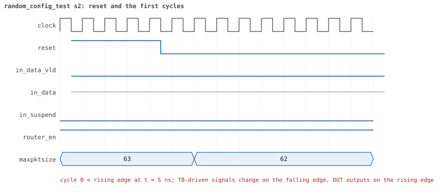
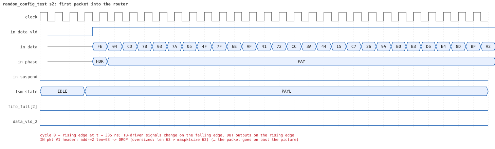
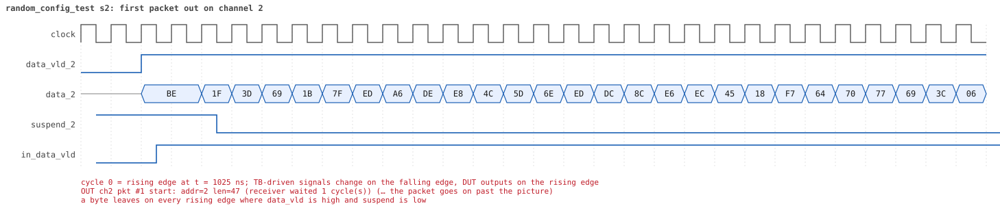
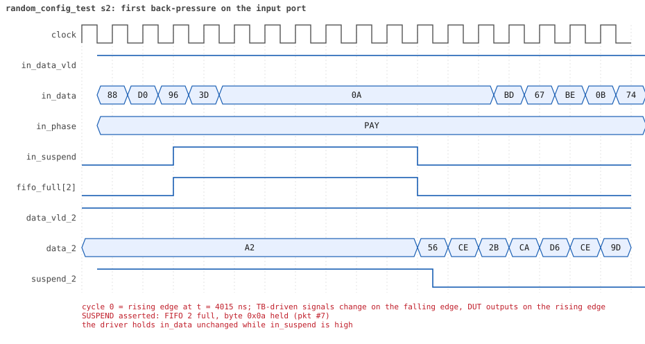
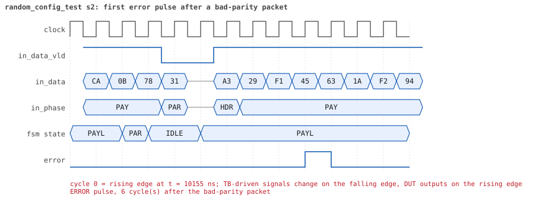
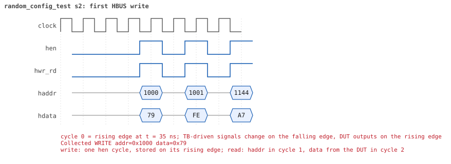
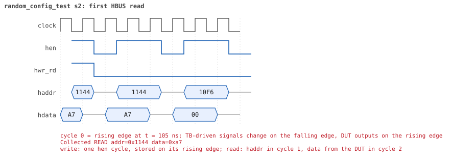

# random_config_test seed 2

**Result:** PASSED (0 UVM_ERROR, 0 UVM_WARNING, 0 UVM_FATAL) · bench `yapp_project_tb` · sim time 30us · wall 13.9 s · log [`random_config_test_s2.log`](random_config_test_s2.log)

Waves: `random_config_test_s2.fst` (GTKWave, Surfer or the VS Code wave viewer).
[Open the waves in Surfer](https://app.surfer-project.org/?load_url=https%3A%2F%2Fraw.githubusercontent.com%2Ftamirgabgab%2FQcom-Mentoring%2Fmain%2Fyapp_project%2Fregression%2Fyapp_project_tb%2Frandom_config_test_s2%2Frandom_config_test_s2.fst&startup_commands=run_command_file_from_url%20https%3A%2F%2Fraw.githubusercontent.com%2Ftamirgabgab%2FQcom-Mentoring%2Fmain%2Fyapp_project%2Ftb%2Fyapp_router.sucl) (web app, the signals already in groups: `yapp_project/tb/yapp_router.sucl`).

## Summary

- YAPP driver sent **50** packet(s) (4 with bad parity); the input monitor saw 50.
- Router: **11** forwarded, **39** dropped (25 router disabled, 11 oversized, 3 illegal address 3).
- Packets out: ch0 **2**, ch1 **4**, ch2 **5**.
- Scoreboard: 11 matched, 0 mismatched, 0 unexpected.
- Back-pressure: in_suspend asserted **6** time(s), longest hold 39 cycle(s).
- Error pulses: 2.
- HBUS: 46 write(s), 141 read(s).

## Stages

| time (ns) | stage |
|---|---|
| 0 | receivers: ch0 RX_SLOW, ch1 RX_NORMAL, ch2 RX_SLOW |
| 0 | random scenario: 50 packets in 8 bursts |
| 540 | burst 1/8: ctrl=0x79 (maxpktsize 57) en=0xfe (router OFF, counter enables 1111111), 6 packet(s) |
| 3630 | burst 1/8 sent: addr0..3 2/0/3/1, bad parity 0, gap 0 3, length 1..63 |
| 3870 | burst 2/8: ctrl=0xe9 (maxpktsize 41) en=0xef (router on, counter enables 1110111), 6 packet(s) |
| 8340 | burst 2/8 sent: addr0..3 0/1/5/0, bad parity 0, gap 0 1, length 40..63 |
| 8800 | burst 3/8: ctrl=0x41 (maxpktsize 1) en=0x01 (router on, counter enables 0000000), 6 packet(s) |
| 11680 | burst 3/8 sent: addr0..3 3/0/1/2, bad parity 1, gap 0 0, length 1..63 |
| 12190 | burst 4/8: ctrl=0xc1 (maxpktsize 1) en=0xe5 (router on, counter enables 1110010), 6 packet(s) |
| 14670 | burst 4/8 sent: addr0..3 1/1/3/1, bad parity 0, gap 0 1, length 1..63 |
| 14880 | burst 5/8: ctrl=0xed (maxpktsize 45) en=0x7a (router OFF, counter enables 0111101), 7 packet(s) |
| 17340 | burst 5/8 sent: addr0..3 2/0/5/0, bad parity 1, gap 0 3, length 1..63 |
| 17600 | burst 6/8: ctrl=0x46 (maxpktsize 6) en=0x90 (router OFF, counter enables 1001000), 6 packet(s) |
| 20280 | burst 6/8 sent: addr0..3 1/1/4/0, bad parity 0, gap 0 1, length 8..63 |
| 20840 | burst 7/8: ctrl=0xbf (maxpktsize 63) en=0x01 (router on, counter enables 0000000), 7 packet(s) |
| 26100 | burst 7/8 sent: addr0..3 0/4/1/2, bad parity 1, gap 0 1, length 62..63 |
| 26330 | burst 8/8: ctrl=0x13 (maxpktsize 19) en=0x58 (router OFF, counter enables 0101100), 6 packet(s) |
| 27690 | burst 8/8 sent: addr0..3 1/1/1/3, bad parity 1, gap 0 3, length 1..63 |
| 27690 | final reads: every register and the stored packet, checked against the reference model |
| 29995 | done: 50 packets (11 forwarded, 39 dropped), 0 storm burst(s), 11 scoreboard matches, 139 HBUS reads checked, 2 error pulses for 2 bad packets |

## Pictures

**reset and the first cycles**

**first packet into the router**

**first packet out on channel 2**

**first back-pressure on the input port**

**first error pulse after a bad-parity packet**

**first HBUS write**

**first HBUS read**

## Timeline

862 events.

| time (ns) | who | event |
|---|---|---|
| 0 | yapp monitor | YAPP monitor running |
| 0 | **test** | STAGE: receivers: ch0 RX_SLOW, ch1 RX_NORMAL, ch2 RX_SLOW |
| 0 | **test** | STAGE: random scenario: 50 packets in 8 bursts |
| 0 | clk/rst driver | Starting clock (period 10) and holding reset for 5 cycles |
| 0 | **DUT** | RESET asserted |
| 50 | **DUT** | RESET released: router_en=1 maxpktsize=63 |
| 70 | hbus driver | Executed WRITE addr=0x1000 data=0x79 |
| 75 | **DUT** | CONFIG router_en=1 maxpktsize=57 |
| 75 | hbus monitor | Collected WRITE addr=0x1000 data=0x79 |
| 75 | reference | maxpktsize is now 57 |
| 90 | hbus driver | Executed WRITE addr=0x1001 data=0xfe |
| 95 | **DUT** | CONFIG router_en=0 maxpktsize=57 |
| 95 | hbus monitor | Collected WRITE addr=0x1001 data=0xfe |
| 95 | reference | router_en is now 0 (en_reg 0xfe) |
| 110 | hbus driver | Executed WRITE addr=0x1144 data=0xa7 |
| 115 | hbus monitor | Collected WRITE addr=0x1144 data=0xa7 |
| 140 | hbus driver | Executed READ  addr=0x1144 data=0xa7 |
| 145 | hbus monitor | Collected READ  addr=0x1144 data=0xa7 |
| 170 | hbus driver | Executed READ  addr=0x10f6 data=0x00 |
| 175 | hbus monitor | Collected READ  addr=0x10f6 data=0x00 |
| 200 | hbus driver | Executed READ  addr=0x100d data=0x00 |
| 205 | hbus monitor | Collected READ  addr=0x100d data=0x00 |
| 230 | hbus driver | Executed READ  addr=0x100d data=0x00 |
| 235 | hbus monitor | Collected READ  addr=0x100d data=0x00 |
| 250 | hbus driver | Executed WRITE addr=0x1124 data=0xc1 |
| 255 | hbus monitor | Collected WRITE addr=0x1124 data=0xc1 |
| 280 | hbus driver | Executed READ  addr=0x1124 data=0xc1 |
| 285 | hbus monitor | Collected READ  addr=0x1124 data=0xc1 |
| 310 | hbus driver | Executed READ  addr=0x100d data=0x00 |
| 315 | hbus monitor | Collected READ  addr=0x100d data=0x00 |
| 330 | hbus driver | Executed WRITE addr=0x11a2 data=0x64 |
| 335 | hbus monitor | Collected WRITE addr=0x11a2 data=0x64 |
| 360 | hbus driver | Executed READ  addr=0x11a2 data=0x64 |
| 365 | hbus monitor | Collected READ  addr=0x11a2 data=0x64 |
| 390 | hbus driver | Executed READ  addr=0x100b data=0x00 |
| 395 | hbus monitor | Collected READ  addr=0x100b data=0x00 |
| 410 | hbus driver | Executed WRITE addr=0x113f data=0x95 |
| 415 | hbus monitor | Collected WRITE addr=0x113f data=0x95 |
| 440 | hbus driver | Executed READ  addr=0x113f data=0x95 |
| 445 | hbus monitor | Collected READ  addr=0x113f data=0x95 |
| 460 | hbus driver | Executed WRITE addr=0x118e data=0x08 |
| 465 | hbus monitor | Collected WRITE addr=0x118e data=0x08 |
| 490 | hbus driver | Executed READ  addr=0x118e data=0x08 |
| 495 | hbus monitor | Collected READ  addr=0x118e data=0x08 |
| 510 | hbus driver | Executed WRITE addr=0x1160 data=0xbf |
| 515 | hbus monitor | Collected WRITE addr=0x1160 data=0xbf |
| 540 | hbus driver | Executed READ  addr=0x1160 data=0xbf |
| 540 | **test** | STAGE: burst 1/8: ctrl=0x79 (maxpktsize 57) en=0xfe (router OFF, counter enables 1111111), 6 packet(s) |
| 540 | yapp driver | TX pkt #1: addr=2 len=63 parity=good delay=20 |
| 545 | hbus monitor | Collected READ  addr=0x1160 data=0xbf |
| 755 | **DUT** | IN  pkt #1 header: addr=2 len=63 -> DROP (router disabled) |
| 1395 | **DUT** | IN  pkt #1 complete: addr=2 len=63 parity=ok dropped, 65 bytes in 65 cycles (held 0) |
| 1395 | yapp monitor | RX pkt #1 on the input: addr=2 len=63 parity=good gap=70 |
| 1395 | reference | Packet dropped: router disabled (addr=2 len=63) |
| 1395 | **DUT** | ROUTER DROPS PACKET addr=2 length=63 (router disabled) |
| 1400 | yapp driver | TX pkt #1 accepted by the DUT |
| 1400 | yapp driver | TX pkt #2: addr=3 len=56 parity=good delay=13 |
| 1535 | **DUT** | IN  pkt #2 header: addr=3 len=56 -> DROP (router disabled) |
| 2105 | **DUT** | IN  pkt #2 complete: addr=3 len=56 parity=ok dropped, 58 bytes in 58 cycles (held 0) |
| 2105 | yapp monitor | RX pkt #2 on the input: addr=3 len=56 parity=good gap=13 |
| 2105 | reference | Packet dropped: router disabled (addr=3 len=56) |
| 2105 | **DUT** | ROUTER DROPS PACKET addr=3 length=56 (router disabled) |
| 2110 | yapp driver | TX pkt #2 accepted by the DUT |
| 2110 | yapp driver | TX pkt #3: addr=0 len=1 parity=good delay=0 |
| 2115 | **DUT** | IN  pkt #3 header: addr=0 len=1 -> DROP (router disabled) |
| 2135 | **DUT** | IN  pkt #3 complete: addr=0 len=1 parity=ok dropped, 3 bytes in 3 cycles (held 0) |
| 2135 | yapp monitor | RX pkt #3 on the input: addr=0 len=1 parity=good gap=0 |
| 2135 | reference | Packet dropped: router disabled (addr=0 len=1) |
| 2135 | **DUT** | ROUTER DROPS PACKET addr=0 length=1 (router disabled) |
| 2140 | yapp driver | TX pkt #3 accepted by the DUT |
| 2140 | yapp driver | TX pkt #4: addr=2 len=47 parity=good delay=6 |
| 2205 | **DUT** | IN  pkt #4 header: addr=2 len=47 -> DROP (router disabled) |
| 2685 | **DUT** | IN  pkt #4 complete: addr=2 len=47 parity=ok dropped, 49 bytes in 49 cycles (held 0) |
| 2685 | yapp monitor | RX pkt #4 on the input: addr=2 len=47 parity=good gap=6 |
| 2685 | reference | Packet dropped: router disabled (addr=2 len=47) |
| 2685 | **DUT** | ROUTER DROPS PACKET addr=2 length=47 (router disabled) |
| 2690 | yapp driver | TX pkt #4 accepted by the DUT |
| 2690 | yapp driver | TX pkt #5: addr=2 len=34 parity=good delay=0 |
| 2695 | **DUT** | IN  pkt #5 header: addr=2 len=34 -> DROP (router disabled) |
| 3045 | **DUT** | IN  pkt #5 complete: addr=2 len=34 parity=ok dropped, 36 bytes in 36 cycles (held 0) |
| 3045 | yapp monitor | RX pkt #5 on the input: addr=2 len=34 parity=good gap=0 |
| 3045 | reference | Packet dropped: router disabled (addr=2 len=34) |
| 3045 | **DUT** | ROUTER DROPS PACKET addr=2 length=34 (router disabled) |
| 3050 | yapp driver | TX pkt #5 accepted by the DUT |
| 3050 | yapp driver | TX pkt #6: addr=0 len=56 parity=good delay=0 |
| 3055 | **DUT** | IN  pkt #6 header: addr=0 len=56 -> DROP (router disabled) |
| 3625 | **DUT** | IN  pkt #6 complete: addr=0 len=56 parity=ok dropped, 58 bytes in 58 cycles (held 0) |
| 3625 | yapp monitor | RX pkt #6 on the input: addr=0 len=56 parity=good gap=0 |
| 3625 | reference | Packet dropped: router disabled (addr=0 len=56) |
| 3625 | **DUT** | ROUTER DROPS PACKET addr=0 length=56 (router disabled) |
| 3630 | yapp driver | TX pkt #6 accepted by the DUT |
| 3630 | **test** | STAGE: burst 1/8 sent: addr0..3 2/0/3/1, bad parity 0, gap 0 3, length 1..63 |
| 3650 | hbus driver | Executed WRITE addr=0x1000 data=0xe9 |
| 3655 | **DUT** | CONFIG router_en=0 maxpktsize=41 |
| 3655 | hbus monitor | Collected WRITE addr=0x1000 data=0xe9 |
| 3655 | reference | maxpktsize is now 41 |
| 3670 | hbus driver | Executed WRITE addr=0x1001 data=0xef |
| 3675 | **DUT** | CONFIG router_en=1 maxpktsize=41 |
| 3675 | hbus monitor | Collected WRITE addr=0x1001 data=0xef |
| 3675 | reference | router_en is now 1 (en_reg 0xef) |
| 3700 | hbus driver | Executed READ  addr=0x1017 data=0x00 |
| 3705 | hbus monitor | Collected READ  addr=0x1017 data=0x00 |
| 3720 | hbus driver | Executed WRITE addr=0x11d0 data=0x0a |
| 3725 | hbus monitor | Collected WRITE addr=0x11d0 data=0x0a |
| 3750 | hbus driver | Executed READ  addr=0x11d0 data=0x0a |
| 3755 | hbus monitor | Collected READ  addr=0x11d0 data=0x0a |
| 3780 | hbus driver | Executed READ  addr=0x10de data=0x00 |
| 3785 | hbus monitor | Collected READ  addr=0x10de data=0x00 |
| 3810 | hbus driver | Executed READ  addr=0x1043 data=0x00 |
| 3815 | hbus monitor | Collected READ  addr=0x1043 data=0x00 |
| 3840 | hbus driver | Executed READ  addr=0x100d data=0x00 |
| 3845 | hbus monitor | Collected READ  addr=0x100d data=0x00 |
| 3870 | hbus driver | Executed READ  addr=0x10fc data=0x00 |
| 3870 | **test** | STAGE: burst 2/8: ctrl=0xe9 (maxpktsize 41) en=0xef (router on, counter enables 1110111), 6 packet(s) |
| 3870 | yapp driver | TX pkt #7: addr=2 len=40 parity=good delay=1 |
| 3875 | hbus monitor | Collected READ  addr=0x10fc data=0x00 |
| 3895 | **DUT** | IN  pkt #7 header: addr=2 len=40 -> channel 2 |
| 4055 | **DUT** | SUSPEND asserted: FIFO 2 full, byte 0x0a held (pkt #7) |
| 4125 | **DUT** | OUT ch2 pkt #1 start: addr=2 len=40 (receiver waited 22 cycle(s)) |
| 4135 | **DUT** | SUSPEND released after 8 cycle(s) |
| 4385 | **DUT** | IN  pkt #7 complete: addr=2 len=40 parity=ok forwarded, 42 bytes in 50 cycles (held 8) |
| 4385 | yapp monitor | RX pkt #7 on the input: addr=2 len=40 parity=good gap=26 |
| 4385 | reference | Packet forwarded: addr=2 len=40 -> channel 2 |
| 4390 | yapp driver | TX pkt #7 accepted by the DUT |
| 4390 | yapp driver | TX pkt #8: addr=2 len=40 parity=good delay=2 |
| 4415 | **DUT** | IN  pkt #8 header: addr=2 len=40 -> channel 2 |
| 4530 | ch2 driver | ch2: packet consumed (response delay 22) |
| 4565 | **DUT** | SUSPEND asserted: FIFO 2 full, byte 0xd6 held (pkt #8) |
| 4945 | **DUT** | OUT ch2 pkt #1 done: 42 bytes in 83 cycles |
| 4945 | ch2 monitor | ch2 RX pkt #1: addr=2 len=40 parity=good |
| 4945 | scoreboard | ch2 pkt matched: addr=2 len=40 (1 matched so far) |
| 4955 | **DUT** | SUSPEND released after 39 cycle(s) |
| 4955 | **DUT** | OUT ch2 pkt #2 start: addr=2 len=40 (receiver waited 0 cycle(s)) |
| 5080 | ch2 driver | ch2: packet consumed (response delay 40) |
| 5095 | **DUT** | SUSPEND asserted: FIFO 2 full, byte 0x40 held (pkt #8) |
| 5405 | **DUT** | SUSPEND released after 31 cycle(s) |
| 5480 | ch2 driver | ch2: packet consumed (response delay 30) |
| 5495 | **DUT** | SUSPEND asserted: FIFO 2 full, byte 0x05 held (pkt #8) |
| 5875 | **DUT** | SUSPEND released after 38 cycle(s) |
| 5905 | **DUT** | IN  pkt #8 complete: addr=2 len=40 parity=ok forwarded, 42 bytes in 150 cycles (held 108) |
| 5905 | yapp monitor | RX pkt #8 on the input: addr=2 len=40 parity=good gap=2 |
| 5905 | reference | Packet forwarded: addr=2 len=40 -> channel 2 |
| 5910 | yapp driver | TX pkt #8 accepted by the DUT |
| 5910 | yapp driver | TX pkt #9: addr=2 len=41 parity=good delay=7 |
| 5985 | **DUT** | IN  pkt #9 header: addr=2 len=41 -> channel 2 |
| 6055 | **DUT** | OUT ch2 pkt #2 done: 42 bytes in 111 cycles |
| 6055 | ch2 monitor | ch2 RX pkt #2: addr=2 len=40 parity=good |
| 6055 | scoreboard | ch2 pkt matched: addr=2 len=40 (2 matched so far) |
| 6065 | **DUT** | OUT ch2 pkt #3 start: addr=2 len=41 (receiver waited 0 cycle(s)) |
| 6405 | **DUT** | IN  pkt #9 complete: addr=2 len=41 parity=ok forwarded, 43 bytes in 43 cycles (held 0) |
| 6405 | yapp monitor | RX pkt #9 on the input: addr=2 len=41 parity=good gap=7 |
| 6405 | reference | Packet forwarded: addr=2 len=41 -> channel 2 |
| 6410 | yapp driver | TX pkt #9 accepted by the DUT |
| 6410 | yapp driver | TX pkt #10: addr=1 len=63 parity=good delay=12 |
| 6485 | **DUT** | OUT ch2 pkt #3 done: 43 bytes in 43 cycles |
| 6485 | ch2 monitor | ch2 RX pkt #3: addr=2 len=41 parity=good |
| 6485 | scoreboard | ch2 pkt matched: addr=2 len=41 (3 matched so far) |
| 6500 | ch2 driver | ch2: packet consumed (response delay 37) |
| 6535 | **DUT** | IN  pkt #10 header: addr=1 len=63 -> DROP (oversized: len 63 > maxpktsize 41) |
| 7175 | **DUT** | IN  pkt #10 complete: addr=1 len=63 parity=ok dropped, 65 bytes in 65 cycles (held 0) |
| 7175 | yapp monitor | RX pkt #10 on the input: addr=1 len=63 parity=good gap=12 |
| 7175 | reference | Packet dropped: length 63 > maxpktsize 41 (addr=1) |
| 7175 | **DUT** | ROUTER DROPS PACKET addr=1 length=63 (length > maxpktsize) |
| 7180 | yapp driver | TX pkt #10 accepted by the DUT |
| 7180 | yapp driver | TX pkt #11: addr=2 len=63 parity=good delay=1 |
| 7195 | **DUT** | IN  pkt #11 header: addr=2 len=63 -> DROP (oversized: len 63 > maxpktsize 41) |
| 7835 | **DUT** | IN  pkt #11 complete: addr=2 len=63 parity=ok dropped, 65 bytes in 65 cycles (held 0) |
| 7835 | yapp monitor | RX pkt #11 on the input: addr=2 len=63 parity=good gap=1 |
| 7835 | reference | Packet dropped: length 63 > maxpktsize 41 (addr=2) |
| 7835 | **DUT** | ROUTER DROPS PACKET addr=2 length=63 (length > maxpktsize) |
| 7840 | yapp driver | TX pkt #11 accepted by the DUT |
| 7840 | yapp driver | TX pkt #12: addr=2 len=48 parity=good delay=0 |
| 7845 | **DUT** | IN  pkt #12 header: addr=2 len=48 -> DROP (oversized: len 48 > maxpktsize 41) |
| 8335 | **DUT** | IN  pkt #12 complete: addr=2 len=48 parity=ok dropped, 50 bytes in 50 cycles (held 0) |
| 8335 | yapp monitor | RX pkt #12 on the input: addr=2 len=48 parity=good gap=0 |
| 8335 | reference | Packet dropped: length 48 > maxpktsize 41 (addr=2) |
| 8335 | **DUT** | ROUTER DROPS PACKET addr=2 length=48 (length > maxpktsize) |
| 8340 | yapp driver | TX pkt #12 accepted by the DUT |
| 8340 | **test** | STAGE: burst 2/8 sent: addr0..3 0/1/5/0, bad parity 0, gap 0 1, length 40..63 |
| 8360 | hbus driver | Executed WRITE addr=0x1000 data=0x41 |
| 8365 | **DUT** | CONFIG router_en=1 maxpktsize=1 |
| 8365 | hbus monitor | Collected WRITE addr=0x1000 data=0x41 |
| 8365 | reference | maxpktsize is now 1 |
| 8380 | hbus driver | Executed WRITE addr=0x1001 data=0x01 |
| 8385 | hbus monitor | Collected WRITE addr=0x1001 data=0x01 |
| 8385 | reference | router_en is now 1 (en_reg 0x01) |
| 8410 | hbus driver | Executed READ  addr=0x100a data=0x01 |
| 8415 | hbus monitor | Collected READ  addr=0x100a data=0x01 |
| 8440 | hbus driver | Executed READ  addr=0x101c data=0x29 |
| 8445 | hbus monitor | Collected READ  addr=0x101c data=0x29 |
| 8460 | hbus driver | Executed WRITE addr=0x117d data=0x08 |
| 8465 | hbus monitor | Collected WRITE addr=0x117d data=0x08 |
| 8490 | hbus driver | Executed READ  addr=0x117d data=0x08 |
| 8495 | hbus monitor | Collected READ  addr=0x117d data=0x08 |
| 8510 | hbus driver | Executed WRITE addr=0x11e3 data=0x79 |
| 8515 | hbus monitor | Collected WRITE addr=0x11e3 data=0x79 |
| 8540 | hbus driver | Executed READ  addr=0x11e3 data=0x79 |
| 8545 | hbus monitor | Collected READ  addr=0x11e3 data=0x79 |
| 8570 | hbus driver | Executed READ  addr=0x100d data=0x30 |
| 8575 | hbus monitor | Collected READ  addr=0x100d data=0x30 |
| 8600 | hbus driver | Executed READ  addr=0x1000 data=0x41 |
| 8605 | hbus monitor | Collected READ  addr=0x1000 data=0x41 |
| 8630 | hbus driver | Executed READ  addr=0x100d data=0x30 |
| 8635 | hbus monitor | Collected READ  addr=0x100d data=0x30 |
| 8650 | hbus driver | Executed WRITE addr=0x11f3 data=0x3f |
| 8655 | hbus monitor | Collected WRITE addr=0x11f3 data=0x3f |
| 8680 | hbus driver | Executed READ  addr=0x11f3 data=0x3f |
| 8685 | hbus monitor | Collected READ  addr=0x11f3 data=0x3f |
| 8710 | hbus driver | Executed READ  addr=0x10f5 data=0x00 |
| 8715 | hbus monitor | Collected READ  addr=0x10f5 data=0x00 |
| 8740 | hbus driver | Executed READ  addr=0x100d data=0x30 |
| 8745 | hbus monitor | Collected READ  addr=0x100d data=0x30 |
| 8770 | hbus driver | Executed READ  addr=0x1006 data=0x00 |
| 8775 | hbus monitor | Collected READ  addr=0x1006 data=0x00 |
| 8800 | hbus driver | Executed READ  addr=0x10ed data=0x00 |
| 8800 | **test** | STAGE: burst 3/8: ctrl=0x41 (maxpktsize 1) en=0x01 (router on, counter enables 0000000), 6 packet(s) |
| 8800 | yapp driver | TX pkt #13: addr=3 len=63 parity=good delay=3 |
| 8805 | hbus monitor | Collected READ  addr=0x10ed data=0x00 |
| 8845 | **DUT** | IN  pkt #13 header: addr=3 len=63 -> DROP (oversized: len 63 > maxpktsize 1) |
| 9485 | **DUT** | IN  pkt #13 complete: addr=3 len=63 parity=ok dropped, 65 bytes in 65 cycles (held 0) |
| 9485 | yapp monitor | RX pkt #13 on the input: addr=3 len=63 parity=good gap=50 |
| 9485 | reference | Packet dropped: illegal address 3 (len=63) |
| 9485 | **DUT** | ROUTER DROPS PACKET addr=3 length=63 (    illegal address) |
| 9490 | yapp driver | TX pkt #13 accepted by the DUT |
| 9490 | yapp driver | TX pkt #14: addr=0 len=56 parity=bad delay=12 |
| 9615 | **DUT** | IN  pkt #14 header: addr=0 len=56 -> DROP (oversized: len 56 > maxpktsize 1) |
| 10185 | **DUT** | IN  pkt #14 complete: addr=0 len=56 parity=BAD dropped, 58 bytes in 58 cycles (held 0) |
| 10185 | yapp monitor | RX pkt #14 on the input: addr=0 len=56 parity=bad gap=12 |
| 10185 | reference | Packet dropped: length 56 > maxpktsize 1 (addr=0) |
| 10185 | **DUT** | ROUTER DROPS PACKET addr=0 length=56 (length > maxpktsize) |
| 10190 | yapp driver | TX pkt #14 accepted by the DUT |
| 10190 | yapp driver | TX pkt #15: addr=3 len=40 parity=good delay=1 |
| 10205 | **DUT** | IN  pkt #15 header: addr=3 len=40 -> DROP (oversized: len 40 > maxpktsize 1) |
| 10250 | **DUT** | ERROR pulse, 6 cycle(s) after the bad-parity packet |
| 10250 | error checker | error pulse 6 cycles after the bad packet (0 still owed) |
| 10615 | **DUT** | IN  pkt #15 complete: addr=3 len=40 parity=ok dropped, 42 bytes in 42 cycles (held 0) |
| 10615 | yapp monitor | RX pkt #15 on the input: addr=3 len=40 parity=good gap=1 |
| 10615 | reference | Packet dropped: illegal address 3 (len=40) |
| 10615 | **DUT** | ROUTER DROPS PACKET addr=3 length=40 (    illegal address) |
| 10620 | yapp driver | TX pkt #15 accepted by the DUT |
| 10620 | yapp driver | TX pkt #16: addr=0 len=63 parity=good delay=20 |
| 10825 | **DUT** | IN  pkt #16 header: addr=0 len=63 -> DROP (oversized: len 63 > maxpktsize 1) |
| 11465 | **DUT** | IN  pkt #16 complete: addr=0 len=63 parity=ok dropped, 65 bytes in 65 cycles (held 0) |
| 11465 | yapp monitor | RX pkt #16 on the input: addr=0 len=63 parity=good gap=20 |
| 11465 | reference | Packet dropped: length 63 > maxpktsize 1 (addr=0) |
| 11465 | **DUT** | ROUTER DROPS PACKET addr=0 length=63 (length > maxpktsize) |
| 11470 | yapp driver | TX pkt #16 accepted by the DUT |
| 11470 | yapp driver | TX pkt #17: addr=2 len=1 parity=good delay=14 |
| 11615 | **DUT** | IN  pkt #17 header: addr=2 len=1 -> channel 2 |
| 11635 | **DUT** | IN  pkt #17 complete: addr=2 len=1 parity=ok forwarded, 3 bytes in 3 cycles (held 0) |
| 11635 | yapp monitor | RX pkt #17 on the input: addr=2 len=1 parity=good gap=14 |
| 11635 | reference | Packet forwarded: addr=2 len=1 -> channel 2 |
| 11640 | yapp driver | TX pkt #17 accepted by the DUT |
| 11640 | yapp driver | TX pkt #18: addr=0 len=1 parity=good delay=1 |
| 11655 | **DUT** | IN  pkt #18 header: addr=0 len=1 -> channel 0 |
| 11675 | **DUT** | IN  pkt #18 complete: addr=0 len=1 parity=ok forwarded, 3 bytes in 3 cycles (held 0) |
| 11675 | yapp monitor | RX pkt #18 on the input: addr=0 len=1 parity=good gap=1 |
| 11675 | reference | Packet forwarded: addr=0 len=1 -> channel 0 |
| 11680 | yapp driver | TX pkt #18 accepted by the DUT |
| 11680 | **test** | STAGE: burst 3/8 sent: addr0..3 3/0/1/2, bad parity 1, gap 0 0, length 1..63 |
| 11700 | hbus driver | Executed WRITE addr=0x1000 data=0xc1 |
| 11705 | hbus monitor | Collected WRITE addr=0x1000 data=0xc1 |
| 11705 | reference | maxpktsize is now 1 |
| 11720 | hbus driver | Executed WRITE addr=0x1001 data=0xe5 |
| 11725 | hbus monitor | Collected WRITE addr=0x1001 data=0xe5 |
| 11725 | reference | router_en is now 1 (en_reg 0xe5) |
| 11740 | hbus driver | Executed WRITE addr=0x116e data=0x1c |
| 11745 | hbus monitor | Collected WRITE addr=0x116e data=0x1c |
| 11770 | hbus driver | Executed READ  addr=0x116e data=0x1c |
| 11775 | hbus monitor | Collected READ  addr=0x116e data=0x1c |
| 11800 | hbus driver | Executed READ  addr=0x1006 data=0x00 |
| 11805 | hbus monitor | Collected READ  addr=0x1006 data=0x00 |
| 11830 | hbus driver | Executed READ  addr=0x100d data=0x01 |
| 11835 | hbus monitor | Collected READ  addr=0x100d data=0x01 |
| 11850 | hbus driver | Executed WRITE addr=0x11c0 data=0x73 |
| 11855 | hbus monitor | Collected WRITE addr=0x11c0 data=0x73 |
| 11880 | hbus driver | Executed READ  addr=0x11c0 data=0x73 |
| 11885 | hbus monitor | Collected READ  addr=0x11c0 data=0x73 |
| 11900 | hbus driver | Executed WRITE addr=0x11e3 data=0x14 |
| 11905 | hbus monitor | Collected WRITE addr=0x11e3 data=0x14 |
| 11915 | **DUT** | OUT ch0 pkt #1 start: addr=0 len=1 (receiver waited 25 cycle(s)) |
| 11930 | ch0 driver | ch0: packet consumed (response delay 25) |
| 11930 | hbus driver | Executed READ  addr=0x11e3 data=0x14 |
| 11935 | hbus monitor | Collected READ  addr=0x11e3 data=0x14 |
| 11950 | hbus driver | Executed WRITE addr=0x1198 data=0x75 |
| 11955 | hbus monitor | Collected WRITE addr=0x1198 data=0x75 |
| 11980 | hbus driver | Executed READ  addr=0x1198 data=0x75 |
| 11985 | hbus monitor | Collected READ  addr=0x1198 data=0x75 |
| 12000 | hbus driver | Executed WRITE addr=0x113d data=0x34 |
| 12005 | hbus monitor | Collected WRITE addr=0x113d data=0x34 |
| 12025 | **DUT** | OUT ch2 pkt #4 start: addr=2 len=1 (receiver waited 40 cycle(s)) |
| 12030 | hbus driver | Executed READ  addr=0x113d data=0x34 |
| 12035 | hbus monitor | Collected READ  addr=0x113d data=0x34 |
| 12040 | ch2 driver | ch2: packet consumed (response delay 40) |
| 12060 | hbus driver | Executed READ  addr=0x100d data=0x01 |
| 12065 | hbus monitor | Collected READ  addr=0x100d data=0x01 |
| 12090 | hbus driver | Executed READ  addr=0x100d data=0x01 |
| 12095 | hbus monitor | Collected READ  addr=0x100d data=0x01 |
| 12110 | hbus driver | Executed WRITE addr=0x1100 data=0xc4 |
| 12115 | hbus monitor | Collected WRITE addr=0x1100 data=0xc4 |
| 12140 | hbus driver | Executed READ  addr=0x1100 data=0xc4 |
| 12145 | hbus monitor | Collected READ  addr=0x1100 data=0xc4 |
| 12160 | hbus driver | Executed WRITE addr=0x1138 data=0x1f |
| 12165 | hbus monitor | Collected WRITE addr=0x1138 data=0x1f |
| 12190 | hbus driver | Executed READ  addr=0x1138 data=0x1f |
| 12190 | **test** | STAGE: burst 4/8: ctrl=0xc1 (maxpktsize 1) en=0xe5 (router on, counter enables 1110010), 6 packet(s) |
| 12190 | yapp driver | TX pkt #19: addr=2 len=25 parity=good delay=20 |
| 12195 | hbus monitor | Collected READ  addr=0x1138 data=0x1f |
| 12225 | **DUT** | OUT ch0 pkt #1 done: 3 bytes in 32 cycles |
| 12225 | ch0 monitor | ch0 RX pkt #1: addr=0 len=1 parity=good |
| 12225 | scoreboard | ch0 pkt matched: addr=0 len=1 (4 matched so far) |
| 12255 | **DUT** | OUT ch2 pkt #4 done: 3 bytes in 24 cycles |
| 12255 | ch2 monitor | ch2 RX pkt #4: addr=2 len=1 parity=good |
| 12255 | scoreboard | ch2 pkt matched: addr=2 len=1 (5 matched so far) |
| 12405 | **DUT** | IN  pkt #19 header: addr=2 len=25 -> DROP (oversized: len 25 > maxpktsize 1) |
| 12550 | ch0 driver | ch0: packet consumed (response delay 28) |
| 12665 | **DUT** | IN  pkt #19 complete: addr=2 len=25 parity=ok dropped, 27 bytes in 27 cycles (held 0) |
| 12665 | yapp monitor | RX pkt #19 on the input: addr=2 len=25 parity=good gap=72 |
| 12665 | reference | Packet dropped: length 25 > maxpktsize 1 (addr=2) |
| 12665 | **DUT** | ROUTER DROPS PACKET addr=2 length=25 (length > maxpktsize) |
| 12670 | yapp driver | TX pkt #19 accepted by the DUT |
| 12670 | yapp driver | TX pkt #20: addr=0 len=1 parity=good delay=0 |
| 12675 | **DUT** | IN  pkt #20 header: addr=0 len=1 -> channel 0 |
| 12695 | **DUT** | IN  pkt #20 complete: addr=0 len=1 parity=ok forwarded, 3 bytes in 3 cycles (held 0) |
| 12695 | yapp monitor | RX pkt #20 on the input: addr=0 len=1 parity=good gap=0 |
| 12695 | reference | Packet forwarded: addr=0 len=1 -> channel 0 |
| 12700 | yapp driver | TX pkt #20 accepted by the DUT |
| 12700 | yapp driver | TX pkt #21: addr=3 len=1 parity=good delay=4 |
| 12745 | **DUT** | IN  pkt #21 header: addr=3 len=1 -> DROP (illegal address 3) |
| 12765 | **DUT** | IN  pkt #21 complete: addr=3 len=1 parity=ok dropped, 3 bytes in 3 cycles (held 0) |
| 12765 | yapp monitor | RX pkt #21 on the input: addr=3 len=1 parity=good gap=4 |
| 12765 | reference | Packet dropped: illegal address 3 (len=1) |
| 12765 | **DUT** | ROUTER DROPS PACKET addr=3 length=1 (    illegal address) |
| 12770 | yapp driver | TX pkt #21 accepted by the DUT |
| 12770 | yapp driver | TX pkt #22: addr=2 len=63 parity=good delay=20 |
| 12820 | ch2 driver | ch2: packet consumed (response delay 20) |
| 12975 | **DUT** | IN  pkt #22 header: addr=2 len=63 -> DROP (oversized: len 63 > maxpktsize 1) |
| 13025 | **DUT** | OUT ch0 pkt #2 start: addr=0 len=1 (receiver waited 34 cycle(s)) |
| 13040 | ch0 driver | ch0: packet consumed (response delay 34) |
| 13265 | **DUT** | OUT ch0 pkt #2 done: 3 bytes in 25 cycles |
| 13265 | ch0 monitor | ch0 RX pkt #2: addr=0 len=1 parity=good |
| 13265 | scoreboard | ch0 pkt matched: addr=0 len=1 (6 matched so far) |
| 13300 | ch0 driver | ch0: packet consumed (response delay 21) |
| 13615 | **DUT** | IN  pkt #22 complete: addr=2 len=63 parity=ok dropped, 65 bytes in 65 cycles (held 0) |
| 13615 | yapp monitor | RX pkt #22 on the input: addr=2 len=63 parity=good gap=20 |
| 13615 | reference | Packet dropped: length 63 > maxpktsize 1 (addr=2) |
| 13615 | **DUT** | ROUTER DROPS PACKET addr=2 length=63 (length > maxpktsize) |
| 13620 | yapp driver | TX pkt #22 accepted by the DUT |
| 13620 | yapp driver | TX pkt #23: addr=1 len=63 parity=good delay=1 |
| 13635 | **DUT** | IN  pkt #23 header: addr=1 len=63 -> DROP (oversized: len 63 > maxpktsize 1) |
| 14275 | **DUT** | IN  pkt #23 complete: addr=1 len=63 parity=ok dropped, 65 bytes in 65 cycles (held 0) |
| 14275 | yapp monitor | RX pkt #23 on the input: addr=1 len=63 parity=good gap=1 |
| 14275 | reference | Packet dropped: length 63 > maxpktsize 1 (addr=1) |
| 14275 | **DUT** | ROUTER DROPS PACKET addr=1 length=63 (length > maxpktsize) |
| 14280 | yapp driver | TX pkt #23 accepted by the DUT |
| 14280 | yapp driver | TX pkt #24: addr=2 len=36 parity=good delay=1 |
| 14295 | **DUT** | IN  pkt #24 header: addr=2 len=36 -> DROP (oversized: len 36 > maxpktsize 1) |
| 14665 | **DUT** | IN  pkt #24 complete: addr=2 len=36 parity=ok dropped, 38 bytes in 38 cycles (held 0) |
| 14665 | yapp monitor | RX pkt #24 on the input: addr=2 len=36 parity=good gap=1 |
| 14665 | reference | Packet dropped: length 36 > maxpktsize 1 (addr=2) |
| 14665 | **DUT** | ROUTER DROPS PACKET addr=2 length=36 (length > maxpktsize) |
| 14670 | yapp driver | TX pkt #24 accepted by the DUT |
| 14670 | **test** | STAGE: burst 4/8 sent: addr0..3 1/1/3/1, bad parity 0, gap 0 1, length 1..63 |
| 14690 | hbus driver | Executed WRITE addr=0x1000 data=0xed |
| 14695 | **DUT** | CONFIG router_en=1 maxpktsize=45 |
| 14695 | hbus monitor | Collected WRITE addr=0x1000 data=0xed |
| 14695 | reference | maxpktsize is now 45 |
| 14710 | hbus driver | Executed WRITE addr=0x1001 data=0x7a |
| 14715 | **DUT** | CONFIG router_en=0 maxpktsize=45 |
| 14715 | hbus monitor | Collected WRITE addr=0x1001 data=0x7a |
| 14715 | reference | router_en is now 0 (en_reg 0x7a) |
| 14730 | hbus driver | Executed WRITE addr=0x113a data=0x5a |
| 14735 | hbus monitor | Collected WRITE addr=0x113a data=0x5a |
| 14760 | hbus driver | Executed READ  addr=0x113a data=0x5a |
| 14765 | hbus monitor | Collected READ  addr=0x113a data=0x5a |
| 14790 | hbus driver | Executed READ  addr=0x100e data=0x00 |
| 14795 | hbus monitor | Collected READ  addr=0x100e data=0x00 |
| 14820 | hbus driver | Executed READ  addr=0x100f data=0x00 |
| 14825 | hbus monitor | Collected READ  addr=0x100f data=0x00 |
| 14850 | hbus driver | Executed READ  addr=0x10a0 data=0x00 |
| 14855 | hbus monitor | Collected READ  addr=0x10a0 data=0x00 |
| 14880 | hbus driver | Executed READ  addr=0x1024 data=0x55 |
| 14880 | **test** | STAGE: burst 5/8: ctrl=0xed (maxpktsize 45) en=0x7a (router OFF, counter enables 0111101), 7 packet(s) |
| 14880 | yapp driver | TX pkt #25: addr=2 len=7 parity=good delay=0 |
| 14885 | hbus monitor | Collected READ  addr=0x1024 data=0x55 |
| 14895 | **DUT** | IN  pkt #25 header: addr=2 len=7 -> DROP (router disabled) |
| 14975 | **DUT** | IN  pkt #25 complete: addr=2 len=7 parity=ok dropped, 9 bytes in 9 cycles (held 0) |
| 14975 | yapp monitor | RX pkt #25 on the input: addr=2 len=7 parity=good gap=22 |
| 14975 | reference | Packet dropped: router disabled (addr=2 len=7) |
| 14975 | **DUT** | ROUTER DROPS PACKET addr=2 length=7 (router disabled) |
| 14980 | yapp driver | TX pkt #25 accepted by the DUT |
| 14980 | yapp driver | TX pkt #26: addr=2 len=42 parity=good delay=0 |
| 14985 | **DUT** | IN  pkt #26 header: addr=2 len=42 -> DROP (router disabled) |
| 15415 | **DUT** | IN  pkt #26 complete: addr=2 len=42 parity=ok dropped, 44 bytes in 44 cycles (held 0) |
| 15415 | yapp monitor | RX pkt #26 on the input: addr=2 len=42 parity=good gap=0 |
| 15415 | reference | Packet dropped: router disabled (addr=2 len=42) |
| 15415 | **DUT** | ROUTER DROPS PACKET addr=2 length=42 (router disabled) |
| 15420 | yapp driver | TX pkt #26 accepted by the DUT |
| 15420 | yapp driver | TX pkt #27: addr=2 len=1 parity=bad delay=1 |
| 15435 | **DUT** | IN  pkt #27 header: addr=2 len=1 -> DROP (router disabled) |
| 15455 | **DUT** | IN  pkt #27 complete: addr=2 len=1 parity=BAD dropped, 3 bytes in 3 cycles (held 0) |
| 15455 | yapp monitor | RX pkt #27 on the input: addr=2 len=1 parity=bad gap=1 |
| 15455 | reference | Packet dropped: router disabled (addr=2 len=1) |
| 15455 | **DUT** | ROUTER DROPS PACKET addr=2 length=1 (router disabled) |
| 15460 | yapp driver | TX pkt #27 accepted by the DUT |
| 15460 | yapp driver | TX pkt #28: addr=2 len=63 parity=good delay=2 |
| 15485 | **DUT** | IN  pkt #28 header: addr=2 len=63 -> DROP (router disabled) |
| 16125 | **DUT** | IN  pkt #28 complete: addr=2 len=63 parity=ok dropped, 65 bytes in 65 cycles (held 0) |
| 16125 | yapp monitor | RX pkt #28 on the input: addr=2 len=63 parity=good gap=2 |
| 16125 | reference | Packet dropped: router disabled (addr=2 len=63) |
| 16125 | **DUT** | ROUTER DROPS PACKET addr=2 length=63 (router disabled) |
| 16130 | yapp driver | TX pkt #28 accepted by the DUT |
| 16130 | yapp driver | TX pkt #29: addr=2 len=28 parity=good delay=5 |
| 16185 | **DUT** | IN  pkt #29 header: addr=2 len=28 -> DROP (router disabled) |
| 16475 | **DUT** | IN  pkt #29 complete: addr=2 len=28 parity=ok dropped, 30 bytes in 30 cycles (held 0) |
| 16475 | yapp monitor | RX pkt #29 on the input: addr=2 len=28 parity=good gap=5 |
| 16475 | reference | Packet dropped: router disabled (addr=2 len=28) |
| 16475 | **DUT** | ROUTER DROPS PACKET addr=2 length=28 (router disabled) |
| 16480 | yapp driver | TX pkt #29 accepted by the DUT |
| 16480 | yapp driver | TX pkt #30: addr=0 len=45 parity=good delay=0 |
| 16485 | **DUT** | IN  pkt #30 header: addr=0 len=45 -> DROP (router disabled) |
| 16945 | **DUT** | IN  pkt #30 complete: addr=0 len=45 parity=ok dropped, 47 bytes in 47 cycles (held 0) |
| 16945 | yapp monitor | RX pkt #30 on the input: addr=0 len=45 parity=good gap=0 |
| 16945 | reference | Packet dropped: router disabled (addr=0 len=45) |
| 16945 | **DUT** | ROUTER DROPS PACKET addr=0 length=45 (router disabled) |
| 16950 | yapp driver | TX pkt #30 accepted by the DUT |
| 16950 | yapp driver | TX pkt #31: addr=0 len=25 parity=good delay=12 |
| 17075 | **DUT** | IN  pkt #31 header: addr=0 len=25 -> DROP (router disabled) |
| 17335 | **DUT** | IN  pkt #31 complete: addr=0 len=25 parity=ok dropped, 27 bytes in 27 cycles (held 0) |
| 17335 | yapp monitor | RX pkt #31 on the input: addr=0 len=25 parity=good gap=12 |
| 17335 | reference | Packet dropped: router disabled (addr=0 len=25) |
| 17335 | **DUT** | ROUTER DROPS PACKET addr=0 length=25 (router disabled) |
| 17340 | yapp driver | TX pkt #31 accepted by the DUT |
| 17340 | **test** | STAGE: burst 5/8 sent: addr0..3 2/0/5/0, bad parity 1, gap 0 3, length 1..63 |
| 17360 | hbus driver | Executed WRITE addr=0x1000 data=0x46 |
| 17365 | **DUT** | CONFIG router_en=0 maxpktsize=6 |
| 17365 | hbus monitor | Collected WRITE addr=0x1000 data=0x46 |
| 17365 | reference | maxpktsize is now 6 |
| 17380 | hbus driver | Executed WRITE addr=0x1001 data=0x90 |
| 17385 | hbus monitor | Collected WRITE addr=0x1001 data=0x90 |
| 17385 | reference | router_en is now 0 (en_reg 0x90) |
| 17400 | hbus driver | Executed WRITE addr=0x114c data=0x91 |
| 17405 | hbus monitor | Collected WRITE addr=0x114c data=0x91 |
| 17430 | hbus driver | Executed READ  addr=0x114c data=0x91 |
| 17435 | hbus monitor | Collected READ  addr=0x114c data=0x91 |
| 17460 | hbus driver | Executed READ  addr=0x100d data=0x24 |
| 17465 | hbus monitor | Collected READ  addr=0x100d data=0x24 |
| 17490 | hbus driver | Executed READ  addr=0x1008 data=0x00 |
| 17495 | hbus monitor | Collected READ  addr=0x1008 data=0x00 |
| 17510 | hbus driver | Executed WRITE addr=0x1131 data=0xd4 |
| 17515 | hbus monitor | Collected WRITE addr=0x1131 data=0xd4 |
| 17540 | hbus driver | Executed READ  addr=0x1131 data=0xd4 |
| 17545 | hbus monitor | Collected READ  addr=0x1131 data=0xd4 |
| 17570 | hbus driver | Executed READ  addr=0x1001 data=0x90 |
| 17575 | hbus monitor | Collected READ  addr=0x1001 data=0x90 |
| 17600 | hbus driver | Executed READ  addr=0x103c data=0x91 |
| 17600 | **test** | STAGE: burst 6/8: ctrl=0x46 (maxpktsize 6) en=0x90 (router OFF, counter enables 1001000), 6 packet(s) |
| 17600 | yapp driver | TX pkt #32: addr=2 len=8 parity=good delay=3 |
| 17605 | hbus monitor | Collected READ  addr=0x103c data=0x91 |
| 17645 | **DUT** | IN  pkt #32 header: addr=2 len=8 -> DROP (router disabled) |
| 17735 | **DUT** | IN  pkt #32 complete: addr=2 len=8 parity=ok dropped, 10 bytes in 10 cycles (held 0) |
| 17735 | yapp monitor | RX pkt #32 on the input: addr=2 len=8 parity=good gap=30 |
| 17735 | reference | Packet dropped: router disabled (addr=2 len=8) |
| 17735 | **DUT** | ROUTER DROPS PACKET addr=2 length=8 (router disabled) |
| 17740 | yapp driver | TX pkt #32 accepted by the DUT |
| 17740 | yapp driver | TX pkt #33: addr=1 len=63 parity=good delay=1 |
| 17755 | **DUT** | IN  pkt #33 header: addr=1 len=63 -> DROP (router disabled) |
| 18395 | **DUT** | IN  pkt #33 complete: addr=1 len=63 parity=ok dropped, 65 bytes in 65 cycles (held 0) |
| 18395 | yapp monitor | RX pkt #33 on the input: addr=1 len=63 parity=good gap=1 |
| 18395 | reference | Packet dropped: router disabled (addr=1 len=63) |
| 18395 | **DUT** | ROUTER DROPS PACKET addr=1 length=63 (router disabled) |
| 18400 | yapp driver | TX pkt #33 accepted by the DUT |
| 18400 | yapp driver | TX pkt #34: addr=2 len=63 parity=good delay=0 |
| 18405 | **DUT** | IN  pkt #34 header: addr=2 len=63 -> DROP (router disabled) |
| 19045 | **DUT** | IN  pkt #34 complete: addr=2 len=63 parity=ok dropped, 65 bytes in 65 cycles (held 0) |
| 19045 | yapp monitor | RX pkt #34 on the input: addr=2 len=63 parity=good gap=0 |
| 19045 | reference | Packet dropped: router disabled (addr=2 len=63) |
| 19045 | **DUT** | ROUTER DROPS PACKET addr=2 length=63 (router disabled) |
| 19050 | yapp driver | TX pkt #34 accepted by the DUT |
| 19050 | yapp driver | TX pkt #35: addr=0 len=63 parity=good delay=3 |
| 19085 | **DUT** | IN  pkt #35 header: addr=0 len=63 -> DROP (router disabled) |
| 19725 | **DUT** | IN  pkt #35 complete: addr=0 len=63 parity=ok dropped, 65 bytes in 65 cycles (held 0) |
| 19725 | yapp monitor | RX pkt #35 on the input: addr=0 len=63 parity=good gap=3 |
| 19725 | reference | Packet dropped: router disabled (addr=0 len=63) |
| 19725 | **DUT** | ROUTER DROPS PACKET addr=0 length=63 (router disabled) |
| 19730 | yapp driver | TX pkt #35 accepted by the DUT |
| 19730 | yapp driver | TX pkt #36: addr=2 len=14 parity=good delay=1 |
| 19745 | **DUT** | IN  pkt #36 header: addr=2 len=14 -> DROP (router disabled) |
| 19895 | **DUT** | IN  pkt #36 complete: addr=2 len=14 parity=ok dropped, 16 bytes in 16 cycles (held 0) |
| 19895 | yapp monitor | RX pkt #36 on the input: addr=2 len=14 parity=good gap=1 |
| 19895 | reference | Packet dropped: router disabled (addr=2 len=14) |
| 19895 | **DUT** | ROUTER DROPS PACKET addr=2 length=14 (router disabled) |
| 19900 | yapp driver | TX pkt #36 accepted by the DUT |
| 19900 | yapp driver | TX pkt #37: addr=2 len=18 parity=good delay=18 |
| 20085 | **DUT** | IN  pkt #37 header: addr=2 len=18 -> DROP (router disabled) |
| 20275 | **DUT** | IN  pkt #37 complete: addr=2 len=18 parity=ok dropped, 20 bytes in 20 cycles (held 0) |
| 20275 | yapp monitor | RX pkt #37 on the input: addr=2 len=18 parity=good gap=18 |
| 20275 | reference | Packet dropped: router disabled (addr=2 len=18) |
| 20275 | **DUT** | ROUTER DROPS PACKET addr=2 length=18 (router disabled) |
| 20280 | yapp driver | TX pkt #37 accepted by the DUT |
| 20280 | **test** | STAGE: burst 6/8 sent: addr0..3 1/1/4/0, bad parity 0, gap 0 1, length 8..63 |
| 20300 | hbus driver | Executed WRITE addr=0x1000 data=0xbf |
| 20305 | **DUT** | CONFIG router_en=0 maxpktsize=63 |
| 20305 | hbus monitor | Collected WRITE addr=0x1000 data=0xbf |
| 20305 | reference | maxpktsize is now 63 |
| 20320 | hbus driver | Executed WRITE addr=0x1001 data=0x01 |
| 20325 | **DUT** | CONFIG router_en=1 maxpktsize=63 |
| 20325 | hbus monitor | Collected WRITE addr=0x1001 data=0x01 |
| 20325 | reference | router_en is now 1 (en_reg 0x01) |
| 20340 | hbus driver | Executed WRITE addr=0x119e data=0x72 |
| 20345 | hbus monitor | Collected WRITE addr=0x119e data=0x72 |
| 20370 | hbus driver | Executed READ  addr=0x119e data=0x72 |
| 20375 | hbus monitor | Collected READ  addr=0x119e data=0x72 |
| 20390 | hbus driver | Executed WRITE addr=0x11a1 data=0xdb |
| 20395 | hbus monitor | Collected WRITE addr=0x11a1 data=0xdb |
| 20420 | hbus driver | Executed READ  addr=0x11a1 data=0xdb |
| 20425 | hbus monitor | Collected READ  addr=0x11a1 data=0xdb |
| 20450 | hbus driver | Executed READ  addr=0x1023 data=0x94 |
| 20455 | hbus monitor | Collected READ  addr=0x1023 data=0x94 |
| 20470 | hbus driver | Executed WRITE addr=0x11f4 data=0x2f |
| 20475 | hbus monitor | Collected WRITE addr=0x11f4 data=0x2f |
| 20500 | hbus driver | Executed READ  addr=0x11f4 data=0x2f |
| 20505 | hbus monitor | Collected READ  addr=0x11f4 data=0x2f |
| 20520 | hbus driver | Executed WRITE addr=0x1102 data=0x83 |
| 20525 | hbus monitor | Collected WRITE addr=0x1102 data=0x83 |
| 20550 | hbus driver | Executed READ  addr=0x1102 data=0x83 |
| 20555 | hbus monitor | Collected READ  addr=0x1102 data=0x83 |
| 20580 | hbus driver | Executed READ  addr=0x103c data=0x91 |
| 20585 | hbus monitor | Collected READ  addr=0x103c data=0x91 |
| 20600 | hbus driver | Executed WRITE addr=0x11ea data=0x3a |
| 20605 | hbus monitor | Collected WRITE addr=0x11ea data=0x3a |
| 20630 | hbus driver | Executed READ  addr=0x11ea data=0x3a |
| 20635 | hbus monitor | Collected READ  addr=0x11ea data=0x3a |
| 20660 | hbus driver | Executed READ  addr=0x104b data=0x87 |
| 20665 | hbus monitor | Collected READ  addr=0x104b data=0x87 |
| 20680 | hbus driver | Executed WRITE addr=0x114a data=0x6c |
| 20685 | hbus monitor | Collected WRITE addr=0x114a data=0x6c |
| 20710 | hbus driver | Executed READ  addr=0x114a data=0x6c |
| 20715 | hbus monitor | Collected READ  addr=0x114a data=0x6c |
| 20730 | hbus driver | Executed WRITE addr=0x1117 data=0x19 |
| 20735 | hbus monitor | Collected WRITE addr=0x1117 data=0x19 |
| 20760 | hbus driver | Executed READ  addr=0x1117 data=0x19 |
| 20765 | hbus monitor | Collected READ  addr=0x1117 data=0x19 |
| 20780 | hbus driver | Executed WRITE addr=0x11a9 data=0x69 |
| 20785 | hbus monitor | Collected WRITE addr=0x11a9 data=0x69 |
| 20810 | hbus driver | Executed READ  addr=0x11a9 data=0x69 |
| 20815 | hbus monitor | Collected READ  addr=0x11a9 data=0x69 |
| 20840 | hbus driver | Executed READ  addr=0x100d data=0x24 |
| 20840 | **test** | STAGE: burst 7/8: ctrl=0xbf (maxpktsize 63) en=0x01 (router on, counter enables 0000000), 7 packet(s) |
| 20840 | yapp driver | TX pkt #38: addr=3 len=63 parity=good delay=0 |
| 20845 | hbus monitor | Collected READ  addr=0x100d data=0x24 |
| 20855 | **DUT** | IN  pkt #38 header: addr=3 len=63 -> DROP (illegal address 3) |
| 21495 | **DUT** | IN  pkt #38 complete: addr=3 len=63 parity=ok dropped, 65 bytes in 65 cycles (held 0) |
| 21495 | yapp monitor | RX pkt #38 on the input: addr=3 len=63 parity=good gap=57 |
| 21495 | reference | Packet dropped: illegal address 3 (len=63) |
| 21495 | **DUT** | ROUTER DROPS PACKET addr=3 length=63 (    illegal address) |
| 21500 | yapp driver | TX pkt #38 accepted by the DUT |
| 21500 | yapp driver | TX pkt #39: addr=3 len=62 parity=bad delay=1 |
| 21515 | **DUT** | IN  pkt #39 header: addr=3 len=62 -> DROP (illegal address 3) |
| 22145 | **DUT** | IN  pkt #39 complete: addr=3 len=62 parity=BAD dropped, 64 bytes in 64 cycles (held 0) |
| 22145 | yapp monitor | RX pkt #39 on the input: addr=3 len=62 parity=bad gap=1 |
| 22145 | reference | Packet dropped: illegal address 3 (len=62) |
| 22145 | **DUT** | ROUTER DROPS PACKET addr=3 length=62 (    illegal address) |
| 22150 | yapp driver | TX pkt #39 accepted by the DUT |
| 22150 | yapp driver | TX pkt #40: addr=1 len=62 parity=good delay=20 |
| 22170 | **DUT** | ERROR pulse, 2 cycle(s) after the bad-parity packet |
| 22170 | error checker | error pulse 2 cycles after the bad packet (0 still owed) |
| 22355 | **DUT** | IN  pkt #40 header: addr=1 len=62 -> channel 1 |
| 22445 | **DUT** | OUT ch1 pkt #1 start: addr=1 len=62 (receiver waited 8 cycle(s)) |
| 22985 | **DUT** | IN  pkt #40 complete: addr=1 len=62 parity=ok forwarded, 64 bytes in 64 cycles (held 0) |
| 22985 | yapp monitor | RX pkt #40 on the input: addr=1 len=62 parity=good gap=20 |
| 22985 | reference | Packet forwarded: addr=1 len=62 -> channel 1 |
| 22990 | yapp driver | TX pkt #40 accepted by the DUT |
| 22990 | yapp driver | TX pkt #41: addr=1 len=63 parity=good delay=20 |
| 23070 | ch1 driver | ch1: packet consumed (response delay 8) |
| 23165 | **DUT** | OUT ch1 pkt #1 done: 64 bytes in 73 cycles |
| 23165 | ch1 monitor | ch1 RX pkt #1: addr=1 len=62 parity=good |
| 23165 | scoreboard | ch1 pkt matched: addr=1 len=62 (7 matched so far) |
| 23195 | **DUT** | IN  pkt #41 header: addr=1 len=63 -> channel 1 |
| 23205 | **DUT** | OUT ch1 pkt #2 start: addr=1 len=63 (receiver waited 0 cycle(s)) |
| 23350 | ch1 driver | ch1: packet consumed (response delay 8) |
| 23835 | **DUT** | IN  pkt #41 complete: addr=1 len=63 parity=ok forwarded, 65 bytes in 65 cycles (held 0) |
| 23835 | yapp monitor | RX pkt #41 on the input: addr=1 len=63 parity=good gap=20 |
| 23835 | reference | Packet forwarded: addr=1 len=63 -> channel 1 |
| 23840 | yapp driver | TX pkt #41 accepted by the DUT |
| 23840 | yapp driver | TX pkt #42: addr=2 len=63 parity=good delay=5 |
| 23875 | **DUT** | OUT ch1 pkt #2 done: 65 bytes in 68 cycles |
| 23875 | ch1 monitor | ch1 RX pkt #2: addr=1 len=63 parity=good |
| 23875 | scoreboard | ch1 pkt matched: addr=1 len=63 (8 matched so far) |
| 23895 | **DUT** | IN  pkt #42 header: addr=2 len=63 -> channel 2 |
| 23920 | ch1 driver | ch1: packet consumed (response delay 2) |
| 24055 | **DUT** | SUSPEND asserted: FIFO 2 full, byte 0x31 held (pkt #42) |
| 24215 | **DUT** | OUT ch2 pkt #5 start: addr=2 len=63 (receiver waited 31 cycle(s)) |
| 24225 | **DUT** | SUSPEND released after 17 cycle(s) |
| 24705 | **DUT** | IN  pkt #42 complete: addr=2 len=63 parity=ok forwarded, 65 bytes in 82 cycles (held 17) |
| 24705 | yapp monitor | RX pkt #42 on the input: addr=2 len=63 parity=good gap=5 |
| 24705 | reference | Packet forwarded: addr=2 len=63 -> channel 2 |
| 24710 | yapp driver | TX pkt #42 accepted by the DUT |
| 24710 | yapp driver | TX pkt #43: addr=1 len=62 parity=good delay=3 |
| 24745 | **DUT** | IN  pkt #43 header: addr=1 len=62 -> channel 1 |
| 24835 | **DUT** | OUT ch1 pkt #3 start: addr=1 len=62 (receiver waited 8 cycle(s)) |
| 24850 | ch2 driver | ch2: packet consumed (response delay 31) |
| 25265 | **DUT** | OUT ch2 pkt #5 done: 65 bytes in 106 cycles |
| 25265 | ch2 monitor | ch2 RX pkt #5: addr=2 len=63 parity=good |
| 25265 | scoreboard | ch2 pkt matched: addr=2 len=63 (9 matched so far) |
| 25375 | **DUT** | IN  pkt #43 complete: addr=1 len=62 parity=ok forwarded, 64 bytes in 64 cycles (held 0) |
| 25375 | yapp monitor | RX pkt #43 on the input: addr=1 len=62 parity=good gap=3 |
| 25375 | reference | Packet forwarded: addr=1 len=62 -> channel 1 |
| 25380 | yapp driver | TX pkt #43 accepted by the DUT |
| 25380 | yapp driver | TX pkt #44: addr=1 len=63 parity=good delay=1 |
| 25395 | **DUT** | IN  pkt #44 header: addr=1 len=63 -> channel 1 |
| 25460 | ch1 driver | ch1: packet consumed (response delay 8) |
| 25495 | **DUT** | OUT ch1 pkt #3 done: 64 bytes in 67 cycles |
| 25495 | ch1 monitor | ch1 RX pkt #3: addr=1 len=62 parity=good |
| 25495 | scoreboard | ch1 pkt matched: addr=1 len=62 (10 matched so far) |
| 25505 | **DUT** | OUT ch1 pkt #4 start: addr=1 len=63 (receiver waited 0 cycle(s)) |
| 25740 | ch2 driver | ch2: packet consumed (response delay 40) |
| 25840 | ch1 driver | ch1: packet consumed (response delay 2) |
| 25895 | **DUT** | SUSPEND asserted: FIFO 1 full, byte 0x2c held (pkt #44) |
| 25955 | **DUT** | SUSPEND released after 6 cycle(s) |
| 26095 | **DUT** | IN  pkt #44 complete: addr=1 len=63 parity=ok forwarded, 65 bytes in 71 cycles (held 6) |
| 26095 | yapp monitor | RX pkt #44 on the input: addr=1 len=63 parity=good gap=1 |
| 26095 | reference | Packet forwarded: addr=1 len=63 -> channel 1 |
| 26100 | yapp driver | TX pkt #44 accepted by the DUT |
| 26100 | **test** | STAGE: burst 7/8 sent: addr0..3 0/4/1/2, bad parity 1, gap 0 1, length 62..63 |
| 26120 | hbus driver | Executed WRITE addr=0x1000 data=0x13 |
| 26125 | **DUT** | CONFIG router_en=1 maxpktsize=19 |
| 26125 | hbus monitor | Collected WRITE addr=0x1000 data=0x13 |
| 26125 | reference | maxpktsize is now 19 |
| 26140 | hbus driver | Executed WRITE addr=0x1001 data=0x58 |
| 26145 | **DUT** | CONFIG router_en=0 maxpktsize=19 |
| 26145 | hbus monitor | Collected WRITE addr=0x1001 data=0x58 |
| 26145 | reference | router_en is now 0 (en_reg 0x58) |
| 26170 | ch1 driver | ch1: packet consumed (response delay 9) |
| 26170 | hbus driver | Executed READ  addr=0x103b data=0x91 |
| 26175 | hbus monitor | Collected READ  addr=0x103b data=0x91 |
| 26200 | hbus driver | Executed READ  addr=0x10d5 data=0x00 |
| 26205 | hbus monitor | Collected READ  addr=0x10d5 data=0x00 |
| 26230 | hbus driver | Executed READ  addr=0x100d data=0x3f |
| 26235 | hbus monitor | Collected READ  addr=0x100d data=0x3f |
| 26250 | hbus driver | Executed WRITE addr=0x11ef data=0x3c |
| 26255 | **DUT** | OUT ch1 pkt #4 done: 65 bytes in 76 cycles |
| 26255 | ch1 monitor | ch1 RX pkt #4: addr=1 len=63 parity=good |
| 26255 | scoreboard | ch1 pkt matched: addr=1 len=63 (11 matched so far) |
| 26255 | hbus monitor | Collected WRITE addr=0x11ef data=0x3c |
| 26280 | hbus driver | Executed READ  addr=0x11ef data=0x3c |
| 26285 | hbus monitor | Collected READ  addr=0x11ef data=0x3c |
| 26300 | hbus driver | Executed WRITE addr=0x1175 data=0x31 |
| 26305 | hbus monitor | Collected WRITE addr=0x1175 data=0x31 |
| 26330 | hbus driver | Executed READ  addr=0x1175 data=0x31 |
| 26330 | **test** | STAGE: burst 8/8: ctrl=0x13 (maxpktsize 19) en=0x58 (router OFF, counter enables 0101100), 6 packet(s) |
| 26330 | yapp driver | TX pkt #45: addr=1 len=18 parity=good delay=0 |
| 26335 | hbus monitor | Collected READ  addr=0x1175 data=0x31 |
| 26345 | **DUT** | IN  pkt #45 header: addr=1 len=18 -> DROP (router disabled) |
| 26440 | ch1 driver | ch1: packet consumed (response delay 0) |
| 26535 | **DUT** | IN  pkt #45 complete: addr=1 len=18 parity=ok dropped, 20 bytes in 20 cycles (held 0) |
| 26535 | yapp monitor | RX pkt #45 on the input: addr=1 len=18 parity=good gap=24 |
| 26535 | reference | Packet dropped: router disabled (addr=1 len=18) |
| 26535 | **DUT** | ROUTER DROPS PACKET addr=1 length=18 (router disabled) |
| 26540 | yapp driver | TX pkt #45 accepted by the DUT |
| 26540 | yapp driver | TX pkt #46: addr=3 len=63 parity=bad delay=17 |
| 26715 | **DUT** | IN  pkt #46 header: addr=3 len=63 -> DROP (router disabled) |
| 27355 | **DUT** | IN  pkt #46 complete: addr=3 len=63 parity=BAD dropped, 65 bytes in 65 cycles (held 0) |
| 27355 | yapp monitor | RX pkt #46 on the input: addr=3 len=63 parity=bad gap=17 |
| 27355 | reference | Packet dropped: router disabled (addr=3 len=63) |
| 27355 | **DUT** | ROUTER DROPS PACKET addr=3 length=63 (router disabled) |
| 27360 | yapp driver | TX pkt #46 accepted by the DUT |
| 27360 | yapp driver | TX pkt #47: addr=3 len=14 parity=good delay=0 |
| 27365 | **DUT** | IN  pkt #47 header: addr=3 len=14 -> DROP (router disabled) |
| 27515 | **DUT** | IN  pkt #47 complete: addr=3 len=14 parity=ok dropped, 16 bytes in 16 cycles (held 0) |
| 27515 | yapp monitor | RX pkt #47 on the input: addr=3 len=14 parity=good gap=0 |
| 27515 | reference | Packet dropped: router disabled (addr=3 len=14) |
| 27515 | **DUT** | ROUTER DROPS PACKET addr=3 length=14 (router disabled) |
| 27520 | yapp driver | TX pkt #47 accepted by the DUT |
| 27520 | yapp driver | TX pkt #48: addr=3 len=1 parity=good delay=2 |
| 27545 | **DUT** | IN  pkt #48 header: addr=3 len=1 -> DROP (router disabled) |
| 27565 | **DUT** | IN  pkt #48 complete: addr=3 len=1 parity=ok dropped, 3 bytes in 3 cycles (held 0) |
| 27565 | yapp monitor | RX pkt #48 on the input: addr=3 len=1 parity=good gap=2 |
| 27565 | reference | Packet dropped: router disabled (addr=3 len=1) |
| 27565 | **DUT** | ROUTER DROPS PACKET addr=3 length=1 (router disabled) |
| 27570 | yapp driver | TX pkt #48 accepted by the DUT |
| 27570 | yapp driver | TX pkt #49: addr=2 len=1 parity=good delay=0 |
| 27575 | **DUT** | IN  pkt #49 header: addr=2 len=1 -> DROP (router disabled) |
| 27595 | **DUT** | IN  pkt #49 complete: addr=2 len=1 parity=ok dropped, 3 bytes in 3 cycles (held 0) |
| 27595 | yapp monitor | RX pkt #49 on the input: addr=2 len=1 parity=good gap=0 |
| 27595 | reference | Packet dropped: router disabled (addr=2 len=1) |
| 27595 | **DUT** | ROUTER DROPS PACKET addr=2 length=1 (router disabled) |
| 27600 | yapp driver | TX pkt #49 accepted by the DUT |
| 27600 | yapp driver | TX pkt #50: addr=0 len=1 parity=good delay=6 |
| 27665 | **DUT** | IN  pkt #50 header: addr=0 len=1 -> DROP (router disabled) |
| 27685 | **DUT** | IN  pkt #50 complete: addr=0 len=1 parity=ok dropped, 3 bytes in 3 cycles (held 0) |
| 27685 | yapp monitor | RX pkt #50 on the input: addr=0 len=1 parity=good gap=6 |
| 27685 | reference | Packet dropped: router disabled (addr=0 len=1) |
| 27685 | **DUT** | ROUTER DROPS PACKET addr=0 length=1 (router disabled) |
| 27690 | yapp driver | TX pkt #50 accepted by the DUT |
| 27690 | **test** | STAGE: burst 8/8 sent: addr0..3 1/1/1/3, bad parity 1, gap 0 3, length 1..63 |
| 27690 | **test** | STAGE: final reads: every register and the stored packet, checked against the reference model |
| 27720 | hbus driver | Executed READ  addr=0x1000 data=0x13 |
| 27725 | hbus monitor | Collected READ  addr=0x1000 data=0x13 |
| 27750 | hbus driver | Executed READ  addr=0x1001 data=0x58 |
| 27755 | hbus monitor | Collected READ  addr=0x1001 data=0x58 |
| 27780 | hbus driver | Executed READ  addr=0x1004 data=0x00 |
| 27785 | hbus monitor | Collected READ  addr=0x1004 data=0x00 |
| 27810 | hbus driver | Executed READ  addr=0x1005 data=0x07 |
| 27815 | hbus monitor | Collected READ  addr=0x1005 data=0x07 |
| 27840 | hbus driver | Executed READ  addr=0x1006 data=0x01 |
| 27845 | hbus monitor | Collected READ  addr=0x1006 data=0x01 |
| 27870 | hbus driver | Executed READ  addr=0x1009 data=0x00 |
| 27875 | hbus monitor | Collected READ  addr=0x1009 data=0x00 |
| 27900 | hbus driver | Executed READ  addr=0x100a data=0x02 |
| 27905 | hbus monitor | Collected READ  addr=0x100a data=0x02 |
| 27930 | hbus driver | Executed READ  addr=0x100b data=0x08 |
| 27935 | hbus monitor | Collected READ  addr=0x100b data=0x08 |
| 27960 | hbus driver | Executed READ  addr=0x100d data=0x3f |
| 27965 | hbus monitor | Collected READ  addr=0x100d data=0x3f |
| 27990 | hbus driver | Executed READ  addr=0x1010 data=0xfd |
| 27995 | hbus monitor | Collected READ  addr=0x1010 data=0xfd |
| 28020 | hbus driver | Executed READ  addr=0x1011 data=0x38 |
| 28025 | hbus monitor | Collected READ  addr=0x1011 data=0x38 |
| 28050 | hbus driver | Executed READ  addr=0x1012 data=0x53 |
| 28055 | hbus monitor | Collected READ  addr=0x1012 data=0x53 |
| 28080 | hbus driver | Executed READ  addr=0x1013 data=0xd3 |
| 28085 | hbus monitor | Collected READ  addr=0x1013 data=0xd3 |
| 28110 | hbus driver | Executed READ  addr=0x1014 data=0xe6 |
| 28115 | hbus monitor | Collected READ  addr=0x1014 data=0xe6 |
| 28140 | hbus driver | Executed READ  addr=0x1015 data=0xd1 |
| 28145 | hbus monitor | Collected READ  addr=0x1015 data=0xd1 |
| 28170 | hbus driver | Executed READ  addr=0x1016 data=0x7e |
| 28175 | hbus monitor | Collected READ  addr=0x1016 data=0x7e |
| 28200 | hbus driver | Executed READ  addr=0x1017 data=0x76 |
| 28205 | hbus monitor | Collected READ  addr=0x1017 data=0x76 |
| 28230 | hbus driver | Executed READ  addr=0x1018 data=0x03 |
| 28235 | hbus monitor | Collected READ  addr=0x1018 data=0x03 |
| 28260 | hbus driver | Executed READ  addr=0x1019 data=0x55 |
| 28265 | hbus monitor | Collected READ  addr=0x1019 data=0x55 |
| 28290 | hbus driver | Executed READ  addr=0x101a data=0xe4 |
| 28295 | hbus monitor | Collected READ  addr=0x101a data=0xe4 |
| 28320 | hbus driver | Executed READ  addr=0x101b data=0x5f |
| 28325 | hbus monitor | Collected READ  addr=0x101b data=0x5f |
| 28350 | hbus driver | Executed READ  addr=0x101c data=0xf4 |
| 28355 | hbus monitor | Collected READ  addr=0x101c data=0xf4 |
| 28380 | hbus driver | Executed READ  addr=0x101d data=0xe6 |
| 28385 | hbus monitor | Collected READ  addr=0x101d data=0xe6 |
| 28410 | hbus driver | Executed READ  addr=0x101e data=0x49 |
| 28415 | hbus monitor | Collected READ  addr=0x101e data=0x49 |
| 28440 | hbus driver | Executed READ  addr=0x101f data=0x67 |
| 28445 | hbus monitor | Collected READ  addr=0x101f data=0x67 |
| 28470 | hbus driver | Executed READ  addr=0x1020 data=0xfe |
| 28475 | hbus monitor | Collected READ  addr=0x1020 data=0xfe |
| 28500 | hbus driver | Executed READ  addr=0x1021 data=0xac |
| 28505 | hbus monitor | Collected READ  addr=0x1021 data=0xac |
| 28530 | hbus driver | Executed READ  addr=0x1022 data=0x95 |
| 28535 | hbus monitor | Collected READ  addr=0x1022 data=0x95 |
| 28560 | hbus driver | Executed READ  addr=0x1023 data=0x46 |
| 28565 | hbus monitor | Collected READ  addr=0x1023 data=0x46 |
| 28590 | hbus driver | Executed READ  addr=0x1024 data=0x5e |
| 28595 | hbus monitor | Collected READ  addr=0x1024 data=0x5e |
| 28620 | hbus driver | Executed READ  addr=0x1025 data=0x32 |
| 28625 | hbus monitor | Collected READ  addr=0x1025 data=0x32 |
| 28650 | hbus driver | Executed READ  addr=0x1026 data=0xcd |
| 28655 | hbus monitor | Collected READ  addr=0x1026 data=0xcd |
| 28680 | hbus driver | Executed READ  addr=0x1027 data=0xd5 |
| 28685 | hbus monitor | Collected READ  addr=0x1027 data=0xd5 |
| 28710 | hbus driver | Executed READ  addr=0x1028 data=0xd9 |
| 28715 | hbus monitor | Collected READ  addr=0x1028 data=0xd9 |
| 28740 | hbus driver | Executed READ  addr=0x1029 data=0x5a |
| 28745 | hbus monitor | Collected READ  addr=0x1029 data=0x5a |
| 28770 | hbus driver | Executed READ  addr=0x102a data=0x52 |
| 28775 | hbus monitor | Collected READ  addr=0x102a data=0x52 |
| 28800 | hbus driver | Executed READ  addr=0x102b data=0x50 |
| 28805 | hbus monitor | Collected READ  addr=0x102b data=0x50 |
| 28830 | hbus driver | Executed READ  addr=0x102c data=0x74 |
| 28835 | hbus monitor | Collected READ  addr=0x102c data=0x74 |
| 28860 | hbus driver | Executed READ  addr=0x102d data=0x00 |
| 28865 | hbus monitor | Collected READ  addr=0x102d data=0x00 |
| 28890 | hbus driver | Executed READ  addr=0x102e data=0xce |
| 28895 | hbus monitor | Collected READ  addr=0x102e data=0xce |
| 28920 | hbus driver | Executed READ  addr=0x102f data=0x91 |
| 28925 | hbus monitor | Collected READ  addr=0x102f data=0x91 |
| 28950 | hbus driver | Executed READ  addr=0x1030 data=0x4d |
| 28955 | hbus monitor | Collected READ  addr=0x1030 data=0x4d |
| 28980 | hbus driver | Executed READ  addr=0x1031 data=0x83 |
| 28985 | hbus monitor | Collected READ  addr=0x1031 data=0x83 |
| 29010 | hbus driver | Executed READ  addr=0x1032 data=0x59 |
| 29015 | hbus monitor | Collected READ  addr=0x1032 data=0x59 |
| 29040 | hbus driver | Executed READ  addr=0x1033 data=0xd7 |
| 29045 | hbus monitor | Collected READ  addr=0x1033 data=0xd7 |
| 29070 | hbus driver | Executed READ  addr=0x1034 data=0x4a |
| 29075 | hbus monitor | Collected READ  addr=0x1034 data=0x4a |
| 29100 | hbus driver | Executed READ  addr=0x1035 data=0x6a |
| 29105 | hbus monitor | Collected READ  addr=0x1035 data=0x6a |
| 29130 | hbus driver | Executed READ  addr=0x1036 data=0x18 |
| 29135 | hbus monitor | Collected READ  addr=0x1036 data=0x18 |
| 29160 | hbus driver | Executed READ  addr=0x1037 data=0x07 |
| 29165 | hbus monitor | Collected READ  addr=0x1037 data=0x07 |
| 29190 | hbus driver | Executed READ  addr=0x1038 data=0x81 |
| 29195 | hbus monitor | Collected READ  addr=0x1038 data=0x81 |
| 29220 | hbus driver | Executed READ  addr=0x1039 data=0x52 |
| 29225 | hbus monitor | Collected READ  addr=0x1039 data=0x52 |
| 29250 | hbus driver | Executed READ  addr=0x103a data=0xfa |
| 29255 | hbus monitor | Collected READ  addr=0x103a data=0xfa |
| 29280 | hbus driver | Executed READ  addr=0x103b data=0x91 |
| 29285 | hbus monitor | Collected READ  addr=0x103b data=0x91 |
| 29310 | hbus driver | Executed READ  addr=0x103c data=0xfe |
| 29315 | hbus monitor | Collected READ  addr=0x103c data=0xfe |
| 29340 | hbus driver | Executed READ  addr=0x103d data=0xbe |
| 29345 | hbus monitor | Collected READ  addr=0x103d data=0xbe |
| 29370 | hbus driver | Executed READ  addr=0x103e data=0xba |
| 29375 | hbus monitor | Collected READ  addr=0x103e data=0xba |
| 29400 | hbus driver | Executed READ  addr=0x103f data=0x5e |
| 29405 | hbus monitor | Collected READ  addr=0x103f data=0x5e |
| 29430 | hbus driver | Executed READ  addr=0x1040 data=0xb4 |
| 29435 | hbus monitor | Collected READ  addr=0x1040 data=0xb4 |
| 29460 | hbus driver | Executed READ  addr=0x1041 data=0xfa |
| 29465 | hbus monitor | Collected READ  addr=0x1041 data=0xfa |
| 29490 | hbus driver | Executed READ  addr=0x1042 data=0x2c |
| 29495 | hbus monitor | Collected READ  addr=0x1042 data=0x2c |
| 29520 | hbus driver | Executed READ  addr=0x1043 data=0xcd |
| 29525 | hbus monitor | Collected READ  addr=0x1043 data=0xcd |
| 29550 | hbus driver | Executed READ  addr=0x1044 data=0x63 |
| 29555 | hbus monitor | Collected READ  addr=0x1044 data=0x63 |
| 29580 | hbus driver | Executed READ  addr=0x1045 data=0x6f |
| 29585 | hbus monitor | Collected READ  addr=0x1045 data=0x6f |
| 29610 | hbus driver | Executed READ  addr=0x1046 data=0x9e |
| 29615 | hbus monitor | Collected READ  addr=0x1046 data=0x9e |
| 29640 | hbus driver | Executed READ  addr=0x1047 data=0x55 |
| 29645 | hbus monitor | Collected READ  addr=0x1047 data=0x55 |
| 29670 | hbus driver | Executed READ  addr=0x1048 data=0xc0 |
| 29675 | hbus monitor | Collected READ  addr=0x1048 data=0xc0 |
| 29700 | hbus driver | Executed READ  addr=0x1049 data=0x66 |
| 29705 | hbus monitor | Collected READ  addr=0x1049 data=0x66 |
| 29730 | hbus driver | Executed READ  addr=0x104a data=0xf9 |
| 29735 | hbus monitor | Collected READ  addr=0x104a data=0xf9 |
| 29760 | hbus driver | Executed READ  addr=0x104b data=0x6b |
| 29765 | hbus monitor | Collected READ  addr=0x104b data=0x6b |
| 29790 | hbus driver | Executed READ  addr=0x104c data=0x2e |
| 29795 | hbus monitor | Collected READ  addr=0x104c data=0x2e |
| 29820 | hbus driver | Executed READ  addr=0x104d data=0x9b |
| 29825 | hbus monitor | Collected READ  addr=0x104d data=0x9b |
| 29850 | hbus driver | Executed READ  addr=0x104e data=0x2c |
| 29855 | hbus monitor | Collected READ  addr=0x104e data=0x2c |
| 29880 | hbus driver | Executed READ  addr=0x104f data=0x35 |
| 29885 | hbus monitor | Collected READ  addr=0x104f data=0x35 |
| 29995 | **test** | STAGE: done: 50 packets (11 forwarded, 39 dropped), 0 storm burst(s), 11 scoreboard matches, 139 HBUS reads checked, 2 error pulses for 2 bad packets |
| 30195 | error checker | error pulse report: 2 bad packets, 2 pulses, 0 outside 1..10 cycles, at most 1 owed at once |
| 30195 | ch0 monitor | Channel 0 report: 2 packets collected |
| 30195 | ch1 monitor | Channel 1 report: 4 packets collected |
| 30195 | ch2 monitor | Channel 2 report: 5 packets collected |
| 30195 | hbus monitor | HBUS report: 46 writes, 141 reads |
| 30195 | coverage | Coverage of the router configuration: 78.3% · maxpktsize 0 / 1 / 2..61 / 62 / 63 : 0 / 12 / 6 / 0 / 7 packets · length < max / = max / max+1 / > max+1 : 5 / 9 / 0 / 11 · forwarded good / bad : 11 / 0 · dropped address 3 good / bad : 4 / 1 · dropped oversized good / bad : 8 / 1 · counter enables none / mixed / all : 13 / 12 / 0 |
| 30195 | coverage | HBUS address coverage: 187 accesses sampled, coverage 54.5% |
| 30195 | coverage | HBUS register bits coverage: 16 writes to ctrl_reg/en_reg, coverage 100.0% |
| 30195 | coverage | HBUS counter value coverage: 10 counter reads sampled, coverage 59.3% |
| 30195 | coverage | HBUS yapp_mem data coverage: 60 accesses sampled, coverage 29.4% |
| 30195 | reference | --- Reference model report --- · forwarded to scoreboard : 11 · dropped (router disabled) : 25 · dropped (oversized) : 9 · dropped (address 3) : 5 · counters parity/oversized/addr0..3 : 0 / 7 / 0 2 8 1 |
| 30195 | reference | HBUS reads checked against the model: 139 (0 mismatches, 2 of memory bytes never written) |
| 30195 | scoreboard | --- Scoreboard report --- · packets received : 11 · packets matched : 11 · packets mismatched: 0 · packets unexpected: 0 · packets to addr 3 : 0 · left in queue 0/1/2: 0 / 0 / 0 |
| 30195 | yapp driver | YAPP driver report: 50 packets sent |
| 30195 | coverage | YAPP gap coverage: 49 gaps sampled, coverage 100.0% |
| 30195 | yapp monitor | YAPP monitor report: 50 packets collected, 4 with bad parity |
| 30195 | yapp monitor | YAPP gaps: 10 back to back, 10 of 1 cycle, 3 of 2, 26 longer |
| 30195 | coverage | YAPP packet coverage: 50 packets sampled, coverage 56.7% |
