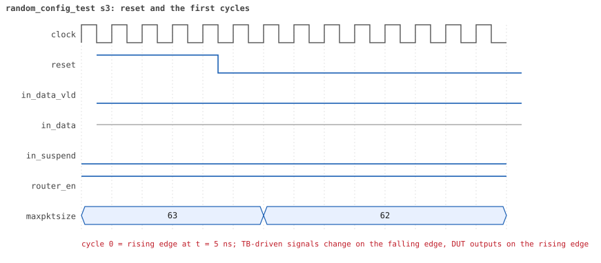
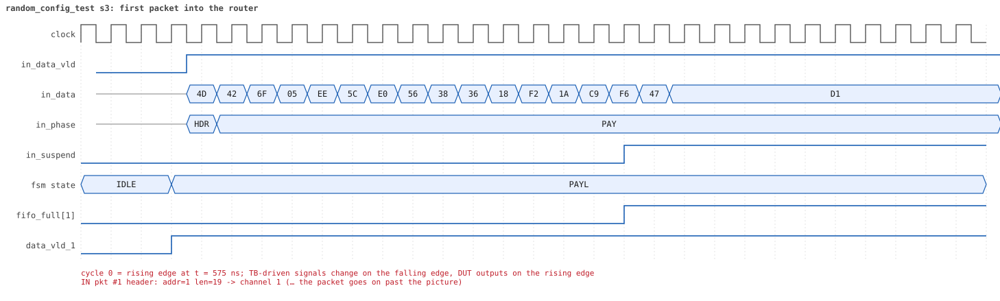
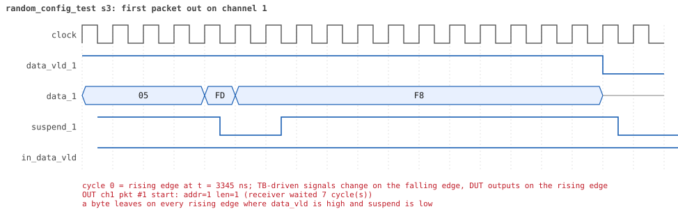
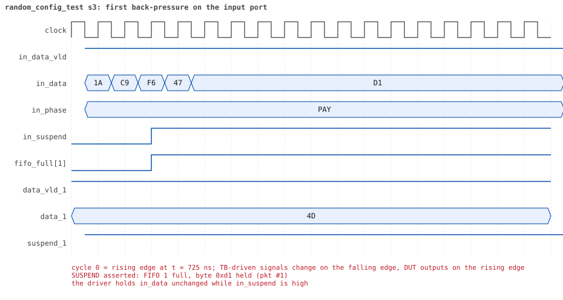
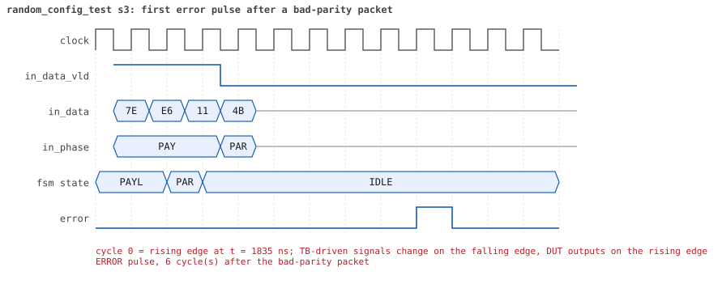
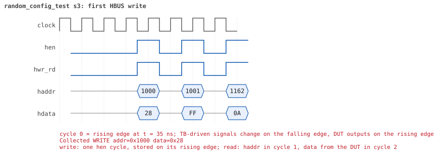
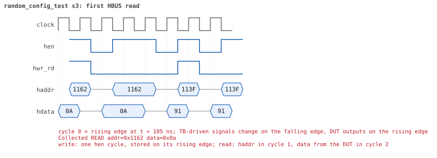

# random_config_test seed 3

**Result:** PASSED (0 UVM_ERROR, 0 UVM_WARNING, 0 UVM_FATAL) · bench `yapp_project_tb` · sim time 8us · wall 8.2 s · log [`random_config_test_s3.log`](random_config_test_s3.log)

Waves: `random_config_test_s3.fst` (GTKWave, Surfer or the VS Code wave viewer).
[Open the waves in Surfer](https://app.surfer-project.org/?load_url=https%3A%2F%2Fraw.githubusercontent.com%2Ftamirgabgab%2FQcom-Mentoring%2Fmain%2Fyapp_project%2Fregression%2Fyapp_project_tb%2Frandom_config_test_s3%2Frandom_config_test_s3.fst&startup_commands=run_command_file_from_url%20https%3A%2F%2Fraw.githubusercontent.com%2Ftamirgabgab%2FQcom-Mentoring%2Fmain%2Fyapp_project%2Ftb%2Fyapp_router.sucl) (web app, the signals already in groups: `yapp_project/tb/yapp_router.sucl`).

## Summary

- YAPP driver sent **11** packet(s) (2 with bad parity); the input monitor saw 11.
- Router: **4** forwarded, **7** dropped (3 router disabled, 3 oversized, 1 illegal address 3).
- Packets out: ch0 **1**, ch1 **2**, ch2 **1**.
- Scoreboard: 4 matched, 0 mismatched, 0 unexpected.
- Back-pressure: in_suspend asserted **1** time(s), longest hold 20 cycle(s).
- Error pulses: 1.
- HBUS: 39 write(s), 91 read(s).

## Stages

| time (ns) | stage |
|---|---|
| 0 | receivers: ch0 CHANNEL_RX_PROFILE_SLOW, ch1 CHANNEL_RX_PROFILE_SLOW, ch2 CHANNEL_RX_PROFILE_STALLY |
| 0 | random scenario: 11 packets in 6 bursts |
| 550 | burst 1/6: ctrl=0x28 (maxpktsize 40) en=0xff (router on, counter enables 1111111), 1 packet(s) |
| 1010 | burst 1/6 sent: addr0..3 0/1/0/0, bad parity 0, gap 0 0, length 19..19 |
| 1530 | burst 2/6: ctrl=0x4d (maxpktsize 13) en=0x00 (router OFF, counter enables 0000000), 3 packet(s) |
| 2510 | burst 2/6 sent: addr0..3 0/1/2/0, bad parity 1, gap 0 1, length 14..32 |
| 2970 | burst 3/6: ctrl=0xbe (maxpktsize 62) en=0x01 (router on, counter enables 0000000), 1 packet(s) |
| 3600 | burst 3/6 sent: addr0..3 0/0/1/0, bad parity 0, gap 0 0, length 40..40 |
| 3910 | burst 4/6: ctrl=0x89 (maxpktsize 9) en=0x2f (router on, counter enables 0010111), 2 packet(s) |
| 4640 | burst 4/6 sent: addr0..3 0/0/0/2, bad parity 0, gap 0 1, length 7..45 |
| 5070 | burst 5/6: ctrl=0x01 (maxpktsize 1) en=0xe5 (router on, counter enables 1110010), 2 packet(s) |
| 5340 | burst 5/6 sent: addr0..3 1/1/0/0, bad parity 1, gap 0 0, length 1..1 |
| 5640 | burst 6/6: ctrl=0xc8 (maxpktsize 8) en=0xcf (router on, counter enables 1100111), 2 packet(s) |
| 6550 | burst 6/6 sent: addr0..3 2/0/0/0, bad parity 0, gap 0 2, length 23..63 |
| 6550 | final reads: every register and the stored packet, checked against the reference model |
| 7655 | done: 11 packets (4 forwarded, 7 dropped), 0 storm burst(s), 4 scoreboard matches, 88 HBUS reads checked, 1 error pulses for 1 bad packets |

## Pictures

**reset and the first cycles**

**first packet into the router**

**first packet out on channel 1**

**first back-pressure on the input port**

**first error pulse after a bad-parity packet**

**first HBUS write**

**first HBUS read**

## Timeline

419 events.

| time (ns) | who | event |
|---|---|---|
| 0 | yapp monitor | YAPP monitor running |
| 0 | **test** | STAGE: receivers: ch0 CHANNEL_RX_PROFILE_SLOW, ch1 CHANNEL_RX_PROFILE_SLOW, ch2 CHANNEL_RX_PROFILE_STALLY |
| 0 | **test** | STAGE: random scenario: 11 packets in 6 bursts |
| 0 | clk/rst driver | Starting clock (period 10) and holding reset for 5 cycles |
| 0 | **DUT** | RESET asserted |
| 50 | **DUT** | RESET released: router_en=1 maxpktsize=63 |
| 70 | hbus driver | Executed WRITE addr=0x1000 data=0x28 |
| 75 | **DUT** | CONFIG router_en=1 maxpktsize=40 |
| 75 | hbus monitor | Collected WRITE addr=0x1000 data=0x28 |
| 75 | reference | maxpktsize is now 40 |
| 90 | hbus driver | Executed WRITE addr=0x1001 data=0xff |
| 95 | hbus monitor | Collected WRITE addr=0x1001 data=0xff |
| 95 | reference | router_en is now 1 (en_reg 0xff) |
| 110 | hbus driver | Executed WRITE addr=0x1162 data=0x0a |
| 115 | hbus monitor | Collected WRITE addr=0x1162 data=0x0a |
| 140 | hbus driver | Executed READ  addr=0x1162 data=0x0a |
| 145 | hbus monitor | Collected READ  addr=0x1162 data=0x0a |
| 160 | hbus driver | Executed WRITE addr=0x113f data=0x91 |
| 165 | hbus monitor | Collected WRITE addr=0x113f data=0x91 |
| 190 | hbus driver | Executed READ  addr=0x113f data=0x91 |
| 195 | hbus monitor | Collected READ  addr=0x113f data=0x91 |
| 220 | hbus driver | Executed READ  addr=0x100d data=0x00 |
| 225 | hbus monitor | Collected READ  addr=0x100d data=0x00 |
| 240 | hbus driver | Executed WRITE addr=0x11ec data=0x95 |
| 245 | hbus monitor | Collected WRITE addr=0x11ec data=0x95 |
| 270 | hbus driver | Executed READ  addr=0x11ec data=0x95 |
| 275 | hbus monitor | Collected READ  addr=0x11ec data=0x95 |
| 300 | hbus driver | Executed READ  addr=0x1000 data=0x28 |
| 305 | hbus monitor | Collected READ  addr=0x1000 data=0x28 |
| 330 | hbus driver | Executed READ  addr=0x100d data=0x00 |
| 335 | hbus monitor | Collected READ  addr=0x100d data=0x00 |
| 350 | hbus driver | Executed WRITE addr=0x11d9 data=0x5e |
| 355 | hbus monitor | Collected WRITE addr=0x11d9 data=0x5e |
| 380 | hbus driver | Executed READ  addr=0x11d9 data=0x5e |
| 385 | hbus monitor | Collected READ  addr=0x11d9 data=0x5e |
| 410 | hbus driver | Executed READ  addr=0x10d5 data=0x00 |
| 415 | hbus monitor | Collected READ  addr=0x10d5 data=0x00 |
| 440 | hbus driver | Executed READ  addr=0x100d data=0x00 |
| 445 | hbus monitor | Collected READ  addr=0x100d data=0x00 |
| 470 | hbus driver | Executed READ  addr=0x10bc data=0x00 |
| 475 | hbus monitor | Collected READ  addr=0x10bc data=0x00 |
| 500 | hbus driver | Executed READ  addr=0x1002 data=0x00 |
| 505 | hbus monitor | Collected READ  addr=0x1002 data=0x00 |
| 520 | hbus driver | Executed WRITE addr=0x11c5 data=0x4b |
| 525 | hbus monitor | Collected WRITE addr=0x11c5 data=0x4b |
| 550 | hbus driver | Executed READ  addr=0x11c5 data=0x4b |
| 550 | **test** | STAGE: burst 1/6: ctrl=0x28 (maxpktsize 40) en=0xff (router on, counter enables 1111111), 1 packet(s) |
| 550 | yapp driver | TX pkt #1: addr=1 len=19 parity=good delay=4 |
| 555 | hbus monitor | Collected READ  addr=0x11c5 data=0x4b |
| 605 | **DUT** | IN  pkt #1 header: addr=1 len=19 -> channel 1 |
| 765 | **DUT** | SUSPEND asserted: FIFO 1 full, byte 0xd1 held (pkt #1) |
| 955 | **DUT** | OUT ch1 pkt #1 start: addr=1 len=19 (receiver waited 34 cycle(s)) |
| 965 | **DUT** | SUSPEND released after 20 cycle(s) |
| 1005 | **DUT** | IN  pkt #1 complete: addr=1 len=19 parity=ok forwarded, 21 bytes in 41 cycles (held 20) |
| 1005 | yapp monitor | RX pkt #1 on the input: addr=1 len=19 parity=good gap=55 |
| 1005 | reference | Packet forwarded: addr=1 len=19 -> channel 1 |
| 1010 | yapp driver | TX pkt #1 accepted by the DUT |
| 1010 | **test** | STAGE: burst 1/6 sent: addr0..3 0/1/0/0, bad parity 0, gap 0 0, length 19..19 |
| 1030 | hbus driver | Executed WRITE addr=0x1000 data=0x4d |
| 1035 | **DUT** | CONFIG router_en=1 maxpktsize=13 |
| 1035 | hbus monitor | Collected WRITE addr=0x1000 data=0x4d |
| 1035 | reference | maxpktsize is now 13 |
| 1050 | hbus driver | Executed WRITE addr=0x1001 data=0x00 |
| 1055 | **DUT** | CONFIG router_en=0 maxpktsize=13 |
| 1055 | hbus monitor | Collected WRITE addr=0x1001 data=0x00 |
| 1055 | reference | router_en is now 0 (en_reg 0x00) |
| 1070 | hbus driver | Executed WRITE addr=0x116c data=0x3b |
| 1075 | hbus monitor | Collected WRITE addr=0x116c data=0x3b |
| 1100 | hbus driver | Executed READ  addr=0x116c data=0x3b |
| 1105 | hbus monitor | Collected READ  addr=0x116c data=0x3b |
| 1130 | hbus driver | Executed READ  addr=0x1040 data=0x00 |
| 1135 | hbus monitor | Collected READ  addr=0x1040 data=0x00 |
| 1150 | ch1 driver | ch1: packet consumed (response delay 34) |
| 1150 | hbus driver | Executed WRITE addr=0x11ee data=0xc2 |
| 1155 | hbus monitor | Collected WRITE addr=0x11ee data=0xc2 |
| 1180 | hbus driver | Executed READ  addr=0x11ee data=0xc2 |
| 1185 | hbus monitor | Collected READ  addr=0x11ee data=0xc2 |
| 1200 | hbus driver | Executed WRITE addr=0x11ec data=0x15 |
| 1205 | hbus monitor | Collected WRITE addr=0x11ec data=0x15 |
| 1230 | hbus driver | Executed READ  addr=0x11ec data=0x15 |
| 1235 | hbus monitor | Collected READ  addr=0x11ec data=0x15 |
| 1260 | hbus driver | Executed READ  addr=0x100b data=0x00 |
| 1265 | hbus monitor | Collected READ  addr=0x100b data=0x00 |
| 1280 | hbus driver | Executed WRITE addr=0x1183 data=0x72 |
| 1285 | hbus monitor | Collected WRITE addr=0x1183 data=0x72 |
| 1310 | hbus driver | Executed READ  addr=0x1183 data=0x72 |
| 1315 | hbus monitor | Collected READ  addr=0x1183 data=0x72 |
| 1340 | hbus driver | Executed READ  addr=0x100d data=0x13 |
| 1345 | hbus monitor | Collected READ  addr=0x100d data=0x13 |
| 1360 | hbus driver | Executed WRITE addr=0x11ab data=0xe3 |
| 1365 | hbus monitor | Collected WRITE addr=0x11ab data=0xe3 |
| 1390 | hbus driver | Executed READ  addr=0x11ab data=0xe3 |
| 1395 | hbus monitor | Collected READ  addr=0x11ab data=0xe3 |
| 1420 | hbus driver | Executed READ  addr=0x100f data=0x00 |
| 1425 | hbus monitor | Collected READ  addr=0x100f data=0x00 |
| 1450 | hbus driver | Executed READ  addr=0x100e data=0x00 |
| 1455 | hbus monitor | Collected READ  addr=0x100e data=0x00 |
| 1480 | hbus driver | Executed READ  addr=0x100d data=0x13 |
| 1485 | hbus monitor | Collected READ  addr=0x100d data=0x13 |
| 1500 | hbus driver | Executed WRITE addr=0x1124 data=0xfc |
| 1505 | hbus monitor | Collected WRITE addr=0x1124 data=0xfc |
| 1530 | hbus driver | Executed READ  addr=0x1124 data=0xfc |
| 1530 | **test** | STAGE: burst 2/6: ctrl=0x4d (maxpktsize 13) en=0x00 (router OFF, counter enables 0000000), 3 packet(s) |
| 1530 | yapp driver | TX pkt #2: addr=2 len=14 parity=bad delay=5 |
| 1535 | hbus monitor | Collected READ  addr=0x1124 data=0xfc |
| 1565 | **DUT** | OUT ch1 pkt #1 done: 21 bytes in 62 cycles |
| 1565 | ch1 monitor | ch1 RX pkt #1: addr=1 len=19 parity=good |
| 1565 | scoreboard | ch1 pkt matched: addr=1 len=19 (1 matched so far) |
| 1595 | **DUT** | IN  pkt #2 header: addr=2 len=14 -> DROP (router disabled) |
| 1745 | **DUT** | IN  pkt #2 complete: addr=2 len=14 parity=BAD dropped, 16 bytes in 16 cycles (held 0) |
| 1745 | yapp monitor | RX pkt #2 on the input: addr=2 len=14 parity=bad gap=58 |
| 1745 | reference | Packet dropped: router disabled (addr=2 len=14) |
| 1745 | **DUT** | ROUTER DROPS PACKET addr=2 length=14 (router disabled) |
| 1750 | yapp driver | TX pkt #2 accepted by the DUT |
| 1750 | yapp driver | TX pkt #3: addr=2 len=32 parity=good delay=0 |
| 1755 | **DUT** | IN  pkt #3 header: addr=2 len=32 -> DROP (router disabled) |
| 1780 | ch1 driver | ch1: packet consumed (response delay 40) |
| 2085 | **DUT** | IN  pkt #3 complete: addr=2 len=32 parity=ok dropped, 34 bytes in 34 cycles (held 0) |
| 2085 | yapp monitor | RX pkt #3 on the input: addr=2 len=32 parity=good gap=0 |
| 2085 | reference | Packet dropped: router disabled (addr=2 len=32) |
| 2085 | **DUT** | ROUTER DROPS PACKET addr=2 length=32 (router disabled) |
| 2090 | yapp driver | TX pkt #3 accepted by the DUT |
| 2090 | yapp driver | TX pkt #4: addr=1 len=20 parity=good delay=20 |
| 2295 | **DUT** | IN  pkt #4 header: addr=1 len=20 -> DROP (router disabled) |
| 2505 | **DUT** | IN  pkt #4 complete: addr=1 len=20 parity=ok dropped, 22 bytes in 22 cycles (held 0) |
| 2505 | yapp monitor | RX pkt #4 on the input: addr=1 len=20 parity=good gap=20 |
| 2505 | reference | Packet dropped: router disabled (addr=1 len=20) |
| 2505 | **DUT** | ROUTER DROPS PACKET addr=1 length=20 (router disabled) |
| 2510 | yapp driver | TX pkt #4 accepted by the DUT |
| 2510 | **test** | STAGE: burst 2/6 sent: addr0..3 0/1/2/0, bad parity 1, gap 0 1, length 14..32 |
| 2530 | hbus driver | Executed WRITE addr=0x1000 data=0xbe |
| 2535 | **DUT** | CONFIG router_en=0 maxpktsize=62 |
| 2535 | hbus monitor | Collected WRITE addr=0x1000 data=0xbe |
| 2535 | reference | maxpktsize is now 62 |
| 2550 | hbus driver | Executed WRITE addr=0x1001 data=0x01 |
| 2555 | **DUT** | CONFIG router_en=1 maxpktsize=62 |
| 2555 | hbus monitor | Collected WRITE addr=0x1001 data=0x01 |
| 2555 | reference | router_en is now 1 (en_reg 0x01) |
| 2570 | hbus driver | Executed WRITE addr=0x11ba data=0x94 |
| 2575 | hbus monitor | Collected WRITE addr=0x11ba data=0x94 |
| 2600 | hbus driver | Executed READ  addr=0x11ba data=0x94 |
| 2605 | hbus monitor | Collected READ  addr=0x11ba data=0x94 |
| 2630 | hbus driver | Executed READ  addr=0x100d data=0x13 |
| 2635 | hbus monitor | Collected READ  addr=0x100d data=0x13 |
| 2660 | hbus driver | Executed READ  addr=0x100d data=0x13 |
| 2665 | hbus monitor | Collected READ  addr=0x100d data=0x13 |
| 2680 | hbus driver | Executed WRITE addr=0x111d data=0xca |
| 2685 | hbus monitor | Collected WRITE addr=0x111d data=0xca |
| 2710 | hbus driver | Executed READ  addr=0x111d data=0xca |
| 2715 | hbus monitor | Collected READ  addr=0x111d data=0xca |
| 2740 | hbus driver | Executed READ  addr=0x100d data=0x13 |
| 2745 | hbus monitor | Collected READ  addr=0x100d data=0x13 |
| 2770 | hbus driver | Executed READ  addr=0x1025 data=0x00 |
| 2775 | hbus monitor | Collected READ  addr=0x1025 data=0x00 |
| 2790 | hbus driver | Executed WRITE addr=0x1199 data=0x40 |
| 2795 | hbus monitor | Collected WRITE addr=0x1199 data=0x40 |
| 2820 | hbus driver | Executed READ  addr=0x1199 data=0x40 |
| 2825 | hbus monitor | Collected READ  addr=0x1199 data=0x40 |
| 2850 | hbus driver | Executed READ  addr=0x105a data=0x00 |
| 2855 | hbus monitor | Collected READ  addr=0x105a data=0x00 |
| 2880 | hbus driver | Executed READ  addr=0x1001 data=0x01 |
| 2885 | hbus monitor | Collected READ  addr=0x1001 data=0x01 |
| 2910 | hbus driver | Executed READ  addr=0x104e data=0x00 |
| 2915 | hbus monitor | Collected READ  addr=0x104e data=0x00 |
| 2940 | hbus driver | Executed READ  addr=0x1001 data=0x01 |
| 2945 | hbus monitor | Collected READ  addr=0x1001 data=0x01 |
| 2970 | hbus driver | Executed READ  addr=0x100a data=0x01 |
| 2970 | **test** | STAGE: burst 3/6: ctrl=0xbe (maxpktsize 62) en=0x01 (router on, counter enables 0000000), 1 packet(s) |
| 2970 | yapp driver | TX pkt #5: addr=2 len=40 parity=good delay=20 |
| 2975 | hbus monitor | Collected READ  addr=0x100a data=0x01 |
| 3185 | **DUT** | IN  pkt #5 header: addr=2 len=40 -> channel 2 |
| 3295 | **DUT** | OUT ch2 pkt #1 start: addr=2 len=40 (receiver waited 10 cycle(s)) |
| 3595 | **DUT** | IN  pkt #5 complete: addr=2 len=40 parity=ok forwarded, 42 bytes in 42 cycles (held 0) |
| 3595 | yapp monitor | RX pkt #5 on the input: addr=2 len=40 parity=good gap=67 |
| 3595 | reference | Packet forwarded: addr=2 len=40 -> channel 2 |
| 3600 | yapp driver | TX pkt #5 accepted by the DUT |
| 3600 | **test** | STAGE: burst 3/6 sent: addr0..3 0/0/1/0, bad parity 0, gap 0 0, length 40..40 |
| 3620 | hbus driver | Executed WRITE addr=0x1000 data=0x89 |
| 3625 | **DUT** | CONFIG router_en=1 maxpktsize=9 |
| 3625 | hbus monitor | Collected WRITE addr=0x1000 data=0x89 |
| 3625 | reference | maxpktsize is now 9 |
| 3640 | hbus driver | Executed WRITE addr=0x1001 data=0x2f |
| 3645 | hbus monitor | Collected WRITE addr=0x1001 data=0x2f |
| 3645 | reference | router_en is now 1 (en_reg 0x2f) |
| 3670 | hbus driver | Executed READ  addr=0x100d data=0x28 |
| 3675 | hbus monitor | Collected READ  addr=0x100d data=0x28 |
| 3700 | ch2 driver | ch2: packet consumed (response delay 10) |
| 3700 | hbus driver | Executed READ  addr=0x1004 data=0x00 |
| 3705 | hbus monitor | Collected READ  addr=0x1004 data=0x00 |
| 3720 | hbus driver | Executed WRITE addr=0x11cd data=0x1f |
| 3725 | hbus monitor | Collected WRITE addr=0x11cd data=0x1f |
| 3750 | hbus driver | Executed READ  addr=0x11cd data=0x1f |
| 3755 | hbus monitor | Collected READ  addr=0x11cd data=0x1f |
| 3765 | **DUT** | OUT ch2 pkt #1 done: 42 bytes in 48 cycles |
| 3765 | ch2 monitor | ch2 RX pkt #1: addr=2 len=40 parity=good |
| 3765 | scoreboard | ch2 pkt matched: addr=2 len=40 (2 matched so far) |
| 3770 | hbus driver | Executed WRITE addr=0x11aa data=0xa7 |
| 3775 | hbus monitor | Collected WRITE addr=0x11aa data=0xa7 |
| 3800 | hbus driver | Executed READ  addr=0x11aa data=0xa7 |
| 3805 | hbus monitor | Collected READ  addr=0x11aa data=0xa7 |
| 3830 | hbus driver | Executed READ  addr=0x1086 data=0x00 |
| 3835 | hbus monitor | Collected READ  addr=0x1086 data=0x00 |
| 3850 | hbus driver | Executed WRITE addr=0x112f data=0x5b |
| 3855 | hbus monitor | Collected WRITE addr=0x112f data=0x5b |
| 3880 | hbus driver | Executed READ  addr=0x112f data=0x5b |
| 3885 | hbus monitor | Collected READ  addr=0x112f data=0x5b |
| 3910 | hbus driver | Executed READ  addr=0x1004 data=0x00 |
| 3910 | **test** | STAGE: burst 4/6: ctrl=0x89 (maxpktsize 9) en=0x2f (router on, counter enables 0010111), 2 packet(s) |
| 3910 | yapp driver | TX pkt #6: addr=3 len=45 parity=good delay=16 |
| 3915 | hbus monitor | Collected READ  addr=0x1004 data=0x00 |
| 4085 | **DUT** | IN  pkt #6 header: addr=3 len=45 -> DROP (oversized: len 45 > maxpktsize 9) |
| 4320 | ch2 driver | ch2: packet consumed (response delay 5) |
| 4545 | **DUT** | IN  pkt #6 complete: addr=3 len=45 parity=ok dropped, 47 bytes in 47 cycles (held 0) |
| 4545 | yapp monitor | RX pkt #6 on the input: addr=3 len=45 parity=good gap=48 |
| 4545 | reference | Packet dropped: illegal address 3 (len=45) |
| 4545 | **DUT** | ROUTER DROPS PACKET addr=3 length=45 (    illegal address) |
| 4550 | yapp driver | TX pkt #6 accepted by the DUT |
| 4550 | yapp driver | TX pkt #7: addr=3 len=7 parity=good delay=0 |
| 4555 | **DUT** | IN  pkt #7 header: addr=3 len=7 -> DROP (illegal address 3) |
| 4635 | **DUT** | IN  pkt #7 complete: addr=3 len=7 parity=ok dropped, 9 bytes in 9 cycles (held 0) |
| 4635 | yapp monitor | RX pkt #7 on the input: addr=3 len=7 parity=good gap=0 |
| 4635 | reference | Packet dropped: illegal address 3 (len=7) |
| 4635 | **DUT** | ROUTER DROPS PACKET addr=3 length=7 (    illegal address) |
| 4640 | yapp driver | TX pkt #7 accepted by the DUT |
| 4640 | **test** | STAGE: burst 4/6 sent: addr0..3 0/0/0/2, bad parity 0, gap 0 1, length 7..45 |
| 4660 | hbus driver | Executed WRITE addr=0x1000 data=0x01 |
| 4665 | **DUT** | CONFIG router_en=1 maxpktsize=1 |
| 4665 | hbus monitor | Collected WRITE addr=0x1000 data=0x01 |
| 4665 | reference | maxpktsize is now 1 |
| 4680 | hbus driver | Executed WRITE addr=0x1001 data=0xe5 |
| 4685 | hbus monitor | Collected WRITE addr=0x1001 data=0xe5 |
| 4685 | reference | router_en is now 1 (en_reg 0xe5) |
| 4700 | hbus driver | Executed WRITE addr=0x114b data=0x68 |
| 4705 | hbus monitor | Collected WRITE addr=0x114b data=0x68 |
| 4730 | hbus driver | Executed READ  addr=0x114b data=0x68 |
| 4735 | hbus monitor | Collected READ  addr=0x114b data=0x68 |
| 4750 | hbus driver | Executed WRITE addr=0x11eb data=0x17 |
| 4755 | hbus monitor | Collected WRITE addr=0x11eb data=0x17 |
| 4780 | hbus driver | Executed READ  addr=0x11eb data=0x17 |
| 4785 | hbus monitor | Collected READ  addr=0x11eb data=0x17 |
| 4810 | hbus driver | Executed READ  addr=0x100d data=0x07 |
| 4815 | hbus monitor | Collected READ  addr=0x100d data=0x07 |
| 4840 | hbus driver | Executed READ  addr=0x1038 data=0xf5 |
| 4845 | hbus monitor | Collected READ  addr=0x1038 data=0xf5 |
| 4860 | hbus driver | Executed WRITE addr=0x113a data=0x4b |
| 4865 | hbus monitor | Collected WRITE addr=0x113a data=0x4b |
| 4890 | hbus driver | Executed READ  addr=0x113a data=0x4b |
| 4895 | hbus monitor | Collected READ  addr=0x113a data=0x4b |
| 4910 | hbus driver | Executed WRITE addr=0x11f7 data=0xe4 |
| 4915 | hbus monitor | Collected WRITE addr=0x11f7 data=0xe4 |
| 4940 | hbus driver | Executed READ  addr=0x11f7 data=0xe4 |
| 4945 | hbus monitor | Collected READ  addr=0x11f7 data=0xe4 |
| 4960 | hbus driver | Executed WRITE addr=0x11cc data=0x1b |
| 4965 | hbus monitor | Collected WRITE addr=0x11cc data=0x1b |
| 4990 | hbus driver | Executed READ  addr=0x11cc data=0x1b |
| 4995 | hbus monitor | Collected READ  addr=0x11cc data=0x1b |
| 5020 | hbus driver | Executed READ  addr=0x1007 data=0x00 |
| 5025 | hbus monitor | Collected READ  addr=0x1007 data=0x00 |
| 5040 | hbus driver | Executed WRITE addr=0x1180 data=0x04 |
| 5045 | hbus monitor | Collected WRITE addr=0x1180 data=0x04 |
| 5070 | hbus driver | Executed READ  addr=0x1180 data=0x04 |
| 5070 | **test** | STAGE: burst 5/6: ctrl=0x01 (maxpktsize 1) en=0xe5 (router on, counter enables 1110010), 2 packet(s) |
| 5070 | yapp driver | TX pkt #8: addr=0 len=1 parity=bad delay=2 |
| 5075 | hbus monitor | Collected READ  addr=0x1180 data=0x04 |
| 5105 | **DUT** | IN  pkt #8 header: addr=0 len=1 -> channel 0 |
| 5125 | **DUT** | IN  pkt #8 complete: addr=0 len=1 parity=BAD forwarded, 3 bytes in 3 cycles (held 0) |
| 5125 | yapp monitor | RX pkt #8 on the input: addr=0 len=1 parity=bad gap=46 |
| 5125 | reference | Packet forwarded: addr=0 len=1 -> channel 0 |
| 5130 | yapp driver | TX pkt #8 accepted by the DUT |
| 5130 | yapp driver | TX pkt #9: addr=1 len=1 parity=good delay=18 |
| 5150 | **DUT** | ERROR pulse, 2 cycle(s) after the bad-parity packet |
| 5150 | error checker | error pulse 2 cycles after the bad packet (0 still owed) |
| 5315 | **DUT** | IN  pkt #9 header: addr=1 len=1 -> channel 1 |
| 5335 | **DUT** | IN  pkt #9 complete: addr=1 len=1 parity=ok forwarded, 3 bytes in 3 cycles (held 0) |
| 5335 | yapp monitor | RX pkt #9 on the input: addr=1 len=1 parity=good gap=18 |
| 5335 | reference | Packet forwarded: addr=1 len=1 -> channel 1 |
| 5340 | yapp driver | TX pkt #9 accepted by the DUT |
| 5340 | **test** | STAGE: burst 5/6 sent: addr0..3 1/1/0/0, bad parity 1, gap 0 0, length 1..1 |
| 5355 | **DUT** | OUT ch0 pkt #1 start: addr=0 len=1 (receiver waited 24 cycle(s)) |
| 5360 | hbus driver | Executed WRITE addr=0x1000 data=0xc8 |
| 5365 | **DUT** | CONFIG router_en=1 maxpktsize=8 |
| 5365 | hbus monitor | Collected WRITE addr=0x1000 data=0xc8 |
| 5365 | reference | maxpktsize is now 8 |
| 5370 | ch0 driver | ch0: packet consumed (response delay 24) |
| 5380 | hbus driver | Executed WRITE addr=0x1001 data=0xcf |
| 5385 | hbus monitor | Collected WRITE addr=0x1001 data=0xcf |
| 5385 | reference | router_en is now 1 (en_reg 0xcf) |
| 5410 | hbus driver | Executed READ  addr=0x1005 data=0x01 |
| 5415 | hbus monitor | Collected READ  addr=0x1005 data=0x01 |
| 5430 | hbus driver | Executed WRITE addr=0x1160 data=0xf8 |
| 5435 | hbus monitor | Collected WRITE addr=0x1160 data=0xf8 |
| 5460 | hbus driver | Executed READ  addr=0x1160 data=0xf8 |
| 5465 | hbus monitor | Collected READ  addr=0x1160 data=0xf8 |
| 5490 | hbus driver | Executed READ  addr=0x100d data=0x01 |
| 5495 | hbus monitor | Collected READ  addr=0x100d data=0x01 |
| 5510 | hbus driver | Executed WRITE addr=0x11b7 data=0x77 |
| 5515 | hbus monitor | Collected WRITE addr=0x11b7 data=0x77 |
| 5540 | hbus driver | Executed READ  addr=0x11b7 data=0x77 |
| 5545 | hbus monitor | Collected READ  addr=0x11b7 data=0x77 |
| 5560 | hbus driver | Executed WRITE addr=0x11be data=0xe9 |
| 5565 | hbus monitor | Collected WRITE addr=0x11be data=0xe9 |
| 5585 | **DUT** | OUT ch0 pkt #1 done: 3 bytes in 24 cycles |
| 5585 | ch0 monitor | ch0 RX pkt #1: addr=0 len=1 parity=bad |
| 5585 | scoreboard | ch0 pkt matched: addr=0 len=1 (3 matched so far) |
| 5590 | hbus driver | Executed READ  addr=0x11be data=0xe9 |
| 5595 | **DUT** | OUT ch1 pkt #2 start: addr=1 len=1 (receiver waited 27 cycle(s)) |
| 5595 | hbus monitor | Collected READ  addr=0x11be data=0xe9 |
| 5610 | ch1 driver | ch1: packet consumed (response delay 27) |
| 5610 | hbus driver | Executed WRITE addr=0x115d data=0x9f |
| 5615 | hbus monitor | Collected WRITE addr=0x115d data=0x9f |
| 5640 | hbus driver | Executed READ  addr=0x115d data=0x9f |
| 5640 | **test** | STAGE: burst 6/6: ctrl=0xc8 (maxpktsize 8) en=0xcf (router on, counter enables 1100111), 2 packet(s) |
| 5640 | yapp driver | TX pkt #10: addr=0 len=63 parity=good delay=0 |
| 5645 | hbus monitor | Collected READ  addr=0x115d data=0x9f |
| 5655 | **DUT** | IN  pkt #10 header: addr=0 len=63 -> DROP (oversized: len 63 > maxpktsize 8) |
| 5690 | ch0 driver | ch0: packet consumed (response delay 20) |
| 6025 | **DUT** | OUT ch1 pkt #2 done: 3 bytes in 44 cycles |
| 6025 | ch1 monitor | ch1 RX pkt #2: addr=1 len=1 parity=good |
| 6025 | scoreboard | ch1 pkt matched: addr=1 len=1 (4 matched so far) |
| 6220 | ch1 driver | ch1: packet consumed (response delay 40) |
| 6295 | **DUT** | IN  pkt #10 complete: addr=0 len=63 parity=ok dropped, 65 bytes in 65 cycles (held 0) |
| 6295 | yapp monitor | RX pkt #10 on the input: addr=0 len=63 parity=good gap=31 |
| 6295 | reference | Packet dropped: length 63 > maxpktsize 8 (addr=0) |
| 6295 | **DUT** | ROUTER DROPS PACKET addr=0 length=63 (length > maxpktsize) |
| 6300 | yapp driver | TX pkt #10 accepted by the DUT |
| 6300 | yapp driver | TX pkt #11: addr=0 len=23 parity=good delay=0 |
| 6305 | **DUT** | IN  pkt #11 header: addr=0 len=23 -> DROP (oversized: len 23 > maxpktsize 8) |
| 6545 | **DUT** | IN  pkt #11 complete: addr=0 len=23 parity=ok dropped, 25 bytes in 25 cycles (held 0) |
| 6545 | yapp monitor | RX pkt #11 on the input: addr=0 len=23 parity=good gap=0 |
| 6545 | reference | Packet dropped: length 23 > maxpktsize 8 (addr=0) |
| 6545 | **DUT** | ROUTER DROPS PACKET addr=0 length=23 (length > maxpktsize) |
| 6550 | yapp driver | TX pkt #11 accepted by the DUT |
| 6550 | **test** | STAGE: burst 6/6 sent: addr0..3 2/0/0/0, bad parity 0, gap 0 2, length 23..63 |
| 6550 | **test** | STAGE: final reads: every register and the stored packet, checked against the reference model |
| 6580 | hbus driver | Executed READ  addr=0x1000 data=0xc8 |
| 6585 | hbus monitor | Collected READ  addr=0x1000 data=0xc8 |
| 6610 | hbus driver | Executed READ  addr=0x1001 data=0xcf |
| 6615 | hbus monitor | Collected READ  addr=0x1001 data=0xcf |
| 6640 | hbus driver | Executed READ  addr=0x1004 data=0x00 |
| 6645 | hbus monitor | Collected READ  addr=0x1004 data=0x00 |
| 6670 | hbus driver | Executed READ  addr=0x1005 data=0x03 |
| 6675 | hbus monitor | Collected READ  addr=0x1005 data=0x03 |
| 6700 | hbus driver | Executed READ  addr=0x1006 data=0x00 |
| 6705 | hbus monitor | Collected READ  addr=0x1006 data=0x00 |
| 6730 | hbus driver | Executed READ  addr=0x1009 data=0x00 |
| 6735 | hbus monitor | Collected READ  addr=0x1009 data=0x00 |
| 6760 | hbus driver | Executed READ  addr=0x100a data=0x02 |
| 6765 | hbus monitor | Collected READ  addr=0x100a data=0x02 |
| 6790 | hbus driver | Executed READ  addr=0x100b data=0x00 |
| 6795 | hbus monitor | Collected READ  addr=0x100b data=0x00 |
| 6820 | hbus driver | Executed READ  addr=0x100d data=0x17 |
| 6825 | hbus monitor | Collected READ  addr=0x100d data=0x17 |
| 6850 | hbus driver | Executed READ  addr=0x1010 data=0x5c |
| 6855 | hbus monitor | Collected READ  addr=0x1010 data=0x5c |
| 6880 | hbus driver | Executed READ  addr=0x1011 data=0xd5 |
| 6885 | hbus monitor | Collected READ  addr=0x1011 data=0xd5 |
| 6910 | hbus driver | Executed READ  addr=0x1012 data=0x20 |
| 6915 | hbus monitor | Collected READ  addr=0x1012 data=0x20 |
| 6940 | hbus driver | Executed READ  addr=0x1013 data=0xe3 |
| 6945 | hbus monitor | Collected READ  addr=0x1013 data=0xe3 |
| 6970 | hbus driver | Executed READ  addr=0x1014 data=0xbe |
| 6975 | hbus monitor | Collected READ  addr=0x1014 data=0xbe |
| 7000 | hbus driver | Executed READ  addr=0x1015 data=0x06 |
| 7005 | hbus monitor | Collected READ  addr=0x1015 data=0x06 |
| 7030 | hbus driver | Executed READ  addr=0x1016 data=0x8e |
| 7035 | hbus monitor | Collected READ  addr=0x1016 data=0x8e |
| 7060 | hbus driver | Executed READ  addr=0x1017 data=0x56 |
| 7065 | hbus monitor | Collected READ  addr=0x1017 data=0x56 |
| 7090 | hbus driver | Executed READ  addr=0x1018 data=0x19 |
| 7095 | hbus monitor | Collected READ  addr=0x1018 data=0x19 |
| 7120 | hbus driver | Executed READ  addr=0x1019 data=0x6a |
| 7125 | hbus monitor | Collected READ  addr=0x1019 data=0x6a |
| 7150 | hbus driver | Executed READ  addr=0x101a data=0x8f |
| 7155 | hbus monitor | Collected READ  addr=0x101a data=0x8f |
| 7180 | hbus driver | Executed READ  addr=0x101b data=0x2f |
| 7185 | hbus monitor | Collected READ  addr=0x101b data=0x2f |
| 7210 | hbus driver | Executed READ  addr=0x101c data=0x7f |
| 7215 | hbus monitor | Collected READ  addr=0x101c data=0x7f |
| 7240 | hbus driver | Executed READ  addr=0x101d data=0x3e |
| 7245 | hbus monitor | Collected READ  addr=0x101d data=0x3e |
| 7270 | hbus driver | Executed READ  addr=0x101e data=0xc4 |
| 7275 | hbus monitor | Collected READ  addr=0x101e data=0xc4 |
| 7300 | hbus driver | Executed READ  addr=0x101f data=0xa8 |
| 7305 | hbus monitor | Collected READ  addr=0x101f data=0xa8 |
| 7330 | hbus driver | Executed READ  addr=0x1020 data=0x69 |
| 7335 | hbus monitor | Collected READ  addr=0x1020 data=0x69 |
| 7360 | hbus driver | Executed READ  addr=0x1021 data=0x23 |
| 7365 | hbus monitor | Collected READ  addr=0x1021 data=0x23 |
| 7390 | hbus driver | Executed READ  addr=0x1022 data=0x91 |
| 7395 | hbus monitor | Collected READ  addr=0x1022 data=0x91 |
| 7420 | hbus driver | Executed READ  addr=0x1023 data=0x59 |
| 7425 | hbus monitor | Collected READ  addr=0x1023 data=0x59 |
| 7450 | hbus driver | Executed READ  addr=0x1024 data=0x10 |
| 7455 | hbus monitor | Collected READ  addr=0x1024 data=0x10 |
| 7480 | hbus driver | Executed READ  addr=0x1025 data=0xe3 |
| 7485 | hbus monitor | Collected READ  addr=0x1025 data=0xe3 |
| 7510 | hbus driver | Executed READ  addr=0x1026 data=0x5d |
| 7515 | hbus monitor | Collected READ  addr=0x1026 data=0x5d |
| 7540 | hbus driver | Executed READ  addr=0x1027 data=0x26 |
| 7545 | hbus monitor | Collected READ  addr=0x1027 data=0x26 |
| 7655 | **test** | STAGE: done: 11 packets (4 forwarded, 7 dropped), 0 storm burst(s), 4 scoreboard matches, 88 HBUS reads checked, 1 error pulses for 1 bad packets |
| 7855 | error checker | error pulse report: 1 bad packets, 1 pulses, 0 outside 1..10 cycles, at most 1 owed at once |
| 7855 | ch0 monitor | Channel 0 report: 1 packets collected |
| 7855 | ch1 monitor | Channel 1 report: 2 packets collected |
| 7855 | ch2 monitor | Channel 2 report: 1 packets collected |
| 7855 | hbus monitor | HBUS report: 39 writes, 91 reads |
| 7855 | coverage | Coverage of the router configuration: 78.3% · maxpktsize 0 / 1 / 2..61 / 62 / 63 : 0 / 2 / 5 / 1 / 0 packets · length < max / = max / max+1 / > max+1 : 3 / 2 / 0 / 3 · forwarded good / bad : 3 / 1 · dropped address 3 good / bad : 2 / 0 · dropped oversized good / bad : 2 / 0 · counter enables none / mixed / all : 1 / 6 / 1 |
| 7855 | coverage | HBUS address coverage: 130 accesses sampled, coverage 50.6% |
| 7855 | coverage | HBUS register bits coverage: 12 writes to ctrl_reg/en_reg, coverage 100.0% |
| 7855 | coverage | HBUS counter value coverage: 11 counter reads sampled, coverage 51.9% |
| 7855 | coverage | HBUS yapp_mem data coverage: 54 accesses sampled, coverage 29.4% |
| 7855 | reference | --- Reference model report --- · forwarded to scoreboard : 4 · dropped (router disabled) : 3 · dropped (oversized) : 2 · dropped (address 3) : 2 · counters parity/oversized/addr0..3 : 0 / 3 / 0 2 0 0 |
| 7855 | reference | HBUS reads checked against the model: 88 (0 mismatches, 3 of memory bytes never written) |
| 7855 | scoreboard | --- Scoreboard report --- · packets received : 4 · packets matched : 4 · packets mismatched: 0 · packets unexpected: 0 · packets to addr 3 : 0 · left in queue 0/1/2: 0 / 0 / 0 |
| 7855 | yapp driver | YAPP driver report: 11 packets sent |
| 7855 | coverage | YAPP gap coverage: 10 gaps sampled, coverage 50.0% |
| 7855 | yapp monitor | YAPP monitor report: 11 packets collected, 2 with bad parity |
| 7855 | yapp monitor | YAPP gaps: 3 back to back, 0 of 1 cycle, 0 of 2, 7 longer |
| 7855 | coverage | YAPP packet coverage: 11 packets sampled, coverage 56.7% |
