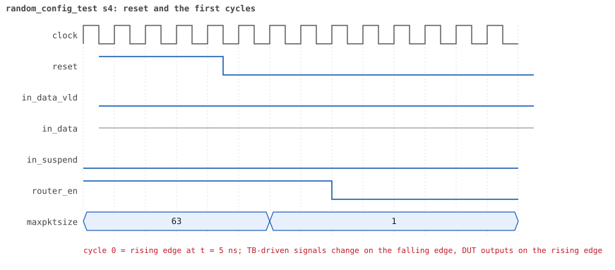
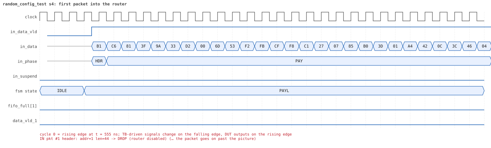
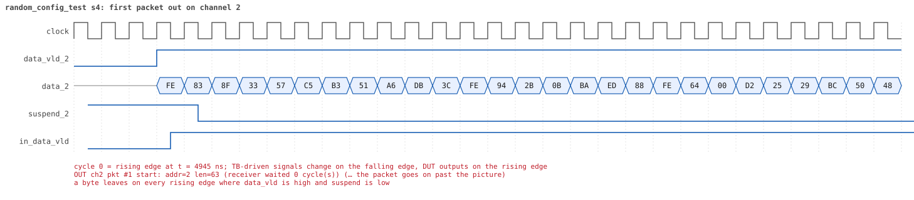
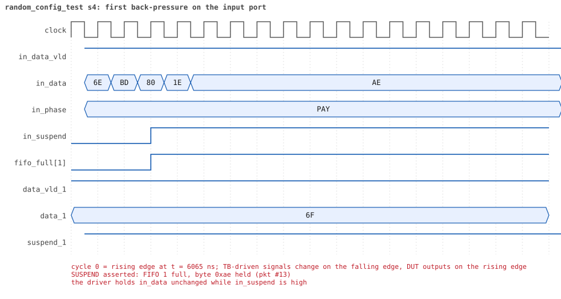
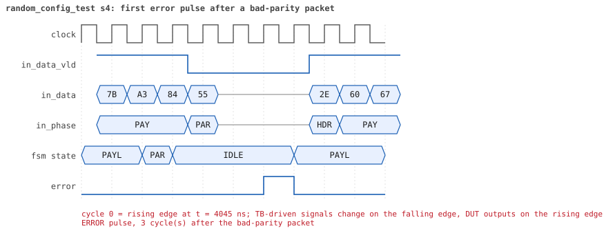
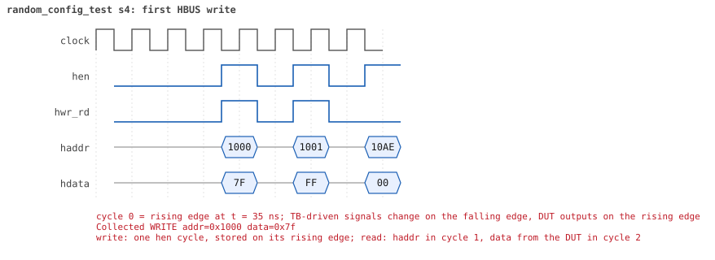
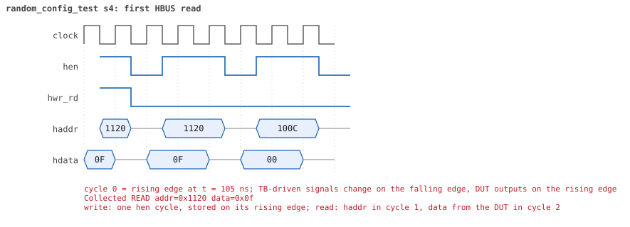

# random_config_test seed 4

**Result:** PASSED (0 UVM_ERROR, 0 UVM_WARNING, 0 UVM_FATAL) · bench `yapp_project_tb` · sim time 40us · wall 17.9 s · log [`random_config_test_s4.log`](random_config_test_s4.log)

Waves: `random_config_test_s4.fst` (GTKWave, Surfer or the VS Code wave viewer).
[Open the waves in Surfer](https://app.surfer-project.org/?load_url=https%3A%2F%2Fraw.githubusercontent.com%2Ftamirgabgab%2FQcom-Mentoring%2Fmain%2Fyapp_project%2Fregression%2Fyapp_project_tb%2Frandom_config_test_s4%2Frandom_config_test_s4.fst&startup_commands=run_command_file_from_url%20https%3A%2F%2Fraw.githubusercontent.com%2Ftamirgabgab%2FQcom-Mentoring%2Fmain%2Fyapp_project%2Ftb%2Fyapp_router.sucl) (web app, the signals already in groups: `yapp_project/tb/yapp_router.sucl`).

## Summary

- YAPP driver sent **81** packet(s) (9 with bad parity); the input monitor saw 81.
- Router: **26** forwarded, **55** dropped (9 illegal address 3, 36 oversized, 10 router disabled).
- Packets out: ch0 **2**, ch1 **6**, ch2 **18**.
- Scoreboard: 26 matched, 0 mismatched, 0 unexpected.
- Back-pressure: in_suspend asserted **4** time(s), longest hold 64 cycle(s).
- Error pulses: 8.
- HBUS: 45 write(s), 68 read(s).

## Stages

| time (ns) | stage |
|---|---|
| 0 | receivers: ch0 RX_SLOW, ch1 RX_STALLY, ch2 RX_NORMAL |
| 0 | random scenario: 81 packets in 8 bursts |
| 350 | burst 1/8: ctrl=0x7f (maxpktsize 63) en=0xff (router on, counter enables 1111111), 10 packet(s) |
| 4910 | burst 1/8 sent: addr0..3 0/2/5/3, bad parity 1, gap 0 3, length 1..63 |
| 5470 | burst 2/8: ctrl=0xb0 (maxpktsize 48) en=0x23 (router on, counter enables 0010001), 11 packet(s) |
| 11810 | burst 2/8 sent: addr0..3 1/4/5/1, bad parity 1, gap 0 2, length 1..63 |
| 12040 | burst 3/8: ctrl=0xc0 (maxpktsize 0) en=0xff (router on, counter enables 1111111), 10 packet(s) |
| 14820 | burst 3/8 sent: addr0..3 3/0/7/0, bad parity 0, gap 0 3, length 1..63 |
| 15030 | burst 4/8: ctrl=0xdd (maxpktsize 29) en=0xff (router on, counter enables 1111111), 10 packet(s) |
| 19890 | burst 4/8 sent: addr0..3 2/1/5/2, bad parity 1, gap 0 3, length 1..63 |
| 20220 | burst 5/8: ctrl=0x46 (maxpktsize 6) en=0x01 (router on, counter enables 0000000), 10 packet(s) |
| 23700 | burst 5/8 sent: addr0..3 2/1/5/2, bad parity 1, gap 0 3, length 5..63 |
| 23950 | burst 6/8: ctrl=0xc0 (maxpktsize 0) en=0x6e (router OFF, counter enables 0110111), 10 packet(s) |
| 27680 | burst 6/8 sent: addr0..3 3/1/5/1, bad parity 1, gap 0 2, length 1..63 |
| 27980 | burst 7/8: ctrl=0xff (maxpktsize 63) en=0xcf (router on, counter enables 1100111), 10 packet(s) |
| 34020 | burst 7/8 sent: addr0..3 2/1/6/1, bad parity 3, gap 0 2, length 14..63 |
| 34300 | burst 8/8: ctrl=0x46 (maxpktsize 6) en=0x01 (router on, counter enables 0000000), 10 packet(s) |
| 38740 | burst 8/8 sent: addr0..3 4/3/1/2, bad parity 1, gap 0 4, length 6..63 |
| 38740 | final reads: every register and the stored packet, checked against the reference model |
| 39335 | done: 81 packets (26 forwarded, 55 dropped), 0 storm burst(s), 26 scoreboard matches, 68 HBUS reads checked, 8 error pulses for 8 bad packets |

## Pictures

**reset and the first cycles**

**first packet into the router**

**first packet out on channel 2**

**first back-pressure on the input port**

**first error pulse after a bad-parity packet**

**first HBUS write**

**first HBUS read**

## Timeline

1006 events.

| time (ns) | who | event |
|---|---|---|
| 0 | yapp monitor | YAPP monitor running |
| 0 | **test** | STAGE: receivers: ch0 RX_SLOW, ch1 RX_STALLY, ch2 RX_NORMAL |
| 0 | **test** | STAGE: random scenario: 81 packets in 8 bursts |
| 0 | clk/rst driver | Starting clock (period 10) and holding reset for 5 cycles |
| 0 | **DUT** | RESET asserted |
| 50 | **DUT** | RESET released: router_en=1 maxpktsize=63 |
| 70 | hbus driver | Executed WRITE addr=0x1000 data=0x7f |
| 75 | hbus monitor | Collected WRITE addr=0x1000 data=0x7f |
| 75 | reference | maxpktsize is now 63 |
| 90 | hbus driver | Executed WRITE addr=0x1001 data=0xff |
| 95 | hbus monitor | Collected WRITE addr=0x1001 data=0xff |
| 95 | reference | router_en is now 1 (en_reg 0xff) |
| 120 | hbus driver | Executed READ  addr=0x10ae data=0x00 |
| 125 | hbus monitor | Collected READ  addr=0x10ae data=0x00 |
| 150 | hbus driver | Executed READ  addr=0x1068 data=0x00 |
| 155 | hbus monitor | Collected READ  addr=0x1068 data=0x00 |
| 170 | hbus driver | Executed WRITE addr=0x1111 data=0xfa |
| 175 | hbus monitor | Collected WRITE addr=0x1111 data=0xfa |
| 200 | hbus driver | Executed READ  addr=0x1111 data=0xfa |
| 205 | hbus monitor | Collected READ  addr=0x1111 data=0xfa |
| 220 | hbus driver | Executed WRITE addr=0x1185 data=0x5e |
| 225 | hbus monitor | Collected WRITE addr=0x1185 data=0x5e |
| 250 | hbus driver | Executed READ  addr=0x1185 data=0x5e |
| 255 | hbus monitor | Collected READ  addr=0x1185 data=0x5e |
| 270 | hbus driver | Executed WRITE addr=0x11f1 data=0xc0 |
| 275 | hbus monitor | Collected WRITE addr=0x11f1 data=0xc0 |
| 300 | hbus driver | Executed READ  addr=0x11f1 data=0xc0 |
| 305 | hbus monitor | Collected READ  addr=0x11f1 data=0xc0 |
| 320 | hbus driver | Executed WRITE addr=0x119e data=0x43 |
| 325 | hbus monitor | Collected WRITE addr=0x119e data=0x43 |
| 350 | hbus driver | Executed READ  addr=0x119e data=0x43 |
| 350 | **test** | STAGE: burst 1/8: ctrl=0x7f (maxpktsize 63) en=0xff (router on, counter enables 1111111), 10 packet(s) |
| 350 | yapp driver | TX pkt #1: addr=3 len=63 parity=good delay=0 |
| 355 | hbus monitor | Collected READ  addr=0x119e data=0x43 |
| 365 | **DUT** | IN  pkt #1 header: addr=3 len=63 -> DROP (illegal address 3) |
| 1005 | **DUT** | IN  pkt #1 complete: addr=3 len=63 parity=ok dropped, 65 bytes in 65 cycles (held 0) |
| 1005 | yapp monitor | RX pkt #1 on the input: addr=3 len=63 parity=good gap=31 |
| 1005 | reference | Packet dropped: illegal address 3 (len=63) |
| 1005 | **DUT** | ROUTER DROPS PACKET addr=3 length=63 (    illegal address) |
| 1010 | yapp driver | TX pkt #1 accepted by the DUT |
| 1010 | yapp driver | TX pkt #2: addr=2 len=63 parity=good delay=11 |
| 1125 | **DUT** | IN  pkt #2 header: addr=2 len=63 -> channel 2 |
| 1155 | **DUT** | OUT ch2 pkt #1 start: addr=2 len=63 (receiver waited 2 cycle(s)) |
| 1765 | **DUT** | IN  pkt #2 complete: addr=2 len=63 parity=ok forwarded, 65 bytes in 65 cycles (held 0) |
| 1765 | yapp monitor | RX pkt #2 on the input: addr=2 len=63 parity=good gap=11 |
| 1765 | reference | Packet forwarded: addr=2 len=63 -> channel 2 |
| 1770 | yapp driver | TX pkt #2 accepted by the DUT |
| 1770 | yapp driver | TX pkt #3: addr=3 len=63 parity=good delay=0 |
| 1775 | **DUT** | IN  pkt #3 header: addr=3 len=63 -> DROP (illegal address 3) |
| 1790 | ch2 driver | ch2: packet consumed (response delay 2) |
| 1845 | **DUT** | OUT ch2 pkt #1 done: 65 bytes in 70 cycles |
| 1845 | ch2 monitor | ch2 RX pkt #1: addr=2 len=63 parity=good |
| 1845 | scoreboard | ch2 pkt matched: addr=2 len=63 (1 matched so far) |
| 1950 | ch2 driver | ch2: packet consumed (response delay 4) |
| 2415 | **DUT** | IN  pkt #3 complete: addr=3 len=63 parity=ok dropped, 65 bytes in 65 cycles (held 0) |
| 2415 | yapp monitor | RX pkt #3 on the input: addr=3 len=63 parity=good gap=0 |
| 2415 | reference | Packet dropped: illegal address 3 (len=63) |
| 2415 | **DUT** | ROUTER DROPS PACKET addr=3 length=63 (    illegal address) |
| 2420 | yapp driver | TX pkt #3 accepted by the DUT |
| 2420 | yapp driver | TX pkt #4: addr=3 len=1 parity=good delay=20 |
| 2625 | **DUT** | IN  pkt #4 header: addr=3 len=1 -> DROP (illegal address 3) |
| 2645 | **DUT** | IN  pkt #4 complete: addr=3 len=1 parity=ok dropped, 3 bytes in 3 cycles (held 0) |
| 2645 | yapp monitor | RX pkt #4 on the input: addr=3 len=1 parity=good gap=20 |
| 2645 | reference | Packet dropped: illegal address 3 (len=1) |
| 2645 | **DUT** | ROUTER DROPS PACKET addr=3 length=1 (    illegal address) |
| 2650 | yapp driver | TX pkt #4 accepted by the DUT |
| 2650 | yapp driver | TX pkt #5: addr=2 len=50 parity=good delay=0 |
| 2655 | **DUT** | IN  pkt #5 header: addr=2 len=50 -> channel 2 |
| 2685 | **DUT** | OUT ch2 pkt #2 start: addr=2 len=50 (receiver waited 2 cycle(s)) |
| 3165 | **DUT** | IN  pkt #5 complete: addr=2 len=50 parity=ok forwarded, 52 bytes in 52 cycles (held 0) |
| 3165 | yapp monitor | RX pkt #5 on the input: addr=2 len=50 parity=good gap=0 |
| 3165 | reference | Packet forwarded: addr=2 len=50 -> channel 2 |
| 3170 | yapp driver | TX pkt #5 accepted by the DUT |
| 3170 | yapp driver | TX pkt #6: addr=2 len=63 parity=good delay=9 |
| 3190 | ch2 driver | ch2: packet consumed (response delay 2) |
| 3205 | **DUT** | OUT ch2 pkt #2 done: 52 bytes in 53 cycles |
| 3205 | ch2 monitor | ch2 RX pkt #2: addr=2 len=50 parity=good |
| 3205 | scoreboard | ch2 pkt matched: addr=2 len=50 (2 matched so far) |
| 3220 | ch2 driver | ch2: packet consumed (response delay 0) |
| 3265 | **DUT** | IN  pkt #6 header: addr=2 len=63 -> channel 2 |
| 3345 | **DUT** | OUT ch2 pkt #3 start: addr=2 len=63 (receiver waited 7 cycle(s)) |
| 3905 | **DUT** | IN  pkt #6 complete: addr=2 len=63 parity=ok forwarded, 65 bytes in 65 cycles (held 0) |
| 3905 | yapp monitor | RX pkt #6 on the input: addr=2 len=63 parity=good gap=9 |
| 3905 | reference | Packet forwarded: addr=2 len=63 -> channel 2 |
| 3910 | yapp driver | TX pkt #6 accepted by the DUT |
| 3910 | yapp driver | TX pkt #7: addr=2 len=6 parity=good delay=2 |
| 3935 | **DUT** | IN  pkt #7 header: addr=2 len=6 -> channel 2 |
| 3980 | ch2 driver | ch2: packet consumed (response delay 7) |
| 4005 | **DUT** | IN  pkt #7 complete: addr=2 len=6 parity=ok forwarded, 8 bytes in 8 cycles (held 0) |
| 4005 | yapp monitor | RX pkt #7 on the input: addr=2 len=6 parity=good gap=2 |
| 4005 | reference | Packet forwarded: addr=2 len=6 -> channel 2 |
| 4010 | yapp driver | TX pkt #7 accepted by the DUT |
| 4010 | yapp driver | TX pkt #8: addr=1 len=3 parity=bad delay=2 |
| 4035 | **DUT** | IN  pkt #8 header: addr=1 len=3 -> channel 1 |
| 4075 | **DUT** | IN  pkt #8 complete: addr=1 len=3 parity=BAD forwarded, 5 bytes in 5 cycles (held 0) |
| 4075 | yapp monitor | RX pkt #8 on the input: addr=1 len=3 parity=bad gap=2 |
| 4075 | reference | Packet forwarded: addr=1 len=3 -> channel 1 |
| 4080 | yapp driver | TX pkt #8 accepted by the DUT |
| 4080 | yapp driver | TX pkt #9: addr=2 len=11 parity=good delay=3 |
| 4095 | **DUT** | OUT ch2 pkt #3 done: 65 bytes in 76 cycles |
| 4095 | ch2 monitor | ch2 RX pkt #3: addr=2 len=63 parity=good |
| 4095 | scoreboard | ch2 pkt matched: addr=2 len=63 (3 matched so far) |
| 4105 | **DUT** | OUT ch2 pkt #4 start: addr=2 len=6 (receiver waited 0 cycle(s)) |
| 4110 | **DUT** | ERROR pulse, 3 cycle(s) after the bad-parity packet |
| 4110 | error checker | error pulse 3 cycles after the bad packet (0 still owed) |
| 4115 | **DUT** | IN  pkt #9 header: addr=2 len=11 -> channel 2 |
| 4135 | **DUT** | OUT ch1 pkt #1 start: addr=1 len=3 (receiver waited 9 cycle(s)) |
| 4170 | ch1 driver | ch1: packet consumed (response delay 9) |
| 4175 | **DUT** | OUT ch2 pkt #4 done: 8 bytes in 8 cycles |
| 4175 | ch2 monitor | ch2 RX pkt #4: addr=2 len=6 parity=good |
| 4175 | scoreboard | ch2 pkt matched: addr=2 len=6 (4 matched so far) |
| 4185 | **DUT** | OUT ch2 pkt #5 start: addr=2 len=11 (receiver waited 0 cycle(s)) |
| 4235 | **DUT** | IN  pkt #9 complete: addr=2 len=11 parity=ok forwarded, 13 bytes in 13 cycles (held 0) |
| 4235 | yapp monitor | RX pkt #9 on the input: addr=2 len=11 parity=good gap=3 |
| 4235 | reference | Packet forwarded: addr=2 len=11 -> channel 2 |
| 4240 | yapp driver | TX pkt #9 accepted by the DUT |
| 4240 | yapp driver | TX pkt #10: addr=1 len=63 parity=good delay=2 |
| 4265 | **DUT** | IN  pkt #10 header: addr=1 len=63 -> channel 1 |
| 4265 | **DUT** | OUT ch1 pkt #1 done: 5 bytes in 14 cycles |
| 4265 | ch1 monitor | ch1 RX pkt #1: addr=1 len=3 parity=bad |
| 4265 | scoreboard | ch1 pkt matched: addr=1 len=3 (5 matched so far) |
| 4275 | **DUT** | OUT ch1 pkt #2 start: addr=1 len=63 (receiver waited 0 cycle(s)) |
| 4305 | **DUT** | OUT ch2 pkt #5 done: 13 bytes in 13 cycles |
| 4305 | ch2 monitor | ch2 RX pkt #5: addr=2 len=11 parity=good |
| 4305 | scoreboard | ch2 pkt matched: addr=2 len=11 (6 matched so far) |
| 4430 | ch2 driver | ch2: packet consumed (response delay 10) |
| 4480 | ch1 driver | ch1: packet consumed (response delay 8) |
| 4905 | **DUT** | IN  pkt #10 complete: addr=1 len=63 parity=ok forwarded, 65 bytes in 65 cycles (held 0) |
| 4905 | yapp monitor | RX pkt #10 on the input: addr=1 len=63 parity=good gap=2 |
| 4905 | reference | Packet forwarded: addr=1 len=63 -> channel 1 |
| 4910 | yapp driver | TX pkt #10 accepted by the DUT |
| 4910 | **test** | STAGE: burst 1/8 sent: addr0..3 0/2/5/3, bad parity 1, gap 0 3, length 1..63 |
| 4930 | hbus driver | Executed WRITE addr=0x1000 data=0xb0 |
| 4935 | **DUT** | CONFIG router_en=1 maxpktsize=48 |
| 4935 | hbus monitor | Collected WRITE addr=0x1000 data=0xb0 |
| 4935 | reference | maxpktsize is now 48 |
| 4945 | **DUT** | OUT ch1 pkt #2 done: 65 bytes in 68 cycles |
| 4945 | ch1 monitor | ch1 RX pkt #2: addr=1 len=63 parity=good |
| 4945 | scoreboard | ch1 pkt matched: addr=1 len=63 (7 matched so far) |
| 4950 | hbus driver | Executed WRITE addr=0x1001 data=0x23 |
| 4955 | hbus monitor | Collected WRITE addr=0x1001 data=0x23 |
| 4955 | reference | router_en is now 1 (en_reg 0x23) |
| 4980 | hbus driver | Executed READ  addr=0x100e data=0x00 |
| 4985 | hbus monitor | Collected READ  addr=0x100e data=0x00 |
| 5000 | hbus driver | Executed WRITE addr=0x114b data=0x4f |
| 5005 | hbus monitor | Collected WRITE addr=0x114b data=0x4f |
| 5010 | ch1 driver | ch1: packet consumed (response delay 2) |
| 5030 | hbus driver | Executed READ  addr=0x114b data=0x4f |
| 5035 | hbus monitor | Collected READ  addr=0x114b data=0x4f |
| 5050 | hbus driver | Executed WRITE addr=0x1135 data=0x14 |
| 5055 | hbus monitor | Collected WRITE addr=0x1135 data=0x14 |
| 5080 | hbus driver | Executed READ  addr=0x1135 data=0x14 |
| 5085 | hbus monitor | Collected READ  addr=0x1135 data=0x14 |
| 5100 | hbus driver | Executed WRITE addr=0x117b data=0xc5 |
| 5105 | hbus monitor | Collected WRITE addr=0x117b data=0xc5 |
| 5130 | hbus driver | Executed READ  addr=0x117b data=0xc5 |
| 5135 | hbus monitor | Collected READ  addr=0x117b data=0xc5 |
| 5160 | hbus driver | Executed READ  addr=0x1001 data=0x23 |
| 5165 | hbus monitor | Collected READ  addr=0x1001 data=0x23 |
| 5180 | hbus driver | Executed WRITE addr=0x119d data=0xb1 |
| 5185 | hbus monitor | Collected WRITE addr=0x119d data=0xb1 |
| 5210 | hbus driver | Executed READ  addr=0x119d data=0xb1 |
| 5215 | hbus monitor | Collected READ  addr=0x119d data=0xb1 |
| 5240 | hbus driver | Executed READ  addr=0x1003 data=0x00 |
| 5245 | hbus monitor | Collected READ  addr=0x1003 data=0x00 |
| 5270 | hbus driver | Executed READ  addr=0x1041 data=0x4c |
| 5275 | hbus monitor | Collected READ  addr=0x1041 data=0x4c |
| 5290 | hbus driver | Executed WRITE addr=0x1179 data=0x6b |
| 5295 | hbus monitor | Collected WRITE addr=0x1179 data=0x6b |
| 5320 | hbus driver | Executed READ  addr=0x1179 data=0x6b |
| 5325 | hbus monitor | Collected READ  addr=0x1179 data=0x6b |
| 5340 | hbus driver | Executed WRITE addr=0x11dc data=0xfc |
| 5345 | hbus monitor | Collected WRITE addr=0x11dc data=0xfc |
| 5370 | hbus driver | Executed READ  addr=0x11dc data=0xfc |
| 5375 | hbus monitor | Collected READ  addr=0x11dc data=0xfc |
| 5390 | hbus driver | Executed WRITE addr=0x118f data=0x86 |
| 5395 | hbus monitor | Collected WRITE addr=0x118f data=0x86 |
| 5420 | hbus driver | Executed READ  addr=0x118f data=0x86 |
| 5425 | hbus monitor | Collected READ  addr=0x118f data=0x86 |
| 5440 | hbus driver | Executed WRITE addr=0x11ba data=0xa1 |
| 5445 | hbus monitor | Collected WRITE addr=0x11ba data=0xa1 |
| 5470 | hbus driver | Executed READ  addr=0x11ba data=0xa1 |
| 5470 | **test** | STAGE: burst 2/8: ctrl=0xb0 (maxpktsize 48) en=0x23 (router on, counter enables 0010001), 11 packet(s) |
| 5470 | yapp driver | TX pkt #11: addr=1 len=1 parity=good delay=1 |
| 5475 | hbus monitor | Collected READ  addr=0x11ba data=0xa1 |
| 5495 | **DUT** | IN  pkt #11 header: addr=1 len=1 -> channel 1 |
| 5515 | **DUT** | IN  pkt #11 complete: addr=1 len=1 parity=ok forwarded, 3 bytes in 3 cycles (held 0) |
| 5515 | yapp monitor | RX pkt #11 on the input: addr=1 len=1 parity=good gap=58 |
| 5515 | reference | Packet forwarded: addr=1 len=1 -> channel 1 |
| 5520 | yapp driver | TX pkt #11 accepted by the DUT |
| 5520 | yapp driver | TX pkt #12: addr=3 len=37 parity=bad delay=3 |
| 5555 | **DUT** | IN  pkt #12 header: addr=3 len=37 -> DROP (illegal address 3) |
| 5595 | **DUT** | OUT ch1 pkt #3 start: addr=1 len=1 (receiver waited 9 cycle(s)) |
| 5610 | ch1 driver | ch1: packet consumed (response delay 9) |
| 5935 | **DUT** | IN  pkt #12 complete: addr=3 len=37 parity=BAD dropped, 39 bytes in 39 cycles (held 0) |
| 5935 | yapp monitor | RX pkt #12 on the input: addr=3 len=37 parity=bad gap=3 |
| 5935 | reference | Packet dropped: illegal address 3 (len=37) |
| 5935 | **DUT** | ROUTER DROPS PACKET addr=3 length=37 (    illegal address) |
| 5940 | yapp driver | TX pkt #12 accepted by the DUT |
| 5940 | yapp driver | TX pkt #13: addr=1 len=48 parity=good delay=1 |
| 5955 | **DUT** | IN  pkt #13 header: addr=1 len=48 -> channel 1 |
| 5970 | **DUT** | ERROR pulse, 3 cycle(s) after the bad-parity packet |
| 5970 | error checker | error pulse 3 cycles after the bad packet (0 still owed) |
| 6105 | **DUT** | SUSPEND asserted: FIFO 1 full, byte 0xae held (pkt #13) |
| 6735 | **DUT** | OUT ch1 pkt #3 done: 3 bytes in 115 cycles |
| 6735 | ch1 monitor | ch1 RX pkt #3: addr=1 len=1 parity=good |
| 6735 | scoreboard | ch1 pkt matched: addr=1 len=1 (8 matched so far) |
| 6745 | **DUT** | SUSPEND released after 64 cycle(s) |
| 6745 | **DUT** | OUT ch1 pkt #4 start: addr=1 len=48 (receiver waited 0 cycle(s)) |
| 7010 | ch1 driver | ch1: packet consumed (response delay 111) |
| 7025 | **DUT** | SUSPEND asserted: FIFO 1 full, byte 0x4e held (pkt #13) |
| 7105 | **DUT** | SUSPEND released after 8 cycle(s) |
| 7165 | **DUT** | IN  pkt #13 complete: addr=1 len=48 parity=ok forwarded, 50 bytes in 122 cycles (held 72) |
| 7165 | yapp monitor | RX pkt #13 on the input: addr=1 len=48 parity=good gap=1 |
| 7165 | reference | Packet forwarded: addr=1 len=48 -> channel 1 |
| 7170 | yapp driver | TX pkt #13 accepted by the DUT |
| 7170 | yapp driver | TX pkt #14: addr=2 len=48 parity=good delay=0 |
| 7175 | **DUT** | IN  pkt #14 header: addr=2 len=48 -> channel 2 |
| 7255 | **DUT** | OUT ch2 pkt #6 start: addr=2 len=48 (receiver waited 7 cycle(s)) |
| 7270 | ch1 driver | ch1: packet consumed (response delay 7) |
| 7335 | **DUT** | OUT ch1 pkt #4 done: 50 bytes in 60 cycles |
| 7335 | ch1 monitor | ch1 RX pkt #4: addr=1 len=48 parity=good |
| 7335 | scoreboard | ch1 pkt matched: addr=1 len=48 (9 matched so far) |
| 7665 | **DUT** | IN  pkt #14 complete: addr=2 len=48 parity=ok forwarded, 50 bytes in 50 cycles (held 0) |
| 7665 | yapp monitor | RX pkt #14 on the input: addr=2 len=48 parity=good gap=0 |
| 7665 | reference | Packet forwarded: addr=2 len=48 -> channel 2 |
| 7670 | yapp driver | TX pkt #14 accepted by the DUT |
| 7670 | yapp driver | TX pkt #15: addr=2 len=47 parity=good delay=4 |
| 7715 | **DUT** | IN  pkt #15 header: addr=2 len=47 -> channel 2 |
| 7740 | ch2 driver | ch2: packet consumed (response delay 7) |
| 7845 | **DUT** | OUT ch2 pkt #6 done: 50 bytes in 60 cycles |
| 7845 | ch2 monitor | ch2 RX pkt #6: addr=2 len=48 parity=good |
| 7845 | scoreboard | ch2 pkt matched: addr=2 len=48 (10 matched so far) |
| 7855 | **DUT** | OUT ch2 pkt #7 start: addr=2 len=47 (receiver waited 0 cycle(s)) |
| 7920 | ch1 driver | ch1: packet consumed (response delay 1) |
| 8195 | **DUT** | IN  pkt #15 complete: addr=2 len=47 parity=ok forwarded, 49 bytes in 49 cycles (held 0) |
| 8195 | yapp monitor | RX pkt #15 on the input: addr=2 len=47 parity=good gap=4 |
| 8195 | reference | Packet forwarded: addr=2 len=47 -> channel 2 |
| 8200 | yapp driver | TX pkt #15 accepted by the DUT |
| 8200 | yapp driver | TX pkt #16: addr=1 len=42 parity=good delay=14 |
| 8330 | ch2 driver | ch2: packet consumed (response delay 9) |
| 8345 | **DUT** | IN  pkt #16 header: addr=1 len=42 -> channel 1 |
| 8445 | **DUT** | OUT ch2 pkt #7 done: 49 bytes in 60 cycles |
| 8445 | ch2 monitor | ch2 RX pkt #7: addr=2 len=47 parity=good |
| 8445 | scoreboard | ch2 pkt matched: addr=2 len=47 (11 matched so far) |
| 8455 | **DUT** | OUT ch1 pkt #5 start: addr=1 len=42 (receiver waited 10 cycle(s)) |
| 8600 | ch2 driver | ch2: packet consumed (response delay 10) |
| 8775 | **DUT** | IN  pkt #16 complete: addr=1 len=42 parity=ok forwarded, 44 bytes in 44 cycles (held 0) |
| 8775 | yapp monitor | RX pkt #16 on the input: addr=1 len=42 parity=good gap=14 |
| 8775 | reference | Packet forwarded: addr=1 len=42 -> channel 1 |
| 8780 | yapp driver | TX pkt #16 accepted by the DUT |
| 8780 | yapp driver | TX pkt #17: addr=2 len=49 parity=good delay=5 |
| 8835 | **DUT** | IN  pkt #17 header: addr=2 len=49 -> DROP (oversized: len 49 > maxpktsize 48) |
| 8880 | ch1 driver | ch1: packet consumed (response delay 10) |
| 9335 | **DUT** | IN  pkt #17 complete: addr=2 len=49 parity=ok dropped, 51 bytes in 51 cycles (held 0) |
| 9335 | yapp monitor | RX pkt #17 on the input: addr=2 len=49 parity=good gap=5 |
| 9335 | reference | Packet dropped: length 49 > maxpktsize 48 (addr=2) |
| 9335 | **DUT** | ROUTER DROPS PACKET addr=2 length=49 (length > maxpktsize) |
| 9340 | yapp driver | TX pkt #17 accepted by the DUT |
| 9340 | yapp driver | TX pkt #18: addr=2 len=63 parity=good delay=5 |
| 9395 | **DUT** | IN  pkt #18 header: addr=2 len=63 -> DROP (oversized: len 63 > maxpktsize 48) |
| 10035 | **DUT** | IN  pkt #18 complete: addr=2 len=63 parity=ok dropped, 65 bytes in 65 cycles (held 0) |
| 10035 | yapp monitor | RX pkt #18 on the input: addr=2 len=63 parity=good gap=5 |
| 10035 | reference | Packet dropped: length 63 > maxpktsize 48 (addr=2) |
| 10035 | **DUT** | ROUTER DROPS PACKET addr=2 length=63 (length > maxpktsize) |
| 10040 | yapp driver | TX pkt #18 accepted by the DUT |
| 10040 | yapp driver | TX pkt #19: addr=2 len=24 parity=good delay=1 |
| 10055 | **DUT** | IN  pkt #19 header: addr=2 len=24 -> channel 2 |
| 10105 | **DUT** | OUT ch2 pkt #8 start: addr=2 len=24 (receiver waited 4 cycle(s)) |
| 10135 | **DUT** | OUT ch1 pkt #5 done: 44 bytes in 169 cycles |
| 10135 | ch1 monitor | ch1 RX pkt #5: addr=1 len=42 parity=good |
| 10135 | scoreboard | ch1 pkt matched: addr=1 len=42 (12 matched so far) |
| 10305 | **DUT** | IN  pkt #19 complete: addr=2 len=24 parity=ok forwarded, 26 bytes in 26 cycles (held 0) |
| 10305 | yapp monitor | RX pkt #19 on the input: addr=2 len=24 parity=good gap=1 |
| 10305 | reference | Packet forwarded: addr=2 len=24 -> channel 2 |
| 10310 | yapp driver | TX pkt #19 accepted by the DUT |
| 10310 | yapp driver | TX pkt #20: addr=1 len=63 parity=good delay=20 |
| 10350 | ch2 driver | ch2: packet consumed (response delay 4) |
| 10445 | **DUT** | OUT ch2 pkt #8 done: 26 bytes in 35 cycles |
| 10445 | ch2 monitor | ch2 RX pkt #8: addr=2 len=24 parity=good |
| 10445 | scoreboard | ch2 pkt matched: addr=2 len=24 (13 matched so far) |
| 10515 | **DUT** | IN  pkt #20 header: addr=1 len=63 -> DROP (oversized: len 63 > maxpktsize 48) |
| 10590 | ch2 driver | ch2: packet consumed (response delay 8) |
| 10630 | ch1 driver | ch1: packet consumed (response delay 124) |
| 11155 | **DUT** | IN  pkt #20 complete: addr=1 len=63 parity=ok dropped, 65 bytes in 65 cycles (held 0) |
| 11155 | yapp monitor | RX pkt #20 on the input: addr=1 len=63 parity=good gap=20 |
| 11155 | reference | Packet dropped: length 63 > maxpktsize 48 (addr=1) |
| 11155 | **DUT** | ROUTER DROPS PACKET addr=1 length=63 (length > maxpktsize) |
| 11160 | yapp driver | TX pkt #20 accepted by the DUT |
| 11160 | yapp driver | TX pkt #21: addr=0 len=63 parity=good delay=0 |
| 11165 | **DUT** | IN  pkt #21 header: addr=0 len=63 -> DROP (oversized: len 63 > maxpktsize 48) |
| 11805 | **DUT** | IN  pkt #21 complete: addr=0 len=63 parity=ok dropped, 65 bytes in 65 cycles (held 0) |
| 11805 | yapp monitor | RX pkt #21 on the input: addr=0 len=63 parity=good gap=0 |
| 11805 | reference | Packet dropped: length 63 > maxpktsize 48 (addr=0) |
| 11805 | **DUT** | ROUTER DROPS PACKET addr=0 length=63 (length > maxpktsize) |
| 11810 | yapp driver | TX pkt #21 accepted by the DUT |
| 11810 | **test** | STAGE: burst 2/8 sent: addr0..3 1/4/5/1, bad parity 1, gap 0 2, length 1..63 |
| 11830 | hbus driver | Executed WRITE addr=0x1000 data=0xc0 |
| 11835 | **DUT** | CONFIG router_en=1 maxpktsize=0 |
| 11835 | hbus monitor | Collected WRITE addr=0x1000 data=0xc0 |
| 11835 | reference | maxpktsize is now 0 |
| 11850 | hbus driver | Executed WRITE addr=0x1001 data=0xff |
| 11855 | hbus monitor | Collected WRITE addr=0x1001 data=0xff |
| 11855 | reference | router_en is now 1 (en_reg 0xff) |
| 11880 | hbus driver | Executed READ  addr=0x1006 data=0x03 |
| 11885 | hbus monitor | Collected READ  addr=0x1006 data=0x03 |
| 11900 | hbus driver | Executed WRITE addr=0x11ed data=0x8e |
| 11905 | hbus monitor | Collected WRITE addr=0x11ed data=0x8e |
| 11930 | hbus driver | Executed READ  addr=0x11ed data=0x8e |
| 11935 | hbus monitor | Collected READ  addr=0x11ed data=0x8e |
| 11950 | hbus driver | Executed WRITE addr=0x11f3 data=0x4f |
| 11955 | hbus monitor | Collected WRITE addr=0x11f3 data=0x4f |
| 11980 | hbus driver | Executed READ  addr=0x11f3 data=0x4f |
| 11985 | hbus monitor | Collected READ  addr=0x11f3 data=0x4f |
| 12010 | hbus driver | Executed READ  addr=0x100f data=0x00 |
| 12015 | hbus monitor | Collected READ  addr=0x100f data=0x00 |
| 12040 | hbus driver | Executed READ  addr=0x10b5 data=0x00 |
| 12040 | **test** | STAGE: burst 3/8: ctrl=0xc0 (maxpktsize 0) en=0xff (router on, counter enables 1111111), 10 packet(s) |
| 12040 | yapp driver | TX pkt #22: addr=2 len=1 parity=good delay=6 |
| 12045 | hbus monitor | Collected READ  addr=0x10b5 data=0x00 |
| 12115 | **DUT** | IN  pkt #22 header: addr=2 len=1 -> DROP (oversized: len 1 > maxpktsize 0) |
| 12135 | **DUT** | IN  pkt #22 complete: addr=2 len=1 parity=ok dropped, 3 bytes in 3 cycles (held 0) |
| 12135 | yapp monitor | RX pkt #22 on the input: addr=2 len=1 parity=good gap=30 |
| 12135 | reference | Packet dropped: length 1 > maxpktsize 0 (addr=2) |
| 12135 | **DUT** | ROUTER DROPS PACKET addr=2 length=1 (length > maxpktsize) |
| 12140 | yapp driver | TX pkt #22 accepted by the DUT |
| 12140 | yapp driver | TX pkt #23: addr=2 len=1 parity=good delay=3 |
| 12175 | **DUT** | IN  pkt #23 header: addr=2 len=1 -> DROP (oversized: len 1 > maxpktsize 0) |
| 12195 | **DUT** | IN  pkt #23 complete: addr=2 len=1 parity=ok dropped, 3 bytes in 3 cycles (held 0) |
| 12195 | yapp monitor | RX pkt #23 on the input: addr=2 len=1 parity=good gap=3 |
| 12195 | reference | Packet dropped: length 1 > maxpktsize 0 (addr=2) |
| 12195 | **DUT** | ROUTER DROPS PACKET addr=2 length=1 (length > maxpktsize) |
| 12200 | yapp driver | TX pkt #23 accepted by the DUT |
| 12200 | yapp driver | TX pkt #24: addr=0 len=63 parity=good delay=1 |
| 12215 | **DUT** | IN  pkt #24 header: addr=0 len=63 -> DROP (oversized: len 63 > maxpktsize 0) |
| 12855 | **DUT** | IN  pkt #24 complete: addr=0 len=63 parity=ok dropped, 65 bytes in 65 cycles (held 0) |
| 12855 | yapp monitor | RX pkt #24 on the input: addr=0 len=63 parity=good gap=1 |
| 12855 | reference | Packet dropped: length 63 > maxpktsize 0 (addr=0) |
| 12855 | **DUT** | ROUTER DROPS PACKET addr=0 length=63 (length > maxpktsize) |
| 12860 | yapp driver | TX pkt #24 accepted by the DUT |
| 12860 | yapp driver | TX pkt #25: addr=2 len=48 parity=good delay=0 |
| 12865 | **DUT** | IN  pkt #25 header: addr=2 len=48 -> DROP (oversized: len 48 > maxpktsize 0) |
| 13355 | **DUT** | IN  pkt #25 complete: addr=2 len=48 parity=ok dropped, 50 bytes in 50 cycles (held 0) |
| 13355 | yapp monitor | RX pkt #25 on the input: addr=2 len=48 parity=good gap=0 |
| 13355 | reference | Packet dropped: length 48 > maxpktsize 0 (addr=2) |
| 13355 | **DUT** | ROUTER DROPS PACKET addr=2 length=48 (length > maxpktsize) |
| 13360 | yapp driver | TX pkt #25 accepted by the DUT |
| 13360 | yapp driver | TX pkt #26: addr=2 len=10 parity=good delay=0 |
| 13365 | **DUT** | IN  pkt #26 header: addr=2 len=10 -> DROP (oversized: len 10 > maxpktsize 0) |
| 13475 | **DUT** | IN  pkt #26 complete: addr=2 len=10 parity=ok dropped, 12 bytes in 12 cycles (held 0) |
| 13475 | yapp monitor | RX pkt #26 on the input: addr=2 len=10 parity=good gap=0 |
| 13475 | reference | Packet dropped: length 10 > maxpktsize 0 (addr=2) |
| 13475 | **DUT** | ROUTER DROPS PACKET addr=2 length=10 (length > maxpktsize) |
| 13480 | yapp driver | TX pkt #26 accepted by the DUT |
| 13480 | yapp driver | TX pkt #27: addr=0 len=23 parity=good delay=1 |
| 13495 | **DUT** | IN  pkt #27 header: addr=0 len=23 -> DROP (oversized: len 23 > maxpktsize 0) |
| 13735 | **DUT** | IN  pkt #27 complete: addr=0 len=23 parity=ok dropped, 25 bytes in 25 cycles (held 0) |
| 13735 | yapp monitor | RX pkt #27 on the input: addr=0 len=23 parity=good gap=1 |
| 13735 | reference | Packet dropped: length 23 > maxpktsize 0 (addr=0) |
| 13735 | **DUT** | ROUTER DROPS PACKET addr=0 length=23 (length > maxpktsize) |
| 13740 | yapp driver | TX pkt #27 accepted by the DUT |
| 13740 | yapp driver | TX pkt #28: addr=2 len=20 parity=good delay=4 |
| 13785 | **DUT** | IN  pkt #28 header: addr=2 len=20 -> DROP (oversized: len 20 > maxpktsize 0) |
| 13995 | **DUT** | IN  pkt #28 complete: addr=2 len=20 parity=ok dropped, 22 bytes in 22 cycles (held 0) |
| 13995 | yapp monitor | RX pkt #28 on the input: addr=2 len=20 parity=good gap=4 |
| 13995 | reference | Packet dropped: length 20 > maxpktsize 0 (addr=2) |
| 13995 | **DUT** | ROUTER DROPS PACKET addr=2 length=20 (length > maxpktsize) |
| 14000 | yapp driver | TX pkt #28 accepted by the DUT |
| 14000 | yapp driver | TX pkt #29: addr=2 len=1 parity=good delay=10 |
| 14105 | **DUT** | IN  pkt #29 header: addr=2 len=1 -> DROP (oversized: len 1 > maxpktsize 0) |
| 14125 | **DUT** | IN  pkt #29 complete: addr=2 len=1 parity=ok dropped, 3 bytes in 3 cycles (held 0) |
| 14125 | yapp monitor | RX pkt #29 on the input: addr=2 len=1 parity=good gap=10 |
| 14125 | reference | Packet dropped: length 1 > maxpktsize 0 (addr=2) |
| 14125 | **DUT** | ROUTER DROPS PACKET addr=2 length=1 (length > maxpktsize) |
| 14130 | yapp driver | TX pkt #29 accepted by the DUT |
| 14130 | yapp driver | TX pkt #30: addr=2 len=63 parity=good delay=1 |
| 14145 | **DUT** | IN  pkt #30 header: addr=2 len=63 -> DROP (oversized: len 63 > maxpktsize 0) |
| 14785 | **DUT** | IN  pkt #30 complete: addr=2 len=63 parity=ok dropped, 65 bytes in 65 cycles (held 0) |
| 14785 | yapp monitor | RX pkt #30 on the input: addr=2 len=63 parity=good gap=1 |
| 14785 | reference | Packet dropped: length 63 > maxpktsize 0 (addr=2) |
| 14785 | **DUT** | ROUTER DROPS PACKET addr=2 length=63 (length > maxpktsize) |
| 14790 | yapp driver | TX pkt #30 accepted by the DUT |
| 14790 | yapp driver | TX pkt #31: addr=0 len=1 parity=good delay=0 |
| 14795 | **DUT** | IN  pkt #31 header: addr=0 len=1 -> DROP (oversized: len 1 > maxpktsize 0) |
| 14815 | **DUT** | IN  pkt #31 complete: addr=0 len=1 parity=ok dropped, 3 bytes in 3 cycles (held 0) |
| 14815 | yapp monitor | RX pkt #31 on the input: addr=0 len=1 parity=good gap=0 |
| 14815 | reference | Packet dropped: length 1 > maxpktsize 0 (addr=0) |
| 14815 | **DUT** | ROUTER DROPS PACKET addr=0 length=1 (length > maxpktsize) |
| 14820 | yapp driver | TX pkt #31 accepted by the DUT |
| 14820 | **test** | STAGE: burst 3/8 sent: addr0..3 3/0/7/0, bad parity 0, gap 0 3, length 1..63 |
| 14840 | hbus driver | Executed WRITE addr=0x1000 data=0xdd |
| 14845 | **DUT** | CONFIG router_en=1 maxpktsize=29 |
| 14845 | hbus monitor | Collected WRITE addr=0x1000 data=0xdd |
| 14845 | reference | maxpktsize is now 29 |
| 14860 | hbus driver | Executed WRITE addr=0x1001 data=0xff |
| 14865 | hbus monitor | Collected WRITE addr=0x1001 data=0xff |
| 14865 | reference | router_en is now 1 (en_reg 0xff) |
| 14880 | hbus driver | Executed WRITE addr=0x1196 data=0x72 |
| 14885 | hbus monitor | Collected WRITE addr=0x1196 data=0x72 |
| 14910 | hbus driver | Executed READ  addr=0x1196 data=0x72 |
| 14915 | hbus monitor | Collected READ  addr=0x1196 data=0x72 |
| 14940 | hbus driver | Executed READ  addr=0x100f data=0x00 |
| 14945 | hbus monitor | Collected READ  addr=0x100f data=0x00 |
| 14970 | hbus driver | Executed READ  addr=0x101f data=0xe6 |
| 14975 | hbus monitor | Collected READ  addr=0x101f data=0xe6 |
| 15000 | hbus driver | Executed READ  addr=0x1005 data=0x0a |
| 15005 | hbus monitor | Collected READ  addr=0x1005 data=0x0a |
| 15030 | hbus driver | Executed READ  addr=0x1000 data=0xdd |
| 15030 | **test** | STAGE: burst 4/8: ctrl=0xdd (maxpktsize 29) en=0xff (router on, counter enables 1111111), 10 packet(s) |
| 15030 | yapp driver | TX pkt #32: addr=0 len=31 parity=good delay=3 |
| 15035 | hbus monitor | Collected READ  addr=0x1000 data=0xdd |
| 15075 | **DUT** | IN  pkt #32 header: addr=0 len=31 -> DROP (oversized: len 31 > maxpktsize 29) |
| 15395 | **DUT** | IN  pkt #32 complete: addr=0 len=31 parity=ok dropped, 33 bytes in 33 cycles (held 0) |
| 15395 | yapp monitor | RX pkt #32 on the input: addr=0 len=31 parity=good gap=25 |
| 15395 | reference | Packet dropped: length 31 > maxpktsize 29 (addr=0) |
| 15395 | **DUT** | ROUTER DROPS PACKET addr=0 length=31 (length > maxpktsize) |
| 15400 | yapp driver | TX pkt #32 accepted by the DUT |
| 15400 | yapp driver | TX pkt #33: addr=1 len=44 parity=bad delay=1 |
| 15415 | **DUT** | IN  pkt #33 header: addr=1 len=44 -> DROP (oversized: len 44 > maxpktsize 29) |
| 15865 | **DUT** | IN  pkt #33 complete: addr=1 len=44 parity=BAD dropped, 46 bytes in 46 cycles (held 0) |
| 15865 | yapp monitor | RX pkt #33 on the input: addr=1 len=44 parity=bad gap=1 |
| 15865 | reference | Packet dropped: length 44 > maxpktsize 29 (addr=1) |
| 15865 | **DUT** | ROUTER DROPS PACKET addr=1 length=44 (length > maxpktsize) |
| 15870 | yapp driver | TX pkt #33 accepted by the DUT |
| 15870 | yapp driver | TX pkt #34: addr=2 len=39 parity=good delay=1 |
| 15885 | **DUT** | IN  pkt #34 header: addr=2 len=39 -> DROP (oversized: len 39 > maxpktsize 29) |
| 15910 | **DUT** | ERROR pulse, 4 cycle(s) after the bad-parity packet |
| 15910 | error checker | error pulse 4 cycles after the bad packet (0 still owed) |
| 16285 | **DUT** | IN  pkt #34 complete: addr=2 len=39 parity=ok dropped, 41 bytes in 41 cycles (held 0) |
| 16285 | yapp monitor | RX pkt #34 on the input: addr=2 len=39 parity=good gap=1 |
| 16285 | reference | Packet dropped: length 39 > maxpktsize 29 (addr=2) |
| 16285 | **DUT** | ROUTER DROPS PACKET addr=2 length=39 (length > maxpktsize) |
| 16290 | yapp driver | TX pkt #34 accepted by the DUT |
| 16290 | yapp driver | TX pkt #35: addr=0 len=63 parity=good delay=0 |
| 16295 | **DUT** | IN  pkt #35 header: addr=0 len=63 -> DROP (oversized: len 63 > maxpktsize 29) |
| 16935 | **DUT** | IN  pkt #35 complete: addr=0 len=63 parity=ok dropped, 65 bytes in 65 cycles (held 0) |
| 16935 | yapp monitor | RX pkt #35 on the input: addr=0 len=63 parity=good gap=0 |
| 16935 | reference | Packet dropped: length 63 > maxpktsize 29 (addr=0) |
| 16935 | **DUT** | ROUTER DROPS PACKET addr=0 length=63 (length > maxpktsize) |
| 16940 | yapp driver | TX pkt #35 accepted by the DUT |
| 16940 | yapp driver | TX pkt #36: addr=3 len=63 parity=good delay=2 |
| 16965 | **DUT** | IN  pkt #36 header: addr=3 len=63 -> DROP (oversized: len 63 > maxpktsize 29) |
| 17605 | **DUT** | IN  pkt #36 complete: addr=3 len=63 parity=ok dropped, 65 bytes in 65 cycles (held 0) |
| 17605 | yapp monitor | RX pkt #36 on the input: addr=3 len=63 parity=good gap=2 |
| 17605 | reference | Packet dropped: illegal address 3 (len=63) |
| 17605 | **DUT** | ROUTER DROPS PACKET addr=3 length=63 (    illegal address) |
| 17610 | yapp driver | TX pkt #36 accepted by the DUT |
| 17610 | yapp driver | TX pkt #37: addr=3 len=1 parity=good delay=0 |
| 17615 | **DUT** | IN  pkt #37 header: addr=3 len=1 -> DROP (illegal address 3) |
| 17635 | **DUT** | IN  pkt #37 complete: addr=3 len=1 parity=ok dropped, 3 bytes in 3 cycles (held 0) |
| 17635 | yapp monitor | RX pkt #37 on the input: addr=3 len=1 parity=good gap=0 |
| 17635 | reference | Packet dropped: illegal address 3 (len=1) |
| 17635 | **DUT** | ROUTER DROPS PACKET addr=3 length=1 (    illegal address) |
| 17640 | yapp driver | TX pkt #37 accepted by the DUT |
| 17640 | yapp driver | TX pkt #38: addr=2 len=50 parity=good delay=1 |
| 17655 | **DUT** | IN  pkt #38 header: addr=2 len=50 -> DROP (oversized: len 50 > maxpktsize 29) |
| 18165 | **DUT** | IN  pkt #38 complete: addr=2 len=50 parity=ok dropped, 52 bytes in 52 cycles (held 0) |
| 18165 | yapp monitor | RX pkt #38 on the input: addr=2 len=50 parity=good gap=1 |
| 18165 | reference | Packet dropped: length 50 > maxpktsize 29 (addr=2) |
| 18165 | **DUT** | ROUTER DROPS PACKET addr=2 length=50 (length > maxpktsize) |
| 18170 | yapp driver | TX pkt #38 accepted by the DUT |
| 18170 | yapp driver | TX pkt #39: addr=2 len=63 parity=good delay=3 |
| 18205 | **DUT** | IN  pkt #39 header: addr=2 len=63 -> DROP (oversized: len 63 > maxpktsize 29) |
| 18845 | **DUT** | IN  pkt #39 complete: addr=2 len=63 parity=ok dropped, 65 bytes in 65 cycles (held 0) |
| 18845 | yapp monitor | RX pkt #39 on the input: addr=2 len=63 parity=good gap=3 |
| 18845 | reference | Packet dropped: length 63 > maxpktsize 29 (addr=2) |
| 18845 | **DUT** | ROUTER DROPS PACKET addr=2 length=63 (length > maxpktsize) |
| 18850 | yapp driver | TX pkt #39 accepted by the DUT |
| 18850 | yapp driver | TX pkt #40: addr=2 len=25 parity=good delay=20 |
| 19055 | **DUT** | IN  pkt #40 header: addr=2 len=25 -> channel 2 |
| 19095 | **DUT** | OUT ch2 pkt #9 start: addr=2 len=25 (receiver waited 3 cycle(s)) |
| 19315 | **DUT** | IN  pkt #40 complete: addr=2 len=25 parity=ok forwarded, 27 bytes in 27 cycles (held 0) |
| 19315 | yapp monitor | RX pkt #40 on the input: addr=2 len=25 parity=good gap=20 |
| 19315 | reference | Packet forwarded: addr=2 len=25 -> channel 2 |
| 19320 | yapp driver | TX pkt #40 accepted by the DUT |
| 19320 | yapp driver | TX pkt #41: addr=2 len=55 parity=good delay=0 |
| 19325 | **DUT** | IN  pkt #41 header: addr=2 len=55 -> DROP (oversized: len 55 > maxpktsize 29) |
| 19350 | ch2 driver | ch2: packet consumed (response delay 3) |
| 19465 | **DUT** | OUT ch2 pkt #9 done: 27 bytes in 38 cycles |
| 19465 | ch2 monitor | ch2 RX pkt #9: addr=2 len=25 parity=good |
| 19465 | scoreboard | ch2 pkt matched: addr=2 len=25 (14 matched so far) |
| 19540 | ch2 driver | ch2: packet consumed (response delay 10) |
| 19885 | **DUT** | IN  pkt #41 complete: addr=2 len=55 parity=ok dropped, 57 bytes in 57 cycles (held 0) |
| 19885 | yapp monitor | RX pkt #41 on the input: addr=2 len=55 parity=good gap=0 |
| 19885 | reference | Packet dropped: length 55 > maxpktsize 29 (addr=2) |
| 19885 | **DUT** | ROUTER DROPS PACKET addr=2 length=55 (length > maxpktsize) |
| 19890 | yapp driver | TX pkt #41 accepted by the DUT |
| 19890 | **test** | STAGE: burst 4/8 sent: addr0..3 2/1/5/2, bad parity 1, gap 0 3, length 1..63 |
| 19910 | hbus driver | Executed WRITE addr=0x1000 data=0x46 |
| 19915 | **DUT** | CONFIG router_en=1 maxpktsize=6 |
| 19915 | hbus monitor | Collected WRITE addr=0x1000 data=0x46 |
| 19915 | reference | maxpktsize is now 6 |
| 19930 | hbus driver | Executed WRITE addr=0x1001 data=0x01 |
| 19935 | hbus monitor | Collected WRITE addr=0x1001 data=0x01 |
| 19935 | reference | router_en is now 1 (en_reg 0x01) |
| 19950 | hbus driver | Executed WRITE addr=0x110e data=0xb6 |
| 19955 | hbus monitor | Collected WRITE addr=0x110e data=0xb6 |
| 19980 | hbus driver | Executed READ  addr=0x110e data=0xb6 |
| 19985 | hbus monitor | Collected READ  addr=0x110e data=0xb6 |
| 20010 | hbus driver | Executed READ  addr=0x100f data=0x00 |
| 20015 | hbus monitor | Collected READ  addr=0x100f data=0x00 |
| 20040 | hbus driver | Executed READ  addr=0x100d data=0x37 |
| 20045 | hbus monitor | Collected READ  addr=0x100d data=0x37 |
| 20060 | hbus driver | Executed WRITE addr=0x11a9 data=0x0b |
| 20065 | hbus monitor | Collected WRITE addr=0x11a9 data=0x0b |
| 20090 | hbus driver | Executed READ  addr=0x11a9 data=0x0b |
| 20095 | hbus monitor | Collected READ  addr=0x11a9 data=0x0b |
| 20120 | hbus driver | Executed READ  addr=0x100b data=0x11 |
| 20125 | hbus monitor | Collected READ  addr=0x100b data=0x11 |
| 20140 | hbus driver | Executed WRITE addr=0x111d data=0x0e |
| 20145 | hbus monitor | Collected WRITE addr=0x111d data=0x0e |
| 20170 | hbus driver | Executed READ  addr=0x111d data=0x0e |
| 20175 | hbus monitor | Collected READ  addr=0x111d data=0x0e |
| 20190 | hbus driver | Executed WRITE addr=0x11f0 data=0x6a |
| 20195 | hbus monitor | Collected WRITE addr=0x11f0 data=0x6a |
| 20220 | hbus driver | Executed READ  addr=0x11f0 data=0x6a |
| 20220 | **test** | STAGE: burst 5/8: ctrl=0x46 (maxpktsize 6) en=0x01 (router on, counter enables 0000000), 10 packet(s) |
| 20220 | yapp driver | TX pkt #42: addr=0 len=37 parity=good delay=6 |
| 20225 | hbus monitor | Collected READ  addr=0x11f0 data=0x6a |
| 20295 | **DUT** | IN  pkt #42 header: addr=0 len=37 -> DROP (oversized: len 37 > maxpktsize 6) |
| 20675 | **DUT** | IN  pkt #42 complete: addr=0 len=37 parity=ok dropped, 39 bytes in 39 cycles (held 0) |
| 20675 | yapp monitor | RX pkt #42 on the input: addr=0 len=37 parity=good gap=40 |
| 20675 | reference | Packet dropped: length 37 > maxpktsize 6 (addr=0) |
| 20675 | **DUT** | ROUTER DROPS PACKET addr=0 length=37 (length > maxpktsize) |
| 20680 | yapp driver | TX pkt #42 accepted by the DUT |
| 20680 | yapp driver | TX pkt #43: addr=3 len=5 parity=good delay=0 |
| 20685 | **DUT** | IN  pkt #43 header: addr=3 len=5 -> DROP (illegal address 3) |
| 20745 | **DUT** | IN  pkt #43 complete: addr=3 len=5 parity=ok dropped, 7 bytes in 7 cycles (held 0) |
| 20745 | yapp monitor | RX pkt #43 on the input: addr=3 len=5 parity=good gap=0 |
| 20745 | reference | Packet dropped: illegal address 3 (len=5) |
| 20745 | **DUT** | ROUTER DROPS PACKET addr=3 length=5 (    illegal address) |
| 20750 | yapp driver | TX pkt #43 accepted by the DUT |
| 20750 | yapp driver | TX pkt #44: addr=2 len=47 parity=good delay=0 |
| 20755 | **DUT** | IN  pkt #44 header: addr=2 len=47 -> DROP (oversized: len 47 > maxpktsize 6) |
| 21235 | **DUT** | IN  pkt #44 complete: addr=2 len=47 parity=ok dropped, 49 bytes in 49 cycles (held 0) |
| 21235 | yapp monitor | RX pkt #44 on the input: addr=2 len=47 parity=good gap=0 |
| 21235 | reference | Packet dropped: length 47 > maxpktsize 6 (addr=2) |
| 21235 | **DUT** | ROUTER DROPS PACKET addr=2 length=47 (length > maxpktsize) |
| 21240 | yapp driver | TX pkt #44 accepted by the DUT |
| 21240 | yapp driver | TX pkt #45: addr=2 len=5 parity=bad delay=2 |
| 21265 | **DUT** | IN  pkt #45 header: addr=2 len=5 -> channel 2 |
| 21305 | **DUT** | OUT ch2 pkt #10 start: addr=2 len=5 (receiver waited 3 cycle(s)) |
| 21325 | **DUT** | IN  pkt #45 complete: addr=2 len=5 parity=BAD forwarded, 7 bytes in 7 cycles (held 0) |
| 21325 | yapp monitor | RX pkt #45 on the input: addr=2 len=5 parity=bad gap=2 |
| 21325 | reference | Packet forwarded: addr=2 len=5 -> channel 2 |
| 21330 | yapp driver | TX pkt #45 accepted by the DUT |
| 21330 | yapp driver | TX pkt #46: addr=3 len=6 parity=good delay=3 |
| 21360 | ch2 driver | ch2: packet consumed (response delay 3) |
| 21365 | **DUT** | IN  pkt #46 header: addr=3 len=6 -> DROP (illegal address 3) |
| 21390 | **DUT** | ERROR pulse, 6 cycle(s) after the bad-parity packet |
| 21390 | error checker | error pulse 6 cycles after the bad packet (0 still owed) |
| 21435 | **DUT** | IN  pkt #46 complete: addr=3 len=6 parity=ok dropped, 8 bytes in 8 cycles (held 0) |
| 21435 | yapp monitor | RX pkt #46 on the input: addr=3 len=6 parity=good gap=3 |
| 21435 | reference | Packet dropped: illegal address 3 (len=6) |
| 21435 | **DUT** | ROUTER DROPS PACKET addr=3 length=6 (    illegal address) |
| 21440 | yapp driver | TX pkt #46 accepted by the DUT |
| 21440 | yapp driver | TX pkt #47: addr=1 len=54 parity=good delay=8 |
| 21455 | **DUT** | OUT ch2 pkt #10 done: 7 bytes in 16 cycles |
| 21455 | ch2 monitor | ch2 RX pkt #10: addr=2 len=5 parity=bad |
| 21455 | scoreboard | ch2 pkt matched: addr=2 len=5 (15 matched so far) |
| 21510 | ch2 driver | ch2: packet consumed (response delay 8) |
| 21525 | **DUT** | IN  pkt #47 header: addr=1 len=54 -> DROP (oversized: len 54 > maxpktsize 6) |
| 22075 | **DUT** | IN  pkt #47 complete: addr=1 len=54 parity=ok dropped, 56 bytes in 56 cycles (held 0) |
| 22075 | yapp monitor | RX pkt #47 on the input: addr=1 len=54 parity=good gap=8 |
| 22075 | reference | Packet dropped: length 54 > maxpktsize 6 (addr=1) |
| 22075 | **DUT** | ROUTER DROPS PACKET addr=1 length=54 (length > maxpktsize) |
| 22080 | yapp driver | TX pkt #47 accepted by the DUT |
| 22080 | yapp driver | TX pkt #48: addr=2 len=46 parity=good delay=20 |
| 22285 | **DUT** | IN  pkt #48 header: addr=2 len=46 -> DROP (oversized: len 46 > maxpktsize 6) |
| 22755 | **DUT** | IN  pkt #48 complete: addr=2 len=46 parity=ok dropped, 48 bytes in 48 cycles (held 0) |
| 22755 | yapp monitor | RX pkt #48 on the input: addr=2 len=46 parity=good gap=20 |
| 22755 | reference | Packet dropped: length 46 > maxpktsize 6 (addr=2) |
| 22755 | **DUT** | ROUTER DROPS PACKET addr=2 length=46 (length > maxpktsize) |
| 22760 | yapp driver | TX pkt #48 accepted by the DUT |
| 22760 | yapp driver | TX pkt #49: addr=2 len=5 parity=good delay=1 |
| 22775 | **DUT** | IN  pkt #49 header: addr=2 len=5 -> channel 2 |
| 22835 | **DUT** | IN  pkt #49 complete: addr=2 len=5 parity=ok forwarded, 7 bytes in 7 cycles (held 0) |
| 22835 | yapp monitor | RX pkt #49 on the input: addr=2 len=5 parity=good gap=1 |
| 22835 | reference | Packet forwarded: addr=2 len=5 -> channel 2 |
| 22840 | yapp driver | TX pkt #49 accepted by the DUT |
| 22840 | yapp driver | TX pkt #50: addr=0 len=63 parity=good delay=0 |
| 22845 | **DUT** | IN  pkt #50 header: addr=0 len=63 -> DROP (oversized: len 63 > maxpktsize 6) |
| 22865 | **DUT** | OUT ch2 pkt #11 start: addr=2 len=5 (receiver waited 8 cycle(s)) |
| 22920 | ch2 driver | ch2: packet consumed (response delay 8) |
| 23025 | **DUT** | OUT ch2 pkt #11 done: 7 bytes in 17 cycles |
| 23025 | ch2 monitor | ch2 RX pkt #11: addr=2 len=5 parity=good |
| 23025 | scoreboard | ch2 pkt matched: addr=2 len=5 (16 matched so far) |
| 23485 | **DUT** | IN  pkt #50 complete: addr=0 len=63 parity=ok dropped, 65 bytes in 65 cycles (held 0) |
| 23485 | yapp monitor | RX pkt #50 on the input: addr=0 len=63 parity=good gap=0 |
| 23485 | reference | Packet dropped: length 63 > maxpktsize 6 (addr=0) |
| 23485 | **DUT** | ROUTER DROPS PACKET addr=0 length=63 (length > maxpktsize) |
| 23490 | yapp driver | TX pkt #50 accepted by the DUT |
| 23490 | yapp driver | TX pkt #51: addr=2 len=6 parity=good delay=13 |
| 23625 | **DUT** | IN  pkt #51 header: addr=2 len=6 -> channel 2 |
| 23635 | **DUT** | OUT ch2 pkt #12 start: addr=2 len=6 (receiver waited 0 cycle(s)) |
| 23640 | ch2 driver | ch2: packet consumed (response delay 9) |
| 23695 | **DUT** | IN  pkt #51 complete: addr=2 len=6 parity=ok forwarded, 8 bytes in 8 cycles (held 0) |
| 23695 | yapp monitor | RX pkt #51 on the input: addr=2 len=6 parity=good gap=13 |
| 23695 | reference | Packet forwarded: addr=2 len=6 -> channel 2 |
| 23700 | yapp driver | TX pkt #51 accepted by the DUT |
| 23700 | **test** | STAGE: burst 5/8 sent: addr0..3 2/1/5/2, bad parity 1, gap 0 3, length 5..63 |
| 23720 | hbus driver | Executed WRITE addr=0x1000 data=0xc0 |
| 23725 | **DUT** | CONFIG router_en=1 maxpktsize=0 |
| 23725 | hbus monitor | Collected WRITE addr=0x1000 data=0xc0 |
| 23725 | reference | maxpktsize is now 0 |
| 23740 | hbus driver | Executed WRITE addr=0x1001 data=0x6e |
| 23745 | **DUT** | CONFIG router_en=0 maxpktsize=0 |
| 23745 | hbus monitor | Collected WRITE addr=0x1001 data=0x6e |
| 23745 | reference | router_en is now 0 (en_reg 0x6e) |
| 23760 | ch2 driver | ch2: packet consumed (response delay 5) |
| 23770 | hbus driver | Executed READ  addr=0x1038 data=0x00 |
| 23775 | hbus monitor | Collected READ  addr=0x1038 data=0x00 |
| 23800 | hbus driver | Executed READ  addr=0x100d data=0x06 |
| 23805 | hbus monitor | Collected READ  addr=0x100d data=0x06 |
| 23820 | hbus driver | Executed WRITE addr=0x1127 data=0x02 |
| 23825 | **DUT** | OUT ch2 pkt #12 done: 8 bytes in 20 cycles |
| 23825 | ch2 monitor | ch2 RX pkt #12: addr=2 len=6 parity=good |
| 23825 | scoreboard | ch2 pkt matched: addr=2 len=6 (17 matched so far) |
| 23825 | hbus monitor | Collected WRITE addr=0x1127 data=0x02 |
| 23850 | hbus driver | Executed READ  addr=0x1127 data=0x02 |
| 23855 | hbus monitor | Collected READ  addr=0x1127 data=0x02 |
| 23870 | hbus driver | Executed WRITE addr=0x114c data=0xf0 |
| 23875 | hbus monitor | Collected WRITE addr=0x114c data=0xf0 |
| 23900 | hbus driver | Executed READ  addr=0x114c data=0xf0 |
| 23905 | hbus monitor | Collected READ  addr=0x114c data=0xf0 |
| 23920 | hbus driver | Executed WRITE addr=0x1149 data=0xf8 |
| 23925 | hbus monitor | Collected WRITE addr=0x1149 data=0xf8 |
| 23950 | hbus driver | Executed READ  addr=0x1149 data=0xf8 |
| 23950 | **test** | STAGE: burst 6/8: ctrl=0xc0 (maxpktsize 0) en=0x6e (router OFF, counter enables 0110111), 10 packet(s) |
| 23950 | yapp driver | TX pkt #52: addr=2 len=35 parity=bad delay=3 |
| 23955 | hbus monitor | Collected READ  addr=0x1149 data=0xf8 |
| 23995 | **DUT** | IN  pkt #52 header: addr=2 len=35 -> DROP (router disabled) |
| 24160 | ch2 driver | ch2: packet consumed (response delay 5) |
| 24355 | **DUT** | IN  pkt #52 complete: addr=2 len=35 parity=BAD dropped, 37 bytes in 37 cycles (held 0) |
| 24355 | yapp monitor | RX pkt #52 on the input: addr=2 len=35 parity=bad gap=29 |
| 24355 | reference | Packet dropped: router disabled (addr=2 len=35) |
| 24355 | **DUT** | ROUTER DROPS PACKET addr=2 length=35 (router disabled) |
| 24360 | yapp driver | TX pkt #52 accepted by the DUT |
| 24360 | yapp driver | TX pkt #53: addr=2 len=38 parity=good delay=0 |
| 24365 | **DUT** | IN  pkt #53 header: addr=2 len=38 -> DROP (router disabled) |
| 24755 | **DUT** | IN  pkt #53 complete: addr=2 len=38 parity=ok dropped, 40 bytes in 40 cycles (held 0) |
| 24755 | yapp monitor | RX pkt #53 on the input: addr=2 len=38 parity=good gap=0 |
| 24755 | reference | Packet dropped: router disabled (addr=2 len=38) |
| 24755 | **DUT** | ROUTER DROPS PACKET addr=2 length=38 (router disabled) |
| 24760 | yapp driver | TX pkt #53 accepted by the DUT |
| 24760 | yapp driver | TX pkt #54: addr=0 len=63 parity=good delay=0 |
| 24765 | **DUT** | IN  pkt #54 header: addr=0 len=63 -> DROP (router disabled) |
| 25405 | **DUT** | IN  pkt #54 complete: addr=0 len=63 parity=ok dropped, 65 bytes in 65 cycles (held 0) |
| 25405 | yapp monitor | RX pkt #54 on the input: addr=0 len=63 parity=good gap=0 |
| 25405 | reference | Packet dropped: router disabled (addr=0 len=63) |
| 25405 | **DUT** | ROUTER DROPS PACKET addr=0 length=63 (router disabled) |
| 25410 | yapp driver | TX pkt #54 accepted by the DUT |
| 25410 | yapp driver | TX pkt #55: addr=2 len=1 parity=good delay=20 |
| 25615 | **DUT** | IN  pkt #55 header: addr=2 len=1 -> DROP (router disabled) |
| 25635 | **DUT** | IN  pkt #55 complete: addr=2 len=1 parity=ok dropped, 3 bytes in 3 cycles (held 0) |
| 25635 | yapp monitor | RX pkt #55 on the input: addr=2 len=1 parity=good gap=20 |
| 25635 | reference | Packet dropped: router disabled (addr=2 len=1) |
| 25635 | **DUT** | ROUTER DROPS PACKET addr=2 length=1 (router disabled) |
| 25640 | yapp driver | TX pkt #55 accepted by the DUT |
| 25640 | yapp driver | TX pkt #56: addr=0 len=1 parity=good delay=2 |
| 25665 | **DUT** | IN  pkt #56 header: addr=0 len=1 -> DROP (router disabled) |
| 25685 | **DUT** | IN  pkt #56 complete: addr=0 len=1 parity=ok dropped, 3 bytes in 3 cycles (held 0) |
| 25685 | yapp monitor | RX pkt #56 on the input: addr=0 len=1 parity=good gap=2 |
| 25685 | reference | Packet dropped: router disabled (addr=0 len=1) |
| 25685 | **DUT** | ROUTER DROPS PACKET addr=0 length=1 (router disabled) |
| 25690 | yapp driver | TX pkt #56 accepted by the DUT |
| 25690 | yapp driver | TX pkt #57: addr=3 len=1 parity=good delay=2 |
| 25715 | **DUT** | IN  pkt #57 header: addr=3 len=1 -> DROP (router disabled) |
| 25735 | **DUT** | IN  pkt #57 complete: addr=3 len=1 parity=ok dropped, 3 bytes in 3 cycles (held 0) |
| 25735 | yapp monitor | RX pkt #57 on the input: addr=3 len=1 parity=good gap=2 |
| 25735 | reference | Packet dropped: router disabled (addr=3 len=1) |
| 25735 | **DUT** | ROUTER DROPS PACKET addr=3 length=1 (router disabled) |
| 25740 | yapp driver | TX pkt #57 accepted by the DUT |
| 25740 | yapp driver | TX pkt #58: addr=2 len=20 parity=good delay=20 |
| 25945 | **DUT** | IN  pkt #58 header: addr=2 len=20 -> DROP (router disabled) |
| 26155 | **DUT** | IN  pkt #58 complete: addr=2 len=20 parity=ok dropped, 22 bytes in 22 cycles (held 0) |
| 26155 | yapp monitor | RX pkt #58 on the input: addr=2 len=20 parity=good gap=20 |
| 26155 | reference | Packet dropped: router disabled (addr=2 len=20) |
| 26155 | **DUT** | ROUTER DROPS PACKET addr=2 length=20 (router disabled) |
| 26160 | yapp driver | TX pkt #58 accepted by the DUT |
| 26160 | yapp driver | TX pkt #59: addr=2 len=59 parity=good delay=4 |
| 26205 | **DUT** | IN  pkt #59 header: addr=2 len=59 -> DROP (router disabled) |
| 26805 | **DUT** | IN  pkt #59 complete: addr=2 len=59 parity=ok dropped, 61 bytes in 61 cycles (held 0) |
| 26805 | yapp monitor | RX pkt #59 on the input: addr=2 len=59 parity=good gap=4 |
| 26805 | reference | Packet dropped: router disabled (addr=2 len=59) |
| 26805 | **DUT** | ROUTER DROPS PACKET addr=2 length=59 (router disabled) |
| 26810 | yapp driver | TX pkt #59 accepted by the DUT |
| 26810 | yapp driver | TX pkt #60: addr=0 len=63 parity=good delay=3 |
| 26845 | **DUT** | IN  pkt #60 header: addr=0 len=63 -> DROP (router disabled) |
| 27485 | **DUT** | IN  pkt #60 complete: addr=0 len=63 parity=ok dropped, 65 bytes in 65 cycles (held 0) |
| 27485 | yapp monitor | RX pkt #60 on the input: addr=0 len=63 parity=good gap=3 |
| 27485 | reference | Packet dropped: router disabled (addr=0 len=63) |
| 27485 | **DUT** | ROUTER DROPS PACKET addr=0 length=63 (router disabled) |
| 27490 | yapp driver | TX pkt #60 accepted by the DUT |
| 27490 | yapp driver | TX pkt #61: addr=1 len=1 parity=good delay=16 |
| 27655 | **DUT** | IN  pkt #61 header: addr=1 len=1 -> DROP (router disabled) |
| 27675 | **DUT** | IN  pkt #61 complete: addr=1 len=1 parity=ok dropped, 3 bytes in 3 cycles (held 0) |
| 27675 | yapp monitor | RX pkt #61 on the input: addr=1 len=1 parity=good gap=16 |
| 27675 | reference | Packet dropped: router disabled (addr=1 len=1) |
| 27675 | **DUT** | ROUTER DROPS PACKET addr=1 length=1 (router disabled) |
| 27680 | yapp driver | TX pkt #61 accepted by the DUT |
| 27680 | **test** | STAGE: burst 6/8 sent: addr0..3 3/1/5/1, bad parity 1, gap 0 2, length 1..63 |
| 27700 | hbus driver | Executed WRITE addr=0x1000 data=0xff |
| 27705 | **DUT** | CONFIG router_en=0 maxpktsize=63 |
| 27705 | hbus monitor | Collected WRITE addr=0x1000 data=0xff |
| 27705 | reference | maxpktsize is now 63 |
| 27720 | hbus driver | Executed WRITE addr=0x1001 data=0xcf |
| 27725 | **DUT** | CONFIG router_en=1 maxpktsize=63 |
| 27725 | hbus monitor | Collected WRITE addr=0x1001 data=0xcf |
| 27725 | reference | router_en is now 1 (en_reg 0xcf) |
| 27740 | hbus driver | Executed WRITE addr=0x11ed data=0xc4 |
| 27745 | hbus monitor | Collected WRITE addr=0x11ed data=0xc4 |
| 27770 | hbus driver | Executed READ  addr=0x11ed data=0xc4 |
| 27775 | hbus monitor | Collected READ  addr=0x11ed data=0xc4 |
| 27790 | hbus driver | Executed WRITE addr=0x111a data=0x81 |
| 27795 | hbus monitor | Collected WRITE addr=0x111a data=0x81 |
| 27820 | hbus driver | Executed READ  addr=0x111a data=0x81 |
| 27825 | hbus monitor | Collected READ  addr=0x111a data=0x81 |
| 27850 | hbus driver | Executed READ  addr=0x103d data=0x60 |
| 27855 | hbus monitor | Collected READ  addr=0x103d data=0x60 |
| 27880 | hbus driver | Executed READ  addr=0x1059 data=0x00 |
| 27885 | hbus monitor | Collected READ  addr=0x1059 data=0x00 |
| 27900 | hbus driver | Executed WRITE addr=0x1128 data=0xf6 |
| 27905 | hbus monitor | Collected WRITE addr=0x1128 data=0xf6 |
| 27930 | hbus driver | Executed READ  addr=0x1128 data=0xf6 |
| 27935 | hbus monitor | Collected READ  addr=0x1128 data=0xf6 |
| 27950 | hbus driver | Executed WRITE addr=0x11b9 data=0x87 |
| 27955 | hbus monitor | Collected WRITE addr=0x11b9 data=0x87 |
| 27980 | hbus driver | Executed READ  addr=0x11b9 data=0x87 |
| 27980 | **test** | STAGE: burst 7/8: ctrl=0xff (maxpktsize 63) en=0xcf (router on, counter enables 1100111), 10 packet(s) |
| 27980 | yapp driver | TX pkt #62: addr=1 len=14 parity=good delay=19 |
| 27985 | hbus monitor | Collected READ  addr=0x11b9 data=0x87 |
| 28185 | **DUT** | IN  pkt #62 header: addr=1 len=14 -> channel 1 |
| 28195 | **DUT** | OUT ch1 pkt #6 start: addr=1 len=14 (receiver waited 0 cycle(s)) |
| 28335 | **DUT** | IN  pkt #62 complete: addr=1 len=14 parity=ok forwarded, 16 bytes in 16 cycles (held 0) |
| 28335 | yapp monitor | RX pkt #62 on the input: addr=1 len=14 parity=good gap=50 |
| 28335 | reference | Packet forwarded: addr=1 len=14 -> channel 1 |
| 28340 | ch1 driver | ch1: packet consumed (response delay 0) |
| 28340 | yapp driver | TX pkt #62 accepted by the DUT |
| 28340 | yapp driver | TX pkt #63: addr=2 len=62 parity=good delay=20 |
| 28455 | **DUT** | OUT ch1 pkt #6 done: 16 bytes in 27 cycles |
| 28455 | ch1 monitor | ch1 RX pkt #6: addr=1 len=14 parity=good |
| 28455 | scoreboard | ch1 pkt matched: addr=1 len=14 (18 matched so far) |
| 28545 | **DUT** | IN  pkt #63 header: addr=2 len=62 -> channel 2 |
| 28615 | **DUT** | OUT ch2 pkt #13 start: addr=2 len=62 (receiver waited 6 cycle(s)) |
| 28810 | ch1 driver | ch1: packet consumed (response delay 10) |
| 29175 | **DUT** | IN  pkt #63 complete: addr=2 len=62 parity=ok forwarded, 64 bytes in 64 cycles (held 0) |
| 29175 | yapp monitor | RX pkt #63 on the input: addr=2 len=62 parity=good gap=20 |
| 29175 | reference | Packet forwarded: addr=2 len=62 -> channel 2 |
| 29180 | yapp driver | TX pkt #63 accepted by the DUT |
| 29180 | yapp driver | TX pkt #64: addr=2 len=63 parity=bad delay=7 |
| 29240 | ch2 driver | ch2: packet consumed (response delay 6) |
| 29255 | **DUT** | IN  pkt #64 header: addr=2 len=63 -> channel 2 |
| 29275 | **DUT** | OUT ch2 pkt #13 done: 64 bytes in 67 cycles |
| 29275 | ch2 monitor | ch2 RX pkt #13: addr=2 len=62 parity=good |
| 29275 | scoreboard | ch2 pkt matched: addr=2 len=62 (19 matched so far) |
| 29285 | **DUT** | OUT ch2 pkt #14 start: addr=2 len=63 (receiver waited 0 cycle(s)) |
| 29750 | ch2 driver | ch2: packet consumed (response delay 2) |
| 29895 | **DUT** | IN  pkt #64 complete: addr=2 len=63 parity=BAD forwarded, 65 bytes in 65 cycles (held 0) |
| 29895 | yapp monitor | RX pkt #64 on the input: addr=2 len=63 parity=bad gap=7 |
| 29895 | reference | Packet forwarded: addr=2 len=63 -> channel 2 |
| 29900 | yapp driver | TX pkt #64 accepted by the DUT |
| 29900 | yapp driver | TX pkt #65: addr=0 len=63 parity=good delay=0 |
| 29905 | **DUT** | IN  pkt #65 header: addr=0 len=63 -> channel 0 |
| 29935 | **DUT** | OUT ch2 pkt #14 done: 65 bytes in 66 cycles |
| 29935 | ch2 monitor | ch2 RX pkt #14: addr=2 len=63 parity=bad |
| 29935 | scoreboard | ch2 pkt matched: addr=2 len=63 (20 matched so far) |
| 29990 | **DUT** | ERROR pulse, 9 cycle(s) after the bad-parity packet |
| 29990 | error checker | error pulse 9 cycles after the bad packet (0 still owed) |
| 30065 | **DUT** | SUSPEND asserted: FIFO 0 full, byte 0xe3 held (pkt #65) |
| 30185 | **DUT** | OUT ch0 pkt #1 start: addr=0 len=63 (receiver waited 27 cycle(s)) |
| 30195 | **DUT** | SUSPEND released after 13 cycle(s) |
| 30400 | ch2 driver | ch2: packet consumed (response delay 0) |
| 30675 | **DUT** | IN  pkt #65 complete: addr=0 len=63 parity=ok forwarded, 65 bytes in 78 cycles (held 13) |
| 30675 | yapp monitor | RX pkt #65 on the input: addr=0 len=63 parity=good gap=0 |
| 30675 | reference | Packet forwarded: addr=0 len=63 -> channel 0 |
| 30680 | yapp driver | TX pkt #65 accepted by the DUT |
| 30680 | yapp driver | TX pkt #66: addr=2 len=38 parity=bad delay=18 |
| 30820 | ch0 driver | ch0: packet consumed (response delay 27) |
| 30865 | **DUT** | IN  pkt #66 header: addr=2 len=38 -> channel 2 |
| 30875 | **DUT** | OUT ch2 pkt #15 start: addr=2 len=38 (receiver waited 0 cycle(s)) |
| 31235 | **DUT** | OUT ch0 pkt #1 done: 65 bytes in 106 cycles |
| 31235 | ch0 monitor | ch0 RX pkt #1: addr=0 len=63 parity=good |
| 31235 | scoreboard | ch0 pkt matched: addr=0 len=63 (21 matched so far) |
| 31255 | **DUT** | IN  pkt #66 complete: addr=2 len=38 parity=BAD forwarded, 40 bytes in 40 cycles (held 0) |
| 31255 | yapp monitor | RX pkt #66 on the input: addr=2 len=38 parity=bad gap=18 |
| 31255 | reference | Packet forwarded: addr=2 len=38 -> channel 2 |
| 31260 | ch2 driver | ch2: packet consumed (response delay 0) |
| 31260 | yapp driver | TX pkt #66 accepted by the DUT |
| 31260 | yapp driver | TX pkt #67: addr=2 len=42 parity=bad delay=20 |
| 31270 | **DUT** | ERROR pulse, 1 cycle(s) after the bad-parity packet |
| 31270 | error checker | error pulse 1 cycles after the bad packet (0 still owed) |
| 31325 | **DUT** | OUT ch2 pkt #15 done: 40 bytes in 46 cycles |
| 31325 | ch2 monitor | ch2 RX pkt #15: addr=2 len=38 parity=bad |
| 31325 | scoreboard | ch2 pkt matched: addr=2 len=38 (22 matched so far) |
| 31465 | **DUT** | IN  pkt #67 header: addr=2 len=42 -> channel 2 |
| 31475 | **DUT** | OUT ch2 pkt #16 start: addr=2 len=42 (receiver waited 0 cycle(s)) |
| 31590 | ch0 driver | ch0: packet consumed (response delay 40) |
| 31670 | ch2 driver | ch2: packet consumed (response delay 5) |
| 31895 | **DUT** | IN  pkt #67 complete: addr=2 len=42 parity=BAD forwarded, 44 bytes in 44 cycles (held 0) |
| 31895 | yapp monitor | RX pkt #67 on the input: addr=2 len=42 parity=bad gap=20 |
| 31895 | reference | Packet forwarded: addr=2 len=42 -> channel 2 |
| 31900 | yapp driver | TX pkt #67 accepted by the DUT |
| 31900 | yapp driver | TX pkt #68: addr=3 len=19 parity=good delay=1 |
| 31910 | **DUT** | ERROR pulse, 1 cycle(s) after the bad-parity packet |
| 31910 | error checker | error pulse 1 cycles after the bad packet (0 still owed) |
| 31915 | **DUT** | IN  pkt #68 header: addr=3 len=19 -> DROP (illegal address 3) |
| 31985 | **DUT** | OUT ch2 pkt #16 done: 44 bytes in 52 cycles |
| 31985 | ch2 monitor | ch2 RX pkt #16: addr=2 len=42 parity=bad |
| 31985 | scoreboard | ch2 pkt matched: addr=2 len=42 (23 matched so far) |
| 32115 | **DUT** | IN  pkt #68 complete: addr=3 len=19 parity=ok dropped, 21 bytes in 21 cycles (held 0) |
| 32115 | yapp monitor | RX pkt #68 on the input: addr=3 len=19 parity=good gap=1 |
| 32115 | reference | Packet dropped: illegal address 3 (len=19) |
| 32115 | **DUT** | ROUTER DROPS PACKET addr=3 length=19 (    illegal address) |
| 32120 | yapp driver | TX pkt #68 accepted by the DUT |
| 32120 | yapp driver | TX pkt #69: addr=2 len=50 parity=good delay=20 |
| 32270 | ch2 driver | ch2: packet consumed (response delay 7) |
| 32325 | **DUT** | IN  pkt #69 header: addr=2 len=50 -> channel 2 |
| 32435 | **DUT** | OUT ch2 pkt #17 start: addr=2 len=50 (receiver waited 10 cycle(s)) |
| 32835 | **DUT** | IN  pkt #69 complete: addr=2 len=50 parity=ok forwarded, 52 bytes in 52 cycles (held 0) |
| 32835 | yapp monitor | RX pkt #69 on the input: addr=2 len=50 parity=good gap=20 |
| 32835 | reference | Packet forwarded: addr=2 len=50 -> channel 2 |
| 32840 | yapp driver | TX pkt #69 accepted by the DUT |
| 32840 | yapp driver | TX pkt #70: addr=0 len=63 parity=good delay=9 |
| 32935 | **DUT** | IN  pkt #70 header: addr=0 len=63 -> channel 0 |
| 32940 | ch2 driver | ch2: packet consumed (response delay 10) |
| 32955 | **DUT** | OUT ch2 pkt #17 done: 52 bytes in 53 cycles |
| 32955 | ch2 monitor | ch2 RX pkt #17: addr=2 len=50 parity=good |
| 32955 | scoreboard | ch2 pkt matched: addr=2 len=50 (24 matched so far) |
| 33010 | ch2 driver | ch2: packet consumed (response delay 0) |
| 33095 | **DUT** | SUSPEND asserted: FIFO 0 full, byte 0x2d held (pkt #70) |
| 33215 | **DUT** | OUT ch0 pkt #2 start: addr=0 len=63 (receiver waited 27 cycle(s)) |
| 33225 | **DUT** | SUSPEND released after 13 cycle(s) |
| 33705 | **DUT** | IN  pkt #70 complete: addr=0 len=63 parity=ok forwarded, 65 bytes in 78 cycles (held 13) |
| 33705 | yapp monitor | RX pkt #70 on the input: addr=0 len=63 parity=good gap=9 |
| 33705 | reference | Packet forwarded: addr=0 len=63 -> channel 0 |
| 33710 | yapp driver | TX pkt #70 accepted by the DUT |
| 33710 | yapp driver | TX pkt #71: addr=2 len=29 parity=good delay=0 |
| 33715 | **DUT** | IN  pkt #71 header: addr=2 len=29 -> channel 2 |
| 33815 | **DUT** | OUT ch2 pkt #18 start: addr=2 len=29 (receiver waited 9 cycle(s)) |
| 33850 | ch0 driver | ch0: packet consumed (response delay 27) |
| 34015 | **DUT** | IN  pkt #71 complete: addr=2 len=29 parity=ok forwarded, 31 bytes in 31 cycles (held 0) |
| 34015 | yapp monitor | RX pkt #71 on the input: addr=2 len=29 parity=good gap=0 |
| 34015 | reference | Packet forwarded: addr=2 len=29 -> channel 2 |
| 34020 | yapp driver | TX pkt #71 accepted by the DUT |
| 34020 | **test** | STAGE: burst 7/8 sent: addr0..3 2/1/6/1, bad parity 3, gap 0 2, length 14..63 |
| 34040 | hbus driver | Executed WRITE addr=0x1000 data=0x46 |
| 34045 | **DUT** | CONFIG router_en=1 maxpktsize=6 |
| 34045 | hbus monitor | Collected WRITE addr=0x1000 data=0x46 |
| 34045 | reference | maxpktsize is now 6 |
| 34060 | hbus driver | Executed WRITE addr=0x1001 data=0x01 |
| 34065 | hbus monitor | Collected WRITE addr=0x1001 data=0x01 |
| 34065 | reference | router_en is now 1 (en_reg 0x01) |
| 34080 | hbus driver | Executed WRITE addr=0x1162 data=0x77 |
| 34085 | hbus monitor | Collected WRITE addr=0x1162 data=0x77 |
| 34110 | ch2 driver | ch2: packet consumed (response delay 9) |
| 34110 | hbus driver | Executed READ  addr=0x1162 data=0x77 |
| 34115 | hbus monitor | Collected READ  addr=0x1162 data=0x77 |
| 34140 | hbus driver | Executed READ  addr=0x100d data=0x1d |
| 34145 | hbus monitor | Collected READ  addr=0x100d data=0x1d |
| 34160 | hbus driver | Executed WRITE addr=0x115e data=0x78 |
| 34165 | **DUT** | OUT ch2 pkt #18 done: 31 bytes in 36 cycles |
| 34165 | ch2 monitor | ch2 RX pkt #18: addr=2 len=29 parity=good |
| 34165 | scoreboard | ch2 pkt matched: addr=2 len=29 (25 matched so far) |
| 34165 | hbus monitor | Collected WRITE addr=0x115e data=0x78 |
| 34175 | **DUT** | OUT ch0 pkt #2 done: 65 bytes in 97 cycles |
| 34175 | ch0 monitor | ch0 RX pkt #2: addr=0 len=63 parity=good |
| 34175 | scoreboard | ch0 pkt matched: addr=0 len=63 (26 matched so far) |
| 34190 | hbus driver | Executed READ  addr=0x115e data=0x78 |
| 34195 | hbus monitor | Collected READ  addr=0x115e data=0x78 |
| 34220 | hbus driver | Executed READ  addr=0x101c data=0xba |
| 34225 | hbus monitor | Collected READ  addr=0x101c data=0xba |
| 34250 | hbus driver | Executed READ  addr=0x1048 data=0x84 |
| 34255 | hbus monitor | Collected READ  addr=0x1048 data=0x84 |
| 34270 | hbus driver | Executed WRITE addr=0x11f3 data=0x6a |
| 34275 | hbus monitor | Collected WRITE addr=0x11f3 data=0x6a |
| 34290 | ch0 driver | ch0: packet consumed (response delay 31) |
| 34300 | hbus driver | Executed READ  addr=0x11f3 data=0x6a |
| 34300 | **test** | STAGE: burst 8/8: ctrl=0x46 (maxpktsize 6) en=0x01 (router on, counter enables 0000000), 10 packet(s) |
| 34300 | yapp driver | TX pkt #72: addr=1 len=63 parity=bad delay=0 |
| 34305 | hbus monitor | Collected READ  addr=0x11f3 data=0x6a |
| 34315 | **DUT** | IN  pkt #72 header: addr=1 len=63 -> DROP (oversized: len 63 > maxpktsize 6) |
| 34460 | ch2 driver | ch2: packet consumed (response delay 4) |
| 34955 | **DUT** | IN  pkt #72 complete: addr=1 len=63 parity=BAD dropped, 65 bytes in 65 cycles (held 0) |
| 34955 | yapp monitor | RX pkt #72 on the input: addr=1 len=63 parity=bad gap=29 |
| 34955 | reference | Packet dropped: length 63 > maxpktsize 6 (addr=1) |
| 34955 | **DUT** | ROUTER DROPS PACKET addr=1 length=63 (length > maxpktsize) |
| 34960 | yapp driver | TX pkt #72 accepted by the DUT |
| 34960 | yapp driver | TX pkt #73: addr=1 len=37 parity=good delay=3 |
| 34990 | **DUT** | ERROR pulse, 3 cycle(s) after the bad-parity packet |
| 34990 | error checker | error pulse 3 cycles after the bad packet (0 still owed) |
| 34995 | **DUT** | IN  pkt #73 header: addr=1 len=37 -> DROP (oversized: len 37 > maxpktsize 6) |
| 35375 | **DUT** | IN  pkt #73 complete: addr=1 len=37 parity=ok dropped, 39 bytes in 39 cycles (held 0) |
| 35375 | yapp monitor | RX pkt #73 on the input: addr=1 len=37 parity=good gap=3 |
| 35375 | reference | Packet dropped: length 37 > maxpktsize 6 (addr=1) |
| 35375 | **DUT** | ROUTER DROPS PACKET addr=1 length=37 (length > maxpktsize) |
| 35380 | yapp driver | TX pkt #73 accepted by the DUT |
| 35380 | yapp driver | TX pkt #74: addr=0 len=62 parity=good delay=0 |
| 35385 | **DUT** | IN  pkt #74 header: addr=0 len=62 -> DROP (oversized: len 62 > maxpktsize 6) |
| 36015 | **DUT** | IN  pkt #74 complete: addr=0 len=62 parity=ok dropped, 64 bytes in 64 cycles (held 0) |
| 36015 | yapp monitor | RX pkt #74 on the input: addr=0 len=62 parity=good gap=0 |
| 36015 | reference | Packet dropped: length 62 > maxpktsize 6 (addr=0) |
| 36015 | **DUT** | ROUTER DROPS PACKET addr=0 length=62 (length > maxpktsize) |
| 36020 | yapp driver | TX pkt #74 accepted by the DUT |
| 36020 | yapp driver | TX pkt #75: addr=0 len=29 parity=good delay=2 |
| 36045 | **DUT** | IN  pkt #75 header: addr=0 len=29 -> DROP (oversized: len 29 > maxpktsize 6) |
| 36345 | **DUT** | IN  pkt #75 complete: addr=0 len=29 parity=ok dropped, 31 bytes in 31 cycles (held 0) |
| 36345 | yapp monitor | RX pkt #75 on the input: addr=0 len=29 parity=good gap=2 |
| 36345 | reference | Packet dropped: length 29 > maxpktsize 6 (addr=0) |
| 36345 | **DUT** | ROUTER DROPS PACKET addr=0 length=29 (length > maxpktsize) |
| 36350 | yapp driver | TX pkt #75 accepted by the DUT |
| 36350 | yapp driver | TX pkt #76: addr=1 len=31 parity=good delay=3 |
| 36385 | **DUT** | IN  pkt #76 header: addr=1 len=31 -> DROP (oversized: len 31 > maxpktsize 6) |
| 36705 | **DUT** | IN  pkt #76 complete: addr=1 len=31 parity=ok dropped, 33 bytes in 33 cycles (held 0) |
| 36705 | yapp monitor | RX pkt #76 on the input: addr=1 len=31 parity=good gap=3 |
| 36705 | reference | Packet dropped: length 31 > maxpktsize 6 (addr=1) |
| 36705 | **DUT** | ROUTER DROPS PACKET addr=1 length=31 (length > maxpktsize) |
| 36710 | yapp driver | TX pkt #76 accepted by the DUT |
| 36710 | yapp driver | TX pkt #77: addr=0 len=7 parity=good delay=0 |
| 36715 | **DUT** | IN  pkt #77 header: addr=0 len=7 -> DROP (oversized: len 7 > maxpktsize 6) |
| 36795 | **DUT** | IN  pkt #77 complete: addr=0 len=7 parity=ok dropped, 9 bytes in 9 cycles (held 0) |
| 36795 | yapp monitor | RX pkt #77 on the input: addr=0 len=7 parity=good gap=0 |
| 36795 | reference | Packet dropped: length 7 > maxpktsize 6 (addr=0) |
| 36795 | **DUT** | ROUTER DROPS PACKET addr=0 length=7 (length > maxpktsize) |
| 36800 | yapp driver | TX pkt #77 accepted by the DUT |
| 36800 | yapp driver | TX pkt #78: addr=2 len=63 parity=good delay=17 |
| 36975 | **DUT** | IN  pkt #78 header: addr=2 len=63 -> DROP (oversized: len 63 > maxpktsize 6) |
| 37615 | **DUT** | IN  pkt #78 complete: addr=2 len=63 parity=ok dropped, 65 bytes in 65 cycles (held 0) |
| 37615 | yapp monitor | RX pkt #78 on the input: addr=2 len=63 parity=good gap=17 |
| 37615 | reference | Packet dropped: length 63 > maxpktsize 6 (addr=2) |
| 37615 | **DUT** | ROUTER DROPS PACKET addr=2 length=63 (length > maxpktsize) |
| 37620 | yapp driver | TX pkt #78 accepted by the DUT |
| 37620 | yapp driver | TX pkt #79: addr=0 len=44 parity=good delay=2 |
| 37645 | **DUT** | IN  pkt #79 header: addr=0 len=44 -> DROP (oversized: len 44 > maxpktsize 6) |
| 38095 | **DUT** | IN  pkt #79 complete: addr=0 len=44 parity=ok dropped, 46 bytes in 46 cycles (held 0) |
| 38095 | yapp monitor | RX pkt #79 on the input: addr=0 len=44 parity=good gap=2 |
| 38095 | reference | Packet dropped: length 44 > maxpktsize 6 (addr=0) |
| 38095 | **DUT** | ROUTER DROPS PACKET addr=0 length=44 (length > maxpktsize) |
| 38100 | yapp driver | TX pkt #79 accepted by the DUT |
| 38100 | yapp driver | TX pkt #80: addr=3 len=37 parity=good delay=0 |
| 38105 | **DUT** | IN  pkt #80 header: addr=3 len=37 -> DROP (oversized: len 37 > maxpktsize 6) |
| 38485 | **DUT** | IN  pkt #80 complete: addr=3 len=37 parity=ok dropped, 39 bytes in 39 cycles (held 0) |
| 38485 | yapp monitor | RX pkt #80 on the input: addr=3 len=37 parity=good gap=0 |
| 38485 | reference | Packet dropped: illegal address 3 (len=37) |
| 38485 | **DUT** | ROUTER DROPS PACKET addr=3 length=37 (    illegal address) |
| 38490 | yapp driver | TX pkt #80 accepted by the DUT |
| 38490 | yapp driver | TX pkt #81: addr=3 len=6 parity=good delay=17 |
| 38665 | **DUT** | IN  pkt #81 header: addr=3 len=6 -> DROP (illegal address 3) |
| 38735 | **DUT** | IN  pkt #81 complete: addr=3 len=6 parity=ok dropped, 8 bytes in 8 cycles (held 0) |
| 38735 | yapp monitor | RX pkt #81 on the input: addr=3 len=6 parity=good gap=17 |
| 38735 | reference | Packet dropped: illegal address 3 (len=6) |
| 38735 | **DUT** | ROUTER DROPS PACKET addr=3 length=6 (    illegal address) |
| 38740 | yapp driver | TX pkt #81 accepted by the DUT |
| 38740 | **test** | STAGE: burst 8/8 sent: addr0..3 4/3/1/2, bad parity 1, gap 0 4, length 6..63 |
| 38740 | **test** | STAGE: final reads: every register and the stored packet, checked against the reference model |
| 38770 | hbus driver | Executed READ  addr=0x1000 data=0x46 |
| 38775 | hbus monitor | Collected READ  addr=0x1000 data=0x46 |
| 38800 | hbus driver | Executed READ  addr=0x1001 data=0x01 |
| 38805 | hbus monitor | Collected READ  addr=0x1001 data=0x01 |
| 38830 | hbus driver | Executed READ  addr=0x1004 data=0x06 |
| 38835 | hbus monitor | Collected READ  addr=0x1004 data=0x06 |
| 38860 | hbus driver | Executed READ  addr=0x1005 data=0x12 |
| 38865 | hbus monitor | Collected READ  addr=0x1005 data=0x12 |
| 38890 | hbus driver | Executed READ  addr=0x1006 data=0x06 |
| 38895 | hbus monitor | Collected READ  addr=0x1006 data=0x06 |
| 38920 | hbus driver | Executed READ  addr=0x1009 data=0x05 |
| 38925 | hbus monitor | Collected READ  addr=0x1009 data=0x05 |
| 38950 | hbus driver | Executed READ  addr=0x100a data=0x07 |
| 38955 | hbus monitor | Collected READ  addr=0x100a data=0x07 |
| 38980 | hbus driver | Executed READ  addr=0x100b data=0x17 |
| 38985 | hbus monitor | Collected READ  addr=0x100b data=0x17 |
| 39010 | hbus driver | Executed READ  addr=0x100d data=0x06 |
| 39015 | hbus monitor | Collected READ  addr=0x100d data=0x06 |
| 39040 | hbus driver | Executed READ  addr=0x1010 data=0x1b |
| 39045 | hbus monitor | Collected READ  addr=0x1010 data=0x1b |
| 39070 | hbus driver | Executed READ  addr=0x1011 data=0xf2 |
| 39075 | hbus monitor | Collected READ  addr=0x1011 data=0xf2 |
| 39100 | hbus driver | Executed READ  addr=0x1012 data=0x25 |
| 39105 | hbus monitor | Collected READ  addr=0x1012 data=0x25 |
| 39130 | hbus driver | Executed READ  addr=0x1013 data=0x7a |
| 39135 | hbus monitor | Collected READ  addr=0x1013 data=0x7a |
| 39160 | hbus driver | Executed READ  addr=0x1014 data=0xe0 |
| 39165 | hbus monitor | Collected READ  addr=0x1014 data=0xe0 |
| 39190 | hbus driver | Executed READ  addr=0x1015 data=0xe3 |
| 39195 | hbus monitor | Collected READ  addr=0x1015 data=0xe3 |
| 39220 | hbus driver | Executed READ  addr=0x1016 data=0xaa |
| 39225 | hbus monitor | Collected READ  addr=0x1016 data=0xaa |
| 39335 | **test** | STAGE: done: 81 packets (26 forwarded, 55 dropped), 0 storm burst(s), 26 scoreboard matches, 68 HBUS reads checked, 8 error pulses for 8 bad packets |
| 39535 | error checker | error pulse report: 8 bad packets, 8 pulses, 0 outside 1..10 cycles, at most 1 owed at once |
| 39535 | ch0 monitor | Channel 0 report: 2 packets collected |
| 39535 | ch1 monitor | Channel 1 report: 6 packets collected |
| 39535 | ch2 monitor | Channel 2 report: 18 packets collected |
| 39535 | hbus monitor | HBUS report: 45 writes, 68 reads |
| 39535 | coverage | Coverage of the router configuration: 91.3% · maxpktsize 0 / 1 / 2..61 / 62 / 63 : 10 / 0 / 41 / 0 / 20 packets · length < max / = max / max+1 / > max+1 : 22 / 13 / 6 / 30 · forwarded good / bad : 21 / 5 · dropped address 3 good / bad : 10 / 1 · dropped oversized good / bad : 32 / 2 · counter enables none / mixed / all : 20 / 21 / 30 |
| 39535 | coverage | HBUS address coverage: 113 accesses sampled, coverage 48.1% |
| 39535 | coverage | HBUS register bits coverage: 16 writes to ctrl_reg/en_reg, coverage 100.0% |
| 39535 | coverage | HBUS counter value coverage: 9 counter reads sampled, coverage 48.1% |
| 39535 | coverage | HBUS yapp_mem data coverage: 58 accesses sampled, coverage 29.4% |
| 39535 | reference | --- Reference model report --- · forwarded to scoreboard : 26 · dropped (router disabled) : 10 · dropped (oversized) : 34 · dropped (address 3) : 11 · counters parity/oversized/addr0..3 : 6 / 18 / 5 7 23 6 |
| 39535 | reference | HBUS reads checked against the model: 68 (0 mismatches, 0 of memory bytes never written) |
| 39535 | scoreboard | --- Scoreboard report --- · packets received : 26 · packets matched : 26 · packets mismatched: 0 · packets unexpected: 0 · packets to addr 3 : 0 · left in queue 0/1/2: 0 / 0 / 0 |
| 39535 | yapp driver | YAPP driver report: 81 packets sent |
| 39535 | coverage | YAPP gap coverage: 80 gaps sampled, coverage 100.0% |
| 39535 | yapp monitor | YAPP monitor report: 81 packets collected, 9 with bad parity |
| 39535 | yapp monitor | YAPP gaps: 20 back to back, 10 of 1 cycle, 9 of 2, 41 longer |
| 39535 | coverage | YAPP packet coverage: 81 packets sampled, coverage 73.3% |
