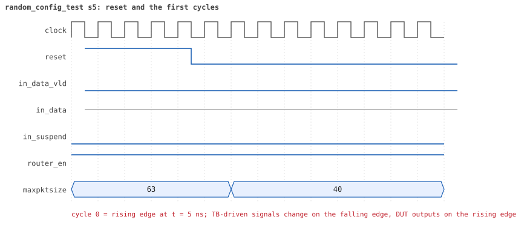
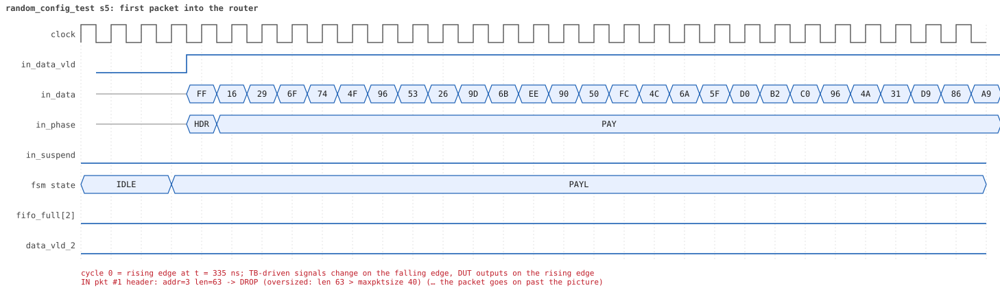
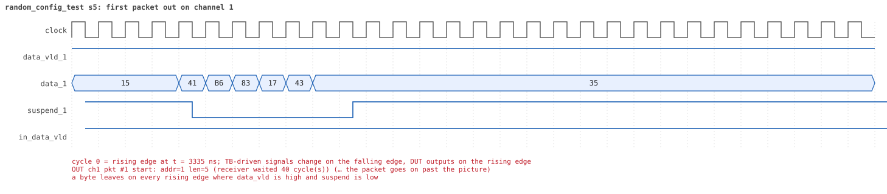
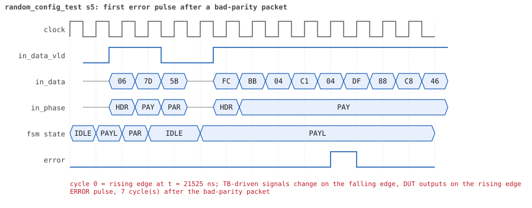
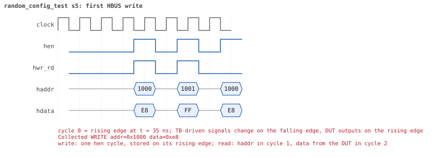
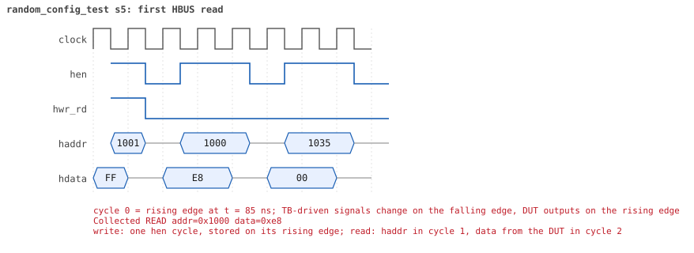

# random_config_test seed 5

**Result:** PASSED (0 UVM_ERROR, 0 UVM_WARNING, 0 UVM_FATAL) · bench `yapp_project_tb` · sim time 19us · wall 9.9 s · log [`random_config_test_s5.log`](random_config_test_s5.log)

Waves: `random_config_test_s5.fst` (GTKWave, Surfer or the VS Code wave viewer).
[Open the waves in Surfer](https://app.surfer-project.org/?load_url=https%3A%2F%2Fraw.githubusercontent.com%2Ftamirgabgab%2FQcom-Mentoring%2Fmain%2Fyapp_project%2Fregression%2Fyapp_project_tb%2Frandom_config_test_s5%2Frandom_config_test_s5.fst&startup_commands=run_command_file_from_url%20https%3A%2F%2Fraw.githubusercontent.com%2Ftamirgabgab%2FQcom-Mentoring%2Fmain%2Fyapp_project%2Ftb%2Fyapp_router.sucl) (web app, the signals already in groups: `yapp_project/tb/yapp_router.sucl`).

## Summary

- YAPP driver sent **36** packet(s) (6 with bad parity); the input monitor saw 36.
- Router: **6** forwarded, **30** dropped (27 oversized, 3 illegal address 3).
- Packets out: ch0 **2**, ch1 **1**, ch2 **3**.
- Scoreboard: 6 matched, 0 mismatched, 0 unexpected.
- Back-pressure: in_suspend asserted **0** time(s).
- Error pulses: 6.
- HBUS: 24 write(s), 109 read(s).

## Stages

| time (ns) | stage |
|---|---|
| 0 | receivers: ch0 RX_FAST, ch1 RX_SLOW, ch2 RX_NORMAL |
| 0 | random scenario: 36 packets in 4 bursts |
| 340 | burst 1/4: ctrl=0xe8 (maxpktsize 40) en=0xff (router on, counter enables 1111111), 9 packet(s) |
| 4740 | burst 1/4 sent: addr0..3 1/3/1/4, bad parity 0, gap 0 1, length 1..63 |
| 5300 | burst 2/4: ctrl=0xd1 (maxpktsize 17) en=0x95 (router on, counter enables 1001010), 9 packet(s) |
| 9080 | burst 2/4 sent: addr0..3 4/1/3/1, bad parity 2, gap 0 3, length 1..63 |
| 9580 | burst 3/4: ctrl=0xc1 (maxpktsize 1) en=0xb3 (router on, counter enables 1011001), 9 packet(s) |
| 12630 | burst 3/4 sent: addr0..3 1/1/6/1, bad parity 1, gap 0 3, length 1..63 |
| 12840 | burst 4/4: ctrl=0x40 (maxpktsize 0) en=0xff (router on, counter enables 1111111), 9 packet(s) |
| 16310 | burst 4/4 sent: addr0..3 2/3/3/1, bad parity 3, gap 0 3, length 1..63 |
| 16310 | final reads: every register and the stored packet, checked against the reference model |
| 18615 | done: 36 packets (6 forwarded, 30 dropped), 0 storm burst(s), 6 scoreboard matches, 108 HBUS reads checked, 6 error pulses for 6 bad packets |

## Pictures

**reset and the first cycles**

**first packet into the router**

**first packet out on channel 1**

**first error pulse after a bad-parity packet**

**first HBUS write**

**first HBUS read**

## Timeline

604 events.

| time (ns) | who | event |
|---|---|---|
| 0 | yapp monitor | YAPP monitor running |
| 0 | **test** | STAGE: receivers: ch0 RX_FAST, ch1 RX_SLOW, ch2 RX_NORMAL |
| 0 | **test** | STAGE: random scenario: 36 packets in 4 bursts |
| 0 | clk/rst driver | Starting clock (period 10) and holding reset for 5 cycles |
| 0 | **DUT** | RESET asserted |
| 50 | **DUT** | RESET released: router_en=1 maxpktsize=63 |
| 70 | hbus driver | Executed WRITE addr=0x1000 data=0xe8 |
| 75 | **DUT** | CONFIG router_en=1 maxpktsize=40 |
| 75 | hbus monitor | Collected WRITE addr=0x1000 data=0xe8 |
| 75 | reference | maxpktsize is now 40 |
| 90 | hbus driver | Executed WRITE addr=0x1001 data=0xff |
| 95 | hbus monitor | Collected WRITE addr=0x1001 data=0xff |
| 95 | reference | router_en is now 1 (en_reg 0xff) |
| 120 | hbus driver | Executed READ  addr=0x1000 data=0xe8 |
| 125 | hbus monitor | Collected READ  addr=0x1000 data=0xe8 |
| 150 | hbus driver | Executed READ  addr=0x1035 data=0x00 |
| 155 | hbus monitor | Collected READ  addr=0x1035 data=0x00 |
| 170 | hbus driver | Executed WRITE addr=0x1173 data=0x99 |
| 175 | hbus monitor | Collected WRITE addr=0x1173 data=0x99 |
| 200 | hbus driver | Executed READ  addr=0x1173 data=0x99 |
| 205 | hbus monitor | Collected READ  addr=0x1173 data=0x99 |
| 230 | hbus driver | Executed READ  addr=0x1006 data=0x00 |
| 235 | hbus monitor | Collected READ  addr=0x1006 data=0x00 |
| 250 | hbus driver | Executed WRITE addr=0x116d data=0xca |
| 255 | hbus monitor | Collected WRITE addr=0x116d data=0xca |
| 280 | hbus driver | Executed READ  addr=0x116d data=0xca |
| 285 | hbus monitor | Collected READ  addr=0x116d data=0xca |
| 310 | hbus driver | Executed READ  addr=0x100f data=0x00 |
| 315 | hbus monitor | Collected READ  addr=0x100f data=0x00 |
| 340 | hbus driver | Executed READ  addr=0x100f data=0x00 |
| 340 | **test** | STAGE: burst 1/4: ctrl=0xe8 (maxpktsize 40) en=0xff (router on, counter enables 1111111), 9 packet(s) |
| 340 | yapp driver | TX pkt #1: addr=3 len=63 parity=good delay=1 |
| 345 | hbus monitor | Collected READ  addr=0x100f data=0x00 |
| 365 | **DUT** | IN  pkt #1 header: addr=3 len=63 -> DROP (oversized: len 63 > maxpktsize 40) |
| 1005 | **DUT** | IN  pkt #1 complete: addr=3 len=63 parity=ok dropped, 65 bytes in 65 cycles (held 0) |
| 1005 | yapp monitor | RX pkt #1 on the input: addr=3 len=63 parity=good gap=31 |
| 1005 | reference | Packet dropped: illegal address 3 (len=63) |
| 1005 | **DUT** | ROUTER DROPS PACKET addr=3 length=63 (    illegal address) |
| 1010 | yapp driver | TX pkt #1 accepted by the DUT |
| 1010 | yapp driver | TX pkt #2: addr=3 len=63 parity=good delay=12 |
| 1135 | **DUT** | IN  pkt #2 header: addr=3 len=63 -> DROP (oversized: len 63 > maxpktsize 40) |
| 1775 | **DUT** | IN  pkt #2 complete: addr=3 len=63 parity=ok dropped, 65 bytes in 65 cycles (held 0) |
| 1775 | yapp monitor | RX pkt #2 on the input: addr=3 len=63 parity=good gap=12 |
| 1775 | reference | Packet dropped: illegal address 3 (len=63) |
| 1775 | **DUT** | ROUTER DROPS PACKET addr=3 length=63 (    illegal address) |
| 1780 | yapp driver | TX pkt #2 accepted by the DUT |
| 1780 | yapp driver | TX pkt #3: addr=0 len=41 parity=good delay=8 |
| 1865 | **DUT** | IN  pkt #3 header: addr=0 len=41 -> DROP (oversized: len 41 > maxpktsize 40) |
| 2285 | **DUT** | IN  pkt #3 complete: addr=0 len=41 parity=ok dropped, 43 bytes in 43 cycles (held 0) |
| 2285 | yapp monitor | RX pkt #3 on the input: addr=0 len=41 parity=good gap=8 |
| 2285 | reference | Packet dropped: length 41 > maxpktsize 40 (addr=0) |
| 2285 | **DUT** | ROUTER DROPS PACKET addr=0 length=41 (length > maxpktsize) |
| 2290 | yapp driver | TX pkt #3 accepted by the DUT |
| 2290 | yapp driver | TX pkt #4: addr=1 len=60 parity=good delay=5 |
| 2345 | **DUT** | IN  pkt #4 header: addr=1 len=60 -> DROP (oversized: len 60 > maxpktsize 40) |
| 2955 | **DUT** | IN  pkt #4 complete: addr=1 len=60 parity=ok dropped, 62 bytes in 62 cycles (held 0) |
| 2955 | yapp monitor | RX pkt #4 on the input: addr=1 len=60 parity=good gap=5 |
| 2955 | reference | Packet dropped: length 60 > maxpktsize 40 (addr=1) |
| 2955 | **DUT** | ROUTER DROPS PACKET addr=1 length=60 (length > maxpktsize) |
| 2960 | yapp driver | TX pkt #4 accepted by the DUT |
| 2960 | yapp driver | TX pkt #5: addr=1 len=5 parity=good delay=0 |
| 2965 | **DUT** | IN  pkt #5 header: addr=1 len=5 -> channel 1 |
| 3025 | **DUT** | IN  pkt #5 complete: addr=1 len=5 parity=ok forwarded, 7 bytes in 7 cycles (held 0) |
| 3025 | yapp monitor | RX pkt #5 on the input: addr=1 len=5 parity=good gap=0 |
| 3025 | reference | Packet forwarded: addr=1 len=5 -> channel 1 |
| 3030 | yapp driver | TX pkt #5 accepted by the DUT |
| 3030 | yapp driver | TX pkt #6: addr=3 len=63 parity=good delay=8 |
| 3115 | **DUT** | IN  pkt #6 header: addr=3 len=63 -> DROP (oversized: len 63 > maxpktsize 40) |
| 3375 | **DUT** | OUT ch1 pkt #1 start: addr=1 len=5 (receiver waited 40 cycle(s)) |
| 3430 | ch1 driver | ch1: packet consumed (response delay 40) |
| 3755 | **DUT** | IN  pkt #6 complete: addr=3 len=63 parity=ok dropped, 65 bytes in 65 cycles (held 0) |
| 3755 | yapp monitor | RX pkt #6 on the input: addr=3 len=63 parity=good gap=8 |
| 3755 | reference | Packet dropped: illegal address 3 (len=63) |
| 3755 | **DUT** | ROUTER DROPS PACKET addr=3 length=63 (    illegal address) |
| 3760 | yapp driver | TX pkt #6 accepted by the DUT |
| 3760 | yapp driver | TX pkt #7: addr=1 len=45 parity=good delay=3 |
| 3795 | **DUT** | IN  pkt #7 header: addr=1 len=45 -> DROP (oversized: len 45 > maxpktsize 40) |
| 3845 | **DUT** | OUT ch1 pkt #1 done: 7 bytes in 48 cycles |
| 3845 | ch1 monitor | ch1 RX pkt #1: addr=1 len=5 parity=good |
| 3845 | scoreboard | ch1 pkt matched: addr=1 len=5 (1 matched so far) |
| 3980 | ch1 driver | ch1: packet consumed (response delay 40) |
| 4255 | **DUT** | IN  pkt #7 complete: addr=1 len=45 parity=ok dropped, 47 bytes in 47 cycles (held 0) |
| 4255 | yapp monitor | RX pkt #7 on the input: addr=1 len=45 parity=good gap=3 |
| 4255 | reference | Packet dropped: length 45 > maxpktsize 40 (addr=1) |
| 4255 | **DUT** | ROUTER DROPS PACKET addr=1 length=45 (length > maxpktsize) |
| 4260 | yapp driver | TX pkt #7 accepted by the DUT |
| 4260 | yapp driver | TX pkt #8: addr=3 len=1 parity=good delay=1 |
| 4275 | **DUT** | IN  pkt #8 header: addr=3 len=1 -> DROP (illegal address 3) |
| 4295 | **DUT** | IN  pkt #8 complete: addr=3 len=1 parity=ok dropped, 3 bytes in 3 cycles (held 0) |
| 4295 | yapp monitor | RX pkt #8 on the input: addr=3 len=1 parity=good gap=1 |
| 4295 | reference | Packet dropped: illegal address 3 (len=1) |
| 4295 | **DUT** | ROUTER DROPS PACKET addr=3 length=1 (    illegal address) |
| 4300 | yapp driver | TX pkt #8 accepted by the DUT |
| 4300 | yapp driver | TX pkt #9: addr=2 len=41 parity=good delay=1 |
| 4315 | **DUT** | IN  pkt #9 header: addr=2 len=41 -> DROP (oversized: len 41 > maxpktsize 40) |
| 4735 | **DUT** | IN  pkt #9 complete: addr=2 len=41 parity=ok dropped, 43 bytes in 43 cycles (held 0) |
| 4735 | yapp monitor | RX pkt #9 on the input: addr=2 len=41 parity=good gap=1 |
| 4735 | reference | Packet dropped: length 41 > maxpktsize 40 (addr=2) |
| 4735 | **DUT** | ROUTER DROPS PACKET addr=2 length=41 (length > maxpktsize) |
| 4740 | yapp driver | TX pkt #9 accepted by the DUT |
| 4740 | **test** | STAGE: burst 1/4 sent: addr0..3 1/3/1/4, bad parity 0, gap 0 1, length 1..63 |
| 4760 | hbus driver | Executed WRITE addr=0x1000 data=0xd1 |
| 4765 | **DUT** | CONFIG router_en=1 maxpktsize=17 |
| 4765 | hbus monitor | Collected WRITE addr=0x1000 data=0xd1 |
| 4765 | reference | maxpktsize is now 17 |
| 4780 | hbus driver | Executed WRITE addr=0x1001 data=0x95 |
| 4785 | hbus monitor | Collected WRITE addr=0x1001 data=0x95 |
| 4785 | reference | router_en is now 1 (en_reg 0x95) |
| 4810 | hbus driver | Executed READ  addr=0x1009 data=0x01 |
| 4815 | hbus monitor | Collected READ  addr=0x1009 data=0x01 |
| 4830 | hbus driver | Executed WRITE addr=0x11ce data=0x3c |
| 4835 | hbus monitor | Collected WRITE addr=0x11ce data=0x3c |
| 4860 | hbus driver | Executed READ  addr=0x11ce data=0x3c |
| 4865 | hbus monitor | Collected READ  addr=0x11ce data=0x3c |
| 4880 | hbus driver | Executed WRITE addr=0x11e7 data=0x89 |
| 4885 | hbus monitor | Collected WRITE addr=0x11e7 data=0x89 |
| 4910 | hbus driver | Executed READ  addr=0x11e7 data=0x89 |
| 4915 | hbus monitor | Collected READ  addr=0x11e7 data=0x89 |
| 4930 | hbus driver | Executed WRITE addr=0x119e data=0x74 |
| 4935 | hbus monitor | Collected WRITE addr=0x119e data=0x74 |
| 4960 | hbus driver | Executed READ  addr=0x119e data=0x74 |
| 4965 | hbus monitor | Collected READ  addr=0x119e data=0x74 |
| 4980 | hbus driver | Executed WRITE addr=0x1104 data=0x0f |
| 4985 | hbus monitor | Collected WRITE addr=0x1104 data=0x0f |
| 5010 | hbus driver | Executed READ  addr=0x1104 data=0x0f |
| 5015 | hbus monitor | Collected READ  addr=0x1104 data=0x0f |
| 5030 | hbus driver | Executed WRITE addr=0x118a data=0x4a |
| 5035 | hbus monitor | Collected WRITE addr=0x118a data=0x4a |
| 5060 | hbus driver | Executed READ  addr=0x118a data=0x4a |
| 5065 | hbus monitor | Collected READ  addr=0x118a data=0x4a |
| 5080 | hbus driver | Executed WRITE addr=0x11f9 data=0x5e |
| 5085 | hbus monitor | Collected WRITE addr=0x11f9 data=0x5e |
| 5110 | hbus driver | Executed READ  addr=0x11f9 data=0x5e |
| 5115 | hbus monitor | Collected READ  addr=0x11f9 data=0x5e |
| 5140 | hbus driver | Executed READ  addr=0x10bf data=0x00 |
| 5145 | hbus monitor | Collected READ  addr=0x10bf data=0x00 |
| 5160 | hbus driver | Executed WRITE addr=0x1137 data=0xb3 |
| 5165 | hbus monitor | Collected WRITE addr=0x1137 data=0xb3 |
| 5190 | hbus driver | Executed READ  addr=0x1137 data=0xb3 |
| 5195 | hbus monitor | Collected READ  addr=0x1137 data=0xb3 |
| 5220 | hbus driver | Executed READ  addr=0x100d data=0x29 |
| 5225 | hbus monitor | Collected READ  addr=0x100d data=0x29 |
| 5250 | hbus driver | Executed READ  addr=0x100f data=0x00 |
| 5255 | hbus monitor | Collected READ  addr=0x100f data=0x00 |
| 5270 | hbus driver | Executed WRITE addr=0x11fc data=0x0e |
| 5275 | hbus monitor | Collected WRITE addr=0x11fc data=0x0e |
| 5300 | hbus driver | Executed READ  addr=0x11fc data=0x0e |
| 5300 | **test** | STAGE: burst 2/4: ctrl=0xd1 (maxpktsize 17) en=0x95 (router on, counter enables 1001010), 9 packet(s) |
| 5300 | yapp driver | TX pkt #10: addr=2 len=63 parity=good delay=1 |
| 5305 | hbus monitor | Collected READ  addr=0x11fc data=0x0e |
| 5325 | **DUT** | IN  pkt #10 header: addr=2 len=63 -> DROP (oversized: len 63 > maxpktsize 17) |
| 5965 | **DUT** | IN  pkt #10 complete: addr=2 len=63 parity=ok dropped, 65 bytes in 65 cycles (held 0) |
| 5965 | yapp monitor | RX pkt #10 on the input: addr=2 len=63 parity=good gap=58 |
| 5965 | reference | Packet dropped: length 63 > maxpktsize 17 (addr=2) |
| 5965 | **DUT** | ROUTER DROPS PACKET addr=2 length=63 (length > maxpktsize) |
| 5970 | yapp driver | TX pkt #10 accepted by the DUT |
| 5970 | yapp driver | TX pkt #11: addr=2 len=32 parity=good delay=13 |
| 6105 | **DUT** | IN  pkt #11 header: addr=2 len=32 -> DROP (oversized: len 32 > maxpktsize 17) |
| 6435 | **DUT** | IN  pkt #11 complete: addr=2 len=32 parity=ok dropped, 34 bytes in 34 cycles (held 0) |
| 6435 | yapp monitor | RX pkt #11 on the input: addr=2 len=32 parity=good gap=13 |
| 6435 | reference | Packet dropped: length 32 > maxpktsize 17 (addr=2) |
| 6435 | **DUT** | ROUTER DROPS PACKET addr=2 length=32 (length > maxpktsize) |
| 6440 | yapp driver | TX pkt #11 accepted by the DUT |
| 6440 | yapp driver | TX pkt #12: addr=2 len=1 parity=good delay=2 |
| 6465 | **DUT** | IN  pkt #12 header: addr=2 len=1 -> channel 2 |
| 6485 | **DUT** | IN  pkt #12 complete: addr=2 len=1 parity=ok forwarded, 3 bytes in 3 cycles (held 0) |
| 6485 | yapp monitor | RX pkt #12 on the input: addr=2 len=1 parity=good gap=2 |
| 6485 | reference | Packet forwarded: addr=2 len=1 -> channel 2 |
| 6490 | yapp driver | TX pkt #12 accepted by the DUT |
| 6490 | yapp driver | TX pkt #13: addr=0 len=17 parity=good delay=3 |
| 6525 | **DUT** | IN  pkt #13 header: addr=0 len=17 -> channel 0 |
| 6535 | **DUT** | OUT ch0 pkt #1 start: addr=0 len=17 (receiver waited 0 cycle(s)) |
| 6565 | **DUT** | OUT ch2 pkt #1 start: addr=2 len=1 (receiver waited 9 cycle(s)) |
| 6580 | ch2 driver | ch2: packet consumed (response delay 9) |
| 6695 | **DUT** | OUT ch2 pkt #1 done: 3 bytes in 14 cycles |
| 6695 | ch2 monitor | ch2 RX pkt #1: addr=2 len=1 parity=good |
| 6695 | scoreboard | ch2 pkt matched: addr=2 len=1 (2 matched so far) |
| 6705 | **DUT** | IN  pkt #13 complete: addr=0 len=17 parity=ok forwarded, 19 bytes in 19 cycles (held 0) |
| 6705 | yapp monitor | RX pkt #13 on the input: addr=0 len=17 parity=good gap=3 |
| 6705 | reference | Packet forwarded: addr=0 len=17 -> channel 0 |
| 6710 | ch0 driver | ch0: packet consumed (response delay 0) |
| 6710 | yapp driver | TX pkt #13 accepted by the DUT |
| 6710 | yapp driver | TX pkt #14: addr=0 len=16 parity=good delay=2 |
| 6725 | **DUT** | OUT ch0 pkt #1 done: 19 bytes in 20 cycles |
| 6725 | ch0 monitor | ch0 RX pkt #1: addr=0 len=17 parity=good |
| 6725 | scoreboard | ch0 pkt matched: addr=0 len=17 (3 matched so far) |
| 6735 | **DUT** | IN  pkt #14 header: addr=0 len=16 -> channel 0 |
| 6745 | **DUT** | OUT ch0 pkt #2 start: addr=0 len=16 (receiver waited 0 cycle(s)) |
| 6905 | **DUT** | IN  pkt #14 complete: addr=0 len=16 parity=ok forwarded, 18 bytes in 18 cycles (held 0) |
| 6905 | yapp monitor | RX pkt #14 on the input: addr=0 len=16 parity=good gap=2 |
| 6905 | reference | Packet forwarded: addr=0 len=16 -> channel 0 |
| 6910 | yapp driver | TX pkt #14 accepted by the DUT |
| 6910 | yapp driver | TX pkt #15: addr=0 len=63 parity=good delay=0 |
| 6915 | **DUT** | IN  pkt #15 header: addr=0 len=63 -> DROP (oversized: len 63 > maxpktsize 17) |
| 6915 | **DUT** | OUT ch0 pkt #2 done: 18 bytes in 18 cycles |
| 6915 | ch0 monitor | ch0 RX pkt #2: addr=0 len=16 parity=good |
| 6915 | scoreboard | ch0 pkt matched: addr=0 len=16 (4 matched so far) |
| 7180 | ch0 driver | ch0: packet consumed (response delay 0) |
| 7320 | ch2 driver | ch2: packet consumed (response delay 10) |
| 7555 | **DUT** | IN  pkt #15 complete: addr=0 len=63 parity=ok dropped, 65 bytes in 65 cycles (held 0) |
| 7555 | yapp monitor | RX pkt #15 on the input: addr=0 len=63 parity=good gap=0 |
| 7555 | reference | Packet dropped: length 63 > maxpktsize 17 (addr=0) |
| 7555 | **DUT** | ROUTER DROPS PACKET addr=0 length=63 (length > maxpktsize) |
| 7560 | yapp driver | TX pkt #15 accepted by the DUT |
| 7560 | yapp driver | TX pkt #16: addr=3 len=17 parity=good delay=0 |
| 7565 | **DUT** | IN  pkt #16 header: addr=3 len=17 -> DROP (illegal address 3) |
| 7745 | **DUT** | IN  pkt #16 complete: addr=3 len=17 parity=ok dropped, 19 bytes in 19 cycles (held 0) |
| 7745 | yapp monitor | RX pkt #16 on the input: addr=3 len=17 parity=good gap=0 |
| 7745 | reference | Packet dropped: illegal address 3 (len=17) |
| 7745 | **DUT** | ROUTER DROPS PACKET addr=3 length=17 (    illegal address) |
| 7750 | yapp driver | TX pkt #16 accepted by the DUT |
| 7750 | yapp driver | TX pkt #17: addr=0 len=63 parity=bad delay=0 |
| 7755 | **DUT** | IN  pkt #17 header: addr=0 len=63 -> DROP (oversized: len 63 > maxpktsize 17) |
| 8395 | **DUT** | IN  pkt #17 complete: addr=0 len=63 parity=BAD dropped, 65 bytes in 65 cycles (held 0) |
| 8395 | yapp monitor | RX pkt #17 on the input: addr=0 len=63 parity=bad gap=0 |
| 8395 | reference | Packet dropped: length 63 > maxpktsize 17 (addr=0) |
| 8395 | **DUT** | ROUTER DROPS PACKET addr=0 length=63 (length > maxpktsize) |
| 8400 | yapp driver | TX pkt #17 accepted by the DUT |
| 8400 | yapp driver | TX pkt #18: addr=1 len=63 parity=bad delay=3 |
| 8430 | **DUT** | ERROR pulse, 3 cycle(s) after the bad-parity packet |
| 8430 | error checker | error pulse 3 cycles after the bad packet (0 still owed) |
| 8435 | **DUT** | IN  pkt #18 header: addr=1 len=63 -> DROP (oversized: len 63 > maxpktsize 17) |
| 9075 | **DUT** | IN  pkt #18 complete: addr=1 len=63 parity=BAD dropped, 65 bytes in 65 cycles (held 0) |
| 9075 | yapp monitor | RX pkt #18 on the input: addr=1 len=63 parity=bad gap=3 |
| 9075 | reference | Packet dropped: length 63 > maxpktsize 17 (addr=1) |
| 9075 | **DUT** | ROUTER DROPS PACKET addr=1 length=63 (length > maxpktsize) |
| 9080 | yapp driver | TX pkt #18 accepted by the DUT |
| 9080 | **test** | STAGE: burst 2/4 sent: addr0..3 4/1/3/1, bad parity 2, gap 0 3, length 1..63 |
| 9100 | hbus driver | Executed WRITE addr=0x1000 data=0xc1 |
| 9105 | **DUT** | CONFIG router_en=1 maxpktsize=1 |
| 9105 | hbus monitor | Collected WRITE addr=0x1000 data=0xc1 |
| 9105 | reference | maxpktsize is now 1 |
| 9120 | hbus driver | Executed WRITE addr=0x1001 data=0xb3 |
| 9125 | hbus monitor | Collected WRITE addr=0x1001 data=0xb3 |
| 9125 | reference | router_en is now 1 (en_reg 0xb3) |
| 9140 | hbus driver | Executed WRITE addr=0x1122 data=0x7f |
| 9145 | hbus monitor | Collected WRITE addr=0x1122 data=0x7f |
| 9150 | **DUT** | ERROR pulse, 7 cycle(s) after the bad-parity packet |
| 9150 | error checker | error pulse 7 cycles after the bad packet (0 still owed) |
| 9170 | hbus driver | Executed READ  addr=0x1122 data=0x7f |
| 9175 | hbus monitor | Collected READ  addr=0x1122 data=0x7f |
| 9200 | hbus driver | Executed READ  addr=0x1000 data=0xc1 |
| 9205 | hbus monitor | Collected READ  addr=0x1000 data=0xc1 |
| 9230 | hbus driver | Executed READ  addr=0x1004 data=0x00 |
| 9235 | hbus monitor | Collected READ  addr=0x1004 data=0x00 |
| 9260 | hbus driver | Executed READ  addr=0x1058 data=0x00 |
| 9265 | hbus monitor | Collected READ  addr=0x1058 data=0x00 |
| 9290 | hbus driver | Executed READ  addr=0x1001 data=0xb3 |
| 9295 | hbus monitor | Collected READ  addr=0x1001 data=0xb3 |
| 9320 | hbus driver | Executed READ  addr=0x1002 data=0x00 |
| 9325 | hbus monitor | Collected READ  addr=0x1002 data=0x00 |
| 9350 | hbus driver | Executed READ  addr=0x100d data=0x3f |
| 9355 | hbus monitor | Collected READ  addr=0x100d data=0x3f |
| 9370 | hbus driver | Executed WRITE addr=0x11e5 data=0x79 |
| 9375 | hbus monitor | Collected WRITE addr=0x11e5 data=0x79 |
| 9400 | hbus driver | Executed READ  addr=0x11e5 data=0x79 |
| 9405 | hbus monitor | Collected READ  addr=0x11e5 data=0x79 |
| 9420 | hbus driver | Executed WRITE addr=0x119b data=0x52 |
| 9425 | hbus monitor | Collected WRITE addr=0x119b data=0x52 |
| 9450 | hbus driver | Executed READ  addr=0x119b data=0x52 |
| 9455 | hbus monitor | Collected READ  addr=0x119b data=0x52 |
| 9480 | hbus driver | Executed READ  addr=0x101e data=0x68 |
| 9485 | hbus monitor | Collected READ  addr=0x101e data=0x68 |
| 9500 | hbus driver | Executed WRITE addr=0x1172 data=0xb7 |
| 9505 | hbus monitor | Collected WRITE addr=0x1172 data=0xb7 |
| 9530 | hbus driver | Executed READ  addr=0x1172 data=0xb7 |
| 9535 | hbus monitor | Collected READ  addr=0x1172 data=0xb7 |
| 9550 | hbus driver | Executed WRITE addr=0x1101 data=0x01 |
| 9555 | hbus monitor | Collected WRITE addr=0x1101 data=0x01 |
| 9580 | hbus driver | Executed READ  addr=0x1101 data=0x01 |
| 9580 | **test** | STAGE: burst 3/4: ctrl=0xc1 (maxpktsize 1) en=0xb3 (router on, counter enables 1011001), 9 packet(s) |
| 9580 | yapp driver | TX pkt #19: addr=2 len=1 parity=good delay=7 |
| 9585 | hbus monitor | Collected READ  addr=0x1101 data=0x01 |
| 9665 | **DUT** | IN  pkt #19 header: addr=2 len=1 -> channel 2 |
| 9685 | **DUT** | IN  pkt #19 complete: addr=2 len=1 parity=ok forwarded, 3 bytes in 3 cycles (held 0) |
| 9685 | yapp monitor | RX pkt #19 on the input: addr=2 len=1 parity=good gap=58 |
| 9685 | reference | Packet forwarded: addr=2 len=1 -> channel 2 |
| 9690 | yapp driver | TX pkt #19 accepted by the DUT |
| 9690 | yapp driver | TX pkt #20: addr=2 len=53 parity=good delay=1 |
| 9705 | **DUT** | IN  pkt #20 header: addr=2 len=53 -> DROP (oversized: len 53 > maxpktsize 1) |
| 9725 | **DUT** | OUT ch2 pkt #2 start: addr=2 len=1 (receiver waited 5 cycle(s)) |
| 9740 | ch2 driver | ch2: packet consumed (response delay 5) |
| 9855 | **DUT** | OUT ch2 pkt #2 done: 3 bytes in 14 cycles |
| 9855 | ch2 monitor | ch2 RX pkt #2: addr=2 len=1 parity=good |
| 9855 | scoreboard | ch2 pkt matched: addr=2 len=1 (5 matched so far) |
| 10000 | ch2 driver | ch2: packet consumed (response delay 10) |
| 10245 | **DUT** | IN  pkt #20 complete: addr=2 len=53 parity=ok dropped, 55 bytes in 55 cycles (held 0) |
| 10245 | yapp monitor | RX pkt #20 on the input: addr=2 len=53 parity=good gap=1 |
| 10245 | reference | Packet dropped: length 53 > maxpktsize 1 (addr=2) |
| 10245 | **DUT** | ROUTER DROPS PACKET addr=2 length=53 (length > maxpktsize) |
| 10250 | yapp driver | TX pkt #20 accepted by the DUT |
| 10250 | yapp driver | TX pkt #21: addr=2 len=1 parity=bad delay=0 |
| 10255 | **DUT** | IN  pkt #21 header: addr=2 len=1 -> channel 2 |
| 10275 | **DUT** | IN  pkt #21 complete: addr=2 len=1 parity=BAD forwarded, 3 bytes in 3 cycles (held 0) |
| 10275 | yapp monitor | RX pkt #21 on the input: addr=2 len=1 parity=bad gap=0 |
| 10275 | reference | Packet forwarded: addr=2 len=1 -> channel 2 |
| 10280 | yapp driver | TX pkt #21 accepted by the DUT |
| 10280 | yapp driver | TX pkt #22: addr=2 len=2 parity=good delay=17 |
| 10330 | **DUT** | ERROR pulse, 5 cycle(s) after the bad-parity packet |
| 10330 | error checker | error pulse 5 cycles after the bad packet (0 still owed) |
| 10335 | **DUT** | OUT ch2 pkt #3 start: addr=2 len=1 (receiver waited 7 cycle(s)) |
| 10350 | ch2 driver | ch2: packet consumed (response delay 7) |
| 10435 | **DUT** | OUT ch2 pkt #3 done: 3 bytes in 11 cycles |
| 10435 | ch2 monitor | ch2 RX pkt #3: addr=2 len=1 parity=bad |
| 10435 | scoreboard | ch2 pkt matched: addr=2 len=1 (6 matched so far) |
| 10455 | **DUT** | IN  pkt #22 header: addr=2 len=2 -> DROP (oversized: len 2 > maxpktsize 1) |
| 10485 | **DUT** | IN  pkt #22 complete: addr=2 len=2 parity=ok dropped, 4 bytes in 4 cycles (held 0) |
| 10485 | yapp monitor | RX pkt #22 on the input: addr=2 len=2 parity=good gap=17 |
| 10485 | reference | Packet dropped: length 2 > maxpktsize 1 (addr=2) |
| 10485 | **DUT** | ROUTER DROPS PACKET addr=2 length=2 (length > maxpktsize) |
| 10490 | yapp driver | TX pkt #22 accepted by the DUT |
| 10490 | yapp driver | TX pkt #23: addr=0 len=39 parity=good delay=0 |
| 10495 | **DUT** | IN  pkt #23 header: addr=0 len=39 -> DROP (oversized: len 39 > maxpktsize 1) |
| 10630 | ch2 driver | ch2: packet consumed (response delay 7) |
| 10895 | **DUT** | IN  pkt #23 complete: addr=0 len=39 parity=ok dropped, 41 bytes in 41 cycles (held 0) |
| 10895 | yapp monitor | RX pkt #23 on the input: addr=0 len=39 parity=good gap=0 |
| 10895 | reference | Packet dropped: length 39 > maxpktsize 1 (addr=0) |
| 10895 | **DUT** | ROUTER DROPS PACKET addr=0 length=39 (length > maxpktsize) |
| 10900 | yapp driver | TX pkt #23 accepted by the DUT |
| 10900 | yapp driver | TX pkt #24: addr=2 len=63 parity=good delay=1 |
| 10915 | **DUT** | IN  pkt #24 header: addr=2 len=63 -> DROP (oversized: len 63 > maxpktsize 1) |
| 11555 | **DUT** | IN  pkt #24 complete: addr=2 len=63 parity=ok dropped, 65 bytes in 65 cycles (held 0) |
| 11555 | yapp monitor | RX pkt #24 on the input: addr=2 len=63 parity=good gap=1 |
| 11555 | reference | Packet dropped: length 63 > maxpktsize 1 (addr=2) |
| 11555 | **DUT** | ROUTER DROPS PACKET addr=2 length=63 (length > maxpktsize) |
| 11560 | yapp driver | TX pkt #24 accepted by the DUT |
| 11560 | yapp driver | TX pkt #25: addr=3 len=1 parity=good delay=18 |
| 11745 | **DUT** | IN  pkt #25 header: addr=3 len=1 -> DROP (illegal address 3) |
| 11765 | **DUT** | IN  pkt #25 complete: addr=3 len=1 parity=ok dropped, 3 bytes in 3 cycles (held 0) |
| 11765 | yapp monitor | RX pkt #25 on the input: addr=3 len=1 parity=good gap=18 |
| 11765 | reference | Packet dropped: illegal address 3 (len=1) |
| 11765 | **DUT** | ROUTER DROPS PACKET addr=3 length=1 (    illegal address) |
| 11770 | yapp driver | TX pkt #25 accepted by the DUT |
| 11770 | yapp driver | TX pkt #26: addr=1 len=18 parity=good delay=1 |
| 11785 | **DUT** | IN  pkt #26 header: addr=1 len=18 -> DROP (oversized: len 18 > maxpktsize 1) |
| 11975 | **DUT** | IN  pkt #26 complete: addr=1 len=18 parity=ok dropped, 20 bytes in 20 cycles (held 0) |
| 11975 | yapp monitor | RX pkt #26 on the input: addr=1 len=18 parity=good gap=1 |
| 11975 | reference | Packet dropped: length 18 > maxpktsize 1 (addr=1) |
| 11975 | **DUT** | ROUTER DROPS PACKET addr=1 length=18 (length > maxpktsize) |
| 11980 | yapp driver | TX pkt #26 accepted by the DUT |
| 11980 | yapp driver | TX pkt #27: addr=2 len=63 parity=good delay=0 |
| 11985 | **DUT** | IN  pkt #27 header: addr=2 len=63 -> DROP (oversized: len 63 > maxpktsize 1) |
| 12625 | **DUT** | IN  pkt #27 complete: addr=2 len=63 parity=ok dropped, 65 bytes in 65 cycles (held 0) |
| 12625 | yapp monitor | RX pkt #27 on the input: addr=2 len=63 parity=good gap=0 |
| 12625 | reference | Packet dropped: length 63 > maxpktsize 1 (addr=2) |
| 12625 | **DUT** | ROUTER DROPS PACKET addr=2 length=63 (length > maxpktsize) |
| 12630 | yapp driver | TX pkt #27 accepted by the DUT |
| 12630 | **test** | STAGE: burst 3/4 sent: addr0..3 1/1/6/1, bad parity 1, gap 0 3, length 1..63 |
| 12650 | hbus driver | Executed WRITE addr=0x1000 data=0x40 |
| 12655 | **DUT** | CONFIG router_en=1 maxpktsize=0 |
| 12655 | hbus monitor | Collected WRITE addr=0x1000 data=0x40 |
| 12655 | reference | maxpktsize is now 0 |
| 12670 | hbus driver | Executed WRITE addr=0x1001 data=0xff |
| 12675 | hbus monitor | Collected WRITE addr=0x1001 data=0xff |
| 12675 | reference | router_en is now 1 (en_reg 0xff) |
| 12700 | hbus driver | Executed READ  addr=0x100d data=0x3f |
| 12705 | hbus monitor | Collected READ  addr=0x100d data=0x3f |
| 12730 | hbus driver | Executed READ  addr=0x100b data=0x01 |
| 12735 | hbus monitor | Collected READ  addr=0x100b data=0x01 |
| 12750 | hbus driver | Executed WRITE addr=0x11ea data=0xaa |
| 12755 | hbus monitor | Collected WRITE addr=0x11ea data=0xaa |
| 12780 | hbus driver | Executed READ  addr=0x11ea data=0xaa |
| 12785 | hbus monitor | Collected READ  addr=0x11ea data=0xaa |
| 12810 | hbus driver | Executed READ  addr=0x100d data=0x3f |
| 12815 | hbus monitor | Collected READ  addr=0x100d data=0x3f |
| 12840 | hbus driver | Executed READ  addr=0x1034 data=0x5d |
| 12840 | **test** | STAGE: burst 4/4: ctrl=0x40 (maxpktsize 0) en=0xff (router on, counter enables 1111111), 9 packet(s) |
| 12840 | yapp driver | TX pkt #28: addr=2 len=1 parity=good delay=20 |
| 12845 | hbus monitor | Collected READ  addr=0x1034 data=0x5d |
| 13055 | **DUT** | IN  pkt #28 header: addr=2 len=1 -> DROP (oversized: len 1 > maxpktsize 0) |
| 13075 | **DUT** | IN  pkt #28 complete: addr=2 len=1 parity=ok dropped, 3 bytes in 3 cycles (held 0) |
| 13075 | yapp monitor | RX pkt #28 on the input: addr=2 len=1 parity=good gap=42 |
| 13075 | reference | Packet dropped: length 1 > maxpktsize 0 (addr=2) |
| 13075 | **DUT** | ROUTER DROPS PACKET addr=2 length=1 (length > maxpktsize) |
| 13080 | yapp driver | TX pkt #28 accepted by the DUT |
| 13080 | yapp driver | TX pkt #29: addr=1 len=1 parity=good delay=0 |
| 13085 | **DUT** | IN  pkt #29 header: addr=1 len=1 -> DROP (oversized: len 1 > maxpktsize 0) |
| 13105 | **DUT** | IN  pkt #29 complete: addr=1 len=1 parity=ok dropped, 3 bytes in 3 cycles (held 0) |
| 13105 | yapp monitor | RX pkt #29 on the input: addr=1 len=1 parity=good gap=0 |
| 13105 | reference | Packet dropped: length 1 > maxpktsize 0 (addr=1) |
| 13105 | **DUT** | ROUTER DROPS PACKET addr=1 length=1 (length > maxpktsize) |
| 13110 | yapp driver | TX pkt #29 accepted by the DUT |
| 13110 | yapp driver | TX pkt #30: addr=1 len=4 parity=bad delay=20 |
| 13315 | **DUT** | IN  pkt #30 header: addr=1 len=4 -> DROP (oversized: len 4 > maxpktsize 0) |
| 13365 | **DUT** | IN  pkt #30 complete: addr=1 len=4 parity=BAD dropped, 6 bytes in 6 cycles (held 0) |
| 13365 | yapp monitor | RX pkt #30 on the input: addr=1 len=4 parity=bad gap=20 |
| 13365 | reference | Packet dropped: length 4 > maxpktsize 0 (addr=1) |
| 13365 | **DUT** | ROUTER DROPS PACKET addr=1 length=4 (length > maxpktsize) |
| 13370 | yapp driver | TX pkt #30 accepted by the DUT |
| 13370 | yapp driver | TX pkt #31: addr=1 len=63 parity=bad delay=20 |
| 13410 | **DUT** | ERROR pulse, 4 cycle(s) after the bad-parity packet |
| 13410 | error checker | error pulse 4 cycles after the bad packet (0 still owed) |
| 13575 | **DUT** | IN  pkt #31 header: addr=1 len=63 -> DROP (oversized: len 63 > maxpktsize 0) |
| 14215 | **DUT** | IN  pkt #31 complete: addr=1 len=63 parity=BAD dropped, 65 bytes in 65 cycles (held 0) |
| 14215 | yapp monitor | RX pkt #31 on the input: addr=1 len=63 parity=bad gap=20 |
| 14215 | reference | Packet dropped: length 63 > maxpktsize 0 (addr=1) |
| 14215 | **DUT** | ROUTER DROPS PACKET addr=1 length=63 (length > maxpktsize) |
| 14220 | yapp driver | TX pkt #31 accepted by the DUT |
| 14220 | yapp driver | TX pkt #32: addr=2 len=1 parity=good delay=0 |
| 14225 | **DUT** | IN  pkt #32 header: addr=2 len=1 -> DROP (oversized: len 1 > maxpktsize 0) |
| 14245 | **DUT** | IN  pkt #32 complete: addr=2 len=1 parity=ok dropped, 3 bytes in 3 cycles (held 0) |
| 14245 | yapp monitor | RX pkt #32 on the input: addr=2 len=1 parity=good gap=0 |
| 14245 | reference | Packet dropped: length 1 > maxpktsize 0 (addr=2) |
| 14245 | **DUT** | ROUTER DROPS PACKET addr=2 length=1 (length > maxpktsize) |
| 14250 | yapp driver | TX pkt #32 accepted by the DUT |
| 14250 | yapp driver | TX pkt #33: addr=2 len=63 parity=good delay=4 |
| 14295 | **DUT** | IN  pkt #33 header: addr=2 len=63 -> DROP (oversized: len 63 > maxpktsize 0) |
| 14310 | **DUT** | ERROR pulse, 9 cycle(s) after the bad-parity packet |
| 14310 | error checker | error pulse 9 cycles after the bad packet (0 still owed) |
| 14935 | **DUT** | IN  pkt #33 complete: addr=2 len=63 parity=ok dropped, 65 bytes in 65 cycles (held 0) |
| 14935 | yapp monitor | RX pkt #33 on the input: addr=2 len=63 parity=good gap=4 |
| 14935 | reference | Packet dropped: length 63 > maxpktsize 0 (addr=2) |
| 14935 | **DUT** | ROUTER DROPS PACKET addr=2 length=63 (length > maxpktsize) |
| 14940 | yapp driver | TX pkt #33 accepted by the DUT |
| 14940 | yapp driver | TX pkt #34: addr=0 len=22 parity=bad delay=0 |
| 14945 | **DUT** | IN  pkt #34 header: addr=0 len=22 -> DROP (oversized: len 22 > maxpktsize 0) |
| 15175 | **DUT** | IN  pkt #34 complete: addr=0 len=22 parity=BAD dropped, 24 bytes in 24 cycles (held 0) |
| 15175 | yapp monitor | RX pkt #34 on the input: addr=0 len=22 parity=bad gap=0 |
| 15175 | reference | Packet dropped: length 22 > maxpktsize 0 (addr=0) |
| 15175 | **DUT** | ROUTER DROPS PACKET addr=0 length=22 (length > maxpktsize) |
| 15180 | yapp driver | TX pkt #34 accepted by the DUT |
| 15180 | yapp driver | TX pkt #35: addr=3 len=29 parity=good delay=16 |
| 15270 | **DUT** | ERROR pulse, 9 cycle(s) after the bad-parity packet |
| 15270 | error checker | error pulse 9 cycles after the bad packet (0 still owed) |
| 15345 | **DUT** | IN  pkt #35 header: addr=3 len=29 -> DROP (oversized: len 29 > maxpktsize 0) |
| 15645 | **DUT** | IN  pkt #35 complete: addr=3 len=29 parity=ok dropped, 31 bytes in 31 cycles (held 0) |
| 15645 | yapp monitor | RX pkt #35 on the input: addr=3 len=29 parity=good gap=16 |
| 15645 | reference | Packet dropped: illegal address 3 (len=29) |
| 15645 | **DUT** | ROUTER DROPS PACKET addr=3 length=29 (    illegal address) |
| 15650 | yapp driver | TX pkt #35 accepted by the DUT |
| 15650 | yapp driver | TX pkt #36: addr=0 len=63 parity=good delay=1 |
| 15665 | **DUT** | IN  pkt #36 header: addr=0 len=63 -> DROP (oversized: len 63 > maxpktsize 0) |
| 16305 | **DUT** | IN  pkt #36 complete: addr=0 len=63 parity=ok dropped, 65 bytes in 65 cycles (held 0) |
| 16305 | yapp monitor | RX pkt #36 on the input: addr=0 len=63 parity=good gap=1 |
| 16305 | reference | Packet dropped: length 63 > maxpktsize 0 (addr=0) |
| 16305 | **DUT** | ROUTER DROPS PACKET addr=0 length=63 (length > maxpktsize) |
| 16310 | yapp driver | TX pkt #36 accepted by the DUT |
| 16310 | **test** | STAGE: burst 4/4 sent: addr0..3 2/3/3/1, bad parity 3, gap 0 3, length 1..63 |
| 16310 | **test** | STAGE: final reads: every register and the stored packet, checked against the reference model |
| 16340 | hbus driver | Executed READ  addr=0x1000 data=0x40 |
| 16345 | hbus monitor | Collected READ  addr=0x1000 data=0x40 |
| 16370 | hbus driver | Executed READ  addr=0x1001 data=0xff |
| 16375 | hbus monitor | Collected READ  addr=0x1001 data=0xff |
| 16400 | hbus driver | Executed READ  addr=0x1004 data=0x04 |
| 16405 | hbus monitor | Collected READ  addr=0x1004 data=0x04 |
| 16430 | hbus driver | Executed READ  addr=0x1005 data=0x15 |
| 16435 | hbus monitor | Collected READ  addr=0x1005 data=0x15 |
| 16460 | hbus driver | Executed READ  addr=0x1006 data=0x07 |
| 16465 | hbus monitor | Collected READ  addr=0x1006 data=0x07 |
| 16490 | hbus driver | Executed READ  addr=0x1009 data=0x08 |
| 16495 | hbus monitor | Collected READ  addr=0x1009 data=0x08 |
| 16520 | hbus driver | Executed READ  addr=0x100a data=0x07 |
| 16525 | hbus monitor | Collected READ  addr=0x100a data=0x07 |
| 16550 | hbus driver | Executed READ  addr=0x100b data=0x04 |
| 16555 | hbus monitor | Collected READ  addr=0x100b data=0x04 |
| 16580 | hbus driver | Executed READ  addr=0x100d data=0x3f |
| 16585 | hbus monitor | Collected READ  addr=0x100d data=0x3f |
| 16610 | hbus driver | Executed READ  addr=0x1010 data=0xfc |
| 16615 | hbus monitor | Collected READ  addr=0x1010 data=0xfc |
| 16640 | hbus driver | Executed READ  addr=0x1011 data=0xb4 |
| 16645 | hbus monitor | Collected READ  addr=0x1011 data=0xb4 |
| 16670 | hbus driver | Executed READ  addr=0x1012 data=0x8c |
| 16675 | hbus monitor | Collected READ  addr=0x1012 data=0x8c |
| 16700 | hbus driver | Executed READ  addr=0x1013 data=0x58 |
| 16705 | hbus monitor | Collected READ  addr=0x1013 data=0x58 |
| 16730 | hbus driver | Executed READ  addr=0x1014 data=0x97 |
| 16735 | hbus monitor | Collected READ  addr=0x1014 data=0x97 |
| 16760 | hbus driver | Executed READ  addr=0x1015 data=0xc1 |
| 16765 | hbus monitor | Collected READ  addr=0x1015 data=0xc1 |
| 16790 | hbus driver | Executed READ  addr=0x1016 data=0xfb |
| 16795 | hbus monitor | Collected READ  addr=0x1016 data=0xfb |
| 16820 | hbus driver | Executed READ  addr=0x1017 data=0x9d |
| 16825 | hbus monitor | Collected READ  addr=0x1017 data=0x9d |
| 16850 | hbus driver | Executed READ  addr=0x1018 data=0x44 |
| 16855 | hbus monitor | Collected READ  addr=0x1018 data=0x44 |
| 16880 | hbus driver | Executed READ  addr=0x1019 data=0xea |
| 16885 | hbus monitor | Collected READ  addr=0x1019 data=0xea |
| 16910 | hbus driver | Executed READ  addr=0x101a data=0x17 |
| 16915 | hbus monitor | Collected READ  addr=0x101a data=0x17 |
| 16940 | hbus driver | Executed READ  addr=0x101b data=0xaa |
| 16945 | hbus monitor | Collected READ  addr=0x101b data=0xaa |
| 16970 | hbus driver | Executed READ  addr=0x101c data=0x93 |
| 16975 | hbus monitor | Collected READ  addr=0x101c data=0x93 |
| 17000 | hbus driver | Executed READ  addr=0x101d data=0xa7 |
| 17005 | hbus monitor | Collected READ  addr=0x101d data=0xa7 |
| 17030 | hbus driver | Executed READ  addr=0x101e data=0x05 |
| 17035 | hbus monitor | Collected READ  addr=0x101e data=0x05 |
| 17060 | hbus driver | Executed READ  addr=0x101f data=0xdb |
| 17065 | hbus monitor | Collected READ  addr=0x101f data=0xdb |
| 17090 | hbus driver | Executed READ  addr=0x1020 data=0xac |
| 17095 | hbus monitor | Collected READ  addr=0x1020 data=0xac |
| 17120 | hbus driver | Executed READ  addr=0x1021 data=0x43 |
| 17125 | hbus monitor | Collected READ  addr=0x1021 data=0x43 |
| 17150 | hbus driver | Executed READ  addr=0x1022 data=0x85 |
| 17155 | hbus monitor | Collected READ  addr=0x1022 data=0x85 |
| 17180 | hbus driver | Executed READ  addr=0x1023 data=0x6b |
| 17185 | hbus monitor | Collected READ  addr=0x1023 data=0x6b |
| 17210 | hbus driver | Executed READ  addr=0x1024 data=0x92 |
| 17215 | hbus monitor | Collected READ  addr=0x1024 data=0x92 |
| 17240 | hbus driver | Executed READ  addr=0x1025 data=0x08 |
| 17245 | hbus monitor | Collected READ  addr=0x1025 data=0x08 |
| 17270 | hbus driver | Executed READ  addr=0x1026 data=0x0b |
| 17275 | hbus monitor | Collected READ  addr=0x1026 data=0x0b |
| 17300 | hbus driver | Executed READ  addr=0x1027 data=0xf7 |
| 17305 | hbus monitor | Collected READ  addr=0x1027 data=0xf7 |
| 17330 | hbus driver | Executed READ  addr=0x1028 data=0x11 |
| 17335 | hbus monitor | Collected READ  addr=0x1028 data=0x11 |
| 17360 | hbus driver | Executed READ  addr=0x1029 data=0x1a |
| 17365 | hbus monitor | Collected READ  addr=0x1029 data=0x1a |
| 17390 | hbus driver | Executed READ  addr=0x102a data=0x37 |
| 17395 | hbus monitor | Collected READ  addr=0x102a data=0x37 |
| 17420 | hbus driver | Executed READ  addr=0x102b data=0xaf |
| 17425 | hbus monitor | Collected READ  addr=0x102b data=0xaf |
| 17450 | hbus driver | Executed READ  addr=0x102c data=0x92 |
| 17455 | hbus monitor | Collected READ  addr=0x102c data=0x92 |
| 17480 | hbus driver | Executed READ  addr=0x102d data=0x98 |
| 17485 | hbus monitor | Collected READ  addr=0x102d data=0x98 |
| 17510 | hbus driver | Executed READ  addr=0x102e data=0x2c |
| 17515 | hbus monitor | Collected READ  addr=0x102e data=0x2c |
| 17540 | hbus driver | Executed READ  addr=0x102f data=0xb2 |
| 17545 | hbus monitor | Collected READ  addr=0x102f data=0xb2 |
| 17570 | hbus driver | Executed READ  addr=0x1030 data=0x37 |
| 17575 | hbus monitor | Collected READ  addr=0x1030 data=0x37 |
| 17600 | hbus driver | Executed READ  addr=0x1031 data=0x27 |
| 17605 | hbus monitor | Collected READ  addr=0x1031 data=0x27 |
| 17630 | hbus driver | Executed READ  addr=0x1032 data=0x54 |
| 17635 | hbus monitor | Collected READ  addr=0x1032 data=0x54 |
| 17660 | hbus driver | Executed READ  addr=0x1033 data=0xf0 |
| 17665 | hbus monitor | Collected READ  addr=0x1033 data=0xf0 |
| 17690 | hbus driver | Executed READ  addr=0x1034 data=0xb3 |
| 17695 | hbus monitor | Collected READ  addr=0x1034 data=0xb3 |
| 17720 | hbus driver | Executed READ  addr=0x1035 data=0x30 |
| 17725 | hbus monitor | Collected READ  addr=0x1035 data=0x30 |
| 17750 | hbus driver | Executed READ  addr=0x1036 data=0x1b |
| 17755 | hbus monitor | Collected READ  addr=0x1036 data=0x1b |
| 17780 | hbus driver | Executed READ  addr=0x1037 data=0x96 |
| 17785 | hbus monitor | Collected READ  addr=0x1037 data=0x96 |
| 17810 | hbus driver | Executed READ  addr=0x1038 data=0x45 |
| 17815 | hbus monitor | Collected READ  addr=0x1038 data=0x45 |
| 17840 | hbus driver | Executed READ  addr=0x1039 data=0xe3 |
| 17845 | hbus monitor | Collected READ  addr=0x1039 data=0xe3 |
| 17870 | hbus driver | Executed READ  addr=0x103a data=0x21 |
| 17875 | hbus monitor | Collected READ  addr=0x103a data=0x21 |
| 17900 | hbus driver | Executed READ  addr=0x103b data=0xf2 |
| 17905 | hbus monitor | Collected READ  addr=0x103b data=0xf2 |
| 17930 | hbus driver | Executed READ  addr=0x103c data=0x46 |
| 17935 | hbus monitor | Collected READ  addr=0x103c data=0x46 |
| 17960 | hbus driver | Executed READ  addr=0x103d data=0xa9 |
| 17965 | hbus monitor | Collected READ  addr=0x103d data=0xa9 |
| 17990 | hbus driver | Executed READ  addr=0x103e data=0x96 |
| 17995 | hbus monitor | Collected READ  addr=0x103e data=0x96 |
| 18020 | hbus driver | Executed READ  addr=0x103f data=0x4d |
| 18025 | hbus monitor | Collected READ  addr=0x103f data=0x4d |
| 18050 | hbus driver | Executed READ  addr=0x1040 data=0x92 |
| 18055 | hbus monitor | Collected READ  addr=0x1040 data=0x92 |
| 18080 | hbus driver | Executed READ  addr=0x1041 data=0x43 |
| 18085 | hbus monitor | Collected READ  addr=0x1041 data=0x43 |
| 18110 | hbus driver | Executed READ  addr=0x1042 data=0x67 |
| 18115 | hbus monitor | Collected READ  addr=0x1042 data=0x67 |
| 18140 | hbus driver | Executed READ  addr=0x1043 data=0x19 |
| 18145 | hbus monitor | Collected READ  addr=0x1043 data=0x19 |
| 18170 | hbus driver | Executed READ  addr=0x1044 data=0x2f |
| 18175 | hbus monitor | Collected READ  addr=0x1044 data=0x2f |
| 18200 | hbus driver | Executed READ  addr=0x1045 data=0xd9 |
| 18205 | hbus monitor | Collected READ  addr=0x1045 data=0xd9 |
| 18230 | hbus driver | Executed READ  addr=0x1046 data=0x57 |
| 18235 | hbus monitor | Collected READ  addr=0x1046 data=0x57 |
| 18260 | hbus driver | Executed READ  addr=0x1047 data=0x06 |
| 18265 | hbus monitor | Collected READ  addr=0x1047 data=0x06 |
| 18290 | hbus driver | Executed READ  addr=0x1048 data=0x42 |
| 18295 | hbus monitor | Collected READ  addr=0x1048 data=0x42 |
| 18320 | hbus driver | Executed READ  addr=0x1049 data=0xf7 |
| 18325 | hbus monitor | Collected READ  addr=0x1049 data=0xf7 |
| 18350 | hbus driver | Executed READ  addr=0x104a data=0x65 |
| 18355 | hbus monitor | Collected READ  addr=0x104a data=0x65 |
| 18380 | hbus driver | Executed READ  addr=0x104b data=0xbd |
| 18385 | hbus monitor | Collected READ  addr=0x104b data=0xbd |
| 18410 | hbus driver | Executed READ  addr=0x104c data=0x64 |
| 18415 | hbus monitor | Collected READ  addr=0x104c data=0x64 |
| 18440 | hbus driver | Executed READ  addr=0x104d data=0xa0 |
| 18445 | hbus monitor | Collected READ  addr=0x104d data=0xa0 |
| 18470 | hbus driver | Executed READ  addr=0x104e data=0xd9 |
| 18475 | hbus monitor | Collected READ  addr=0x104e data=0xd9 |
| 18500 | hbus driver | Executed READ  addr=0x104f data=0x33 |
| 18505 | hbus monitor | Collected READ  addr=0x104f data=0x33 |
| 18615 | **test** | STAGE: done: 36 packets (6 forwarded, 30 dropped), 0 storm burst(s), 6 scoreboard matches, 108 HBUS reads checked, 6 error pulses for 6 bad packets |
| 18815 | error checker | error pulse report: 6 bad packets, 6 pulses, 0 outside 1..10 cycles, at most 1 owed at once |
| 18815 | ch0 monitor | Channel 0 report: 2 packets collected |
| 18815 | ch1 monitor | Channel 1 report: 1 packets collected |
| 18815 | ch2 monitor | Channel 2 report: 3 packets collected |
| 18815 | hbus monitor | HBUS report: 24 writes, 109 reads |
| 18815 | coverage | Coverage of the router configuration: 82.6% · maxpktsize 0 / 1 / 2..61 / 62 / 63 : 9 / 9 / 18 / 0 / 0 packets · length < max / = max / max+1 / > max+1 : 4 / 5 / 6 / 21 · forwarded good / bad : 5 / 1 · dropped address 3 good / bad : 7 / 0 · dropped oversized good / bad : 18 / 5 · counter enables none / mixed / all : 0 / 18 / 18 |
| 18815 | coverage | HBUS address coverage: 133 accesses sampled, coverage 48.1% |
| 18815 | coverage | HBUS register bits coverage: 8 writes to ctrl_reg/en_reg, coverage 86.4% |
| 18815 | coverage | HBUS counter value coverage: 10 counter reads sampled, coverage 59.3% |
| 18815 | coverage | HBUS yapp_mem data coverage: 32 accesses sampled, coverage 47.1% |
| 18815 | reference | --- Reference model report --- · forwarded to scoreboard : 6 · dropped (router disabled) : 0 · dropped (oversized) : 23 · dropped (address 3) : 7 · counters parity/oversized/addr0..3 : 4 / 21 / 8 7 4 7 |
| 18815 | reference | HBUS reads checked against the model: 108 (0 mismatches, 1 of memory bytes never written) |
| 18815 | scoreboard | --- Scoreboard report --- · packets received : 6 · packets matched : 6 · packets mismatched: 0 · packets unexpected: 0 · packets to addr 3 : 0 · left in queue 0/1/2: 0 / 0 / 0 |
| 18815 | yapp driver | YAPP driver report: 36 packets sent |
| 18815 | coverage | YAPP gap coverage: 35 gaps sampled, coverage 100.0% |
| 18815 | yapp monitor | YAPP monitor report: 36 packets collected, 6 with bad parity |
| 18815 | yapp monitor | YAPP gaps: 10 back to back, 6 of 1 cycle, 2 of 2, 17 longer |
| 18815 | coverage | YAPP packet coverage: 36 packets sampled, coverage 66.7% |
