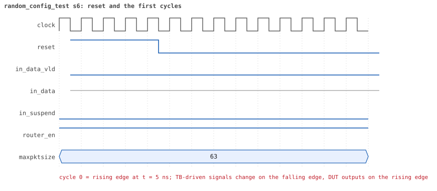
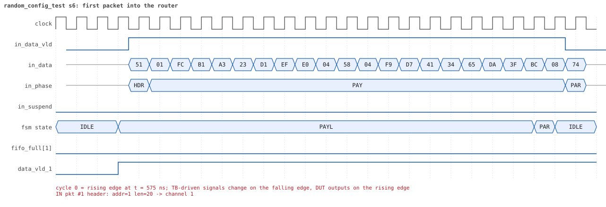
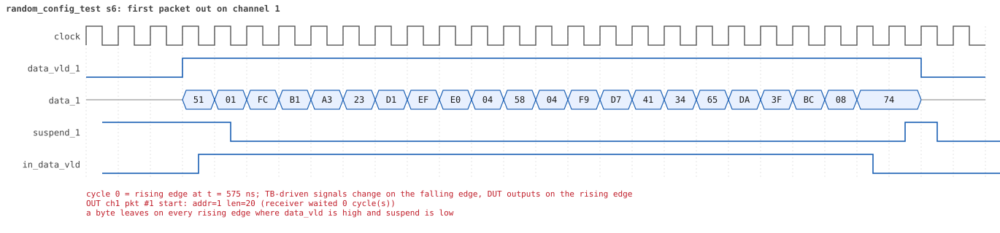
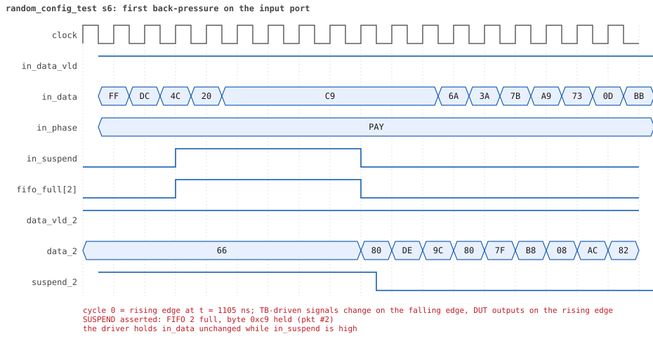
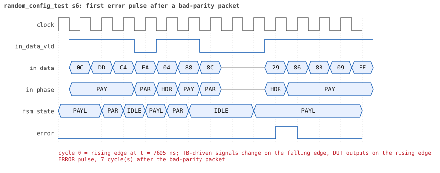
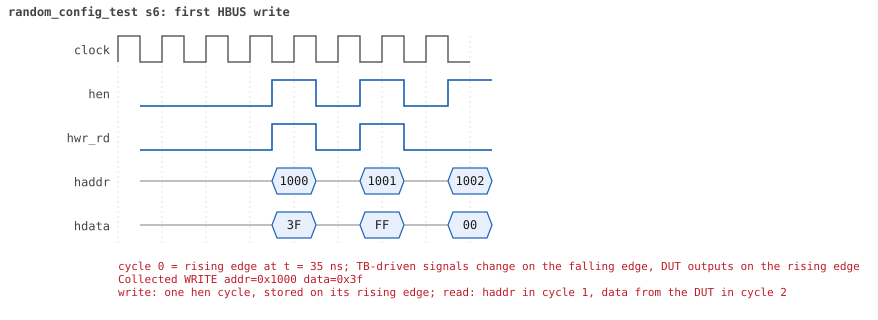
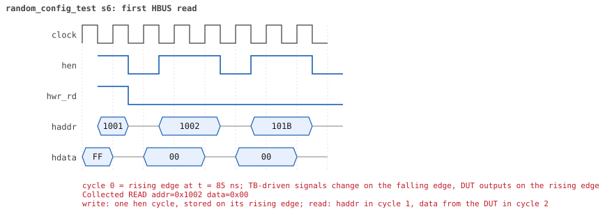

# random_config_test  seed 6

**Result:** PASSED (0 UVM_ERROR, 0 UVM_WARNING, 0 UVM_FATAL) · bench `yapp_project_tb` · sim time 18us · log `random_config_test_s6.log`

Waves: `random_config_test_s6.fst` (GTKWave, Surfer or the VS Code wave viewer); signal trace: `signals.csv`.
[Open the waves in Surfer](https://app.surfer-project.org/?load_url=https%3A%2F%2Fraw.githubusercontent.com%2Ftamirgabgab%2FQcom-Mentoring%2Fmain%2Fyapp_project%2Fregression%2Fyapp_project_tb%2Frandom_config_test_s6%2Frandom_config_test_s6.fst&startup_commands=run_command_file_from_url%20https%3A%2F%2Fraw.githubusercontent.com%2Ftamirgabgab%2FQcom-Mentoring%2Fmain%2Fyapp_project%2Ftb%2Fyapp_router.sucl) (web app, the signals already in groups: `yapp_project/tb/yapp_router.sucl`).

## Summary

- YAPP driver sent **24** packet(s) (2 with bad parity); the input monitor saw 24.
- Router: **11** forwarded, **13** dropped (3 illegal address 3, 7 oversized, 3 router disabled).
- Packets out: ch0 **3**, ch1 **4**, ch2 **4**.
- Scoreboard: 11 matched, 0 mismatched, 0 unexpected.
- Back-pressure: in_suspend asserted **4** time(s), longest hold 54 cycle(s).
- Error pulses: 1.
- HBUS: 45 write(s), 126 read(s).

## Stages

| time (ns) | stage |
|---|---|
| 0 | receivers: ch0 RX_FAST, ch1 RX_NORMAL, ch2 RX_STALLY |
| 0 | random scenario: 24 packets in 7 bursts |
| 560 | burst 1/7: ctrl=0x3f (maxpktsize 63) en=0xff (router on, counter enables 1111111), 4 packet(s) |
| 3270 | burst 1/7 sent: addr0..3 0/1/2/1, bad parity 0, gap 0 1, length 20..63 |
| 3550 | burst 2/7: ctrl=0x2a (maxpktsize 42) en=0x8b (router on, counter enables 1000101), 4 packet(s) |
| 5550 | burst 2/7 sent: addr0..3 3/0/1/0, bad parity 1, gap 0 2, length 1..63 |
| 5820 | burst 3/7: ctrl=0x3e (maxpktsize 62) en=0xd5 (router on, counter enables 1101010), 3 packet(s) |
| 6960 | burst 3/7 sent: addr0..3 1/1/1/0, bad parity 0, gap 0 0, length 1..63 |
| 7270 | burst 4/7: ctrl=0x00 (maxpktsize 0) en=0xe8 (router OFF, counter enables 1110100), 3 packet(s) |
| 9160 | burst 4/7 sent: addr0..3 0/1/2/0, bad parity 1, gap 0 1, length 35..63 |
| 9680 | burst 5/7: ctrl=0x3e (maxpktsize 62) en=0xfd (router on, counter enables 1111110), 3 packet(s) |
| 10850 | burst 5/7 sent: addr0..3 0/1/0/2, bad parity 0, gap 0 1, length 6..58 |
| 11240 | burst 6/7: ctrl=0x81 (maxpktsize 1) en=0xff (router on, counter enables 1111111), 4 packet(s) |
| 12900 | burst 6/7 sent: addr0..3 1/2/0/1, bad parity 0, gap 0 0, length 1..63 |
| 13140 | burst 7/7: ctrl=0xff (maxpktsize 63) en=0xcb (router on, counter enables 1100101), 3 packet(s) |
| 15060 | burst 7/7 sent: addr0..3 2/1/0/0, bad parity 0, gap 0 0, length 44..63 |
| 15060 | final reads: every register and the stored packet, checked against the reference model |
| 17335 | done: 24 packets (11 forwarded, 13 dropped), 0 storm burst(s), 11 scoreboard matches, 125 HBUS reads checked, 1 error pulses for 1 bad packets |

## Pictures

**reset and the first cycles**

**first packet into the router**

**first packet out on channel 1**

**first back-pressure on the input port**

**first error pulse after a bad-parity packet**

**first HBUS write**

**first HBUS read**

## Timeline

637 events (the same list is in `timeline.csv`).

| time (ns) | who | event |
|---|---|---|
| 0 | yapp monitor | YAPP monitor running |
| 0 | **test** | STAGE: receivers: ch0 RX_FAST, ch1 RX_NORMAL, ch2 RX_STALLY |
| 0 | **test** | STAGE: random scenario: 24 packets in 7 bursts |
| 0 | clk/rst driver | Starting clock (period 10) and holding reset for 5 cycles |
| 0 | **DUT** | RESET asserted |
| 50 | **DUT** | RESET released: router_en=1 maxpktsize=63 |
| 70 | hbus driver | Executed WRITE addr=0x1000 data=0x3f |
| 75 | hbus monitor | Collected WRITE addr=0x1000 data=0x3f |
| 75 | reference | maxpktsize is now 63 |
| 90 | hbus driver | Executed WRITE addr=0x1001 data=0xff |
| 95 | hbus monitor | Collected WRITE addr=0x1001 data=0xff |
| 95 | reference | router_en is now 1 (en_reg 0xff) |
| 120 | hbus driver | Executed READ  addr=0x1002 data=0x00 |
| 125 | hbus monitor | Collected READ  addr=0x1002 data=0x00 |
| 150 | hbus driver | Executed READ  addr=0x101b data=0x00 |
| 155 | hbus monitor | Collected READ  addr=0x101b data=0x00 |
| 170 | hbus driver | Executed WRITE addr=0x115c data=0xc3 |
| 175 | hbus monitor | Collected WRITE addr=0x115c data=0xc3 |
| 200 | hbus driver | Executed READ  addr=0x115c data=0xc3 |
| 205 | hbus monitor | Collected READ  addr=0x115c data=0xc3 |
| 230 | hbus driver | Executed READ  addr=0x100d data=0x00 |
| 235 | hbus monitor | Collected READ  addr=0x100d data=0x00 |
| 250 | hbus driver | Executed WRITE addr=0x11ea data=0xef |
| 255 | hbus monitor | Collected WRITE addr=0x11ea data=0xef |
| 280 | hbus driver | Executed READ  addr=0x11ea data=0xef |
| 285 | hbus monitor | Collected READ  addr=0x11ea data=0xef |
| 300 | hbus driver | Executed WRITE addr=0x117c data=0xd4 |
| 305 | hbus monitor | Collected WRITE addr=0x117c data=0xd4 |
| 330 | hbus driver | Executed READ  addr=0x117c data=0xd4 |
| 335 | hbus monitor | Collected READ  addr=0x117c data=0xd4 |
| 350 | hbus driver | Executed WRITE addr=0x114d data=0x33 |
| 355 | hbus monitor | Collected WRITE addr=0x114d data=0x33 |
| 380 | hbus driver | Executed READ  addr=0x114d data=0x33 |
| 385 | hbus monitor | Collected READ  addr=0x114d data=0x33 |
| 400 | hbus driver | Executed WRITE addr=0x111d data=0x8d |
| 405 | hbus monitor | Collected WRITE addr=0x111d data=0x8d |
| 430 | hbus driver | Executed READ  addr=0x111d data=0x8d |
| 435 | hbus monitor | Collected READ  addr=0x111d data=0x8d |
| 450 | hbus driver | Executed WRITE addr=0x11ce data=0x42 |
| 455 | hbus monitor | Collected WRITE addr=0x11ce data=0x42 |
| 480 | hbus driver | Executed READ  addr=0x11ce data=0x42 |
| 485 | hbus monitor | Collected READ  addr=0x11ce data=0x42 |
| 510 | hbus driver | Executed READ  addr=0x100d data=0x00 |
| 515 | hbus monitor | Collected READ  addr=0x100d data=0x00 |
| 530 | hbus driver | Executed WRITE addr=0x11c6 data=0x03 |
| 535 | hbus monitor | Collected WRITE addr=0x11c6 data=0x03 |
| 560 | hbus driver | Executed READ  addr=0x11c6 data=0x03 |
| 560 | **test** | STAGE: burst 1/7: ctrl=0x3f (maxpktsize 63) en=0xff (router on, counter enables 1111111), 4 packet(s) |
| 560 | yapp driver | TX pkt #1: addr=1 len=20 parity=good delay=3 |
| 565 | hbus monitor | Collected READ  addr=0x11c6 data=0x03 |
| 605 | **DUT** | IN  pkt #1 header: addr=1 len=20 -> channel 1 |
| 695 | **DUT** | OUT ch1 pkt #1 start: addr=1 len=20 (receiver waited 8 cycle(s)) |
| 815 | **DUT** | IN  pkt #1 complete: addr=1 len=20 parity=ok forwarded, 22 bytes in 22 cycles (held 0) |
| 815 | yapp monitor | RX pkt #1 on the input: addr=1 len=20 parity=good gap=55 |
| 815 | reference | Packet forwarded: addr=1 len=20 -> channel 1 |
| 820 | yapp driver | TX pkt #1 accepted by the DUT |
| 820 | yapp driver | TX pkt #2: addr=2 len=25 parity=good delay=16 |
| 900 | ch1 driver | ch1: packet consumed (response delay 8) |
| 975 | **DUT** | OUT ch1 pkt #1 done: 22 bytes in 29 cycles |
| 975 | ch1 monitor | ch1 RX pkt #1: addr=1 len=20 parity=good |
| 975 | scoreboard | ch1 pkt matched: addr=1 len=20 (1 matched so far) |
| 985 | **DUT** | IN  pkt #2 header: addr=2 len=25 -> channel 2 |
| 1145 | **DUT** | SUSPEND asserted: FIFO 2 full, byte 0xc9 held (pkt #2) |
| 1270 | ch1 driver | ch1: packet consumed (response delay 6) |
| 1675 | **DUT** | OUT ch2 pkt #1 start: addr=2 len=25 (receiver waited 68 cycle(s)) |
| 1685 | **DUT** | SUSPEND released after 54 cycle(s) |
| 1785 | **DUT** | IN  pkt #2 complete: addr=2 len=25 parity=ok forwarded, 27 bytes in 81 cycles (held 54) |
| 1785 | yapp monitor | RX pkt #2 on the input: addr=2 len=25 parity=good gap=16 |
| 1785 | reference | Packet forwarded: addr=2 len=25 -> channel 2 |
| 1790 | yapp driver | TX pkt #2 accepted by the DUT |
| 1790 | yapp driver | TX pkt #3: addr=2 len=56 parity=good delay=3 |
| 1825 | **DUT** | IN  pkt #3 header: addr=2 len=56 -> channel 2 |
| 1930 | ch2 driver | ch2: packet consumed (response delay 68) |
| 1975 | **DUT** | SUSPEND asserted: FIFO 2 full, byte 0x6b held (pkt #3) |
| 2045 | **DUT** | OUT ch2 pkt #1 done: 27 bytes in 38 cycles |
| 2045 | ch2 monitor | ch2 RX pkt #1: addr=2 len=25 parity=good |
| 2045 | scoreboard | ch2 pkt matched: addr=2 len=25 (2 matched so far) |
| 2055 | **DUT** | SUSPEND released after 8 cycle(s) |
| 2055 | **DUT** | OUT ch2 pkt #2 start: addr=2 len=56 (receiver waited 0 cycle(s)) |
| 2130 | ch2 driver | ch2: packet consumed (response delay 10) |
| 2145 | **DUT** | SUSPEND asserted: FIFO 2 full, byte 0xf6 held (pkt #3) |
| 2185 | **DUT** | SUSPEND released after 4 cycle(s) |
| 2400 | ch2 driver | ch2: packet consumed (response delay 3) |
| 2415 | **DUT** | SUSPEND asserted: FIFO 2 full, byte 0x7b held (pkt #3) |
| 2515 | **DUT** | SUSPEND released after 10 cycle(s) |
| 2615 | **DUT** | IN  pkt #3 complete: addr=2 len=56 parity=ok forwarded, 58 bytes in 80 cycles (held 22) |
| 2615 | yapp monitor | RX pkt #3 on the input: addr=2 len=56 parity=good gap=3 |
| 2615 | reference | Packet forwarded: addr=2 len=56 -> channel 2 |
| 2620 | yapp driver | TX pkt #3 accepted by the DUT |
| 2620 | yapp driver | TX pkt #4: addr=3 len=63 parity=good delay=0 |
| 2625 | **DUT** | IN  pkt #4 header: addr=3 len=63 -> DROP (illegal address 3) |
| 2765 | **DUT** | OUT ch2 pkt #2 done: 58 bytes in 72 cycles |
| 2765 | ch2 monitor | ch2 RX pkt #2: addr=2 len=56 parity=good |
| 2765 | scoreboard | ch2 pkt matched: addr=2 len=56 (3 matched so far) |
| 3060 | ch2 driver | ch2: packet consumed (response delay 9) |
| 3265 | **DUT** | IN  pkt #4 complete: addr=3 len=63 parity=ok dropped, 65 bytes in 65 cycles (held 0) |
| 3265 | yapp monitor | RX pkt #4 on the input: addr=3 len=63 parity=good gap=0 |
| 3265 | reference | Packet dropped: illegal address 3 (len=63) |
| 3265 | **DUT** | ROUTER DROPS PACKET addr=3 length=63 (    illegal address) |
| 3270 | yapp driver | TX pkt #4 accepted by the DUT |
| 3270 | **test** | STAGE: burst 1/7 sent: addr0..3 0/1/2/1, bad parity 0, gap 0 1, length 20..63 |
| 3290 | hbus driver | Executed WRITE addr=0x1000 data=0x2a |
| 3295 | **DUT** | CONFIG router_en=1 maxpktsize=42 |
| 3295 | hbus monitor | Collected WRITE addr=0x1000 data=0x2a |
| 3295 | reference | maxpktsize is now 42 |
| 3310 | hbus driver | Executed WRITE addr=0x1001 data=0x8b |
| 3315 | hbus monitor | Collected WRITE addr=0x1001 data=0x8b |
| 3315 | reference | router_en is now 1 (en_reg 0x8b) |
| 3340 | hbus driver | Executed READ  addr=0x107f data=0x00 |
| 3345 | hbus monitor | Collected READ  addr=0x107f data=0x00 |
| 3370 | hbus driver | Executed READ  addr=0x10f1 data=0x00 |
| 3375 | hbus monitor | Collected READ  addr=0x10f1 data=0x00 |
| 3390 | hbus driver | Executed WRITE addr=0x1135 data=0x4e |
| 3395 | hbus monitor | Collected WRITE addr=0x1135 data=0x4e |
| 3420 | hbus driver | Executed READ  addr=0x1135 data=0x4e |
| 3425 | hbus monitor | Collected READ  addr=0x1135 data=0x4e |
| 3440 | hbus driver | Executed WRITE addr=0x11fe data=0x21 |
| 3445 | hbus monitor | Collected WRITE addr=0x11fe data=0x21 |
| 3470 | hbus driver | Executed READ  addr=0x11fe data=0x21 |
| 3475 | hbus monitor | Collected READ  addr=0x11fe data=0x21 |
| 3500 | hbus driver | Executed READ  addr=0x10f9 data=0x00 |
| 3505 | hbus monitor | Collected READ  addr=0x10f9 data=0x00 |
| 3520 | hbus driver | Executed WRITE addr=0x11c1 data=0xcf |
| 3525 | hbus monitor | Collected WRITE addr=0x11c1 data=0xcf |
| 3550 | hbus driver | Executed READ  addr=0x11c1 data=0xcf |
| 3550 | **test** | STAGE: burst 2/7: ctrl=0x2a (maxpktsize 42) en=0x8b (router on, counter enables 1000101), 4 packet(s) |
| 3550 | yapp driver | TX pkt #5: addr=2 len=1 parity=bad delay=3 |
| 3555 | hbus monitor | Collected READ  addr=0x11c1 data=0xcf |
| 3595 | **DUT** | IN  pkt #5 header: addr=2 len=1 -> channel 2 |
| 3605 | **DUT** | OUT ch2 pkt #3 start: addr=2 len=1 (receiver waited 0 cycle(s)) |
| 3615 | **DUT** | IN  pkt #5 complete: addr=2 len=1 parity=BAD forwarded, 3 bytes in 3 cycles (held 0) |
| 3615 | yapp monitor | RX pkt #5 on the input: addr=2 len=1 parity=bad gap=32 |
| 3615 | reference | Packet forwarded: addr=2 len=1 -> channel 2 |
| 3620 | ch2 driver | ch2: packet consumed (response delay 0) |
| 3620 | yapp driver | TX pkt #5 accepted by the DUT |
| 3620 | yapp driver | TX pkt #6: addr=0 len=63 parity=good delay=0 |
| 3625 | **DUT** | IN  pkt #6 header: addr=0 len=63 -> DROP (oversized: len 63 > maxpktsize 42) |
| 3670 | **DUT** | ERROR pulse, 5 cycle(s) after the bad-parity packet |
| 3670 | error checker | error pulse 5 cycles after the bad packet (0 still owed) |
| 3725 | **DUT** | OUT ch2 pkt #3 done: 3 bytes in 13 cycles |
| 3725 | ch2 monitor | ch2 RX pkt #3: addr=2 len=1 parity=bad |
| 3725 | scoreboard | ch2 pkt matched: addr=2 len=1 (4 matched so far) |
| 3890 | ch2 driver | ch2: packet consumed (response delay 9) |
| 4265 | **DUT** | IN  pkt #6 complete: addr=0 len=63 parity=ok dropped, 65 bytes in 65 cycles (held 0) |
| 4265 | yapp monitor | RX pkt #6 on the input: addr=0 len=63 parity=good gap=0 |
| 4265 | reference | Packet dropped: length 63 > maxpktsize 42 (addr=0) |
| 4265 | **DUT** | ROUTER DROPS PACKET addr=0 length=63 (length > maxpktsize) |
| 4270 | yapp driver | TX pkt #6 accepted by the DUT |
| 4270 | yapp driver | TX pkt #7: addr=0 len=63 parity=good delay=0 |
| 4275 | **DUT** | IN  pkt #7 header: addr=0 len=63 -> DROP (oversized: len 63 > maxpktsize 42) |
| 4915 | **DUT** | IN  pkt #7 complete: addr=0 len=63 parity=ok dropped, 65 bytes in 65 cycles (held 0) |
| 4915 | yapp monitor | RX pkt #7 on the input: addr=0 len=63 parity=good gap=0 |
| 4915 | reference | Packet dropped: length 63 > maxpktsize 42 (addr=0) |
| 4915 | **DUT** | ROUTER DROPS PACKET addr=0 length=63 (length > maxpktsize) |
| 4920 | yapp driver | TX pkt #7 accepted by the DUT |
| 4920 | yapp driver | TX pkt #8: addr=0 len=60 parity=good delay=1 |
| 4935 | **DUT** | IN  pkt #8 header: addr=0 len=60 -> DROP (oversized: len 60 > maxpktsize 42) |
| 5545 | **DUT** | IN  pkt #8 complete: addr=0 len=60 parity=ok dropped, 62 bytes in 62 cycles (held 0) |
| 5545 | yapp monitor | RX pkt #8 on the input: addr=0 len=60 parity=good gap=1 |
| 5545 | reference | Packet dropped: length 60 > maxpktsize 42 (addr=0) |
| 5545 | **DUT** | ROUTER DROPS PACKET addr=0 length=60 (length > maxpktsize) |
| 5550 | yapp driver | TX pkt #8 accepted by the DUT |
| 5550 | **test** | STAGE: burst 2/7 sent: addr0..3 3/0/1/0, bad parity 1, gap 0 2, length 1..63 |
| 5570 | hbus driver | Executed WRITE addr=0x1000 data=0x3e |
| 5575 | **DUT** | CONFIG router_en=1 maxpktsize=62 |
| 5575 | hbus monitor | Collected WRITE addr=0x1000 data=0x3e |
| 5575 | reference | maxpktsize is now 62 |
| 5590 | hbus driver | Executed WRITE addr=0x1001 data=0xd5 |
| 5595 | hbus monitor | Collected WRITE addr=0x1001 data=0xd5 |
| 5595 | reference | router_en is now 1 (en_reg 0xd5) |
| 5620 | hbus driver | Executed READ  addr=0x101a data=0xa6 |
| 5625 | hbus monitor | Collected READ  addr=0x101a data=0xa6 |
| 5640 | hbus driver | Executed WRITE addr=0x11ec data=0xc2 |
| 5645 | hbus monitor | Collected WRITE addr=0x11ec data=0xc2 |
| 5670 | hbus driver | Executed READ  addr=0x11ec data=0xc2 |
| 5675 | hbus monitor | Collected READ  addr=0x11ec data=0xc2 |
| 5690 | hbus driver | Executed WRITE addr=0x1101 data=0x94 |
| 5695 | hbus monitor | Collected WRITE addr=0x1101 data=0x94 |
| 5720 | hbus driver | Executed READ  addr=0x1101 data=0x94 |
| 5725 | hbus monitor | Collected READ  addr=0x1101 data=0x94 |
| 5740 | hbus driver | Executed WRITE addr=0x11ab data=0x6d |
| 5745 | hbus monitor | Collected WRITE addr=0x11ab data=0x6d |
| 5770 | hbus driver | Executed READ  addr=0x11ab data=0x6d |
| 5775 | hbus monitor | Collected READ  addr=0x11ab data=0x6d |
| 5790 | hbus driver | Executed WRITE addr=0x118c data=0xea |
| 5795 | hbus monitor | Collected WRITE addr=0x118c data=0xea |
| 5820 | hbus driver | Executed READ  addr=0x118c data=0xea |
| 5820 | **test** | STAGE: burst 3/7: ctrl=0x3e (maxpktsize 62) en=0xd5 (router on, counter enables 1101010), 3 packet(s) |
| 5820 | yapp driver | TX pkt #9: addr=0 len=63 parity=good delay=1 |
| 5825 | hbus monitor | Collected READ  addr=0x118c data=0xea |
| 5845 | **DUT** | IN  pkt #9 header: addr=0 len=63 -> DROP (oversized: len 63 > maxpktsize 62) |
| 6485 | **DUT** | IN  pkt #9 complete: addr=0 len=63 parity=ok dropped, 65 bytes in 65 cycles (held 0) |
| 6485 | yapp monitor | RX pkt #9 on the input: addr=0 len=63 parity=good gap=29 |
| 6485 | reference | Packet dropped: length 63 > maxpktsize 62 (addr=0) |
| 6485 | **DUT** | ROUTER DROPS PACKET addr=0 length=63 (length > maxpktsize) |
| 6490 | yapp driver | TX pkt #9 accepted by the DUT |
| 6490 | yapp driver | TX pkt #10: addr=1 len=38 parity=good delay=3 |
| 6525 | **DUT** | IN  pkt #10 header: addr=1 len=38 -> channel 1 |
| 6545 | **DUT** | OUT ch1 pkt #2 start: addr=1 len=38 (receiver waited 1 cycle(s)) |
| 6915 | **DUT** | IN  pkt #10 complete: addr=1 len=38 parity=ok forwarded, 40 bytes in 40 cycles (held 0) |
| 6915 | yapp monitor | RX pkt #10 on the input: addr=1 len=38 parity=good gap=3 |
| 6915 | reference | Packet forwarded: addr=1 len=38 -> channel 1 |
| 6920 | yapp driver | TX pkt #10 accepted by the DUT |
| 6920 | yapp driver | TX pkt #11: addr=2 len=1 parity=good delay=1 |
| 6930 | ch1 driver | ch1: packet consumed (response delay 1) |
| 6935 | **DUT** | IN  pkt #11 header: addr=2 len=1 -> channel 2 |
| 6955 | **DUT** | IN  pkt #11 complete: addr=2 len=1 parity=ok forwarded, 3 bytes in 3 cycles (held 0) |
| 6955 | **DUT** | OUT ch2 pkt #4 start: addr=2 len=1 (receiver waited 1 cycle(s)) |
| 6955 | yapp monitor | RX pkt #11 on the input: addr=2 len=1 parity=good gap=1 |
| 6955 | reference | Packet forwarded: addr=2 len=1 -> channel 2 |
| 6960 | yapp driver | TX pkt #11 accepted by the DUT |
| 6960 | **test** | STAGE: burst 3/7 sent: addr0..3 1/1/1/0, bad parity 0, gap 0 0, length 1..63 |
| 6970 | ch2 driver | ch2: packet consumed (response delay 1) |
| 6980 | hbus driver | Executed WRITE addr=0x1000 data=0x00 |
| 6985 | **DUT** | CONFIG router_en=1 maxpktsize=0 |
| 6985 | hbus monitor | Collected WRITE addr=0x1000 data=0x00 |
| 6985 | reference | maxpktsize is now 0 |
| 7000 | hbus driver | Executed WRITE addr=0x1001 data=0xe8 |
| 7005 | **DUT** | CONFIG router_en=0 maxpktsize=0 |
| 7005 | hbus monitor | Collected WRITE addr=0x1001 data=0xe8 |
| 7005 | reference | router_en is now 0 (en_reg 0xe8) |
| 7025 | **DUT** | OUT ch1 pkt #2 done: 40 bytes in 49 cycles |
| 7025 | ch1 monitor | ch1 RX pkt #2: addr=1 len=38 parity=good |
| 7025 | scoreboard | ch1 pkt matched: addr=1 len=38 (5 matched so far) |
| 7030 | hbus driver | Executed READ  addr=0x1083 data=0x00 |
| 7035 | hbus monitor | Collected READ  addr=0x1083 data=0x00 |
| 7050 | hbus driver | Executed WRITE addr=0x1199 data=0xe7 |
| 7055 | hbus monitor | Collected WRITE addr=0x1199 data=0xe7 |
| 7080 | hbus driver | Executed READ  addr=0x1199 data=0xe7 |
| 7085 | **DUT** | OUT ch2 pkt #4 done: 3 bytes in 14 cycles |
| 7085 | ch2 monitor | ch2 RX pkt #4: addr=2 len=1 parity=good |
| 7085 | scoreboard | ch2 pkt matched: addr=2 len=1 (6 matched so far) |
| 7085 | hbus monitor | Collected READ  addr=0x1199 data=0xe7 |
| 7110 | hbus driver | Executed READ  addr=0x1019 data=0x76 |
| 7115 | hbus monitor | Collected READ  addr=0x1019 data=0x76 |
| 7130 | hbus driver | Executed WRITE addr=0x11a7 data=0x80 |
| 7135 | hbus monitor | Collected WRITE addr=0x11a7 data=0x80 |
| 7160 | hbus driver | Executed READ  addr=0x11a7 data=0x80 |
| 7165 | hbus monitor | Collected READ  addr=0x11a7 data=0x80 |
| 7190 | hbus driver | Executed READ  addr=0x100d data=0x01 |
| 7195 | hbus monitor | Collected READ  addr=0x100d data=0x01 |
| 7220 | hbus driver | Executed READ  addr=0x100d data=0x01 |
| 7225 | hbus monitor | Collected READ  addr=0x100d data=0x01 |
| 7240 | hbus driver | Executed WRITE addr=0x117e data=0x28 |
| 7245 | hbus monitor | Collected WRITE addr=0x117e data=0x28 |
| 7270 | hbus driver | Executed READ  addr=0x117e data=0x28 |
| 7270 | **test** | STAGE: burst 4/7: ctrl=0x00 (maxpktsize 0) en=0xe8 (router OFF, counter enables 1110100), 3 packet(s) |
| 7270 | yapp driver | TX pkt #12: addr=2 len=63 parity=bad delay=2 |
| 7275 | hbus monitor | Collected READ  addr=0x117e data=0x28 |
| 7305 | **DUT** | IN  pkt #12 header: addr=2 len=63 -> DROP (router disabled) |
| 7370 | ch1 driver | ch1: packet consumed (response delay 8) |
| 7530 | ch2 driver | ch2: packet consumed (response delay 10) |
| 7945 | **DUT** | IN  pkt #12 complete: addr=2 len=63 parity=BAD dropped, 65 bytes in 65 cycles (held 0) |
| 7945 | yapp monitor | RX pkt #12 on the input: addr=2 len=63 parity=bad gap=34 |
| 7945 | reference | Packet dropped: router disabled (addr=2 len=63) |
| 7945 | **DUT** | ROUTER DROPS PACKET addr=2 length=63 (router disabled) |
| 7950 | yapp driver | TX pkt #12 accepted by the DUT |
| 7950 | yapp driver | TX pkt #13: addr=1 len=63 parity=good delay=19 |
| 8145 | **DUT** | IN  pkt #13 header: addr=1 len=63 -> DROP (router disabled) |
| 8785 | **DUT** | IN  pkt #13 complete: addr=1 len=63 parity=ok dropped, 65 bytes in 65 cycles (held 0) |
| 8785 | yapp monitor | RX pkt #13 on the input: addr=1 len=63 parity=good gap=19 |
| 8785 | reference | Packet dropped: router disabled (addr=1 len=63) |
| 8785 | **DUT** | ROUTER DROPS PACKET addr=1 length=63 (router disabled) |
| 8790 | yapp driver | TX pkt #13 accepted by the DUT |
| 8790 | yapp driver | TX pkt #14: addr=2 len=35 parity=good delay=0 |
| 8795 | **DUT** | IN  pkt #14 header: addr=2 len=35 -> DROP (router disabled) |
| 9155 | **DUT** | IN  pkt #14 complete: addr=2 len=35 parity=ok dropped, 37 bytes in 37 cycles (held 0) |
| 9155 | yapp monitor | RX pkt #14 on the input: addr=2 len=35 parity=good gap=0 |
| 9155 | reference | Packet dropped: router disabled (addr=2 len=35) |
| 9155 | **DUT** | ROUTER DROPS PACKET addr=2 length=35 (router disabled) |
| 9160 | yapp driver | TX pkt #14 accepted by the DUT |
| 9160 | **test** | STAGE: burst 4/7 sent: addr0..3 0/1/2/0, bad parity 1, gap 0 1, length 35..63 |
| 9180 | hbus driver | Executed WRITE addr=0x1000 data=0x3e |
| 9185 | **DUT** | CONFIG router_en=0 maxpktsize=62 |
| 9185 | hbus monitor | Collected WRITE addr=0x1000 data=0x3e |
| 9185 | reference | maxpktsize is now 62 |
| 9200 | hbus driver | Executed WRITE addr=0x1001 data=0xfd |
| 9205 | **DUT** | CONFIG router_en=1 maxpktsize=62 |
| 9205 | hbus monitor | Collected WRITE addr=0x1001 data=0xfd |
| 9205 | reference | router_en is now 1 (en_reg 0xfd) |
| 9220 | hbus driver | Executed WRITE addr=0x1192 data=0x1e |
| 9225 | hbus monitor | Collected WRITE addr=0x1192 data=0x1e |
| 9250 | hbus driver | Executed READ  addr=0x1192 data=0x1e |
| 9255 | hbus monitor | Collected READ  addr=0x1192 data=0x1e |
| 9280 | hbus driver | Executed READ  addr=0x1041 data=0x91 |
| 9285 | hbus monitor | Collected READ  addr=0x1041 data=0x91 |
| 9310 | hbus driver | Executed READ  addr=0x106a data=0x00 |
| 9315 | hbus monitor | Collected READ  addr=0x106a data=0x00 |
| 9330 | hbus driver | Executed WRITE addr=0x1162 data=0xd5 |
| 9335 | hbus monitor | Collected WRITE addr=0x1162 data=0xd5 |
| 9360 | hbus driver | Executed READ  addr=0x1162 data=0xd5 |
| 9365 | hbus monitor | Collected READ  addr=0x1162 data=0xd5 |
| 9380 | hbus driver | Executed WRITE addr=0x11c8 data=0x3c |
| 9385 | hbus monitor | Collected WRITE addr=0x11c8 data=0x3c |
| 9410 | hbus driver | Executed READ  addr=0x11c8 data=0x3c |
| 9415 | hbus monitor | Collected READ  addr=0x11c8 data=0x3c |
| 9430 | hbus driver | Executed WRITE addr=0x1134 data=0xce |
| 9435 | hbus monitor | Collected WRITE addr=0x1134 data=0xce |
| 9460 | hbus driver | Executed READ  addr=0x1134 data=0xce |
| 9465 | hbus monitor | Collected READ  addr=0x1134 data=0xce |
| 9480 | hbus driver | Executed WRITE addr=0x1169 data=0x25 |
| 9485 | hbus monitor | Collected WRITE addr=0x1169 data=0x25 |
| 9510 | hbus driver | Executed READ  addr=0x1169 data=0x25 |
| 9515 | hbus monitor | Collected READ  addr=0x1169 data=0x25 |
| 9540 | hbus driver | Executed READ  addr=0x100e data=0x00 |
| 9545 | hbus monitor | Collected READ  addr=0x100e data=0x00 |
| 9570 | hbus driver | Executed READ  addr=0x101f data=0x9d |
| 9575 | hbus monitor | Collected READ  addr=0x101f data=0x9d |
| 9600 | hbus driver | Executed READ  addr=0x100d data=0x01 |
| 9605 | hbus monitor | Collected READ  addr=0x100d data=0x01 |
| 9630 | hbus driver | Executed READ  addr=0x1001 data=0xfd |
| 9635 | hbus monitor | Collected READ  addr=0x1001 data=0xfd |
| 9650 | hbus driver | Executed WRITE addr=0x11b7 data=0x76 |
| 9655 | hbus monitor | Collected WRITE addr=0x11b7 data=0x76 |
| 9680 | hbus driver | Executed READ  addr=0x11b7 data=0x76 |
| 9680 | **test** | STAGE: burst 5/7: ctrl=0x3e (maxpktsize 62) en=0xfd (router on, counter enables 1111110), 3 packet(s) |
| 9680 | yapp driver | TX pkt #15: addr=3 len=6 parity=good delay=3 |
| 9685 | hbus monitor | Collected READ  addr=0x11b7 data=0x76 |
| 9725 | **DUT** | IN  pkt #15 header: addr=3 len=6 -> DROP (illegal address 3) |
| 9795 | **DUT** | IN  pkt #15 complete: addr=3 len=6 parity=ok dropped, 8 bytes in 8 cycles (held 0) |
| 9795 | yapp monitor | RX pkt #15 on the input: addr=3 len=6 parity=good gap=56 |
| 9795 | reference | Packet dropped: illegal address 3 (len=6) |
| 9795 | **DUT** | ROUTER DROPS PACKET addr=3 length=6 (    illegal address) |
| 9800 | yapp driver | TX pkt #15 accepted by the DUT |
| 9800 | yapp driver | TX pkt #16: addr=1 len=58 parity=good delay=10 |
| 9905 | **DUT** | IN  pkt #16 header: addr=1 len=58 -> channel 1 |
| 9985 | **DUT** | OUT ch1 pkt #3 start: addr=1 len=58 (receiver waited 7 cycle(s)) |
| 10495 | **DUT** | IN  pkt #16 complete: addr=1 len=58 parity=ok forwarded, 60 bytes in 60 cycles (held 0) |
| 10495 | yapp monitor | RX pkt #16 on the input: addr=1 len=58 parity=good gap=10 |
| 10495 | reference | Packet forwarded: addr=1 len=58 -> channel 1 |
| 10500 | yapp driver | TX pkt #16 accepted by the DUT |
| 10500 | yapp driver | TX pkt #17: addr=3 len=33 parity=good delay=0 |
| 10505 | **DUT** | IN  pkt #17 header: addr=3 len=33 -> DROP (illegal address 3) |
| 10570 | ch1 driver | ch1: packet consumed (response delay 7) |
| 10685 | **DUT** | OUT ch1 pkt #3 done: 60 bytes in 71 cycles |
| 10685 | ch1 monitor | ch1 RX pkt #3: addr=1 len=58 parity=good |
| 10685 | scoreboard | ch1 pkt matched: addr=1 len=58 (7 matched so far) |
| 10845 | **DUT** | IN  pkt #17 complete: addr=3 len=33 parity=ok dropped, 35 bytes in 35 cycles (held 0) |
| 10845 | yapp monitor | RX pkt #17 on the input: addr=3 len=33 parity=good gap=0 |
| 10845 | reference | Packet dropped: illegal address 3 (len=33) |
| 10845 | **DUT** | ROUTER DROPS PACKET addr=3 length=33 (    illegal address) |
| 10850 | yapp driver | TX pkt #17 accepted by the DUT |
| 10850 | **test** | STAGE: burst 5/7 sent: addr0..3 0/1/0/2, bad parity 0, gap 0 1, length 6..58 |
| 10870 | hbus driver | Executed WRITE addr=0x1000 data=0x81 |
| 10875 | **DUT** | CONFIG router_en=1 maxpktsize=1 |
| 10875 | hbus monitor | Collected WRITE addr=0x1000 data=0x81 |
| 10875 | reference | maxpktsize is now 1 |
| 10890 | hbus driver | Executed WRITE addr=0x1001 data=0xff |
| 10895 | hbus monitor | Collected WRITE addr=0x1001 data=0xff |
| 10895 | reference | router_en is now 1 (en_reg 0xff) |
| 10910 | hbus driver | Executed WRITE addr=0x1120 data=0x4b |
| 10915 | hbus monitor | Collected WRITE addr=0x1120 data=0x4b |
| 10940 | hbus driver | Executed READ  addr=0x1120 data=0x4b |
| 10945 | hbus monitor | Collected READ  addr=0x1120 data=0x4b |
| 10960 | hbus driver | Executed WRITE addr=0x118b data=0x2d |
| 10965 | hbus monitor | Collected WRITE addr=0x118b data=0x2d |
| 10990 | hbus driver | Executed READ  addr=0x118b data=0x2d |
| 10995 | hbus monitor | Collected READ  addr=0x118b data=0x2d |
| 11010 | hbus driver | Executed WRITE addr=0x1115 data=0x22 |
| 11015 | hbus monitor | Collected WRITE addr=0x1115 data=0x22 |
| 11040 | hbus driver | Executed READ  addr=0x1115 data=0x22 |
| 11045 | hbus monitor | Collected READ  addr=0x1115 data=0x22 |
| 11060 | hbus driver | Executed WRITE addr=0x1172 data=0x37 |
| 11065 | hbus monitor | Collected WRITE addr=0x1172 data=0x37 |
| 11090 | hbus driver | Executed READ  addr=0x1172 data=0x37 |
| 11095 | hbus monitor | Collected READ  addr=0x1172 data=0x37 |
| 11110 | ch1 driver | ch1: packet consumed (response delay 10) |
| 11110 | hbus driver | Executed WRITE addr=0x1195 data=0x8a |
| 11115 | hbus monitor | Collected WRITE addr=0x1195 data=0x8a |
| 11140 | hbus driver | Executed READ  addr=0x1195 data=0x8a |
| 11145 | hbus monitor | Collected READ  addr=0x1195 data=0x8a |
| 11160 | hbus driver | Executed WRITE addr=0x11d8 data=0xcf |
| 11165 | hbus monitor | Collected WRITE addr=0x11d8 data=0xcf |
| 11190 | hbus driver | Executed READ  addr=0x11d8 data=0xcf |
| 11195 | hbus monitor | Collected READ  addr=0x11d8 data=0xcf |
| 11210 | hbus driver | Executed WRITE addr=0x114e data=0xc0 |
| 11215 | hbus monitor | Collected WRITE addr=0x114e data=0xc0 |
| 11240 | hbus driver | Executed READ  addr=0x114e data=0xc0 |
| 11240 | **test** | STAGE: burst 6/7: ctrl=0x81 (maxpktsize 1) en=0xff (router on, counter enables 1111111), 4 packet(s) |
| 11240 | yapp driver | TX pkt #18: addr=1 len=16 parity=good delay=1 |
| 11245 | hbus monitor | Collected READ  addr=0x114e data=0xc0 |
| 11265 | **DUT** | IN  pkt #18 header: addr=1 len=16 -> DROP (oversized: len 16 > maxpktsize 1) |
| 11435 | **DUT** | IN  pkt #18 complete: addr=1 len=16 parity=ok dropped, 18 bytes in 18 cycles (held 0) |
| 11435 | yapp monitor | RX pkt #18 on the input: addr=1 len=16 parity=good gap=41 |
| 11435 | reference | Packet dropped: length 16 > maxpktsize 1 (addr=1) |
| 11435 | **DUT** | ROUTER DROPS PACKET addr=1 length=16 (length > maxpktsize) |
| 11440 | yapp driver | TX pkt #18 accepted by the DUT |
| 11440 | yapp driver | TX pkt #19: addr=3 len=63 parity=good delay=3 |
| 11475 | **DUT** | IN  pkt #19 header: addr=3 len=63 -> DROP (oversized: len 63 > maxpktsize 1) |
| 12115 | **DUT** | IN  pkt #19 complete: addr=3 len=63 parity=ok dropped, 65 bytes in 65 cycles (held 0) |
| 12115 | yapp monitor | RX pkt #19 on the input: addr=3 len=63 parity=good gap=3 |
| 12115 | reference | Packet dropped: illegal address 3 (len=63) |
| 12115 | **DUT** | ROUTER DROPS PACKET addr=3 length=63 (    illegal address) |
| 12120 | yapp driver | TX pkt #19 accepted by the DUT |
| 12120 | yapp driver | TX pkt #20: addr=0 len=1 parity=good delay=11 |
| 12235 | **DUT** | IN  pkt #20 header: addr=0 len=1 -> channel 0 |
| 12245 | **DUT** | OUT ch0 pkt #1 start: addr=0 len=1 (receiver waited 0 cycle(s)) |
| 12255 | **DUT** | IN  pkt #20 complete: addr=0 len=1 parity=ok forwarded, 3 bytes in 3 cycles (held 0) |
| 12255 | yapp monitor | RX pkt #20 on the input: addr=0 len=1 parity=good gap=11 |
| 12255 | reference | Packet forwarded: addr=0 len=1 -> channel 0 |
| 12260 | ch0 driver | ch0: packet consumed (response delay 0) |
| 12260 | yapp driver | TX pkt #20 accepted by the DUT |
| 12260 | yapp driver | TX pkt #21: addr=1 len=61 parity=good delay=1 |
| 12275 | **DUT** | IN  pkt #21 header: addr=1 len=61 -> DROP (oversized: len 61 > maxpktsize 1) |
| 12275 | **DUT** | OUT ch0 pkt #1 done: 3 bytes in 4 cycles |
| 12275 | ch0 monitor | ch0 RX pkt #1: addr=0 len=1 parity=good |
| 12275 | scoreboard | ch0 pkt matched: addr=0 len=1 (8 matched so far) |
| 12460 | ch0 driver | ch0: packet consumed (response delay 0) |
| 12895 | **DUT** | IN  pkt #21 complete: addr=1 len=61 parity=ok dropped, 63 bytes in 63 cycles (held 0) |
| 12895 | yapp monitor | RX pkt #21 on the input: addr=1 len=61 parity=good gap=1 |
| 12895 | reference | Packet dropped: length 61 > maxpktsize 1 (addr=1) |
| 12895 | **DUT** | ROUTER DROPS PACKET addr=1 length=61 (length > maxpktsize) |
| 12900 | yapp driver | TX pkt #21 accepted by the DUT |
| 12900 | **test** | STAGE: burst 6/7 sent: addr0..3 1/2/0/1, bad parity 0, gap 0 0, length 1..63 |
| 12920 | hbus driver | Executed WRITE addr=0x1000 data=0xff |
| 12925 | **DUT** | CONFIG router_en=1 maxpktsize=63 |
| 12925 | hbus monitor | Collected WRITE addr=0x1000 data=0xff |
| 12925 | reference | maxpktsize is now 63 |
| 12940 | hbus driver | Executed WRITE addr=0x1001 data=0xcb |
| 12945 | hbus monitor | Collected WRITE addr=0x1001 data=0xcb |
| 12945 | reference | router_en is now 1 (en_reg 0xcb) |
| 12970 | hbus driver | Executed READ  addr=0x1002 data=0x00 |
| 12975 | hbus monitor | Collected READ  addr=0x1002 data=0x00 |
| 13000 | hbus driver | Executed READ  addr=0x10f5 data=0x00 |
| 13005 | hbus monitor | Collected READ  addr=0x10f5 data=0x00 |
| 13030 | hbus driver | Executed READ  addr=0x100d data=0x3d |
| 13035 | hbus monitor | Collected READ  addr=0x100d data=0x3d |
| 13060 | hbus driver | Executed READ  addr=0x100d data=0x3d |
| 13065 | hbus monitor | Collected READ  addr=0x100d data=0x3d |
| 13080 | hbus driver | Executed WRITE addr=0x116f data=0x06 |
| 13085 | hbus monitor | Collected WRITE addr=0x116f data=0x06 |
| 13110 | hbus driver | Executed READ  addr=0x116f data=0x06 |
| 13115 | hbus monitor | Collected READ  addr=0x116f data=0x06 |
| 13140 | hbus driver | Executed READ  addr=0x100d data=0x3d |
| 13140 | **test** | STAGE: burst 7/7: ctrl=0xff (maxpktsize 63) en=0xcb (router on, counter enables 1100101), 3 packet(s) |
| 13140 | yapp driver | TX pkt #22: addr=0 len=44 parity=good delay=9 |
| 13145 | hbus monitor | Collected READ  addr=0x100d data=0x3d |
| 13245 | **DUT** | IN  pkt #22 header: addr=0 len=44 -> channel 0 |
| 13255 | **DUT** | OUT ch0 pkt #2 start: addr=0 len=44 (receiver waited 0 cycle(s)) |
| 13695 | **DUT** | IN  pkt #22 complete: addr=0 len=44 parity=ok forwarded, 46 bytes in 46 cycles (held 0) |
| 13695 | yapp monitor | RX pkt #22 on the input: addr=0 len=44 parity=good gap=34 |
| 13695 | reference | Packet forwarded: addr=0 len=44 -> channel 0 |
| 13700 | ch0 driver | ch0: packet consumed (response delay 0) |
| 13700 | yapp driver | TX pkt #22 accepted by the DUT |
| 13700 | yapp driver | TX pkt #23: addr=1 len=63 parity=good delay=5 |
| 13715 | **DUT** | OUT ch0 pkt #2 done: 46 bytes in 47 cycles |
| 13715 | ch0 monitor | ch0 RX pkt #2: addr=0 len=44 parity=good |
| 13715 | scoreboard | ch0 pkt matched: addr=0 len=44 (9 matched so far) |
| 13755 | **DUT** | IN  pkt #23 header: addr=1 len=63 -> channel 1 |
| 13855 | **DUT** | OUT ch1 pkt #4 start: addr=1 len=63 (receiver waited 9 cycle(s)) |
| 14090 | ch0 driver | ch0: packet consumed (response delay 0) |
| 14395 | **DUT** | IN  pkt #23 complete: addr=1 len=63 parity=ok forwarded, 65 bytes in 65 cycles (held 0) |
| 14395 | yapp monitor | RX pkt #23 on the input: addr=1 len=63 parity=good gap=5 |
| 14395 | reference | Packet forwarded: addr=1 len=63 -> channel 1 |
| 14400 | yapp driver | TX pkt #23 accepted by the DUT |
| 14400 | yapp driver | TX pkt #24: addr=0 len=62 parity=good delay=2 |
| 14425 | **DUT** | IN  pkt #24 header: addr=0 len=62 -> channel 0 |
| 14435 | **DUT** | OUT ch0 pkt #3 start: addr=0 len=62 (receiver waited 0 cycle(s)) |
| 14490 | ch1 driver | ch1: packet consumed (response delay 9) |
| 14565 | **DUT** | OUT ch1 pkt #4 done: 65 bytes in 72 cycles |
| 14565 | ch1 monitor | ch1 RX pkt #4: addr=1 len=63 parity=good |
| 14565 | scoreboard | ch1 pkt matched: addr=1 len=63 (10 matched so far) |
| 14750 | ch1 driver | ch1: packet consumed (response delay 6) |
| 15055 | **DUT** | IN  pkt #24 complete: addr=0 len=62 parity=ok forwarded, 64 bytes in 64 cycles (held 0) |
| 15055 | yapp monitor | RX pkt #24 on the input: addr=0 len=62 parity=good gap=2 |
| 15055 | reference | Packet forwarded: addr=0 len=62 -> channel 0 |
| 15060 | ch0 driver | ch0: packet consumed (response delay 0) |
| 15060 | yapp driver | TX pkt #24 accepted by the DUT |
| 15060 | **test** | STAGE: burst 7/7 sent: addr0..3 2/1/0/0, bad parity 0, gap 0 0, length 44..63 |
| 15060 | **test** | STAGE: final reads: every register and the stored packet, checked against the reference model |
| 15075 | **DUT** | OUT ch0 pkt #3 done: 64 bytes in 65 cycles |
| 15075 | ch0 monitor | ch0 RX pkt #3: addr=0 len=62 parity=good |
| 15075 | scoreboard | ch0 pkt matched: addr=0 len=62 (11 matched so far) |
| 15090 | hbus driver | Executed READ  addr=0x1000 data=0xff |
| 15095 | hbus monitor | Collected READ  addr=0x1000 data=0xff |
| 15120 | hbus driver | Executed READ  addr=0x1001 data=0xcb |
| 15125 | hbus monitor | Collected READ  addr=0x1001 data=0xcb |
| 15150 | hbus driver | Executed READ  addr=0x1004 data=0x01 |
| 15155 | hbus monitor | Collected READ  addr=0x1004 data=0x01 |
| 15180 | hbus driver | Executed READ  addr=0x1005 data=0x04 |
| 15185 | hbus monitor | Collected READ  addr=0x1005 data=0x04 |
| 15210 | hbus driver | Executed READ  addr=0x1006 data=0x04 |
| 15215 | hbus monitor | Collected READ  addr=0x1006 data=0x04 |
| 15240 | hbus driver | Executed READ  addr=0x1009 data=0x02 |
| 15245 | hbus monitor | Collected READ  addr=0x1009 data=0x02 |
| 15270 | hbus driver | Executed READ  addr=0x100a data=0x04 |
| 15275 | hbus monitor | Collected READ  addr=0x100a data=0x04 |
| 15300 | hbus driver | Executed READ  addr=0x100b data=0x03 |
| 15305 | hbus monitor | Collected READ  addr=0x100b data=0x03 |
| 15330 | hbus driver | Executed READ  addr=0x100d data=0x3e |
| 15335 | hbus monitor | Collected READ  addr=0x100d data=0x3e |
| 15360 | hbus driver | Executed READ  addr=0x1010 data=0xf8 |
| 15365 | hbus monitor | Collected READ  addr=0x1010 data=0xf8 |
| 15390 | hbus driver | Executed READ  addr=0x1011 data=0xc0 |
| 15395 | hbus monitor | Collected READ  addr=0x1011 data=0xc0 |
| 15420 | hbus driver | Executed READ  addr=0x1012 data=0x7c |
| 15425 | hbus monitor | Collected READ  addr=0x1012 data=0x7c |
| 15450 | hbus driver | Executed READ  addr=0x1013 data=0xc9 |
| 15455 | hbus monitor | Collected READ  addr=0x1013 data=0xc9 |
| 15480 | hbus driver | Executed READ  addr=0x1014 data=0x4f |
| 15485 | hbus monitor | Collected READ  addr=0x1014 data=0x4f |
| 15510 | hbus driver | Executed READ  addr=0x1015 data=0x9f |
| 15515 | hbus monitor | Collected READ  addr=0x1015 data=0x9f |
| 15540 | hbus driver | Executed READ  addr=0x1016 data=0xe2 |
| 15545 | hbus monitor | Collected READ  addr=0x1016 data=0xe2 |
| 15570 | hbus driver | Executed READ  addr=0x1017 data=0x14 |
| 15575 | hbus monitor | Collected READ  addr=0x1017 data=0x14 |
| 15600 | hbus driver | Executed READ  addr=0x1018 data=0x0a |
| 15605 | hbus monitor | Collected READ  addr=0x1018 data=0x0a |
| 15630 | hbus driver | Executed READ  addr=0x1019 data=0xf2 |
| 15635 | hbus monitor | Collected READ  addr=0x1019 data=0xf2 |
| 15660 | hbus driver | Executed READ  addr=0x101a data=0x49 |
| 15665 | hbus monitor | Collected READ  addr=0x101a data=0x49 |
| 15690 | ch0 driver | ch0: packet consumed (response delay 0) |
| 15690 | hbus driver | Executed READ  addr=0x101b data=0xfd |
| 15695 | hbus monitor | Collected READ  addr=0x101b data=0xfd |
| 15720 | hbus driver | Executed READ  addr=0x101c data=0x6a |
| 15725 | hbus monitor | Collected READ  addr=0x101c data=0x6a |
| 15750 | hbus driver | Executed READ  addr=0x101d data=0xcc |
| 15755 | hbus monitor | Collected READ  addr=0x101d data=0xcc |
| 15780 | hbus driver | Executed READ  addr=0x101e data=0xa8 |
| 15785 | hbus monitor | Collected READ  addr=0x101e data=0xa8 |
| 15810 | hbus driver | Executed READ  addr=0x101f data=0x8e |
| 15815 | hbus monitor | Collected READ  addr=0x101f data=0x8e |
| 15840 | hbus driver | Executed READ  addr=0x1020 data=0xa6 |
| 15845 | hbus monitor | Collected READ  addr=0x1020 data=0xa6 |
| 15870 | hbus driver | Executed READ  addr=0x1021 data=0xa3 |
| 15875 | hbus monitor | Collected READ  addr=0x1021 data=0xa3 |
| 15900 | hbus driver | Executed READ  addr=0x1022 data=0x5e |
| 15905 | hbus monitor | Collected READ  addr=0x1022 data=0x5e |
| 15930 | hbus driver | Executed READ  addr=0x1023 data=0xe0 |
| 15935 | hbus monitor | Collected READ  addr=0x1023 data=0xe0 |
| 15960 | hbus driver | Executed READ  addr=0x1024 data=0x6c |
| 15965 | hbus monitor | Collected READ  addr=0x1024 data=0x6c |
| 15990 | hbus driver | Executed READ  addr=0x1025 data=0x00 |
| 15995 | hbus monitor | Collected READ  addr=0x1025 data=0x00 |
| 16020 | hbus driver | Executed READ  addr=0x1026 data=0x05 |
| 16025 | hbus monitor | Collected READ  addr=0x1026 data=0x05 |
| 16050 | hbus driver | Executed READ  addr=0x1027 data=0xbf |
| 16055 | hbus monitor | Collected READ  addr=0x1027 data=0xbf |
| 16080 | hbus driver | Executed READ  addr=0x1028 data=0x64 |
| 16085 | hbus monitor | Collected READ  addr=0x1028 data=0x64 |
| 16110 | hbus driver | Executed READ  addr=0x1029 data=0x29 |
| 16115 | hbus monitor | Collected READ  addr=0x1029 data=0x29 |
| 16140 | hbus driver | Executed READ  addr=0x102a data=0xd7 |
| 16145 | hbus monitor | Collected READ  addr=0x102a data=0xd7 |
| 16170 | hbus driver | Executed READ  addr=0x102b data=0xeb |
| 16175 | hbus monitor | Collected READ  addr=0x102b data=0xeb |
| 16200 | hbus driver | Executed READ  addr=0x102c data=0x94 |
| 16205 | hbus monitor | Collected READ  addr=0x102c data=0x94 |
| 16230 | hbus driver | Executed READ  addr=0x102d data=0xe7 |
| 16235 | hbus monitor | Collected READ  addr=0x102d data=0xe7 |
| 16260 | hbus driver | Executed READ  addr=0x102e data=0x4e |
| 16265 | hbus monitor | Collected READ  addr=0x102e data=0x4e |
| 16290 | hbus driver | Executed READ  addr=0x102f data=0x01 |
| 16295 | hbus monitor | Collected READ  addr=0x102f data=0x01 |
| 16320 | hbus driver | Executed READ  addr=0x1030 data=0x91 |
| 16325 | hbus monitor | Collected READ  addr=0x1030 data=0x91 |
| 16350 | hbus driver | Executed READ  addr=0x1031 data=0x1b |
| 16355 | hbus monitor | Collected READ  addr=0x1031 data=0x1b |
| 16380 | hbus driver | Executed READ  addr=0x1032 data=0x91 |
| 16385 | hbus monitor | Collected READ  addr=0x1032 data=0x91 |
| 16410 | hbus driver | Executed READ  addr=0x1033 data=0x2a |
| 16415 | hbus monitor | Collected READ  addr=0x1033 data=0x2a |
| 16440 | hbus driver | Executed READ  addr=0x1034 data=0xa7 |
| 16445 | hbus monitor | Collected READ  addr=0x1034 data=0xa7 |
| 16470 | hbus driver | Executed READ  addr=0x1035 data=0x80 |
| 16475 | hbus monitor | Collected READ  addr=0x1035 data=0x80 |
| 16500 | hbus driver | Executed READ  addr=0x1036 data=0x60 |
| 16505 | hbus monitor | Collected READ  addr=0x1036 data=0x60 |
| 16530 | hbus driver | Executed READ  addr=0x1037 data=0x4d |
| 16535 | hbus monitor | Collected READ  addr=0x1037 data=0x4d |
| 16560 | hbus driver | Executed READ  addr=0x1038 data=0x43 |
| 16565 | hbus monitor | Collected READ  addr=0x1038 data=0x43 |
| 16590 | hbus driver | Executed READ  addr=0x1039 data=0x51 |
| 16595 | hbus monitor | Collected READ  addr=0x1039 data=0x51 |
| 16620 | hbus driver | Executed READ  addr=0x103a data=0xc1 |
| 16625 | hbus monitor | Collected READ  addr=0x103a data=0xc1 |
| 16650 | hbus driver | Executed READ  addr=0x103b data=0xe2 |
| 16655 | hbus monitor | Collected READ  addr=0x103b data=0xe2 |
| 16680 | hbus driver | Executed READ  addr=0x103c data=0xd2 |
| 16685 | hbus monitor | Collected READ  addr=0x103c data=0xd2 |
| 16710 | hbus driver | Executed READ  addr=0x103d data=0xd0 |
| 16715 | hbus monitor | Collected READ  addr=0x103d data=0xd0 |
| 16740 | hbus driver | Executed READ  addr=0x103e data=0xe2 |
| 16745 | hbus monitor | Collected READ  addr=0x103e data=0xe2 |
| 16770 | hbus driver | Executed READ  addr=0x103f data=0x7b |
| 16775 | hbus monitor | Collected READ  addr=0x103f data=0x7b |
| 16800 | hbus driver | Executed READ  addr=0x1040 data=0x9f |
| 16805 | hbus monitor | Collected READ  addr=0x1040 data=0x9f |
| 16830 | hbus driver | Executed READ  addr=0x1041 data=0xf0 |
| 16835 | hbus monitor | Collected READ  addr=0x1041 data=0xf0 |
| 16860 | hbus driver | Executed READ  addr=0x1042 data=0xc8 |
| 16865 | hbus monitor | Collected READ  addr=0x1042 data=0xc8 |
| 16890 | hbus driver | Executed READ  addr=0x1043 data=0xaa |
| 16895 | hbus monitor | Collected READ  addr=0x1043 data=0xaa |
| 16920 | hbus driver | Executed READ  addr=0x1044 data=0x61 |
| 16925 | hbus monitor | Collected READ  addr=0x1044 data=0x61 |
| 16950 | hbus driver | Executed READ  addr=0x1045 data=0xf1 |
| 16955 | hbus monitor | Collected READ  addr=0x1045 data=0xf1 |
| 16980 | hbus driver | Executed READ  addr=0x1046 data=0xd3 |
| 16985 | hbus monitor | Collected READ  addr=0x1046 data=0xd3 |
| 17010 | hbus driver | Executed READ  addr=0x1047 data=0xdd |
| 17015 | hbus monitor | Collected READ  addr=0x1047 data=0xdd |
| 17040 | hbus driver | Executed READ  addr=0x1048 data=0xcf |
| 17045 | hbus monitor | Collected READ  addr=0x1048 data=0xcf |
| 17070 | hbus driver | Executed READ  addr=0x1049 data=0x79 |
| 17075 | hbus monitor | Collected READ  addr=0x1049 data=0x79 |
| 17100 | hbus driver | Executed READ  addr=0x104a data=0xb2 |
| 17105 | hbus monitor | Collected READ  addr=0x104a data=0xb2 |
| 17130 | hbus driver | Executed READ  addr=0x104b data=0xf0 |
| 17135 | hbus monitor | Collected READ  addr=0x104b data=0xf0 |
| 17160 | hbus driver | Executed READ  addr=0x104c data=0x12 |
| 17165 | hbus monitor | Collected READ  addr=0x104c data=0x12 |
| 17190 | hbus driver | Executed READ  addr=0x104d data=0xcb |
| 17195 | hbus monitor | Collected READ  addr=0x104d data=0xcb |
| 17220 | hbus driver | Executed READ  addr=0x104e data=0x9c |
| 17225 | hbus monitor | Collected READ  addr=0x104e data=0x9c |
| 17335 | **test** | STAGE: done: 24 packets (11 forwarded, 13 dropped), 0 storm burst(s), 11 scoreboard matches, 125 HBUS reads checked, 1 error pulses for 1 bad packets |
| 17535 | error checker | error pulse report: 1 bad packets, 1 pulses, 0 outside 1..10 cycles, at most 1 owed at once |
| 17535 | ch0 monitor | Channel 0 report: 3 packets collected |
| 17535 | ch1 monitor | Channel 1 report: 4 packets collected |
| 17535 | ch2 monitor | Channel 2 report: 4 packets collected |
| 17535 | hbus monitor | HBUS report: 45 writes, 126 reads |
| 17535 | coverage | Coverage of the router configuration: 82.6% |
| 17535 | coverage | HBUS address coverage: 171 accesses sampled, coverage 45.5% |
| 17535 | coverage | HBUS register bits coverage: 14 writes to ctrl_reg/en_reg, coverage 97.7% |
| 17535 | coverage | HBUS counter value coverage: 6 counter reads sampled, coverage 48.1% |
| 17535 | coverage | HBUS yapp_mem data coverage: 62 accesses sampled, coverage 29.4% |
| 17535 | reference |  |
| 17535 | reference | HBUS reads checked against the model: 125 (0 mismatches, 1 of memory bytes never written) |
| 17535 | scoreboard |  |
| 17535 | yapp driver | YAPP driver report: 24 packets sent |
| 17535 | coverage | YAPP gap coverage: 23 gaps sampled, coverage 100.0% |
| 17535 | yapp monitor | YAPP monitor report: 24 packets collected, 2 with bad parity |
| 17535 | yapp monitor | YAPP gaps: 5 back to back, 3 of 1 cycle, 1 of 2, 14 longer |
| 17535 | coverage | YAPP packet coverage: 24 packets sampled, coverage 56.7% |
