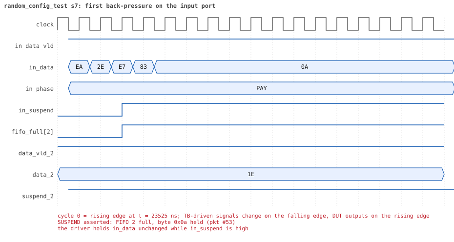

# random_config_test seed 7

**Result:** PASSED (0 UVM_ERROR, 0 UVM_WARNING, 0 UVM_FATAL) · bench `yapp_project_tb` · sim time 39us · wall 21.7 s · log [`random_config_test_s7.log`](random_config_test_s7.log)

Waves: `random_config_test_s7.fst` (GTKWave, Surfer or the VS Code wave viewer).
[Open the waves in Surfer](https://app.surfer-project.org/?load_url=https%3A%2F%2Fraw.githubusercontent.com%2Ftamirgabgab%2FQcom-Mentoring%2Fmain%2Fyapp_project%2Fregression%2Fyapp_project_tb%2Frandom_config_test_s7%2Frandom_config_test_s7.fst&startup_commands=run_command_file_from_url%20https%3A%2F%2Fraw.githubusercontent.com%2Ftamirgabgab%2FQcom-Mentoring%2Fmain%2Fyapp_project%2Ftb%2Fyapp_router.sucl) (web app, the signals already in groups: `yapp_project/tb/yapp_router.sucl`).

## Summary

- YAPP driver sent **85** packet(s) (13 with bad parity); the input monitor saw 85.
- Router: **22** forwarded, **63** dropped (40 oversized, 22 router disabled, 1 illegal address 3).
- Packets out: ch0 **6**, ch1 **6**, ch2 **10**.
- Scoreboard: 22 matched, 0 mismatched, 0 unexpected.
- Back-pressure: in_suspend asserted **3** time(s), longest hold 115 cycle(s).
- Error pulses: 9.
- HBUS: 21 write(s), 42 read(s).

## Stages

| time (ns) | stage |
|---|---|
| 0 | receivers: ch0 CHANNEL_RX_PROFILE_STALLY, ch1 CHANNEL_RX_PROFILE_FAST, ch2 CHANNEL_RX_PROFILE_STALLY |
| 0 | random scenario: 85 packets in 4 bursts |
| 500 | burst 1/4: ctrl=0x4d (maxpktsize 13) en=0xff (router on, counter enables 1111111), 21 packet(s) |
| 9040 | burst 1/4 sent: addr0..3 5/2/12/2, bad parity 3, gap 0 5, length 1..63 |
| 9270 | burst 2/4: ctrl=0x5e (maxpktsize 30) en=0xea (router OFF, counter enables 1110101), 22 packet(s) |
| 17810 | burst 2/4 sent: addr0..3 5/8/7/2, bad parity 4, gap 0 8, length 1..63 |
| 18090 | burst 3/4: ctrl=0x5b (maxpktsize 27) en=0xff (router on, counter enables 1111111), 21 packet(s) |
| 29480 | burst 3/4 sent: addr0..3 4/7/7/3, bad parity 4, gap 0 6, length 1..63 |
| 29780 | burst 4/4: ctrl=0x12 (maxpktsize 18) en=0x21 (router on, counter enables 0010000), 21 packet(s) |
| 38030 | burst 4/4 sent: addr0..3 9/3/6/3, bad parity 2, gap 0 3, length 1..63 |
| 38030 | final reads: every register and the stored packet, checked against the reference model |
| 39095 | done: 85 packets (22 forwarded, 63 dropped), 0 storm burst(s), 22 scoreboard matches, 40 HBUS reads checked, 9 error pulses for 9 bad packets |

## Pictures

**reset and the first cycles**

**first packet into the router**

**first packet out on channel 2**

**first back-pressure on the input port**

**first error pulse after a bad-parity packet**

**first HBUS write**

**first HBUS read**

## Timeline

890 events.

| time (ns) | who | event |
|---|---|---|
| 0 | yapp monitor | YAPP monitor running |
| 0 | **test** | STAGE: receivers: ch0 CHANNEL_RX_PROFILE_STALLY, ch1 CHANNEL_RX_PROFILE_FAST, ch2 CHANNEL_RX_PROFILE_STALLY |
| 0 | **test** | STAGE: random scenario: 85 packets in 4 bursts |
| 0 | clk/rst driver | Starting clock (period 10) and holding reset for 5 cycles |
| 0 | **DUT** | RESET asserted |
| 50 | **DUT** | RESET released: router_en=1 maxpktsize=63 |
| 70 | hbus driver | Executed WRITE addr=0x1000 data=0x4d |
| 75 | **DUT** | CONFIG router_en=1 maxpktsize=13 |
| 75 | hbus monitor | Collected WRITE addr=0x1000 data=0x4d |
| 75 | reference | maxpktsize is now 13 |
| 90 | hbus driver | Executed WRITE addr=0x1001 data=0xff |
| 95 | hbus monitor | Collected WRITE addr=0x1001 data=0xff |
| 95 | reference | router_en is now 1 (en_reg 0xff) |
| 120 | hbus driver | Executed READ  addr=0x1026 data=0x00 |
| 125 | hbus monitor | Collected READ  addr=0x1026 data=0x00 |
| 150 | hbus driver | Executed READ  addr=0x100b data=0x00 |
| 155 | hbus monitor | Collected READ  addr=0x100b data=0x00 |
| 170 | hbus driver | Executed WRITE addr=0x11e3 data=0x4e |
| 175 | hbus monitor | Collected WRITE addr=0x11e3 data=0x4e |
| 200 | hbus driver | Executed READ  addr=0x11e3 data=0x4e |
| 205 | hbus monitor | Collected READ  addr=0x11e3 data=0x4e |
| 230 | hbus driver | Executed READ  addr=0x100d data=0x00 |
| 235 | hbus monitor | Collected READ  addr=0x100d data=0x00 |
| 250 | hbus driver | Executed WRITE addr=0x11c5 data=0xc4 |
| 255 | hbus monitor | Collected WRITE addr=0x11c5 data=0xc4 |
| 280 | hbus driver | Executed READ  addr=0x11c5 data=0xc4 |
| 285 | hbus monitor | Collected READ  addr=0x11c5 data=0xc4 |
| 310 | hbus driver | Executed READ  addr=0x1041 data=0x00 |
| 315 | hbus monitor | Collected READ  addr=0x1041 data=0x00 |
| 340 | hbus driver | Executed READ  addr=0x100d data=0x00 |
| 345 | hbus monitor | Collected READ  addr=0x100d data=0x00 |
| 360 | hbus driver | Executed WRITE addr=0x111c data=0xf0 |
| 365 | hbus monitor | Collected WRITE addr=0x111c data=0xf0 |
| 390 | hbus driver | Executed READ  addr=0x111c data=0xf0 |
| 395 | hbus monitor | Collected READ  addr=0x111c data=0xf0 |
| 420 | hbus driver | Executed READ  addr=0x100d data=0x00 |
| 425 | hbus monitor | Collected READ  addr=0x100d data=0x00 |
| 450 | hbus driver | Executed READ  addr=0x100d data=0x00 |
| 455 | hbus monitor | Collected READ  addr=0x100d data=0x00 |
| 470 | hbus driver | Executed WRITE addr=0x11a7 data=0xbe |
| 475 | hbus monitor | Collected WRITE addr=0x11a7 data=0xbe |
| 500 | hbus driver | Executed READ  addr=0x11a7 data=0xbe |
| 500 | **test** | STAGE: burst 1/4: ctrl=0x4d (maxpktsize 13) en=0xff (router on, counter enables 1111111), 21 packet(s) |
| 500 | yapp driver | TX pkt #1: addr=2 len=14 parity=bad delay=5 |
| 505 | hbus monitor | Collected READ  addr=0x11a7 data=0xbe |
| 565 | **DUT** | IN  pkt #1 header: addr=2 len=14 -> DROP (oversized: len 14 > maxpktsize 13) |
| 715 | **DUT** | IN  pkt #1 complete: addr=2 len=14 parity=BAD dropped, 16 bytes in 16 cycles (held 0) |
| 715 | yapp monitor | RX pkt #1 on the input: addr=2 len=14 parity=bad gap=51 |
| 715 | reference | Packet dropped: length 14 > maxpktsize 13 (addr=2) |
| 715 | **DUT** | ROUTER DROPS PACKET addr=2 length=14 (length > maxpktsize) |
| 720 | yapp driver | TX pkt #1 accepted by the DUT |
| 720 | yapp driver | TX pkt #2: addr=2 len=10 parity=good delay=3 |
| 750 | **DUT** | ERROR pulse, 3 cycle(s) after the bad-parity packet |
| 750 | error checker | error pulse 3 cycles after the bad packet (0 still owed) |
| 755 | **DUT** | IN  pkt #2 header: addr=2 len=10 -> channel 2 |
| 845 | **DUT** | OUT ch2 pkt #1 start: addr=2 len=10 (receiver waited 8 cycle(s)) |
| 865 | **DUT** | IN  pkt #2 complete: addr=2 len=10 parity=ok forwarded, 12 bytes in 12 cycles (held 0) |
| 865 | yapp monitor | RX pkt #2 on the input: addr=2 len=10 parity=good gap=3 |
| 865 | reference | Packet forwarded: addr=2 len=10 -> channel 2 |
| 870 | yapp driver | TX pkt #2 accepted by the DUT |
| 870 | yapp driver | TX pkt #3: addr=0 len=12 parity=good delay=1 |
| 885 | **DUT** | IN  pkt #3 header: addr=0 len=12 -> channel 0 |
| 925 | **DUT** | OUT ch0 pkt #1 start: addr=0 len=12 (receiver waited 3 cycle(s)) |
| 950 | ch2 driver | ch2: packet consumed (response delay 8) |
| 995 | **DUT** | OUT ch2 pkt #1 done: 12 bytes in 16 cycles |
| 995 | ch2 monitor | ch2 RX pkt #1: addr=2 len=10 parity=good |
| 995 | scoreboard | ch2 pkt matched: addr=2 len=10 (1 matched so far) |
| 1015 | **DUT** | IN  pkt #3 complete: addr=0 len=12 parity=ok forwarded, 14 bytes in 14 cycles (held 0) |
| 1015 | yapp monitor | RX pkt #3 on the input: addr=0 len=12 parity=good gap=1 |
| 1015 | reference | Packet forwarded: addr=0 len=12 -> channel 0 |
| 1020 | yapp driver | TX pkt #3 accepted by the DUT |
| 1020 | yapp driver | TX pkt #4: addr=2 len=29 parity=good delay=0 |
| 1025 | **DUT** | IN  pkt #4 header: addr=2 len=29 -> DROP (oversized: len 29 > maxpktsize 13) |
| 1050 | ch0 driver | ch0: packet consumed (response delay 3) |
| 1280 | ch2 driver | ch2: packet consumed (response delay 3) |
| 1325 | **DUT** | IN  pkt #4 complete: addr=2 len=29 parity=ok dropped, 31 bytes in 31 cycles (held 0) |
| 1325 | yapp monitor | RX pkt #4 on the input: addr=2 len=29 parity=good gap=0 |
| 1325 | reference | Packet dropped: length 29 > maxpktsize 13 (addr=2) |
| 1325 | **DUT** | ROUTER DROPS PACKET addr=2 length=29 (length > maxpktsize) |
| 1330 | yapp driver | TX pkt #4 accepted by the DUT |
| 1330 | yapp driver | TX pkt #5: addr=2 len=37 parity=good delay=16 |
| 1495 | **DUT** | IN  pkt #5 header: addr=2 len=37 -> DROP (oversized: len 37 > maxpktsize 13) |
| 1875 | **DUT** | IN  pkt #5 complete: addr=2 len=37 parity=ok dropped, 39 bytes in 39 cycles (held 0) |
| 1875 | yapp monitor | RX pkt #5 on the input: addr=2 len=37 parity=good gap=16 |
| 1875 | reference | Packet dropped: length 37 > maxpktsize 13 (addr=2) |
| 1875 | **DUT** | ROUTER DROPS PACKET addr=2 length=37 (length > maxpktsize) |
| 1880 | yapp driver | TX pkt #5 accepted by the DUT |
| 1880 | yapp driver | TX pkt #6: addr=3 len=63 parity=good delay=0 |
| 1885 | **DUT** | IN  pkt #6 header: addr=3 len=63 -> DROP (oversized: len 63 > maxpktsize 13) |
| 2495 | **DUT** | OUT ch0 pkt #1 done: 14 bytes in 158 cycles |
| 2495 | ch0 monitor | ch0 RX pkt #1: addr=0 len=12 parity=good |
| 2495 | scoreboard | ch0 pkt matched: addr=0 len=12 (2 matched so far) |
| 2525 | **DUT** | IN  pkt #6 complete: addr=3 len=63 parity=ok dropped, 65 bytes in 65 cycles (held 0) |
| 2525 | yapp monitor | RX pkt #6 on the input: addr=3 len=63 parity=good gap=0 |
| 2525 | reference | Packet dropped: illegal address 3 (len=63) |
| 2525 | **DUT** | ROUTER DROPS PACKET addr=3 length=63 (    illegal address) |
| 2530 | yapp driver | TX pkt #6 accepted by the DUT |
| 2530 | yapp driver | TX pkt #7: addr=2 len=63 parity=good delay=2 |
| 2555 | **DUT** | IN  pkt #7 header: addr=2 len=63 -> DROP (oversized: len 63 > maxpktsize 13) |
| 2870 | ch0 driver | ch0: packet consumed (response delay 143) |
| 3195 | **DUT** | IN  pkt #7 complete: addr=2 len=63 parity=ok dropped, 65 bytes in 65 cycles (held 0) |
| 3195 | yapp monitor | RX pkt #7 on the input: addr=2 len=63 parity=good gap=2 |
| 3195 | reference | Packet dropped: length 63 > maxpktsize 13 (addr=2) |
| 3195 | **DUT** | ROUTER DROPS PACKET addr=2 length=63 (length > maxpktsize) |
| 3200 | yapp driver | TX pkt #7 accepted by the DUT |
| 3200 | yapp driver | TX pkt #8: addr=2 len=8 parity=good delay=17 |
| 3375 | **DUT** | IN  pkt #8 header: addr=2 len=8 -> channel 2 |
| 3405 | **DUT** | OUT ch2 pkt #2 start: addr=2 len=8 (receiver waited 2 cycle(s)) |
| 3465 | **DUT** | IN  pkt #8 complete: addr=2 len=8 parity=ok forwarded, 10 bytes in 10 cycles (held 0) |
| 3465 | yapp monitor | RX pkt #8 on the input: addr=2 len=8 parity=good gap=17 |
| 3465 | reference | Packet forwarded: addr=2 len=8 -> channel 2 |
| 3470 | yapp driver | TX pkt #8 accepted by the DUT |
| 3470 | yapp driver | TX pkt #9: addr=1 len=1 parity=good delay=0 |
| 3475 | **DUT** | IN  pkt #9 header: addr=1 len=1 -> channel 1 |
| 3485 | **DUT** | OUT ch1 pkt #1 start: addr=1 len=1 (receiver waited 0 cycle(s)) |
| 3490 | ch2 driver | ch2: packet consumed (response delay 2) |
| 3495 | **DUT** | IN  pkt #9 complete: addr=1 len=1 parity=ok forwarded, 3 bytes in 3 cycles (held 0) |
| 3495 | yapp monitor | RX pkt #9 on the input: addr=1 len=1 parity=good gap=0 |
| 3495 | reference | Packet forwarded: addr=1 len=1 -> channel 1 |
| 3500 | ch1 driver | ch1: packet consumed (response delay 0) |
| 3500 | yapp driver | TX pkt #9 accepted by the DUT |
| 3500 | yapp driver | TX pkt #10: addr=2 len=52 parity=bad delay=1 |
| 3515 | **DUT** | IN  pkt #10 header: addr=2 len=52 -> DROP (oversized: len 52 > maxpktsize 13) |
| 3515 | **DUT** | OUT ch1 pkt #1 done: 3 bytes in 4 cycles |
| 3515 | ch1 monitor | ch1 RX pkt #1: addr=1 len=1 parity=good |
| 3515 | scoreboard | ch1 pkt matched: addr=1 len=1 (3 matched so far) |
| 3575 | **DUT** | OUT ch2 pkt #2 done: 10 bytes in 18 cycles |
| 3575 | ch2 monitor | ch2 RX pkt #2: addr=2 len=8 parity=good |
| 3575 | scoreboard | ch2 pkt matched: addr=2 len=8 (4 matched so far) |
| 3850 | ch1 driver | ch1: packet consumed (response delay 0) |
| 3950 | ch2 driver | ch2: packet consumed (response delay 7) |
| 4045 | **DUT** | IN  pkt #10 complete: addr=2 len=52 parity=BAD dropped, 54 bytes in 54 cycles (held 0) |
| 4045 | yapp monitor | RX pkt #10 on the input: addr=2 len=52 parity=bad gap=1 |
| 4045 | reference | Packet dropped: length 52 > maxpktsize 13 (addr=2) |
| 4045 | **DUT** | ROUTER DROPS PACKET addr=2 length=52 (length > maxpktsize) |
| 4050 | yapp driver | TX pkt #10 accepted by the DUT |
| 4050 | yapp driver | TX pkt #11: addr=2 len=14 parity=good delay=1 |
| 4065 | **DUT** | IN  pkt #11 header: addr=2 len=14 -> DROP (oversized: len 14 > maxpktsize 13) |
| 4110 | **DUT** | ERROR pulse, 6 cycle(s) after the bad-parity packet |
| 4110 | error checker | error pulse 6 cycles after the bad packet (0 still owed) |
| 4215 | **DUT** | IN  pkt #11 complete: addr=2 len=14 parity=ok dropped, 16 bytes in 16 cycles (held 0) |
| 4215 | yapp monitor | RX pkt #11 on the input: addr=2 len=14 parity=good gap=1 |
| 4215 | reference | Packet dropped: length 14 > maxpktsize 13 (addr=2) |
| 4215 | **DUT** | ROUTER DROPS PACKET addr=2 length=14 (length > maxpktsize) |
| 4220 | yapp driver | TX pkt #11 accepted by the DUT |
| 4220 | yapp driver | TX pkt #12: addr=2 len=63 parity=good delay=0 |
| 4225 | **DUT** | IN  pkt #12 header: addr=2 len=63 -> DROP (oversized: len 63 > maxpktsize 13) |
| 4865 | **DUT** | IN  pkt #12 complete: addr=2 len=63 parity=ok dropped, 65 bytes in 65 cycles (held 0) |
| 4865 | yapp monitor | RX pkt #12 on the input: addr=2 len=63 parity=good gap=0 |
| 4865 | reference | Packet dropped: length 63 > maxpktsize 13 (addr=2) |
| 4865 | **DUT** | ROUTER DROPS PACKET addr=2 length=63 (length > maxpktsize) |
| 4870 | yapp driver | TX pkt #12 accepted by the DUT |
| 4870 | yapp driver | TX pkt #13: addr=0 len=63 parity=good delay=1 |
| 4885 | **DUT** | IN  pkt #13 header: addr=0 len=63 -> DROP (oversized: len 63 > maxpktsize 13) |
| 5525 | **DUT** | IN  pkt #13 complete: addr=0 len=63 parity=ok dropped, 65 bytes in 65 cycles (held 0) |
| 5525 | yapp monitor | RX pkt #13 on the input: addr=0 len=63 parity=good gap=1 |
| 5525 | reference | Packet dropped: length 63 > maxpktsize 13 (addr=0) |
| 5525 | **DUT** | ROUTER DROPS PACKET addr=0 length=63 (length > maxpktsize) |
| 5530 | yapp driver | TX pkt #13 accepted by the DUT |
| 5530 | yapp driver | TX pkt #14: addr=1 len=13 parity=good delay=3 |
| 5565 | **DUT** | IN  pkt #14 header: addr=1 len=13 -> channel 1 |
| 5575 | **DUT** | OUT ch1 pkt #2 start: addr=1 len=13 (receiver waited 0 cycle(s)) |
| 5705 | **DUT** | IN  pkt #14 complete: addr=1 len=13 parity=ok forwarded, 15 bytes in 15 cycles (held 0) |
| 5705 | yapp monitor | RX pkt #14 on the input: addr=1 len=13 parity=good gap=3 |
| 5705 | reference | Packet forwarded: addr=1 len=13 -> channel 1 |
| 5710 | ch1 driver | ch1: packet consumed (response delay 0) |
| 5710 | yapp driver | TX pkt #14 accepted by the DUT |
| 5710 | yapp driver | TX pkt #15: addr=3 len=14 parity=good delay=4 |
| 5725 | **DUT** | OUT ch1 pkt #2 done: 15 bytes in 16 cycles |
| 5725 | ch1 monitor | ch1 RX pkt #2: addr=1 len=13 parity=good |
| 5725 | scoreboard | ch1 pkt matched: addr=1 len=13 (5 matched so far) |
| 5755 | **DUT** | IN  pkt #15 header: addr=3 len=14 -> DROP (oversized: len 14 > maxpktsize 13) |
| 5905 | **DUT** | IN  pkt #15 complete: addr=3 len=14 parity=ok dropped, 16 bytes in 16 cycles (held 0) |
| 5905 | yapp monitor | RX pkt #15 on the input: addr=3 len=14 parity=good gap=4 |
| 5905 | reference | Packet dropped: illegal address 3 (len=14) |
| 5905 | **DUT** | ROUTER DROPS PACKET addr=3 length=14 (    illegal address) |
| 5910 | yapp driver | TX pkt #15 accepted by the DUT |
| 5910 | yapp driver | TX pkt #16: addr=0 len=33 parity=good delay=15 |
| 6065 | **DUT** | IN  pkt #16 header: addr=0 len=33 -> DROP (oversized: len 33 > maxpktsize 13) |
| 6300 | ch1 driver | ch1: packet consumed (response delay 0) |
| 6405 | **DUT** | IN  pkt #16 complete: addr=0 len=33 parity=ok dropped, 35 bytes in 35 cycles (held 0) |
| 6405 | yapp monitor | RX pkt #16 on the input: addr=0 len=33 parity=good gap=15 |
| 6405 | reference | Packet dropped: length 33 > maxpktsize 13 (addr=0) |
| 6405 | **DUT** | ROUTER DROPS PACKET addr=0 length=33 (length > maxpktsize) |
| 6410 | yapp driver | TX pkt #16 accepted by the DUT |
| 6410 | yapp driver | TX pkt #17: addr=0 len=17 parity=bad delay=20 |
| 6615 | **DUT** | IN  pkt #17 header: addr=0 len=17 -> DROP (oversized: len 17 > maxpktsize 13) |
| 6795 | **DUT** | IN  pkt #17 complete: addr=0 len=17 parity=BAD dropped, 19 bytes in 19 cycles (held 0) |
| 6795 | yapp monitor | RX pkt #17 on the input: addr=0 len=17 parity=bad gap=20 |
| 6795 | reference | Packet dropped: length 17 > maxpktsize 13 (addr=0) |
| 6795 | **DUT** | ROUTER DROPS PACKET addr=0 length=17 (length > maxpktsize) |
| 6800 | yapp driver | TX pkt #17 accepted by the DUT |
| 6800 | yapp driver | TX pkt #18: addr=2 len=63 parity=good delay=1 |
| 6815 | **DUT** | IN  pkt #18 header: addr=2 len=63 -> DROP (oversized: len 63 > maxpktsize 13) |
| 6830 | **DUT** | ERROR pulse, 3 cycle(s) after the bad-parity packet |
| 6830 | error checker | error pulse 3 cycles after the bad packet (0 still owed) |
| 7455 | **DUT** | IN  pkt #18 complete: addr=2 len=63 parity=ok dropped, 65 bytes in 65 cycles (held 0) |
| 7455 | yapp monitor | RX pkt #18 on the input: addr=2 len=63 parity=good gap=1 |
| 7455 | reference | Packet dropped: length 63 > maxpktsize 13 (addr=2) |
| 7455 | **DUT** | ROUTER DROPS PACKET addr=2 length=63 (length > maxpktsize) |
| 7460 | yapp driver | TX pkt #18 accepted by the DUT |
| 7460 | yapp driver | TX pkt #19: addr=2 len=20 parity=good delay=0 |
| 7465 | **DUT** | IN  pkt #19 header: addr=2 len=20 -> DROP (oversized: len 20 > maxpktsize 13) |
| 7675 | **DUT** | IN  pkt #19 complete: addr=2 len=20 parity=ok dropped, 22 bytes in 22 cycles (held 0) |
| 7675 | yapp monitor | RX pkt #19 on the input: addr=2 len=20 parity=good gap=0 |
| 7675 | reference | Packet dropped: length 20 > maxpktsize 13 (addr=2) |
| 7675 | **DUT** | ROUTER DROPS PACKET addr=2 length=20 (length > maxpktsize) |
| 7680 | yapp driver | TX pkt #19 accepted by the DUT |
| 7680 | yapp driver | TX pkt #20: addr=0 len=63 parity=good delay=1 |
| 7695 | **DUT** | IN  pkt #20 header: addr=0 len=63 -> DROP (oversized: len 63 > maxpktsize 13) |
| 8335 | **DUT** | IN  pkt #20 complete: addr=0 len=63 parity=ok dropped, 65 bytes in 65 cycles (held 0) |
| 8335 | yapp monitor | RX pkt #20 on the input: addr=0 len=63 parity=good gap=1 |
| 8335 | reference | Packet dropped: length 63 > maxpktsize 13 (addr=0) |
| 8335 | **DUT** | ROUTER DROPS PACKET addr=0 length=63 (length > maxpktsize) |
| 8340 | yapp driver | TX pkt #20 accepted by the DUT |
| 8340 | yapp driver | TX pkt #21: addr=2 len=63 parity=good delay=5 |
| 8395 | **DUT** | IN  pkt #21 header: addr=2 len=63 -> DROP (oversized: len 63 > maxpktsize 13) |
| 9035 | **DUT** | IN  pkt #21 complete: addr=2 len=63 parity=ok dropped, 65 bytes in 65 cycles (held 0) |
| 9035 | yapp monitor | RX pkt #21 on the input: addr=2 len=63 parity=good gap=5 |
| 9035 | reference | Packet dropped: length 63 > maxpktsize 13 (addr=2) |
| 9035 | **DUT** | ROUTER DROPS PACKET addr=2 length=63 (length > maxpktsize) |
| 9040 | yapp driver | TX pkt #21 accepted by the DUT |
| 9040 | **test** | STAGE: burst 1/4 sent: addr0..3 5/2/12/2, bad parity 3, gap 0 5, length 1..63 |
| 9060 | hbus driver | Executed WRITE addr=0x1000 data=0x5e |
| 9065 | **DUT** | CONFIG router_en=1 maxpktsize=30 |
| 9065 | hbus monitor | Collected WRITE addr=0x1000 data=0x5e |
| 9065 | reference | maxpktsize is now 30 |
| 9080 | hbus driver | Executed WRITE addr=0x1001 data=0xea |
| 9085 | **DUT** | CONFIG router_en=0 maxpktsize=30 |
| 9085 | hbus monitor | Collected WRITE addr=0x1001 data=0xea |
| 9085 | reference | router_en is now 0 (en_reg 0xea) |
| 9100 | hbus driver | Executed WRITE addr=0x11da data=0xa3 |
| 9105 | hbus monitor | Collected WRITE addr=0x11da data=0xa3 |
| 9130 | hbus driver | Executed READ  addr=0x11da data=0xa3 |
| 9135 | hbus monitor | Collected READ  addr=0x11da data=0xa3 |
| 9160 | hbus driver | Executed READ  addr=0x1022 data=0x7f |
| 9165 | hbus monitor | Collected READ  addr=0x1022 data=0x7f |
| 9190 | hbus driver | Executed READ  addr=0x100d data=0x3f |
| 9195 | hbus monitor | Collected READ  addr=0x100d data=0x3f |
| 9210 | hbus driver | Executed WRITE addr=0x1117 data=0x8c |
| 9215 | hbus monitor | Collected WRITE addr=0x1117 data=0x8c |
| 9240 | hbus driver | Executed READ  addr=0x1117 data=0x8c |
| 9245 | hbus monitor | Collected READ  addr=0x1117 data=0x8c |
| 9270 | hbus driver | Executed READ  addr=0x100d data=0x3f |
| 9270 | **test** | STAGE: burst 2/4: ctrl=0x5e (maxpktsize 30) en=0xea (router OFF, counter enables 1110101), 22 packet(s) |
| 9270 | yapp driver | TX pkt #22: addr=0 len=63 parity=good delay=0 |
| 9275 | hbus monitor | Collected READ  addr=0x100d data=0x3f |
| 9285 | **DUT** | IN  pkt #22 header: addr=0 len=63 -> DROP (router disabled) |
| 9925 | **DUT** | IN  pkt #22 complete: addr=0 len=63 parity=ok dropped, 65 bytes in 65 cycles (held 0) |
| 9925 | yapp monitor | RX pkt #22 on the input: addr=0 len=63 parity=good gap=24 |
| 9925 | reference | Packet dropped: router disabled (addr=0 len=63) |
| 9925 | **DUT** | ROUTER DROPS PACKET addr=0 length=63 (router disabled) |
| 9930 | yapp driver | TX pkt #22 accepted by the DUT |
| 9930 | yapp driver | TX pkt #23: addr=1 len=63 parity=good delay=1 |
| 9945 | **DUT** | IN  pkt #23 header: addr=1 len=63 -> DROP (router disabled) |
| 10585 | **DUT** | IN  pkt #23 complete: addr=1 len=63 parity=ok dropped, 65 bytes in 65 cycles (held 0) |
| 10585 | yapp monitor | RX pkt #23 on the input: addr=1 len=63 parity=good gap=1 |
| 10585 | reference | Packet dropped: router disabled (addr=1 len=63) |
| 10585 | **DUT** | ROUTER DROPS PACKET addr=1 length=63 (router disabled) |
| 10590 | yapp driver | TX pkt #23 accepted by the DUT |
| 10590 | yapp driver | TX pkt #24: addr=2 len=1 parity=bad delay=1 |
| 10605 | **DUT** | IN  pkt #24 header: addr=2 len=1 -> DROP (router disabled) |
| 10625 | **DUT** | IN  pkt #24 complete: addr=2 len=1 parity=BAD dropped, 3 bytes in 3 cycles (held 0) |
| 10625 | yapp monitor | RX pkt #24 on the input: addr=2 len=1 parity=bad gap=1 |
| 10625 | reference | Packet dropped: router disabled (addr=2 len=1) |
| 10625 | **DUT** | ROUTER DROPS PACKET addr=2 length=1 (router disabled) |
| 10630 | yapp driver | TX pkt #24 accepted by the DUT |
| 10630 | yapp driver | TX pkt #25: addr=2 len=31 parity=good delay=3 |
| 10665 | **DUT** | IN  pkt #25 header: addr=2 len=31 -> DROP (router disabled) |
| 10985 | **DUT** | IN  pkt #25 complete: addr=2 len=31 parity=ok dropped, 33 bytes in 33 cycles (held 0) |
| 10985 | yapp monitor | RX pkt #25 on the input: addr=2 len=31 parity=good gap=3 |
| 10985 | reference | Packet dropped: router disabled (addr=2 len=31) |
| 10985 | **DUT** | ROUTER DROPS PACKET addr=2 length=31 (router disabled) |
| 10990 | yapp driver | TX pkt #25 accepted by the DUT |
| 10990 | yapp driver | TX pkt #26: addr=2 len=28 parity=good delay=1 |
| 11005 | **DUT** | IN  pkt #26 header: addr=2 len=28 -> DROP (router disabled) |
| 11295 | **DUT** | IN  pkt #26 complete: addr=2 len=28 parity=ok dropped, 30 bytes in 30 cycles (held 0) |
| 11295 | yapp monitor | RX pkt #26 on the input: addr=2 len=28 parity=good gap=1 |
| 11295 | reference | Packet dropped: router disabled (addr=2 len=28) |
| 11295 | **DUT** | ROUTER DROPS PACKET addr=2 length=28 (router disabled) |
| 11300 | yapp driver | TX pkt #26 accepted by the DUT |
| 11300 | yapp driver | TX pkt #27: addr=0 len=29 parity=good delay=0 |
| 11305 | **DUT** | IN  pkt #27 header: addr=0 len=29 -> DROP (router disabled) |
| 11605 | **DUT** | IN  pkt #27 complete: addr=0 len=29 parity=ok dropped, 31 bytes in 31 cycles (held 0) |
| 11605 | yapp monitor | RX pkt #27 on the input: addr=0 len=29 parity=good gap=0 |
| 11605 | reference | Packet dropped: router disabled (addr=0 len=29) |
| 11605 | **DUT** | ROUTER DROPS PACKET addr=0 length=29 (router disabled) |
| 11610 | yapp driver | TX pkt #27 accepted by the DUT |
| 11610 | yapp driver | TX pkt #28: addr=1 len=1 parity=good delay=1 |
| 11625 | **DUT** | IN  pkt #28 header: addr=1 len=1 -> DROP (router disabled) |
| 11645 | **DUT** | IN  pkt #28 complete: addr=1 len=1 parity=ok dropped, 3 bytes in 3 cycles (held 0) |
| 11645 | yapp monitor | RX pkt #28 on the input: addr=1 len=1 parity=good gap=1 |
| 11645 | reference | Packet dropped: router disabled (addr=1 len=1) |
| 11645 | **DUT** | ROUTER DROPS PACKET addr=1 length=1 (router disabled) |
| 11650 | yapp driver | TX pkt #28 accepted by the DUT |
| 11650 | yapp driver | TX pkt #29: addr=2 len=30 parity=good delay=0 |
| 11655 | **DUT** | IN  pkt #29 header: addr=2 len=30 -> DROP (router disabled) |
| 11965 | **DUT** | IN  pkt #29 complete: addr=2 len=30 parity=ok dropped, 32 bytes in 32 cycles (held 0) |
| 11965 | yapp monitor | RX pkt #29 on the input: addr=2 len=30 parity=good gap=0 |
| 11965 | reference | Packet dropped: router disabled (addr=2 len=30) |
| 11965 | **DUT** | ROUTER DROPS PACKET addr=2 length=30 (router disabled) |
| 11970 | yapp driver | TX pkt #29 accepted by the DUT |
| 11970 | yapp driver | TX pkt #30: addr=1 len=63 parity=good delay=0 |
| 11975 | **DUT** | IN  pkt #30 header: addr=1 len=63 -> DROP (router disabled) |
| 12615 | **DUT** | IN  pkt #30 complete: addr=1 len=63 parity=ok dropped, 65 bytes in 65 cycles (held 0) |
| 12615 | yapp monitor | RX pkt #30 on the input: addr=1 len=63 parity=good gap=0 |
| 12615 | reference | Packet dropped: router disabled (addr=1 len=63) |
| 12615 | **DUT** | ROUTER DROPS PACKET addr=1 length=63 (router disabled) |
| 12620 | yapp driver | TX pkt #30 accepted by the DUT |
| 12620 | yapp driver | TX pkt #31: addr=1 len=29 parity=good delay=0 |
| 12625 | **DUT** | IN  pkt #31 header: addr=1 len=29 -> DROP (router disabled) |
| 12925 | **DUT** | IN  pkt #31 complete: addr=1 len=29 parity=ok dropped, 31 bytes in 31 cycles (held 0) |
| 12925 | yapp monitor | RX pkt #31 on the input: addr=1 len=29 parity=good gap=0 |
| 12925 | reference | Packet dropped: router disabled (addr=1 len=29) |
| 12925 | **DUT** | ROUTER DROPS PACKET addr=1 length=29 (router disabled) |
| 12930 | yapp driver | TX pkt #31 accepted by the DUT |
| 12930 | yapp driver | TX pkt #32: addr=2 len=4 parity=good delay=0 |
| 12935 | **DUT** | IN  pkt #32 header: addr=2 len=4 -> DROP (router disabled) |
| 12985 | **DUT** | IN  pkt #32 complete: addr=2 len=4 parity=ok dropped, 6 bytes in 6 cycles (held 0) |
| 12985 | yapp monitor | RX pkt #32 on the input: addr=2 len=4 parity=good gap=0 |
| 12985 | reference | Packet dropped: router disabled (addr=2 len=4) |
| 12985 | **DUT** | ROUTER DROPS PACKET addr=2 length=4 (router disabled) |
| 12990 | yapp driver | TX pkt #32 accepted by the DUT |
| 12990 | yapp driver | TX pkt #33: addr=2 len=30 parity=good delay=0 |
| 12995 | **DUT** | IN  pkt #33 header: addr=2 len=30 -> DROP (router disabled) |
| 13305 | **DUT** | IN  pkt #33 complete: addr=2 len=30 parity=ok dropped, 32 bytes in 32 cycles (held 0) |
| 13305 | yapp monitor | RX pkt #33 on the input: addr=2 len=30 parity=good gap=0 |
| 13305 | reference | Packet dropped: router disabled (addr=2 len=30) |
| 13305 | **DUT** | ROUTER DROPS PACKET addr=2 length=30 (router disabled) |
| 13310 | yapp driver | TX pkt #33 accepted by the DUT |
| 13310 | yapp driver | TX pkt #34: addr=2 len=61 parity=good delay=3 |
| 13345 | **DUT** | IN  pkt #34 header: addr=2 len=61 -> DROP (router disabled) |
| 13965 | **DUT** | IN  pkt #34 complete: addr=2 len=61 parity=ok dropped, 63 bytes in 63 cycles (held 0) |
| 13965 | yapp monitor | RX pkt #34 on the input: addr=2 len=61 parity=good gap=3 |
| 13965 | reference | Packet dropped: router disabled (addr=2 len=61) |
| 13965 | **DUT** | ROUTER DROPS PACKET addr=2 length=61 (router disabled) |
| 13970 | yapp driver | TX pkt #34 accepted by the DUT |
| 13970 | yapp driver | TX pkt #35: addr=0 len=29 parity=good delay=0 |
| 13975 | **DUT** | IN  pkt #35 header: addr=0 len=29 -> DROP (router disabled) |
| 14275 | **DUT** | IN  pkt #35 complete: addr=0 len=29 parity=ok dropped, 31 bytes in 31 cycles (held 0) |
| 14275 | yapp monitor | RX pkt #35 on the input: addr=0 len=29 parity=good gap=0 |
| 14275 | reference | Packet dropped: router disabled (addr=0 len=29) |
| 14275 | **DUT** | ROUTER DROPS PACKET addr=0 length=29 (router disabled) |
| 14280 | yapp driver | TX pkt #35 accepted by the DUT |
| 14280 | yapp driver | TX pkt #36: addr=0 len=29 parity=good delay=3 |
| 14315 | **DUT** | IN  pkt #36 header: addr=0 len=29 -> DROP (router disabled) |
| 14615 | **DUT** | IN  pkt #36 complete: addr=0 len=29 parity=ok dropped, 31 bytes in 31 cycles (held 0) |
| 14615 | yapp monitor | RX pkt #36 on the input: addr=0 len=29 parity=good gap=3 |
| 14615 | reference | Packet dropped: router disabled (addr=0 len=29) |
| 14615 | **DUT** | ROUTER DROPS PACKET addr=0 length=29 (router disabled) |
| 14620 | yapp driver | TX pkt #36 accepted by the DUT |
| 14620 | yapp driver | TX pkt #37: addr=3 len=29 parity=bad delay=20 |
| 14825 | **DUT** | IN  pkt #37 header: addr=3 len=29 -> DROP (router disabled) |
| 15125 | **DUT** | IN  pkt #37 complete: addr=3 len=29 parity=BAD dropped, 31 bytes in 31 cycles (held 0) |
| 15125 | yapp monitor | RX pkt #37 on the input: addr=3 len=29 parity=bad gap=20 |
| 15125 | reference | Packet dropped: router disabled (addr=3 len=29) |
| 15125 | **DUT** | ROUTER DROPS PACKET addr=3 length=29 (router disabled) |
| 15130 | yapp driver | TX pkt #37 accepted by the DUT |
| 15130 | yapp driver | TX pkt #38: addr=1 len=36 parity=bad delay=5 |
| 15185 | **DUT** | IN  pkt #38 header: addr=1 len=36 -> DROP (router disabled) |
| 15555 | **DUT** | IN  pkt #38 complete: addr=1 len=36 parity=BAD dropped, 38 bytes in 38 cycles (held 0) |
| 15555 | yapp monitor | RX pkt #38 on the input: addr=1 len=36 parity=bad gap=5 |
| 15555 | reference | Packet dropped: router disabled (addr=1 len=36) |
| 15555 | **DUT** | ROUTER DROPS PACKET addr=1 length=36 (router disabled) |
| 15560 | yapp driver | TX pkt #38 accepted by the DUT |
| 15560 | yapp driver | TX pkt #39: addr=3 len=63 parity=good delay=20 |
| 15765 | **DUT** | IN  pkt #39 header: addr=3 len=63 -> DROP (router disabled) |
| 16405 | **DUT** | IN  pkt #39 complete: addr=3 len=63 parity=ok dropped, 65 bytes in 65 cycles (held 0) |
| 16405 | yapp monitor | RX pkt #39 on the input: addr=3 len=63 parity=good gap=20 |
| 16405 | reference | Packet dropped: router disabled (addr=3 len=63) |
| 16405 | **DUT** | ROUTER DROPS PACKET addr=3 length=63 (router disabled) |
| 16410 | yapp driver | TX pkt #39 accepted by the DUT |
| 16410 | yapp driver | TX pkt #40: addr=1 len=30 parity=bad delay=1 |
| 16425 | **DUT** | IN  pkt #40 header: addr=1 len=30 -> DROP (router disabled) |
| 16735 | **DUT** | IN  pkt #40 complete: addr=1 len=30 parity=BAD dropped, 32 bytes in 32 cycles (held 0) |
| 16735 | yapp monitor | RX pkt #40 on the input: addr=1 len=30 parity=bad gap=1 |
| 16735 | reference | Packet dropped: router disabled (addr=1 len=30) |
| 16735 | **DUT** | ROUTER DROPS PACKET addr=1 length=30 (router disabled) |
| 16740 | yapp driver | TX pkt #40 accepted by the DUT |
| 16740 | yapp driver | TX pkt #41: addr=1 len=58 parity=good delay=4 |
| 16785 | **DUT** | IN  pkt #41 header: addr=1 len=58 -> DROP (router disabled) |
| 17375 | **DUT** | IN  pkt #41 complete: addr=1 len=58 parity=ok dropped, 60 bytes in 60 cycles (held 0) |
| 17375 | yapp monitor | RX pkt #41 on the input: addr=1 len=58 parity=good gap=4 |
| 17375 | reference | Packet dropped: router disabled (addr=1 len=58) |
| 17375 | **DUT** | ROUTER DROPS PACKET addr=1 length=58 (router disabled) |
| 17380 | yapp driver | TX pkt #41 accepted by the DUT |
| 17380 | yapp driver | TX pkt #42: addr=0 len=32 parity=good delay=5 |
| 17435 | **DUT** | IN  pkt #42 header: addr=0 len=32 -> DROP (router disabled) |
| 17765 | **DUT** | IN  pkt #42 complete: addr=0 len=32 parity=ok dropped, 34 bytes in 34 cycles (held 0) |
| 17765 | yapp monitor | RX pkt #42 on the input: addr=0 len=32 parity=good gap=5 |
| 17765 | reference | Packet dropped: router disabled (addr=0 len=32) |
| 17765 | **DUT** | ROUTER DROPS PACKET addr=0 length=32 (router disabled) |
| 17770 | yapp driver | TX pkt #42 accepted by the DUT |
| 17770 | yapp driver | TX pkt #43: addr=1 len=1 parity=good delay=1 |
| 17785 | **DUT** | IN  pkt #43 header: addr=1 len=1 -> DROP (router disabled) |
| 17805 | **DUT** | IN  pkt #43 complete: addr=1 len=1 parity=ok dropped, 3 bytes in 3 cycles (held 0) |
| 17805 | yapp monitor | RX pkt #43 on the input: addr=1 len=1 parity=good gap=1 |
| 17805 | reference | Packet dropped: router disabled (addr=1 len=1) |
| 17805 | **DUT** | ROUTER DROPS PACKET addr=1 length=1 (router disabled) |
| 17810 | yapp driver | TX pkt #43 accepted by the DUT |
| 17810 | **test** | STAGE: burst 2/4 sent: addr0..3 5/8/7/2, bad parity 4, gap 0 8, length 1..63 |
| 17830 | hbus driver | Executed WRITE addr=0x1000 data=0x5b |
| 17835 | **DUT** | CONFIG router_en=0 maxpktsize=27 |
| 17835 | hbus monitor | Collected WRITE addr=0x1000 data=0x5b |
| 17835 | reference | maxpktsize is now 27 |
| 17850 | hbus driver | Executed WRITE addr=0x1001 data=0xff |
| 17855 | **DUT** | CONFIG router_en=1 maxpktsize=27 |
| 17855 | hbus monitor | Collected WRITE addr=0x1001 data=0xff |
| 17855 | reference | router_en is now 1 (en_reg 0xff) |
| 17870 | hbus driver | Executed WRITE addr=0x1185 data=0xe9 |
| 17875 | hbus monitor | Collected WRITE addr=0x1185 data=0xe9 |
| 17900 | hbus driver | Executed READ  addr=0x1185 data=0xe9 |
| 17905 | hbus monitor | Collected READ  addr=0x1185 data=0xe9 |
| 17920 | hbus driver | Executed WRITE addr=0x1137 data=0xb0 |
| 17925 | hbus monitor | Collected WRITE addr=0x1137 data=0xb0 |
| 17950 | hbus driver | Executed READ  addr=0x1137 data=0xb0 |
| 17955 | hbus monitor | Collected READ  addr=0x1137 data=0xb0 |
| 17980 | hbus driver | Executed READ  addr=0x100d data=0x3f |
| 17985 | hbus monitor | Collected READ  addr=0x100d data=0x3f |
| 18010 | hbus driver | Executed READ  addr=0x108c data=0x00 |
| 18015 | hbus monitor | Collected READ  addr=0x108c data=0x00 |
| 18040 | hbus driver | Executed READ  addr=0x1006 data=0x02 |
| 18045 | hbus monitor | Collected READ  addr=0x1006 data=0x02 |
| 18060 | hbus driver | Executed WRITE addr=0x1116 data=0x51 |
| 18065 | hbus monitor | Collected WRITE addr=0x1116 data=0x51 |
| 18090 | hbus driver | Executed READ  addr=0x1116 data=0x51 |
| 18090 | **test** | STAGE: burst 3/4: ctrl=0x5b (maxpktsize 27) en=0xff (router on, counter enables 1111111), 21 packet(s) |
| 18090 | yapp driver | TX pkt #44: addr=1 len=63 parity=good delay=3 |
| 18095 | hbus monitor | Collected READ  addr=0x1116 data=0x51 |
| 18135 | **DUT** | IN  pkt #44 header: addr=1 len=63 -> DROP (oversized: len 63 > maxpktsize 27) |
| 18775 | **DUT** | IN  pkt #44 complete: addr=1 len=63 parity=ok dropped, 65 bytes in 65 cycles (held 0) |
| 18775 | yapp monitor | RX pkt #44 on the input: addr=1 len=63 parity=good gap=32 |
| 18775 | reference | Packet dropped: length 63 > maxpktsize 27 (addr=1) |
| 18775 | **DUT** | ROUTER DROPS PACKET addr=1 length=63 (length > maxpktsize) |
| 18780 | yapp driver | TX pkt #44 accepted by the DUT |
| 18780 | yapp driver | TX pkt #45: addr=3 len=63 parity=bad delay=17 |
| 18955 | **DUT** | IN  pkt #45 header: addr=3 len=63 -> DROP (oversized: len 63 > maxpktsize 27) |
| 19595 | **DUT** | IN  pkt #45 complete: addr=3 len=63 parity=BAD dropped, 65 bytes in 65 cycles (held 0) |
| 19595 | yapp monitor | RX pkt #45 on the input: addr=3 len=63 parity=bad gap=17 |
| 19595 | reference | Packet dropped: illegal address 3 (len=63) |
| 19595 | **DUT** | ROUTER DROPS PACKET addr=3 length=63 (    illegal address) |
| 19600 | yapp driver | TX pkt #45 accepted by the DUT |
| 19600 | yapp driver | TX pkt #46: addr=3 len=63 parity=good delay=0 |
| 19605 | **DUT** | IN  pkt #46 header: addr=3 len=63 -> DROP (oversized: len 63 > maxpktsize 27) |
| 19630 | **DUT** | ERROR pulse, 3 cycle(s) after the bad-parity packet |
| 19630 | error checker | error pulse 3 cycles after the bad packet (0 still owed) |
| 20245 | **DUT** | IN  pkt #46 complete: addr=3 len=63 parity=ok dropped, 65 bytes in 65 cycles (held 0) |
| 20245 | yapp monitor | RX pkt #46 on the input: addr=3 len=63 parity=good gap=0 |
| 20245 | reference | Packet dropped: illegal address 3 (len=63) |
| 20245 | **DUT** | ROUTER DROPS PACKET addr=3 length=63 (    illegal address) |
| 20250 | yapp driver | TX pkt #46 accepted by the DUT |
| 20250 | yapp driver | TX pkt #47: addr=1 len=63 parity=good delay=1 |
| 20265 | **DUT** | IN  pkt #47 header: addr=1 len=63 -> DROP (oversized: len 63 > maxpktsize 27) |
| 20905 | **DUT** | IN  pkt #47 complete: addr=1 len=63 parity=ok dropped, 65 bytes in 65 cycles (held 0) |
| 20905 | yapp monitor | RX pkt #47 on the input: addr=1 len=63 parity=good gap=1 |
| 20905 | reference | Packet dropped: length 63 > maxpktsize 27 (addr=1) |
| 20905 | **DUT** | ROUTER DROPS PACKET addr=1 length=63 (length > maxpktsize) |
| 20910 | yapp driver | TX pkt #47 accepted by the DUT |
| 20910 | yapp driver | TX pkt #48: addr=0 len=63 parity=good delay=2 |
| 20935 | **DUT** | IN  pkt #48 header: addr=0 len=63 -> DROP (oversized: len 63 > maxpktsize 27) |
| 21575 | **DUT** | IN  pkt #48 complete: addr=0 len=63 parity=ok dropped, 65 bytes in 65 cycles (held 0) |
| 21575 | yapp monitor | RX pkt #48 on the input: addr=0 len=63 parity=good gap=2 |
| 21575 | reference | Packet dropped: length 63 > maxpktsize 27 (addr=0) |
| 21575 | **DUT** | ROUTER DROPS PACKET addr=0 length=63 (length > maxpktsize) |
| 21580 | yapp driver | TX pkt #48 accepted by the DUT |
| 21580 | yapp driver | TX pkt #49: addr=0 len=26 parity=good delay=1 |
| 21595 | **DUT** | IN  pkt #49 header: addr=0 len=26 -> channel 0 |
| 21685 | **DUT** | OUT ch0 pkt #2 start: addr=0 len=26 (receiver waited 8 cycle(s)) |
| 21865 | **DUT** | IN  pkt #49 complete: addr=0 len=26 parity=ok forwarded, 28 bytes in 28 cycles (held 0) |
| 21865 | yapp monitor | RX pkt #49 on the input: addr=0 len=26 parity=good gap=1 |
| 21865 | reference | Packet forwarded: addr=0 len=26 -> channel 0 |
| 21870 | yapp driver | TX pkt #49 accepted by the DUT |
| 21870 | yapp driver | TX pkt #50: addr=1 len=63 parity=good delay=1 |
| 21885 | **DUT** | IN  pkt #50 header: addr=1 len=63 -> DROP (oversized: len 63 > maxpktsize 27) |
| 21950 | ch0 driver | ch0: packet consumed (response delay 8) |
| 22055 | **DUT** | OUT ch0 pkt #2 done: 28 bytes in 38 cycles |
| 22055 | ch0 monitor | ch0 RX pkt #2: addr=0 len=26 parity=good |
| 22055 | scoreboard | ch0 pkt matched: addr=0 len=26 (6 matched so far) |
| 22390 | ch0 driver | ch0: packet consumed (response delay 9) |
| 22525 | **DUT** | IN  pkt #50 complete: addr=1 len=63 parity=ok dropped, 65 bytes in 65 cycles (held 0) |
| 22525 | yapp monitor | RX pkt #50 on the input: addr=1 len=63 parity=good gap=1 |
| 22525 | reference | Packet dropped: length 63 > maxpktsize 27 (addr=1) |
| 22525 | **DUT** | ROUTER DROPS PACKET addr=1 length=63 (length > maxpktsize) |
| 22530 | yapp driver | TX pkt #50 accepted by the DUT |
| 22530 | yapp driver | TX pkt #51: addr=2 len=63 parity=good delay=16 |
| 22695 | **DUT** | IN  pkt #51 header: addr=2 len=63 -> DROP (oversized: len 63 > maxpktsize 27) |
| 23335 | **DUT** | IN  pkt #51 complete: addr=2 len=63 parity=ok dropped, 65 bytes in 65 cycles (held 0) |
| 23335 | yapp monitor | RX pkt #51 on the input: addr=2 len=63 parity=good gap=16 |
| 23335 | reference | Packet dropped: length 63 > maxpktsize 27 (addr=2) |
| 23335 | **DUT** | ROUTER DROPS PACKET addr=2 length=63 (length > maxpktsize) |
| 23340 | yapp driver | TX pkt #51 accepted by the DUT |
| 23340 | yapp driver | TX pkt #52: addr=2 len=7 parity=good delay=0 |
| 23345 | **DUT** | IN  pkt #52 header: addr=2 len=7 -> channel 2 |
| 23425 | **DUT** | IN  pkt #52 complete: addr=2 len=7 parity=ok forwarded, 9 bytes in 9 cycles (held 0) |
| 23425 | yapp monitor | RX pkt #52 on the input: addr=2 len=7 parity=good gap=0 |
| 23425 | reference | Packet forwarded: addr=2 len=7 -> channel 2 |
| 23430 | yapp driver | TX pkt #52 accepted by the DUT |
| 23430 | yapp driver | TX pkt #53: addr=2 len=14 parity=good delay=6 |
| 23495 | **DUT** | IN  pkt #53 header: addr=2 len=14 -> channel 2 |
| 23565 | **DUT** | SUSPEND asserted: FIFO 2 full, byte 0x0a held (pkt #53) |
| 24705 | **DUT** | OUT ch2 pkt #3 start: addr=2 len=7 (receiver waited 135 cycle(s)) |
| 24715 | **DUT** | SUSPEND released after 115 cycle(s) |
| 24780 | ch2 driver | ch2: packet consumed (response delay 135) |
| 24795 | **DUT** | SUSPEND asserted: FIFO 2 full, byte 0xf6 held (pkt #53) |
| 24895 | **DUT** | OUT ch2 pkt #3 done: 9 bytes in 20 cycles |
| 24895 | ch2 monitor | ch2 RX pkt #3: addr=2 len=7 parity=good |
| 24895 | scoreboard | ch2 pkt matched: addr=2 len=7 (7 matched so far) |
| 24905 | **DUT** | IN  pkt #53 complete: addr=2 len=14 parity=ok forwarded, 16 bytes in 142 cycles (held 126) |
| 24905 | **DUT** | SUSPEND released after 11 cycle(s) |
| 24905 | **DUT** | OUT ch2 pkt #4 start: addr=2 len=14 (receiver waited 0 cycle(s)) |
| 24905 | yapp monitor | RX pkt #53 on the input: addr=2 len=14 parity=good gap=6 |
| 24905 | reference | Packet forwarded: addr=2 len=14 -> channel 2 |
| 24910 | ch2 driver | ch2: packet consumed (response delay 10) |
| 24910 | yapp driver | TX pkt #53 accepted by the DUT |
| 24910 | yapp driver | TX pkt #54: addr=2 len=1 parity=good delay=0 |
| 24915 | **DUT** | IN  pkt #54 header: addr=2 len=1 -> channel 2 |
| 24925 | **DUT** | SUSPEND asserted: FIFO 2 full, byte 0x20 held (pkt #54) |
| 25905 | **DUT** | SUSPEND released after 98 cycle(s) |
| 25915 | **DUT** | IN  pkt #54 complete: addr=2 len=1 parity=ok forwarded, 3 bytes in 101 cycles (held 98) |
| 25915 | yapp monitor | RX pkt #54 on the input: addr=2 len=1 parity=good gap=0 |
| 25915 | reference | Packet forwarded: addr=2 len=1 -> channel 2 |
| 25920 | yapp driver | TX pkt #54 accepted by the DUT |
| 25920 | yapp driver | TX pkt #55: addr=1 len=27 parity=good delay=2 |
| 25945 | **DUT** | IN  pkt #55 header: addr=1 len=27 -> channel 1 |
| 25955 | **DUT** | OUT ch1 pkt #3 start: addr=1 len=27 (receiver waited 0 cycle(s)) |
| 26035 | **DUT** | OUT ch2 pkt #4 done: 16 bytes in 114 cycles |
| 26035 | ch2 monitor | ch2 RX pkt #4: addr=2 len=14 parity=good |
| 26035 | scoreboard | ch2 pkt matched: addr=2 len=14 (8 matched so far) |
| 26045 | **DUT** | OUT ch2 pkt #5 start: addr=2 len=1 (receiver waited 0 cycle(s)) |
| 26065 | **DUT** | OUT ch2 pkt #5 done: 3 bytes in 3 cycles |
| 26065 | ch2 monitor | ch2 RX pkt #5: addr=2 len=1 parity=good |
| 26065 | scoreboard | ch2 pkt matched: addr=2 len=1 (9 matched so far) |
| 26190 | ch2 driver | ch2: packet consumed (response delay 97) |
| 26225 | **DUT** | IN  pkt #55 complete: addr=1 len=27 parity=ok forwarded, 29 bytes in 29 cycles (held 0) |
| 26225 | yapp monitor | RX pkt #55 on the input: addr=1 len=27 parity=good gap=2 |
| 26225 | reference | Packet forwarded: addr=1 len=27 -> channel 1 |
| 26230 | ch1 driver | ch1: packet consumed (response delay 0) |
| 26230 | yapp driver | TX pkt #55 accepted by the DUT |
| 26230 | yapp driver | TX pkt #56: addr=1 len=1 parity=good delay=2 |
| 26245 | **DUT** | OUT ch1 pkt #3 done: 29 bytes in 30 cycles |
| 26245 | ch1 monitor | ch1 RX pkt #3: addr=1 len=27 parity=good |
| 26245 | scoreboard | ch1 pkt matched: addr=1 len=27 (10 matched so far) |
| 26255 | **DUT** | IN  pkt #56 header: addr=1 len=1 -> channel 1 |
| 26265 | **DUT** | OUT ch1 pkt #4 start: addr=1 len=1 (receiver waited 0 cycle(s)) |
| 26275 | **DUT** | IN  pkt #56 complete: addr=1 len=1 parity=ok forwarded, 3 bytes in 3 cycles (held 0) |
| 26275 | yapp monitor | RX pkt #56 on the input: addr=1 len=1 parity=good gap=2 |
| 26275 | reference | Packet forwarded: addr=1 len=1 -> channel 1 |
| 26280 | yapp driver | TX pkt #56 accepted by the DUT |
| 26280 | yapp driver | TX pkt #57: addr=3 len=35 parity=good delay=20 |
| 26285 | **DUT** | OUT ch1 pkt #4 done: 3 bytes in 3 cycles |
| 26285 | ch1 monitor | ch1 RX pkt #4: addr=1 len=1 parity=good |
| 26285 | scoreboard | ch1 pkt matched: addr=1 len=1 (11 matched so far) |
| 26300 | ch1 driver | ch1: packet consumed (response delay 0) |
| 26485 | **DUT** | IN  pkt #57 header: addr=3 len=35 -> DROP (oversized: len 35 > maxpktsize 27) |
| 26845 | **DUT** | IN  pkt #57 complete: addr=3 len=35 parity=ok dropped, 37 bytes in 37 cycles (held 0) |
| 26845 | yapp monitor | RX pkt #57 on the input: addr=3 len=35 parity=good gap=20 |
| 26845 | reference | Packet dropped: illegal address 3 (len=35) |
| 26845 | **DUT** | ROUTER DROPS PACKET addr=3 length=35 (    illegal address) |
| 26850 | yapp driver | TX pkt #57 accepted by the DUT |
| 26850 | yapp driver | TX pkt #58: addr=0 len=1 parity=good delay=3 |
| 26885 | **DUT** | IN  pkt #58 header: addr=0 len=1 -> channel 0 |
| 26905 | **DUT** | IN  pkt #58 complete: addr=0 len=1 parity=ok forwarded, 3 bytes in 3 cycles (held 0) |
| 26905 | yapp monitor | RX pkt #58 on the input: addr=0 len=1 parity=good gap=3 |
| 26905 | reference | Packet forwarded: addr=0 len=1 -> channel 0 |
| 26910 | yapp driver | TX pkt #58 accepted by the DUT |
| 26910 | yapp driver | TX pkt #59: addr=1 len=45 parity=bad delay=0 |
| 26915 | **DUT** | IN  pkt #59 header: addr=1 len=45 -> DROP (oversized: len 45 > maxpktsize 27) |
| 26985 | **DUT** | OUT ch0 pkt #3 start: addr=0 len=1 (receiver waited 9 cycle(s)) |
| 27000 | ch0 driver | ch0: packet consumed (response delay 9) |
| 27035 | **DUT** | OUT ch0 pkt #3 done: 3 bytes in 6 cycles |
| 27035 | ch0 monitor | ch0 RX pkt #3: addr=0 len=1 parity=good |
| 27035 | scoreboard | ch0 pkt matched: addr=0 len=1 (12 matched so far) |
| 27375 | **DUT** | IN  pkt #59 complete: addr=1 len=45 parity=BAD dropped, 47 bytes in 47 cycles (held 0) |
| 27375 | yapp monitor | RX pkt #59 on the input: addr=1 len=45 parity=bad gap=0 |
| 27375 | reference | Packet dropped: length 45 > maxpktsize 27 (addr=1) |
| 27375 | **DUT** | ROUTER DROPS PACKET addr=1 length=45 (length > maxpktsize) |
| 27380 | yapp driver | TX pkt #59 accepted by the DUT |
| 27380 | yapp driver | TX pkt #60: addr=1 len=28 parity=bad delay=13 |
| 27410 | **DUT** | ERROR pulse, 3 cycle(s) after the bad-parity packet |
| 27410 | error checker | error pulse 3 cycles after the bad packet (0 still owed) |
| 27450 | ch0 driver | ch0: packet consumed (response delay 2) |
| 27515 | **DUT** | IN  pkt #60 header: addr=1 len=28 -> DROP (oversized: len 28 > maxpktsize 27) |
| 27805 | **DUT** | IN  pkt #60 complete: addr=1 len=28 parity=BAD dropped, 30 bytes in 30 cycles (held 0) |
| 27805 | yapp monitor | RX pkt #60 on the input: addr=1 len=28 parity=bad gap=13 |
| 27805 | reference | Packet dropped: length 28 > maxpktsize 27 (addr=1) |
| 27805 | **DUT** | ROUTER DROPS PACKET addr=1 length=28 (length > maxpktsize) |
| 27810 | yapp driver | TX pkt #60 accepted by the DUT |
| 27810 | yapp driver | TX pkt #61: addr=2 len=27 parity=good delay=20 |
| 27890 | **DUT** | ERROR pulse, 8 cycle(s) after the bad-parity packet |
| 27890 | error checker | error pulse 8 cycles after the bad packet (0 still owed) |
| 28015 | **DUT** | IN  pkt #61 header: addr=2 len=27 -> channel 2 |
| 28105 | **DUT** | OUT ch2 pkt #6 start: addr=2 len=27 (receiver waited 8 cycle(s)) |
| 28295 | **DUT** | IN  pkt #61 complete: addr=2 len=27 parity=ok forwarded, 29 bytes in 29 cycles (held 0) |
| 28295 | yapp monitor | RX pkt #61 on the input: addr=2 len=27 parity=good gap=20 |
| 28295 | reference | Packet forwarded: addr=2 len=27 -> channel 2 |
| 28300 | yapp driver | TX pkt #61 accepted by the DUT |
| 28300 | yapp driver | TX pkt #62: addr=2 len=1 parity=good delay=0 |
| 28305 | **DUT** | IN  pkt #62 header: addr=2 len=1 -> channel 2 |
| 28325 | **DUT** | IN  pkt #62 complete: addr=2 len=1 parity=ok forwarded, 3 bytes in 3 cycles (held 0) |
| 28325 | yapp monitor | RX pkt #62 on the input: addr=2 len=1 parity=good gap=0 |
| 28325 | reference | Packet forwarded: addr=2 len=1 -> channel 2 |
| 28330 | yapp driver | TX pkt #62 accepted by the DUT |
| 28330 | yapp driver | TX pkt #63: addr=2 len=63 parity=bad delay=0 |
| 28335 | **DUT** | IN  pkt #63 header: addr=2 len=63 -> DROP (oversized: len 63 > maxpktsize 27) |
| 28380 | ch2 driver | ch2: packet consumed (response delay 8) |
| 28975 | **DUT** | IN  pkt #63 complete: addr=2 len=63 parity=BAD dropped, 65 bytes in 65 cycles (held 0) |
| 28975 | **DUT** | OUT ch2 pkt #6 done: 29 bytes in 88 cycles |
| 28975 | ch2 monitor | ch2 RX pkt #6: addr=2 len=27 parity=good |
| 28975 | scoreboard | ch2 pkt matched: addr=2 len=27 (13 matched so far) |
| 28975 | yapp monitor | RX pkt #63 on the input: addr=2 len=63 parity=bad gap=0 |
| 28975 | reference | Packet dropped: length 63 > maxpktsize 27 (addr=2) |
| 28975 | **DUT** | ROUTER DROPS PACKET addr=2 length=63 (length > maxpktsize) |
| 28980 | yapp driver | TX pkt #63 accepted by the DUT |
| 28980 | yapp driver | TX pkt #64: addr=0 len=28 parity=good delay=20 |
| 28985 | **DUT** | OUT ch2 pkt #7 start: addr=2 len=1 (receiver waited 0 cycle(s)) |
| 29005 | **DUT** | OUT ch2 pkt #7 done: 3 bytes in 3 cycles |
| 29005 | ch2 monitor | ch2 RX pkt #7: addr=2 len=1 parity=good |
| 29005 | scoreboard | ch2 pkt matched: addr=2 len=1 (14 matched so far) |
| 29010 | **DUT** | ERROR pulse, 3 cycle(s) after the bad-parity packet |
| 29010 | error checker | error pulse 3 cycles after the bad packet (0 still owed) |
| 29185 | **DUT** | IN  pkt #64 header: addr=0 len=28 -> DROP (oversized: len 28 > maxpktsize 27) |
| 29475 | **DUT** | IN  pkt #64 complete: addr=0 len=28 parity=ok dropped, 30 bytes in 30 cycles (held 0) |
| 29475 | yapp monitor | RX pkt #64 on the input: addr=0 len=28 parity=good gap=20 |
| 29475 | reference | Packet dropped: length 28 > maxpktsize 27 (addr=0) |
| 29475 | **DUT** | ROUTER DROPS PACKET addr=0 length=28 (length > maxpktsize) |
| 29480 | yapp driver | TX pkt #64 accepted by the DUT |
| 29480 | **test** | STAGE: burst 3/4 sent: addr0..3 4/7/7/3, bad parity 4, gap 0 6, length 1..63 |
| 29500 | hbus driver | Executed WRITE addr=0x1000 data=0x12 |
| 29505 | **DUT** | CONFIG router_en=1 maxpktsize=18 |
| 29505 | hbus monitor | Collected WRITE addr=0x1000 data=0x12 |
| 29505 | reference | maxpktsize is now 18 |
| 29520 | hbus driver | Executed WRITE addr=0x1001 data=0x21 |
| 29525 | hbus monitor | Collected WRITE addr=0x1001 data=0x21 |
| 29525 | reference | router_en is now 1 (en_reg 0x21) |
| 29530 | ch2 driver | ch2: packet consumed (response delay 58) |
| 29540 | hbus driver | Executed WRITE addr=0x116d data=0xdb |
| 29545 | hbus monitor | Collected WRITE addr=0x116d data=0xdb |
| 29570 | hbus driver | Executed READ  addr=0x116d data=0xdb |
| 29575 | hbus monitor | Collected READ  addr=0x116d data=0xdb |
| 29600 | hbus driver | Executed READ  addr=0x10a2 data=0x00 |
| 29605 | hbus monitor | Collected READ  addr=0x10a2 data=0x00 |
| 29620 | hbus driver | Executed WRITE addr=0x1188 data=0xe8 |
| 29625 | hbus monitor | Collected WRITE addr=0x1188 data=0xe8 |
| 29650 | hbus driver | Executed READ  addr=0x1188 data=0xe8 |
| 29655 | hbus monitor | Collected READ  addr=0x1188 data=0xe8 |
| 29680 | hbus driver | Executed READ  addr=0x100d data=0x1c |
| 29685 | hbus monitor | Collected READ  addr=0x100d data=0x1c |
| 29700 | hbus driver | Executed WRITE addr=0x115d data=0xfb |
| 29705 | hbus monitor | Collected WRITE addr=0x115d data=0xfb |
| 29730 | hbus driver | Executed READ  addr=0x115d data=0xfb |
| 29735 | hbus monitor | Collected READ  addr=0x115d data=0xfb |
| 29750 | hbus driver | Executed WRITE addr=0x11e1 data=0x18 |
| 29755 | hbus monitor | Collected WRITE addr=0x11e1 data=0x18 |
| 29780 | hbus driver | Executed READ  addr=0x11e1 data=0x18 |
| 29780 | **test** | STAGE: burst 4/4: ctrl=0x12 (maxpktsize 18) en=0x21 (router on, counter enables 0010000), 21 packet(s) |
| 29780 | yapp driver | TX pkt #65: addr=0 len=28 parity=good delay=18 |
| 29785 | hbus monitor | Collected READ  addr=0x11e1 data=0x18 |
| 29975 | **DUT** | IN  pkt #65 header: addr=0 len=28 -> DROP (oversized: len 28 > maxpktsize 18) |
| 30265 | **DUT** | IN  pkt #65 complete: addr=0 len=28 parity=ok dropped, 30 bytes in 30 cycles (held 0) |
| 30265 | yapp monitor | RX pkt #65 on the input: addr=0 len=28 parity=good gap=49 |
| 30265 | reference | Packet dropped: length 28 > maxpktsize 18 (addr=0) |
| 30265 | **DUT** | ROUTER DROPS PACKET addr=0 length=28 (length > maxpktsize) |
| 30270 | yapp driver | TX pkt #65 accepted by the DUT |
| 30270 | yapp driver | TX pkt #66: addr=2 len=63 parity=good delay=20 |
| 30475 | **DUT** | IN  pkt #66 header: addr=2 len=63 -> DROP (oversized: len 63 > maxpktsize 18) |
| 31115 | **DUT** | IN  pkt #66 complete: addr=2 len=63 parity=ok dropped, 65 bytes in 65 cycles (held 0) |
| 31115 | yapp monitor | RX pkt #66 on the input: addr=2 len=63 parity=good gap=20 |
| 31115 | reference | Packet dropped: length 63 > maxpktsize 18 (addr=2) |
| 31115 | **DUT** | ROUTER DROPS PACKET addr=2 length=63 (length > maxpktsize) |
| 31120 | yapp driver | TX pkt #66 accepted by the DUT |
| 31120 | yapp driver | TX pkt #67: addr=0 len=1 parity=good delay=3 |
| 31155 | **DUT** | IN  pkt #67 header: addr=0 len=1 -> channel 0 |
| 31175 | **DUT** | IN  pkt #67 complete: addr=0 len=1 parity=ok forwarded, 3 bytes in 3 cycles (held 0) |
| 31175 | yapp monitor | RX pkt #67 on the input: addr=0 len=1 parity=good gap=3 |
| 31175 | reference | Packet forwarded: addr=0 len=1 -> channel 0 |
| 31180 | yapp driver | TX pkt #67 accepted by the DUT |
| 31180 | yapp driver | TX pkt #68: addr=3 len=19 parity=good delay=1 |
| 31195 | **DUT** | IN  pkt #68 header: addr=3 len=19 -> DROP (oversized: len 19 > maxpktsize 18) |
| 31395 | **DUT** | IN  pkt #68 complete: addr=3 len=19 parity=ok dropped, 21 bytes in 21 cycles (held 0) |
| 31395 | yapp monitor | RX pkt #68 on the input: addr=3 len=19 parity=good gap=1 |
| 31395 | reference | Packet dropped: illegal address 3 (len=19) |
| 31395 | **DUT** | ROUTER DROPS PACKET addr=3 length=19 (    illegal address) |
| 31400 | yapp driver | TX pkt #68 accepted by the DUT |
| 31400 | yapp driver | TX pkt #69: addr=0 len=63 parity=good delay=0 |
| 31405 | **DUT** | IN  pkt #69 header: addr=0 len=63 -> DROP (oversized: len 63 > maxpktsize 18) |
| 32045 | **DUT** | IN  pkt #69 complete: addr=0 len=63 parity=ok dropped, 65 bytes in 65 cycles (held 0) |
| 32045 | yapp monitor | RX pkt #69 on the input: addr=0 len=63 parity=good gap=0 |
| 32045 | reference | Packet dropped: length 63 > maxpktsize 18 (addr=0) |
| 32045 | **DUT** | ROUTER DROPS PACKET addr=0 length=63 (length > maxpktsize) |
| 32050 | yapp driver | TX pkt #69 accepted by the DUT |
| 32050 | yapp driver | TX pkt #70: addr=2 len=19 parity=good delay=2 |
| 32075 | **DUT** | IN  pkt #70 header: addr=2 len=19 -> DROP (oversized: len 19 > maxpktsize 18) |
| 32265 | **DUT** | OUT ch0 pkt #4 start: addr=0 len=1 (receiver waited 110 cycle(s)) |
| 32275 | **DUT** | IN  pkt #70 complete: addr=2 len=19 parity=ok dropped, 21 bytes in 21 cycles (held 0) |
| 32275 | yapp monitor | RX pkt #70 on the input: addr=2 len=19 parity=good gap=2 |
| 32275 | reference | Packet dropped: length 19 > maxpktsize 18 (addr=2) |
| 32275 | **DUT** | ROUTER DROPS PACKET addr=2 length=19 (length > maxpktsize) |
| 32280 | ch0 driver | ch0: packet consumed (response delay 110) |
| 32280 | yapp driver | TX pkt #70 accepted by the DUT |
| 32280 | yapp driver | TX pkt #71: addr=0 len=39 parity=bad delay=2 |
| 32305 | **DUT** | IN  pkt #71 header: addr=0 len=39 -> DROP (oversized: len 39 > maxpktsize 18) |
| 32315 | **DUT** | OUT ch0 pkt #4 done: 3 bytes in 6 cycles |
| 32315 | ch0 monitor | ch0 RX pkt #4: addr=0 len=1 parity=good |
| 32315 | scoreboard | ch0 pkt matched: addr=0 len=1 (15 matched so far) |
| 32350 | ch0 driver | ch0: packet consumed (response delay 2) |
| 32705 | **DUT** | IN  pkt #71 complete: addr=0 len=39 parity=BAD dropped, 41 bytes in 41 cycles (held 0) |
| 32705 | yapp monitor | RX pkt #71 on the input: addr=0 len=39 parity=bad gap=2 |
| 32705 | reference | Packet dropped: length 39 > maxpktsize 18 (addr=0) |
| 32705 | **DUT** | ROUTER DROPS PACKET addr=0 length=39 (length > maxpktsize) |
| 32710 | yapp driver | TX pkt #71 accepted by the DUT |
| 32710 | yapp driver | TX pkt #72: addr=0 len=32 parity=good delay=1 |
| 32725 | **DUT** | IN  pkt #72 header: addr=0 len=32 -> DROP (oversized: len 32 > maxpktsize 18) |
| 32730 | **DUT** | ERROR pulse, 2 cycle(s) after the bad-parity packet |
| 32730 | error checker | error pulse 2 cycles after the bad packet (0 still owed) |
| 33055 | **DUT** | IN  pkt #72 complete: addr=0 len=32 parity=ok dropped, 34 bytes in 34 cycles (held 0) |
| 33055 | yapp monitor | RX pkt #72 on the input: addr=0 len=32 parity=good gap=1 |
| 33055 | reference | Packet dropped: length 32 > maxpktsize 18 (addr=0) |
| 33055 | **DUT** | ROUTER DROPS PACKET addr=0 length=32 (length > maxpktsize) |
| 33060 | yapp driver | TX pkt #72 accepted by the DUT |
| 33060 | yapp driver | TX pkt #73: addr=1 len=63 parity=good delay=4 |
| 33105 | **DUT** | IN  pkt #73 header: addr=1 len=63 -> DROP (oversized: len 63 > maxpktsize 18) |
| 33745 | **DUT** | IN  pkt #73 complete: addr=1 len=63 parity=ok dropped, 65 bytes in 65 cycles (held 0) |
| 33745 | yapp monitor | RX pkt #73 on the input: addr=1 len=63 parity=good gap=4 |
| 33745 | reference | Packet dropped: length 63 > maxpktsize 18 (addr=1) |
| 33745 | **DUT** | ROUTER DROPS PACKET addr=1 length=63 (length > maxpktsize) |
| 33750 | yapp driver | TX pkt #73 accepted by the DUT |
| 33750 | yapp driver | TX pkt #74: addr=0 len=63 parity=good delay=19 |
| 33945 | **DUT** | IN  pkt #74 header: addr=0 len=63 -> DROP (oversized: len 63 > maxpktsize 18) |
| 34585 | **DUT** | IN  pkt #74 complete: addr=0 len=63 parity=ok dropped, 65 bytes in 65 cycles (held 0) |
| 34585 | yapp monitor | RX pkt #74 on the input: addr=0 len=63 parity=good gap=19 |
| 34585 | reference | Packet dropped: length 63 > maxpktsize 18 (addr=0) |
| 34585 | **DUT** | ROUTER DROPS PACKET addr=0 length=63 (length > maxpktsize) |
| 34590 | yapp driver | TX pkt #74 accepted by the DUT |
| 34590 | yapp driver | TX pkt #75: addr=0 len=17 parity=good delay=8 |
| 34675 | **DUT** | IN  pkt #75 header: addr=0 len=17 -> channel 0 |
| 34775 | **DUT** | OUT ch0 pkt #5 start: addr=0 len=17 (receiver waited 9 cycle(s)) |
| 34855 | **DUT** | IN  pkt #75 complete: addr=0 len=17 parity=ok forwarded, 19 bytes in 19 cycles (held 0) |
| 34855 | yapp monitor | RX pkt #75 on the input: addr=0 len=17 parity=good gap=8 |
| 34855 | reference | Packet forwarded: addr=0 len=17 -> channel 0 |
| 34860 | yapp driver | TX pkt #75 accepted by the DUT |
| 34860 | yapp driver | TX pkt #76: addr=3 len=63 parity=good delay=20 |
| 34950 | ch0 driver | ch0: packet consumed (response delay 9) |
| 35025 | **DUT** | OUT ch0 pkt #5 done: 19 bytes in 26 cycles |
| 35025 | ch0 monitor | ch0 RX pkt #5: addr=0 len=17 parity=good |
| 35025 | scoreboard | ch0 pkt matched: addr=0 len=17 (16 matched so far) |
| 35065 | **DUT** | IN  pkt #76 header: addr=3 len=63 -> DROP (oversized: len 63 > maxpktsize 18) |
| 35510 | ch0 driver | ch0: packet consumed (response delay 6) |
| 35705 | **DUT** | IN  pkt #76 complete: addr=3 len=63 parity=ok dropped, 65 bytes in 65 cycles (held 0) |
| 35705 | yapp monitor | RX pkt #76 on the input: addr=3 len=63 parity=good gap=20 |
| 35705 | reference | Packet dropped: illegal address 3 (len=63) |
| 35705 | **DUT** | ROUTER DROPS PACKET addr=3 length=63 (    illegal address) |
| 35710 | yapp driver | TX pkt #76 accepted by the DUT |
| 35710 | yapp driver | TX pkt #77: addr=1 len=15 parity=good delay=0 |
| 35715 | **DUT** | IN  pkt #77 header: addr=1 len=15 -> channel 1 |
| 35725 | **DUT** | OUT ch1 pkt #5 start: addr=1 len=15 (receiver waited 0 cycle(s)) |
| 35875 | **DUT** | IN  pkt #77 complete: addr=1 len=15 parity=ok forwarded, 17 bytes in 17 cycles (held 0) |
| 35875 | yapp monitor | RX pkt #77 on the input: addr=1 len=15 parity=good gap=0 |
| 35875 | reference | Packet forwarded: addr=1 len=15 -> channel 1 |
| 35880 | ch1 driver | ch1: packet consumed (response delay 0) |
| 35880 | yapp driver | TX pkt #77 accepted by the DUT |
| 35880 | yapp driver | TX pkt #78: addr=1 len=1 parity=good delay=3 |
| 35895 | **DUT** | OUT ch1 pkt #5 done: 17 bytes in 18 cycles |
| 35895 | ch1 monitor | ch1 RX pkt #5: addr=1 len=15 parity=good |
| 35895 | scoreboard | ch1 pkt matched: addr=1 len=15 (17 matched so far) |
| 35915 | **DUT** | IN  pkt #78 header: addr=1 len=1 -> channel 1 |
| 35925 | **DUT** | OUT ch1 pkt #6 start: addr=1 len=1 (receiver waited 0 cycle(s)) |
| 35935 | **DUT** | IN  pkt #78 complete: addr=1 len=1 parity=ok forwarded, 3 bytes in 3 cycles (held 0) |
| 35935 | yapp monitor | RX pkt #78 on the input: addr=1 len=1 parity=good gap=3 |
| 35935 | reference | Packet forwarded: addr=1 len=1 -> channel 1 |
| 35940 | yapp driver | TX pkt #78 accepted by the DUT |
| 35940 | yapp driver | TX pkt #79: addr=2 len=51 parity=bad delay=4 |
| 35945 | **DUT** | OUT ch1 pkt #6 done: 3 bytes in 3 cycles |
| 35945 | ch1 monitor | ch1 RX pkt #6: addr=1 len=1 parity=good |
| 35945 | scoreboard | ch1 pkt matched: addr=1 len=1 (18 matched so far) |
| 35985 | **DUT** | IN  pkt #79 header: addr=2 len=51 -> DROP (oversized: len 51 > maxpktsize 18) |
| 36410 | ch1 driver | ch1: packet consumed (response delay 0) |
| 36505 | **DUT** | IN  pkt #79 complete: addr=2 len=51 parity=BAD dropped, 53 bytes in 53 cycles (held 0) |
| 36505 | yapp monitor | RX pkt #79 on the input: addr=2 len=51 parity=bad gap=4 |
| 36505 | reference | Packet dropped: length 51 > maxpktsize 18 (addr=2) |
| 36505 | **DUT** | ROUTER DROPS PACKET addr=2 length=51 (length > maxpktsize) |
| 36510 | yapp driver | TX pkt #79 accepted by the DUT |
| 36510 | yapp driver | TX pkt #80: addr=2 len=4 parity=good delay=2 |
| 36535 | **DUT** | IN  pkt #80 header: addr=2 len=4 -> channel 2 |
| 36550 | **DUT** | ERROR pulse, 4 cycle(s) after the bad-parity packet |
| 36550 | error checker | error pulse 4 cycles after the bad packet (0 still owed) |
| 36585 | **DUT** | IN  pkt #80 complete: addr=2 len=4 parity=ok forwarded, 6 bytes in 6 cycles (held 0) |
| 36585 | yapp monitor | RX pkt #80 on the input: addr=2 len=4 parity=good gap=2 |
| 36585 | reference | Packet forwarded: addr=2 len=4 -> channel 2 |
| 36590 | yapp driver | TX pkt #80 accepted by the DUT |
| 36590 | yapp driver | TX pkt #81: addr=0 len=63 parity=good delay=0 |
| 36595 | **DUT** | IN  pkt #81 header: addr=0 len=63 -> DROP (oversized: len 63 > maxpktsize 18) |
| 36625 | **DUT** | OUT ch2 pkt #8 start: addr=2 len=4 (receiver waited 8 cycle(s)) |
| 36670 | ch2 driver | ch2: packet consumed (response delay 8) |
| 36775 | **DUT** | OUT ch2 pkt #8 done: 6 bytes in 16 cycles |
| 36775 | ch2 monitor | ch2 RX pkt #8: addr=2 len=4 parity=good |
| 36775 | scoreboard | ch2 pkt matched: addr=2 len=4 (19 matched so far) |
| 37235 | **DUT** | IN  pkt #81 complete: addr=0 len=63 parity=ok dropped, 65 bytes in 65 cycles (held 0) |
| 37235 | yapp monitor | RX pkt #81 on the input: addr=0 len=63 parity=good gap=0 |
| 37235 | reference | Packet dropped: length 63 > maxpktsize 18 (addr=0) |
| 37235 | **DUT** | ROUTER DROPS PACKET addr=0 length=63 (length > maxpktsize) |
| 37240 | yapp driver | TX pkt #81 accepted by the DUT |
| 37240 | yapp driver | TX pkt #82: addr=2 len=15 parity=good delay=2 |
| 37265 | **DUT** | IN  pkt #82 header: addr=2 len=15 -> channel 2 |
| 37275 | **DUT** | OUT ch2 pkt #9 start: addr=2 len=15 (receiver waited 0 cycle(s)) |
| 37410 | ch2 driver | ch2: packet consumed (response delay 9) |
| 37425 | **DUT** | IN  pkt #82 complete: addr=2 len=15 parity=ok forwarded, 17 bytes in 17 cycles (held 0) |
| 37425 | yapp monitor | RX pkt #82 on the input: addr=2 len=15 parity=good gap=2 |
| 37425 | reference | Packet forwarded: addr=2 len=15 -> channel 2 |
| 37430 | yapp driver | TX pkt #82 accepted by the DUT |
| 37430 | yapp driver | TX pkt #83: addr=0 len=10 parity=good delay=3 |
| 37465 | **DUT** | IN  pkt #83 header: addr=0 len=10 -> channel 0 |
| 37535 | **DUT** | OUT ch2 pkt #9 done: 17 bytes in 27 cycles |
| 37535 | ch2 monitor | ch2 RX pkt #9: addr=2 len=15 parity=good |
| 37535 | scoreboard | ch2 pkt matched: addr=2 len=15 (20 matched so far) |
| 37575 | **DUT** | IN  pkt #83 complete: addr=0 len=10 parity=ok forwarded, 12 bytes in 12 cycles (held 0) |
| 37575 | yapp monitor | RX pkt #83 on the input: addr=0 len=10 parity=good gap=3 |
| 37575 | reference | Packet forwarded: addr=0 len=10 -> channel 0 |
| 37580 | yapp driver | TX pkt #83 accepted by the DUT |
| 37580 | yapp driver | TX pkt #84: addr=2 len=18 parity=good delay=2 |
| 37605 | **DUT** | IN  pkt #84 header: addr=2 len=18 -> channel 2 |
| 37615 | **DUT** | OUT ch2 pkt #10 start: addr=2 len=18 (receiver waited 0 cycle(s)) |
| 37795 | **DUT** | IN  pkt #84 complete: addr=2 len=18 parity=ok forwarded, 20 bytes in 20 cycles (held 0) |
| 37795 | yapp monitor | RX pkt #84 on the input: addr=2 len=18 parity=good gap=2 |
| 37795 | reference | Packet forwarded: addr=2 len=18 -> channel 2 |
| 37800 | yapp driver | TX pkt #84 accepted by the DUT |
| 37800 | yapp driver | TX pkt #85: addr=3 len=4 parity=good delay=17 |
| 37805 | **DUT** | OUT ch2 pkt #10 done: 20 bytes in 20 cycles |
| 37805 | ch2 monitor | ch2 RX pkt #10: addr=2 len=18 parity=good |
| 37805 | scoreboard | ch2 pkt matched: addr=2 len=18 (21 matched so far) |
| 37850 | ch2 driver | ch2: packet consumed (response delay 9) |
| 37975 | **DUT** | IN  pkt #85 header: addr=3 len=4 -> DROP (illegal address 3) |
| 38025 | **DUT** | IN  pkt #85 complete: addr=3 len=4 parity=ok dropped, 6 bytes in 6 cycles (held 0) |
| 38025 | yapp monitor | RX pkt #85 on the input: addr=3 len=4 parity=good gap=17 |
| 38025 | reference | Packet dropped: illegal address 3 (len=4) |
| 38025 | **DUT** | ROUTER DROPS PACKET addr=3 length=4 (    illegal address) |
| 38030 | yapp driver | TX pkt #85 accepted by the DUT |
| 38030 | **test** | STAGE: burst 4/4 sent: addr0..3 9/3/6/3, bad parity 2, gap 0 3, length 1..63 |
| 38030 | **test** | STAGE: final reads: every register and the stored packet, checked against the reference model |
| 38060 | hbus driver | Executed READ  addr=0x1000 data=0x12 |
| 38065 | hbus monitor | Collected READ  addr=0x1000 data=0x12 |
| 38090 | hbus driver | Executed READ  addr=0x1001 data=0x21 |
| 38095 | hbus monitor | Collected READ  addr=0x1001 data=0x21 |
| 38120 | hbus driver | Executed READ  addr=0x1004 data=0x07 |
| 38125 | hbus monitor | Collected READ  addr=0x1004 data=0x07 |
| 38150 | hbus driver | Executed READ  addr=0x1005 data=0x1c |
| 38155 | hbus monitor | Collected READ  addr=0x1005 data=0x1c |
| 38180 | hbus driver | Executed READ  addr=0x1006 data=0x05 |
| 38185 | hbus monitor | Collected READ  addr=0x1006 data=0x05 |
| 38210 | hbus driver | Executed READ  addr=0x1009 data=0x09 |
| 38215 | hbus monitor | Collected READ  addr=0x1009 data=0x09 |
| 38240 | hbus driver | Executed READ  addr=0x100a data=0x0c |
| 38245 | hbus monitor | Collected READ  addr=0x100a data=0x0c |
| 38270 | hbus driver | Executed READ  addr=0x100b data=0x13 |
| 38275 | hbus monitor | Collected READ  addr=0x100b data=0x13 |
| 38300 | hbus driver | Executed READ  addr=0x100d data=0x04 |
| 38305 | hbus monitor | Collected READ  addr=0x100d data=0x04 |
| 38330 | hbus driver | Executed READ  addr=0x1010 data=0x13 |
| 38335 | hbus monitor | Collected READ  addr=0x1010 data=0x13 |
| 38360 | hbus driver | Executed READ  addr=0x1011 data=0xdb |
| 38365 | hbus monitor | Collected READ  addr=0x1011 data=0xdb |
| 38390 | hbus driver | Executed READ  addr=0x1012 data=0x47 |
| 38395 | hbus monitor | Collected READ  addr=0x1012 data=0x47 |
| 38420 | hbus driver | Executed READ  addr=0x1013 data=0x05 |
| 38425 | hbus monitor | Collected READ  addr=0x1013 data=0x05 |
| 38450 | hbus driver | Executed READ  addr=0x1014 data=0x45 |
| 38455 | hbus monitor | Collected READ  addr=0x1014 data=0x45 |
| 38785 | **DUT** | OUT ch0 pkt #6 start: addr=0 len=10 (receiver waited 131 cycle(s)) |
| 38890 | ch0 driver | ch0: packet consumed (response delay 131) |
| 38975 | **DUT** | OUT ch0 pkt #6 done: 12 bytes in 20 cycles |
| 38975 | ch0 monitor | ch0 RX pkt #6: addr=0 len=10 parity=good |
| 38975 | scoreboard | ch0 pkt matched: addr=0 len=10 (22 matched so far) |
| 39095 | **test** | STAGE: done: 85 packets (22 forwarded, 63 dropped), 0 storm burst(s), 22 scoreboard matches, 40 HBUS reads checked, 9 error pulses for 9 bad packets |
| 39295 | error checker | error pulse report: 9 bad packets, 9 pulses, 0 outside 1..10 cycles, at most 1 owed at once |
| 39295 | ch0 monitor | Channel 0 report: 6 packets collected |
| 39295 | ch1 monitor | Channel 1 report: 6 packets collected |
| 39295 | ch2 monitor | Channel 2 report: 10 packets collected |
| 39295 | hbus monitor | HBUS report: 21 writes, 42 reads |
| 39295 | coverage | Coverage of the router configuration: 73.9% · maxpktsize 0 / 1 / 2..61 / 62 / 63 : 0 / 0 / 63 / 0 / 0 packets · length < max / = max / max+1 / > max+1 : 19 / 4 / 7 / 33 · forwarded good / bad : 22 / 0 · dropped address 3 good / bad : 7 / 1 · dropped oversized good / bad : 25 / 8 · counter enables none / mixed / all : 0 / 21 / 42 |
| 39295 | coverage | HBUS address coverage: 63 accesses sampled, coverage 40.3% |
| 39295 | coverage | HBUS register bits coverage: 8 writes to ctrl_reg/en_reg, coverage 93.2% |
| 39295 | coverage | HBUS counter value coverage: 8 counter reads sampled, coverage 55.6% |
| 39295 | coverage | HBUS yapp_mem data coverage: 26 accesses sampled, coverage 29.4% |
| 39295 | reference | --- Reference model report --- · forwarded to scoreboard : 22 · dropped (router disabled) : 22 · dropped (oversized) : 33 · dropped (address 3) : 8 · counters parity/oversized/addr0..3 : 7 / 28 / 9 12 19 5 |
| 39295 | reference | HBUS reads checked against the model: 40 (0 mismatches, 2 of memory bytes never written) |
| 39295 | scoreboard | --- Scoreboard report --- · packets received : 22 · packets matched : 22 · packets mismatched: 0 · packets unexpected: 0 · packets to addr 3 : 0 · left in queue 0/1/2: 0 / 0 / 0 |
| 39295 | yapp driver | YAPP driver report: 85 packets sent |
| 39295 | coverage | YAPP gap coverage: 84 gaps sampled, coverage 100.0% |
| 39295 | yapp monitor | YAPP monitor report: 85 packets collected, 13 with bad parity |
| 39295 | yapp monitor | YAPP gaps: 21 back to back, 17 of 1 cycle, 9 of 2, 37 longer |
| 39295 | coverage | YAPP packet coverage: 85 packets sampled, coverage 73.3% |
