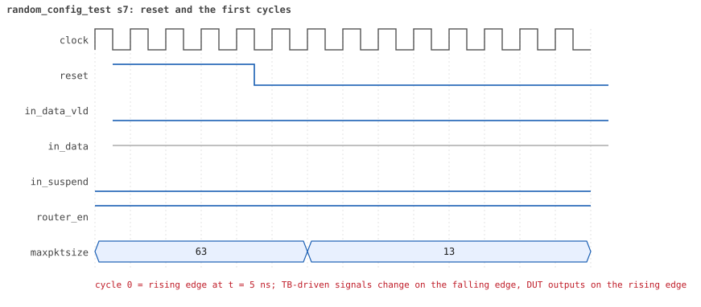
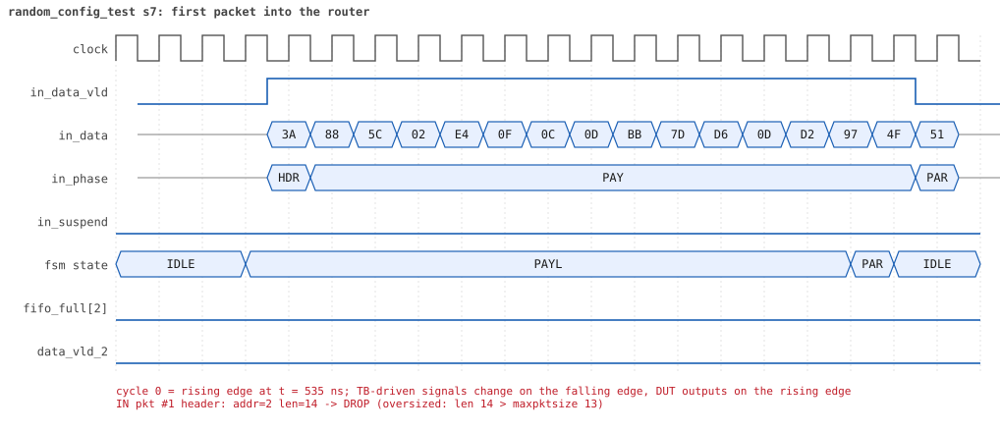
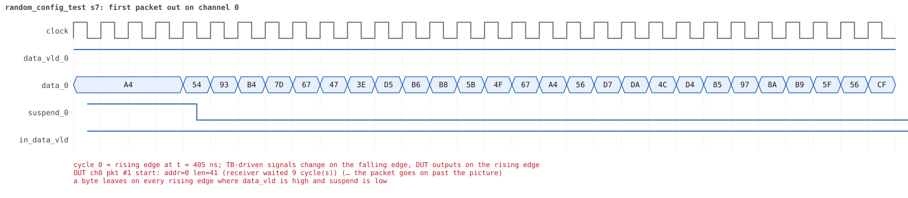
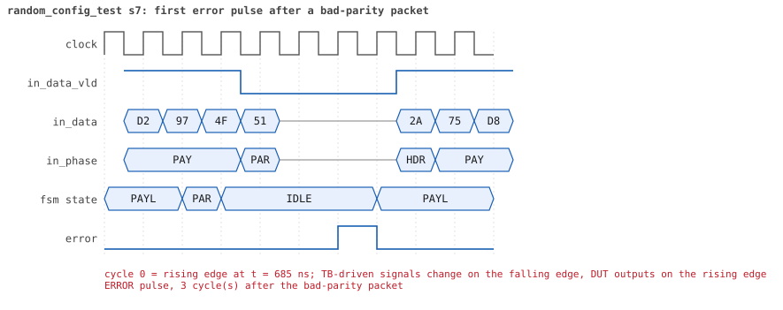
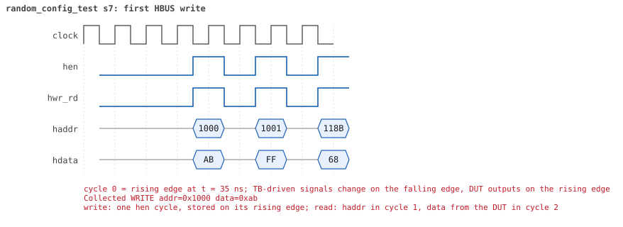
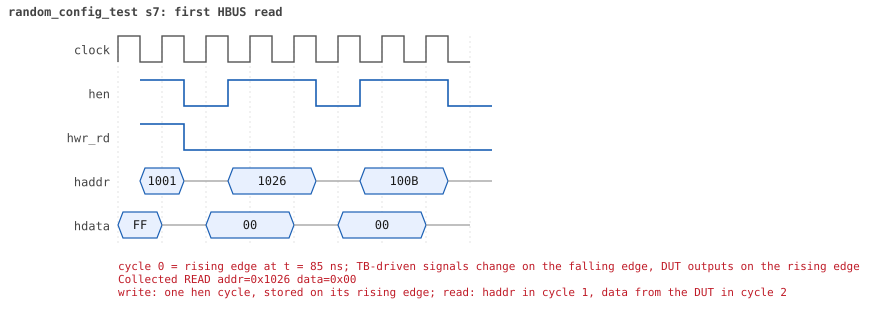

# random_config_test  seed 7

**Result:** PASSED (0 UVM_ERROR, 0 UVM_WARNING, 0 UVM_FATAL) · bench `yapp_project_tb` · sim time 47us · log `random_config_test_s7.log`

Waves: `random_config_test_s7.fst` (GTKWave, Surfer or the VS Code wave viewer); signal trace: `signals.csv`.
[Open the waves in Surfer](https://app.surfer-project.org/?load_url=https%3A%2F%2Fraw.githubusercontent.com%2Ftamirgabgab%2FQcom-Mentoring%2Fmain%2Fyapp_project%2Fregression%2Fyapp_project_tb%2Frandom_config_test_s7%2Frandom_config_test_s7.fst&startup_commands=run_command_file_from_url%20https%3A%2F%2Fraw.githubusercontent.com%2Ftamirgabgab%2FQcom-Mentoring%2Fmain%2Fyapp_project%2Ftb%2Fyapp_router.sucl) (web app, the signals already in groups: `yapp_project/tb/yapp_router.sucl`).

## Summary

- YAPP driver sent **89** packet(s) (6 with bad parity); the input monitor saw 89.
- Router: **37** forwarded, **52** dropped (50 oversized, 2 illegal address 3).
- Packets out: ch0 **5**, ch1 **10**, ch2 **22**.
- Scoreboard: 37 matched, 0 mismatched, 0 unexpected.
- Back-pressure: in_suspend asserted **0** time(s).
- Error pulses: 6.
- HBUS: 43 write(s), 72 read(s).

## Stages

| time (ns) | stage |
|---|---|
| 0 | receivers: ch0 RX_NORMAL, ch1 RX_NORMAL, ch2 RX_FAST |
| 0 | random scenario: 89 packets in 8 bursts |
| 320 | burst 1/8: ctrl=0xab (maxpktsize 43) en=0xff (router on, counter enables 1111111), 11 packet(s) |
| 6630 | burst 1/8 sent: addr0..3 1/3/5/2, bad parity 1, gap 0 1, length 32..63 |
| 7000 | burst 2/8: ctrl=0x41 (maxpktsize 1) en=0xff (router on, counter enables 1111111), 11 packet(s) |
| 13590 | burst 2/8 sent: addr0..3 3/3/4/1, bad parity 0, gap 0 4, length 16..63 |
| 14000 | burst 3/8: ctrl=0x95 (maxpktsize 21) en=0x4d (router on, counter enables 0100110), 11 packet(s) |
| 18530 | burst 3/8 sent: addr0..3 0/1/8/2, bad parity 1, gap 0 1, length 1..63 |
| 19030 | burst 4/8: ctrl=0x01 (maxpktsize 1) en=0xff (router on, counter enables 1111111), 11 packet(s) |
| 23510 | burst 4/8 sent: addr0..3 5/1/3/2, bad parity 2, gap 0 0, length 1..63 |
| 23720 | burst 5/8: ctrl=0xfe (maxpktsize 62) en=0xe7 (router on, counter enables 1110011), 11 packet(s) |
| 30230 | burst 5/8 sent: addr0..3 2/2/7/0, bad parity 0, gap 0 2, length 1..63 |
| 30440 | burst 6/8: ctrl=0xfc (maxpktsize 60) en=0x2b (router on, counter enables 0010101), 11 packet(s) |
| 35510 | burst 6/8 sent: addr0..3 2/2/6/1, bad parity 2, gap 0 2, length 1..63 |
| 35780 | burst 7/8: ctrl=0x7e (maxpktsize 62) en=0xff (router on, counter enables 1111111), 12 packet(s) |
| 42050 | burst 7/8 sent: addr0..3 1/4/7/0, bad parity 0, gap 0 6, length 1..63 |
| 42470 | burst 8/8: ctrl=0xc1 (maxpktsize 1) en=0x01 (router on, counter enables 0000000), 11 packet(s) |
| 46570 | burst 8/8 sent: addr0..3 1/1/7/2, bad parity 0, gap 0 4, length 1..63 |
| 46570 | final reads: every register and the stored packet, checked against the reference model |
| 47045 | done: 89 packets (37 forwarded, 52 dropped), 0 storm burst(s), 37 scoreboard matches, 72 HBUS reads checked, 6 error pulses for 6 bad packets |

## Pictures

**reset and the first cycles**

**first packet into the router**

**first packet out on channel 0**

**first error pulse after a bad-parity packet**

**first HBUS write**

**first HBUS read**

## Timeline

1101 events (the same list is in `timeline.csv`).

| time (ns) | who | event |
|---|---|---|
| 0 | yapp monitor | YAPP monitor running |
| 0 | **test** | STAGE: receivers: ch0 RX_NORMAL, ch1 RX_NORMAL, ch2 RX_FAST |
| 0 | **test** | STAGE: random scenario: 89 packets in 8 bursts |
| 0 | clk/rst driver | Starting clock (period 10) and holding reset for 5 cycles |
| 0 | **DUT** | RESET asserted |
| 50 | **DUT** | RESET released: router_en=1 maxpktsize=63 |
| 70 | hbus driver | Executed WRITE addr=0x1000 data=0xab |
| 75 | **DUT** | CONFIG router_en=1 maxpktsize=43 |
| 75 | hbus monitor | Collected WRITE addr=0x1000 data=0xab |
| 75 | reference | maxpktsize is now 43 |
| 90 | hbus driver | Executed WRITE addr=0x1001 data=0xff |
| 95 | hbus monitor | Collected WRITE addr=0x1001 data=0xff |
| 95 | reference | router_en is now 1 (en_reg 0xff) |
| 110 | hbus driver | Executed WRITE addr=0x118b data=0x68 |
| 115 | hbus monitor | Collected WRITE addr=0x118b data=0x68 |
| 140 | hbus driver | Executed READ  addr=0x118b data=0x68 |
| 145 | hbus monitor | Collected READ  addr=0x118b data=0x68 |
| 160 | hbus driver | Executed WRITE addr=0x1197 data=0x20 |
| 165 | hbus monitor | Collected WRITE addr=0x1197 data=0x20 |
| 190 | hbus driver | Executed READ  addr=0x1197 data=0x20 |
| 195 | hbus monitor | Collected READ  addr=0x1197 data=0x20 |
| 210 | hbus driver | Executed WRITE addr=0x11b9 data=0xc9 |
| 215 | hbus monitor | Collected WRITE addr=0x11b9 data=0xc9 |
| 240 | hbus driver | Executed READ  addr=0x11b9 data=0xc9 |
| 245 | hbus monitor | Collected READ  addr=0x11b9 data=0xc9 |
| 260 | hbus driver | Executed WRITE addr=0x11ba data=0xee |
| 265 | hbus monitor | Collected WRITE addr=0x11ba data=0xee |
| 290 | hbus driver | Executed READ  addr=0x11ba data=0xee |
| 295 | hbus monitor | Collected READ  addr=0x11ba data=0xee |
| 320 | hbus driver | Executed READ  addr=0x100d data=0x00 |
| 320 | **test** | STAGE: burst 1/8: ctrl=0xab (maxpktsize 43) en=0xff (router on, counter enables 1111111), 11 packet(s) |
| 320 | yapp driver | TX pkt #1: addr=0 len=41 parity=good delay=1 |
| 325 | hbus monitor | Collected READ  addr=0x100d data=0x00 |
| 345 | **DUT** | IN  pkt #1 header: addr=0 len=41 -> channel 0 |
| 445 | **DUT** | OUT ch0 pkt #1 start: addr=0 len=41 (receiver waited 9 cycle(s)) |
| 765 | **DUT** | IN  pkt #1 complete: addr=0 len=41 parity=ok forwarded, 43 bytes in 43 cycles (held 0) |
| 765 | yapp monitor | RX pkt #1 on the input: addr=0 len=41 parity=good gap=29 |
| 765 | reference | Packet forwarded: addr=0 len=41 -> channel 0 |
| 770 | yapp driver | TX pkt #1 accepted by the DUT |
| 770 | yapp driver | TX pkt #2: addr=1 len=63 parity=good delay=20 |
| 860 | ch0 driver | ch0: packet consumed (response delay 9) |
| 975 | **DUT** | IN  pkt #2 header: addr=1 len=63 -> DROP (oversized: len 63 > maxpktsize 43) |
| 975 | **DUT** | OUT ch0 pkt #1 done: 43 bytes in 54 cycles |
| 975 | ch0 monitor | ch0 RX pkt #1: addr=0 len=41 parity=good |
| 975 | scoreboard | ch0 pkt matched: addr=0 len=41 (1 matched so far) |
| 1500 | ch0 driver | ch0: packet consumed (response delay 10) |
| 1615 | **DUT** | IN  pkt #2 complete: addr=1 len=63 parity=ok dropped, 65 bytes in 65 cycles (held 0) |
| 1615 | yapp monitor | RX pkt #2 on the input: addr=1 len=63 parity=good gap=20 |
| 1615 | reference | Packet dropped: length 63 > maxpktsize 43 (addr=1) |
| 1615 | **DUT** | ROUTER DROPS PACKET addr=1 length=63 (length > maxpktsize) |
| 1620 | yapp driver | TX pkt #2 accepted by the DUT |
| 1620 | yapp driver | TX pkt #3: addr=3 len=63 parity=good delay=0 |
| 1625 | **DUT** | IN  pkt #3 header: addr=3 len=63 -> DROP (oversized: len 63 > maxpktsize 43) |
| 2265 | **DUT** | IN  pkt #3 complete: addr=3 len=63 parity=ok dropped, 65 bytes in 65 cycles (held 0) |
| 2265 | yapp monitor | RX pkt #3 on the input: addr=3 len=63 parity=good gap=0 |
| 2265 | reference | Packet dropped: illegal address 3 (len=63) |
| 2265 | **DUT** | ROUTER DROPS PACKET addr=3 length=63 (    illegal address) |
| 2270 | yapp driver | TX pkt #3 accepted by the DUT |
| 2270 | yapp driver | TX pkt #4: addr=1 len=43 parity=good delay=20 |
| 2475 | **DUT** | IN  pkt #4 header: addr=1 len=43 -> channel 1 |
| 2505 | **DUT** | OUT ch1 pkt #1 start: addr=1 len=43 (receiver waited 2 cycle(s)) |
| 2915 | **DUT** | IN  pkt #4 complete: addr=1 len=43 parity=ok forwarded, 45 bytes in 45 cycles (held 0) |
| 2915 | yapp monitor | RX pkt #4 on the input: addr=1 len=43 parity=good gap=20 |
| 2915 | reference | Packet forwarded: addr=1 len=43 -> channel 1 |
| 2920 | yapp driver | TX pkt #4 accepted by the DUT |
| 2920 | yapp driver | TX pkt #5: addr=2 len=56 parity=good delay=1 |
| 2935 | **DUT** | IN  pkt #5 header: addr=2 len=56 -> DROP (oversized: len 56 > maxpktsize 43) |
| 2940 | ch1 driver | ch1: packet consumed (response delay 2) |
| 2955 | **DUT** | OUT ch1 pkt #1 done: 45 bytes in 46 cycles |
| 2955 | ch1 monitor | ch1 RX pkt #1: addr=1 len=43 parity=good |
| 2955 | scoreboard | ch1 pkt matched: addr=1 len=43 (2 matched so far) |
| 3400 | ch1 driver | ch1: packet consumed (response delay 0) |
| 3505 | **DUT** | IN  pkt #5 complete: addr=2 len=56 parity=ok dropped, 58 bytes in 58 cycles (held 0) |
| 3505 | yapp monitor | RX pkt #5 on the input: addr=2 len=56 parity=good gap=1 |
| 3505 | reference | Packet dropped: length 56 > maxpktsize 43 (addr=2) |
| 3505 | **DUT** | ROUTER DROPS PACKET addr=2 length=56 (length > maxpktsize) |
| 3510 | yapp driver | TX pkt #5 accepted by the DUT |
| 3510 | yapp driver | TX pkt #6: addr=2 len=43 parity=good delay=20 |
| 3715 | **DUT** | IN  pkt #6 header: addr=2 len=43 -> channel 2 |
| 3725 | **DUT** | OUT ch2 pkt #1 start: addr=2 len=43 (receiver waited 0 cycle(s)) |
| 4155 | **DUT** | IN  pkt #6 complete: addr=2 len=43 parity=ok forwarded, 45 bytes in 45 cycles (held 0) |
| 4155 | yapp monitor | RX pkt #6 on the input: addr=2 len=43 parity=good gap=20 |
| 4155 | reference | Packet forwarded: addr=2 len=43 -> channel 2 |
| 4160 | ch2 driver | ch2: packet consumed (response delay 0) |
| 4160 | yapp driver | TX pkt #6 accepted by the DUT |
| 4160 | yapp driver | TX pkt #7: addr=1 len=42 parity=good delay=5 |
| 4175 | **DUT** | OUT ch2 pkt #1 done: 45 bytes in 46 cycles |
| 4175 | ch2 monitor | ch2 RX pkt #1: addr=2 len=43 parity=good |
| 4175 | scoreboard | ch2 pkt matched: addr=2 len=43 (3 matched so far) |
| 4215 | **DUT** | IN  pkt #7 header: addr=1 len=42 -> channel 1 |
| 4305 | **DUT** | OUT ch1 pkt #2 start: addr=1 len=42 (receiver waited 8 cycle(s)) |
| 4470 | ch2 driver | ch2: packet consumed (response delay 0) |
| 4645 | **DUT** | IN  pkt #7 complete: addr=1 len=42 parity=ok forwarded, 44 bytes in 44 cycles (held 0) |
| 4645 | yapp monitor | RX pkt #7 on the input: addr=1 len=42 parity=good gap=5 |
| 4645 | reference | Packet forwarded: addr=1 len=42 -> channel 1 |
| 4650 | yapp driver | TX pkt #7 accepted by the DUT |
| 4650 | yapp driver | TX pkt #8: addr=2 len=43 parity=good delay=1 |
| 4665 | **DUT** | IN  pkt #8 header: addr=2 len=43 -> channel 2 |
| 4675 | **DUT** | OUT ch2 pkt #2 start: addr=2 len=43 (receiver waited 0 cycle(s)) |
| 4730 | ch1 driver | ch1: packet consumed (response delay 8) |
| 4835 | **DUT** | OUT ch1 pkt #2 done: 44 bytes in 54 cycles |
| 4835 | ch1 monitor | ch1 RX pkt #2: addr=1 len=42 parity=good |
| 4835 | scoreboard | ch1 pkt matched: addr=1 len=42 (4 matched so far) |
| 4940 | ch1 driver | ch1: packet consumed (response delay 9) |
| 5105 | **DUT** | IN  pkt #8 complete: addr=2 len=43 parity=ok forwarded, 45 bytes in 45 cycles (held 0) |
| 5105 | yapp monitor | RX pkt #8 on the input: addr=2 len=43 parity=good gap=1 |
| 5105 | reference | Packet forwarded: addr=2 len=43 -> channel 2 |
| 5110 | ch2 driver | ch2: packet consumed (response delay 0) |
| 5110 | yapp driver | TX pkt #8 accepted by the DUT |
| 5110 | yapp driver | TX pkt #9: addr=2 len=63 parity=bad delay=1 |
| 5125 | **DUT** | IN  pkt #9 header: addr=2 len=63 -> DROP (oversized: len 63 > maxpktsize 43) |
| 5125 | **DUT** | OUT ch2 pkt #2 done: 45 bytes in 46 cycles |
| 5125 | ch2 monitor | ch2 RX pkt #2: addr=2 len=43 parity=good |
| 5125 | scoreboard | ch2 pkt matched: addr=2 len=43 (5 matched so far) |
| 5400 | ch2 driver | ch2: packet consumed (response delay 0) |
| 5765 | **DUT** | IN  pkt #9 complete: addr=2 len=63 parity=BAD dropped, 65 bytes in 65 cycles (held 0) |
| 5765 | yapp monitor | RX pkt #9 on the input: addr=2 len=63 parity=bad gap=1 |
| 5765 | reference | Packet dropped: length 63 > maxpktsize 43 (addr=2) |
| 5765 | **DUT** | ROUTER DROPS PACKET addr=2 length=63 (length > maxpktsize) |
| 5770 | yapp driver | TX pkt #9 accepted by the DUT |
| 5770 | yapp driver | TX pkt #10: addr=2 len=32 parity=good delay=2 |
| 5790 | **DUT** | ERROR pulse, 2 cycle(s) after the bad-parity packet |
| 5790 | error checker | error pulse 2 cycles after the bad packet (0 still owed) |
| 5795 | **DUT** | IN  pkt #10 header: addr=2 len=32 -> channel 2 |
| 5805 | **DUT** | OUT ch2 pkt #3 start: addr=2 len=32 (receiver waited 0 cycle(s)) |
| 6125 | **DUT** | IN  pkt #10 complete: addr=2 len=32 parity=ok forwarded, 34 bytes in 34 cycles (held 0) |
| 6125 | yapp monitor | RX pkt #10 on the input: addr=2 len=32 parity=good gap=2 |
| 6125 | reference | Packet forwarded: addr=2 len=32 -> channel 2 |
| 6130 | ch2 driver | ch2: packet consumed (response delay 0) |
| 6130 | yapp driver | TX pkt #10 accepted by the DUT |
| 6130 | yapp driver | TX pkt #11: addr=3 len=44 parity=good delay=4 |
| 6145 | **DUT** | OUT ch2 pkt #3 done: 34 bytes in 35 cycles |
| 6145 | ch2 monitor | ch2 RX pkt #3: addr=2 len=32 parity=good |
| 6145 | scoreboard | ch2 pkt matched: addr=2 len=32 (6 matched so far) |
| 6175 | **DUT** | IN  pkt #11 header: addr=3 len=44 -> DROP (oversized: len 44 > maxpktsize 43) |
| 6380 | ch2 driver | ch2: packet consumed (response delay 0) |
| 6625 | **DUT** | IN  pkt #11 complete: addr=3 len=44 parity=ok dropped, 46 bytes in 46 cycles (held 0) |
| 6625 | yapp monitor | RX pkt #11 on the input: addr=3 len=44 parity=good gap=4 |
| 6625 | reference | Packet dropped: illegal address 3 (len=44) |
| 6625 | **DUT** | ROUTER DROPS PACKET addr=3 length=44 (    illegal address) |
| 6630 | yapp driver | TX pkt #11 accepted by the DUT |
| 6630 | **test** | STAGE: burst 1/8 sent: addr0..3 1/3/5/2, bad parity 1, gap 0 1, length 32..63 |
| 6650 | hbus driver | Executed WRITE addr=0x1000 data=0x41 |
| 6655 | **DUT** | CONFIG router_en=1 maxpktsize=1 |
| 6655 | hbus monitor | Collected WRITE addr=0x1000 data=0x41 |
| 6655 | reference | maxpktsize is now 1 |
| 6670 | hbus driver | Executed WRITE addr=0x1001 data=0xff |
| 6675 | hbus monitor | Collected WRITE addr=0x1001 data=0xff |
| 6675 | reference | router_en is now 1 (en_reg 0xff) |
| 6690 | hbus driver | Executed WRITE addr=0x11a8 data=0x64 |
| 6695 | hbus monitor | Collected WRITE addr=0x11a8 data=0x64 |
| 6720 | hbus driver | Executed READ  addr=0x11a8 data=0x64 |
| 6725 | hbus monitor | Collected READ  addr=0x11a8 data=0x64 |
| 6740 | hbus driver | Executed WRITE addr=0x11b4 data=0x2b |
| 6745 | hbus monitor | Collected WRITE addr=0x11b4 data=0x2b |
| 6770 | hbus driver | Executed READ  addr=0x11b4 data=0x2b |
| 6775 | hbus monitor | Collected READ  addr=0x11b4 data=0x2b |
| 6790 | hbus driver | Executed WRITE addr=0x11ef data=0x38 |
| 6795 | hbus monitor | Collected WRITE addr=0x11ef data=0x38 |
| 6820 | hbus driver | Executed READ  addr=0x11ef data=0x38 |
| 6825 | hbus monitor | Collected READ  addr=0x11ef data=0x38 |
| 6850 | hbus driver | Executed READ  addr=0x100c data=0x00 |
| 6855 | hbus monitor | Collected READ  addr=0x100c data=0x00 |
| 6880 | hbus driver | Executed READ  addr=0x102f data=0x02 |
| 6885 | hbus monitor | Collected READ  addr=0x102f data=0x02 |
| 6910 | hbus driver | Executed READ  addr=0x100d data=0x2c |
| 6915 | hbus monitor | Collected READ  addr=0x100d data=0x2c |
| 6940 | hbus driver | Executed READ  addr=0x100d data=0x2c |
| 6945 | hbus monitor | Collected READ  addr=0x100d data=0x2c |
| 6970 | hbus driver | Executed READ  addr=0x1005 data=0x05 |
| 6975 | hbus monitor | Collected READ  addr=0x1005 data=0x05 |
| 7000 | hbus driver | Executed READ  addr=0x104f data=0xca |
| 7000 | **test** | STAGE: burst 2/8: ctrl=0x41 (maxpktsize 1) en=0xff (router on, counter enables 1111111), 11 packet(s) |
| 7000 | yapp driver | TX pkt #12: addr=2 len=63 parity=good delay=17 |
| 7005 | hbus monitor | Collected READ  addr=0x104f data=0xca |
| 7185 | **DUT** | IN  pkt #12 header: addr=2 len=63 -> DROP (oversized: len 63 > maxpktsize 1) |
| 7825 | **DUT** | IN  pkt #12 complete: addr=2 len=63 parity=ok dropped, 65 bytes in 65 cycles (held 0) |
| 7825 | yapp monitor | RX pkt #12 on the input: addr=2 len=63 parity=good gap=55 |
| 7825 | reference | Packet dropped: length 63 > maxpktsize 1 (addr=2) |
| 7825 | **DUT** | ROUTER DROPS PACKET addr=2 length=63 (length > maxpktsize) |
| 7830 | yapp driver | TX pkt #12 accepted by the DUT |
| 7830 | yapp driver | TX pkt #13: addr=2 len=51 parity=good delay=18 |
| 8015 | **DUT** | IN  pkt #13 header: addr=2 len=51 -> DROP (oversized: len 51 > maxpktsize 1) |
| 8535 | **DUT** | IN  pkt #13 complete: addr=2 len=51 parity=ok dropped, 53 bytes in 53 cycles (held 0) |
| 8535 | yapp monitor | RX pkt #13 on the input: addr=2 len=51 parity=good gap=18 |
| 8535 | reference | Packet dropped: length 51 > maxpktsize 1 (addr=2) |
| 8535 | **DUT** | ROUTER DROPS PACKET addr=2 length=51 (length > maxpktsize) |
| 8540 | yapp driver | TX pkt #13 accepted by the DUT |
| 8540 | yapp driver | TX pkt #14: addr=2 len=63 parity=good delay=1 |
| 8555 | **DUT** | IN  pkt #14 header: addr=2 len=63 -> DROP (oversized: len 63 > maxpktsize 1) |
| 9195 | **DUT** | IN  pkt #14 complete: addr=2 len=63 parity=ok dropped, 65 bytes in 65 cycles (held 0) |
| 9195 | yapp monitor | RX pkt #14 on the input: addr=2 len=63 parity=good gap=1 |
| 9195 | reference | Packet dropped: length 63 > maxpktsize 1 (addr=2) |
| 9195 | **DUT** | ROUTER DROPS PACKET addr=2 length=63 (length > maxpktsize) |
| 9200 | yapp driver | TX pkt #14 accepted by the DUT |
| 9200 | yapp driver | TX pkt #15: addr=0 len=47 parity=good delay=6 |
| 9265 | **DUT** | IN  pkt #15 header: addr=0 len=47 -> DROP (oversized: len 47 > maxpktsize 1) |
| 9745 | **DUT** | IN  pkt #15 complete: addr=0 len=47 parity=ok dropped, 49 bytes in 49 cycles (held 0) |
| 9745 | yapp monitor | RX pkt #15 on the input: addr=0 len=47 parity=good gap=6 |
| 9745 | reference | Packet dropped: length 47 > maxpktsize 1 (addr=0) |
| 9745 | **DUT** | ROUTER DROPS PACKET addr=0 length=47 (length > maxpktsize) |
| 9750 | yapp driver | TX pkt #15 accepted by the DUT |
| 9750 | yapp driver | TX pkt #16: addr=0 len=63 parity=good delay=0 |
| 9755 | **DUT** | IN  pkt #16 header: addr=0 len=63 -> DROP (oversized: len 63 > maxpktsize 1) |
| 10395 | **DUT** | IN  pkt #16 complete: addr=0 len=63 parity=ok dropped, 65 bytes in 65 cycles (held 0) |
| 10395 | yapp monitor | RX pkt #16 on the input: addr=0 len=63 parity=good gap=0 |
| 10395 | reference | Packet dropped: length 63 > maxpktsize 1 (addr=0) |
| 10395 | **DUT** | ROUTER DROPS PACKET addr=0 length=63 (length > maxpktsize) |
| 10400 | yapp driver | TX pkt #16 accepted by the DUT |
| 10400 | yapp driver | TX pkt #17: addr=1 len=35 parity=good delay=13 |
| 10535 | **DUT** | IN  pkt #17 header: addr=1 len=35 -> DROP (oversized: len 35 > maxpktsize 1) |
| 10895 | **DUT** | IN  pkt #17 complete: addr=1 len=35 parity=ok dropped, 37 bytes in 37 cycles (held 0) |
| 10895 | yapp monitor | RX pkt #17 on the input: addr=1 len=35 parity=good gap=13 |
| 10895 | reference | Packet dropped: length 35 > maxpktsize 1 (addr=1) |
| 10895 | **DUT** | ROUTER DROPS PACKET addr=1 length=35 (length > maxpktsize) |
| 10900 | yapp driver | TX pkt #17 accepted by the DUT |
| 10900 | yapp driver | TX pkt #18: addr=3 len=63 parity=good delay=0 |
| 10905 | **DUT** | IN  pkt #18 header: addr=3 len=63 -> DROP (oversized: len 63 > maxpktsize 1) |
| 11545 | **DUT** | IN  pkt #18 complete: addr=3 len=63 parity=ok dropped, 65 bytes in 65 cycles (held 0) |
| 11545 | yapp monitor | RX pkt #18 on the input: addr=3 len=63 parity=good gap=0 |
| 11545 | reference | Packet dropped: illegal address 3 (len=63) |
| 11545 | **DUT** | ROUTER DROPS PACKET addr=3 length=63 (    illegal address) |
| 11550 | yapp driver | TX pkt #18 accepted by the DUT |
| 11550 | yapp driver | TX pkt #19: addr=0 len=63 parity=good delay=0 |
| 11555 | **DUT** | IN  pkt #19 header: addr=0 len=63 -> DROP (oversized: len 63 > maxpktsize 1) |
| 12195 | **DUT** | IN  pkt #19 complete: addr=0 len=63 parity=ok dropped, 65 bytes in 65 cycles (held 0) |
| 12195 | yapp monitor | RX pkt #19 on the input: addr=0 len=63 parity=good gap=0 |
| 12195 | reference | Packet dropped: length 63 > maxpktsize 1 (addr=0) |
| 12195 | **DUT** | ROUTER DROPS PACKET addr=0 length=63 (length > maxpktsize) |
| 12200 | yapp driver | TX pkt #19 accepted by the DUT |
| 12200 | yapp driver | TX pkt #20: addr=2 len=16 parity=good delay=0 |
| 12205 | **DUT** | IN  pkt #20 header: addr=2 len=16 -> DROP (oversized: len 16 > maxpktsize 1) |
| 12375 | **DUT** | IN  pkt #20 complete: addr=2 len=16 parity=ok dropped, 18 bytes in 18 cycles (held 0) |
| 12375 | yapp monitor | RX pkt #20 on the input: addr=2 len=16 parity=good gap=0 |
| 12375 | reference | Packet dropped: length 16 > maxpktsize 1 (addr=2) |
| 12375 | **DUT** | ROUTER DROPS PACKET addr=2 length=16 (length > maxpktsize) |
| 12380 | yapp driver | TX pkt #20 accepted by the DUT |
| 12380 | yapp driver | TX pkt #21: addr=1 len=63 parity=good delay=1 |
| 12395 | **DUT** | IN  pkt #21 header: addr=1 len=63 -> DROP (oversized: len 63 > maxpktsize 1) |
| 13035 | **DUT** | IN  pkt #21 complete: addr=1 len=63 parity=ok dropped, 65 bytes in 65 cycles (held 0) |
| 13035 | yapp monitor | RX pkt #21 on the input: addr=1 len=63 parity=good gap=1 |
| 13035 | reference | Packet dropped: length 63 > maxpktsize 1 (addr=1) |
| 13035 | **DUT** | ROUTER DROPS PACKET addr=1 length=63 (length > maxpktsize) |
| 13040 | yapp driver | TX pkt #21 accepted by the DUT |
| 13040 | yapp driver | TX pkt #22: addr=1 len=33 parity=good delay=20 |
| 13245 | **DUT** | IN  pkt #22 header: addr=1 len=33 -> DROP (oversized: len 33 > maxpktsize 1) |
| 13585 | **DUT** | IN  pkt #22 complete: addr=1 len=33 parity=ok dropped, 35 bytes in 35 cycles (held 0) |
| 13585 | yapp monitor | RX pkt #22 on the input: addr=1 len=33 parity=good gap=20 |
| 13585 | reference | Packet dropped: length 33 > maxpktsize 1 (addr=1) |
| 13585 | **DUT** | ROUTER DROPS PACKET addr=1 length=33 (length > maxpktsize) |
| 13590 | yapp driver | TX pkt #22 accepted by the DUT |
| 13590 | **test** | STAGE: burst 2/8 sent: addr0..3 3/3/4/1, bad parity 0, gap 0 4, length 16..63 |
| 13610 | hbus driver | Executed WRITE addr=0x1000 data=0x95 |
| 13615 | **DUT** | CONFIG router_en=1 maxpktsize=21 |
| 13615 | hbus monitor | Collected WRITE addr=0x1000 data=0x95 |
| 13615 | reference | maxpktsize is now 21 |
| 13630 | hbus driver | Executed WRITE addr=0x1001 data=0x4d |
| 13635 | hbus monitor | Collected WRITE addr=0x1001 data=0x4d |
| 13635 | reference | router_en is now 1 (en_reg 0x4d) |
| 13660 | hbus driver | Executed READ  addr=0x100d data=0x21 |
| 13665 | hbus monitor | Collected READ  addr=0x100d data=0x21 |
| 13680 | hbus driver | Executed WRITE addr=0x1173 data=0x62 |
| 13685 | hbus monitor | Collected WRITE addr=0x1173 data=0x62 |
| 13710 | hbus driver | Executed READ  addr=0x1173 data=0x62 |
| 13715 | hbus monitor | Collected READ  addr=0x1173 data=0x62 |
| 13740 | hbus driver | Executed READ  addr=0x1038 data=0x87 |
| 13745 | hbus monitor | Collected READ  addr=0x1038 data=0x87 |
| 13760 | hbus driver | Executed WRITE addr=0x115a data=0xfe |
| 13765 | hbus monitor | Collected WRITE addr=0x115a data=0xfe |
| 13790 | hbus driver | Executed READ  addr=0x115a data=0xfe |
| 13795 | hbus monitor | Collected READ  addr=0x115a data=0xfe |
| 13810 | hbus driver | Executed WRITE addr=0x1164 data=0xe0 |
| 13815 | hbus monitor | Collected WRITE addr=0x1164 data=0xe0 |
| 13840 | hbus driver | Executed READ  addr=0x1164 data=0xe0 |
| 13845 | hbus monitor | Collected READ  addr=0x1164 data=0xe0 |
| 13870 | hbus driver | Executed READ  addr=0x1003 data=0x00 |
| 13875 | hbus monitor | Collected READ  addr=0x1003 data=0x00 |
| 13890 | hbus driver | Executed WRITE addr=0x1134 data=0xd0 |
| 13895 | hbus monitor | Collected WRITE addr=0x1134 data=0xd0 |
| 13920 | hbus driver | Executed READ  addr=0x1134 data=0xd0 |
| 13925 | hbus monitor | Collected READ  addr=0x1134 data=0xd0 |
| 13950 | hbus driver | Executed READ  addr=0x10e1 data=0x00 |
| 13955 | hbus monitor | Collected READ  addr=0x10e1 data=0x00 |
| 13970 | hbus driver | Executed WRITE addr=0x1182 data=0x1a |
| 13975 | hbus monitor | Collected WRITE addr=0x1182 data=0x1a |
| 14000 | hbus driver | Executed READ  addr=0x1182 data=0x1a |
| 14000 | **test** | STAGE: burst 3/8: ctrl=0x95 (maxpktsize 21) en=0x4d (router on, counter enables 0100110), 11 packet(s) |
| 14000 | yapp driver | TX pkt #23: addr=2 len=63 parity=good delay=2 |
| 14005 | hbus monitor | Collected READ  addr=0x1182 data=0x1a |
| 14035 | **DUT** | IN  pkt #23 header: addr=2 len=63 -> DROP (oversized: len 63 > maxpktsize 21) |
| 14675 | **DUT** | IN  pkt #23 complete: addr=2 len=63 parity=ok dropped, 65 bytes in 65 cycles (held 0) |
| 14675 | yapp monitor | RX pkt #23 on the input: addr=2 len=63 parity=good gap=44 |
| 14675 | reference | Packet dropped: length 63 > maxpktsize 21 (addr=2) |
| 14675 | **DUT** | ROUTER DROPS PACKET addr=2 length=63 (length > maxpktsize) |
| 14680 | yapp driver | TX pkt #23 accepted by the DUT |
| 14680 | yapp driver | TX pkt #24: addr=2 len=29 parity=bad delay=1 |
| 14695 | **DUT** | IN  pkt #24 header: addr=2 len=29 -> DROP (oversized: len 29 > maxpktsize 21) |
| 14995 | **DUT** | IN  pkt #24 complete: addr=2 len=29 parity=BAD dropped, 31 bytes in 31 cycles (held 0) |
| 14995 | yapp monitor | RX pkt #24 on the input: addr=2 len=29 parity=bad gap=1 |
| 14995 | reference | Packet dropped: length 29 > maxpktsize 21 (addr=2) |
| 14995 | **DUT** | ROUTER DROPS PACKET addr=2 length=29 (length > maxpktsize) |
| 15000 | yapp driver | TX pkt #24 accepted by the DUT |
| 15000 | yapp driver | TX pkt #25: addr=2 len=32 parity=good delay=5 |
| 15055 | **DUT** | IN  pkt #25 header: addr=2 len=32 -> DROP (oversized: len 32 > maxpktsize 21) |
| 15070 | **DUT** | ERROR pulse, 7 cycle(s) after the bad-parity packet |
| 15070 | error checker | error pulse 7 cycles after the bad packet (0 still owed) |
| 15385 | **DUT** | IN  pkt #25 complete: addr=2 len=32 parity=ok dropped, 34 bytes in 34 cycles (held 0) |
| 15385 | yapp monitor | RX pkt #25 on the input: addr=2 len=32 parity=good gap=5 |
| 15385 | reference | Packet dropped: length 32 > maxpktsize 21 (addr=2) |
| 15385 | **DUT** | ROUTER DROPS PACKET addr=2 length=32 (length > maxpktsize) |
| 15390 | yapp driver | TX pkt #25 accepted by the DUT |
| 15390 | yapp driver | TX pkt #26: addr=3 len=52 parity=good delay=19 |
| 15585 | **DUT** | IN  pkt #26 header: addr=3 len=52 -> DROP (oversized: len 52 > maxpktsize 21) |
| 16115 | **DUT** | IN  pkt #26 complete: addr=3 len=52 parity=ok dropped, 54 bytes in 54 cycles (held 0) |
| 16115 | yapp monitor | RX pkt #26 on the input: addr=3 len=52 parity=good gap=19 |
| 16115 | reference | Packet dropped: illegal address 3 (len=52) |
| 16115 | **DUT** | ROUTER DROPS PACKET addr=3 length=52 (    illegal address) |
| 16120 | yapp driver | TX pkt #26 accepted by the DUT |
| 16120 | yapp driver | TX pkt #27: addr=1 len=22 parity=good delay=15 |
| 16275 | **DUT** | IN  pkt #27 header: addr=1 len=22 -> DROP (oversized: len 22 > maxpktsize 21) |
| 16505 | **DUT** | IN  pkt #27 complete: addr=1 len=22 parity=ok dropped, 24 bytes in 24 cycles (held 0) |
| 16505 | yapp monitor | RX pkt #27 on the input: addr=1 len=22 parity=good gap=15 |
| 16505 | reference | Packet dropped: length 22 > maxpktsize 21 (addr=1) |
| 16505 | **DUT** | ROUTER DROPS PACKET addr=1 length=22 (length > maxpktsize) |
| 16510 | yapp driver | TX pkt #27 accepted by the DUT |
| 16510 | yapp driver | TX pkt #28: addr=2 len=1 parity=good delay=19 |
| 16705 | **DUT** | IN  pkt #28 header: addr=2 len=1 -> channel 2 |
| 16715 | **DUT** | OUT ch2 pkt #4 start: addr=2 len=1 (receiver waited 0 cycle(s)) |
| 16725 | **DUT** | IN  pkt #28 complete: addr=2 len=1 parity=ok forwarded, 3 bytes in 3 cycles (held 0) |
| 16725 | yapp monitor | RX pkt #28 on the input: addr=2 len=1 parity=good gap=19 |
| 16725 | reference | Packet forwarded: addr=2 len=1 -> channel 2 |
| 16730 | ch2 driver | ch2: packet consumed (response delay 0) |
| 16730 | yapp driver | TX pkt #28 accepted by the DUT |
| 16730 | yapp driver | TX pkt #29: addr=3 len=63 parity=good delay=1 |
| 16745 | **DUT** | IN  pkt #29 header: addr=3 len=63 -> DROP (oversized: len 63 > maxpktsize 21) |
| 16745 | **DUT** | OUT ch2 pkt #4 done: 3 bytes in 4 cycles |
| 16745 | ch2 monitor | ch2 RX pkt #4: addr=2 len=1 parity=good |
| 16745 | scoreboard | ch2 pkt matched: addr=2 len=1 (7 matched so far) |
| 17140 | ch2 driver | ch2: packet consumed (response delay 0) |
| 17385 | **DUT** | IN  pkt #29 complete: addr=3 len=63 parity=ok dropped, 65 bytes in 65 cycles (held 0) |
| 17385 | yapp monitor | RX pkt #29 on the input: addr=3 len=63 parity=good gap=1 |
| 17385 | reference | Packet dropped: illegal address 3 (len=63) |
| 17385 | **DUT** | ROUTER DROPS PACKET addr=3 length=63 (    illegal address) |
| 17390 | yapp driver | TX pkt #29 accepted by the DUT |
| 17390 | yapp driver | TX pkt #30: addr=2 len=1 parity=good delay=1 |
| 17405 | **DUT** | IN  pkt #30 header: addr=2 len=1 -> channel 2 |
| 17415 | **DUT** | OUT ch2 pkt #5 start: addr=2 len=1 (receiver waited 0 cycle(s)) |
| 17425 | **DUT** | IN  pkt #30 complete: addr=2 len=1 parity=ok forwarded, 3 bytes in 3 cycles (held 0) |
| 17425 | yapp monitor | RX pkt #30 on the input: addr=2 len=1 parity=good gap=1 |
| 17425 | reference | Packet forwarded: addr=2 len=1 -> channel 2 |
| 17430 | ch2 driver | ch2: packet consumed (response delay 0) |
| 17430 | yapp driver | TX pkt #30 accepted by the DUT |
| 17430 | yapp driver | TX pkt #31: addr=2 len=10 parity=good delay=0 |
| 17435 | **DUT** | IN  pkt #31 header: addr=2 len=10 -> channel 2 |
| 17445 | **DUT** | OUT ch2 pkt #5 done: 3 bytes in 4 cycles |
| 17445 | ch2 monitor | ch2 RX pkt #5: addr=2 len=1 parity=good |
| 17445 | scoreboard | ch2 pkt matched: addr=2 len=1 (8 matched so far) |
| 17455 | **DUT** | OUT ch2 pkt #6 start: addr=2 len=10 (receiver waited 0 cycle(s)) |
| 17545 | **DUT** | IN  pkt #31 complete: addr=2 len=10 parity=ok forwarded, 12 bytes in 12 cycles (held 0) |
| 17545 | yapp monitor | RX pkt #31 on the input: addr=2 len=10 parity=good gap=0 |
| 17545 | reference | Packet forwarded: addr=2 len=10 -> channel 2 |
| 17550 | yapp driver | TX pkt #31 accepted by the DUT |
| 17550 | yapp driver | TX pkt #32: addr=2 len=63 parity=good delay=8 |
| 17565 | **DUT** | OUT ch2 pkt #6 done: 12 bytes in 12 cycles |
| 17565 | ch2 monitor | ch2 RX pkt #6: addr=2 len=10 parity=good |
| 17565 | scoreboard | ch2 pkt matched: addr=2 len=10 (9 matched so far) |
| 17600 | ch2 driver | ch2: packet consumed (response delay 0) |
| 17635 | **DUT** | IN  pkt #32 header: addr=2 len=63 -> DROP (oversized: len 63 > maxpktsize 21) |
| 18275 | **DUT** | IN  pkt #32 complete: addr=2 len=63 parity=ok dropped, 65 bytes in 65 cycles (held 0) |
| 18275 | yapp monitor | RX pkt #32 on the input: addr=2 len=63 parity=good gap=8 |
| 18275 | reference | Packet dropped: length 63 > maxpktsize 21 (addr=2) |
| 18275 | **DUT** | ROUTER DROPS PACKET addr=2 length=63 (length > maxpktsize) |
| 18280 | yapp driver | TX pkt #32 accepted by the DUT |
| 18280 | yapp driver | TX pkt #33: addr=2 len=21 parity=good delay=2 |
| 18305 | **DUT** | IN  pkt #33 header: addr=2 len=21 -> channel 2 |
| 18315 | **DUT** | OUT ch2 pkt #7 start: addr=2 len=21 (receiver waited 0 cycle(s)) |
| 18525 | **DUT** | IN  pkt #33 complete: addr=2 len=21 parity=ok forwarded, 23 bytes in 23 cycles (held 0) |
| 18525 | yapp monitor | RX pkt #33 on the input: addr=2 len=21 parity=good gap=2 |
| 18525 | reference | Packet forwarded: addr=2 len=21 -> channel 2 |
| 18530 | ch2 driver | ch2: packet consumed (response delay 0) |
| 18530 | yapp driver | TX pkt #33 accepted by the DUT |
| 18530 | **test** | STAGE: burst 3/8 sent: addr0..3 0/1/8/2, bad parity 1, gap 0 1, length 1..63 |
| 18545 | **DUT** | OUT ch2 pkt #7 done: 23 bytes in 24 cycles |
| 18545 | ch2 monitor | ch2 RX pkt #7: addr=2 len=21 parity=good |
| 18545 | scoreboard | ch2 pkt matched: addr=2 len=21 (10 matched so far) |
| 18550 | hbus driver | Executed WRITE addr=0x1000 data=0x01 |
| 18555 | **DUT** | CONFIG router_en=1 maxpktsize=1 |
| 18555 | hbus monitor | Collected WRITE addr=0x1000 data=0x01 |
| 18555 | reference | maxpktsize is now 1 |
| 18570 | hbus driver | Executed WRITE addr=0x1001 data=0xff |
| 18575 | hbus monitor | Collected WRITE addr=0x1001 data=0xff |
| 18575 | reference | router_en is now 1 (en_reg 0xff) |
| 18600 | hbus driver | Executed READ  addr=0x102f data=0x3d |
| 18605 | hbus monitor | Collected READ  addr=0x102f data=0x3d |
| 18630 | hbus driver | Executed READ  addr=0x103f data=0x4d |
| 18635 | hbus monitor | Collected READ  addr=0x103f data=0x4d |
| 18650 | hbus driver | Executed WRITE addr=0x116a data=0xfa |
| 18655 | hbus monitor | Collected WRITE addr=0x116a data=0xfa |
| 18680 | hbus driver | Executed READ  addr=0x116a data=0xfa |
| 18685 | hbus monitor | Collected READ  addr=0x116a data=0xfa |
| 18700 | hbus driver | Executed WRITE addr=0x1120 data=0xb4 |
| 18705 | hbus monitor | Collected WRITE addr=0x1120 data=0xb4 |
| 18730 | hbus driver | Executed READ  addr=0x1120 data=0xb4 |
| 18735 | hbus monitor | Collected READ  addr=0x1120 data=0xb4 |
| 18760 | hbus driver | Executed READ  addr=0x103d data=0xc9 |
| 18765 | hbus monitor | Collected READ  addr=0x103d data=0xc9 |
| 18780 | hbus driver | Executed WRITE addr=0x116c data=0x49 |
| 18785 | hbus monitor | Collected WRITE addr=0x116c data=0x49 |
| 18810 | hbus driver | Executed READ  addr=0x116c data=0x49 |
| 18815 | hbus monitor | Collected READ  addr=0x116c data=0x49 |
| 18840 | hbus driver | Executed READ  addr=0x100f data=0x00 |
| 18845 | hbus monitor | Collected READ  addr=0x100f data=0x00 |
| 18860 | ch2 driver | ch2: packet consumed (response delay 0) |
| 18860 | hbus driver | Executed WRITE addr=0x115f data=0x3a |
| 18865 | hbus monitor | Collected WRITE addr=0x115f data=0x3a |
| 18890 | hbus driver | Executed READ  addr=0x115f data=0x3a |
| 18895 | hbus monitor | Collected READ  addr=0x115f data=0x3a |
| 18920 | hbus driver | Executed READ  addr=0x100d data=0x15 |
| 18925 | hbus monitor | Collected READ  addr=0x100d data=0x15 |
| 18950 | hbus driver | Executed READ  addr=0x1004 data=0x01 |
| 18955 | hbus monitor | Collected READ  addr=0x1004 data=0x01 |
| 18970 | hbus driver | Executed WRITE addr=0x11e9 data=0x02 |
| 18975 | hbus monitor | Collected WRITE addr=0x11e9 data=0x02 |
| 19000 | hbus driver | Executed READ  addr=0x11e9 data=0x02 |
| 19005 | hbus monitor | Collected READ  addr=0x11e9 data=0x02 |
| 19030 | hbus driver | Executed READ  addr=0x1099 data=0x00 |
| 19030 | **test** | STAGE: burst 4/8: ctrl=0x01 (maxpktsize 1) en=0xff (router on, counter enables 1111111), 11 packet(s) |
| 19030 | yapp driver | TX pkt #34: addr=3 len=53 parity=good delay=20 |
| 19035 | hbus monitor | Collected READ  addr=0x1099 data=0x00 |
| 19245 | **DUT** | IN  pkt #34 header: addr=3 len=53 -> DROP (oversized: len 53 > maxpktsize 1) |
| 19785 | **DUT** | IN  pkt #34 complete: addr=3 len=53 parity=ok dropped, 55 bytes in 55 cycles (held 0) |
| 19785 | yapp monitor | RX pkt #34 on the input: addr=3 len=53 parity=good gap=71 |
| 19785 | reference | Packet dropped: illegal address 3 (len=53) |
| 19785 | **DUT** | ROUTER DROPS PACKET addr=3 length=53 (    illegal address) |
| 19790 | yapp driver | TX pkt #34 accepted by the DUT |
| 19790 | yapp driver | TX pkt #35: addr=0 len=63 parity=good delay=2 |
| 19815 | **DUT** | IN  pkt #35 header: addr=0 len=63 -> DROP (oversized: len 63 > maxpktsize 1) |
| 20455 | **DUT** | IN  pkt #35 complete: addr=0 len=63 parity=ok dropped, 65 bytes in 65 cycles (held 0) |
| 20455 | yapp monitor | RX pkt #35 on the input: addr=0 len=63 parity=good gap=2 |
| 20455 | reference | Packet dropped: length 63 > maxpktsize 1 (addr=0) |
| 20455 | **DUT** | ROUTER DROPS PACKET addr=0 length=63 (length > maxpktsize) |
| 20460 | yapp driver | TX pkt #35 accepted by the DUT |
| 20460 | yapp driver | TX pkt #36: addr=0 len=1 parity=good delay=20 |
| 20665 | **DUT** | IN  pkt #36 header: addr=0 len=1 -> channel 0 |
| 20685 | **DUT** | IN  pkt #36 complete: addr=0 len=1 parity=ok forwarded, 3 bytes in 3 cycles (held 0) |
| 20685 | yapp monitor | RX pkt #36 on the input: addr=0 len=1 parity=good gap=20 |
| 20685 | reference | Packet forwarded: addr=0 len=1 -> channel 0 |
| 20690 | yapp driver | TX pkt #36 accepted by the DUT |
| 20690 | yapp driver | TX pkt #37: addr=0 len=63 parity=good delay=3 |
| 20725 | **DUT** | IN  pkt #37 header: addr=0 len=63 -> DROP (oversized: len 63 > maxpktsize 1) |
| 20735 | **DUT** | OUT ch0 pkt #2 start: addr=0 len=1 (receiver waited 6 cycle(s)) |
| 20750 | ch0 driver | ch0: packet consumed (response delay 6) |
| 20855 | **DUT** | OUT ch0 pkt #2 done: 3 bytes in 13 cycles |
| 20855 | ch0 monitor | ch0 RX pkt #2: addr=0 len=1 parity=good |
| 20855 | scoreboard | ch0 pkt matched: addr=0 len=1 (11 matched so far) |
| 21365 | **DUT** | IN  pkt #37 complete: addr=0 len=63 parity=ok dropped, 65 bytes in 65 cycles (held 0) |
| 21365 | yapp monitor | RX pkt #37 on the input: addr=0 len=63 parity=good gap=3 |
| 21365 | reference | Packet dropped: length 63 > maxpktsize 1 (addr=0) |
| 21365 | **DUT** | ROUTER DROPS PACKET addr=0 length=63 (length > maxpktsize) |
| 21370 | yapp driver | TX pkt #37 accepted by the DUT |
| 21370 | yapp driver | TX pkt #38: addr=3 len=5 parity=good delay=7 |
| 21400 | ch0 driver | ch0: packet consumed (response delay 9) |
| 21445 | **DUT** | IN  pkt #38 header: addr=3 len=5 -> DROP (oversized: len 5 > maxpktsize 1) |
| 21505 | **DUT** | IN  pkt #38 complete: addr=3 len=5 parity=ok dropped, 7 bytes in 7 cycles (held 0) |
| 21505 | yapp monitor | RX pkt #38 on the input: addr=3 len=5 parity=good gap=7 |
| 21505 | reference | Packet dropped: illegal address 3 (len=5) |
| 21505 | **DUT** | ROUTER DROPS PACKET addr=3 length=5 (    illegal address) |
| 21510 | yapp driver | TX pkt #38 accepted by the DUT |
| 21510 | yapp driver | TX pkt #39: addr=0 len=63 parity=good delay=2 |
| 21535 | **DUT** | IN  pkt #39 header: addr=0 len=63 -> DROP (oversized: len 63 > maxpktsize 1) |
| 22175 | **DUT** | IN  pkt #39 complete: addr=0 len=63 parity=ok dropped, 65 bytes in 65 cycles (held 0) |
| 22175 | yapp monitor | RX pkt #39 on the input: addr=0 len=63 parity=good gap=2 |
| 22175 | reference | Packet dropped: length 63 > maxpktsize 1 (addr=0) |
| 22175 | **DUT** | ROUTER DROPS PACKET addr=0 length=63 (length > maxpktsize) |
| 22180 | yapp driver | TX pkt #39 accepted by the DUT |
| 22180 | yapp driver | TX pkt #40: addr=2 len=47 parity=bad delay=4 |
| 22225 | **DUT** | IN  pkt #40 header: addr=2 len=47 -> DROP (oversized: len 47 > maxpktsize 1) |
| 22705 | **DUT** | IN  pkt #40 complete: addr=2 len=47 parity=BAD dropped, 49 bytes in 49 cycles (held 0) |
| 22705 | yapp monitor | RX pkt #40 on the input: addr=2 len=47 parity=bad gap=4 |
| 22705 | reference | Packet dropped: length 47 > maxpktsize 1 (addr=2) |
| 22705 | **DUT** | ROUTER DROPS PACKET addr=2 length=47 (length > maxpktsize) |
| 22710 | yapp driver | TX pkt #40 accepted by the DUT |
| 22710 | yapp driver | TX pkt #41: addr=0 len=1 parity=good delay=2 |
| 22735 | **DUT** | IN  pkt #41 header: addr=0 len=1 -> channel 0 |
| 22755 | **DUT** | IN  pkt #41 complete: addr=0 len=1 parity=ok forwarded, 3 bytes in 3 cycles (held 0) |
| 22755 | yapp monitor | RX pkt #41 on the input: addr=0 len=1 parity=good gap=2 |
| 22755 | reference | Packet forwarded: addr=0 len=1 -> channel 0 |
| 22760 | yapp driver | TX pkt #41 accepted by the DUT |
| 22760 | yapp driver | TX pkt #42: addr=2 len=1 parity=good delay=1 |
| 22775 | **DUT** | IN  pkt #42 header: addr=2 len=1 -> channel 2 |
| 22785 | **DUT** | OUT ch2 pkt #8 start: addr=2 len=1 (receiver waited 0 cycle(s)) |
| 22795 | **DUT** | IN  pkt #42 complete: addr=2 len=1 parity=ok forwarded, 3 bytes in 3 cycles (held 0) |
| 22795 | yapp monitor | RX pkt #42 on the input: addr=2 len=1 parity=good gap=1 |
| 22795 | reference | Packet forwarded: addr=2 len=1 -> channel 2 |
| 22800 | ch2 driver | ch2: packet consumed (response delay 0) |
| 22800 | yapp driver | TX pkt #42 accepted by the DUT |
| 22800 | yapp driver | TX pkt #43: addr=2 len=63 parity=bad delay=1 |
| 22805 | **DUT** | OUT ch0 pkt #3 start: addr=0 len=1 (receiver waited 6 cycle(s)) |
| 22810 | **DUT** | ERROR pulse, 10 cycle(s) after the bad-parity packet |
| 22810 | error checker | error pulse 10 cycles after the bad packet (0 still owed) |
| 22815 | **DUT** | IN  pkt #43 header: addr=2 len=63 -> DROP (oversized: len 63 > maxpktsize 1) |
| 22815 | **DUT** | OUT ch2 pkt #8 done: 3 bytes in 4 cycles |
| 22815 | ch2 monitor | ch2 RX pkt #8: addr=2 len=1 parity=good |
| 22815 | scoreboard | ch2 pkt matched: addr=2 len=1 (12 matched so far) |
| 22820 | ch0 driver | ch0: packet consumed (response delay 6) |
| 22915 | **DUT** | OUT ch0 pkt #3 done: 3 bytes in 12 cycles |
| 22915 | ch0 monitor | ch0 RX pkt #3: addr=0 len=1 parity=good |
| 22915 | scoreboard | ch0 pkt matched: addr=0 len=1 (13 matched so far) |
| 23020 | ch0 driver | ch0: packet consumed (response delay 8) |
| 23140 | ch2 driver | ch2: packet consumed (response delay 0) |
| 23455 | **DUT** | IN  pkt #43 complete: addr=2 len=63 parity=BAD dropped, 65 bytes in 65 cycles (held 0) |
| 23455 | yapp monitor | RX pkt #43 on the input: addr=2 len=63 parity=bad gap=1 |
| 23455 | reference | Packet dropped: length 63 > maxpktsize 1 (addr=2) |
| 23455 | **DUT** | ROUTER DROPS PACKET addr=2 length=63 (length > maxpktsize) |
| 23460 | yapp driver | TX pkt #43 accepted by the DUT |
| 23460 | yapp driver | TX pkt #44: addr=1 len=2 parity=good delay=1 |
| 23475 | **DUT** | IN  pkt #44 header: addr=1 len=2 -> DROP (oversized: len 2 > maxpktsize 1) |
| 23505 | **DUT** | IN  pkt #44 complete: addr=1 len=2 parity=ok dropped, 4 bytes in 4 cycles (held 0) |
| 23505 | yapp monitor | RX pkt #44 on the input: addr=1 len=2 parity=good gap=1 |
| 23505 | reference | Packet dropped: length 2 > maxpktsize 1 (addr=1) |
| 23505 | **DUT** | ROUTER DROPS PACKET addr=1 length=2 (length > maxpktsize) |
| 23510 | **DUT** | ERROR pulse, 5 cycle(s) after the bad-parity packet |
| 23510 | error checker | error pulse 5 cycles after the bad packet (0 still owed) |
| 23510 | yapp driver | TX pkt #44 accepted by the DUT |
| 23510 | **test** | STAGE: burst 4/8 sent: addr0..3 5/1/3/2, bad parity 2, gap 0 0, length 1..63 |
| 23530 | hbus driver | Executed WRITE addr=0x1000 data=0xfe |
| 23535 | **DUT** | CONFIG router_en=1 maxpktsize=62 |
| 23535 | hbus monitor | Collected WRITE addr=0x1000 data=0xfe |
| 23535 | reference | maxpktsize is now 62 |
| 23550 | hbus driver | Executed WRITE addr=0x1001 data=0xe7 |
| 23555 | hbus monitor | Collected WRITE addr=0x1001 data=0xe7 |
| 23555 | reference | router_en is now 1 (en_reg 0xe7) |
| 23580 | hbus driver | Executed READ  addr=0x1005 data=0x1f |
| 23585 | hbus monitor | Collected READ  addr=0x1005 data=0x1f |
| 23610 | hbus driver | Executed READ  addr=0x1004 data=0x03 |
| 23615 | hbus monitor | Collected READ  addr=0x1004 data=0x03 |
| 23630 | hbus driver | Executed WRITE addr=0x11f6 data=0x3f |
| 23635 | hbus monitor | Collected WRITE addr=0x11f6 data=0x3f |
| 23660 | hbus driver | Executed READ  addr=0x11f6 data=0x3f |
| 23665 | hbus monitor | Collected READ  addr=0x11f6 data=0x3f |
| 23690 | hbus driver | Executed READ  addr=0x100d data=0x02 |
| 23695 | hbus monitor | Collected READ  addr=0x100d data=0x02 |
| 23720 | hbus driver | Executed READ  addr=0x100d data=0x02 |
| 23720 | **test** | STAGE: burst 5/8: ctrl=0xfe (maxpktsize 62) en=0xe7 (router on, counter enables 1110011), 11 packet(s) |
| 23720 | yapp driver | TX pkt #45: addr=2 len=7 parity=good delay=20 |
| 23725 | hbus monitor | Collected READ  addr=0x100d data=0x02 |
| 23935 | **DUT** | IN  pkt #45 header: addr=2 len=7 -> channel 2 |
| 23945 | **DUT** | OUT ch2 pkt #9 start: addr=2 len=7 (receiver waited 0 cycle(s)) |
| 24015 | **DUT** | IN  pkt #45 complete: addr=2 len=7 parity=ok forwarded, 9 bytes in 9 cycles (held 0) |
| 24015 | yapp monitor | RX pkt #45 on the input: addr=2 len=7 parity=good gap=42 |
| 24015 | reference | Packet forwarded: addr=2 len=7 -> channel 2 |
| 24020 | ch2 driver | ch2: packet consumed (response delay 0) |
| 24020 | yapp driver | TX pkt #45 accepted by the DUT |
| 24020 | yapp driver | TX pkt #46: addr=2 len=1 parity=good delay=3 |
| 24035 | **DUT** | OUT ch2 pkt #9 done: 9 bytes in 10 cycles |
| 24035 | ch2 monitor | ch2 RX pkt #9: addr=2 len=7 parity=good |
| 24035 | scoreboard | ch2 pkt matched: addr=2 len=7 (14 matched so far) |
| 24055 | **DUT** | IN  pkt #46 header: addr=2 len=1 -> channel 2 |
| 24065 | **DUT** | OUT ch2 pkt #10 start: addr=2 len=1 (receiver waited 0 cycle(s)) |
| 24075 | **DUT** | IN  pkt #46 complete: addr=2 len=1 parity=ok forwarded, 3 bytes in 3 cycles (held 0) |
| 24075 | yapp monitor | RX pkt #46 on the input: addr=2 len=1 parity=good gap=3 |
| 24075 | reference | Packet forwarded: addr=2 len=1 -> channel 2 |
| 24080 | yapp driver | TX pkt #46 accepted by the DUT |
| 24080 | yapp driver | TX pkt #47: addr=2 len=63 parity=good delay=20 |
| 24085 | **DUT** | OUT ch2 pkt #10 done: 3 bytes in 3 cycles |
| 24085 | ch2 monitor | ch2 RX pkt #10: addr=2 len=1 parity=good |
| 24085 | scoreboard | ch2 pkt matched: addr=2 len=1 (15 matched so far) |
| 24100 | ch2 driver | ch2: packet consumed (response delay 0) |
| 24285 | **DUT** | IN  pkt #47 header: addr=2 len=63 -> DROP (oversized: len 63 > maxpktsize 62) |
| 24925 | **DUT** | IN  pkt #47 complete: addr=2 len=63 parity=ok dropped, 65 bytes in 65 cycles (held 0) |
| 24925 | yapp monitor | RX pkt #47 on the input: addr=2 len=63 parity=good gap=20 |
| 24925 | reference | Packet dropped: length 63 > maxpktsize 62 (addr=2) |
| 24925 | **DUT** | ROUTER DROPS PACKET addr=2 length=63 (length > maxpktsize) |
| 24930 | yapp driver | TX pkt #47 accepted by the DUT |
| 24930 | yapp driver | TX pkt #48: addr=1 len=63 parity=good delay=0 |
| 24935 | **DUT** | IN  pkt #48 header: addr=1 len=63 -> DROP (oversized: len 63 > maxpktsize 62) |
| 25575 | **DUT** | IN  pkt #48 complete: addr=1 len=63 parity=ok dropped, 65 bytes in 65 cycles (held 0) |
| 25575 | yapp monitor | RX pkt #48 on the input: addr=1 len=63 parity=good gap=0 |
| 25575 | reference | Packet dropped: length 63 > maxpktsize 62 (addr=1) |
| 25575 | **DUT** | ROUTER DROPS PACKET addr=1 length=63 (length > maxpktsize) |
| 25580 | yapp driver | TX pkt #48 accepted by the DUT |
| 25580 | yapp driver | TX pkt #49: addr=2 len=28 parity=good delay=2 |
| 25605 | **DUT** | IN  pkt #49 header: addr=2 len=28 -> channel 2 |
| 25615 | **DUT** | OUT ch2 pkt #11 start: addr=2 len=28 (receiver waited 0 cycle(s)) |
| 25895 | **DUT** | IN  pkt #49 complete: addr=2 len=28 parity=ok forwarded, 30 bytes in 30 cycles (held 0) |
| 25895 | yapp monitor | RX pkt #49 on the input: addr=2 len=28 parity=good gap=2 |
| 25895 | reference | Packet forwarded: addr=2 len=28 -> channel 2 |
| 25900 | ch2 driver | ch2: packet consumed (response delay 0) |
| 25900 | yapp driver | TX pkt #49 accepted by the DUT |
| 25900 | yapp driver | TX pkt #50: addr=0 len=57 parity=good delay=19 |
| 25915 | **DUT** | OUT ch2 pkt #11 done: 30 bytes in 31 cycles |
| 25915 | ch2 monitor | ch2 RX pkt #11: addr=2 len=28 parity=good |
| 25915 | scoreboard | ch2 pkt matched: addr=2 len=28 (16 matched so far) |
| 26095 | **DUT** | IN  pkt #50 header: addr=0 len=57 -> channel 0 |
| 26145 | **DUT** | OUT ch0 pkt #4 start: addr=0 len=57 (receiver waited 4 cycle(s)) |
| 26330 | ch2 driver | ch2: packet consumed (response delay 0) |
| 26675 | **DUT** | IN  pkt #50 complete: addr=0 len=57 parity=ok forwarded, 59 bytes in 59 cycles (held 0) |
| 26675 | yapp monitor | RX pkt #50 on the input: addr=0 len=57 parity=good gap=19 |
| 26675 | reference | Packet forwarded: addr=0 len=57 -> channel 0 |
| 26680 | yapp driver | TX pkt #50 accepted by the DUT |
| 26680 | yapp driver | TX pkt #51: addr=2 len=63 parity=good delay=19 |
| 26720 | ch0 driver | ch0: packet consumed (response delay 4) |
| 26755 | **DUT** | OUT ch0 pkt #4 done: 59 bytes in 62 cycles |
| 26755 | ch0 monitor | ch0 RX pkt #4: addr=0 len=57 parity=good |
| 26755 | scoreboard | ch0 pkt matched: addr=0 len=57 (17 matched so far) |
| 26875 | **DUT** | IN  pkt #51 header: addr=2 len=63 -> DROP (oversized: len 63 > maxpktsize 62) |
| 26890 | ch0 driver | ch0: packet consumed (response delay 2) |
| 27515 | **DUT** | IN  pkt #51 complete: addr=2 len=63 parity=ok dropped, 65 bytes in 65 cycles (held 0) |
| 27515 | yapp monitor | RX pkt #51 on the input: addr=2 len=63 parity=good gap=19 |
| 27515 | reference | Packet dropped: length 63 > maxpktsize 62 (addr=2) |
| 27515 | **DUT** | ROUTER DROPS PACKET addr=2 length=63 (length > maxpktsize) |
| 27520 | yapp driver | TX pkt #51 accepted by the DUT |
| 27520 | yapp driver | TX pkt #52: addr=1 len=61 parity=good delay=2 |
| 27545 | **DUT** | IN  pkt #52 header: addr=1 len=61 -> channel 1 |
| 27625 | **DUT** | OUT ch1 pkt #3 start: addr=1 len=61 (receiver waited 7 cycle(s)) |
| 28165 | **DUT** | IN  pkt #52 complete: addr=1 len=61 parity=ok forwarded, 63 bytes in 63 cycles (held 0) |
| 28165 | yapp monitor | RX pkt #52 on the input: addr=1 len=61 parity=good gap=2 |
| 28165 | reference | Packet forwarded: addr=1 len=61 -> channel 1 |
| 28170 | yapp driver | TX pkt #52 accepted by the DUT |
| 28170 | yapp driver | TX pkt #53: addr=2 len=63 parity=good delay=0 |
| 28175 | **DUT** | IN  pkt #53 header: addr=2 len=63 -> DROP (oversized: len 63 > maxpktsize 62) |
| 28240 | ch1 driver | ch1: packet consumed (response delay 7) |
| 28295 | **DUT** | OUT ch1 pkt #3 done: 63 bytes in 68 cycles |
| 28295 | ch1 monitor | ch1 RX pkt #3: addr=1 len=61 parity=good |
| 28295 | scoreboard | ch1 pkt matched: addr=1 len=61 (18 matched so far) |
| 28490 | ch1 driver | ch1: packet consumed (response delay 4) |
| 28815 | **DUT** | IN  pkt #53 complete: addr=2 len=63 parity=ok dropped, 65 bytes in 65 cycles (held 0) |
| 28815 | yapp monitor | RX pkt #53 on the input: addr=2 len=63 parity=good gap=0 |
| 28815 | reference | Packet dropped: length 63 > maxpktsize 62 (addr=2) |
| 28815 | **DUT** | ROUTER DROPS PACKET addr=2 length=63 (length > maxpktsize) |
| 28820 | yapp driver | TX pkt #53 accepted by the DUT |
| 28820 | yapp driver | TX pkt #54: addr=0 len=63 parity=good delay=2 |
| 28845 | **DUT** | IN  pkt #54 header: addr=0 len=63 -> DROP (oversized: len 63 > maxpktsize 62) |
| 29485 | **DUT** | IN  pkt #54 complete: addr=0 len=63 parity=ok dropped, 65 bytes in 65 cycles (held 0) |
| 29485 | yapp monitor | RX pkt #54 on the input: addr=0 len=63 parity=good gap=2 |
| 29485 | reference | Packet dropped: length 63 > maxpktsize 62 (addr=0) |
| 29485 | **DUT** | ROUTER DROPS PACKET addr=0 length=63 (length > maxpktsize) |
| 29490 | yapp driver | TX pkt #54 accepted by the DUT |
| 29490 | yapp driver | TX pkt #55: addr=2 len=63 parity=good delay=9 |
| 29585 | **DUT** | IN  pkt #55 header: addr=2 len=63 -> DROP (oversized: len 63 > maxpktsize 62) |
| 30225 | **DUT** | IN  pkt #55 complete: addr=2 len=63 parity=ok dropped, 65 bytes in 65 cycles (held 0) |
| 30225 | yapp monitor | RX pkt #55 on the input: addr=2 len=63 parity=good gap=9 |
| 30225 | reference | Packet dropped: length 63 > maxpktsize 62 (addr=2) |
| 30225 | **DUT** | ROUTER DROPS PACKET addr=2 length=63 (length > maxpktsize) |
| 30230 | yapp driver | TX pkt #55 accepted by the DUT |
| 30230 | **test** | STAGE: burst 5/8 sent: addr0..3 2/2/7/0, bad parity 0, gap 0 2, length 1..63 |
| 30250 | hbus driver | Executed WRITE addr=0x1000 data=0xfc |
| 30255 | **DUT** | CONFIG router_en=1 maxpktsize=60 |
| 30255 | hbus monitor | Collected WRITE addr=0x1000 data=0xfc |
| 30255 | reference | maxpktsize is now 60 |
| 30270 | hbus driver | Executed WRITE addr=0x1001 data=0x2b |
| 30275 | hbus monitor | Collected WRITE addr=0x1001 data=0x2b |
| 30275 | reference | router_en is now 1 (en_reg 0x2b) |
| 30300 | hbus driver | Executed READ  addr=0x1000 data=0xfc |
| 30305 | hbus monitor | Collected READ  addr=0x1000 data=0xfc |
| 30320 | hbus driver | Executed WRITE addr=0x11ba data=0xa7 |
| 30325 | hbus monitor | Collected WRITE addr=0x11ba data=0xa7 |
| 30350 | hbus driver | Executed READ  addr=0x11ba data=0xa7 |
| 30355 | hbus monitor | Collected READ  addr=0x11ba data=0xa7 |
| 30380 | hbus driver | Executed READ  addr=0x1028 data=0x82 |
| 30385 | hbus monitor | Collected READ  addr=0x1028 data=0x82 |
| 30410 | hbus driver | Executed READ  addr=0x101e data=0xab |
| 30415 | hbus monitor | Collected READ  addr=0x101e data=0xab |
| 30440 | hbus driver | Executed READ  addr=0x10bf data=0x00 |
| 30440 | **test** | STAGE: burst 6/8: ctrl=0xfc (maxpktsize 60) en=0x2b (router on, counter enables 0010101), 11 packet(s) |
| 30440 | yapp driver | TX pkt #56: addr=2 len=59 parity=good delay=20 |
| 30445 | hbus monitor | Collected READ  addr=0x10bf data=0x00 |
| 30655 | **DUT** | IN  pkt #56 header: addr=2 len=59 -> channel 2 |
| 30665 | **DUT** | OUT ch2 pkt #12 start: addr=2 len=59 (receiver waited 0 cycle(s)) |
| 31255 | **DUT** | IN  pkt #56 complete: addr=2 len=59 parity=ok forwarded, 61 bytes in 61 cycles (held 0) |
| 31255 | yapp monitor | RX pkt #56 on the input: addr=2 len=59 parity=good gap=42 |
| 31255 | reference | Packet forwarded: addr=2 len=59 -> channel 2 |
| 31260 | ch2 driver | ch2: packet consumed (response delay 0) |
| 31260 | yapp driver | TX pkt #56 accepted by the DUT |
| 31260 | yapp driver | TX pkt #57: addr=1 len=43 parity=bad delay=19 |
| 31275 | **DUT** | OUT ch2 pkt #12 done: 61 bytes in 62 cycles |
| 31275 | ch2 monitor | ch2 RX pkt #12: addr=2 len=59 parity=good |
| 31275 | scoreboard | ch2 pkt matched: addr=2 len=59 (19 matched so far) |
| 31455 | **DUT** | IN  pkt #57 header: addr=1 len=43 -> channel 1 |
| 31500 | ch2 driver | ch2: packet consumed (response delay 0) |
| 31515 | **DUT** | OUT ch1 pkt #4 start: addr=1 len=43 (receiver waited 5 cycle(s)) |
| 31895 | **DUT** | IN  pkt #57 complete: addr=1 len=43 parity=BAD forwarded, 45 bytes in 45 cycles (held 0) |
| 31895 | yapp monitor | RX pkt #57 on the input: addr=1 len=43 parity=bad gap=19 |
| 31895 | reference | Packet forwarded: addr=1 len=43 -> channel 1 |
| 31900 | yapp driver | TX pkt #57 accepted by the DUT |
| 31900 | yapp driver | TX pkt #58: addr=2 len=1 parity=good delay=0 |
| 31905 | **DUT** | IN  pkt #58 header: addr=2 len=1 -> channel 2 |
| 31910 | **DUT** | ERROR pulse, 1 cycle(s) after the bad-parity packet |
| 31910 | error checker | error pulse 1 cycles after the bad packet (0 still owed) |
| 31915 | **DUT** | OUT ch2 pkt #13 start: addr=2 len=1 (receiver waited 0 cycle(s)) |
| 31925 | **DUT** | IN  pkt #58 complete: addr=2 len=1 parity=ok forwarded, 3 bytes in 3 cycles (held 0) |
| 31925 | yapp monitor | RX pkt #58 on the input: addr=2 len=1 parity=good gap=0 |
| 31925 | reference | Packet forwarded: addr=2 len=1 -> channel 2 |
| 31930 | ch2 driver | ch2: packet consumed (response delay 0) |
| 31930 | yapp driver | TX pkt #58 accepted by the DUT |
| 31930 | yapp driver | TX pkt #59: addr=0 len=61 parity=good delay=11 |
| 31945 | **DUT** | OUT ch2 pkt #13 done: 3 bytes in 4 cycles |
| 31945 | ch2 monitor | ch2 RX pkt #13: addr=2 len=1 parity=good |
| 31945 | scoreboard | ch2 pkt matched: addr=2 len=1 (20 matched so far) |
| 31950 | ch1 driver | ch1: packet consumed (response delay 5) |
| 31985 | **DUT** | OUT ch1 pkt #4 done: 45 bytes in 48 cycles |
| 31985 | ch1 monitor | ch1 RX pkt #4: addr=1 len=43 parity=bad |
| 31985 | scoreboard | ch1 pkt matched: addr=1 len=43 (21 matched so far) |
| 32045 | **DUT** | IN  pkt #59 header: addr=0 len=61 -> DROP (oversized: len 61 > maxpktsize 60) |
| 32460 | ch1 driver | ch1: packet consumed (response delay 2) |
| 32550 | ch2 driver | ch2: packet consumed (response delay 0) |
| 32665 | **DUT** | IN  pkt #59 complete: addr=0 len=61 parity=ok dropped, 63 bytes in 63 cycles (held 0) |
| 32665 | yapp monitor | RX pkt #59 on the input: addr=0 len=61 parity=good gap=11 |
| 32665 | reference | Packet dropped: length 61 > maxpktsize 60 (addr=0) |
| 32665 | **DUT** | ROUTER DROPS PACKET addr=0 length=61 (length > maxpktsize) |
| 32670 | yapp driver | TX pkt #59 accepted by the DUT |
| 32670 | yapp driver | TX pkt #60: addr=2 len=1 parity=good delay=5 |
| 32725 | **DUT** | IN  pkt #60 header: addr=2 len=1 -> channel 2 |
| 32735 | **DUT** | OUT ch2 pkt #14 start: addr=2 len=1 (receiver waited 0 cycle(s)) |
| 32745 | **DUT** | IN  pkt #60 complete: addr=2 len=1 parity=ok forwarded, 3 bytes in 3 cycles (held 0) |
| 32745 | yapp monitor | RX pkt #60 on the input: addr=2 len=1 parity=good gap=5 |
| 32745 | reference | Packet forwarded: addr=2 len=1 -> channel 2 |
| 32750 | ch2 driver | ch2: packet consumed (response delay 0) |
| 32750 | yapp driver | TX pkt #60 accepted by the DUT |
| 32750 | yapp driver | TX pkt #61: addr=3 len=1 parity=good delay=16 |
| 32765 | **DUT** | OUT ch2 pkt #14 done: 3 bytes in 4 cycles |
| 32765 | ch2 monitor | ch2 RX pkt #14: addr=2 len=1 parity=good |
| 32765 | scoreboard | ch2 pkt matched: addr=2 len=1 (22 matched so far) |
| 32800 | ch2 driver | ch2: packet consumed (response delay 0) |
| 32915 | **DUT** | IN  pkt #61 header: addr=3 len=1 -> DROP (illegal address 3) |
| 32935 | **DUT** | IN  pkt #61 complete: addr=3 len=1 parity=ok dropped, 3 bytes in 3 cycles (held 0) |
| 32935 | yapp monitor | RX pkt #61 on the input: addr=3 len=1 parity=good gap=16 |
| 32935 | reference | Packet dropped: illegal address 3 (len=1) |
| 32935 | **DUT** | ROUTER DROPS PACKET addr=3 length=1 (    illegal address) |
| 32940 | yapp driver | TX pkt #61 accepted by the DUT |
| 32940 | yapp driver | TX pkt #62: addr=2 len=63 parity=good delay=2 |
| 32965 | **DUT** | IN  pkt #62 header: addr=2 len=63 -> DROP (oversized: len 63 > maxpktsize 60) |
| 33605 | **DUT** | IN  pkt #62 complete: addr=2 len=63 parity=ok dropped, 65 bytes in 65 cycles (held 0) |
| 33605 | yapp monitor | RX pkt #62 on the input: addr=2 len=63 parity=good gap=2 |
| 33605 | reference | Packet dropped: length 63 > maxpktsize 60 (addr=2) |
| 33605 | **DUT** | ROUTER DROPS PACKET addr=2 length=63 (length > maxpktsize) |
| 33610 | yapp driver | TX pkt #62 accepted by the DUT |
| 33610 | yapp driver | TX pkt #63: addr=0 len=49 parity=bad delay=0 |
| 33615 | **DUT** | IN  pkt #63 header: addr=0 len=49 -> channel 0 |
| 33675 | **DUT** | OUT ch0 pkt #5 start: addr=0 len=49 (receiver waited 5 cycle(s)) |
| 34115 | **DUT** | IN  pkt #63 complete: addr=0 len=49 parity=BAD forwarded, 51 bytes in 51 cycles (held 0) |
| 34115 | yapp monitor | RX pkt #63 on the input: addr=0 len=49 parity=bad gap=0 |
| 34115 | reference | Packet forwarded: addr=0 len=49 -> channel 0 |
| 34120 | yapp driver | TX pkt #63 accepted by the DUT |
| 34120 | yapp driver | TX pkt #64: addr=1 len=16 parity=good delay=20 |
| 34170 | **DUT** | ERROR pulse, 5 cycle(s) after the bad-parity packet |
| 34170 | error checker | error pulse 5 cycles after the bad packet (0 still owed) |
| 34170 | ch0 driver | ch0: packet consumed (response delay 5) |
| 34285 | **DUT** | OUT ch0 pkt #5 done: 51 bytes in 62 cycles |
| 34285 | ch0 monitor | ch0 RX pkt #5: addr=0 len=49 parity=bad |
| 34285 | scoreboard | ch0 pkt matched: addr=0 len=49 (23 matched so far) |
| 34325 | **DUT** | IN  pkt #64 header: addr=1 len=16 -> channel 1 |
| 34415 | **DUT** | OUT ch1 pkt #5 start: addr=1 len=16 (receiver waited 8 cycle(s)) |
| 34495 | **DUT** | IN  pkt #64 complete: addr=1 len=16 parity=ok forwarded, 18 bytes in 18 cycles (held 0) |
| 34495 | yapp monitor | RX pkt #64 on the input: addr=1 len=16 parity=good gap=20 |
| 34495 | reference | Packet forwarded: addr=1 len=16 -> channel 1 |
| 34500 | yapp driver | TX pkt #64 accepted by the DUT |
| 34500 | yapp driver | TX pkt #65: addr=2 len=63 parity=good delay=1 |
| 34515 | **DUT** | IN  pkt #65 header: addr=2 len=63 -> DROP (oversized: len 63 > maxpktsize 60) |
| 34580 | ch1 driver | ch1: packet consumed (response delay 8) |
| 34675 | **DUT** | OUT ch1 pkt #5 done: 18 bytes in 27 cycles |
| 34675 | ch1 monitor | ch1 RX pkt #5: addr=1 len=16 parity=good |
| 34675 | scoreboard | ch1 pkt matched: addr=1 len=16 (24 matched so far) |
| 34760 | ch0 driver | ch0: packet consumed (response delay 10) |
| 34830 | ch1 driver | ch1: packet consumed (response delay 8) |
| 35155 | **DUT** | IN  pkt #65 complete: addr=2 len=63 parity=ok dropped, 65 bytes in 65 cycles (held 0) |
| 35155 | yapp monitor | RX pkt #65 on the input: addr=2 len=63 parity=good gap=1 |
| 35155 | reference | Packet dropped: length 63 > maxpktsize 60 (addr=2) |
| 35155 | **DUT** | ROUTER DROPS PACKET addr=2 length=63 (length > maxpktsize) |
| 35160 | yapp driver | TX pkt #65 accepted by the DUT |
| 35160 | yapp driver | TX pkt #66: addr=2 len=22 parity=good delay=11 |
| 35275 | **DUT** | IN  pkt #66 header: addr=2 len=22 -> channel 2 |
| 35285 | **DUT** | OUT ch2 pkt #15 start: addr=2 len=22 (receiver waited 0 cycle(s)) |
| 35505 | **DUT** | IN  pkt #66 complete: addr=2 len=22 parity=ok forwarded, 24 bytes in 24 cycles (held 0) |
| 35505 | yapp monitor | RX pkt #66 on the input: addr=2 len=22 parity=good gap=11 |
| 35505 | reference | Packet forwarded: addr=2 len=22 -> channel 2 |
| 35510 | ch2 driver | ch2: packet consumed (response delay 0) |
| 35510 | yapp driver | TX pkt #66 accepted by the DUT |
| 35510 | **test** | STAGE: burst 6/8 sent: addr0..3 2/2/6/1, bad parity 2, gap 0 2, length 1..63 |
| 35525 | **DUT** | OUT ch2 pkt #15 done: 24 bytes in 25 cycles |
| 35525 | ch2 monitor | ch2 RX pkt #15: addr=2 len=22 parity=good |
| 35525 | scoreboard | ch2 pkt matched: addr=2 len=22 (25 matched so far) |
| 35530 | hbus driver | Executed WRITE addr=0x1000 data=0x7e |
| 35535 | **DUT** | CONFIG router_en=1 maxpktsize=62 |
| 35535 | hbus monitor | Collected WRITE addr=0x1000 data=0x7e |
| 35535 | reference | maxpktsize is now 62 |
| 35550 | hbus driver | Executed WRITE addr=0x1001 data=0xff |
| 35555 | hbus monitor | Collected WRITE addr=0x1001 data=0xff |
| 35555 | reference | router_en is now 1 (en_reg 0xff) |
| 35570 | hbus driver | Executed WRITE addr=0x11bb data=0xe8 |
| 35575 | hbus monitor | Collected WRITE addr=0x11bb data=0xe8 |
| 35600 | hbus driver | Executed READ  addr=0x11bb data=0xe8 |
| 35605 | hbus monitor | Collected READ  addr=0x11bb data=0xe8 |
| 35620 | hbus driver | Executed WRITE addr=0x11ed data=0xa8 |
| 35625 | hbus monitor | Collected WRITE addr=0x11ed data=0xa8 |
| 35650 | hbus driver | Executed READ  addr=0x11ed data=0xa8 |
| 35655 | hbus monitor | Collected READ  addr=0x11ed data=0xa8 |
| 35670 | hbus driver | Executed WRITE addr=0x11aa data=0xc4 |
| 35675 | hbus monitor | Collected WRITE addr=0x11aa data=0xc4 |
| 35700 | hbus driver | Executed READ  addr=0x11aa data=0xc4 |
| 35705 | hbus monitor | Collected READ  addr=0x11aa data=0xc4 |
| 35720 | hbus driver | Executed WRITE addr=0x1187 data=0x30 |
| 35725 | hbus monitor | Collected WRITE addr=0x1187 data=0x30 |
| 35750 | hbus driver | Executed READ  addr=0x1187 data=0x30 |
| 35755 | hbus monitor | Collected READ  addr=0x1187 data=0x30 |
| 35780 | hbus driver | Executed READ  addr=0x1001 data=0xff |
| 35780 | **test** | STAGE: burst 7/8: ctrl=0x7e (maxpktsize 62) en=0xff (router on, counter enables 1111111), 12 packet(s) |
| 35780 | yapp driver | TX pkt #67: addr=2 len=33 parity=good delay=0 |
| 35785 | hbus monitor | Collected READ  addr=0x1001 data=0xff |
| 35795 | **DUT** | IN  pkt #67 header: addr=2 len=33 -> channel 2 |
| 35805 | **DUT** | OUT ch2 pkt #16 start: addr=2 len=33 (receiver waited 0 cycle(s)) |
| 35830 | ch2 driver | ch2: packet consumed (response delay 0) |
| 36135 | **DUT** | IN  pkt #67 complete: addr=2 len=33 parity=ok forwarded, 35 bytes in 35 cycles (held 0) |
| 36135 | yapp monitor | RX pkt #67 on the input: addr=2 len=33 parity=good gap=28 |
| 36135 | reference | Packet forwarded: addr=2 len=33 -> channel 2 |
| 36140 | yapp driver | TX pkt #67 accepted by the DUT |
| 36140 | yapp driver | TX pkt #68: addr=2 len=9 parity=good delay=6 |
| 36155 | **DUT** | OUT ch2 pkt #16 done: 35 bytes in 36 cycles |
| 36155 | ch2 monitor | ch2 RX pkt #16: addr=2 len=33 parity=good |
| 36155 | scoreboard | ch2 pkt matched: addr=2 len=33 (26 matched so far) |
| 36205 | **DUT** | IN  pkt #68 header: addr=2 len=9 -> channel 2 |
| 36215 | **DUT** | OUT ch2 pkt #17 start: addr=2 len=9 (receiver waited 0 cycle(s)) |
| 36305 | **DUT** | IN  pkt #68 complete: addr=2 len=9 parity=ok forwarded, 11 bytes in 11 cycles (held 0) |
| 36305 | yapp monitor | RX pkt #68 on the input: addr=2 len=9 parity=good gap=6 |
| 36305 | reference | Packet forwarded: addr=2 len=9 -> channel 2 |
| 36310 | yapp driver | TX pkt #68 accepted by the DUT |
| 36310 | yapp driver | TX pkt #69: addr=1 len=44 parity=good delay=0 |
| 36315 | **DUT** | IN  pkt #69 header: addr=1 len=44 -> channel 1 |
| 36315 | **DUT** | OUT ch2 pkt #17 done: 11 bytes in 11 cycles |
| 36315 | ch2 monitor | ch2 RX pkt #17: addr=2 len=9 parity=good |
| 36315 | scoreboard | ch2 pkt matched: addr=2 len=9 (27 matched so far) |
| 36380 | ch2 driver | ch2: packet consumed (response delay 0) |
| 36405 | **DUT** | OUT ch1 pkt #6 start: addr=1 len=44 (receiver waited 8 cycle(s)) |
| 36765 | **DUT** | IN  pkt #69 complete: addr=1 len=44 parity=ok forwarded, 46 bytes in 46 cycles (held 0) |
| 36765 | yapp monitor | RX pkt #69 on the input: addr=1 len=44 parity=good gap=0 |
| 36765 | reference | Packet forwarded: addr=1 len=44 -> channel 1 |
| 36770 | yapp driver | TX pkt #69 accepted by the DUT |
| 36770 | yapp driver | TX pkt #70: addr=2 len=59 parity=good delay=0 |
| 36775 | **DUT** | IN  pkt #70 header: addr=2 len=59 -> channel 2 |
| 36785 | **DUT** | OUT ch2 pkt #18 start: addr=2 len=59 (receiver waited 0 cycle(s)) |
| 36850 | ch1 driver | ch1: packet consumed (response delay 8) |
| 36955 | **DUT** | OUT ch1 pkt #6 done: 46 bytes in 56 cycles |
| 36955 | ch1 monitor | ch1 RX pkt #6: addr=1 len=44 parity=good |
| 36955 | scoreboard | ch1 pkt matched: addr=1 len=44 (28 matched so far) |
| 37260 | ch1 driver | ch1: packet consumed (response delay 9) |
| 37375 | **DUT** | IN  pkt #70 complete: addr=2 len=59 parity=ok forwarded, 61 bytes in 61 cycles (held 0) |
| 37375 | yapp monitor | RX pkt #70 on the input: addr=2 len=59 parity=good gap=0 |
| 37375 | reference | Packet forwarded: addr=2 len=59 -> channel 2 |
| 37380 | ch2 driver | ch2: packet consumed (response delay 0) |
| 37380 | yapp driver | TX pkt #70 accepted by the DUT |
| 37380 | yapp driver | TX pkt #71: addr=2 len=1 parity=good delay=4 |
| 37395 | **DUT** | OUT ch2 pkt #18 done: 61 bytes in 62 cycles |
| 37395 | ch2 monitor | ch2 RX pkt #18: addr=2 len=59 parity=good |
| 37395 | scoreboard | ch2 pkt matched: addr=2 len=59 (29 matched so far) |
| 37425 | **DUT** | IN  pkt #71 header: addr=2 len=1 -> channel 2 |
| 37435 | **DUT** | OUT ch2 pkt #19 start: addr=2 len=1 (receiver waited 0 cycle(s)) |
| 37445 | **DUT** | IN  pkt #71 complete: addr=2 len=1 parity=ok forwarded, 3 bytes in 3 cycles (held 0) |
| 37445 | yapp monitor | RX pkt #71 on the input: addr=2 len=1 parity=good gap=4 |
| 37445 | reference | Packet forwarded: addr=2 len=1 -> channel 2 |
| 37450 | ch2 driver | ch2: packet consumed (response delay 0) |
| 37450 | yapp driver | TX pkt #71 accepted by the DUT |
| 37450 | yapp driver | TX pkt #72: addr=1 len=61 parity=good delay=1 |
| 37465 | **DUT** | IN  pkt #72 header: addr=1 len=61 -> channel 1 |
| 37465 | **DUT** | OUT ch2 pkt #19 done: 3 bytes in 4 cycles |
| 37465 | ch2 monitor | ch2 RX pkt #19: addr=2 len=1 parity=good |
| 37465 | scoreboard | ch2 pkt matched: addr=2 len=1 (30 matched so far) |
| 37515 | **DUT** | OUT ch1 pkt #7 start: addr=1 len=61 (receiver waited 4 cycle(s)) |
| 37650 | ch2 driver | ch2: packet consumed (response delay 0) |
| 38085 | **DUT** | IN  pkt #72 complete: addr=1 len=61 parity=ok forwarded, 63 bytes in 63 cycles (held 0) |
| 38085 | yapp monitor | RX pkt #72 on the input: addr=1 len=61 parity=good gap=1 |
| 38085 | reference | Packet forwarded: addr=1 len=61 -> channel 1 |
| 38090 | yapp driver | TX pkt #72 accepted by the DUT |
| 38090 | yapp driver | TX pkt #73: addr=0 len=63 parity=good delay=0 |
| 38095 | **DUT** | IN  pkt #73 header: addr=0 len=63 -> DROP (oversized: len 63 > maxpktsize 62) |
| 38130 | ch1 driver | ch1: packet consumed (response delay 4) |
| 38205 | **DUT** | OUT ch1 pkt #7 done: 63 bytes in 70 cycles |
| 38205 | ch1 monitor | ch1 RX pkt #7: addr=1 len=61 parity=good |
| 38205 | scoreboard | ch1 pkt matched: addr=1 len=61 (31 matched so far) |
| 38620 | ch1 driver | ch1: packet consumed (response delay 6) |
| 38735 | **DUT** | IN  pkt #73 complete: addr=0 len=63 parity=ok dropped, 65 bytes in 65 cycles (held 0) |
| 38735 | yapp monitor | RX pkt #73 on the input: addr=0 len=63 parity=good gap=0 |
| 38735 | reference | Packet dropped: length 63 > maxpktsize 62 (addr=0) |
| 38735 | **DUT** | ROUTER DROPS PACKET addr=0 length=63 (length > maxpktsize) |
| 38740 | yapp driver | TX pkt #73 accepted by the DUT |
| 38740 | yapp driver | TX pkt #74: addr=1 len=62 parity=good delay=2 |
| 38765 | **DUT** | IN  pkt #74 header: addr=1 len=62 -> channel 1 |
| 38785 | **DUT** | OUT ch1 pkt #8 start: addr=1 len=62 (receiver waited 1 cycle(s)) |
| 39395 | **DUT** | IN  pkt #74 complete: addr=1 len=62 parity=ok forwarded, 64 bytes in 64 cycles (held 0) |
| 39395 | yapp monitor | RX pkt #74 on the input: addr=1 len=62 parity=good gap=2 |
| 39395 | reference | Packet forwarded: addr=1 len=62 -> channel 1 |
| 39400 | yapp driver | TX pkt #74 accepted by the DUT |
| 39400 | yapp driver | TX pkt #75: addr=2 len=63 parity=good delay=0 |
| 39405 | **DUT** | IN  pkt #75 header: addr=2 len=63 -> DROP (oversized: len 63 > maxpktsize 62) |
| 39410 | ch1 driver | ch1: packet consumed (response delay 1) |
| 39505 | **DUT** | OUT ch1 pkt #8 done: 64 bytes in 73 cycles |
| 39505 | ch1 monitor | ch1 RX pkt #8: addr=1 len=62 parity=good |
| 39505 | scoreboard | ch1 pkt matched: addr=1 len=62 (32 matched so far) |
| 39670 | ch1 driver | ch1: packet consumed (response delay 8) |
| 40045 | **DUT** | IN  pkt #75 complete: addr=2 len=63 parity=ok dropped, 65 bytes in 65 cycles (held 0) |
| 40045 | yapp monitor | RX pkt #75 on the input: addr=2 len=63 parity=good gap=0 |
| 40045 | reference | Packet dropped: length 63 > maxpktsize 62 (addr=2) |
| 40045 | **DUT** | ROUTER DROPS PACKET addr=2 length=63 (length > maxpktsize) |
| 40050 | yapp driver | TX pkt #75 accepted by the DUT |
| 40050 | yapp driver | TX pkt #76: addr=2 len=61 parity=good delay=10 |
| 40155 | **DUT** | IN  pkt #76 header: addr=2 len=61 -> channel 2 |
| 40165 | **DUT** | OUT ch2 pkt #20 start: addr=2 len=61 (receiver waited 0 cycle(s)) |
| 40775 | **DUT** | IN  pkt #76 complete: addr=2 len=61 parity=ok forwarded, 63 bytes in 63 cycles (held 0) |
| 40775 | yapp monitor | RX pkt #76 on the input: addr=2 len=61 parity=good gap=10 |
| 40775 | reference | Packet forwarded: addr=2 len=61 -> channel 2 |
| 40780 | ch2 driver | ch2: packet consumed (response delay 0) |
| 40780 | yapp driver | TX pkt #76 accepted by the DUT |
| 40780 | yapp driver | TX pkt #77: addr=2 len=62 parity=good delay=1 |
| 40795 | **DUT** | IN  pkt #77 header: addr=2 len=62 -> channel 2 |
| 40795 | **DUT** | OUT ch2 pkt #20 done: 63 bytes in 64 cycles |
| 40795 | ch2 monitor | ch2 RX pkt #20: addr=2 len=61 parity=good |
| 40795 | scoreboard | ch2 pkt matched: addr=2 len=61 (33 matched so far) |
| 40805 | **DUT** | OUT ch2 pkt #21 start: addr=2 len=62 (receiver waited 0 cycle(s)) |
| 41410 | ch2 driver | ch2: packet consumed (response delay 0) |
| 41425 | **DUT** | IN  pkt #77 complete: addr=2 len=62 parity=ok forwarded, 64 bytes in 64 cycles (held 0) |
| 41425 | yapp monitor | RX pkt #77 on the input: addr=2 len=62 parity=good gap=1 |
| 41425 | reference | Packet forwarded: addr=2 len=62 -> channel 2 |
| 41430 | yapp driver | TX pkt #77 accepted by the DUT |
| 41430 | yapp driver | TX pkt #78: addr=1 len=60 parity=good delay=0 |
| 41435 | **DUT** | IN  pkt #78 header: addr=1 len=60 -> channel 1 |
| 41445 | **DUT** | OUT ch2 pkt #21 done: 64 bytes in 65 cycles |
| 41445 | ch2 monitor | ch2 RX pkt #21: addr=2 len=62 parity=good |
| 41445 | scoreboard | ch2 pkt matched: addr=2 len=62 (34 matched so far) |
| 41545 | **DUT** | OUT ch1 pkt #9 start: addr=1 len=60 (receiver waited 10 cycle(s)) |
| 41620 | ch2 driver | ch2: packet consumed (response delay 0) |
| 42045 | **DUT** | IN  pkt #78 complete: addr=1 len=60 parity=ok forwarded, 62 bytes in 62 cycles (held 0) |
| 42045 | yapp monitor | RX pkt #78 on the input: addr=1 len=60 parity=good gap=0 |
| 42045 | reference | Packet forwarded: addr=1 len=60 -> channel 1 |
| 42050 | yapp driver | TX pkt #78 accepted by the DUT |
| 42050 | **test** | STAGE: burst 7/8 sent: addr0..3 1/4/7/0, bad parity 0, gap 0 6, length 1..63 |
| 42070 | hbus driver | Executed WRITE addr=0x1000 data=0xc1 |
| 42075 | **DUT** | CONFIG router_en=1 maxpktsize=1 |
| 42075 | hbus monitor | Collected WRITE addr=0x1000 data=0xc1 |
| 42075 | reference | maxpktsize is now 1 |
| 42090 | hbus driver | Executed WRITE addr=0x1001 data=0x01 |
| 42095 | hbus monitor | Collected WRITE addr=0x1001 data=0x01 |
| 42095 | reference | router_en is now 1 (en_reg 0x01) |
| 42120 | hbus driver | Executed READ  addr=0x1003 data=0x00 |
| 42125 | hbus monitor | Collected READ  addr=0x1003 data=0x00 |
| 42150 | ch1 driver | ch1: packet consumed (response delay 10) |
| 42150 | hbus driver | Executed READ  addr=0x10f4 data=0x00 |
| 42155 | hbus monitor | Collected READ  addr=0x10f4 data=0x00 |
| 42165 | **DUT** | OUT ch1 pkt #9 done: 62 bytes in 63 cycles |
| 42165 | ch1 monitor | ch1 RX pkt #9: addr=1 len=60 parity=good |
| 42165 | scoreboard | ch1 pkt matched: addr=1 len=60 (35 matched so far) |
| 42180 | hbus driver | Executed READ  addr=0x1009 data=0x0a |
| 42185 | hbus monitor | Collected READ  addr=0x1009 data=0x0a |
| 42200 | hbus driver | Executed WRITE addr=0x11a5 data=0x29 |
| 42205 | hbus monitor | Collected WRITE addr=0x11a5 data=0x29 |
| 42230 | hbus driver | Executed READ  addr=0x11a5 data=0x29 |
| 42235 | hbus monitor | Collected READ  addr=0x11a5 data=0x29 |
| 42250 | hbus driver | Executed WRITE addr=0x1190 data=0xbc |
| 42255 | hbus monitor | Collected WRITE addr=0x1190 data=0xbc |
| 42280 | hbus driver | Executed READ  addr=0x1190 data=0xbc |
| 42285 | hbus monitor | Collected READ  addr=0x1190 data=0xbc |
| 42300 | hbus driver | Executed WRITE addr=0x114e data=0x28 |
| 42305 | hbus monitor | Collected WRITE addr=0x114e data=0x28 |
| 42330 | hbus driver | Executed READ  addr=0x114e data=0x28 |
| 42335 | hbus monitor | Collected READ  addr=0x114e data=0x28 |
| 42360 | hbus driver | Executed READ  addr=0x100e data=0x00 |
| 42365 | hbus monitor | Collected READ  addr=0x100e data=0x00 |
| 42380 | hbus driver | Executed WRITE addr=0x1107 data=0x2d |
| 42385 | hbus monitor | Collected WRITE addr=0x1107 data=0x2d |
| 42410 | hbus driver | Executed READ  addr=0x1107 data=0x2d |
| 42415 | hbus monitor | Collected READ  addr=0x1107 data=0x2d |
| 42440 | hbus driver | Executed READ  addr=0x100b data=0x22 |
| 42445 | hbus monitor | Collected READ  addr=0x100b data=0x22 |
| 42470 | hbus driver | Executed READ  addr=0x1047 data=0x97 |
| 42470 | **test** | STAGE: burst 8/8: ctrl=0xc1 (maxpktsize 1) en=0x01 (router on, counter enables 0000000), 11 packet(s) |
| 42470 | yapp driver | TX pkt #79: addr=2 len=1 parity=good delay=6 |
| 42475 | hbus monitor | Collected READ  addr=0x1047 data=0x97 |
| 42545 | **DUT** | IN  pkt #79 header: addr=2 len=1 -> channel 2 |
| 42555 | **DUT** | OUT ch2 pkt #22 start: addr=2 len=1 (receiver waited 0 cycle(s)) |
| 42565 | **DUT** | IN  pkt #79 complete: addr=2 len=1 parity=ok forwarded, 3 bytes in 3 cycles (held 0) |
| 42565 | yapp monitor | RX pkt #79 on the input: addr=2 len=1 parity=good gap=49 |
| 42565 | reference | Packet forwarded: addr=2 len=1 -> channel 2 |
| 42570 | ch2 driver | ch2: packet consumed (response delay 0) |
| 42570 | yapp driver | TX pkt #79 accepted by the DUT |
| 42570 | yapp driver | TX pkt #80: addr=0 len=13 parity=good delay=10 |
| 42585 | **DUT** | OUT ch2 pkt #22 done: 3 bytes in 4 cycles |
| 42585 | ch2 monitor | ch2 RX pkt #22: addr=2 len=1 parity=good |
| 42585 | scoreboard | ch2 pkt matched: addr=2 len=1 (36 matched so far) |
| 42640 | ch2 driver | ch2: packet consumed (response delay 0) |
| 42675 | **DUT** | IN  pkt #80 header: addr=0 len=13 -> DROP (oversized: len 13 > maxpktsize 1) |
| 42710 | ch1 driver | ch1: packet consumed (response delay 0) |
| 42815 | **DUT** | IN  pkt #80 complete: addr=0 len=13 parity=ok dropped, 15 bytes in 15 cycles (held 0) |
| 42815 | yapp monitor | RX pkt #80 on the input: addr=0 len=13 parity=good gap=10 |
| 42815 | reference | Packet dropped: length 13 > maxpktsize 1 (addr=0) |
| 42815 | **DUT** | ROUTER DROPS PACKET addr=0 length=13 (length > maxpktsize) |
| 42820 | yapp driver | TX pkt #80 accepted by the DUT |
| 42820 | yapp driver | TX pkt #81: addr=2 len=57 parity=good delay=0 |
| 42825 | **DUT** | IN  pkt #81 header: addr=2 len=57 -> DROP (oversized: len 57 > maxpktsize 1) |
| 43405 | **DUT** | IN  pkt #81 complete: addr=2 len=57 parity=ok dropped, 59 bytes in 59 cycles (held 0) |
| 43405 | yapp monitor | RX pkt #81 on the input: addr=2 len=57 parity=good gap=0 |
| 43405 | reference | Packet dropped: length 57 > maxpktsize 1 (addr=2) |
| 43405 | **DUT** | ROUTER DROPS PACKET addr=2 length=57 (length > maxpktsize) |
| 43410 | yapp driver | TX pkt #81 accepted by the DUT |
| 43410 | yapp driver | TX pkt #82: addr=2 len=63 parity=good delay=20 |
| 43615 | **DUT** | IN  pkt #82 header: addr=2 len=63 -> DROP (oversized: len 63 > maxpktsize 1) |
| 44255 | **DUT** | IN  pkt #82 complete: addr=2 len=63 parity=ok dropped, 65 bytes in 65 cycles (held 0) |
| 44255 | yapp monitor | RX pkt #82 on the input: addr=2 len=63 parity=good gap=20 |
| 44255 | reference | Packet dropped: length 63 > maxpktsize 1 (addr=2) |
| 44255 | **DUT** | ROUTER DROPS PACKET addr=2 length=63 (length > maxpktsize) |
| 44260 | yapp driver | TX pkt #82 accepted by the DUT |
| 44260 | yapp driver | TX pkt #83: addr=2 len=20 parity=good delay=20 |
| 44465 | **DUT** | IN  pkt #83 header: addr=2 len=20 -> DROP (oversized: len 20 > maxpktsize 1) |
| 44675 | **DUT** | IN  pkt #83 complete: addr=2 len=20 parity=ok dropped, 22 bytes in 22 cycles (held 0) |
| 44675 | yapp monitor | RX pkt #83 on the input: addr=2 len=20 parity=good gap=20 |
| 44675 | reference | Packet dropped: length 20 > maxpktsize 1 (addr=2) |
| 44675 | **DUT** | ROUTER DROPS PACKET addr=2 length=20 (length > maxpktsize) |
| 44680 | yapp driver | TX pkt #83 accepted by the DUT |
| 44680 | yapp driver | TX pkt #84: addr=2 len=63 parity=good delay=0 |
| 44685 | **DUT** | IN  pkt #84 header: addr=2 len=63 -> DROP (oversized: len 63 > maxpktsize 1) |
| 45325 | **DUT** | IN  pkt #84 complete: addr=2 len=63 parity=ok dropped, 65 bytes in 65 cycles (held 0) |
| 45325 | yapp monitor | RX pkt #84 on the input: addr=2 len=63 parity=good gap=0 |
| 45325 | reference | Packet dropped: length 63 > maxpktsize 1 (addr=2) |
| 45325 | **DUT** | ROUTER DROPS PACKET addr=2 length=63 (length > maxpktsize) |
| 45330 | yapp driver | TX pkt #84 accepted by the DUT |
| 45330 | yapp driver | TX pkt #85: addr=3 len=42 parity=good delay=3 |
| 45365 | **DUT** | IN  pkt #85 header: addr=3 len=42 -> DROP (oversized: len 42 > maxpktsize 1) |
| 45795 | **DUT** | IN  pkt #85 complete: addr=3 len=42 parity=ok dropped, 44 bytes in 44 cycles (held 0) |
| 45795 | yapp monitor | RX pkt #85 on the input: addr=3 len=42 parity=good gap=3 |
| 45795 | reference | Packet dropped: illegal address 3 (len=42) |
| 45795 | **DUT** | ROUTER DROPS PACKET addr=3 length=42 (    illegal address) |
| 45800 | yapp driver | TX pkt #85 accepted by the DUT |
| 45800 | yapp driver | TX pkt #86: addr=1 len=1 parity=good delay=0 |
| 45805 | **DUT** | IN  pkt #86 header: addr=1 len=1 -> channel 1 |
| 45825 | **DUT** | IN  pkt #86 complete: addr=1 len=1 parity=ok forwarded, 3 bytes in 3 cycles (held 0) |
| 45825 | yapp monitor | RX pkt #86 on the input: addr=1 len=1 parity=good gap=0 |
| 45825 | reference | Packet forwarded: addr=1 len=1 -> channel 1 |
| 45830 | yapp driver | TX pkt #86 accepted by the DUT |
| 45830 | yapp driver | TX pkt #87: addr=3 len=1 parity=good delay=0 |
| 45835 | **DUT** | IN  pkt #87 header: addr=3 len=1 -> DROP (illegal address 3) |
| 45855 | **DUT** | IN  pkt #87 complete: addr=3 len=1 parity=ok dropped, 3 bytes in 3 cycles (held 0) |
| 45855 | yapp monitor | RX pkt #87 on the input: addr=3 len=1 parity=good gap=0 |
| 45855 | reference | Packet dropped: illegal address 3 (len=1) |
| 45855 | **DUT** | ROUTER DROPS PACKET addr=3 length=1 (    illegal address) |
| 45860 | yapp driver | TX pkt #87 accepted by the DUT |
| 45860 | yapp driver | TX pkt #88: addr=2 len=55 parity=good delay=7 |
| 45905 | **DUT** | OUT ch1 pkt #10 start: addr=1 len=1 (receiver waited 9 cycle(s)) |
| 45920 | ch1 driver | ch1: packet consumed (response delay 9) |
| 45935 | **DUT** | IN  pkt #88 header: addr=2 len=55 -> DROP (oversized: len 55 > maxpktsize 1) |
| 46035 | **DUT** | OUT ch1 pkt #10 done: 3 bytes in 14 cycles |
| 46035 | ch1 monitor | ch1 RX pkt #10: addr=1 len=1 parity=good |
| 46035 | scoreboard | ch1 pkt matched: addr=1 len=1 (37 matched so far) |
| 46495 | **DUT** | IN  pkt #88 complete: addr=2 len=55 parity=ok dropped, 57 bytes in 57 cycles (held 0) |
| 46495 | yapp monitor | RX pkt #88 on the input: addr=2 len=55 parity=good gap=7 |
| 46495 | reference | Packet dropped: length 55 > maxpktsize 1 (addr=2) |
| 46495 | **DUT** | ROUTER DROPS PACKET addr=2 length=55 (length > maxpktsize) |
| 46500 | yapp driver | TX pkt #88 accepted by the DUT |
| 46500 | yapp driver | TX pkt #89: addr=2 len=2 parity=good delay=3 |
| 46535 | **DUT** | IN  pkt #89 header: addr=2 len=2 -> DROP (oversized: len 2 > maxpktsize 1) |
| 46565 | **DUT** | IN  pkt #89 complete: addr=2 len=2 parity=ok dropped, 4 bytes in 4 cycles (held 0) |
| 46565 | yapp monitor | RX pkt #89 on the input: addr=2 len=2 parity=good gap=3 |
| 46565 | reference | Packet dropped: length 2 > maxpktsize 1 (addr=2) |
| 46565 | **DUT** | ROUTER DROPS PACKET addr=2 length=2 (length > maxpktsize) |
| 46570 | yapp driver | TX pkt #89 accepted by the DUT |
| 46570 | **test** | STAGE: burst 8/8 sent: addr0..3 1/1/7/2, bad parity 0, gap 0 4, length 1..63 |
| 46570 | **test** | STAGE: final reads: every register and the stored packet, checked against the reference model |
| 46600 | ch1 driver | ch1: packet consumed (response delay 10) |
| 46600 | hbus driver | Executed READ  addr=0x1000 data=0xc1 |
| 46605 | hbus monitor | Collected READ  addr=0x1000 data=0xc1 |
| 46630 | hbus driver | Executed READ  addr=0x1001 data=0x01 |
| 46635 | hbus monitor | Collected READ  addr=0x1001 data=0x01 |
| 46660 | hbus driver | Executed READ  addr=0x1004 data=0x05 |
| 46665 | hbus monitor | Collected READ  addr=0x1004 data=0x05 |
| 46690 | hbus driver | Executed READ  addr=0x1005 data=0x27 |
| 46695 | hbus monitor | Collected READ  addr=0x1005 data=0x27 |
| 46720 | hbus driver | Executed READ  addr=0x1006 data=0x05 |
| 46725 | hbus monitor | Collected READ  addr=0x1006 data=0x05 |
| 46750 | hbus driver | Executed READ  addr=0x1009 data=0x0a |
| 46755 | hbus monitor | Collected READ  addr=0x1009 data=0x0a |
| 46780 | hbus driver | Executed READ  addr=0x100a data=0x0f |
| 46785 | hbus monitor | Collected READ  addr=0x100a data=0x0f |
| 46810 | hbus driver | Executed READ  addr=0x100b data=0x22 |
| 46815 | hbus monitor | Collected READ  addr=0x100b data=0x22 |
| 46840 | hbus driver | Executed READ  addr=0x100d data=0x02 |
| 46845 | hbus monitor | Collected READ  addr=0x100d data=0x02 |
| 46870 | hbus driver | Executed READ  addr=0x1010 data=0x0a |
| 46875 | hbus monitor | Collected READ  addr=0x1010 data=0x0a |
| 46900 | hbus driver | Executed READ  addr=0x1011 data=0x15 |
| 46905 | hbus monitor | Collected READ  addr=0x1011 data=0x15 |
| 46930 | hbus driver | Executed READ  addr=0x1012 data=0x3c |
| 46935 | hbus monitor | Collected READ  addr=0x1012 data=0x3c |
| 47045 | **test** | STAGE: done: 89 packets (37 forwarded, 52 dropped), 0 storm burst(s), 37 scoreboard matches, 72 HBUS reads checked, 6 error pulses for 6 bad packets |
| 47245 | error checker | error pulse report: 6 bad packets, 6 pulses, 0 outside 1..10 cycles, at most 1 owed at once |
| 47245 | ch0 monitor | Channel 0 report: 5 packets collected |
| 47245 | ch1 monitor | Channel 1 report: 10 packets collected |
| 47245 | ch2 monitor | Channel 2 report: 22 packets collected |
| 47245 | hbus monitor | HBUS report: 43 writes, 72 reads |
| 47245 | reference |  |
| 47245 | reference | HBUS reads checked against the model: 72 (0 mismatches, 0 of memory bytes never written) |
| 47245 | reference | Coverage of the router configuration: 87.0% |
| 47245 | scoreboard |  |
| 47245 | yapp driver | YAPP driver report: 89 packets sent |
| 47245 | yapp monitor | YAPP monitor report: 89 packets collected, coverage 66.7% |
| 47245 | yapp monitor | YAPP gaps: 19 back to back, 14 of 1 cycle, 10 of 2, 45 longer (gap coverage 100.0%) |
