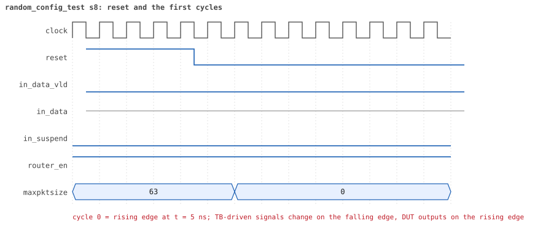
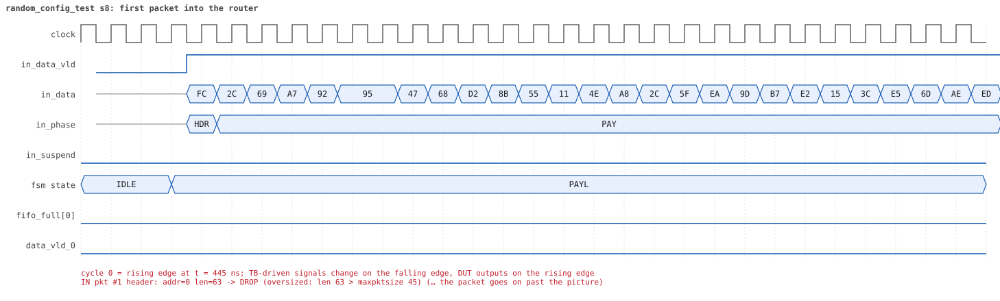
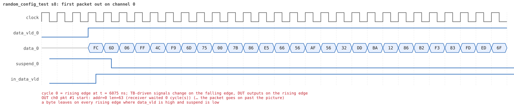
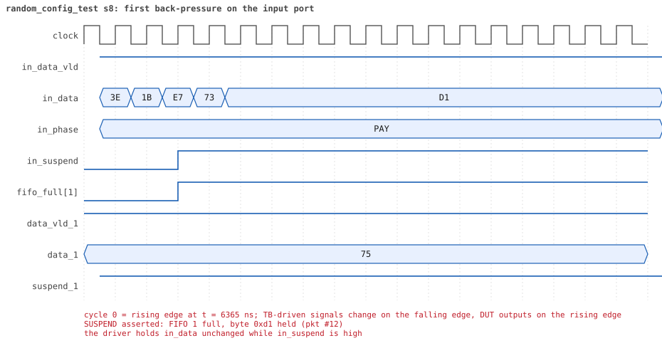
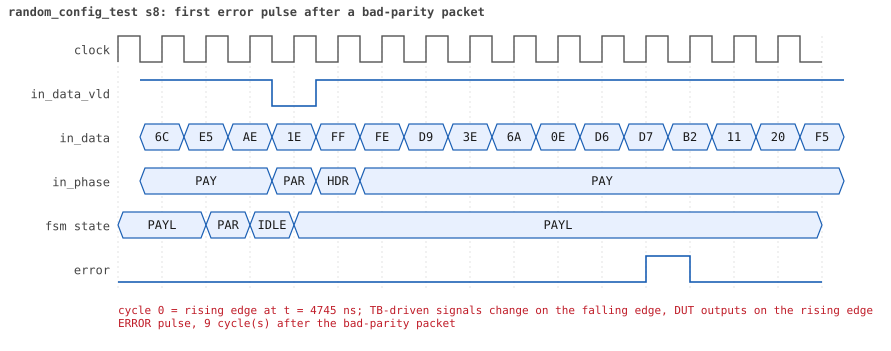
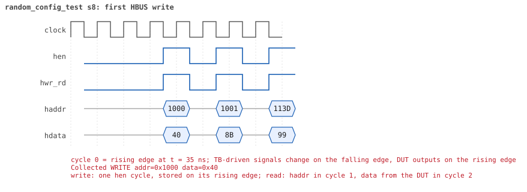
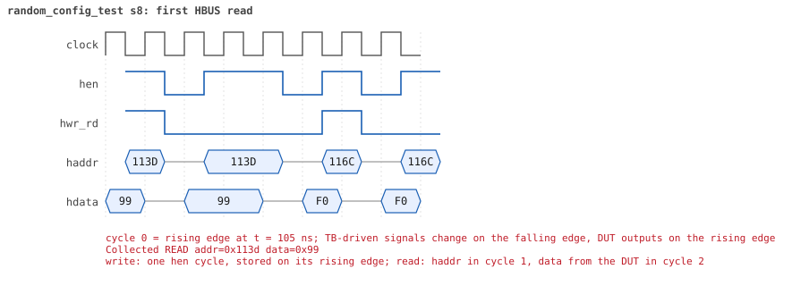

# random_config_test  seed 8

**Result:** PASSED (0 UVM_ERROR, 0 UVM_WARNING, 0 UVM_FATAL) · bench `yapp_project_tb` · sim time 49us · log `random_config_test_s8.log`

Waves: `random_config_test_s8.fst` (GTKWave, Surfer or the VS Code wave viewer); signal trace: `signals.csv`.
[Open the waves in Surfer](https://app.surfer-project.org/?load_url=https%3A%2F%2Fraw.githubusercontent.com%2Ftamirgabgab%2FQcom-Mentoring%2Fmain%2Fyapp_project%2Fregression%2Fyapp_project_tb%2Frandom_config_test_s8%2Frandom_config_test_s8.fst&startup_commands=run_command_file_from_url%20https%3A%2F%2Fraw.githubusercontent.com%2Ftamirgabgab%2FQcom-Mentoring%2Fmain%2Fyapp_project%2Ftb%2Fyapp_router.sucl) (web app, the signals already in groups: `yapp_project/tb/yapp_router.sucl`).

## Summary

- YAPP driver sent **95** packet(s) (10 with bad parity); the input monitor saw 95.
- Router: **26** forwarded, **69** dropped (27 oversized, 2 illegal address 3, 40 router disabled).
- Packets out: ch0 **11**, ch1 **3**, ch2 **12**.
- Scoreboard: 26 matched, 0 mismatched, 0 unexpected.
- Back-pressure: in_suspend asserted **5** time(s), longest hold 26 cycle(s).
- Error pulses: 6.
- HBUS: 51 write(s), 141 read(s).

## Stages

| time (ns) | stage |
|---|---|
| 0 | receivers: ch0 RX_FAST, ch1 RX_SLOW, ch2 RX_NORMAL |
| 0 | random scenario: 95 packets in 7 bursts |
| 460 | burst 1/7: ctrl=0xed (maxpktsize 45) en=0xff (router on, counter enables 1111111), 13 packet(s) |
| 7360 | burst 1/7 sent: addr0..3 8/1/3/1, bad parity 1, gap 0 7, length 1..63 |
| 7900 | burst 2/7: ctrl=0xbf (maxpktsize 63) en=0xff (router on, counter enables 1111111), 14 packet(s) |
| 15710 | burst 2/7 sent: addr0..3 6/1/6/1, bad parity 1, gap 0 1, length 1..63 |
| 16150 | burst 3/7: ctrl=0xc0 (maxpktsize 0) en=0xff (router on, counter enables 1111111), 14 packet(s) |
| 21420 | burst 3/7 sent: addr0..3 5/1/4/4, bad parity 2, gap 0 6, length 1..63 |
| 21930 | burst 4/7: ctrl=0x84 (maxpktsize 4) en=0xf6 (router OFF, counter enables 1111011), 14 packet(s) |
| 26460 | burst 4/7 sent: addr0..3 1/1/10/2, bad parity 2, gap 0 4, length 1..63 |
| 26730 | burst 5/7: ctrl=0x01 (maxpktsize 1) en=0xbe (router OFF, counter enables 1011111), 13 packet(s) |
| 31360 | burst 5/7 sent: addr0..3 4/3/5/1, bad parity 2, gap 0 5, length 1..63 |
| 31900 | burst 6/7: ctrl=0x00 (maxpktsize 0) en=0x0a (router OFF, counter enables 0000101), 13 packet(s) |
| 37880 | burst 6/7 sent: addr0..3 1/3/7/2, bad parity 0, gap 0 4, length 1..63 |
| 38230 | burst 7/7: ctrl=0xfe (maxpktsize 62) en=0xff (router on, counter enables 1111111), 14 packet(s) |
| 46000 | burst 7/7 sent: addr0..3 5/3/5/1, bad parity 2, gap 0 3, length 1..63 |
| 46000 | final reads: every register and the stored packet, checked against the reference model |
| 48305 | done: 95 packets (26 forwarded, 69 dropped), 0 storm burst(s), 26 scoreboard matches, 138 HBUS reads checked, 6 error pulses for 6 bad packets |

## Pictures

**reset and the first cycles**

**first packet into the router**

**first packet out on channel 0**

**first back-pressure on the input port**

**first error pulse after a bad-parity packet**

**first HBUS write**

**first HBUS read**

## Timeline

1255 events (the same list is in `timeline.csv`).

| time (ns) | who | event |
|---|---|---|
| 0 | yapp monitor | YAPP monitor running |
| 0 | **test** | STAGE: receivers: ch0 RX_FAST, ch1 RX_SLOW, ch2 RX_NORMAL |
| 0 | **test** | STAGE: random scenario: 95 packets in 7 bursts |
| 0 | clk/rst driver | Starting clock (period 10) and holding reset for 5 cycles |
| 0 | **DUT** | RESET asserted |
| 50 | **DUT** | RESET released: router_en=1 maxpktsize=63 |
| 70 | hbus driver | Executed WRITE addr=0x1000 data=0xed |
| 75 | **DUT** | CONFIG router_en=1 maxpktsize=45 |
| 75 | hbus monitor | Collected WRITE addr=0x1000 data=0xed |
| 75 | reference | maxpktsize is now 45 |
| 90 | hbus driver | Executed WRITE addr=0x1001 data=0xff |
| 95 | hbus monitor | Collected WRITE addr=0x1001 data=0xff |
| 95 | reference | router_en is now 1 (en_reg 0xff) |
| 120 | hbus driver | Executed READ  addr=0x100b data=0x00 |
| 125 | hbus monitor | Collected READ  addr=0x100b data=0x00 |
| 150 | hbus driver | Executed READ  addr=0x1019 data=0x00 |
| 155 | hbus monitor | Collected READ  addr=0x1019 data=0x00 |
| 180 | hbus driver | Executed READ  addr=0x101a data=0x00 |
| 185 | hbus monitor | Collected READ  addr=0x101a data=0x00 |
| 200 | hbus driver | Executed WRITE addr=0x111a data=0x86 |
| 205 | hbus monitor | Collected WRITE addr=0x111a data=0x86 |
| 230 | hbus driver | Executed READ  addr=0x111a data=0x86 |
| 235 | hbus monitor | Collected READ  addr=0x111a data=0x86 |
| 260 | hbus driver | Executed READ  addr=0x1000 data=0xed |
| 265 | hbus monitor | Collected READ  addr=0x1000 data=0xed |
| 290 | hbus driver | Executed READ  addr=0x10ea data=0x00 |
| 295 | hbus monitor | Collected READ  addr=0x10ea data=0x00 |
| 320 | hbus driver | Executed READ  addr=0x1001 data=0xff |
| 325 | hbus monitor | Collected READ  addr=0x1001 data=0xff |
| 350 | hbus driver | Executed READ  addr=0x1033 data=0x00 |
| 355 | hbus monitor | Collected READ  addr=0x1033 data=0x00 |
| 370 | hbus driver | Executed WRITE addr=0x117a data=0x1a |
| 375 | hbus monitor | Collected WRITE addr=0x117a data=0x1a |
| 400 | hbus driver | Executed READ  addr=0x117a data=0x1a |
| 405 | hbus monitor | Collected READ  addr=0x117a data=0x1a |
| 430 | hbus driver | Executed READ  addr=0x10f3 data=0x00 |
| 435 | hbus monitor | Collected READ  addr=0x10f3 data=0x00 |
| 460 | hbus driver | Executed READ  addr=0x1001 data=0xff |
| 460 | **test** | STAGE: burst 1/7: ctrl=0xed (maxpktsize 45) en=0xff (router on, counter enables 1111111), 13 packet(s) |
| 460 | yapp driver | TX pkt #1: addr=0 len=63 parity=good delay=0 |
| 465 | hbus monitor | Collected READ  addr=0x1001 data=0xff |
| 475 | **DUT** | IN  pkt #1 header: addr=0 len=63 -> DROP (oversized: len 63 > maxpktsize 45) |
| 1115 | **DUT** | IN  pkt #1 complete: addr=0 len=63 parity=ok dropped, 65 bytes in 65 cycles (held 0) |
| 1115 | yapp monitor | RX pkt #1 on the input: addr=0 len=63 parity=good gap=42 |
| 1115 | reference | Packet dropped: length 63 > maxpktsize 45 (addr=0) |
| 1115 | **DUT** | ROUTER DROPS PACKET addr=0 length=63 (length > maxpktsize) |
| 1120 | yapp driver | TX pkt #1 accepted by the DUT |
| 1120 | yapp driver | TX pkt #2: addr=0 len=34 parity=good delay=0 |
| 1125 | **DUT** | IN  pkt #2 header: addr=0 len=34 -> channel 0 |
| 1135 | **DUT** | OUT ch0 pkt #1 start: addr=0 len=34 (receiver waited 0 cycle(s)) |
| 1475 | **DUT** | IN  pkt #2 complete: addr=0 len=34 parity=ok forwarded, 36 bytes in 36 cycles (held 0) |
| 1475 | yapp monitor | RX pkt #2 on the input: addr=0 len=34 parity=good gap=0 |
| 1475 | reference | Packet forwarded: addr=0 len=34 -> channel 0 |
| 1480 | ch0 driver | ch0: packet consumed (response delay 0) |
| 1480 | yapp driver | TX pkt #2 accepted by the DUT |
| 1480 | yapp driver | TX pkt #3: addr=0 len=63 parity=good delay=5 |
| 1495 | **DUT** | OUT ch0 pkt #1 done: 36 bytes in 37 cycles |
| 1495 | ch0 monitor | ch0 RX pkt #1: addr=0 len=34 parity=good |
| 1495 | scoreboard | ch0 pkt matched: addr=0 len=34 (1 matched so far) |
| 1535 | **DUT** | IN  pkt #3 header: addr=0 len=63 -> DROP (oversized: len 63 > maxpktsize 45) |
| 1790 | ch0 driver | ch0: packet consumed (response delay 0) |
| 2175 | **DUT** | IN  pkt #3 complete: addr=0 len=63 parity=ok dropped, 65 bytes in 65 cycles (held 0) |
| 2175 | yapp monitor | RX pkt #3 on the input: addr=0 len=63 parity=good gap=5 |
| 2175 | reference | Packet dropped: length 63 > maxpktsize 45 (addr=0) |
| 2175 | **DUT** | ROUTER DROPS PACKET addr=0 length=63 (length > maxpktsize) |
| 2180 | yapp driver | TX pkt #3 accepted by the DUT |
| 2180 | yapp driver | TX pkt #4: addr=0 len=63 parity=good delay=2 |
| 2205 | **DUT** | IN  pkt #4 header: addr=0 len=63 -> DROP (oversized: len 63 > maxpktsize 45) |
| 2845 | **DUT** | IN  pkt #4 complete: addr=0 len=63 parity=ok dropped, 65 bytes in 65 cycles (held 0) |
| 2845 | yapp monitor | RX pkt #4 on the input: addr=0 len=63 parity=good gap=2 |
| 2845 | reference | Packet dropped: length 63 > maxpktsize 45 (addr=0) |
| 2845 | **DUT** | ROUTER DROPS PACKET addr=0 length=63 (length > maxpktsize) |
| 2850 | yapp driver | TX pkt #4 accepted by the DUT |
| 2850 | yapp driver | TX pkt #5: addr=2 len=1 parity=good delay=0 |
| 2855 | **DUT** | IN  pkt #5 header: addr=2 len=1 -> channel 2 |
| 2865 | **DUT** | OUT ch2 pkt #1 start: addr=2 len=1 (receiver waited 0 cycle(s)) |
| 2875 | **DUT** | IN  pkt #5 complete: addr=2 len=1 parity=ok forwarded, 3 bytes in 3 cycles (held 0) |
| 2875 | yapp monitor | RX pkt #5 on the input: addr=2 len=1 parity=good gap=0 |
| 2875 | reference | Packet forwarded: addr=2 len=1 -> channel 2 |
| 2880 | ch2 driver | ch2: packet consumed (response delay 0) |
| 2880 | yapp driver | TX pkt #5 accepted by the DUT |
| 2880 | yapp driver | TX pkt #6: addr=0 len=46 parity=good delay=0 |
| 2885 | **DUT** | IN  pkt #6 header: addr=0 len=46 -> DROP (oversized: len 46 > maxpktsize 45) |
| 2995 | **DUT** | OUT ch2 pkt #1 done: 3 bytes in 14 cycles |
| 2995 | ch2 monitor | ch2 RX pkt #1: addr=2 len=1 parity=good |
| 2995 | scoreboard | ch2 pkt matched: addr=2 len=1 (2 matched so far) |
| 3150 | ch2 driver | ch2: packet consumed (response delay 10) |
| 3355 | **DUT** | IN  pkt #6 complete: addr=0 len=46 parity=ok dropped, 48 bytes in 48 cycles (held 0) |
| 3355 | yapp monitor | RX pkt #6 on the input: addr=0 len=46 parity=good gap=0 |
| 3355 | reference | Packet dropped: length 46 > maxpktsize 45 (addr=0) |
| 3355 | **DUT** | ROUTER DROPS PACKET addr=0 length=46 (length > maxpktsize) |
| 3360 | yapp driver | TX pkt #6 accepted by the DUT |
| 3360 | yapp driver | TX pkt #7: addr=0 len=63 parity=good delay=16 |
| 3525 | **DUT** | IN  pkt #7 header: addr=0 len=63 -> DROP (oversized: len 63 > maxpktsize 45) |
| 4165 | **DUT** | IN  pkt #7 complete: addr=0 len=63 parity=ok dropped, 65 bytes in 65 cycles (held 0) |
| 4165 | yapp monitor | RX pkt #7 on the input: addr=0 len=63 parity=good gap=16 |
| 4165 | reference | Packet dropped: length 63 > maxpktsize 45 (addr=0) |
| 4165 | **DUT** | ROUTER DROPS PACKET addr=0 length=63 (length > maxpktsize) |
| 4170 | yapp driver | TX pkt #7 accepted by the DUT |
| 4170 | yapp driver | TX pkt #8: addr=2 len=59 parity=bad delay=0 |
| 4175 | **DUT** | IN  pkt #8 header: addr=2 len=59 -> DROP (oversized: len 59 > maxpktsize 45) |
| 4775 | **DUT** | IN  pkt #8 complete: addr=2 len=59 parity=BAD dropped, 61 bytes in 61 cycles (held 0) |
| 4775 | yapp monitor | RX pkt #8 on the input: addr=2 len=59 parity=bad gap=0 |
| 4775 | reference | Packet dropped: length 59 > maxpktsize 45 (addr=2) |
| 4775 | **DUT** | ROUTER DROPS PACKET addr=2 length=59 (length > maxpktsize) |
| 4780 | yapp driver | TX pkt #8 accepted by the DUT |
| 4780 | yapp driver | TX pkt #9: addr=3 len=63 parity=good delay=0 |
| 4785 | **DUT** | IN  pkt #9 header: addr=3 len=63 -> DROP (oversized: len 63 > maxpktsize 45) |
| 4870 | **DUT** | ERROR pulse, 9 cycle(s) after the bad-parity packet |
| 4870 | error checker | error pulse 9 cycles after the bad packet (0 still owed) |
| 5425 | **DUT** | IN  pkt #9 complete: addr=3 len=63 parity=ok dropped, 65 bytes in 65 cycles (held 0) |
| 5425 | yapp monitor | RX pkt #9 on the input: addr=3 len=63 parity=good gap=0 |
| 5425 | reference | Packet dropped: illegal address 3 (len=63) |
| 5425 | **DUT** | ROUTER DROPS PACKET addr=3 length=63 (    illegal address) |
| 5430 | yapp driver | TX pkt #9 accepted by the DUT |
| 5430 | yapp driver | TX pkt #10: addr=2 len=13 parity=good delay=0 |
| 5435 | **DUT** | IN  pkt #10 header: addr=2 len=13 -> channel 2 |
| 5485 | **DUT** | OUT ch2 pkt #2 start: addr=2 len=13 (receiver waited 4 cycle(s)) |
| 5575 | **DUT** | IN  pkt #10 complete: addr=2 len=13 parity=ok forwarded, 15 bytes in 15 cycles (held 0) |
| 5575 | yapp monitor | RX pkt #10 on the input: addr=2 len=13 parity=good gap=0 |
| 5575 | reference | Packet forwarded: addr=2 len=13 -> channel 2 |
| 5580 | yapp driver | TX pkt #10 accepted by the DUT |
| 5580 | yapp driver | TX pkt #11: addr=0 len=44 parity=good delay=18 |
| 5620 | ch2 driver | ch2: packet consumed (response delay 4) |
| 5645 | **DUT** | OUT ch2 pkt #2 done: 15 bytes in 17 cycles |
| 5645 | ch2 monitor | ch2 RX pkt #2: addr=2 len=13 parity=good |
| 5645 | scoreboard | ch2 pkt matched: addr=2 len=13 (3 matched so far) |
| 5765 | **DUT** | IN  pkt #11 header: addr=0 len=44 -> channel 0 |
| 5775 | **DUT** | OUT ch0 pkt #2 start: addr=0 len=44 (receiver waited 0 cycle(s)) |
| 6215 | **DUT** | IN  pkt #11 complete: addr=0 len=44 parity=ok forwarded, 46 bytes in 46 cycles (held 0) |
| 6215 | yapp monitor | RX pkt #11 on the input: addr=0 len=44 parity=good gap=18 |
| 6215 | reference | Packet forwarded: addr=0 len=44 -> channel 0 |
| 6220 | ch0 driver | ch0: packet consumed (response delay 0) |
| 6220 | yapp driver | TX pkt #11 accepted by the DUT |
| 6220 | yapp driver | TX pkt #12: addr=1 len=29 parity=good delay=2 |
| 6235 | **DUT** | OUT ch0 pkt #2 done: 46 bytes in 47 cycles |
| 6235 | ch0 monitor | ch0 RX pkt #2: addr=0 len=44 parity=good |
| 6235 | scoreboard | ch0 pkt matched: addr=0 len=44 (4 matched so far) |
| 6245 | **DUT** | IN  pkt #12 header: addr=1 len=29 -> channel 1 |
| 6250 | ch2 driver | ch2: packet consumed (response delay 1) |
| 6405 | **DUT** | SUSPEND asserted: FIFO 1 full, byte 0xd1 held (pkt #12) |
| 6545 | **DUT** | OUT ch1 pkt #1 start: addr=1 len=29 (receiver waited 29 cycle(s)) |
| 6555 | **DUT** | SUSPEND released after 15 cycle(s) |
| 6640 | ch0 driver | ch0: packet consumed (response delay 0) |
| 6695 | **DUT** | IN  pkt #12 complete: addr=1 len=29 parity=ok forwarded, 31 bytes in 46 cycles (held 15) |
| 6695 | yapp monitor | RX pkt #12 on the input: addr=1 len=29 parity=good gap=2 |
| 6695 | reference | Packet forwarded: addr=1 len=29 -> channel 1 |
| 6700 | yapp driver | TX pkt #12 accepted by the DUT |
| 6700 | yapp driver | TX pkt #13: addr=0 len=63 parity=good delay=1 |
| 6715 | **DUT** | IN  pkt #13 header: addr=0 len=63 -> DROP (oversized: len 63 > maxpktsize 45) |
| 6840 | ch1 driver | ch1: packet consumed (response delay 29) |
| 7205 | **DUT** | OUT ch1 pkt #1 done: 31 bytes in 67 cycles |
| 7205 | ch1 monitor | ch1 RX pkt #1: addr=1 len=29 parity=good |
| 7205 | scoreboard | ch1 pkt matched: addr=1 len=29 (5 matched so far) |
| 7210 | ch1 driver | ch1: packet consumed (response delay 35) |
| 7355 | **DUT** | IN  pkt #13 complete: addr=0 len=63 parity=ok dropped, 65 bytes in 65 cycles (held 0) |
| 7355 | yapp monitor | RX pkt #13 on the input: addr=0 len=63 parity=good gap=1 |
| 7355 | reference | Packet dropped: length 63 > maxpktsize 45 (addr=0) |
| 7355 | **DUT** | ROUTER DROPS PACKET addr=0 length=63 (length > maxpktsize) |
| 7360 | yapp driver | TX pkt #13 accepted by the DUT |
| 7360 | **test** | STAGE: burst 1/7 sent: addr0..3 8/1/3/1, bad parity 1, gap 0 7, length 1..63 |
| 7380 | hbus driver | Executed WRITE addr=0x1000 data=0xbf |
| 7385 | **DUT** | CONFIG router_en=1 maxpktsize=63 |
| 7385 | hbus monitor | Collected WRITE addr=0x1000 data=0xbf |
| 7385 | reference | maxpktsize is now 63 |
| 7400 | hbus driver | Executed WRITE addr=0x1001 data=0xff |
| 7405 | hbus monitor | Collected WRITE addr=0x1001 data=0xff |
| 7405 | reference | router_en is now 1 (en_reg 0xff) |
| 7420 | hbus driver | Executed WRITE addr=0x11d0 data=0x94 |
| 7425 | hbus monitor | Collected WRITE addr=0x11d0 data=0x94 |
| 7450 | hbus driver | Executed READ  addr=0x11d0 data=0x94 |
| 7455 | hbus monitor | Collected READ  addr=0x11d0 data=0x94 |
| 7470 | hbus driver | Executed WRITE addr=0x11b7 data=0xfc |
| 7475 | hbus monitor | Collected WRITE addr=0x11b7 data=0xfc |
| 7500 | hbus driver | Executed READ  addr=0x11b7 data=0xfc |
| 7505 | hbus monitor | Collected READ  addr=0x11b7 data=0xfc |
| 7520 | hbus driver | Executed WRITE addr=0x11bc data=0x32 |
| 7525 | hbus monitor | Collected WRITE addr=0x11bc data=0x32 |
| 7550 | hbus driver | Executed READ  addr=0x11bc data=0x32 |
| 7555 | hbus monitor | Collected READ  addr=0x11bc data=0x32 |
| 7570 | hbus driver | Executed WRITE addr=0x115b data=0xe5 |
| 7575 | hbus monitor | Collected WRITE addr=0x115b data=0xe5 |
| 7600 | hbus driver | Executed READ  addr=0x115b data=0xe5 |
| 7605 | hbus monitor | Collected READ  addr=0x115b data=0xe5 |
| 7620 | hbus driver | Executed WRITE addr=0x11bd data=0xf0 |
| 7625 | hbus monitor | Collected WRITE addr=0x11bd data=0xf0 |
| 7650 | hbus driver | Executed READ  addr=0x11bd data=0xf0 |
| 7655 | hbus monitor | Collected READ  addr=0x11bd data=0xf0 |
| 7680 | hbus driver | Executed READ  addr=0x1024 data=0x23 |
| 7685 | hbus monitor | Collected READ  addr=0x1024 data=0x23 |
| 7700 | hbus driver | Executed WRITE addr=0x1129 data=0xe6 |
| 7705 | hbus monitor | Collected WRITE addr=0x1129 data=0xe6 |
| 7730 | hbus driver | Executed READ  addr=0x1129 data=0xe6 |
| 7735 | hbus monitor | Collected READ  addr=0x1129 data=0xe6 |
| 7760 | hbus driver | Executed READ  addr=0x10f6 data=0x00 |
| 7765 | hbus monitor | Collected READ  addr=0x10f6 data=0x00 |
| 7790 | hbus driver | Executed READ  addr=0x10f6 data=0x00 |
| 7795 | hbus monitor | Collected READ  addr=0x10f6 data=0x00 |
| 7810 | hbus driver | Executed WRITE addr=0x110e data=0xaf |
| 7815 | hbus monitor | Collected WRITE addr=0x110e data=0xaf |
| 7840 | hbus driver | Executed READ  addr=0x110e data=0xaf |
| 7845 | hbus monitor | Collected READ  addr=0x110e data=0xaf |
| 7870 | hbus driver | Executed READ  addr=0x1076 data=0x00 |
| 7875 | hbus monitor | Collected READ  addr=0x1076 data=0x00 |
| 7900 | hbus driver | Executed READ  addr=0x104a data=0xf4 |
| 7900 | **test** | STAGE: burst 2/7: ctrl=0xbf (maxpktsize 63) en=0xff (router on, counter enables 1111111), 14 packet(s) |
| 7900 | yapp driver | TX pkt #14: addr=2 len=63 parity=good delay=16 |
| 7905 | hbus monitor | Collected READ  addr=0x104a data=0xf4 |
| 8075 | **DUT** | IN  pkt #14 header: addr=2 len=63 -> channel 2 |
| 8115 | **DUT** | OUT ch2 pkt #3 start: addr=2 len=63 (receiver waited 3 cycle(s)) |
| 8715 | **DUT** | IN  pkt #14 complete: addr=2 len=63 parity=ok forwarded, 65 bytes in 65 cycles (held 0) |
| 8715 | yapp monitor | RX pkt #14 on the input: addr=2 len=63 parity=good gap=71 |
| 8715 | reference | Packet forwarded: addr=2 len=63 -> channel 2 |
| 8720 | yapp driver | TX pkt #14 accepted by the DUT |
| 8720 | yapp driver | TX pkt #15: addr=2 len=27 parity=good delay=3 |
| 8750 | ch2 driver | ch2: packet consumed (response delay 3) |
| 8755 | **DUT** | IN  pkt #15 header: addr=2 len=27 -> channel 2 |
| 8765 | **DUT** | OUT ch2 pkt #3 done: 65 bytes in 66 cycles |
| 8765 | ch2 monitor | ch2 RX pkt #3: addr=2 len=63 parity=good |
| 8765 | scoreboard | ch2 pkt matched: addr=2 len=63 (6 matched so far) |
| 8775 | **DUT** | OUT ch2 pkt #4 start: addr=2 len=27 (receiver waited 0 cycle(s)) |
| 8910 | ch2 driver | ch2: packet consumed (response delay 0) |
| 9035 | **DUT** | IN  pkt #15 complete: addr=2 len=27 parity=ok forwarded, 29 bytes in 29 cycles (held 0) |
| 9035 | yapp monitor | RX pkt #15 on the input: addr=2 len=27 parity=good gap=3 |
| 9035 | reference | Packet forwarded: addr=2 len=27 -> channel 2 |
| 9040 | yapp driver | TX pkt #15 accepted by the DUT |
| 9040 | yapp driver | TX pkt #16: addr=0 len=62 parity=bad delay=6 |
| 9105 | **DUT** | IN  pkt #16 header: addr=0 len=62 -> channel 0 |
| 9115 | **DUT** | OUT ch0 pkt #3 start: addr=0 len=62 (receiver waited 0 cycle(s)) |
| 9115 | **DUT** | OUT ch2 pkt #4 done: 29 bytes in 35 cycles |
| 9115 | ch2 monitor | ch2 RX pkt #4: addr=2 len=27 parity=good |
| 9115 | scoreboard | ch2 pkt matched: addr=2 len=27 (7 matched so far) |
| 9380 | ch2 driver | ch2: packet consumed (response delay 5) |
| 9735 | **DUT** | IN  pkt #16 complete: addr=0 len=62 parity=BAD forwarded, 64 bytes in 64 cycles (held 0) |
| 9735 | yapp monitor | RX pkt #16 on the input: addr=0 len=62 parity=bad gap=6 |
| 9735 | reference | Packet forwarded: addr=0 len=62 -> channel 0 |
| 9740 | ch0 driver | ch0: packet consumed (response delay 0) |
| 9740 | yapp driver | TX pkt #16 accepted by the DUT |
| 9740 | yapp driver | TX pkt #17: addr=0 len=3 parity=good delay=20 |
| 9755 | **DUT** | OUT ch0 pkt #3 done: 64 bytes in 65 cycles |
| 9755 | ch0 monitor | ch0 RX pkt #3: addr=0 len=62 parity=bad |
| 9755 | scoreboard | ch0 pkt matched: addr=0 len=62 (8 matched so far) |
| 9830 | **DUT** | ERROR pulse, 9 cycle(s) after the bad-parity packet |
| 9830 | error checker | error pulse 9 cycles after the bad packet (0 still owed) |
| 9945 | **DUT** | IN  pkt #17 header: addr=0 len=3 -> channel 0 |
| 9955 | **DUT** | OUT ch0 pkt #4 start: addr=0 len=3 (receiver waited 0 cycle(s)) |
| 9985 | **DUT** | IN  pkt #17 complete: addr=0 len=3 parity=ok forwarded, 5 bytes in 5 cycles (held 0) |
| 9985 | yapp monitor | RX pkt #17 on the input: addr=0 len=3 parity=good gap=20 |
| 9985 | reference | Packet forwarded: addr=0 len=3 -> channel 0 |
| 9990 | yapp driver | TX pkt #17 accepted by the DUT |
| 9990 | yapp driver | TX pkt #18: addr=0 len=30 parity=good delay=20 |
| 9995 | **DUT** | OUT ch0 pkt #4 done: 5 bytes in 5 cycles |
| 9995 | ch0 monitor | ch0 RX pkt #4: addr=0 len=3 parity=good |
| 9995 | scoreboard | ch0 pkt matched: addr=0 len=3 (9 matched so far) |
| 10020 | ch0 driver | ch0: packet consumed (response delay 0) |
| 10195 | **DUT** | IN  pkt #18 header: addr=0 len=30 -> channel 0 |
| 10205 | **DUT** | OUT ch0 pkt #5 start: addr=0 len=30 (receiver waited 0 cycle(s)) |
| 10505 | **DUT** | IN  pkt #18 complete: addr=0 len=30 parity=ok forwarded, 32 bytes in 32 cycles (held 0) |
| 10505 | yapp monitor | RX pkt #18 on the input: addr=0 len=30 parity=good gap=20 |
| 10505 | reference | Packet forwarded: addr=0 len=30 -> channel 0 |
| 10510 | ch0 driver | ch0: packet consumed (response delay 0) |
| 10510 | yapp driver | TX pkt #18 accepted by the DUT |
| 10510 | yapp driver | TX pkt #19: addr=2 len=63 parity=good delay=1 |
| 10525 | **DUT** | IN  pkt #19 header: addr=2 len=63 -> channel 2 |
| 10525 | **DUT** | OUT ch0 pkt #5 done: 32 bytes in 33 cycles |
| 10525 | ch0 monitor | ch0 RX pkt #5: addr=0 len=30 parity=good |
| 10525 | scoreboard | ch0 pkt matched: addr=0 len=30 (10 matched so far) |
| 10635 | **DUT** | OUT ch2 pkt #5 start: addr=2 len=63 (receiver waited 10 cycle(s)) |
| 10900 | ch0 driver | ch0: packet consumed (response delay 0) |
| 11165 | **DUT** | IN  pkt #19 complete: addr=2 len=63 parity=ok forwarded, 65 bytes in 65 cycles (held 0) |
| 11165 | yapp monitor | RX pkt #19 on the input: addr=2 len=63 parity=good gap=1 |
| 11165 | reference | Packet forwarded: addr=2 len=63 -> channel 2 |
| 11170 | yapp driver | TX pkt #19 accepted by the DUT |
| 11170 | yapp driver | TX pkt #20: addr=2 len=29 parity=good delay=5 |
| 11225 | **DUT** | IN  pkt #20 header: addr=2 len=29 -> channel 2 |
| 11270 | ch2 driver | ch2: packet consumed (response delay 10) |
| 11365 | **DUT** | OUT ch2 pkt #5 done: 65 bytes in 74 cycles |
| 11365 | ch2 monitor | ch2 RX pkt #5: addr=2 len=63 parity=good |
| 11365 | scoreboard | ch2 pkt matched: addr=2 len=63 (11 matched so far) |
| 11375 | **DUT** | OUT ch2 pkt #6 start: addr=2 len=29 (receiver waited 0 cycle(s)) |
| 11525 | **DUT** | IN  pkt #20 complete: addr=2 len=29 parity=ok forwarded, 31 bytes in 31 cycles (held 0) |
| 11525 | yapp monitor | RX pkt #20 on the input: addr=2 len=29 parity=good gap=5 |
| 11525 | reference | Packet forwarded: addr=2 len=29 -> channel 2 |
| 11530 | yapp driver | TX pkt #20 accepted by the DUT |
| 11530 | yapp driver | TX pkt #21: addr=2 len=63 parity=good delay=16 |
| 11675 | **DUT** | OUT ch2 pkt #6 done: 31 bytes in 31 cycles |
| 11675 | ch2 monitor | ch2 RX pkt #6: addr=2 len=29 parity=good |
| 11675 | scoreboard | ch2 pkt matched: addr=2 len=29 (12 matched so far) |
| 11695 | **DUT** | IN  pkt #21 header: addr=2 len=63 -> channel 2 |
| 11705 | **DUT** | OUT ch2 pkt #7 start: addr=2 len=63 (receiver waited 0 cycle(s)) |
| 11780 | ch2 driver | ch2: packet consumed (response delay 8) |
| 12020 | ch2 driver | ch2: packet consumed (response delay 6) |
| 12105 | **DUT** | SUSPEND asserted: FIFO 2 full, byte 0x9e held (pkt #21) |
| 12125 | **DUT** | SUSPEND released after 2 cycle(s) |
| 12240 | ch2 driver | ch2: packet consumed (response delay 8) |
| 12255 | **DUT** | SUSPEND asserted: FIFO 2 full, byte 0xbb held (pkt #21) |
| 12365 | **DUT** | SUSPEND released after 11 cycle(s) |
| 12465 | **DUT** | IN  pkt #21 complete: addr=2 len=63 parity=ok forwarded, 65 bytes in 78 cycles (held 13) |
| 12465 | yapp monitor | RX pkt #21 on the input: addr=2 len=63 parity=good gap=16 |
| 12465 | reference | Packet forwarded: addr=2 len=63 -> channel 2 |
| 12470 | yapp driver | TX pkt #21 accepted by the DUT |
| 12470 | yapp driver | TX pkt #22: addr=0 len=58 parity=good delay=2 |
| 12495 | **DUT** | IN  pkt #22 header: addr=0 len=58 -> channel 0 |
| 12505 | **DUT** | OUT ch0 pkt #6 start: addr=0 len=58 (receiver waited 0 cycle(s)) |
| 12615 | **DUT** | OUT ch2 pkt #7 done: 65 bytes in 92 cycles |
| 12615 | ch2 monitor | ch2 RX pkt #7: addr=2 len=63 parity=good |
| 12615 | scoreboard | ch2 pkt matched: addr=2 len=63 (13 matched so far) |
| 12640 | ch2 driver | ch2: packet consumed (response delay 10) |
| 13085 | **DUT** | IN  pkt #22 complete: addr=0 len=58 parity=ok forwarded, 60 bytes in 60 cycles (held 0) |
| 13085 | yapp monitor | RX pkt #22 on the input: addr=0 len=58 parity=good gap=2 |
| 13085 | reference | Packet forwarded: addr=0 len=58 -> channel 0 |
| 13090 | ch0 driver | ch0: packet consumed (response delay 0) |
| 13090 | yapp driver | TX pkt #22 accepted by the DUT |
| 13090 | yapp driver | TX pkt #23: addr=0 len=16 parity=good delay=0 |
| 13095 | **DUT** | IN  pkt #23 header: addr=0 len=16 -> channel 0 |
| 13105 | **DUT** | OUT ch0 pkt #6 done: 60 bytes in 61 cycles |
| 13105 | ch0 monitor | ch0 RX pkt #6: addr=0 len=58 parity=good |
| 13105 | scoreboard | ch0 pkt matched: addr=0 len=58 (14 matched so far) |
| 13115 | **DUT** | OUT ch0 pkt #7 start: addr=0 len=16 (receiver waited 0 cycle(s)) |
| 13265 | **DUT** | IN  pkt #23 complete: addr=0 len=16 parity=ok forwarded, 18 bytes in 18 cycles (held 0) |
| 13265 | yapp monitor | RX pkt #23 on the input: addr=0 len=16 parity=good gap=0 |
| 13265 | reference | Packet forwarded: addr=0 len=16 -> channel 0 |
| 13270 | yapp driver | TX pkt #23 accepted by the DUT |
| 13270 | yapp driver | TX pkt #24: addr=2 len=63 parity=good delay=1 |
| 13285 | **DUT** | IN  pkt #24 header: addr=2 len=63 -> channel 2 |
| 13285 | **DUT** | OUT ch0 pkt #7 done: 18 bytes in 18 cycles |
| 13285 | ch0 monitor | ch0 RX pkt #7: addr=0 len=16 parity=good |
| 13285 | scoreboard | ch0 pkt matched: addr=0 len=16 (15 matched so far) |
| 13295 | **DUT** | OUT ch2 pkt #8 start: addr=2 len=63 (receiver waited 0 cycle(s)) |
| 13480 | ch0 driver | ch0: packet consumed (response delay 0) |
| 13925 | **DUT** | IN  pkt #24 complete: addr=2 len=63 parity=ok forwarded, 65 bytes in 65 cycles (held 0) |
| 13925 | yapp monitor | RX pkt #24 on the input: addr=2 len=63 parity=good gap=1 |
| 13925 | reference | Packet forwarded: addr=2 len=63 -> channel 2 |
| 13930 | ch2 driver | ch2: packet consumed (response delay 0) |
| 13930 | yapp driver | TX pkt #24 accepted by the DUT |
| 13930 | yapp driver | TX pkt #25: addr=0 len=44 parity=good delay=20 |
| 14035 | **DUT** | OUT ch2 pkt #8 done: 65 bytes in 75 cycles |
| 14035 | ch2 monitor | ch2 RX pkt #8: addr=2 len=63 parity=good |
| 14035 | scoreboard | ch2 pkt matched: addr=2 len=63 (16 matched so far) |
| 14135 | **DUT** | IN  pkt #25 header: addr=0 len=44 -> channel 0 |
| 14145 | **DUT** | OUT ch0 pkt #8 start: addr=0 len=44 (receiver waited 0 cycle(s)) |
| 14470 | ch2 driver | ch2: packet consumed (response delay 9) |
| 14585 | **DUT** | IN  pkt #25 complete: addr=0 len=44 parity=ok forwarded, 46 bytes in 46 cycles (held 0) |
| 14585 | yapp monitor | RX pkt #25 on the input: addr=0 len=44 parity=good gap=20 |
| 14585 | reference | Packet forwarded: addr=0 len=44 -> channel 0 |
| 14590 | ch0 driver | ch0: packet consumed (response delay 0) |
| 14590 | yapp driver | TX pkt #25 accepted by the DUT |
| 14590 | yapp driver | TX pkt #26: addr=1 len=63 parity=good delay=13 |
| 14605 | **DUT** | OUT ch0 pkt #8 done: 46 bytes in 47 cycles |
| 14605 | ch0 monitor | ch0 RX pkt #8: addr=0 len=44 parity=good |
| 14605 | scoreboard | ch0 pkt matched: addr=0 len=44 (17 matched so far) |
| 14725 | **DUT** | IN  pkt #26 header: addr=1 len=63 -> channel 1 |
| 14885 | **DUT** | SUSPEND asserted: FIFO 1 full, byte 0x35 held (pkt #26) |
| 15130 | ch0 driver | ch0: packet consumed (response delay 0) |
| 15135 | **DUT** | OUT ch1 pkt #2 start: addr=1 len=63 (receiver waited 40 cycle(s)) |
| 15145 | **DUT** | SUSPEND released after 26 cycle(s) |
| 15625 | **DUT** | IN  pkt #26 complete: addr=1 len=63 parity=ok forwarded, 65 bytes in 91 cycles (held 26) |
| 15625 | yapp monitor | RX pkt #26 on the input: addr=1 len=63 parity=good gap=13 |
| 15625 | reference | Packet forwarded: addr=1 len=63 -> channel 1 |
| 15630 | yapp driver | TX pkt #26 accepted by the DUT |
| 15630 | yapp driver | TX pkt #27: addr=3 len=1 parity=good delay=5 |
| 15685 | **DUT** | IN  pkt #27 header: addr=3 len=1 -> DROP (illegal address 3) |
| 15705 | **DUT** | IN  pkt #27 complete: addr=3 len=1 parity=ok dropped, 3 bytes in 3 cycles (held 0) |
| 15705 | yapp monitor | RX pkt #27 on the input: addr=3 len=1 parity=good gap=5 |
| 15705 | reference | Packet dropped: illegal address 3 (len=1) |
| 15705 | **DUT** | ROUTER DROPS PACKET addr=3 length=1 (    illegal address) |
| 15710 | yapp driver | TX pkt #27 accepted by the DUT |
| 15710 | **test** | STAGE: burst 2/7 sent: addr0..3 6/1/6/1, bad parity 1, gap 0 1, length 1..63 |
| 15730 | hbus driver | Executed WRITE addr=0x1000 data=0xc0 |
| 15735 | **DUT** | CONFIG router_en=1 maxpktsize=0 |
| 15735 | hbus monitor | Collected WRITE addr=0x1000 data=0xc0 |
| 15735 | reference | maxpktsize is now 0 |
| 15750 | hbus driver | Executed WRITE addr=0x1001 data=0xff |
| 15755 | hbus monitor | Collected WRITE addr=0x1001 data=0xff |
| 15755 | reference | router_en is now 1 (en_reg 0xff) |
| 15770 | ch1 driver | ch1: packet consumed (response delay 40) |
| 15770 | hbus driver | Executed WRITE addr=0x1184 data=0x98 |
| 15775 | hbus monitor | Collected WRITE addr=0x1184 data=0x98 |
| 15800 | hbus driver | Executed READ  addr=0x1184 data=0x98 |
| 15805 | hbus monitor | Collected READ  addr=0x1184 data=0x98 |
| 15830 | hbus driver | Executed READ  addr=0x1004 data=0x02 |
| 15835 | hbus monitor | Collected READ  addr=0x1004 data=0x02 |
| 15860 | hbus driver | Executed READ  addr=0x101e data=0x19 |
| 15865 | hbus monitor | Collected READ  addr=0x101e data=0x19 |
| 15880 | hbus driver | Executed WRITE addr=0x11e7 data=0x41 |
| 15885 | hbus monitor | Collected WRITE addr=0x11e7 data=0x41 |
| 15910 | hbus driver | Executed READ  addr=0x11e7 data=0x41 |
| 15915 | hbus monitor | Collected READ  addr=0x11e7 data=0x41 |
| 15930 | hbus driver | Executed WRITE addr=0x1195 data=0x22 |
| 15935 | hbus monitor | Collected WRITE addr=0x1195 data=0x22 |
| 15960 | hbus driver | Executed READ  addr=0x1195 data=0x22 |
| 15965 | hbus monitor | Collected READ  addr=0x1195 data=0x22 |
| 15990 | hbus driver | Executed READ  addr=0x100f data=0x00 |
| 15995 | hbus monitor | Collected READ  addr=0x100f data=0x00 |
| 16010 | hbus driver | Executed WRITE addr=0x11f5 data=0xe2 |
| 16015 | hbus monitor | Collected WRITE addr=0x11f5 data=0xe2 |
| 16040 | hbus driver | Executed READ  addr=0x11f5 data=0xe2 |
| 16045 | hbus monitor | Collected READ  addr=0x11f5 data=0xe2 |
| 16070 | hbus driver | Executed READ  addr=0x100f data=0x00 |
| 16075 | hbus monitor | Collected READ  addr=0x100f data=0x00 |
| 16090 | hbus driver | Executed WRITE addr=0x11db data=0x2f |
| 16095 | hbus monitor | Collected WRITE addr=0x11db data=0x2f |
| 16120 | hbus driver | Executed READ  addr=0x11db data=0x2f |
| 16125 | hbus monitor | Collected READ  addr=0x11db data=0x2f |
| 16150 | hbus driver | Executed READ  addr=0x1010 data=0x07 |
| 16150 | **test** | STAGE: burst 3/7: ctrl=0xc0 (maxpktsize 0) en=0xff (router on, counter enables 1111111), 14 packet(s) |
| 16150 | yapp driver | TX pkt #28: addr=3 len=1 parity=good delay=0 |
| 16155 | hbus monitor | Collected READ  addr=0x1010 data=0x07 |
| 16165 | **DUT** | IN  pkt #28 header: addr=3 len=1 -> DROP (oversized: len 1 > maxpktsize 0) |
| 16165 | **DUT** | OUT ch1 pkt #2 done: 65 bytes in 104 cycles |
| 16165 | ch1 monitor | ch1 RX pkt #2: addr=1 len=63 parity=good |
| 16165 | scoreboard | ch1 pkt matched: addr=1 len=63 (18 matched so far) |
| 16185 | **DUT** | IN  pkt #28 complete: addr=3 len=1 parity=ok dropped, 3 bytes in 3 cycles (held 0) |
| 16185 | yapp monitor | RX pkt #28 on the input: addr=3 len=1 parity=good gap=45 |
| 16185 | reference | Packet dropped: illegal address 3 (len=1) |
| 16185 | **DUT** | ROUTER DROPS PACKET addr=3 length=1 (    illegal address) |
| 16190 | yapp driver | TX pkt #28 accepted by the DUT |
| 16190 | yapp driver | TX pkt #29: addr=1 len=4 parity=good delay=0 |
| 16195 | **DUT** | IN  pkt #29 header: addr=1 len=4 -> DROP (oversized: len 4 > maxpktsize 0) |
| 16245 | **DUT** | IN  pkt #29 complete: addr=1 len=4 parity=ok dropped, 6 bytes in 6 cycles (held 0) |
| 16245 | yapp monitor | RX pkt #29 on the input: addr=1 len=4 parity=good gap=0 |
| 16245 | reference | Packet dropped: length 4 > maxpktsize 0 (addr=1) |
| 16245 | **DUT** | ROUTER DROPS PACKET addr=1 length=4 (length > maxpktsize) |
| 16250 | yapp driver | TX pkt #29 accepted by the DUT |
| 16250 | yapp driver | TX pkt #30: addr=2 len=63 parity=good delay=0 |
| 16255 | **DUT** | IN  pkt #30 header: addr=2 len=63 -> DROP (oversized: len 63 > maxpktsize 0) |
| 16780 | ch1 driver | ch1: packet consumed (response delay 38) |
| 16895 | **DUT** | IN  pkt #30 complete: addr=2 len=63 parity=ok dropped, 65 bytes in 65 cycles (held 0) |
| 16895 | yapp monitor | RX pkt #30 on the input: addr=2 len=63 parity=good gap=0 |
| 16895 | reference | Packet dropped: length 63 > maxpktsize 0 (addr=2) |
| 16895 | **DUT** | ROUTER DROPS PACKET addr=2 length=63 (length > maxpktsize) |
| 16900 | yapp driver | TX pkt #30 accepted by the DUT |
| 16900 | yapp driver | TX pkt #31: addr=0 len=63 parity=good delay=18 |
| 17085 | **DUT** | IN  pkt #31 header: addr=0 len=63 -> DROP (oversized: len 63 > maxpktsize 0) |
| 17725 | **DUT** | IN  pkt #31 complete: addr=0 len=63 parity=ok dropped, 65 bytes in 65 cycles (held 0) |
| 17725 | yapp monitor | RX pkt #31 on the input: addr=0 len=63 parity=good gap=18 |
| 17725 | reference | Packet dropped: length 63 > maxpktsize 0 (addr=0) |
| 17725 | **DUT** | ROUTER DROPS PACKET addr=0 length=63 (length > maxpktsize) |
| 17730 | yapp driver | TX pkt #31 accepted by the DUT |
| 17730 | yapp driver | TX pkt #32: addr=3 len=1 parity=bad delay=5 |
| 17785 | **DUT** | IN  pkt #32 header: addr=3 len=1 -> DROP (oversized: len 1 > maxpktsize 0) |
| 17805 | **DUT** | IN  pkt #32 complete: addr=3 len=1 parity=BAD dropped, 3 bytes in 3 cycles (held 0) |
| 17805 | yapp monitor | RX pkt #32 on the input: addr=3 len=1 parity=bad gap=5 |
| 17805 | reference | Packet dropped: illegal address 3 (len=1) |
| 17805 | **DUT** | ROUTER DROPS PACKET addr=3 length=1 (    illegal address) |
| 17810 | yapp driver | TX pkt #32 accepted by the DUT |
| 17810 | yapp driver | TX pkt #33: addr=3 len=56 parity=bad delay=1 |
| 17825 | **DUT** | IN  pkt #33 header: addr=3 len=56 -> DROP (oversized: len 56 > maxpktsize 0) |
| 17870 | **DUT** | ERROR pulse, 6 cycle(s) after the bad-parity packet |
| 17870 | error checker | error pulse 6 cycles after the bad packet (0 still owed) |
| 18395 | **DUT** | IN  pkt #33 complete: addr=3 len=56 parity=BAD dropped, 58 bytes in 58 cycles (held 0) |
| 18395 | yapp monitor | RX pkt #33 on the input: addr=3 len=56 parity=bad gap=1 |
| 18395 | reference | Packet dropped: illegal address 3 (len=56) |
| 18395 | **DUT** | ROUTER DROPS PACKET addr=3 length=56 (    illegal address) |
| 18400 | yapp driver | TX pkt #33 accepted by the DUT |
| 18400 | yapp driver | TX pkt #34: addr=3 len=63 parity=good delay=0 |
| 18405 | **DUT** | IN  pkt #34 header: addr=3 len=63 -> DROP (oversized: len 63 > maxpktsize 0) |
| 18410 | **DUT** | ERROR pulse, 1 cycle(s) after the bad-parity packet |
| 18410 | error checker | error pulse 1 cycles after the bad packet (0 still owed) |
| 19045 | **DUT** | IN  pkt #34 complete: addr=3 len=63 parity=ok dropped, 65 bytes in 65 cycles (held 0) |
| 19045 | yapp monitor | RX pkt #34 on the input: addr=3 len=63 parity=good gap=0 |
| 19045 | reference | Packet dropped: illegal address 3 (len=63) |
| 19045 | **DUT** | ROUTER DROPS PACKET addr=3 length=63 (    illegal address) |
| 19050 | yapp driver | TX pkt #34 accepted by the DUT |
| 19050 | yapp driver | TX pkt #35: addr=2 len=58 parity=good delay=0 |
| 19055 | **DUT** | IN  pkt #35 header: addr=2 len=58 -> DROP (oversized: len 58 > maxpktsize 0) |
| 19645 | **DUT** | IN  pkt #35 complete: addr=2 len=58 parity=ok dropped, 60 bytes in 60 cycles (held 0) |
| 19645 | yapp monitor | RX pkt #35 on the input: addr=2 len=58 parity=good gap=0 |
| 19645 | reference | Packet dropped: length 58 > maxpktsize 0 (addr=2) |
| 19645 | **DUT** | ROUTER DROPS PACKET addr=2 length=58 (length > maxpktsize) |
| 19650 | yapp driver | TX pkt #35 accepted by the DUT |
| 19650 | yapp driver | TX pkt #36: addr=0 len=63 parity=good delay=3 |
| 19685 | **DUT** | IN  pkt #36 header: addr=0 len=63 -> DROP (oversized: len 63 > maxpktsize 0) |
| 20325 | **DUT** | IN  pkt #36 complete: addr=0 len=63 parity=ok dropped, 65 bytes in 65 cycles (held 0) |
| 20325 | yapp monitor | RX pkt #36 on the input: addr=0 len=63 parity=good gap=3 |
| 20325 | reference | Packet dropped: length 63 > maxpktsize 0 (addr=0) |
| 20325 | **DUT** | ROUTER DROPS PACKET addr=0 length=63 (length > maxpktsize) |
| 20330 | yapp driver | TX pkt #36 accepted by the DUT |
| 20330 | yapp driver | TX pkt #37: addr=0 len=1 parity=good delay=10 |
| 20435 | **DUT** | IN  pkt #37 header: addr=0 len=1 -> DROP (oversized: len 1 > maxpktsize 0) |
| 20455 | **DUT** | IN  pkt #37 complete: addr=0 len=1 parity=ok dropped, 3 bytes in 3 cycles (held 0) |
| 20455 | yapp monitor | RX pkt #37 on the input: addr=0 len=1 parity=good gap=10 |
| 20455 | reference | Packet dropped: length 1 > maxpktsize 0 (addr=0) |
| 20455 | **DUT** | ROUTER DROPS PACKET addr=0 length=1 (length > maxpktsize) |
| 20460 | yapp driver | TX pkt #37 accepted by the DUT |
| 20460 | yapp driver | TX pkt #38: addr=2 len=63 parity=good delay=0 |
| 20465 | **DUT** | IN  pkt #38 header: addr=2 len=63 -> DROP (oversized: len 63 > maxpktsize 0) |
| 21105 | **DUT** | IN  pkt #38 complete: addr=2 len=63 parity=ok dropped, 65 bytes in 65 cycles (held 0) |
| 21105 | yapp monitor | RX pkt #38 on the input: addr=2 len=63 parity=good gap=0 |
| 21105 | reference | Packet dropped: length 63 > maxpktsize 0 (addr=2) |
| 21105 | **DUT** | ROUTER DROPS PACKET addr=2 length=63 (length > maxpktsize) |
| 21110 | yapp driver | TX pkt #38 accepted by the DUT |
| 21110 | yapp driver | TX pkt #39: addr=2 len=1 parity=good delay=3 |
| 21145 | **DUT** | IN  pkt #39 header: addr=2 len=1 -> DROP (oversized: len 1 > maxpktsize 0) |
| 21165 | **DUT** | IN  pkt #39 complete: addr=2 len=1 parity=ok dropped, 3 bytes in 3 cycles (held 0) |
| 21165 | yapp monitor | RX pkt #39 on the input: addr=2 len=1 parity=good gap=3 |
| 21165 | reference | Packet dropped: length 1 > maxpktsize 0 (addr=2) |
| 21165 | **DUT** | ROUTER DROPS PACKET addr=2 length=1 (length > maxpktsize) |
| 21170 | yapp driver | TX pkt #39 accepted by the DUT |
| 21170 | yapp driver | TX pkt #40: addr=0 len=1 parity=good delay=3 |
| 21205 | **DUT** | IN  pkt #40 header: addr=0 len=1 -> DROP (oversized: len 1 > maxpktsize 0) |
| 21225 | **DUT** | IN  pkt #40 complete: addr=0 len=1 parity=ok dropped, 3 bytes in 3 cycles (held 0) |
| 21225 | yapp monitor | RX pkt #40 on the input: addr=0 len=1 parity=good gap=3 |
| 21225 | reference | Packet dropped: length 1 > maxpktsize 0 (addr=0) |
| 21225 | **DUT** | ROUTER DROPS PACKET addr=0 length=1 (length > maxpktsize) |
| 21230 | yapp driver | TX pkt #40 accepted by the DUT |
| 21230 | yapp driver | TX pkt #41: addr=0 len=1 parity=good delay=16 |
| 21395 | **DUT** | IN  pkt #41 header: addr=0 len=1 -> DROP (oversized: len 1 > maxpktsize 0) |
| 21415 | **DUT** | IN  pkt #41 complete: addr=0 len=1 parity=ok dropped, 3 bytes in 3 cycles (held 0) |
| 21415 | yapp monitor | RX pkt #41 on the input: addr=0 len=1 parity=good gap=16 |
| 21415 | reference | Packet dropped: length 1 > maxpktsize 0 (addr=0) |
| 21415 | **DUT** | ROUTER DROPS PACKET addr=0 length=1 (length > maxpktsize) |
| 21420 | yapp driver | TX pkt #41 accepted by the DUT |
| 21420 | **test** | STAGE: burst 3/7 sent: addr0..3 5/1/4/4, bad parity 2, gap 0 6, length 1..63 |
| 21440 | hbus driver | Executed WRITE addr=0x1000 data=0x84 |
| 21445 | **DUT** | CONFIG router_en=1 maxpktsize=4 |
| 21445 | hbus monitor | Collected WRITE addr=0x1000 data=0x84 |
| 21445 | reference | maxpktsize is now 4 |
| 21460 | hbus driver | Executed WRITE addr=0x1001 data=0xf6 |
| 21465 | **DUT** | CONFIG router_en=0 maxpktsize=4 |
| 21465 | hbus monitor | Collected WRITE addr=0x1001 data=0xf6 |
| 21465 | reference | router_en is now 0 (en_reg 0xf6) |
| 21490 | hbus driver | Executed READ  addr=0x100d data=0x01 |
| 21495 | hbus monitor | Collected READ  addr=0x100d data=0x01 |
| 21510 | hbus driver | Executed WRITE addr=0x1173 data=0x46 |
| 21515 | hbus monitor | Collected WRITE addr=0x1173 data=0x46 |
| 21540 | hbus driver | Executed READ  addr=0x1173 data=0x46 |
| 21545 | hbus monitor | Collected READ  addr=0x1173 data=0x46 |
| 21570 | hbus driver | Executed READ  addr=0x102f data=0x5a |
| 21575 | hbus monitor | Collected READ  addr=0x102f data=0x5a |
| 21590 | hbus driver | Executed WRITE addr=0x1167 data=0x7a |
| 21595 | hbus monitor | Collected WRITE addr=0x1167 data=0x7a |
| 21620 | hbus driver | Executed READ  addr=0x1167 data=0x7a |
| 21625 | hbus monitor | Collected READ  addr=0x1167 data=0x7a |
| 21640 | hbus driver | Executed WRITE addr=0x111c data=0xd0 |
| 21645 | hbus monitor | Collected WRITE addr=0x111c data=0xd0 |
| 21670 | hbus driver | Executed READ  addr=0x111c data=0xd0 |
| 21675 | hbus monitor | Collected READ  addr=0x111c data=0xd0 |
| 21690 | hbus driver | Executed WRITE addr=0x11c7 data=0x6a |
| 21695 | hbus monitor | Collected WRITE addr=0x11c7 data=0x6a |
| 21720 | hbus driver | Executed READ  addr=0x11c7 data=0x6a |
| 21725 | hbus monitor | Collected READ  addr=0x11c7 data=0x6a |
| 21740 | hbus driver | Executed WRITE addr=0x1121 data=0xd7 |
| 21745 | hbus monitor | Collected WRITE addr=0x1121 data=0xd7 |
| 21770 | hbus driver | Executed READ  addr=0x1121 data=0xd7 |
| 21775 | hbus monitor | Collected READ  addr=0x1121 data=0xd7 |
| 21790 | hbus driver | Executed WRITE addr=0x113c data=0xa0 |
| 21795 | hbus monitor | Collected WRITE addr=0x113c data=0xa0 |
| 21820 | hbus driver | Executed READ  addr=0x113c data=0xa0 |
| 21825 | hbus monitor | Collected READ  addr=0x113c data=0xa0 |
| 21850 | hbus driver | Executed READ  addr=0x100c data=0x00 |
| 21855 | hbus monitor | Collected READ  addr=0x100c data=0x00 |
| 21870 | hbus driver | Executed WRITE addr=0x112b data=0x0d |
| 21875 | hbus monitor | Collected WRITE addr=0x112b data=0x0d |
| 21900 | hbus driver | Executed READ  addr=0x112b data=0x0d |
| 21905 | hbus monitor | Collected READ  addr=0x112b data=0x0d |
| 21930 | hbus driver | Executed READ  addr=0x100d data=0x01 |
| 21930 | **test** | STAGE: burst 4/7: ctrl=0x84 (maxpktsize 4) en=0xf6 (router OFF, counter enables 1111011), 14 packet(s) |
| 21930 | yapp driver | TX pkt #42: addr=2 len=63 parity=good delay=0 |
| 21935 | hbus monitor | Collected READ  addr=0x100d data=0x01 |
| 21945 | **DUT** | IN  pkt #42 header: addr=2 len=63 -> DROP (router disabled) |
| 22585 | **DUT** | IN  pkt #42 complete: addr=2 len=63 parity=ok dropped, 65 bytes in 65 cycles (held 0) |
| 22585 | yapp monitor | RX pkt #42 on the input: addr=2 len=63 parity=good gap=52 |
| 22585 | reference | Packet dropped: router disabled (addr=2 len=63) |
| 22585 | **DUT** | ROUTER DROPS PACKET addr=2 length=63 (router disabled) |
| 22590 | yapp driver | TX pkt #42 accepted by the DUT |
| 22590 | yapp driver | TX pkt #43: addr=2 len=5 parity=bad delay=6 |
| 22655 | **DUT** | IN  pkt #43 header: addr=2 len=5 -> DROP (router disabled) |
| 22715 | **DUT** | IN  pkt #43 complete: addr=2 len=5 parity=BAD dropped, 7 bytes in 7 cycles (held 0) |
| 22715 | yapp monitor | RX pkt #43 on the input: addr=2 len=5 parity=bad gap=6 |
| 22715 | reference | Packet dropped: router disabled (addr=2 len=5) |
| 22715 | **DUT** | ROUTER DROPS PACKET addr=2 length=5 (router disabled) |
| 22720 | yapp driver | TX pkt #43 accepted by the DUT |
| 22720 | yapp driver | TX pkt #44: addr=2 len=48 parity=good delay=0 |
| 22725 | **DUT** | IN  pkt #44 header: addr=2 len=48 -> DROP (router disabled) |
| 23215 | **DUT** | IN  pkt #44 complete: addr=2 len=48 parity=ok dropped, 50 bytes in 50 cycles (held 0) |
| 23215 | yapp monitor | RX pkt #44 on the input: addr=2 len=48 parity=good gap=0 |
| 23215 | reference | Packet dropped: router disabled (addr=2 len=48) |
| 23215 | **DUT** | ROUTER DROPS PACKET addr=2 length=48 (router disabled) |
| 23220 | yapp driver | TX pkt #44 accepted by the DUT |
| 23220 | yapp driver | TX pkt #45: addr=2 len=25 parity=good delay=1 |
| 23235 | **DUT** | IN  pkt #45 header: addr=2 len=25 -> DROP (router disabled) |
| 23495 | **DUT** | IN  pkt #45 complete: addr=2 len=25 parity=ok dropped, 27 bytes in 27 cycles (held 0) |
| 23495 | yapp monitor | RX pkt #45 on the input: addr=2 len=25 parity=good gap=1 |
| 23495 | reference | Packet dropped: router disabled (addr=2 len=25) |
| 23495 | **DUT** | ROUTER DROPS PACKET addr=2 length=25 (router disabled) |
| 23500 | yapp driver | TX pkt #45 accepted by the DUT |
| 23500 | yapp driver | TX pkt #46: addr=2 len=1 parity=good delay=0 |
| 23505 | **DUT** | IN  pkt #46 header: addr=2 len=1 -> DROP (router disabled) |
| 23525 | **DUT** | IN  pkt #46 complete: addr=2 len=1 parity=ok dropped, 3 bytes in 3 cycles (held 0) |
| 23525 | yapp monitor | RX pkt #46 on the input: addr=2 len=1 parity=good gap=0 |
| 23525 | reference | Packet dropped: router disabled (addr=2 len=1) |
| 23525 | **DUT** | ROUTER DROPS PACKET addr=2 length=1 (router disabled) |
| 23530 | yapp driver | TX pkt #46 accepted by the DUT |
| 23530 | yapp driver | TX pkt #47: addr=2 len=4 parity=good delay=1 |
| 23545 | **DUT** | IN  pkt #47 header: addr=2 len=4 -> DROP (router disabled) |
| 23595 | **DUT** | IN  pkt #47 complete: addr=2 len=4 parity=ok dropped, 6 bytes in 6 cycles (held 0) |
| 23595 | yapp monitor | RX pkt #47 on the input: addr=2 len=4 parity=good gap=1 |
| 23595 | reference | Packet dropped: router disabled (addr=2 len=4) |
| 23595 | **DUT** | ROUTER DROPS PACKET addr=2 length=4 (router disabled) |
| 23600 | yapp driver | TX pkt #47 accepted by the DUT |
| 23600 | yapp driver | TX pkt #48: addr=2 len=1 parity=good delay=20 |
| 23805 | **DUT** | IN  pkt #48 header: addr=2 len=1 -> DROP (router disabled) |
| 23825 | **DUT** | IN  pkt #48 complete: addr=2 len=1 parity=ok dropped, 3 bytes in 3 cycles (held 0) |
| 23825 | yapp monitor | RX pkt #48 on the input: addr=2 len=1 parity=good gap=20 |
| 23825 | reference | Packet dropped: router disabled (addr=2 len=1) |
| 23825 | **DUT** | ROUTER DROPS PACKET addr=2 length=1 (router disabled) |
| 23830 | yapp driver | TX pkt #48 accepted by the DUT |
| 23830 | yapp driver | TX pkt #49: addr=0 len=8 parity=good delay=1 |
| 23845 | **DUT** | IN  pkt #49 header: addr=0 len=8 -> DROP (router disabled) |
| 23935 | **DUT** | IN  pkt #49 complete: addr=0 len=8 parity=ok dropped, 10 bytes in 10 cycles (held 0) |
| 23935 | yapp monitor | RX pkt #49 on the input: addr=0 len=8 parity=good gap=1 |
| 23935 | reference | Packet dropped: router disabled (addr=0 len=8) |
| 23935 | **DUT** | ROUTER DROPS PACKET addr=0 length=8 (router disabled) |
| 23940 | yapp driver | TX pkt #49 accepted by the DUT |
| 23940 | yapp driver | TX pkt #50: addr=2 len=3 parity=good delay=0 |
| 23945 | **DUT** | IN  pkt #50 header: addr=2 len=3 -> DROP (router disabled) |
| 23985 | **DUT** | IN  pkt #50 complete: addr=2 len=3 parity=ok dropped, 5 bytes in 5 cycles (held 0) |
| 23985 | yapp monitor | RX pkt #50 on the input: addr=2 len=3 parity=good gap=0 |
| 23985 | reference | Packet dropped: router disabled (addr=2 len=3) |
| 23985 | **DUT** | ROUTER DROPS PACKET addr=2 length=3 (router disabled) |
| 23990 | yapp driver | TX pkt #50 accepted by the DUT |
| 23990 | yapp driver | TX pkt #51: addr=3 len=63 parity=bad delay=19 |
| 24185 | **DUT** | IN  pkt #51 header: addr=3 len=63 -> DROP (router disabled) |
| 24825 | **DUT** | IN  pkt #51 complete: addr=3 len=63 parity=BAD dropped, 65 bytes in 65 cycles (held 0) |
| 24825 | yapp monitor | RX pkt #51 on the input: addr=3 len=63 parity=bad gap=19 |
| 24825 | reference | Packet dropped: router disabled (addr=3 len=63) |
| 24825 | **DUT** | ROUTER DROPS PACKET addr=3 length=63 (router disabled) |
| 24830 | yapp driver | TX pkt #51 accepted by the DUT |
| 24830 | yapp driver | TX pkt #52: addr=2 len=38 parity=good delay=1 |
| 24845 | **DUT** | IN  pkt #52 header: addr=2 len=38 -> DROP (router disabled) |
| 25235 | **DUT** | IN  pkt #52 complete: addr=2 len=38 parity=ok dropped, 40 bytes in 40 cycles (held 0) |
| 25235 | yapp monitor | RX pkt #52 on the input: addr=2 len=38 parity=good gap=1 |
| 25235 | reference | Packet dropped: router disabled (addr=2 len=38) |
| 25235 | **DUT** | ROUTER DROPS PACKET addr=2 length=38 (router disabled) |
| 25240 | yapp driver | TX pkt #52 accepted by the DUT |
| 25240 | yapp driver | TX pkt #53: addr=2 len=63 parity=good delay=1 |
| 25255 | **DUT** | IN  pkt #53 header: addr=2 len=63 -> DROP (router disabled) |
| 25895 | **DUT** | IN  pkt #53 complete: addr=2 len=63 parity=ok dropped, 65 bytes in 65 cycles (held 0) |
| 25895 | yapp monitor | RX pkt #53 on the input: addr=2 len=63 parity=good gap=1 |
| 25895 | reference | Packet dropped: router disabled (addr=2 len=63) |
| 25895 | **DUT** | ROUTER DROPS PACKET addr=2 length=63 (router disabled) |
| 25900 | yapp driver | TX pkt #53 accepted by the DUT |
| 25900 | yapp driver | TX pkt #54: addr=3 len=10 parity=good delay=17 |
| 26075 | **DUT** | IN  pkt #54 header: addr=3 len=10 -> DROP (router disabled) |
| 26185 | **DUT** | IN  pkt #54 complete: addr=3 len=10 parity=ok dropped, 12 bytes in 12 cycles (held 0) |
| 26185 | yapp monitor | RX pkt #54 on the input: addr=3 len=10 parity=good gap=17 |
| 26185 | reference | Packet dropped: router disabled (addr=3 len=10) |
| 26185 | **DUT** | ROUTER DROPS PACKET addr=3 length=10 (router disabled) |
| 26190 | yapp driver | TX pkt #54 accepted by the DUT |
| 26190 | yapp driver | TX pkt #55: addr=1 len=5 parity=good delay=20 |
| 26395 | **DUT** | IN  pkt #55 header: addr=1 len=5 -> DROP (router disabled) |
| 26455 | **DUT** | IN  pkt #55 complete: addr=1 len=5 parity=ok dropped, 7 bytes in 7 cycles (held 0) |
| 26455 | yapp monitor | RX pkt #55 on the input: addr=1 len=5 parity=good gap=20 |
| 26455 | reference | Packet dropped: router disabled (addr=1 len=5) |
| 26455 | **DUT** | ROUTER DROPS PACKET addr=1 length=5 (router disabled) |
| 26460 | yapp driver | TX pkt #55 accepted by the DUT |
| 26460 | **test** | STAGE: burst 4/7 sent: addr0..3 1/1/10/2, bad parity 2, gap 0 4, length 1..63 |
| 26480 | hbus driver | Executed WRITE addr=0x1000 data=0x01 |
| 26485 | **DUT** | CONFIG router_en=0 maxpktsize=1 |
| 26485 | hbus monitor | Collected WRITE addr=0x1000 data=0x01 |
| 26485 | reference | maxpktsize is now 1 |
| 26500 | hbus driver | Executed WRITE addr=0x1001 data=0xbe |
| 26505 | hbus monitor | Collected WRITE addr=0x1001 data=0xbe |
| 26505 | reference | router_en is now 0 (en_reg 0xbe) |
| 26520 | hbus driver | Executed WRITE addr=0x11ec data=0xf3 |
| 26525 | hbus monitor | Collected WRITE addr=0x11ec data=0xf3 |
| 26550 | hbus driver | Executed READ  addr=0x11ec data=0xf3 |
| 26555 | hbus monitor | Collected READ  addr=0x11ec data=0xf3 |
| 26570 | hbus driver | Executed WRITE addr=0x1113 data=0x9b |
| 26575 | hbus monitor | Collected WRITE addr=0x1113 data=0x9b |
| 26600 | hbus driver | Executed READ  addr=0x1113 data=0x9b |
| 26605 | hbus monitor | Collected READ  addr=0x1113 data=0x9b |
| 26630 | hbus driver | Executed READ  addr=0x100b data=0x0d |
| 26635 | hbus monitor | Collected READ  addr=0x100b data=0x0d |
| 26650 | hbus driver | Executed WRITE addr=0x111b data=0x46 |
| 26655 | hbus monitor | Collected WRITE addr=0x111b data=0x46 |
| 26680 | hbus driver | Executed READ  addr=0x111b data=0x46 |
| 26685 | hbus monitor | Collected READ  addr=0x111b data=0x46 |
| 26700 | hbus driver | Executed WRITE addr=0x1198 data=0xc3 |
| 26705 | hbus monitor | Collected WRITE addr=0x1198 data=0xc3 |
| 26730 | hbus driver | Executed READ  addr=0x1198 data=0xc3 |
| 26730 | **test** | STAGE: burst 5/7: ctrl=0x01 (maxpktsize 1) en=0xbe (router OFF, counter enables 1011111), 13 packet(s) |
| 26730 | yapp driver | TX pkt #56: addr=1 len=40 parity=good delay=1 |
| 26735 | hbus monitor | Collected READ  addr=0x1198 data=0xc3 |
| 26755 | **DUT** | IN  pkt #56 header: addr=1 len=40 -> DROP (router disabled) |
| 27165 | **DUT** | IN  pkt #56 complete: addr=1 len=40 parity=ok dropped, 42 bytes in 42 cycles (held 0) |
| 27165 | yapp monitor | RX pkt #56 on the input: addr=1 len=40 parity=good gap=29 |
| 27165 | reference | Packet dropped: router disabled (addr=1 len=40) |
| 27165 | **DUT** | ROUTER DROPS PACKET addr=1 length=40 (router disabled) |
| 27170 | yapp driver | TX pkt #56 accepted by the DUT |
| 27170 | yapp driver | TX pkt #57: addr=0 len=1 parity=good delay=0 |
| 27175 | **DUT** | IN  pkt #57 header: addr=0 len=1 -> DROP (router disabled) |
| 27195 | **DUT** | IN  pkt #57 complete: addr=0 len=1 parity=ok dropped, 3 bytes in 3 cycles (held 0) |
| 27195 | yapp monitor | RX pkt #57 on the input: addr=0 len=1 parity=good gap=0 |
| 27195 | reference | Packet dropped: router disabled (addr=0 len=1) |
| 27195 | **DUT** | ROUTER DROPS PACKET addr=0 length=1 (router disabled) |
| 27200 | yapp driver | TX pkt #57 accepted by the DUT |
| 27200 | yapp driver | TX pkt #58: addr=1 len=56 parity=bad delay=20 |
| 27405 | **DUT** | IN  pkt #58 header: addr=1 len=56 -> DROP (router disabled) |
| 27975 | **DUT** | IN  pkt #58 complete: addr=1 len=56 parity=BAD dropped, 58 bytes in 58 cycles (held 0) |
| 27975 | yapp monitor | RX pkt #58 on the input: addr=1 len=56 parity=bad gap=20 |
| 27975 | reference | Packet dropped: router disabled (addr=1 len=56) |
| 27975 | **DUT** | ROUTER DROPS PACKET addr=1 length=56 (router disabled) |
| 27980 | yapp driver | TX pkt #58 accepted by the DUT |
| 27980 | yapp driver | TX pkt #59: addr=3 len=38 parity=bad delay=0 |
| 27985 | **DUT** | IN  pkt #59 header: addr=3 len=38 -> DROP (router disabled) |
| 28375 | **DUT** | IN  pkt #59 complete: addr=3 len=38 parity=BAD dropped, 40 bytes in 40 cycles (held 0) |
| 28375 | yapp monitor | RX pkt #59 on the input: addr=3 len=38 parity=bad gap=0 |
| 28375 | reference | Packet dropped: router disabled (addr=3 len=38) |
| 28375 | **DUT** | ROUTER DROPS PACKET addr=3 length=38 (router disabled) |
| 28380 | yapp driver | TX pkt #59 accepted by the DUT |
| 28380 | yapp driver | TX pkt #60: addr=2 len=1 parity=good delay=0 |
| 28385 | **DUT** | IN  pkt #60 header: addr=2 len=1 -> DROP (router disabled) |
| 28405 | **DUT** | IN  pkt #60 complete: addr=2 len=1 parity=ok dropped, 3 bytes in 3 cycles (held 0) |
| 28405 | yapp monitor | RX pkt #60 on the input: addr=2 len=1 parity=good gap=0 |
| 28405 | reference | Packet dropped: router disabled (addr=2 len=1) |
| 28405 | **DUT** | ROUTER DROPS PACKET addr=2 length=1 (router disabled) |
| 28410 | yapp driver | TX pkt #60 accepted by the DUT |
| 28410 | yapp driver | TX pkt #61: addr=2 len=2 parity=good delay=3 |
| 28445 | **DUT** | IN  pkt #61 header: addr=2 len=2 -> DROP (router disabled) |
| 28475 | **DUT** | IN  pkt #61 complete: addr=2 len=2 parity=ok dropped, 4 bytes in 4 cycles (held 0) |
| 28475 | yapp monitor | RX pkt #61 on the input: addr=2 len=2 parity=good gap=3 |
| 28475 | reference | Packet dropped: router disabled (addr=2 len=2) |
| 28475 | **DUT** | ROUTER DROPS PACKET addr=2 length=2 (router disabled) |
| 28480 | yapp driver | TX pkt #61 accepted by the DUT |
| 28480 | yapp driver | TX pkt #62: addr=0 len=35 parity=good delay=0 |
| 28485 | **DUT** | IN  pkt #62 header: addr=0 len=35 -> DROP (router disabled) |
| 28845 | **DUT** | IN  pkt #62 complete: addr=0 len=35 parity=ok dropped, 37 bytes in 37 cycles (held 0) |
| 28845 | yapp monitor | RX pkt #62 on the input: addr=0 len=35 parity=good gap=0 |
| 28845 | reference | Packet dropped: router disabled (addr=0 len=35) |
| 28845 | **DUT** | ROUTER DROPS PACKET addr=0 length=35 (router disabled) |
| 28850 | yapp driver | TX pkt #62 accepted by the DUT |
| 28850 | yapp driver | TX pkt #63: addr=0 len=63 parity=good delay=1 |
| 28865 | **DUT** | IN  pkt #63 header: addr=0 len=63 -> DROP (router disabled) |
| 29505 | **DUT** | IN  pkt #63 complete: addr=0 len=63 parity=ok dropped, 65 bytes in 65 cycles (held 0) |
| 29505 | yapp monitor | RX pkt #63 on the input: addr=0 len=63 parity=good gap=1 |
| 29505 | reference | Packet dropped: router disabled (addr=0 len=63) |
| 29505 | **DUT** | ROUTER DROPS PACKET addr=0 length=63 (router disabled) |
| 29510 | yapp driver | TX pkt #63 accepted by the DUT |
| 29510 | yapp driver | TX pkt #64: addr=0 len=1 parity=good delay=20 |
| 29715 | **DUT** | IN  pkt #64 header: addr=0 len=1 -> DROP (router disabled) |
| 29735 | **DUT** | IN  pkt #64 complete: addr=0 len=1 parity=ok dropped, 3 bytes in 3 cycles (held 0) |
| 29735 | yapp monitor | RX pkt #64 on the input: addr=0 len=1 parity=good gap=20 |
| 29735 | reference | Packet dropped: router disabled (addr=0 len=1) |
| 29735 | **DUT** | ROUTER DROPS PACKET addr=0 length=1 (router disabled) |
| 29740 | yapp driver | TX pkt #64 accepted by the DUT |
| 29740 | yapp driver | TX pkt #65: addr=1 len=16 parity=good delay=3 |
| 29775 | **DUT** | IN  pkt #65 header: addr=1 len=16 -> DROP (router disabled) |
| 29945 | **DUT** | IN  pkt #65 complete: addr=1 len=16 parity=ok dropped, 18 bytes in 18 cycles (held 0) |
| 29945 | yapp monitor | RX pkt #65 on the input: addr=1 len=16 parity=good gap=3 |
| 29945 | reference | Packet dropped: router disabled (addr=1 len=16) |
| 29945 | **DUT** | ROUTER DROPS PACKET addr=1 length=16 (router disabled) |
| 29950 | yapp driver | TX pkt #65 accepted by the DUT |
| 29950 | yapp driver | TX pkt #66: addr=2 len=63 parity=good delay=1 |
| 29965 | **DUT** | IN  pkt #66 header: addr=2 len=63 -> DROP (router disabled) |
| 30605 | **DUT** | IN  pkt #66 complete: addr=2 len=63 parity=ok dropped, 65 bytes in 65 cycles (held 0) |
| 30605 | yapp monitor | RX pkt #66 on the input: addr=2 len=63 parity=good gap=1 |
| 30605 | reference | Packet dropped: router disabled (addr=2 len=63) |
| 30605 | **DUT** | ROUTER DROPS PACKET addr=2 length=63 (router disabled) |
| 30610 | yapp driver | TX pkt #66 accepted by the DUT |
| 30610 | yapp driver | TX pkt #67: addr=2 len=1 parity=good delay=7 |
| 30685 | **DUT** | IN  pkt #67 header: addr=2 len=1 -> DROP (router disabled) |
| 30705 | **DUT** | IN  pkt #67 complete: addr=2 len=1 parity=ok dropped, 3 bytes in 3 cycles (held 0) |
| 30705 | yapp monitor | RX pkt #67 on the input: addr=2 len=1 parity=good gap=7 |
| 30705 | reference | Packet dropped: router disabled (addr=2 len=1) |
| 30705 | **DUT** | ROUTER DROPS PACKET addr=2 length=1 (router disabled) |
| 30710 | yapp driver | TX pkt #67 accepted by the DUT |
| 30710 | yapp driver | TX pkt #68: addr=2 len=63 parity=good delay=0 |
| 30715 | **DUT** | IN  pkt #68 header: addr=2 len=63 -> DROP (router disabled) |
| 31355 | **DUT** | IN  pkt #68 complete: addr=2 len=63 parity=ok dropped, 65 bytes in 65 cycles (held 0) |
| 31355 | yapp monitor | RX pkt #68 on the input: addr=2 len=63 parity=good gap=0 |
| 31355 | reference | Packet dropped: router disabled (addr=2 len=63) |
| 31355 | **DUT** | ROUTER DROPS PACKET addr=2 length=63 (router disabled) |
| 31360 | yapp driver | TX pkt #68 accepted by the DUT |
| 31360 | **test** | STAGE: burst 5/7 sent: addr0..3 4/3/5/1, bad parity 2, gap 0 5, length 1..63 |
| 31380 | hbus driver | Executed WRITE addr=0x1000 data=0x00 |
| 31385 | **DUT** | CONFIG router_en=0 maxpktsize=0 |
| 31385 | hbus monitor | Collected WRITE addr=0x1000 data=0x00 |
| 31385 | reference | maxpktsize is now 0 |
| 31400 | hbus driver | Executed WRITE addr=0x1001 data=0x0a |
| 31405 | hbus monitor | Collected WRITE addr=0x1001 data=0x0a |
| 31405 | reference | router_en is now 0 (en_reg 0x0a) |
| 31420 | hbus driver | Executed WRITE addr=0x11ac data=0xe0 |
| 31425 | hbus monitor | Collected WRITE addr=0x11ac data=0xe0 |
| 31450 | hbus driver | Executed READ  addr=0x11ac data=0xe0 |
| 31455 | hbus monitor | Collected READ  addr=0x11ac data=0xe0 |
| 31480 | hbus driver | Executed READ  addr=0x100b data=0x0d |
| 31485 | hbus monitor | Collected READ  addr=0x100b data=0x0d |
| 31500 | hbus driver | Executed WRITE addr=0x116a data=0xb7 |
| 31505 | hbus monitor | Collected WRITE addr=0x116a data=0xb7 |
| 31530 | hbus driver | Executed READ  addr=0x116a data=0xb7 |
| 31535 | hbus monitor | Collected READ  addr=0x116a data=0xb7 |
| 31550 | hbus driver | Executed WRITE addr=0x11cf data=0x0c |
| 31555 | hbus monitor | Collected WRITE addr=0x11cf data=0x0c |
| 31580 | hbus driver | Executed READ  addr=0x11cf data=0x0c |
| 31585 | hbus monitor | Collected READ  addr=0x11cf data=0x0c |
| 31610 | hbus driver | Executed READ  addr=0x1079 data=0x00 |
| 31615 | hbus monitor | Collected READ  addr=0x1079 data=0x00 |
| 31630 | hbus driver | Executed WRITE addr=0x1101 data=0x3c |
| 31635 | hbus monitor | Collected WRITE addr=0x1101 data=0x3c |
| 31660 | hbus driver | Executed READ  addr=0x1101 data=0x3c |
| 31665 | hbus monitor | Collected READ  addr=0x1101 data=0x3c |
| 31680 | hbus driver | Executed WRITE addr=0x1153 data=0x2f |
| 31685 | hbus monitor | Collected WRITE addr=0x1153 data=0x2f |
| 31710 | hbus driver | Executed READ  addr=0x1153 data=0x2f |
| 31715 | hbus monitor | Collected READ  addr=0x1153 data=0x2f |
| 31730 | hbus driver | Executed WRITE addr=0x11b3 data=0xde |
| 31735 | hbus monitor | Collected WRITE addr=0x11b3 data=0xde |
| 31760 | hbus driver | Executed READ  addr=0x11b3 data=0xde |
| 31765 | hbus monitor | Collected READ  addr=0x11b3 data=0xde |
| 31790 | hbus driver | Executed READ  addr=0x10f7 data=0x00 |
| 31795 | hbus monitor | Collected READ  addr=0x10f7 data=0x00 |
| 31820 | hbus driver | Executed READ  addr=0x109e data=0x00 |
| 31825 | hbus monitor | Collected READ  addr=0x109e data=0x00 |
| 31850 | hbus driver | Executed READ  addr=0x104b data=0xe2 |
| 31855 | hbus monitor | Collected READ  addr=0x104b data=0xe2 |
| 31870 | hbus driver | Executed WRITE addr=0x1174 data=0xb6 |
| 31875 | hbus monitor | Collected WRITE addr=0x1174 data=0xb6 |
| 31900 | hbus driver | Executed READ  addr=0x1174 data=0xb6 |
| 31900 | **test** | STAGE: burst 6/7: ctrl=0x00 (maxpktsize 0) en=0x0a (router OFF, counter enables 0000101), 13 packet(s) |
| 31900 | yapp driver | TX pkt #69: addr=2 len=63 parity=good delay=1 |
| 31905 | hbus monitor | Collected READ  addr=0x1174 data=0xb6 |
| 31925 | **DUT** | IN  pkt #69 header: addr=2 len=63 -> DROP (router disabled) |
| 32565 | **DUT** | IN  pkt #69 complete: addr=2 len=63 parity=ok dropped, 65 bytes in 65 cycles (held 0) |
| 32565 | yapp monitor | RX pkt #69 on the input: addr=2 len=63 parity=good gap=56 |
| 32565 | reference | Packet dropped: router disabled (addr=2 len=63) |
| 32565 | **DUT** | ROUTER DROPS PACKET addr=2 length=63 (router disabled) |
| 32570 | yapp driver | TX pkt #69 accepted by the DUT |
| 32570 | yapp driver | TX pkt #70: addr=0 len=63 parity=good delay=12 |
| 32695 | **DUT** | IN  pkt #70 header: addr=0 len=63 -> DROP (router disabled) |
| 33335 | **DUT** | IN  pkt #70 complete: addr=0 len=63 parity=ok dropped, 65 bytes in 65 cycles (held 0) |
| 33335 | yapp monitor | RX pkt #70 on the input: addr=0 len=63 parity=good gap=12 |
| 33335 | reference | Packet dropped: router disabled (addr=0 len=63) |
| 33335 | **DUT** | ROUTER DROPS PACKET addr=0 length=63 (router disabled) |
| 33340 | yapp driver | TX pkt #70 accepted by the DUT |
| 33340 | yapp driver | TX pkt #71: addr=2 len=57 parity=good delay=0 |
| 33345 | **DUT** | IN  pkt #71 header: addr=2 len=57 -> DROP (router disabled) |
| 33925 | **DUT** | IN  pkt #71 complete: addr=2 len=57 parity=ok dropped, 59 bytes in 59 cycles (held 0) |
| 33925 | yapp monitor | RX pkt #71 on the input: addr=2 len=57 parity=good gap=0 |
| 33925 | reference | Packet dropped: router disabled (addr=2 len=57) |
| 33925 | **DUT** | ROUTER DROPS PACKET addr=2 length=57 (router disabled) |
| 33930 | yapp driver | TX pkt #71 accepted by the DUT |
| 33930 | yapp driver | TX pkt #72: addr=1 len=1 parity=good delay=0 |
| 33935 | **DUT** | IN  pkt #72 header: addr=1 len=1 -> DROP (router disabled) |
| 33955 | **DUT** | IN  pkt #72 complete: addr=1 len=1 parity=ok dropped, 3 bytes in 3 cycles (held 0) |
| 33955 | yapp monitor | RX pkt #72 on the input: addr=1 len=1 parity=good gap=0 |
| 33955 | reference | Packet dropped: router disabled (addr=1 len=1) |
| 33955 | **DUT** | ROUTER DROPS PACKET addr=1 length=1 (router disabled) |
| 33960 | yapp driver | TX pkt #72 accepted by the DUT |
| 33960 | yapp driver | TX pkt #73: addr=3 len=63 parity=good delay=20 |
| 34165 | **DUT** | IN  pkt #73 header: addr=3 len=63 -> DROP (router disabled) |
| 34805 | **DUT** | IN  pkt #73 complete: addr=3 len=63 parity=ok dropped, 65 bytes in 65 cycles (held 0) |
| 34805 | yapp monitor | RX pkt #73 on the input: addr=3 len=63 parity=good gap=20 |
| 34805 | reference | Packet dropped: router disabled (addr=3 len=63) |
| 34805 | **DUT** | ROUTER DROPS PACKET addr=3 length=63 (router disabled) |
| 34810 | yapp driver | TX pkt #73 accepted by the DUT |
| 34810 | yapp driver | TX pkt #74: addr=2 len=63 parity=good delay=0 |
| 34815 | **DUT** | IN  pkt #74 header: addr=2 len=63 -> DROP (router disabled) |
| 35455 | **DUT** | IN  pkt #74 complete: addr=2 len=63 parity=ok dropped, 65 bytes in 65 cycles (held 0) |
| 35455 | yapp monitor | RX pkt #74 on the input: addr=2 len=63 parity=good gap=0 |
| 35455 | reference | Packet dropped: router disabled (addr=2 len=63) |
| 35455 | **DUT** | ROUTER DROPS PACKET addr=2 length=63 (router disabled) |
| 35460 | yapp driver | TX pkt #74 accepted by the DUT |
| 35460 | yapp driver | TX pkt #75: addr=1 len=55 parity=good delay=2 |
| 35485 | **DUT** | IN  pkt #75 header: addr=1 len=55 -> DROP (router disabled) |
| 36045 | **DUT** | IN  pkt #75 complete: addr=1 len=55 parity=ok dropped, 57 bytes in 57 cycles (held 0) |
| 36045 | yapp monitor | RX pkt #75 on the input: addr=1 len=55 parity=good gap=2 |
| 36045 | reference | Packet dropped: router disabled (addr=1 len=55) |
| 36045 | **DUT** | ROUTER DROPS PACKET addr=1 length=55 (router disabled) |
| 36050 | yapp driver | TX pkt #75 accepted by the DUT |
| 36050 | yapp driver | TX pkt #76: addr=2 len=1 parity=good delay=17 |
| 36225 | **DUT** | IN  pkt #76 header: addr=2 len=1 -> DROP (router disabled) |
| 36245 | **DUT** | IN  pkt #76 complete: addr=2 len=1 parity=ok dropped, 3 bytes in 3 cycles (held 0) |
| 36245 | yapp monitor | RX pkt #76 on the input: addr=2 len=1 parity=good gap=17 |
| 36245 | reference | Packet dropped: router disabled (addr=2 len=1) |
| 36245 | **DUT** | ROUTER DROPS PACKET addr=2 length=1 (router disabled) |
| 36250 | yapp driver | TX pkt #76 accepted by the DUT |
| 36250 | yapp driver | TX pkt #77: addr=1 len=1 parity=good delay=6 |
| 36315 | **DUT** | IN  pkt #77 header: addr=1 len=1 -> DROP (router disabled) |
| 36335 | **DUT** | IN  pkt #77 complete: addr=1 len=1 parity=ok dropped, 3 bytes in 3 cycles (held 0) |
| 36335 | yapp monitor | RX pkt #77 on the input: addr=1 len=1 parity=good gap=6 |
| 36335 | reference | Packet dropped: router disabled (addr=1 len=1) |
| 36335 | **DUT** | ROUTER DROPS PACKET addr=1 length=1 (router disabled) |
| 36340 | yapp driver | TX pkt #77 accepted by the DUT |
| 36340 | yapp driver | TX pkt #78: addr=2 len=19 parity=good delay=7 |
| 36415 | **DUT** | IN  pkt #78 header: addr=2 len=19 -> DROP (router disabled) |
| 36615 | **DUT** | IN  pkt #78 complete: addr=2 len=19 parity=ok dropped, 21 bytes in 21 cycles (held 0) |
| 36615 | yapp monitor | RX pkt #78 on the input: addr=2 len=19 parity=good gap=7 |
| 36615 | reference | Packet dropped: router disabled (addr=2 len=19) |
| 36615 | **DUT** | ROUTER DROPS PACKET addr=2 length=19 (router disabled) |
| 36620 | yapp driver | TX pkt #78 accepted by the DUT |
| 36620 | yapp driver | TX pkt #79: addr=2 len=59 parity=good delay=17 |
| 36795 | **DUT** | IN  pkt #79 header: addr=2 len=59 -> DROP (router disabled) |
| 37395 | **DUT** | IN  pkt #79 complete: addr=2 len=59 parity=ok dropped, 61 bytes in 61 cycles (held 0) |
| 37395 | yapp monitor | RX pkt #79 on the input: addr=2 len=59 parity=good gap=17 |
| 37395 | reference | Packet dropped: router disabled (addr=2 len=59) |
| 37395 | **DUT** | ROUTER DROPS PACKET addr=2 length=59 (router disabled) |
| 37400 | yapp driver | TX pkt #79 accepted by the DUT |
| 37400 | yapp driver | TX pkt #80: addr=2 len=1 parity=good delay=0 |
| 37405 | **DUT** | IN  pkt #80 header: addr=2 len=1 -> DROP (router disabled) |
| 37425 | **DUT** | IN  pkt #80 complete: addr=2 len=1 parity=ok dropped, 3 bytes in 3 cycles (held 0) |
| 37425 | yapp monitor | RX pkt #80 on the input: addr=2 len=1 parity=good gap=0 |
| 37425 | reference | Packet dropped: router disabled (addr=2 len=1) |
| 37425 | **DUT** | ROUTER DROPS PACKET addr=2 length=1 (router disabled) |
| 37430 | yapp driver | TX pkt #80 accepted by the DUT |
| 37430 | yapp driver | TX pkt #81: addr=3 len=41 parity=good delay=2 |
| 37455 | **DUT** | IN  pkt #81 header: addr=3 len=41 -> DROP (router disabled) |
| 37875 | **DUT** | IN  pkt #81 complete: addr=3 len=41 parity=ok dropped, 43 bytes in 43 cycles (held 0) |
| 37875 | yapp monitor | RX pkt #81 on the input: addr=3 len=41 parity=good gap=2 |
| 37875 | reference | Packet dropped: router disabled (addr=3 len=41) |
| 37875 | **DUT** | ROUTER DROPS PACKET addr=3 length=41 (router disabled) |
| 37880 | yapp driver | TX pkt #81 accepted by the DUT |
| 37880 | **test** | STAGE: burst 6/7 sent: addr0..3 1/3/7/2, bad parity 0, gap 0 4, length 1..63 |
| 37900 | hbus driver | Executed WRITE addr=0x1000 data=0xfe |
| 37905 | **DUT** | CONFIG router_en=0 maxpktsize=62 |
| 37905 | hbus monitor | Collected WRITE addr=0x1000 data=0xfe |
| 37905 | reference | maxpktsize is now 62 |
| 37920 | hbus driver | Executed WRITE addr=0x1001 data=0xff |
| 37925 | **DUT** | CONFIG router_en=1 maxpktsize=62 |
| 37925 | hbus monitor | Collected WRITE addr=0x1001 data=0xff |
| 37925 | reference | router_en is now 1 (en_reg 0xff) |
| 37950 | hbus driver | Executed READ  addr=0x100d data=0x01 |
| 37955 | hbus monitor | Collected READ  addr=0x100d data=0x01 |
| 37970 | hbus driver | Executed WRITE addr=0x117f data=0x29 |
| 37975 | hbus monitor | Collected WRITE addr=0x117f data=0x29 |
| 38000 | hbus driver | Executed READ  addr=0x117f data=0x29 |
| 38005 | hbus monitor | Collected READ  addr=0x117f data=0x29 |
| 38020 | hbus driver | Executed WRITE addr=0x11a1 data=0x61 |
| 38025 | hbus monitor | Collected WRITE addr=0x11a1 data=0x61 |
| 38050 | hbus driver | Executed READ  addr=0x11a1 data=0x61 |
| 38055 | hbus monitor | Collected READ  addr=0x11a1 data=0x61 |
| 38080 | hbus driver | Executed READ  addr=0x1008 data=0x00 |
| 38085 | hbus monitor | Collected READ  addr=0x1008 data=0x00 |
| 38100 | hbus driver | Executed WRITE addr=0x113f data=0x13 |
| 38105 | hbus monitor | Collected WRITE addr=0x113f data=0x13 |
| 38130 | hbus driver | Executed READ  addr=0x113f data=0x13 |
| 38135 | hbus monitor | Collected READ  addr=0x113f data=0x13 |
| 38150 | hbus driver | Executed WRITE addr=0x1180 data=0x8e |
| 38155 | hbus monitor | Collected WRITE addr=0x1180 data=0x8e |
| 38180 | hbus driver | Executed READ  addr=0x1180 data=0x8e |
| 38185 | hbus monitor | Collected READ  addr=0x1180 data=0x8e |
| 38200 | hbus driver | Executed WRITE addr=0x111e data=0x6e |
| 38205 | hbus monitor | Collected WRITE addr=0x111e data=0x6e |
| 38230 | hbus driver | Executed READ  addr=0x111e data=0x6e |
| 38230 | **test** | STAGE: burst 7/7: ctrl=0xfe (maxpktsize 62) en=0xff (router on, counter enables 1111111), 14 packet(s) |
| 38230 | yapp driver | TX pkt #82: addr=0 len=63 parity=good delay=1 |
| 38235 | hbus monitor | Collected READ  addr=0x111e data=0x6e |
| 38255 | **DUT** | IN  pkt #82 header: addr=0 len=63 -> DROP (oversized: len 63 > maxpktsize 62) |
| 38895 | **DUT** | IN  pkt #82 complete: addr=0 len=63 parity=ok dropped, 65 bytes in 65 cycles (held 0) |
| 38895 | yapp monitor | RX pkt #82 on the input: addr=0 len=63 parity=good gap=37 |
| 38895 | reference | Packet dropped: length 63 > maxpktsize 62 (addr=0) |
| 38895 | **DUT** | ROUTER DROPS PACKET addr=0 length=63 (length > maxpktsize) |
| 38900 | yapp driver | TX pkt #82 accepted by the DUT |
| 38900 | yapp driver | TX pkt #83: addr=0 len=61 parity=good delay=17 |
| 39075 | **DUT** | IN  pkt #83 header: addr=0 len=61 -> channel 0 |
| 39085 | **DUT** | OUT ch0 pkt #9 start: addr=0 len=61 (receiver waited 0 cycle(s)) |
| 39695 | **DUT** | IN  pkt #83 complete: addr=0 len=61 parity=ok forwarded, 63 bytes in 63 cycles (held 0) |
| 39695 | yapp monitor | RX pkt #83 on the input: addr=0 len=61 parity=good gap=17 |
| 39695 | reference | Packet forwarded: addr=0 len=61 -> channel 0 |
| 39700 | ch0 driver | ch0: packet consumed (response delay 0) |
| 39700 | yapp driver | TX pkt #83 accepted by the DUT |
| 39700 | yapp driver | TX pkt #84: addr=0 len=61 parity=good delay=0 |
| 39705 | **DUT** | IN  pkt #84 header: addr=0 len=61 -> channel 0 |
| 39715 | **DUT** | OUT ch0 pkt #9 done: 63 bytes in 64 cycles |
| 39715 | ch0 monitor | ch0 RX pkt #9: addr=0 len=61 parity=good |
| 39715 | scoreboard | ch0 pkt matched: addr=0 len=61 (19 matched so far) |
| 39725 | **DUT** | OUT ch0 pkt #10 start: addr=0 len=61 (receiver waited 0 cycle(s)) |
| 40020 | ch0 driver | ch0: packet consumed (response delay 0) |
| 40325 | **DUT** | IN  pkt #84 complete: addr=0 len=61 parity=ok forwarded, 63 bytes in 63 cycles (held 0) |
| 40325 | yapp monitor | RX pkt #84 on the input: addr=0 len=61 parity=good gap=0 |
| 40325 | reference | Packet forwarded: addr=0 len=61 -> channel 0 |
| 40330 | yapp driver | TX pkt #84 accepted by the DUT |
| 40330 | yapp driver | TX pkt #85: addr=0 len=63 parity=good delay=9 |
| 40355 | **DUT** | OUT ch0 pkt #10 done: 63 bytes in 64 cycles |
| 40355 | ch0 monitor | ch0 RX pkt #10: addr=0 len=61 parity=good |
| 40355 | scoreboard | ch0 pkt matched: addr=0 len=61 (20 matched so far) |
| 40390 | ch0 driver | ch0: packet consumed (response delay 0) |
| 40425 | **DUT** | IN  pkt #85 header: addr=0 len=63 -> DROP (oversized: len 63 > maxpktsize 62) |
| 41065 | **DUT** | IN  pkt #85 complete: addr=0 len=63 parity=ok dropped, 65 bytes in 65 cycles (held 0) |
| 41065 | yapp monitor | RX pkt #85 on the input: addr=0 len=63 parity=good gap=9 |
| 41065 | reference | Packet dropped: length 63 > maxpktsize 62 (addr=0) |
| 41065 | **DUT** | ROUTER DROPS PACKET addr=0 length=63 (length > maxpktsize) |
| 41070 | yapp driver | TX pkt #85 accepted by the DUT |
| 41070 | yapp driver | TX pkt #86: addr=1 len=63 parity=good delay=1 |
| 41085 | **DUT** | IN  pkt #86 header: addr=1 len=63 -> DROP (oversized: len 63 > maxpktsize 62) |
| 41725 | **DUT** | IN  pkt #86 complete: addr=1 len=63 parity=ok dropped, 65 bytes in 65 cycles (held 0) |
| 41725 | yapp monitor | RX pkt #86 on the input: addr=1 len=63 parity=good gap=1 |
| 41725 | reference | Packet dropped: length 63 > maxpktsize 62 (addr=1) |
| 41725 | **DUT** | ROUTER DROPS PACKET addr=1 length=63 (length > maxpktsize) |
| 41730 | yapp driver | TX pkt #86 accepted by the DUT |
| 41730 | yapp driver | TX pkt #87: addr=0 len=34 parity=good delay=1 |
| 41745 | **DUT** | IN  pkt #87 header: addr=0 len=34 -> channel 0 |
| 41755 | **DUT** | OUT ch0 pkt #11 start: addr=0 len=34 (receiver waited 0 cycle(s)) |
| 42095 | **DUT** | IN  pkt #87 complete: addr=0 len=34 parity=ok forwarded, 36 bytes in 36 cycles (held 0) |
| 42095 | yapp monitor | RX pkt #87 on the input: addr=0 len=34 parity=good gap=1 |
| 42095 | reference | Packet forwarded: addr=0 len=34 -> channel 0 |
| 42100 | ch0 driver | ch0: packet consumed (response delay 0) |
| 42100 | yapp driver | TX pkt #87 accepted by the DUT |
| 42100 | yapp driver | TX pkt #88: addr=2 len=39 parity=good delay=20 |
| 42115 | **DUT** | OUT ch0 pkt #11 done: 36 bytes in 37 cycles |
| 42115 | ch0 monitor | ch0 RX pkt #11: addr=0 len=34 parity=good |
| 42115 | scoreboard | ch0 pkt matched: addr=0 len=34 (21 matched so far) |
| 42305 | **DUT** | IN  pkt #88 header: addr=2 len=39 -> channel 2 |
| 42415 | **DUT** | OUT ch2 pkt #9 start: addr=2 len=39 (receiver waited 10 cycle(s)) |
| 42630 | ch0 driver | ch0: packet consumed (response delay 0) |
| 42705 | **DUT** | IN  pkt #88 complete: addr=2 len=39 parity=ok forwarded, 41 bytes in 41 cycles (held 0) |
| 42705 | yapp monitor | RX pkt #88 on the input: addr=2 len=39 parity=good gap=20 |
| 42705 | reference | Packet forwarded: addr=2 len=39 -> channel 2 |
| 42710 | yapp driver | TX pkt #88 accepted by the DUT |
| 42710 | yapp driver | TX pkt #89: addr=1 len=21 parity=bad delay=10 |
| 42810 | ch2 driver | ch2: packet consumed (response delay 10) |
| 42815 | **DUT** | IN  pkt #89 header: addr=1 len=21 -> channel 1 |
| 42925 | **DUT** | OUT ch2 pkt #9 done: 41 bytes in 52 cycles |
| 42925 | ch2 monitor | ch2 RX pkt #9: addr=2 len=39 parity=good |
| 42925 | scoreboard | ch2 pkt matched: addr=2 len=39 (22 matched so far) |
| 42975 | **DUT** | SUSPEND asserted: FIFO 1 full, byte 0xac held (pkt #89) |
| 43025 | **DUT** | OUT ch1 pkt #3 start: addr=1 len=21 (receiver waited 20 cycle(s)) |
| 43035 | **DUT** | SUSPEND released after 6 cycle(s) |
| 43095 | **DUT** | IN  pkt #89 complete: addr=1 len=21 parity=BAD forwarded, 23 bytes in 29 cycles (held 6) |
| 43095 | yapp monitor | RX pkt #89 on the input: addr=1 len=21 parity=bad gap=10 |
| 43095 | reference | Packet forwarded: addr=1 len=21 -> channel 1 |
| 43100 | yapp driver | TX pkt #89 accepted by the DUT |
| 43100 | yapp driver | TX pkt #90: addr=2 len=23 parity=bad delay=0 |
| 43105 | **DUT** | IN  pkt #90 header: addr=2 len=23 -> channel 2 |
| 43110 | **DUT** | ERROR pulse, 1 cycle(s) after the bad-parity packet |
| 43110 | error checker | error pulse 1 cycles after the bad packet (0 still owed) |
| 43115 | **DUT** | OUT ch2 pkt #10 start: addr=2 len=23 (receiver waited 0 cycle(s)) |
| 43240 | ch1 driver | ch1: packet consumed (response delay 20) |
| 43240 | ch2 driver | ch2: packet consumed (response delay 10) |
| 43345 | **DUT** | IN  pkt #90 complete: addr=2 len=23 parity=BAD forwarded, 25 bytes in 25 cycles (held 0) |
| 43345 | yapp monitor | RX pkt #90 on the input: addr=2 len=23 parity=bad gap=0 |
| 43345 | reference | Packet forwarded: addr=2 len=23 -> channel 2 |
| 43350 | yapp driver | TX pkt #90 accepted by the DUT |
| 43350 | yapp driver | TX pkt #91: addr=2 len=53 parity=good delay=3 |
| 43385 | **DUT** | IN  pkt #91 header: addr=2 len=53 -> channel 2 |
| 43450 | **DUT** | ERROR pulse, 10 cycle(s) after the bad-parity packet |
| 43450 | error checker | error pulse 10 cycles after the bad packet (0 still owed) |
| 43465 | **DUT** | OUT ch2 pkt #10 done: 25 bytes in 36 cycles |
| 43465 | ch2 monitor | ch2 RX pkt #10: addr=2 len=23 parity=bad |
| 43465 | scoreboard | ch2 pkt matched: addr=2 len=23 (23 matched so far) |
| 43475 | **DUT** | OUT ch2 pkt #11 start: addr=2 len=53 (receiver waited 0 cycle(s)) |
| 43605 | **DUT** | OUT ch1 pkt #3 done: 23 bytes in 59 cycles |
| 43605 | ch1 monitor | ch1 RX pkt #3: addr=1 len=21 parity=bad |
| 43605 | scoreboard | ch1 pkt matched: addr=1 len=21 (24 matched so far) |
| 43870 | ch1 driver | ch1: packet consumed (response delay 35) |
| 43925 | **DUT** | IN  pkt #91 complete: addr=2 len=53 parity=ok forwarded, 55 bytes in 55 cycles (held 0) |
| 43925 | yapp monitor | RX pkt #91 on the input: addr=2 len=53 parity=good gap=3 |
| 43925 | reference | Packet forwarded: addr=2 len=53 -> channel 2 |
| 43930 | yapp driver | TX pkt #91 accepted by the DUT |
| 43930 | yapp driver | TX pkt #92: addr=3 len=62 parity=good delay=3 |
| 43965 | **DUT** | IN  pkt #92 header: addr=3 len=62 -> DROP (illegal address 3) |
| 43990 | ch2 driver | ch2: packet consumed (response delay 10) |
| 44045 | **DUT** | OUT ch2 pkt #11 done: 55 bytes in 58 cycles |
| 44045 | ch2 monitor | ch2 RX pkt #11: addr=2 len=53 parity=good |
| 44045 | scoreboard | ch2 pkt matched: addr=2 len=53 (25 matched so far) |
| 44390 | ch2 driver | ch2: packet consumed (response delay 2) |
| 44595 | **DUT** | IN  pkt #92 complete: addr=3 len=62 parity=ok dropped, 64 bytes in 64 cycles (held 0) |
| 44595 | yapp monitor | RX pkt #92 on the input: addr=3 len=62 parity=good gap=3 |
| 44595 | reference | Packet dropped: illegal address 3 (len=62) |
| 44595 | **DUT** | ROUTER DROPS PACKET addr=3 length=62 (    illegal address) |
| 44600 | yapp driver | TX pkt #92 accepted by the DUT |
| 44600 | yapp driver | TX pkt #93: addr=2 len=1 parity=good delay=5 |
| 44655 | **DUT** | IN  pkt #93 header: addr=2 len=1 -> channel 2 |
| 44675 | **DUT** | IN  pkt #93 complete: addr=2 len=1 parity=ok forwarded, 3 bytes in 3 cycles (held 0) |
| 44675 | yapp monitor | RX pkt #93 on the input: addr=2 len=1 parity=good gap=5 |
| 44675 | reference | Packet forwarded: addr=2 len=1 -> channel 2 |
| 44680 | yapp driver | TX pkt #93 accepted by the DUT |
| 44680 | yapp driver | TX pkt #94: addr=1 len=63 parity=good delay=0 |
| 44685 | **DUT** | IN  pkt #94 header: addr=1 len=63 -> DROP (oversized: len 63 > maxpktsize 62) |
| 44755 | **DUT** | OUT ch2 pkt #12 start: addr=2 len=1 (receiver waited 9 cycle(s)) |
| 44770 | ch2 driver | ch2: packet consumed (response delay 9) |
| 44855 | **DUT** | OUT ch2 pkt #12 done: 3 bytes in 11 cycles |
| 44855 | ch2 monitor | ch2 RX pkt #12: addr=2 len=1 parity=good |
| 44855 | scoreboard | ch2 pkt matched: addr=2 len=1 (26 matched so far) |
| 45140 | ch2 driver | ch2: packet consumed (response delay 7) |
| 45325 | **DUT** | IN  pkt #94 complete: addr=1 len=63 parity=ok dropped, 65 bytes in 65 cycles (held 0) |
| 45325 | yapp monitor | RX pkt #94 on the input: addr=1 len=63 parity=good gap=0 |
| 45325 | reference | Packet dropped: length 63 > maxpktsize 62 (addr=1) |
| 45325 | **DUT** | ROUTER DROPS PACKET addr=1 length=63 (length > maxpktsize) |
| 45330 | yapp driver | TX pkt #94 accepted by the DUT |
| 45330 | yapp driver | TX pkt #95: addr=2 len=63 parity=good delay=2 |
| 45355 | **DUT** | IN  pkt #95 header: addr=2 len=63 -> DROP (oversized: len 63 > maxpktsize 62) |
| 45995 | **DUT** | IN  pkt #95 complete: addr=2 len=63 parity=ok dropped, 65 bytes in 65 cycles (held 0) |
| 45995 | yapp monitor | RX pkt #95 on the input: addr=2 len=63 parity=good gap=2 |
| 45995 | reference | Packet dropped: length 63 > maxpktsize 62 (addr=2) |
| 45995 | **DUT** | ROUTER DROPS PACKET addr=2 length=63 (length > maxpktsize) |
| 46000 | yapp driver | TX pkt #95 accepted by the DUT |
| 46000 | **test** | STAGE: burst 7/7 sent: addr0..3 5/3/5/1, bad parity 2, gap 0 3, length 1..63 |
| 46000 | **test** | STAGE: final reads: every register and the stored packet, checked against the reference model |
| 46030 | hbus driver | Executed READ  addr=0x1000 data=0xfe |
| 46035 | hbus monitor | Collected READ  addr=0x1000 data=0xfe |
| 46060 | hbus driver | Executed READ  addr=0x1001 data=0xff |
| 46065 | hbus monitor | Collected READ  addr=0x1001 data=0xff |
| 46090 | hbus driver | Executed READ  addr=0x1004 data=0x06 |
| 46095 | hbus monitor | Collected READ  addr=0x1004 data=0x06 |
| 46120 | hbus driver | Executed READ  addr=0x1005 data=0x1b |
| 46125 | hbus monitor | Collected READ  addr=0x1005 data=0x1b |
| 46150 | hbus driver | Executed READ  addr=0x1006 data=0x07 |
| 46155 | hbus monitor | Collected READ  addr=0x1006 data=0x07 |
| 46180 | hbus driver | Executed READ  addr=0x1009 data=0x18 |
| 46185 | hbus monitor | Collected READ  addr=0x1009 data=0x18 |
| 46210 | hbus driver | Executed READ  addr=0x100a data=0x06 |
| 46215 | hbus monitor | Collected READ  addr=0x100a data=0x06 |
| 46240 | hbus driver | Executed READ  addr=0x100b data=0x12 |
| 46245 | hbus monitor | Collected READ  addr=0x100b data=0x12 |
| 46270 | hbus driver | Executed READ  addr=0x100d data=0x3f |
| 46275 | hbus monitor | Collected READ  addr=0x100d data=0x3f |
| 46300 | hbus driver | Executed READ  addr=0x1010 data=0xfe |
| 46305 | hbus monitor | Collected READ  addr=0x1010 data=0xfe |
| 46330 | hbus driver | Executed READ  addr=0x1011 data=0x3c |
| 46335 | hbus monitor | Collected READ  addr=0x1011 data=0x3c |
| 46360 | hbus driver | Executed READ  addr=0x1012 data=0xc0 |
| 46365 | hbus monitor | Collected READ  addr=0x1012 data=0xc0 |
| 46390 | hbus driver | Executed READ  addr=0x1013 data=0x1c |
| 46395 | hbus monitor | Collected READ  addr=0x1013 data=0x1c |
| 46420 | hbus driver | Executed READ  addr=0x1014 data=0x4b |
| 46425 | hbus monitor | Collected READ  addr=0x1014 data=0x4b |
| 46450 | hbus driver | Executed READ  addr=0x1015 data=0x08 |
| 46455 | hbus monitor | Collected READ  addr=0x1015 data=0x08 |
| 46480 | hbus driver | Executed READ  addr=0x1016 data=0xa3 |
| 46485 | hbus monitor | Collected READ  addr=0x1016 data=0xa3 |
| 46510 | hbus driver | Executed READ  addr=0x1017 data=0x96 |
| 46515 | hbus monitor | Collected READ  addr=0x1017 data=0x96 |
| 46540 | hbus driver | Executed READ  addr=0x1018 data=0xb1 |
| 46545 | hbus monitor | Collected READ  addr=0x1018 data=0xb1 |
| 46570 | hbus driver | Executed READ  addr=0x1019 data=0x40 |
| 46575 | hbus monitor | Collected READ  addr=0x1019 data=0x40 |
| 46600 | hbus driver | Executed READ  addr=0x101a data=0x4b |
| 46605 | hbus monitor | Collected READ  addr=0x101a data=0x4b |
| 46630 | hbus driver | Executed READ  addr=0x101b data=0x41 |
| 46635 | hbus monitor | Collected READ  addr=0x101b data=0x41 |
| 46660 | hbus driver | Executed READ  addr=0x101c data=0xd0 |
| 46665 | hbus monitor | Collected READ  addr=0x101c data=0xd0 |
| 46690 | hbus driver | Executed READ  addr=0x101d data=0x03 |
| 46695 | hbus monitor | Collected READ  addr=0x101d data=0x03 |
| 46720 | hbus driver | Executed READ  addr=0x101e data=0x46 |
| 46725 | hbus monitor | Collected READ  addr=0x101e data=0x46 |
| 46750 | hbus driver | Executed READ  addr=0x101f data=0xee |
| 46755 | hbus monitor | Collected READ  addr=0x101f data=0xee |
| 46780 | hbus driver | Executed READ  addr=0x1020 data=0x26 |
| 46785 | hbus monitor | Collected READ  addr=0x1020 data=0x26 |
| 46810 | hbus driver | Executed READ  addr=0x1021 data=0x09 |
| 46815 | hbus monitor | Collected READ  addr=0x1021 data=0x09 |
| 46840 | hbus driver | Executed READ  addr=0x1022 data=0x1b |
| 46845 | hbus monitor | Collected READ  addr=0x1022 data=0x1b |
| 46870 | hbus driver | Executed READ  addr=0x1023 data=0x76 |
| 46875 | hbus monitor | Collected READ  addr=0x1023 data=0x76 |
| 46900 | hbus driver | Executed READ  addr=0x1024 data=0x57 |
| 46905 | hbus monitor | Collected READ  addr=0x1024 data=0x57 |
| 46930 | hbus driver | Executed READ  addr=0x1025 data=0xe7 |
| 46935 | hbus monitor | Collected READ  addr=0x1025 data=0xe7 |
| 46960 | hbus driver | Executed READ  addr=0x1026 data=0xe9 |
| 46965 | hbus monitor | Collected READ  addr=0x1026 data=0xe9 |
| 46990 | hbus driver | Executed READ  addr=0x1027 data=0xa5 |
| 46995 | hbus monitor | Collected READ  addr=0x1027 data=0xa5 |
| 47020 | hbus driver | Executed READ  addr=0x1028 data=0xd9 |
| 47025 | hbus monitor | Collected READ  addr=0x1028 data=0xd9 |
| 47050 | hbus driver | Executed READ  addr=0x1029 data=0x03 |
| 47055 | hbus monitor | Collected READ  addr=0x1029 data=0x03 |
| 47080 | hbus driver | Executed READ  addr=0x102a data=0xce |
| 47085 | hbus monitor | Collected READ  addr=0x102a data=0xce |
| 47110 | hbus driver | Executed READ  addr=0x102b data=0x24 |
| 47115 | hbus monitor | Collected READ  addr=0x102b data=0x24 |
| 47140 | hbus driver | Executed READ  addr=0x102c data=0x83 |
| 47145 | hbus monitor | Collected READ  addr=0x102c data=0x83 |
| 47170 | hbus driver | Executed READ  addr=0x102d data=0x5d |
| 47175 | hbus monitor | Collected READ  addr=0x102d data=0x5d |
| 47200 | hbus driver | Executed READ  addr=0x102e data=0xb4 |
| 47205 | hbus monitor | Collected READ  addr=0x102e data=0xb4 |
| 47230 | hbus driver | Executed READ  addr=0x102f data=0x33 |
| 47235 | hbus monitor | Collected READ  addr=0x102f data=0x33 |
| 47260 | hbus driver | Executed READ  addr=0x1030 data=0x1f |
| 47265 | hbus monitor | Collected READ  addr=0x1030 data=0x1f |
| 47290 | hbus driver | Executed READ  addr=0x1031 data=0x4d |
| 47295 | hbus monitor | Collected READ  addr=0x1031 data=0x4d |
| 47320 | hbus driver | Executed READ  addr=0x1032 data=0x89 |
| 47325 | hbus monitor | Collected READ  addr=0x1032 data=0x89 |
| 47350 | hbus driver | Executed READ  addr=0x1033 data=0xbf |
| 47355 | hbus monitor | Collected READ  addr=0x1033 data=0xbf |
| 47380 | hbus driver | Executed READ  addr=0x1034 data=0x3e |
| 47385 | hbus monitor | Collected READ  addr=0x1034 data=0x3e |
| 47410 | hbus driver | Executed READ  addr=0x1035 data=0x48 |
| 47415 | hbus monitor | Collected READ  addr=0x1035 data=0x48 |
| 47440 | hbus driver | Executed READ  addr=0x1036 data=0xd4 |
| 47445 | hbus monitor | Collected READ  addr=0x1036 data=0xd4 |
| 47470 | hbus driver | Executed READ  addr=0x1037 data=0xc3 |
| 47475 | hbus monitor | Collected READ  addr=0x1037 data=0xc3 |
| 47500 | hbus driver | Executed READ  addr=0x1038 data=0x97 |
| 47505 | hbus monitor | Collected READ  addr=0x1038 data=0x97 |
| 47530 | hbus driver | Executed READ  addr=0x1039 data=0xa5 |
| 47535 | hbus monitor | Collected READ  addr=0x1039 data=0xa5 |
| 47560 | hbus driver | Executed READ  addr=0x103a data=0x52 |
| 47565 | hbus monitor | Collected READ  addr=0x103a data=0x52 |
| 47590 | hbus driver | Executed READ  addr=0x103b data=0xa0 |
| 47595 | hbus monitor | Collected READ  addr=0x103b data=0xa0 |
| 47620 | hbus driver | Executed READ  addr=0x103c data=0xd3 |
| 47625 | hbus monitor | Collected READ  addr=0x103c data=0xd3 |
| 47650 | hbus driver | Executed READ  addr=0x103d data=0x3e |
| 47655 | hbus monitor | Collected READ  addr=0x103d data=0x3e |
| 47680 | hbus driver | Executed READ  addr=0x103e data=0x9a |
| 47685 | hbus monitor | Collected READ  addr=0x103e data=0x9a |
| 47710 | hbus driver | Executed READ  addr=0x103f data=0x58 |
| 47715 | hbus monitor | Collected READ  addr=0x103f data=0x58 |
| 47740 | hbus driver | Executed READ  addr=0x1040 data=0x84 |
| 47745 | hbus monitor | Collected READ  addr=0x1040 data=0x84 |
| 47770 | hbus driver | Executed READ  addr=0x1041 data=0xd7 |
| 47775 | hbus monitor | Collected READ  addr=0x1041 data=0xd7 |
| 47800 | hbus driver | Executed READ  addr=0x1042 data=0x83 |
| 47805 | hbus monitor | Collected READ  addr=0x1042 data=0x83 |
| 47830 | hbus driver | Executed READ  addr=0x1043 data=0x8e |
| 47835 | hbus monitor | Collected READ  addr=0x1043 data=0x8e |
| 47860 | hbus driver | Executed READ  addr=0x1044 data=0x12 |
| 47865 | hbus monitor | Collected READ  addr=0x1044 data=0x12 |
| 47890 | hbus driver | Executed READ  addr=0x1045 data=0x6f |
| 47895 | hbus monitor | Collected READ  addr=0x1045 data=0x6f |
| 47920 | hbus driver | Executed READ  addr=0x1046 data=0x4e |
| 47925 | hbus monitor | Collected READ  addr=0x1046 data=0x4e |
| 47950 | hbus driver | Executed READ  addr=0x1047 data=0x95 |
| 47955 | hbus monitor | Collected READ  addr=0x1047 data=0x95 |
| 47980 | hbus driver | Executed READ  addr=0x1048 data=0x94 |
| 47985 | hbus monitor | Collected READ  addr=0x1048 data=0x94 |
| 48010 | hbus driver | Executed READ  addr=0x1049 data=0x23 |
| 48015 | hbus monitor | Collected READ  addr=0x1049 data=0x23 |
| 48040 | hbus driver | Executed READ  addr=0x104a data=0x8e |
| 48045 | hbus monitor | Collected READ  addr=0x104a data=0x8e |
| 48070 | hbus driver | Executed READ  addr=0x104b data=0x84 |
| 48075 | hbus monitor | Collected READ  addr=0x104b data=0x84 |
| 48100 | hbus driver | Executed READ  addr=0x104c data=0xf6 |
| 48105 | hbus monitor | Collected READ  addr=0x104c data=0xf6 |
| 48130 | hbus driver | Executed READ  addr=0x104d data=0x2b |
| 48135 | hbus monitor | Collected READ  addr=0x104d data=0x2b |
| 48160 | hbus driver | Executed READ  addr=0x104e data=0x83 |
| 48165 | hbus monitor | Collected READ  addr=0x104e data=0x83 |
| 48190 | hbus driver | Executed READ  addr=0x104f data=0x2b |
| 48195 | hbus monitor | Collected READ  addr=0x104f data=0x2b |
| 48305 | **test** | STAGE: done: 95 packets (26 forwarded, 69 dropped), 0 storm burst(s), 26 scoreboard matches, 138 HBUS reads checked, 6 error pulses for 6 bad packets |
| 48505 | error checker | error pulse report: 6 bad packets, 6 pulses, 0 outside 1..10 cycles, at most 1 owed at once |
| 48505 | ch0 monitor | Channel 0 report: 11 packets collected |
| 48505 | ch1 monitor | Channel 1 report: 3 packets collected |
| 48505 | ch2 monitor | Channel 2 report: 12 packets collected |
| 48505 | hbus monitor | HBUS report: 51 writes, 141 reads |
| 48505 | coverage | Coverage of the router configuration: 87.0% |
| 48505 | coverage | HBUS address coverage: 192 accesses sampled, coverage 50.6% |
| 48505 | coverage | HBUS register bits coverage: 14 writes to ctrl_reg/en_reg, coverage 97.7% |
| 48505 | coverage | HBUS counter value coverage: 10 counter reads sampled, coverage 55.6% |
| 48505 | coverage | HBUS yapp_mem data coverage: 74 accesses sampled, coverage 29.4% |
| 48505 | reference |  |
| 48505 | reference | HBUS reads checked against the model: 138 (0 mismatches, 3 of memory bytes never written) |
| 48505 | scoreboard |  |
| 48505 | yapp driver | YAPP driver report: 95 packets sent |
| 48505 | coverage | YAPP gap coverage: 94 gaps sampled, coverage 100.0% |
| 48505 | yapp monitor | YAPP monitor report: 95 packets collected, 10 with bad parity |
| 48505 | yapp monitor | YAPP gaps: 27 back to back, 13 of 1 cycle, 6 of 2, 48 longer |
| 48505 | coverage | YAPP packet coverage: 95 packets sampled, coverage 70.0% |
