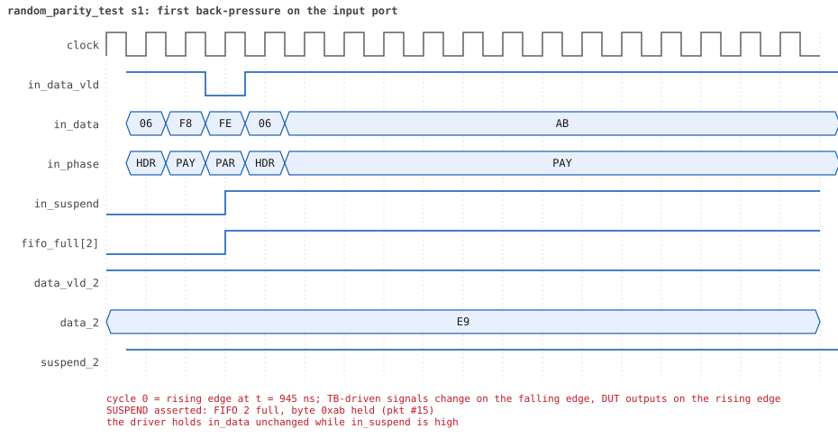
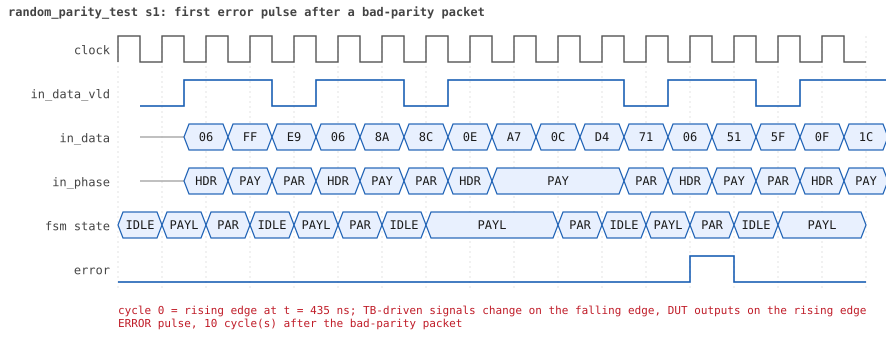
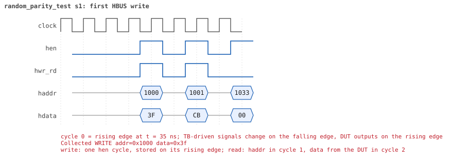

# random_parity_test  seed 1

**Result:** PASSED (0 UVM_ERROR, 0 UVM_WARNING, 0 UVM_FATAL) · bench `yapp_project_tb` · sim time 26us · log `random_parity_test_s1.log`

Waves: `random_parity_test_s1.fst` (GTKWave, Surfer or the VS Code wave viewer); signal trace: `signals.csv`.
[Open the waves in Surfer](https://app.surfer-project.org/?load_url=https%3A%2F%2Fraw.githubusercontent.com%2Ftamirgabgab%2FQcom-Mentoring%2Fmain%2Fyapp_project%2Fregression%2Fyapp_project_tb%2Frandom_parity_test_s1%2Frandom_parity_test_s1.fst&startup_commands=run_command_file_from_url%20https%3A%2F%2Fraw.githubusercontent.com%2Ftamirgabgab%2FQcom-Mentoring%2Fmain%2Fyapp_project%2Ftb%2Fyapp_router.sucl) (web app, the signals already in groups: `yapp_project/tb/yapp_router.sucl`).

## Summary

- YAPP driver sent **94** packet(s) (34 with bad parity); the input monitor saw 94.
- Router: **43** forwarded, **51** dropped (9 illegal address 3, 42 oversized).
- Packets out: ch0 **10**, ch1 **15**, ch2 **18**.
- Scoreboard: 43 matched, 0 mismatched, 0 unexpected.
- Back-pressure: in_suspend asserted **2** time(s), longest hold 97 cycle(s).
- Error pulses: 34.
- HBUS: 28 write(s), 44 read(s).

## Stages

| time (ns) | stage |
|---|---|
| 0 | receivers: ch0 RX_STALLY, ch1 RX_FAST, ch2 RX_STALLY |
| 0 | random scenario: 94 packets in 6 bursts |
| 360 | burst 1/6: ctrl=0x3f (maxpktsize 63) en=0xcb (router on, counter enables 1100101), 16 packet(s) -- storm: 1..3-byte packets back to back, half with bad parity |
| 2000 | burst 1/6 sent: addr0..3 1/5/6/4, bad parity 4, gap 0 12, length 1..3 |
| 2230 | burst 2/6: ctrl=0xb0 (maxpktsize 48) en=0xa9 (router on, counter enables 1010100), 15 packet(s) |
| 9460 | burst 2/6 sent: addr0..3 4/4/6/1, bad parity 2, gap 0 7, length 1..63 |
| 9630 | burst 3/6: ctrl=0xbe (maxpktsize 62) en=0x05 (router on, counter enables 0000010), 16 packet(s) |
| 17330 | burst 3/6 sent: addr0..3 4/4/6/2, bad parity 5, gap 0 8, length 1..63 |
| 17590 | burst 4/6: ctrl=0x02 (maxpktsize 2) en=0xad (router on, counter enables 1010110), 15 packet(s) |
| 22990 | burst 4/6 sent: addr0..3 2/3/8/2, bad parity 7, gap 0 10, length 1..63 |
| 23320 | burst 5/6: ctrl=0xa6 (maxpktsize 38) en=0xd1 (router on, counter enables 1101000), 16 packet(s) -- storm: 1..3-byte packets back to back, half with bad parity |
| 24010 | burst 5/6 sent: addr0..3 2/6/6/2, bad parity 11, gap 0 14, length 1..3 |
| 24230 | burst 6/6: ctrl=0x00 (maxpktsize 0) en=0x01 (router on, counter enables 0000000), 16 packet(s) -- storm: 1..3-byte packets back to back, half with bad parity |
| 24880 | burst 6/6 sent: addr0..3 1/3/9/3, bad parity 5, gap 0 13, length 1..3 |
| 24880 | final reads: every register and the stored packet, checked against the reference model |
| 25355 | done: 94 packets (43 forwarded, 51 dropped), 3 storm burst(s), 43 scoreboard matches, 41 HBUS reads checked, 34 error pulses for 34 bad packets |

## Pictures

**reset and the first cycles**

**first packet into the router**

**first packet out on channel 1**

**first back-pressure on the input port**

**first error pulse after a bad-parity packet**

**first HBUS write**

**first HBUS read**

## Timeline

1104 events (the same list is in `timeline.csv`).

| time (ns) | who | event |
|---|---|---|
| 0 | yapp monitor | YAPP monitor running |
| 0 | **test** | STAGE: receivers: ch0 RX_STALLY, ch1 RX_FAST, ch2 RX_STALLY |
| 0 | **test** | STAGE: random scenario: 94 packets in 6 bursts |
| 0 | clk/rst driver | Starting clock (period 10) and holding reset for 5 cycles |
| 0 | **DUT** | RESET asserted |
| 50 | **DUT** | RESET released: router_en=1 maxpktsize=63 |
| 70 | hbus driver | Executed WRITE addr=0x1000 data=0x3f |
| 75 | hbus monitor | Collected WRITE addr=0x1000 data=0x3f |
| 75 | reference | maxpktsize is now 63 |
| 90 | hbus driver | Executed WRITE addr=0x1001 data=0xcb |
| 95 | hbus monitor | Collected WRITE addr=0x1001 data=0xcb |
| 95 | reference | router_en is now 1 (en_reg 0xcb) |
| 120 | hbus driver | Executed READ  addr=0x1033 data=0x00 |
| 125 | hbus monitor | Collected READ  addr=0x1033 data=0x00 |
| 140 | hbus driver | Executed WRITE addr=0x118c data=0x26 |
| 145 | hbus monitor | Collected WRITE addr=0x118c data=0x26 |
| 170 | hbus driver | Executed READ  addr=0x118c data=0x26 |
| 175 | hbus monitor | Collected READ  addr=0x118c data=0x26 |
| 190 | hbus driver | Executed WRITE addr=0x1128 data=0xff |
| 195 | hbus monitor | Collected WRITE addr=0x1128 data=0xff |
| 220 | hbus driver | Executed READ  addr=0x1128 data=0xff |
| 225 | hbus monitor | Collected READ  addr=0x1128 data=0xff |
| 250 | hbus driver | Executed READ  addr=0x10a3 data=0x00 |
| 255 | hbus monitor | Collected READ  addr=0x10a3 data=0x00 |
| 280 | hbus driver | Executed READ  addr=0x102e data=0x00 |
| 285 | hbus monitor | Collected READ  addr=0x102e data=0x00 |
| 300 | hbus driver | Executed WRITE addr=0x1193 data=0x7f |
| 305 | hbus monitor | Collected WRITE addr=0x1193 data=0x7f |
| 330 | hbus driver | Executed READ  addr=0x1193 data=0x7f |
| 335 | hbus monitor | Collected READ  addr=0x1193 data=0x7f |
| 360 | hbus driver | Executed READ  addr=0x1001 data=0xcb |
| 360 | **test** | STAGE: burst 1/6: ctrl=0x3f (maxpktsize 63) en=0xcb (router on, counter enables 1100101), 16 packet(s) -- storm: 1..3-byte packets back to back, half with bad parity |
| 360 | yapp driver | TX pkt #1: addr=1 len=2 parity=good delay=0 |
| 365 | hbus monitor | Collected READ  addr=0x1001 data=0xcb |
| 375 | **DUT** | IN  pkt #1 header: addr=1 len=2 -> channel 1 |
| 385 | **DUT** | OUT ch1 pkt #1 start: addr=1 len=2 (receiver waited 0 cycle(s)) |
| 405 | **DUT** | IN  pkt #1 complete: addr=1 len=2 parity=ok forwarded, 4 bytes in 4 cycles (held 0) |
| 405 | yapp monitor | RX pkt #1 on the input: addr=1 len=2 parity=good gap=32 |
| 405 | reference | Packet forwarded: addr=1 len=2 -> channel 1 |
| 410 | ch1 driver | ch1: packet consumed (response delay 0) |
| 410 | yapp driver | TX pkt #1 accepted by the DUT |
| 410 | yapp driver | TX pkt #2: addr=2 len=1 parity=bad delay=3 |
| 425 | **DUT** | OUT ch1 pkt #1 done: 4 bytes in 5 cycles |
| 425 | ch1 monitor | ch1 RX pkt #1: addr=1 len=2 parity=good |
| 425 | scoreboard | ch1 pkt matched: addr=1 len=2 (1 matched so far) |
| 445 | **DUT** | IN  pkt #2 header: addr=2 len=1 -> channel 2 |
| 465 | **DUT** | IN  pkt #2 complete: addr=2 len=1 parity=BAD forwarded, 3 bytes in 3 cycles (held 0) |
| 465 | yapp monitor | RX pkt #2 on the input: addr=2 len=1 parity=bad gap=3 |
| 465 | reference | Packet forwarded: addr=2 len=1 -> channel 2 |
| 470 | yapp driver | TX pkt #2 accepted by the DUT |
| 470 | yapp driver | TX pkt #3: addr=2 len=1 parity=good delay=0 |
| 475 | **DUT** | IN  pkt #3 header: addr=2 len=1 -> channel 2 |
| 480 | ch1 driver | ch1: packet consumed (response delay 0) |
| 495 | **DUT** | IN  pkt #3 complete: addr=2 len=1 parity=ok forwarded, 3 bytes in 3 cycles (held 0) |
| 495 | yapp monitor | RX pkt #3 on the input: addr=2 len=1 parity=good gap=0 |
| 495 | reference | Packet forwarded: addr=2 len=1 -> channel 2 |
| 500 | yapp driver | TX pkt #3 accepted by the DUT |
| 500 | yapp driver | TX pkt #4: addr=1 len=3 parity=good delay=0 |
| 505 | **DUT** | IN  pkt #4 header: addr=1 len=3 -> channel 1 |
| 515 | **DUT** | OUT ch1 pkt #2 start: addr=1 len=3 (receiver waited 0 cycle(s)) |
| 515 | **DUT** | OUT ch2 pkt #1 start: addr=2 len=1 (receiver waited 6 cycle(s)) |
| 530 | ch2 driver | ch2: packet consumed (response delay 6) |
| 545 | **DUT** | IN  pkt #4 complete: addr=1 len=3 parity=ok forwarded, 5 bytes in 5 cycles (held 0) |
| 545 | yapp monitor | RX pkt #4 on the input: addr=1 len=3 parity=good gap=0 |
| 545 | reference | Packet forwarded: addr=1 len=3 -> channel 1 |
| 550 | ch1 driver | ch1: packet consumed (response delay 0) |
| 550 | yapp driver | TX pkt #4 accepted by the DUT |
| 550 | yapp driver | TX pkt #5: addr=3 len=3 parity=bad delay=1 |
| 565 | **DUT** | IN  pkt #5 header: addr=3 len=3 -> DROP (illegal address 3) |
| 565 | **DUT** | OUT ch1 pkt #2 done: 5 bytes in 6 cycles |
| 565 | ch1 monitor | ch1 RX pkt #2: addr=1 len=3 parity=good |
| 565 | scoreboard | ch1 pkt matched: addr=1 len=3 (2 matched so far) |
| 570 | **DUT** | ERROR pulse, 10 cycle(s) after the bad-parity packet |
| 570 | error checker | error pulse 10 cycles after the bad packet (0 still owed) |
| 605 | **DUT** | IN  pkt #5 complete: addr=3 len=3 parity=BAD dropped, 5 bytes in 5 cycles (held 0) |
| 605 | yapp monitor | RX pkt #5 on the input: addr=3 len=3 parity=bad gap=1 |
| 605 | reference | Packet dropped: illegal address 3 (len=3) |
| 605 | **DUT** | ROUTER DROPS PACKET addr=3 length=3 (    illegal address) |
| 610 | yapp driver | TX pkt #5 accepted by the DUT |
| 610 | yapp driver | TX pkt #6: addr=1 len=1 parity=bad delay=0 |
| 615 | **DUT** | IN  pkt #6 header: addr=1 len=1 -> channel 1 |
| 625 | **DUT** | OUT ch1 pkt #3 start: addr=1 len=1 (receiver waited 0 cycle(s)) |
| 635 | **DUT** | IN  pkt #6 complete: addr=1 len=1 parity=BAD forwarded, 3 bytes in 3 cycles (held 0) |
| 635 | yapp monitor | RX pkt #6 on the input: addr=1 len=1 parity=bad gap=0 |
| 635 | reference | Packet forwarded: addr=1 len=1 -> channel 1 |
| 640 | yapp driver | TX pkt #6 accepted by the DUT |
| 640 | yapp driver | TX pkt #7: addr=3 len=2 parity=good delay=0 |
| 645 | **DUT** | IN  pkt #7 header: addr=3 len=2 -> DROP (illegal address 3) |
| 645 | **DUT** | OUT ch1 pkt #3 done: 3 bytes in 3 cycles |
| 645 | ch1 monitor | ch1 RX pkt #3: addr=1 len=1 parity=bad |
| 645 | scoreboard | ch1 pkt matched: addr=1 len=1 (3 matched so far) |
| 650 | **DUT** | ERROR pulse, 4 cycle(s) after the bad-parity packet (1 more owed) |
| 650 | error checker | error pulse 4 cycles after the bad packet (1 still owed) |
| 675 | **DUT** | IN  pkt #7 complete: addr=3 len=2 parity=ok dropped, 4 bytes in 4 cycles (held 0) |
| 675 | yapp monitor | RX pkt #7 on the input: addr=3 len=2 parity=good gap=0 |
| 675 | reference | Packet dropped: illegal address 3 (len=2) |
| 675 | **DUT** | ROUTER DROPS PACKET addr=3 length=2 (    illegal address) |
| 680 | yapp driver | TX pkt #7 accepted by the DUT |
| 680 | yapp driver | TX pkt #8: addr=2 len=1 parity=good delay=0 |
| 685 | **DUT** | IN  pkt #8 header: addr=2 len=1 -> channel 2 |
| 690 | **DUT** | ERROR pulse, 5 cycle(s) after the bad-parity packet |
| 690 | error checker | error pulse 5 cycles after the bad packet (0 still owed) |
| 705 | **DUT** | IN  pkt #8 complete: addr=2 len=1 parity=ok forwarded, 3 bytes in 3 cycles (held 0) |
| 705 | yapp monitor | RX pkt #8 on the input: addr=2 len=1 parity=good gap=0 |
| 705 | reference | Packet forwarded: addr=2 len=1 -> channel 2 |
| 710 | yapp driver | TX pkt #8 accepted by the DUT |
| 710 | yapp driver | TX pkt #9: addr=3 len=2 parity=good delay=1 |
| 725 | **DUT** | IN  pkt #9 header: addr=3 len=2 -> DROP (illegal address 3) |
| 755 | **DUT** | IN  pkt #9 complete: addr=3 len=2 parity=ok dropped, 4 bytes in 4 cycles (held 0) |
| 755 | yapp monitor | RX pkt #9 on the input: addr=3 len=2 parity=good gap=1 |
| 755 | reference | Packet dropped: illegal address 3 (len=2) |
| 755 | **DUT** | ROUTER DROPS PACKET addr=3 length=2 (    illegal address) |
| 760 | yapp driver | TX pkt #9 accepted by the DUT |
| 760 | yapp driver | TX pkt #10: addr=1 len=1 parity=good delay=0 |
| 765 | **DUT** | IN  pkt #10 header: addr=1 len=1 -> channel 1 |
| 775 | **DUT** | OUT ch1 pkt #4 start: addr=1 len=1 (receiver waited 0 cycle(s)) |
| 785 | **DUT** | IN  pkt #10 complete: addr=1 len=1 parity=ok forwarded, 3 bytes in 3 cycles (held 0) |
| 785 | yapp monitor | RX pkt #10 on the input: addr=1 len=1 parity=good gap=0 |
| 785 | reference | Packet forwarded: addr=1 len=1 -> channel 1 |
| 790 | yapp driver | TX pkt #10 accepted by the DUT |
| 790 | yapp driver | TX pkt #11: addr=0 len=3 parity=good delay=2 |
| 795 | **DUT** | OUT ch1 pkt #4 done: 3 bytes in 3 cycles |
| 795 | ch1 monitor | ch1 RX pkt #4: addr=1 len=1 parity=good |
| 795 | scoreboard | ch1 pkt matched: addr=1 len=1 (4 matched so far) |
| 800 | ch1 driver | ch1: packet consumed (response delay 0) |
| 815 | **DUT** | IN  pkt #11 header: addr=0 len=3 -> channel 0 |
| 855 | **DUT** | IN  pkt #11 complete: addr=0 len=3 parity=ok forwarded, 5 bytes in 5 cycles (held 0) |
| 855 | yapp monitor | RX pkt #11 on the input: addr=0 len=3 parity=good gap=2 |
| 855 | reference | Packet forwarded: addr=0 len=3 -> channel 0 |
| 860 | yapp driver | TX pkt #11 accepted by the DUT |
| 860 | yapp driver | TX pkt #12: addr=3 len=1 parity=bad delay=0 |
| 865 | **DUT** | IN  pkt #12 header: addr=3 len=1 -> DROP (illegal address 3) |
| 885 | **DUT** | IN  pkt #12 complete: addr=3 len=1 parity=BAD dropped, 3 bytes in 3 cycles (held 0) |
| 885 | yapp monitor | RX pkt #12 on the input: addr=3 len=1 parity=bad gap=0 |
| 885 | reference | Packet dropped: illegal address 3 (len=1) |
| 885 | **DUT** | ROUTER DROPS PACKET addr=3 length=1 (    illegal address) |
| 890 | yapp driver | TX pkt #12 accepted by the DUT |
| 890 | yapp driver | TX pkt #13: addr=2 len=3 parity=good delay=0 |
| 895 | **DUT** | IN  pkt #13 header: addr=2 len=3 -> channel 2 |
| 930 | **DUT** | ERROR pulse, 4 cycle(s) after the bad-parity packet |
| 930 | error checker | error pulse 4 cycles after the bad packet (0 still owed) |
| 935 | **DUT** | IN  pkt #13 complete: addr=2 len=3 parity=ok forwarded, 5 bytes in 5 cycles (held 0) |
| 935 | yapp monitor | RX pkt #13 on the input: addr=2 len=3 parity=good gap=0 |
| 935 | reference | Packet forwarded: addr=2 len=3 -> channel 2 |
| 940 | yapp driver | TX pkt #13 accepted by the DUT |
| 940 | yapp driver | TX pkt #14: addr=2 len=1 parity=good delay=0 |
| 945 | **DUT** | IN  pkt #14 header: addr=2 len=1 -> channel 2 |
| 965 | **DUT** | IN  pkt #14 complete: addr=2 len=1 parity=ok forwarded, 3 bytes in 3 cycles (held 0) |
| 965 | yapp monitor | RX pkt #14 on the input: addr=2 len=1 parity=good gap=0 |
| 965 | reference | Packet forwarded: addr=2 len=1 -> channel 2 |
| 970 | yapp driver | TX pkt #14 accepted by the DUT |
| 970 | yapp driver | TX pkt #15: addr=2 len=1 parity=good delay=0 |
| 975 | **DUT** | IN  pkt #15 header: addr=2 len=1 -> channel 2 |
| 985 | **DUT** | SUSPEND asserted: FIFO 2 full, byte 0xab held (pkt #15) |
| 1535 | **DUT** | OUT ch0 pkt #1 start: addr=0 len=3 (receiver waited 71 cycle(s)) |
| 1570 | ch0 driver | ch0: packet consumed (response delay 71) |
| 1675 | **DUT** | OUT ch0 pkt #1 done: 5 bytes in 15 cycles |
| 1675 | ch0 monitor | ch0 RX pkt #1: addr=0 len=3 parity=good |
| 1675 | scoreboard | ch0 pkt matched: addr=0 len=3 (5 matched so far) |
| 1810 | ch0 driver | ch0: packet consumed (response delay 9) |
| 1945 | **DUT** | OUT ch2 pkt #1 done: 3 bytes in 144 cycles |
| 1945 | ch2 monitor | ch2 RX pkt #1: addr=2 len=1 parity=bad |
| 1945 | scoreboard | ch2 pkt matched: addr=2 len=1 (6 matched so far) |
| 1955 | **DUT** | SUSPEND released after 97 cycle(s) |
| 1955 | **DUT** | OUT ch2 pkt #2 start: addr=2 len=1 (receiver waited 0 cycle(s)) |
| 1965 | **DUT** | IN  pkt #15 complete: addr=2 len=1 parity=ok forwarded, 3 bytes in 100 cycles (held 97) |
| 1965 | yapp monitor | RX pkt #15 on the input: addr=2 len=1 parity=good gap=0 |
| 1965 | reference | Packet forwarded: addr=2 len=1 -> channel 2 |
| 1970 | yapp driver | TX pkt #15 accepted by the DUT |
| 1970 | yapp driver | TX pkt #16: addr=1 len=1 parity=good delay=0 |
| 1975 | **DUT** | IN  pkt #16 header: addr=1 len=1 -> channel 1 |
| 1975 | **DUT** | OUT ch2 pkt #2 done: 3 bytes in 3 cycles |
| 1975 | ch2 monitor | ch2 RX pkt #2: addr=2 len=1 parity=good |
| 1975 | scoreboard | ch2 pkt matched: addr=2 len=1 (7 matched so far) |
| 1985 | **DUT** | OUT ch1 pkt #5 start: addr=1 len=1 (receiver waited 0 cycle(s)) |
| 1985 | **DUT** | OUT ch2 pkt #3 start: addr=2 len=1 (receiver waited 0 cycle(s)) |
| 1995 | **DUT** | IN  pkt #16 complete: addr=1 len=1 parity=ok forwarded, 3 bytes in 3 cycles (held 0) |
| 1995 | yapp monitor | RX pkt #16 on the input: addr=1 len=1 parity=good gap=0 |
| 1995 | reference | Packet forwarded: addr=1 len=1 -> channel 1 |
| 2000 | ch1 driver | ch1: packet consumed (response delay 0) |
| 2000 | yapp driver | TX pkt #16 accepted by the DUT |
| 2000 | **test** | STAGE: burst 1/6 sent: addr0..3 1/5/6/4, bad parity 4, gap 0 12, length 1..3 |
| 2005 | **DUT** | OUT ch2 pkt #3 done: 3 bytes in 3 cycles |
| 2005 | ch2 monitor | ch2 RX pkt #3: addr=2 len=1 parity=good |
| 2005 | scoreboard | ch2 pkt matched: addr=2 len=1 (8 matched so far) |
| 2015 | **DUT** | OUT ch1 pkt #5 done: 3 bytes in 4 cycles |
| 2015 | **DUT** | OUT ch2 pkt #4 start: addr=2 len=3 (receiver waited 0 cycle(s)) |
| 2015 | ch1 monitor | ch1 RX pkt #5: addr=1 len=1 parity=good |
| 2015 | scoreboard | ch1 pkt matched: addr=1 len=1 (9 matched so far) |
| 2020 | hbus driver | Executed WRITE addr=0x1000 data=0xb0 |
| 2025 | **DUT** | CONFIG router_en=1 maxpktsize=48 |
| 2025 | hbus monitor | Collected WRITE addr=0x1000 data=0xb0 |
| 2025 | reference | maxpktsize is now 48 |
| 2040 | hbus driver | Executed WRITE addr=0x1001 data=0xa9 |
| 2045 | hbus monitor | Collected WRITE addr=0x1001 data=0xa9 |
| 2045 | reference | router_en is now 1 (en_reg 0xa9) |
| 2055 | **DUT** | OUT ch2 pkt #4 done: 5 bytes in 5 cycles |
| 2055 | ch2 monitor | ch2 RX pkt #4: addr=2 len=3 parity=good |
| 2055 | scoreboard | ch2 pkt matched: addr=2 len=3 (10 matched so far) |
| 2065 | **DUT** | OUT ch2 pkt #5 start: addr=2 len=1 (receiver waited 0 cycle(s)) |
| 2070 | ch1 driver | ch1: packet consumed (response delay 0) |
| 2070 | hbus driver | Executed READ  addr=0x1009 data=0x00 |
| 2075 | hbus monitor | Collected READ  addr=0x1009 data=0x00 |
| 2085 | **DUT** | OUT ch2 pkt #5 done: 3 bytes in 3 cycles |
| 2085 | ch2 monitor | ch2 RX pkt #5: addr=2 len=1 parity=good |
| 2085 | scoreboard | ch2 pkt matched: addr=2 len=1 (11 matched so far) |
| 2090 | hbus driver | Executed WRITE addr=0x1184 data=0xdd |
| 2095 | **DUT** | OUT ch2 pkt #6 start: addr=2 len=1 (receiver waited 0 cycle(s)) |
| 2095 | hbus monitor | Collected WRITE addr=0x1184 data=0xdd |
| 2115 | **DUT** | OUT ch2 pkt #6 done: 3 bytes in 3 cycles |
| 2115 | ch2 monitor | ch2 RX pkt #6: addr=2 len=1 parity=good |
| 2115 | scoreboard | ch2 pkt matched: addr=2 len=1 (12 matched so far) |
| 2120 | hbus driver | Executed READ  addr=0x1184 data=0xdd |
| 2125 | hbus monitor | Collected READ  addr=0x1184 data=0xdd |
| 2150 | hbus driver | Executed READ  addr=0x100d data=0x01 |
| 2155 | hbus monitor | Collected READ  addr=0x100d data=0x01 |
| 2170 | hbus driver | Executed WRITE addr=0x1123 data=0x20 |
| 2175 | hbus monitor | Collected WRITE addr=0x1123 data=0x20 |
| 2200 | hbus driver | Executed READ  addr=0x1123 data=0x20 |
| 2205 | hbus monitor | Collected READ  addr=0x1123 data=0x20 |
| 2230 | hbus driver | Executed READ  addr=0x103e data=0x00 |
| 2230 | **test** | STAGE: burst 2/6: ctrl=0xb0 (maxpktsize 48) en=0xa9 (router on, counter enables 1010100), 15 packet(s) |
| 2230 | yapp driver | TX pkt #17: addr=1 len=36 parity=good delay=0 |
| 2235 | hbus monitor | Collected READ  addr=0x103e data=0x00 |
| 2245 | **DUT** | IN  pkt #17 header: addr=1 len=36 -> channel 1 |
| 2255 | **DUT** | OUT ch1 pkt #6 start: addr=1 len=36 (receiver waited 0 cycle(s)) |
| 2530 | ch2 driver | ch2: packet consumed (response delay 140) |
| 2615 | **DUT** | IN  pkt #17 complete: addr=1 len=36 parity=ok forwarded, 38 bytes in 38 cycles (held 0) |
| 2615 | yapp monitor | RX pkt #17 on the input: addr=1 len=36 parity=good gap=24 |
| 2615 | reference | Packet forwarded: addr=1 len=36 -> channel 1 |
| 2620 | ch1 driver | ch1: packet consumed (response delay 0) |
| 2620 | yapp driver | TX pkt #17 accepted by the DUT |
| 2620 | yapp driver | TX pkt #18: addr=0 len=7 parity=good delay=3 |
| 2635 | **DUT** | OUT ch1 pkt #6 done: 38 bytes in 39 cycles |
| 2635 | ch1 monitor | ch1 RX pkt #6: addr=1 len=36 parity=good |
| 2635 | scoreboard | ch1 pkt matched: addr=1 len=36 (13 matched so far) |
| 2655 | **DUT** | IN  pkt #18 header: addr=0 len=7 -> channel 0 |
| 2675 | **DUT** | OUT ch0 pkt #2 start: addr=0 len=7 (receiver waited 1 cycle(s)) |
| 2710 | ch1 driver | ch1: packet consumed (response delay 0) |
| 2735 | **DUT** | IN  pkt #18 complete: addr=0 len=7 parity=ok forwarded, 9 bytes in 9 cycles (held 0) |
| 2735 | yapp monitor | RX pkt #18 on the input: addr=0 len=7 parity=good gap=3 |
| 2735 | reference | Packet forwarded: addr=0 len=7 -> channel 0 |
| 2740 | yapp driver | TX pkt #18 accepted by the DUT |
| 2740 | yapp driver | TX pkt #19: addr=1 len=54 parity=bad delay=0 |
| 2745 | **DUT** | IN  pkt #19 header: addr=1 len=54 -> DROP (oversized: len 54 > maxpktsize 48) |
| 2750 | ch0 driver | ch0: packet consumed (response delay 1) |
| 2865 | **DUT** | OUT ch0 pkt #2 done: 9 bytes in 20 cycles |
| 2865 | ch0 monitor | ch0 RX pkt #2: addr=0 len=7 parity=good |
| 2865 | scoreboard | ch0 pkt matched: addr=0 len=7 (14 matched so far) |
| 3295 | **DUT** | IN  pkt #19 complete: addr=1 len=54 parity=BAD dropped, 56 bytes in 56 cycles (held 0) |
| 3295 | yapp monitor | RX pkt #19 on the input: addr=1 len=54 parity=bad gap=0 |
| 3295 | reference | Packet dropped: length 54 > maxpktsize 48 (addr=1) |
| 3295 | **DUT** | ROUTER DROPS PACKET addr=1 length=54 (length > maxpktsize) |
| 3300 | yapp driver | TX pkt #19 accepted by the DUT |
| 3300 | yapp driver | TX pkt #20: addr=3 len=41 parity=good delay=0 |
| 3305 | **DUT** | IN  pkt #20 header: addr=3 len=41 -> DROP (illegal address 3) |
| 3350 | **DUT** | ERROR pulse, 5 cycle(s) after the bad-parity packet |
| 3350 | error checker | error pulse 5 cycles after the bad packet (0 still owed) |
| 3350 | ch0 driver | ch0: packet consumed (response delay 10) |
| 3725 | **DUT** | IN  pkt #20 complete: addr=3 len=41 parity=ok dropped, 43 bytes in 43 cycles (held 0) |
| 3725 | yapp monitor | RX pkt #20 on the input: addr=3 len=41 parity=good gap=0 |
| 3725 | reference | Packet dropped: illegal address 3 (len=41) |
| 3725 | **DUT** | ROUTER DROPS PACKET addr=3 length=41 (    illegal address) |
| 3730 | yapp driver | TX pkt #20 accepted by the DUT |
| 3730 | yapp driver | TX pkt #21: addr=2 len=56 parity=good delay=4 |
| 3775 | **DUT** | IN  pkt #21 header: addr=2 len=56 -> DROP (oversized: len 56 > maxpktsize 48) |
| 4345 | **DUT** | IN  pkt #21 complete: addr=2 len=56 parity=ok dropped, 58 bytes in 58 cycles (held 0) |
| 4345 | yapp monitor | RX pkt #21 on the input: addr=2 len=56 parity=good gap=4 |
| 4345 | reference | Packet dropped: length 56 > maxpktsize 48 (addr=2) |
| 4345 | **DUT** | ROUTER DROPS PACKET addr=2 length=56 (length > maxpktsize) |
| 4350 | yapp driver | TX pkt #21 accepted by the DUT |
| 4350 | yapp driver | TX pkt #22: addr=1 len=63 parity=good delay=0 |
| 4355 | **DUT** | IN  pkt #22 header: addr=1 len=63 -> DROP (oversized: len 63 > maxpktsize 48) |
| 4995 | **DUT** | IN  pkt #22 complete: addr=1 len=63 parity=ok dropped, 65 bytes in 65 cycles (held 0) |
| 4995 | yapp monitor | RX pkt #22 on the input: addr=1 len=63 parity=good gap=0 |
| 4995 | reference | Packet dropped: length 63 > maxpktsize 48 (addr=1) |
| 4995 | **DUT** | ROUTER DROPS PACKET addr=1 length=63 (length > maxpktsize) |
| 5000 | yapp driver | TX pkt #22 accepted by the DUT |
| 5000 | yapp driver | TX pkt #23: addr=2 len=43 parity=good delay=3 |
| 5035 | **DUT** | IN  pkt #23 header: addr=2 len=43 -> channel 2 |
| 5055 | **DUT** | OUT ch2 pkt #7 start: addr=2 len=43 (receiver waited 1 cycle(s)) |
| 5475 | **DUT** | IN  pkt #23 complete: addr=2 len=43 parity=ok forwarded, 45 bytes in 45 cycles (held 0) |
| 5475 | yapp monitor | RX pkt #23 on the input: addr=2 len=43 parity=good gap=3 |
| 5475 | reference | Packet forwarded: addr=2 len=43 -> channel 2 |
| 5480 | yapp driver | TX pkt #23 accepted by the DUT |
| 5480 | yapp driver | TX pkt #24: addr=0 len=3 parity=good delay=2 |
| 5490 | ch2 driver | ch2: packet consumed (response delay 1) |
| 5505 | **DUT** | IN  pkt #24 header: addr=0 len=3 -> channel 0 |
| 5545 | **DUT** | IN  pkt #24 complete: addr=0 len=3 parity=ok forwarded, 5 bytes in 5 cycles (held 0) |
| 5545 | yapp monitor | RX pkt #24 on the input: addr=0 len=3 parity=good gap=2 |
| 5545 | reference | Packet forwarded: addr=0 len=3 -> channel 0 |
| 5550 | yapp driver | TX pkt #24 accepted by the DUT |
| 5550 | yapp driver | TX pkt #25: addr=2 len=63 parity=good delay=16 |
| 5715 | **DUT** | IN  pkt #25 header: addr=2 len=63 -> DROP (oversized: len 63 > maxpktsize 48) |
| 6355 | **DUT** | IN  pkt #25 complete: addr=2 len=63 parity=ok dropped, 65 bytes in 65 cycles (held 0) |
| 6355 | yapp monitor | RX pkt #25 on the input: addr=2 len=63 parity=good gap=16 |
| 6355 | reference | Packet dropped: length 63 > maxpktsize 48 (addr=2) |
| 6355 | **DUT** | ROUTER DROPS PACKET addr=2 length=63 (length > maxpktsize) |
| 6360 | yapp driver | TX pkt #25 accepted by the DUT |
| 6360 | yapp driver | TX pkt #26: addr=2 len=63 parity=good delay=1 |
| 6375 | **DUT** | IN  pkt #26 header: addr=2 len=63 -> DROP (oversized: len 63 > maxpktsize 48) |
| 6835 | **DUT** | OUT ch2 pkt #7 done: 45 bytes in 179 cycles |
| 6835 | ch2 monitor | ch2 RX pkt #7: addr=2 len=43 parity=good |
| 6835 | scoreboard | ch2 pkt matched: addr=2 len=43 (15 matched so far) |
| 6870 | ch2 driver | ch2: packet consumed (response delay 133) |
| 6925 | **DUT** | OUT ch0 pkt #3 start: addr=0 len=3 (receiver waited 141 cycle(s)) |
| 6960 | ch0 driver | ch0: packet consumed (response delay 141) |
| 7015 | **DUT** | IN  pkt #26 complete: addr=2 len=63 parity=ok dropped, 65 bytes in 65 cycles (held 0) |
| 7015 | yapp monitor | RX pkt #26 on the input: addr=2 len=63 parity=good gap=1 |
| 7015 | reference | Packet dropped: length 63 > maxpktsize 48 (addr=2) |
| 7015 | **DUT** | ROUTER DROPS PACKET addr=2 length=63 (length > maxpktsize) |
| 7020 | yapp driver | TX pkt #26 accepted by the DUT |
| 7020 | yapp driver | TX pkt #27: addr=0 len=63 parity=good delay=1 |
| 7035 | **DUT** | IN  pkt #27 header: addr=0 len=63 -> DROP (oversized: len 63 > maxpktsize 48) |
| 7075 | **DUT** | OUT ch0 pkt #3 done: 5 bytes in 16 cycles |
| 7075 | ch0 monitor | ch0 RX pkt #3: addr=0 len=3 parity=good |
| 7075 | scoreboard | ch0 pkt matched: addr=0 len=3 (16 matched so far) |
| 7200 | ch0 driver | ch0: packet consumed (response delay 10) |
| 7675 | **DUT** | IN  pkt #27 complete: addr=0 len=63 parity=ok dropped, 65 bytes in 65 cycles (held 0) |
| 7675 | yapp monitor | RX pkt #27 on the input: addr=0 len=63 parity=good gap=1 |
| 7675 | reference | Packet dropped: length 63 > maxpktsize 48 (addr=0) |
| 7675 | **DUT** | ROUTER DROPS PACKET addr=0 length=63 (length > maxpktsize) |
| 7680 | yapp driver | TX pkt #27 accepted by the DUT |
| 7680 | yapp driver | TX pkt #28: addr=1 len=48 parity=good delay=0 |
| 7685 | **DUT** | IN  pkt #28 header: addr=1 len=48 -> channel 1 |
| 7695 | **DUT** | OUT ch1 pkt #7 start: addr=1 len=48 (receiver waited 0 cycle(s)) |
| 8175 | **DUT** | IN  pkt #28 complete: addr=1 len=48 parity=ok forwarded, 50 bytes in 50 cycles (held 0) |
| 8175 | yapp monitor | RX pkt #28 on the input: addr=1 len=48 parity=good gap=0 |
| 8175 | reference | Packet forwarded: addr=1 len=48 -> channel 1 |
| 8180 | ch1 driver | ch1: packet consumed (response delay 0) |
| 8180 | yapp driver | TX pkt #28 accepted by the DUT |
| 8180 | yapp driver | TX pkt #29: addr=0 len=1 parity=good delay=0 |
| 8185 | **DUT** | IN  pkt #29 header: addr=0 len=1 -> channel 0 |
| 8195 | **DUT** | OUT ch1 pkt #7 done: 50 bytes in 51 cycles |
| 8195 | ch1 monitor | ch1 RX pkt #7: addr=1 len=48 parity=good |
| 8195 | scoreboard | ch1 pkt matched: addr=1 len=48 (17 matched so far) |
| 8205 | **DUT** | IN  pkt #29 complete: addr=0 len=1 parity=ok forwarded, 3 bytes in 3 cycles (held 0) |
| 8205 | yapp monitor | RX pkt #29 on the input: addr=0 len=1 parity=good gap=0 |
| 8205 | reference | Packet forwarded: addr=0 len=1 -> channel 0 |
| 8210 | yapp driver | TX pkt #29 accepted by the DUT |
| 8210 | yapp driver | TX pkt #30: addr=2 len=63 parity=good delay=2 |
| 8235 | **DUT** | IN  pkt #30 header: addr=2 len=63 -> DROP (oversized: len 63 > maxpktsize 48) |
| 8245 | **DUT** | OUT ch0 pkt #4 start: addr=0 len=1 (receiver waited 5 cycle(s)) |
| 8260 | ch0 driver | ch0: packet consumed (response delay 5) |
| 8315 | **DUT** | OUT ch0 pkt #4 done: 3 bytes in 8 cycles |
| 8315 | ch0 monitor | ch0 RX pkt #4: addr=0 len=1 parity=good |
| 8315 | scoreboard | ch0 pkt matched: addr=0 len=1 (18 matched so far) |
| 8430 | ch1 driver | ch1: packet consumed (response delay 0) |
| 8470 | ch0 driver | ch0: packet consumed (response delay 4) |
| 8875 | **DUT** | IN  pkt #30 complete: addr=2 len=63 parity=ok dropped, 65 bytes in 65 cycles (held 0) |
| 8875 | yapp monitor | RX pkt #30 on the input: addr=2 len=63 parity=good gap=2 |
| 8875 | reference | Packet dropped: length 63 > maxpktsize 48 (addr=2) |
| 8875 | **DUT** | ROUTER DROPS PACKET addr=2 length=63 (length > maxpktsize) |
| 8880 | yapp driver | TX pkt #30 accepted by the DUT |
| 8880 | yapp driver | TX pkt #31: addr=2 len=56 parity=bad delay=0 |
| 8885 | **DUT** | IN  pkt #31 header: addr=2 len=56 -> DROP (oversized: len 56 > maxpktsize 48) |
| 9455 | **DUT** | IN  pkt #31 complete: addr=2 len=56 parity=BAD dropped, 58 bytes in 58 cycles (held 0) |
| 9455 | yapp monitor | RX pkt #31 on the input: addr=2 len=56 parity=bad gap=0 |
| 9455 | reference | Packet dropped: length 56 > maxpktsize 48 (addr=2) |
| 9455 | **DUT** | ROUTER DROPS PACKET addr=2 length=56 (length > maxpktsize) |
| 9460 | yapp driver | TX pkt #31 accepted by the DUT |
| 9460 | **test** | STAGE: burst 2/6 sent: addr0..3 4/4/6/1, bad parity 2, gap 0 7, length 1..63 |
| 9480 | hbus driver | Executed WRITE addr=0x1000 data=0xbe |
| 9485 | **DUT** | CONFIG router_en=1 maxpktsize=62 |
| 9485 | hbus monitor | Collected WRITE addr=0x1000 data=0xbe |
| 9485 | reference | maxpktsize is now 62 |
| 9490 | **DUT** | ERROR pulse, 3 cycle(s) after the bad-parity packet |
| 9490 | error checker | error pulse 3 cycles after the bad packet (0 still owed) |
| 9500 | hbus driver | Executed WRITE addr=0x1001 data=0x05 |
| 9505 | hbus monitor | Collected WRITE addr=0x1001 data=0x05 |
| 9505 | reference | router_en is now 1 (en_reg 0x05) |
| 9520 | hbus driver | Executed WRITE addr=0x11f4 data=0x35 |
| 9525 | hbus monitor | Collected WRITE addr=0x11f4 data=0x35 |
| 9550 | hbus driver | Executed READ  addr=0x11f4 data=0x35 |
| 9555 | hbus monitor | Collected READ  addr=0x11f4 data=0x35 |
| 9580 | hbus driver | Executed READ  addr=0x101d data=0x3f |
| 9585 | hbus monitor | Collected READ  addr=0x101d data=0x3f |
| 9600 | hbus driver | Executed WRITE addr=0x11af data=0x1f |
| 9605 | hbus monitor | Collected WRITE addr=0x11af data=0x1f |
| 9630 | hbus driver | Executed READ  addr=0x11af data=0x1f |
| 9630 | **test** | STAGE: burst 3/6: ctrl=0xbe (maxpktsize 62) en=0x05 (router on, counter enables 0000010), 16 packet(s) |
| 9630 | yapp driver | TX pkt #32: addr=2 len=1 parity=good delay=12 |
| 9635 | hbus monitor | Collected READ  addr=0x11af data=0x1f |
| 9765 | **DUT** | IN  pkt #32 header: addr=2 len=1 -> channel 2 |
| 9785 | **DUT** | IN  pkt #32 complete: addr=2 len=1 parity=ok forwarded, 3 bytes in 3 cycles (held 0) |
| 9785 | yapp monitor | RX pkt #32 on the input: addr=2 len=1 parity=good gap=30 |
| 9785 | reference | Packet forwarded: addr=2 len=1 -> channel 2 |
| 9790 | yapp driver | TX pkt #32 accepted by the DUT |
| 9790 | yapp driver | TX pkt #33: addr=1 len=20 parity=good delay=17 |
| 9865 | **DUT** | OUT ch2 pkt #8 start: addr=2 len=1 (receiver waited 9 cycle(s)) |
| 9880 | ch2 driver | ch2: packet consumed (response delay 9) |
| 9965 | **DUT** | IN  pkt #33 header: addr=1 len=20 -> channel 1 |
| 9975 | **DUT** | OUT ch1 pkt #8 start: addr=1 len=20 (receiver waited 0 cycle(s)) |
| 9975 | **DUT** | OUT ch2 pkt #8 done: 3 bytes in 12 cycles |
| 9975 | ch2 monitor | ch2 RX pkt #8: addr=2 len=1 parity=good |
| 9975 | scoreboard | ch2 pkt matched: addr=2 len=1 (19 matched so far) |
| 10175 | **DUT** | IN  pkt #33 complete: addr=1 len=20 parity=ok forwarded, 22 bytes in 22 cycles (held 0) |
| 10175 | yapp monitor | RX pkt #33 on the input: addr=1 len=20 parity=good gap=17 |
| 10175 | reference | Packet forwarded: addr=1 len=20 -> channel 1 |
| 10180 | ch1 driver | ch1: packet consumed (response delay 0) |
| 10180 | yapp driver | TX pkt #33 accepted by the DUT |
| 10180 | yapp driver | TX pkt #34: addr=3 len=15 parity=good delay=1 |
| 10195 | **DUT** | IN  pkt #34 header: addr=3 len=15 -> DROP (illegal address 3) |
| 10195 | **DUT** | OUT ch1 pkt #8 done: 22 bytes in 23 cycles |
| 10195 | ch1 monitor | ch1 RX pkt #8: addr=1 len=20 parity=good |
| 10195 | scoreboard | ch1 pkt matched: addr=1 len=20 (20 matched so far) |
| 10355 | **DUT** | IN  pkt #34 complete: addr=3 len=15 parity=ok dropped, 17 bytes in 17 cycles (held 0) |
| 10355 | yapp monitor | RX pkt #34 on the input: addr=3 len=15 parity=good gap=1 |
| 10355 | reference | Packet dropped: illegal address 3 (len=15) |
| 10355 | **DUT** | ROUTER DROPS PACKET addr=3 length=15 (    illegal address) |
| 10360 | yapp driver | TX pkt #34 accepted by the DUT |
| 10360 | yapp driver | TX pkt #35: addr=2 len=63 parity=good delay=10 |
| 10380 | ch1 driver | ch1: packet consumed (response delay 0) |
| 10465 | **DUT** | IN  pkt #35 header: addr=2 len=63 -> DROP (oversized: len 63 > maxpktsize 62) |
| 10540 | ch2 driver | ch2: packet consumed (response delay 8) |
| 11105 | **DUT** | IN  pkt #35 complete: addr=2 len=63 parity=ok dropped, 65 bytes in 65 cycles (held 0) |
| 11105 | yapp monitor | RX pkt #35 on the input: addr=2 len=63 parity=good gap=10 |
| 11105 | reference | Packet dropped: length 63 > maxpktsize 62 (addr=2) |
| 11105 | **DUT** | ROUTER DROPS PACKET addr=2 length=63 (length > maxpktsize) |
| 11110 | yapp driver | TX pkt #35 accepted by the DUT |
| 11110 | yapp driver | TX pkt #36: addr=2 len=63 parity=bad delay=0 |
| 11115 | **DUT** | IN  pkt #36 header: addr=2 len=63 -> DROP (oversized: len 63 > maxpktsize 62) |
| 11755 | **DUT** | IN  pkt #36 complete: addr=2 len=63 parity=BAD dropped, 65 bytes in 65 cycles (held 0) |
| 11755 | yapp monitor | RX pkt #36 on the input: addr=2 len=63 parity=bad gap=0 |
| 11755 | reference | Packet dropped: length 63 > maxpktsize 62 (addr=2) |
| 11755 | **DUT** | ROUTER DROPS PACKET addr=2 length=63 (length > maxpktsize) |
| 11760 | yapp driver | TX pkt #36 accepted by the DUT |
| 11760 | yapp driver | TX pkt #37: addr=1 len=38 parity=bad delay=15 |
| 11790 | **DUT** | ERROR pulse, 3 cycle(s) after the bad-parity packet |
| 11790 | error checker | error pulse 3 cycles after the bad packet (0 still owed) |
| 11915 | **DUT** | IN  pkt #37 header: addr=1 len=38 -> channel 1 |
| 11925 | **DUT** | OUT ch1 pkt #9 start: addr=1 len=38 (receiver waited 0 cycle(s)) |
| 12305 | **DUT** | IN  pkt #37 complete: addr=1 len=38 parity=BAD forwarded, 40 bytes in 40 cycles (held 0) |
| 12305 | yapp monitor | RX pkt #37 on the input: addr=1 len=38 parity=bad gap=15 |
| 12305 | reference | Packet forwarded: addr=1 len=38 -> channel 1 |
| 12310 | ch1 driver | ch1: packet consumed (response delay 0) |
| 12310 | yapp driver | TX pkt #37 accepted by the DUT |
| 12310 | yapp driver | TX pkt #38: addr=3 len=1 parity=bad delay=3 |
| 12325 | **DUT** | OUT ch1 pkt #9 done: 40 bytes in 41 cycles |
| 12325 | ch1 monitor | ch1 RX pkt #9: addr=1 len=38 parity=bad |
| 12325 | scoreboard | ch1 pkt matched: addr=1 len=38 (21 matched so far) |
| 12345 | **DUT** | IN  pkt #38 header: addr=3 len=1 -> DROP (illegal address 3) |
| 12365 | **DUT** | IN  pkt #38 complete: addr=3 len=1 parity=BAD dropped, 3 bytes in 3 cycles (held 0) |
| 12365 | yapp monitor | RX pkt #38 on the input: addr=3 len=1 parity=bad gap=3 |
| 12365 | reference | Packet dropped: illegal address 3 (len=1) |
| 12365 | **DUT** | ROUTER DROPS PACKET addr=3 length=1 (    illegal address) |
| 12370 | yapp driver | TX pkt #38 accepted by the DUT |
| 12370 | yapp driver | TX pkt #39: addr=0 len=15 parity=good delay=0 |
| 12375 | **DUT** | IN  pkt #39 header: addr=0 len=15 -> channel 0 |
| 12395 | **DUT** | OUT ch0 pkt #5 start: addr=0 len=15 (receiver waited 1 cycle(s)) |
| 12410 | **DUT** | ERROR pulse, 10 cycle(s) after the bad-parity packet (1 more owed) |
| 12410 | error checker | error pulse 10 cycles after the bad packet (1 still owed) |
| 12430 | **DUT** | ERROR pulse, 6 cycle(s) after the bad-parity packet |
| 12430 | error checker | error pulse 6 cycles after the bad packet (0 still owed) |
| 12535 | **DUT** | IN  pkt #39 complete: addr=0 len=15 parity=ok forwarded, 17 bytes in 17 cycles (held 0) |
| 12535 | yapp monitor | RX pkt #39 on the input: addr=0 len=15 parity=good gap=0 |
| 12535 | reference | Packet forwarded: addr=0 len=15 -> channel 0 |
| 12540 | yapp driver | TX pkt #39 accepted by the DUT |
| 12540 | yapp driver | TX pkt #40: addr=2 len=63 parity=good delay=0 |
| 12545 | **DUT** | IN  pkt #40 header: addr=2 len=63 -> DROP (oversized: len 63 > maxpktsize 62) |
| 12550 | ch0 driver | ch0: packet consumed (response delay 1) |
| 12625 | **DUT** | OUT ch0 pkt #5 done: 17 bytes in 24 cycles |
| 12625 | ch0 monitor | ch0 RX pkt #5: addr=0 len=15 parity=good |
| 12625 | scoreboard | ch0 pkt matched: addr=0 len=15 (22 matched so far) |
| 12640 | ch1 driver | ch1: packet consumed (response delay 0) |
| 13170 | ch0 driver | ch0: packet consumed (response delay 6) |
| 13185 | **DUT** | IN  pkt #40 complete: addr=2 len=63 parity=ok dropped, 65 bytes in 65 cycles (held 0) |
| 13185 | yapp monitor | RX pkt #40 on the input: addr=2 len=63 parity=good gap=0 |
| 13185 | reference | Packet dropped: length 63 > maxpktsize 62 (addr=2) |
| 13185 | **DUT** | ROUTER DROPS PACKET addr=2 length=63 (length > maxpktsize) |
| 13190 | yapp driver | TX pkt #40 accepted by the DUT |
| 13190 | yapp driver | TX pkt #41: addr=2 len=48 parity=bad delay=0 |
| 13195 | **DUT** | IN  pkt #41 header: addr=2 len=48 -> channel 2 |
| 13245 | **DUT** | OUT ch2 pkt #9 start: addr=2 len=48 (receiver waited 4 cycle(s)) |
| 13685 | **DUT** | IN  pkt #41 complete: addr=2 len=48 parity=BAD forwarded, 50 bytes in 50 cycles (held 0) |
| 13685 | yapp monitor | RX pkt #41 on the input: addr=2 len=48 parity=bad gap=0 |
| 13685 | reference | Packet forwarded: addr=2 len=48 -> channel 2 |
| 13690 | yapp driver | TX pkt #41 accepted by the DUT |
| 13690 | yapp driver | TX pkt #42: addr=0 len=61 parity=good delay=12 |
| 13730 | **DUT** | ERROR pulse, 4 cycle(s) after the bad-parity packet |
| 13730 | error checker | error pulse 4 cycles after the bad packet (0 still owed) |
| 13730 | ch2 driver | ch2: packet consumed (response delay 4) |
| 13815 | **DUT** | IN  pkt #42 header: addr=0 len=61 -> channel 0 |
| 13845 | **DUT** | OUT ch2 pkt #9 done: 50 bytes in 61 cycles |
| 13845 | ch2 monitor | ch2 RX pkt #9: addr=2 len=48 parity=bad |
| 13845 | scoreboard | ch2 pkt matched: addr=2 len=48 (23 matched so far) |
| 13855 | **DUT** | OUT ch0 pkt #6 start: addr=0 len=61 (receiver waited 3 cycle(s)) |
| 14370 | ch2 driver | ch2: packet consumed (response delay 10) |
| 14435 | **DUT** | IN  pkt #42 complete: addr=0 len=61 parity=ok forwarded, 63 bytes in 63 cycles (held 0) |
| 14435 | yapp monitor | RX pkt #42 on the input: addr=0 len=61 parity=good gap=12 |
| 14435 | reference | Packet forwarded: addr=0 len=61 -> channel 0 |
| 14440 | yapp driver | TX pkt #42 accepted by the DUT |
| 14440 | yapp driver | TX pkt #43: addr=1 len=63 parity=good delay=0 |
| 14445 | **DUT** | IN  pkt #43 header: addr=1 len=63 -> DROP (oversized: len 63 > maxpktsize 62) |
| 14470 | ch0 driver | ch0: packet consumed (response delay 3) |
| 15085 | **DUT** | IN  pkt #43 complete: addr=1 len=63 parity=ok dropped, 65 bytes in 65 cycles (held 0) |
| 15085 | yapp monitor | RX pkt #43 on the input: addr=1 len=63 parity=good gap=0 |
| 15085 | reference | Packet dropped: length 63 > maxpktsize 62 (addr=1) |
| 15085 | **DUT** | ROUTER DROPS PACKET addr=1 length=63 (length > maxpktsize) |
| 15090 | yapp driver | TX pkt #43 accepted by the DUT |
| 15090 | yapp driver | TX pkt #44: addr=1 len=63 parity=good delay=0 |
| 15095 | **DUT** | IN  pkt #44 header: addr=1 len=63 -> DROP (oversized: len 63 > maxpktsize 62) |
| 15345 | **DUT** | OUT ch0 pkt #6 done: 63 bytes in 150 cycles |
| 15345 | ch0 monitor | ch0 RX pkt #6: addr=0 len=61 parity=good |
| 15345 | scoreboard | ch0 pkt matched: addr=0 len=61 (24 matched so far) |
| 15590 | ch0 driver | ch0: packet consumed (response delay 86) |
| 15735 | **DUT** | IN  pkt #44 complete: addr=1 len=63 parity=ok dropped, 65 bytes in 65 cycles (held 0) |
| 15735 | yapp monitor | RX pkt #44 on the input: addr=1 len=63 parity=good gap=0 |
| 15735 | reference | Packet dropped: length 63 > maxpktsize 62 (addr=1) |
| 15735 | **DUT** | ROUTER DROPS PACKET addr=1 length=63 (length > maxpktsize) |
| 15740 | yapp driver | TX pkt #44 accepted by the DUT |
| 15740 | yapp driver | TX pkt #45: addr=2 len=62 parity=bad delay=0 |
| 15745 | **DUT** | IN  pkt #45 header: addr=2 len=62 -> channel 2 |
| 15845 | **DUT** | OUT ch2 pkt #10 start: addr=2 len=62 (receiver waited 9 cycle(s)) |
| 16375 | **DUT** | IN  pkt #45 complete: addr=2 len=62 parity=BAD forwarded, 64 bytes in 64 cycles (held 0) |
| 16375 | yapp monitor | RX pkt #45 on the input: addr=2 len=62 parity=bad gap=0 |
| 16375 | reference | Packet forwarded: addr=2 len=62 -> channel 2 |
| 16380 | yapp driver | TX pkt #45 accepted by the DUT |
| 16380 | yapp driver | TX pkt #46: addr=0 len=12 parity=good delay=0 |
| 16385 | **DUT** | IN  pkt #46 header: addr=0 len=12 -> channel 0 |
| 16390 | **DUT** | ERROR pulse, 1 cycle(s) after the bad-parity packet |
| 16390 | error checker | error pulse 1 cycles after the bad packet (0 still owed) |
| 16470 | ch2 driver | ch2: packet consumed (response delay 9) |
| 16495 | **DUT** | OUT ch0 pkt #7 start: addr=0 len=12 (receiver waited 10 cycle(s)) |
| 16515 | **DUT** | IN  pkt #46 complete: addr=0 len=12 parity=ok forwarded, 14 bytes in 14 cycles (held 0) |
| 16515 | yapp monitor | RX pkt #46 on the input: addr=0 len=12 parity=good gap=0 |
| 16515 | reference | Packet forwarded: addr=0 len=12 -> channel 0 |
| 16520 | yapp driver | TX pkt #46 accepted by the DUT |
| 16520 | yapp driver | TX pkt #47: addr=0 len=26 parity=good delay=1 |
| 16535 | **DUT** | IN  pkt #47 header: addr=0 len=26 -> channel 0 |
| 16585 | **DUT** | OUT ch2 pkt #10 done: 64 bytes in 75 cycles |
| 16585 | ch2 monitor | ch2 RX pkt #10: addr=2 len=62 parity=bad |
| 16585 | scoreboard | ch2 pkt matched: addr=2 len=62 (25 matched so far) |
| 16620 | ch0 driver | ch0: packet consumed (response delay 10) |
| 16685 | **DUT** | SUSPEND asserted: FIFO 0 full, byte 0xe1 held (pkt #47) |
| 16860 | ch2 driver | ch2: packet consumed (response delay 10) |
| 17195 | **DUT** | OUT ch0 pkt #7 done: 14 bytes in 71 cycles |
| 17195 | ch0 monitor | ch0 RX pkt #7: addr=0 len=12 parity=good |
| 17195 | scoreboard | ch0 pkt matched: addr=0 len=12 (26 matched so far) |
| 17205 | **DUT** | SUSPEND released after 52 cycle(s) |
| 17205 | **DUT** | OUT ch0 pkt #8 start: addr=0 len=26 (receiver waited 0 cycle(s)) |
| 17325 | **DUT** | IN  pkt #47 complete: addr=0 len=26 parity=ok forwarded, 28 bytes in 80 cycles (held 52) |
| 17325 | yapp monitor | RX pkt #47 on the input: addr=0 len=26 parity=good gap=1 |
| 17325 | reference | Packet forwarded: addr=0 len=26 -> channel 0 |
| 17330 | yapp driver | TX pkt #47 accepted by the DUT |
| 17330 | **test** | STAGE: burst 3/6 sent: addr0..3 4/4/6/2, bad parity 5, gap 0 8, length 1..63 |
| 17350 | hbus driver | Executed WRITE addr=0x1000 data=0x02 |
| 17355 | **DUT** | CONFIG router_en=1 maxpktsize=2 |
| 17355 | hbus monitor | Collected WRITE addr=0x1000 data=0x02 |
| 17355 | reference | maxpktsize is now 2 |
| 17370 | hbus driver | Executed WRITE addr=0x1001 data=0xad |
| 17375 | hbus monitor | Collected WRITE addr=0x1001 data=0xad |
| 17375 | reference | router_en is now 1 (en_reg 0xad) |
| 17400 | hbus driver | Executed READ  addr=0x1001 data=0xad |
| 17405 | hbus monitor | Collected READ  addr=0x1001 data=0xad |
| 17420 | hbus driver | Executed WRITE addr=0x1190 data=0xae |
| 17425 | hbus monitor | Collected WRITE addr=0x1190 data=0xae |
| 17450 | hbus driver | Executed READ  addr=0x1190 data=0xae |
| 17455 | hbus monitor | Collected READ  addr=0x1190 data=0xae |
| 17470 | hbus driver | Executed WRITE addr=0x11ed data=0x4a |
| 17475 | **DUT** | OUT ch0 pkt #8 done: 28 bytes in 28 cycles |
| 17475 | ch0 monitor | ch0 RX pkt #8: addr=0 len=26 parity=good |
| 17475 | scoreboard | ch0 pkt matched: addr=0 len=26 (27 matched so far) |
| 17475 | hbus monitor | Collected WRITE addr=0x11ed data=0x4a |
| 17500 | hbus driver | Executed READ  addr=0x11ed data=0x4a |
| 17505 | hbus monitor | Collected READ  addr=0x11ed data=0x4a |
| 17530 | hbus driver | Executed READ  addr=0x1026 data=0xde |
| 17535 | hbus monitor | Collected READ  addr=0x1026 data=0xde |
| 17560 | hbus driver | Executed READ  addr=0x1021 data=0x9d |
| 17565 | hbus monitor | Collected READ  addr=0x1021 data=0x9d |
| 17590 | hbus driver | Executed READ  addr=0x100c data=0x00 |
| 17590 | **test** | STAGE: burst 4/6: ctrl=0x02 (maxpktsize 2) en=0xad (router on, counter enables 1010110), 15 packet(s) |
| 17590 | yapp driver | TX pkt #48: addr=1 len=24 parity=bad delay=0 |
| 17595 | hbus monitor | Collected READ  addr=0x100c data=0x00 |
| 17605 | **DUT** | IN  pkt #48 header: addr=1 len=24 -> DROP (oversized: len 24 > maxpktsize 2) |
| 17720 | ch0 driver | ch0: packet consumed (response delay 56) |
| 17855 | **DUT** | IN  pkt #48 complete: addr=1 len=24 parity=BAD dropped, 26 bytes in 26 cycles (held 0) |
| 17855 | yapp monitor | RX pkt #48 on the input: addr=1 len=24 parity=bad gap=27 |
| 17855 | reference | Packet dropped: length 24 > maxpktsize 2 (addr=1) |
| 17855 | **DUT** | ROUTER DROPS PACKET addr=1 length=24 (length > maxpktsize) |
| 17860 | yapp driver | TX pkt #48 accepted by the DUT |
| 17860 | yapp driver | TX pkt #49: addr=0 len=63 parity=bad delay=0 |
| 17865 | **DUT** | IN  pkt #49 header: addr=0 len=63 -> DROP (oversized: len 63 > maxpktsize 2) |
| 17910 | **DUT** | ERROR pulse, 5 cycle(s) after the bad-parity packet |
| 17910 | error checker | error pulse 5 cycles after the bad packet (0 still owed) |
| 18505 | **DUT** | IN  pkt #49 complete: addr=0 len=63 parity=BAD dropped, 65 bytes in 65 cycles (held 0) |
| 18505 | yapp monitor | RX pkt #49 on the input: addr=0 len=63 parity=bad gap=0 |
| 18505 | reference | Packet dropped: length 63 > maxpktsize 2 (addr=0) |
| 18505 | **DUT** | ROUTER DROPS PACKET addr=0 length=63 (length > maxpktsize) |
| 18510 | yapp driver | TX pkt #49 accepted by the DUT |
| 18510 | yapp driver | TX pkt #50: addr=2 len=33 parity=bad delay=0 |
| 18515 | **DUT** | IN  pkt #50 header: addr=2 len=33 -> DROP (oversized: len 33 > maxpktsize 2) |
| 18570 | **DUT** | ERROR pulse, 6 cycle(s) after the bad-parity packet |
| 18570 | error checker | error pulse 6 cycles after the bad packet (0 still owed) |
| 18855 | **DUT** | IN  pkt #50 complete: addr=2 len=33 parity=BAD dropped, 35 bytes in 35 cycles (held 0) |
| 18855 | yapp monitor | RX pkt #50 on the input: addr=2 len=33 parity=bad gap=0 |
| 18855 | reference | Packet dropped: length 33 > maxpktsize 2 (addr=2) |
| 18855 | **DUT** | ROUTER DROPS PACKET addr=2 length=33 (length > maxpktsize) |
| 18860 | yapp driver | TX pkt #50 accepted by the DUT |
| 18860 | yapp driver | TX pkt #51: addr=2 len=4 parity=good delay=0 |
| 18865 | **DUT** | IN  pkt #51 header: addr=2 len=4 -> DROP (oversized: len 4 > maxpktsize 2) |
| 18915 | **DUT** | IN  pkt #51 complete: addr=2 len=4 parity=ok dropped, 6 bytes in 6 cycles (held 0) |
| 18915 | yapp monitor | RX pkt #51 on the input: addr=2 len=4 parity=good gap=0 |
| 18915 | reference | Packet dropped: length 4 > maxpktsize 2 (addr=2) |
| 18915 | **DUT** | ROUTER DROPS PACKET addr=2 length=4 (length > maxpktsize) |
| 18920 | yapp driver | TX pkt #51 accepted by the DUT |
| 18920 | yapp driver | TX pkt #52: addr=2 len=3 parity=good delay=0 |
| 18925 | **DUT** | IN  pkt #52 header: addr=2 len=3 -> DROP (oversized: len 3 > maxpktsize 2) |
| 18950 | **DUT** | ERROR pulse, 9 cycle(s) after the bad-parity packet |
| 18950 | error checker | error pulse 9 cycles after the bad packet (0 still owed) |
| 18965 | **DUT** | IN  pkt #52 complete: addr=2 len=3 parity=ok dropped, 5 bytes in 5 cycles (held 0) |
| 18965 | yapp monitor | RX pkt #52 on the input: addr=2 len=3 parity=good gap=0 |
| 18965 | reference | Packet dropped: length 3 > maxpktsize 2 (addr=2) |
| 18965 | **DUT** | ROUTER DROPS PACKET addr=2 length=3 (length > maxpktsize) |
| 18970 | yapp driver | TX pkt #52 accepted by the DUT |
| 18970 | yapp driver | TX pkt #53: addr=3 len=63 parity=bad delay=0 |
| 18975 | **DUT** | IN  pkt #53 header: addr=3 len=63 -> DROP (oversized: len 63 > maxpktsize 2) |
| 19615 | **DUT** | IN  pkt #53 complete: addr=3 len=63 parity=BAD dropped, 65 bytes in 65 cycles (held 0) |
| 19615 | yapp monitor | RX pkt #53 on the input: addr=3 len=63 parity=bad gap=0 |
| 19615 | reference | Packet dropped: illegal address 3 (len=63) |
| 19615 | **DUT** | ROUTER DROPS PACKET addr=3 length=63 (    illegal address) |
| 19620 | yapp driver | TX pkt #53 accepted by the DUT |
| 19620 | yapp driver | TX pkt #54: addr=2 len=32 parity=good delay=0 |
| 19625 | **DUT** | IN  pkt #54 header: addr=2 len=32 -> DROP (oversized: len 32 > maxpktsize 2) |
| 19670 | **DUT** | ERROR pulse, 5 cycle(s) after the bad-parity packet |
| 19670 | error checker | error pulse 5 cycles after the bad packet (0 still owed) |
| 19955 | **DUT** | IN  pkt #54 complete: addr=2 len=32 parity=ok dropped, 34 bytes in 34 cycles (held 0) |
| 19955 | yapp monitor | RX pkt #54 on the input: addr=2 len=32 parity=good gap=0 |
| 19955 | reference | Packet dropped: length 32 > maxpktsize 2 (addr=2) |
| 19955 | **DUT** | ROUTER DROPS PACKET addr=2 length=32 (length > maxpktsize) |
| 19960 | yapp driver | TX pkt #54 accepted by the DUT |
| 19960 | yapp driver | TX pkt #55: addr=1 len=51 parity=good delay=3 |
| 19995 | **DUT** | IN  pkt #55 header: addr=1 len=51 -> DROP (oversized: len 51 > maxpktsize 2) |
| 20515 | **DUT** | IN  pkt #55 complete: addr=1 len=51 parity=ok dropped, 53 bytes in 53 cycles (held 0) |
| 20515 | yapp monitor | RX pkt #55 on the input: addr=1 len=51 parity=good gap=3 |
| 20515 | reference | Packet dropped: length 51 > maxpktsize 2 (addr=1) |
| 20515 | **DUT** | ROUTER DROPS PACKET addr=1 length=51 (length > maxpktsize) |
| 20520 | yapp driver | TX pkt #55 accepted by the DUT |
| 20520 | yapp driver | TX pkt #56: addr=2 len=2 parity=good delay=1 |
| 20535 | **DUT** | IN  pkt #56 header: addr=2 len=2 -> channel 2 |
| 20565 | **DUT** | IN  pkt #56 complete: addr=2 len=2 parity=ok forwarded, 4 bytes in 4 cycles (held 0) |
| 20565 | yapp monitor | RX pkt #56 on the input: addr=2 len=2 parity=good gap=1 |
| 20565 | reference | Packet forwarded: addr=2 len=2 -> channel 2 |
| 20570 | yapp driver | TX pkt #56 accepted by the DUT |
| 20570 | yapp driver | TX pkt #57: addr=3 len=63 parity=bad delay=19 |
| 20645 | **DUT** | OUT ch2 pkt #11 start: addr=2 len=2 (receiver waited 10 cycle(s)) |
| 20670 | ch2 driver | ch2: packet consumed (response delay 10) |
| 20685 | **DUT** | OUT ch2 pkt #11 done: 4 bytes in 5 cycles |
| 20685 | ch2 monitor | ch2 RX pkt #11: addr=2 len=2 parity=good |
| 20685 | scoreboard | ch2 pkt matched: addr=2 len=2 (28 matched so far) |
| 20765 | **DUT** | IN  pkt #57 header: addr=3 len=63 -> DROP (oversized: len 63 > maxpktsize 2) |
| 21150 | ch2 driver | ch2: packet consumed (response delay 0) |
| 21405 | **DUT** | IN  pkt #57 complete: addr=3 len=63 parity=BAD dropped, 65 bytes in 65 cycles (held 0) |
| 21405 | yapp monitor | RX pkt #57 on the input: addr=3 len=63 parity=bad gap=19 |
| 21405 | reference | Packet dropped: illegal address 3 (len=63) |
| 21405 | **DUT** | ROUTER DROPS PACKET addr=3 length=63 (    illegal address) |
| 21410 | yapp driver | TX pkt #57 accepted by the DUT |
| 21410 | yapp driver | TX pkt #58: addr=0 len=63 parity=good delay=0 |
| 21415 | **DUT** | IN  pkt #58 header: addr=0 len=63 -> DROP (oversized: len 63 > maxpktsize 2) |
| 21490 | **DUT** | ERROR pulse, 8 cycle(s) after the bad-parity packet |
| 21490 | error checker | error pulse 8 cycles after the bad packet (0 still owed) |
| 22055 | **DUT** | IN  pkt #58 complete: addr=0 len=63 parity=ok dropped, 65 bytes in 65 cycles (held 0) |
| 22055 | yapp monitor | RX pkt #58 on the input: addr=0 len=63 parity=good gap=0 |
| 22055 | reference | Packet dropped: length 63 > maxpktsize 2 (addr=0) |
| 22055 | **DUT** | ROUTER DROPS PACKET addr=0 length=63 (length > maxpktsize) |
| 22060 | yapp driver | TX pkt #58 accepted by the DUT |
| 22060 | yapp driver | TX pkt #59: addr=2 len=23 parity=good delay=3 |
| 22095 | **DUT** | IN  pkt #59 header: addr=2 len=23 -> DROP (oversized: len 23 > maxpktsize 2) |
| 22335 | **DUT** | IN  pkt #59 complete: addr=2 len=23 parity=ok dropped, 25 bytes in 25 cycles (held 0) |
| 22335 | yapp monitor | RX pkt #59 on the input: addr=2 len=23 parity=good gap=3 |
| 22335 | reference | Packet dropped: length 23 > maxpktsize 2 (addr=2) |
| 22335 | **DUT** | ROUTER DROPS PACKET addr=2 length=23 (length > maxpktsize) |
| 22340 | yapp driver | TX pkt #59 accepted by the DUT |
| 22340 | yapp driver | TX pkt #60: addr=1 len=3 parity=bad delay=16 |
| 22505 | **DUT** | IN  pkt #60 header: addr=1 len=3 -> DROP (oversized: len 3 > maxpktsize 2) |
| 22545 | **DUT** | IN  pkt #60 complete: addr=1 len=3 parity=BAD dropped, 5 bytes in 5 cycles (held 0) |
| 22545 | yapp monitor | RX pkt #60 on the input: addr=1 len=3 parity=bad gap=16 |
| 22545 | reference | Packet dropped: length 3 > maxpktsize 2 (addr=1) |
| 22545 | **DUT** | ROUTER DROPS PACKET addr=1 length=3 (length > maxpktsize) |
| 22550 | yapp driver | TX pkt #60 accepted by the DUT |
| 22550 | yapp driver | TX pkt #61: addr=2 len=1 parity=bad delay=0 |
| 22555 | **DUT** | IN  pkt #61 header: addr=2 len=1 -> channel 2 |
| 22575 | **DUT** | IN  pkt #61 complete: addr=2 len=1 parity=BAD forwarded, 3 bytes in 3 cycles (held 0) |
| 22575 | yapp monitor | RX pkt #61 on the input: addr=2 len=1 parity=bad gap=0 |
| 22575 | reference | Packet forwarded: addr=2 len=1 -> channel 2 |
| 22580 | yapp driver | TX pkt #61 accepted by the DUT |
| 22580 | yapp driver | TX pkt #62: addr=2 len=39 parity=good delay=0 |
| 22585 | **DUT** | IN  pkt #62 header: addr=2 len=39 -> DROP (oversized: len 39 > maxpktsize 2) |
| 22610 | **DUT** | ERROR pulse, 6 cycle(s) after the bad-parity packet (1 more owed) |
| 22610 | error checker | error pulse 6 cycles after the bad packet (1 still owed) |
| 22650 | **DUT** | ERROR pulse, 7 cycle(s) after the bad-parity packet |
| 22650 | error checker | error pulse 7 cycles after the bad packet (0 still owed) |
| 22665 | **DUT** | OUT ch2 pkt #12 start: addr=2 len=1 (receiver waited 10 cycle(s)) |
| 22680 | ch2 driver | ch2: packet consumed (response delay 10) |
| 22985 | **DUT** | IN  pkt #62 complete: addr=2 len=39 parity=ok dropped, 41 bytes in 41 cycles (held 0) |
| 22985 | yapp monitor | RX pkt #62 on the input: addr=2 len=39 parity=good gap=0 |
| 22985 | reference | Packet dropped: length 39 > maxpktsize 2 (addr=2) |
| 22985 | **DUT** | ROUTER DROPS PACKET addr=2 length=39 (length > maxpktsize) |
| 22990 | yapp driver | TX pkt #62 accepted by the DUT |
| 22990 | **test** | STAGE: burst 4/6 sent: addr0..3 2/3/8/2, bad parity 7, gap 0 10, length 1..63 |
| 23010 | hbus driver | Executed WRITE addr=0x1000 data=0xa6 |
| 23015 | **DUT** | CONFIG router_en=1 maxpktsize=38 |
| 23015 | hbus monitor | Collected WRITE addr=0x1000 data=0xa6 |
| 23015 | reference | maxpktsize is now 38 |
| 23030 | hbus driver | Executed WRITE addr=0x1001 data=0xd1 |
| 23035 | hbus monitor | Collected WRITE addr=0x1001 data=0xd1 |
| 23035 | reference | router_en is now 1 (en_reg 0xd1) |
| 23060 | hbus driver | Executed READ  addr=0x1003 data=0x00 |
| 23065 | hbus monitor | Collected READ  addr=0x1003 data=0x00 |
| 23090 | hbus driver | Executed READ  addr=0x103c data=0x8f |
| 23095 | hbus monitor | Collected READ  addr=0x103c data=0x8f |
| 23120 | hbus driver | Executed READ  addr=0x103d data=0xb6 |
| 23125 | hbus monitor | Collected READ  addr=0x103d data=0xb6 |
| 23140 | hbus driver | Executed WRITE addr=0x1118 data=0x4a |
| 23145 | hbus monitor | Collected WRITE addr=0x1118 data=0x4a |
| 23170 | hbus driver | Executed READ  addr=0x1118 data=0x4a |
| 23175 | hbus monitor | Collected READ  addr=0x1118 data=0x4a |
| 23190 | hbus driver | Executed WRITE addr=0x110f data=0xd0 |
| 23195 | hbus monitor | Collected WRITE addr=0x110f data=0xd0 |
| 23220 | hbus driver | Executed READ  addr=0x110f data=0xd0 |
| 23225 | hbus monitor | Collected READ  addr=0x110f data=0xd0 |
| 23240 | hbus driver | Executed WRITE addr=0x118a data=0x8a |
| 23245 | hbus monitor | Collected WRITE addr=0x118a data=0x8a |
| 23270 | hbus driver | Executed READ  addr=0x118a data=0x8a |
| 23275 | hbus monitor | Collected READ  addr=0x118a data=0x8a |
| 23290 | hbus driver | Executed WRITE addr=0x1194 data=0x95 |
| 23295 | hbus monitor | Collected WRITE addr=0x1194 data=0x95 |
| 23320 | hbus driver | Executed READ  addr=0x1194 data=0x95 |
| 23320 | **test** | STAGE: burst 5/6: ctrl=0xa6 (maxpktsize 38) en=0xd1 (router on, counter enables 1101000), 16 packet(s) -- storm: 1..3-byte packets back to back, half with bad parity |
| 23320 | yapp driver | TX pkt #63: addr=0 len=2 parity=bad delay=0 |
| 23325 | hbus monitor | Collected READ  addr=0x1194 data=0x95 |
| 23335 | **DUT** | IN  pkt #63 header: addr=0 len=2 -> channel 0 |
| 23365 | **DUT** | IN  pkt #63 complete: addr=0 len=2 parity=BAD forwarded, 4 bytes in 4 cycles (held 0) |
| 23365 | yapp monitor | RX pkt #63 on the input: addr=0 len=2 parity=bad gap=34 |
| 23365 | reference | Packet forwarded: addr=0 len=2 -> channel 0 |
| 23370 | yapp driver | TX pkt #63 accepted by the DUT |
| 23370 | yapp driver | TX pkt #64: addr=1 len=3 parity=good delay=0 |
| 23375 | **DUT** | IN  pkt #64 header: addr=1 len=3 -> channel 1 |
| 23385 | **DUT** | OUT ch1 pkt #10 start: addr=1 len=3 (receiver waited 0 cycle(s)) |
| 23390 | **DUT** | ERROR pulse, 2 cycle(s) after the bad-parity packet |
| 23390 | error checker | error pulse 2 cycles after the bad packet (0 still owed) |
| 23405 | **DUT** | OUT ch0 pkt #9 start: addr=0 len=2 (receiver waited 6 cycle(s)) |
| 23415 | **DUT** | IN  pkt #64 complete: addr=1 len=3 parity=ok forwarded, 5 bytes in 5 cycles (held 0) |
| 23415 | yapp monitor | RX pkt #64 on the input: addr=1 len=3 parity=good gap=0 |
| 23415 | reference | Packet forwarded: addr=1 len=3 -> channel 1 |
| 23420 | ch1 driver | ch1: packet consumed (response delay 0) |
| 23420 | yapp driver | TX pkt #64 accepted by the DUT |
| 23420 | yapp driver | TX pkt #65: addr=1 len=1 parity=bad delay=0 |
| 23425 | **DUT** | IN  pkt #65 header: addr=1 len=1 -> channel 1 |
| 23430 | ch0 driver | ch0: packet consumed (response delay 6) |
| 23435 | **DUT** | OUT ch1 pkt #10 done: 5 bytes in 6 cycles |
| 23435 | ch1 monitor | ch1 RX pkt #10: addr=1 len=3 parity=good |
| 23435 | scoreboard | ch1 pkt matched: addr=1 len=3 (29 matched so far) |
| 23445 | **DUT** | IN  pkt #65 complete: addr=1 len=1 parity=BAD forwarded, 3 bytes in 3 cycles (held 0) |
| 23445 | **DUT** | OUT ch1 pkt #11 start: addr=1 len=1 (receiver waited 0 cycle(s)) |
| 23445 | yapp monitor | RX pkt #65 on the input: addr=1 len=1 parity=bad gap=0 |
| 23445 | reference | Packet forwarded: addr=1 len=1 -> channel 1 |
| 23450 | yapp driver | TX pkt #65 accepted by the DUT |
| 23450 | yapp driver | TX pkt #66: addr=1 len=2 parity=good delay=1 |
| 23465 | **DUT** | IN  pkt #66 header: addr=1 len=2 -> channel 1 |
| 23465 | **DUT** | OUT ch0 pkt #9 done: 4 bytes in 7 cycles |
| 23465 | **DUT** | OUT ch1 pkt #11 done: 3 bytes in 3 cycles |
| 23465 | ch0 monitor | ch0 RX pkt #9: addr=0 len=2 parity=bad |
| 23465 | scoreboard | ch0 pkt matched: addr=0 len=2 (30 matched so far) |
| 23465 | ch1 monitor | ch1 RX pkt #11: addr=1 len=1 parity=bad |
| 23465 | scoreboard | ch1 pkt matched: addr=1 len=1 (31 matched so far) |
| 23475 | **DUT** | OUT ch1 pkt #12 start: addr=1 len=2 (receiver waited 0 cycle(s)) |
| 23490 | **DUT** | ERROR pulse, 4 cycle(s) after the bad-parity packet |
| 23490 | error checker | error pulse 4 cycles after the bad packet (0 still owed) |
| 23495 | **DUT** | IN  pkt #66 complete: addr=1 len=2 parity=ok forwarded, 4 bytes in 4 cycles (held 0) |
| 23495 | yapp monitor | RX pkt #66 on the input: addr=1 len=2 parity=good gap=1 |
| 23495 | reference | Packet forwarded: addr=1 len=2 -> channel 1 |
| 23500 | yapp driver | TX pkt #66 accepted by the DUT |
| 23500 | yapp driver | TX pkt #67: addr=3 len=1 parity=bad delay=0 |
| 23505 | **DUT** | IN  pkt #67 header: addr=3 len=1 -> DROP (illegal address 3) |
| 23505 | **DUT** | OUT ch1 pkt #12 done: 4 bytes in 4 cycles |
| 23505 | ch1 monitor | ch1 RX pkt #12: addr=1 len=2 parity=good |
| 23505 | scoreboard | ch1 pkt matched: addr=1 len=2 (32 matched so far) |
| 23525 | **DUT** | IN  pkt #67 complete: addr=3 len=1 parity=BAD dropped, 3 bytes in 3 cycles (held 0) |
| 23525 | **DUT** | OUT ch2 pkt #12 done: 3 bytes in 87 cycles |
| 23525 | ch2 monitor | ch2 RX pkt #12: addr=2 len=1 parity=bad |
| 23525 | scoreboard | ch2 pkt matched: addr=2 len=1 (33 matched so far) |
| 23525 | yapp monitor | RX pkt #67 on the input: addr=3 len=1 parity=bad gap=0 |
| 23525 | reference | Packet dropped: illegal address 3 (len=1) |
| 23525 | **DUT** | ROUTER DROPS PACKET addr=3 length=1 (    illegal address) |
| 23530 | yapp driver | TX pkt #67 accepted by the DUT |
| 23530 | yapp driver | TX pkt #68: addr=1 len=2 parity=good delay=0 |
| 23535 | **DUT** | IN  pkt #68 header: addr=1 len=2 -> channel 1 |
| 23545 | **DUT** | OUT ch1 pkt #13 start: addr=1 len=2 (receiver waited 0 cycle(s)) |
| 23550 | **DUT** | ERROR pulse, 2 cycle(s) after the bad-parity packet |
| 23550 | error checker | error pulse 2 cycles after the bad packet (0 still owed) |
| 23565 | **DUT** | IN  pkt #68 complete: addr=1 len=2 parity=ok forwarded, 4 bytes in 4 cycles (held 0) |
| 23565 | yapp monitor | RX pkt #68 on the input: addr=1 len=2 parity=good gap=0 |
| 23565 | reference | Packet forwarded: addr=1 len=2 -> channel 1 |
| 23570 | yapp driver | TX pkt #68 accepted by the DUT |
| 23570 | yapp driver | TX pkt #69: addr=2 len=2 parity=bad delay=0 |
| 23575 | **DUT** | IN  pkt #69 header: addr=2 len=2 -> channel 2 |
| 23575 | **DUT** | OUT ch1 pkt #13 done: 4 bytes in 4 cycles |
| 23575 | ch1 monitor | ch1 RX pkt #13: addr=1 len=2 parity=good |
| 23575 | scoreboard | ch1 pkt matched: addr=1 len=2 (34 matched so far) |
| 23585 | **DUT** | OUT ch2 pkt #13 start: addr=2 len=2 (receiver waited 0 cycle(s)) |
| 23605 | **DUT** | IN  pkt #69 complete: addr=2 len=2 parity=BAD forwarded, 4 bytes in 4 cycles (held 0) |
| 23605 | yapp monitor | RX pkt #69 on the input: addr=2 len=2 parity=bad gap=0 |
| 23605 | reference | Packet forwarded: addr=2 len=2 -> channel 2 |
| 23610 | yapp driver | TX pkt #69 accepted by the DUT |
| 23610 | yapp driver | TX pkt #70: addr=3 len=3 parity=bad delay=0 |
| 23615 | **DUT** | IN  pkt #70 header: addr=3 len=3 -> DROP (illegal address 3) |
| 23615 | **DUT** | OUT ch2 pkt #13 done: 4 bytes in 4 cycles |
| 23615 | ch2 monitor | ch2 RX pkt #13: addr=2 len=2 parity=bad |
| 23615 | scoreboard | ch2 pkt matched: addr=2 len=2 (35 matched so far) |
| 23650 | **DUT** | ERROR pulse, 4 cycle(s) after the bad-parity packet |
| 23650 | error checker | error pulse 4 cycles after the bad packet (0 still owed) |
| 23655 | **DUT** | IN  pkt #70 complete: addr=3 len=3 parity=BAD dropped, 5 bytes in 5 cycles (held 0) |
| 23655 | yapp monitor | RX pkt #70 on the input: addr=3 len=3 parity=bad gap=0 |
| 23655 | reference | Packet dropped: illegal address 3 (len=3) |
| 23655 | **DUT** | ROUTER DROPS PACKET addr=3 length=3 (    illegal address) |
| 23660 | yapp driver | TX pkt #70 accepted by the DUT |
| 23660 | yapp driver | TX pkt #71: addr=0 len=1 parity=bad delay=0 |
| 23665 | **DUT** | IN  pkt #71 header: addr=0 len=1 -> channel 0 |
| 23675 | **DUT** | OUT ch0 pkt #10 start: addr=0 len=1 (receiver waited 0 cycle(s)) |
| 23685 | **DUT** | IN  pkt #71 complete: addr=0 len=1 parity=BAD forwarded, 3 bytes in 3 cycles (held 0) |
| 23685 | yapp monitor | RX pkt #71 on the input: addr=0 len=1 parity=bad gap=0 |
| 23685 | reference | Packet forwarded: addr=0 len=1 -> channel 0 |
| 23690 | yapp driver | TX pkt #71 accepted by the DUT |
| 23690 | yapp driver | TX pkt #72: addr=1 len=1 parity=good delay=0 |
| 23695 | **DUT** | IN  pkt #72 header: addr=1 len=1 -> channel 1 |
| 23695 | **DUT** | OUT ch0 pkt #10 done: 3 bytes in 3 cycles |
| 23695 | ch0 monitor | ch0 RX pkt #10: addr=0 len=1 parity=bad |
| 23695 | scoreboard | ch0 pkt matched: addr=0 len=1 (36 matched so far) |
| 23705 | **DUT** | OUT ch1 pkt #14 start: addr=1 len=1 (receiver waited 0 cycle(s)) |
| 23710 | **DUT** | ERROR pulse, 5 cycle(s) after the bad-parity packet (1 more owed) |
| 23710 | error checker | error pulse 5 cycles after the bad packet (1 still owed) |
| 23715 | **DUT** | IN  pkt #72 complete: addr=1 len=1 parity=ok forwarded, 3 bytes in 3 cycles (held 0) |
| 23715 | yapp monitor | RX pkt #72 on the input: addr=1 len=1 parity=good gap=0 |
| 23715 | reference | Packet forwarded: addr=1 len=1 -> channel 1 |
| 23720 | yapp driver | TX pkt #72 accepted by the DUT |
| 23720 | yapp driver | TX pkt #73: addr=2 len=3 parity=good delay=0 |
| 23725 | **DUT** | IN  pkt #73 header: addr=2 len=3 -> channel 2 |
| 23725 | **DUT** | OUT ch1 pkt #14 done: 3 bytes in 3 cycles |
| 23725 | ch1 monitor | ch1 RX pkt #14: addr=1 len=1 parity=good |
| 23725 | scoreboard | ch1 pkt matched: addr=1 len=1 (37 matched so far) |
| 23735 | **DUT** | OUT ch2 pkt #14 start: addr=2 len=3 (receiver waited 0 cycle(s)) |
| 23750 | **DUT** | ERROR pulse, 6 cycle(s) after the bad-parity packet |
| 23750 | error checker | error pulse 6 cycles after the bad packet (0 still owed) |
| 23765 | **DUT** | IN  pkt #73 complete: addr=2 len=3 parity=ok forwarded, 5 bytes in 5 cycles (held 0) |
| 23765 | yapp monitor | RX pkt #73 on the input: addr=2 len=3 parity=good gap=0 |
| 23765 | reference | Packet forwarded: addr=2 len=3 -> channel 2 |
| 23770 | ch2 driver | ch2: packet consumed (response delay 83) |
| 23770 | yapp driver | TX pkt #73 accepted by the DUT |
| 23770 | yapp driver | TX pkt #74: addr=2 len=1 parity=bad delay=0 |
| 23775 | **DUT** | IN  pkt #74 header: addr=2 len=1 -> channel 2 |
| 23795 | **DUT** | IN  pkt #74 complete: addr=2 len=1 parity=BAD forwarded, 3 bytes in 3 cycles (held 0) |
| 23795 | yapp monitor | RX pkt #74 on the input: addr=2 len=1 parity=bad gap=0 |
| 23795 | reference | Packet forwarded: addr=2 len=1 -> channel 2 |
| 23800 | yapp driver | TX pkt #74 accepted by the DUT |
| 23800 | yapp driver | TX pkt #75: addr=2 len=3 parity=bad delay=0 |
| 23805 | **DUT** | IN  pkt #75 header: addr=2 len=3 -> channel 2 |
| 23845 | **DUT** | IN  pkt #75 complete: addr=2 len=3 parity=BAD forwarded, 5 bytes in 5 cycles (held 0) |
| 23845 | yapp monitor | RX pkt #75 on the input: addr=2 len=3 parity=bad gap=0 |
| 23845 | reference | Packet forwarded: addr=2 len=3 -> channel 2 |
| 23850 | yapp driver | TX pkt #75 accepted by the DUT |
| 23850 | yapp driver | TX pkt #76: addr=2 len=3 parity=bad delay=0 |
| 23855 | **DUT** | IN  pkt #76 header: addr=2 len=3 -> channel 2 |
| 23870 | **DUT** | ERROR pulse, 7 cycle(s) after the bad-parity packet (1 more owed) |
| 23870 | error checker | error pulse 7 cycles after the bad packet (1 still owed) |
| 23880 | **DUT** | ERROR pulse, 3 cycle(s) after the bad-parity packet |
| 23880 | error checker | error pulse 3 cycles after the bad packet (0 still owed) |
| 23885 | **DUT** | OUT ch2 pkt #14 done: 5 bytes in 16 cycles |
| 23885 | ch2 monitor | ch2 RX pkt #14: addr=2 len=3 parity=good |
| 23885 | scoreboard | ch2 pkt matched: addr=2 len=3 (38 matched so far) |
| 23895 | **DUT** | IN  pkt #76 complete: addr=2 len=3 parity=BAD forwarded, 5 bytes in 5 cycles (held 0) |
| 23895 | **DUT** | OUT ch2 pkt #15 start: addr=2 len=1 (receiver waited 0 cycle(s)) |
| 23895 | yapp monitor | RX pkt #76 on the input: addr=2 len=3 parity=bad gap=0 |
| 23895 | reference | Packet forwarded: addr=2 len=3 -> channel 2 |
| 23900 | ch2 driver | ch2: packet consumed (response delay 10) |
| 23900 | yapp driver | TX pkt #76 accepted by the DUT |
| 23900 | yapp driver | TX pkt #77: addr=2 len=2 parity=bad delay=3 |
| 23910 | **DUT** | ERROR pulse, 1 cycle(s) after the bad-parity packet |
| 23910 | error checker | error pulse 1 cycles after the bad packet (0 still owed) |
| 23935 | **DUT** | IN  pkt #77 header: addr=2 len=2 -> channel 2 |
| 23935 | **DUT** | OUT ch2 pkt #15 done: 3 bytes in 5 cycles |
| 23935 | ch2 monitor | ch2 RX pkt #15: addr=2 len=1 parity=bad |
| 23935 | scoreboard | ch2 pkt matched: addr=2 len=1 (39 matched so far) |
| 23945 | **DUT** | OUT ch2 pkt #16 start: addr=2 len=3 (receiver waited 0 cycle(s)) |
| 23960 | ch1 driver | ch1: packet consumed (response delay 0) |
| 23965 | **DUT** | IN  pkt #77 complete: addr=2 len=2 parity=BAD forwarded, 4 bytes in 4 cycles (held 0) |
| 23965 | yapp monitor | RX pkt #77 on the input: addr=2 len=2 parity=bad gap=3 |
| 23965 | reference | Packet forwarded: addr=2 len=2 -> channel 2 |
| 23970 | yapp driver | TX pkt #77 accepted by the DUT |
| 23970 | yapp driver | TX pkt #78: addr=1 len=2 parity=bad delay=0 |
| 23975 | **DUT** | IN  pkt #78 header: addr=1 len=2 -> channel 1 |
| 23980 | ch0 driver | ch0: packet consumed (response delay 2) |
| 23985 | **DUT** | OUT ch1 pkt #15 start: addr=1 len=2 (receiver waited 0 cycle(s)) |
| 23985 | **DUT** | OUT ch2 pkt #16 done: 5 bytes in 5 cycles |
| 23985 | ch2 monitor | ch2 RX pkt #16: addr=2 len=3 parity=bad |
| 23985 | scoreboard | ch2 pkt matched: addr=2 len=3 (40 matched so far) |
| 23995 | **DUT** | OUT ch2 pkt #17 start: addr=2 len=3 (receiver waited 0 cycle(s)) |
| 24005 | **DUT** | IN  pkt #78 complete: addr=1 len=2 parity=BAD forwarded, 4 bytes in 4 cycles (held 0) |
| 24005 | yapp monitor | RX pkt #78 on the input: addr=1 len=2 parity=bad gap=0 |
| 24005 | reference | Packet forwarded: addr=1 len=2 -> channel 1 |
| 24010 | ch1 driver | ch1: packet consumed (response delay 0) |
| 24010 | yapp driver | TX pkt #78 accepted by the DUT |
| 24010 | **test** | STAGE: burst 5/6 sent: addr0..3 2/6/6/2, bad parity 11, gap 0 14, length 1..3 |
| 24025 | **DUT** | OUT ch1 pkt #15 done: 4 bytes in 5 cycles |
| 24025 | ch1 monitor | ch1 RX pkt #15: addr=1 len=2 parity=bad |
| 24025 | scoreboard | ch1 pkt matched: addr=1 len=2 (41 matched so far) |
| 24030 | **DUT** | ERROR pulse, 6 cycle(s) after the bad-parity packet (1 more owed) |
| 24030 | error checker | error pulse 6 cycles after the bad packet (1 still owed) |
| 24030 | hbus driver | Executed WRITE addr=0x1000 data=0x00 |
| 24035 | **DUT** | OUT ch2 pkt #17 done: 5 bytes in 5 cycles |
| 24035 | **DUT** | CONFIG router_en=1 maxpktsize=0 |
| 24035 | ch2 monitor | ch2 RX pkt #17: addr=2 len=3 parity=bad |
| 24035 | scoreboard | ch2 pkt matched: addr=2 len=3 (42 matched so far) |
| 24035 | hbus monitor | Collected WRITE addr=0x1000 data=0x00 |
| 24035 | reference | maxpktsize is now 0 |
| 24045 | **DUT** | OUT ch2 pkt #18 start: addr=2 len=2 (receiver waited 0 cycle(s)) |
| 24050 | **DUT** | ERROR pulse, 4 cycle(s) after the bad-parity packet |
| 24050 | error checker | error pulse 4 cycles after the bad packet (0 still owed) |
| 24050 | hbus driver | Executed WRITE addr=0x1001 data=0x01 |
| 24055 | hbus monitor | Collected WRITE addr=0x1001 data=0x01 |
| 24055 | reference | router_en is now 1 (en_reg 0x01) |
| 24070 | hbus driver | Executed WRITE addr=0x11db data=0xd2 |
| 24075 | **DUT** | OUT ch2 pkt #18 done: 4 bytes in 4 cycles |
| 24075 | ch2 monitor | ch2 RX pkt #18: addr=2 len=2 parity=bad |
| 24075 | scoreboard | ch2 pkt matched: addr=2 len=2 (43 matched so far) |
| 24075 | hbus monitor | Collected WRITE addr=0x11db data=0xd2 |
| 24100 | hbus driver | Executed READ  addr=0x11db data=0xd2 |
| 24105 | hbus monitor | Collected READ  addr=0x11db data=0xd2 |
| 24120 | hbus driver | Executed WRITE addr=0x1152 data=0xd2 |
| 24125 | hbus monitor | Collected WRITE addr=0x1152 data=0xd2 |
| 24150 | hbus driver | Executed READ  addr=0x1152 data=0xd2 |
| 24155 | hbus monitor | Collected READ  addr=0x1152 data=0xd2 |
| 24180 | hbus driver | Executed READ  addr=0x1009 data=0x02 |
| 24185 | hbus monitor | Collected READ  addr=0x1009 data=0x02 |
| 24200 | hbus driver | Executed WRITE addr=0x115a data=0xf0 |
| 24205 | hbus monitor | Collected WRITE addr=0x115a data=0xf0 |
| 24230 | hbus driver | Executed READ  addr=0x115a data=0xf0 |
| 24230 | **test** | STAGE: burst 6/6: ctrl=0x00 (maxpktsize 0) en=0x01 (router on, counter enables 0000000), 16 packet(s) -- storm: 1..3-byte packets back to back, half with bad parity |
| 24230 | yapp driver | TX pkt #79: addr=2 len=1 parity=bad delay=0 |
| 24235 | hbus monitor | Collected READ  addr=0x115a data=0xf0 |
| 24245 | **DUT** | IN  pkt #79 header: addr=2 len=1 -> DROP (oversized: len 1 > maxpktsize 0) |
| 24265 | **DUT** | IN  pkt #79 complete: addr=2 len=1 parity=BAD dropped, 3 bytes in 3 cycles (held 0) |
| 24265 | yapp monitor | RX pkt #79 on the input: addr=2 len=1 parity=bad gap=23 |
| 24265 | reference | Packet dropped: length 1 > maxpktsize 0 (addr=2) |
| 24265 | **DUT** | ROUTER DROPS PACKET addr=2 length=1 (length > maxpktsize) |
| 24270 | yapp driver | TX pkt #79 accepted by the DUT |
| 24270 | yapp driver | TX pkt #80: addr=2 len=1 parity=bad delay=2 |
| 24290 | ch2 driver | ch2: packet consumed (response delay 1) |
| 24295 | **DUT** | IN  pkt #80 header: addr=2 len=1 -> DROP (oversized: len 1 > maxpktsize 0) |
| 24315 | **DUT** | IN  pkt #80 complete: addr=2 len=1 parity=BAD dropped, 3 bytes in 3 cycles (held 0) |
| 24315 | yapp monitor | RX pkt #80 on the input: addr=2 len=1 parity=bad gap=2 |
| 24315 | reference | Packet dropped: length 1 > maxpktsize 0 (addr=2) |
| 24315 | **DUT** | ROUTER DROPS PACKET addr=2 length=1 (length > maxpktsize) |
| 24320 | yapp driver | TX pkt #80 accepted by the DUT |
| 24320 | yapp driver | TX pkt #81: addr=0 len=1 parity=good delay=0 |
| 24325 | **DUT** | IN  pkt #81 header: addr=0 len=1 -> DROP (oversized: len 1 > maxpktsize 0) |
| 24330 | **DUT** | ERROR pulse, 6 cycle(s) after the bad-parity packet (1 more owed) |
| 24330 | error checker | error pulse 6 cycles after the bad packet (1 still owed) |
| 24340 | **DUT** | ERROR pulse, 2 cycle(s) after the bad-parity packet |
| 24340 | error checker | error pulse 2 cycles after the bad packet (0 still owed) |
| 24345 | **DUT** | IN  pkt #81 complete: addr=0 len=1 parity=ok dropped, 3 bytes in 3 cycles (held 0) |
| 24345 | yapp monitor | RX pkt #81 on the input: addr=0 len=1 parity=good gap=0 |
| 24345 | reference | Packet dropped: length 1 > maxpktsize 0 (addr=0) |
| 24345 | **DUT** | ROUTER DROPS PACKET addr=0 length=1 (length > maxpktsize) |
| 24350 | yapp driver | TX pkt #81 accepted by the DUT |
| 24350 | yapp driver | TX pkt #82: addr=3 len=3 parity=good delay=0 |
| 24355 | **DUT** | IN  pkt #82 header: addr=3 len=3 -> DROP (oversized: len 3 > maxpktsize 0) |
| 24395 | **DUT** | IN  pkt #82 complete: addr=3 len=3 parity=ok dropped, 5 bytes in 5 cycles (held 0) |
| 24395 | yapp monitor | RX pkt #82 on the input: addr=3 len=3 parity=good gap=0 |
| 24395 | reference | Packet dropped: illegal address 3 (len=3) |
| 24395 | **DUT** | ROUTER DROPS PACKET addr=3 length=3 (    illegal address) |
| 24400 | yapp driver | TX pkt #82 accepted by the DUT |
| 24400 | yapp driver | TX pkt #83: addr=2 len=1 parity=good delay=1 |
| 24415 | **DUT** | IN  pkt #83 header: addr=2 len=1 -> DROP (oversized: len 1 > maxpktsize 0) |
| 24435 | **DUT** | IN  pkt #83 complete: addr=2 len=1 parity=ok dropped, 3 bytes in 3 cycles (held 0) |
| 24435 | yapp monitor | RX pkt #83 on the input: addr=2 len=1 parity=good gap=1 |
| 24435 | reference | Packet dropped: length 1 > maxpktsize 0 (addr=2) |
| 24435 | **DUT** | ROUTER DROPS PACKET addr=2 length=1 (length > maxpktsize) |
| 24440 | yapp driver | TX pkt #83 accepted by the DUT |
| 24440 | yapp driver | TX pkt #84: addr=1 len=1 parity=good delay=0 |
| 24445 | **DUT** | IN  pkt #84 header: addr=1 len=1 -> DROP (oversized: len 1 > maxpktsize 0) |
| 24465 | **DUT** | IN  pkt #84 complete: addr=1 len=1 parity=ok dropped, 3 bytes in 3 cycles (held 0) |
| 24465 | yapp monitor | RX pkt #84 on the input: addr=1 len=1 parity=good gap=0 |
| 24465 | reference | Packet dropped: length 1 > maxpktsize 0 (addr=1) |
| 24465 | **DUT** | ROUTER DROPS PACKET addr=1 length=1 (length > maxpktsize) |
| 24470 | yapp driver | TX pkt #84 accepted by the DUT |
| 24470 | yapp driver | TX pkt #85: addr=3 len=1 parity=good delay=0 |
| 24475 | **DUT** | IN  pkt #85 header: addr=3 len=1 -> DROP (oversized: len 1 > maxpktsize 0) |
| 24495 | **DUT** | IN  pkt #85 complete: addr=3 len=1 parity=ok dropped, 3 bytes in 3 cycles (held 0) |
| 24495 | yapp monitor | RX pkt #85 on the input: addr=3 len=1 parity=good gap=0 |
| 24495 | reference | Packet dropped: illegal address 3 (len=1) |
| 24495 | **DUT** | ROUTER DROPS PACKET addr=3 length=1 (    illegal address) |
| 24500 | yapp driver | TX pkt #85 accepted by the DUT |
| 24500 | yapp driver | TX pkt #86: addr=1 len=2 parity=bad delay=0 |
| 24505 | **DUT** | IN  pkt #86 header: addr=1 len=2 -> DROP (oversized: len 2 > maxpktsize 0) |
| 24530 | ch1 driver | ch1: packet consumed (response delay 0) |
| 24535 | **DUT** | IN  pkt #86 complete: addr=1 len=2 parity=BAD dropped, 4 bytes in 4 cycles (held 0) |
| 24535 | yapp monitor | RX pkt #86 on the input: addr=1 len=2 parity=bad gap=0 |
| 24535 | reference | Packet dropped: length 2 > maxpktsize 0 (addr=1) |
| 24535 | **DUT** | ROUTER DROPS PACKET addr=1 length=2 (length > maxpktsize) |
| 24540 | yapp driver | TX pkt #86 accepted by the DUT |
| 24540 | yapp driver | TX pkt #87: addr=2 len=3 parity=bad delay=0 |
| 24545 | **DUT** | IN  pkt #87 header: addr=2 len=3 -> DROP (oversized: len 3 > maxpktsize 0) |
| 24550 | **DUT** | ERROR pulse, 1 cycle(s) after the bad-parity packet |
| 24550 | error checker | error pulse 1 cycles after the bad packet (0 still owed) |
| 24585 | **DUT** | IN  pkt #87 complete: addr=2 len=3 parity=BAD dropped, 5 bytes in 5 cycles (held 0) |
| 24585 | yapp monitor | RX pkt #87 on the input: addr=2 len=3 parity=bad gap=0 |
| 24585 | reference | Packet dropped: length 3 > maxpktsize 0 (addr=2) |
| 24585 | **DUT** | ROUTER DROPS PACKET addr=2 length=3 (length > maxpktsize) |
| 24590 | yapp driver | TX pkt #87 accepted by the DUT |
| 24590 | yapp driver | TX pkt #88: addr=2 len=1 parity=good delay=2 |
| 24615 | **DUT** | IN  pkt #88 header: addr=2 len=1 -> DROP (oversized: len 1 > maxpktsize 0) |
| 24635 | **DUT** | IN  pkt #88 complete: addr=2 len=1 parity=ok dropped, 3 bytes in 3 cycles (held 0) |
| 24635 | yapp monitor | RX pkt #88 on the input: addr=2 len=1 parity=good gap=2 |
| 24635 | reference | Packet dropped: length 1 > maxpktsize 0 (addr=2) |
| 24635 | **DUT** | ROUTER DROPS PACKET addr=2 length=1 (length > maxpktsize) |
| 24640 | yapp driver | TX pkt #88 accepted by the DUT |
| 24640 | yapp driver | TX pkt #89: addr=2 len=2 parity=good delay=0 |
| 24645 | **DUT** | IN  pkt #89 header: addr=2 len=2 -> DROP (oversized: len 2 > maxpktsize 0) |
| 24650 | **DUT** | ERROR pulse, 6 cycle(s) after the bad-parity packet |
| 24650 | error checker | error pulse 6 cycles after the bad packet (0 still owed) |
| 24675 | **DUT** | IN  pkt #89 complete: addr=2 len=2 parity=ok dropped, 4 bytes in 4 cycles (held 0) |
| 24675 | yapp monitor | RX pkt #89 on the input: addr=2 len=2 parity=good gap=0 |
| 24675 | reference | Packet dropped: length 2 > maxpktsize 0 (addr=2) |
| 24675 | **DUT** | ROUTER DROPS PACKET addr=2 length=2 (length > maxpktsize) |
| 24680 | yapp driver | TX pkt #89 accepted by the DUT |
| 24680 | yapp driver | TX pkt #90: addr=2 len=2 parity=bad delay=0 |
| 24685 | **DUT** | IN  pkt #90 header: addr=2 len=2 -> DROP (oversized: len 2 > maxpktsize 0) |
| 24715 | **DUT** | IN  pkt #90 complete: addr=2 len=2 parity=BAD dropped, 4 bytes in 4 cycles (held 0) |
| 24715 | yapp monitor | RX pkt #90 on the input: addr=2 len=2 parity=bad gap=0 |
| 24715 | reference | Packet dropped: length 2 > maxpktsize 0 (addr=2) |
| 24715 | **DUT** | ROUTER DROPS PACKET addr=2 length=2 (length > maxpktsize) |
| 24720 | yapp driver | TX pkt #90 accepted by the DUT |
| 24720 | yapp driver | TX pkt #91: addr=3 len=1 parity=good delay=0 |
| 24725 | **DUT** | IN  pkt #91 header: addr=3 len=1 -> DROP (oversized: len 1 > maxpktsize 0) |
| 24745 | **DUT** | IN  pkt #91 complete: addr=3 len=1 parity=ok dropped, 3 bytes in 3 cycles (held 0) |
| 24745 | yapp monitor | RX pkt #91 on the input: addr=3 len=1 parity=good gap=0 |
| 24745 | reference | Packet dropped: illegal address 3 (len=1) |
| 24745 | **DUT** | ROUTER DROPS PACKET addr=3 length=1 (    illegal address) |
| 24750 | **DUT** | ERROR pulse, 3 cycle(s) after the bad-parity packet |
| 24750 | error checker | error pulse 3 cycles after the bad packet (0 still owed) |
| 24750 | yapp driver | TX pkt #91 accepted by the DUT |
| 24750 | yapp driver | TX pkt #92: addr=2 len=3 parity=good delay=0 |
| 24755 | **DUT** | IN  pkt #92 header: addr=2 len=3 -> DROP (oversized: len 3 > maxpktsize 0) |
| 24795 | **DUT** | IN  pkt #92 complete: addr=2 len=3 parity=ok dropped, 5 bytes in 5 cycles (held 0) |
| 24795 | yapp monitor | RX pkt #92 on the input: addr=2 len=3 parity=good gap=0 |
| 24795 | reference | Packet dropped: length 3 > maxpktsize 0 (addr=2) |
| 24795 | **DUT** | ROUTER DROPS PACKET addr=2 length=3 (length > maxpktsize) |
| 24800 | yapp driver | TX pkt #92 accepted by the DUT |
| 24800 | yapp driver | TX pkt #93: addr=2 len=2 parity=good delay=0 |
| 24805 | **DUT** | IN  pkt #93 header: addr=2 len=2 -> DROP (oversized: len 2 > maxpktsize 0) |
| 24835 | **DUT** | IN  pkt #93 complete: addr=2 len=2 parity=ok dropped, 4 bytes in 4 cycles (held 0) |
| 24835 | yapp monitor | RX pkt #93 on the input: addr=2 len=2 parity=good gap=0 |
| 24835 | reference | Packet dropped: length 2 > maxpktsize 0 (addr=2) |
| 24835 | **DUT** | ROUTER DROPS PACKET addr=2 length=2 (length > maxpktsize) |
| 24840 | yapp driver | TX pkt #93 accepted by the DUT |
| 24840 | yapp driver | TX pkt #94: addr=1 len=2 parity=good delay=0 |
| 24845 | **DUT** | IN  pkt #94 header: addr=1 len=2 -> DROP (oversized: len 2 > maxpktsize 0) |
| 24875 | **DUT** | IN  pkt #94 complete: addr=1 len=2 parity=ok dropped, 4 bytes in 4 cycles (held 0) |
| 24875 | yapp monitor | RX pkt #94 on the input: addr=1 len=2 parity=good gap=0 |
| 24875 | reference | Packet dropped: length 2 > maxpktsize 0 (addr=1) |
| 24875 | **DUT** | ROUTER DROPS PACKET addr=1 length=2 (length > maxpktsize) |
| 24880 | yapp driver | TX pkt #94 accepted by the DUT |
| 24880 | **test** | STAGE: burst 6/6 sent: addr0..3 1/3/9/3, bad parity 5, gap 0 13, length 1..3 |
| 24880 | **test** | STAGE: final reads: every register and the stored packet, checked against the reference model |
| 24910 | hbus driver | Executed READ  addr=0x1000 data=0x00 |
| 24915 | hbus monitor | Collected READ  addr=0x1000 data=0x00 |
| 24940 | hbus driver | Executed READ  addr=0x1001 data=0x01 |
| 24945 | hbus monitor | Collected READ  addr=0x1001 data=0x01 |
| 24970 | hbus driver | Executed READ  addr=0x1004 data=0x04 |
| 24975 | hbus monitor | Collected READ  addr=0x1004 data=0x04 |
| 25000 | hbus driver | Executed READ  addr=0x1005 data=0x12 |
| 25005 | hbus monitor | Collected READ  addr=0x1005 data=0x12 |
| 25030 | hbus driver | Executed READ  addr=0x1006 data=0x09 |
| 25035 | hbus monitor | Collected READ  addr=0x1006 data=0x09 |
| 25060 | hbus driver | Executed READ  addr=0x1009 data=0x02 |
| 25065 | hbus monitor | Collected READ  addr=0x1009 data=0x02 |
| 25090 | hbus driver | Executed READ  addr=0x100a data=0x07 |
| 25095 | hbus monitor | Collected READ  addr=0x100a data=0x07 |
| 25120 | hbus driver | Executed READ  addr=0x100b data=0x0c |
| 25125 | hbus monitor | Collected READ  addr=0x100b data=0x0c |
| 25150 | hbus driver | Executed READ  addr=0x100d data=0x02 |
| 25155 | hbus monitor | Collected READ  addr=0x100d data=0x02 |
| 25180 | hbus driver | Executed READ  addr=0x1010 data=0x09 |
| 25185 | hbus monitor | Collected READ  addr=0x1010 data=0x09 |
| 25210 | hbus driver | Executed READ  addr=0x1011 data=0x75 |
| 25215 | hbus monitor | Collected READ  addr=0x1011 data=0x75 |
| 25240 | hbus driver | Executed READ  addr=0x1012 data=0x6e |
| 25245 | hbus monitor | Collected READ  addr=0x1012 data=0x6e |
| 25355 | **test** | STAGE: done: 94 packets (43 forwarded, 51 dropped), 3 storm burst(s), 43 scoreboard matches, 41 HBUS reads checked, 34 error pulses for 34 bad packets |
| 25555 | error checker | error pulse report: 34 bad packets, 34 pulses, 0 outside 1..10 cycles, at most 2 owed at once |
| 25555 | ch0 monitor | Channel 0 report: 10 packets collected |
| 25555 | ch1 monitor | Channel 1 report: 15 packets collected |
| 25555 | ch2 monitor | Channel 2 report: 18 packets collected |
| 25555 | hbus monitor | HBUS report: 28 writes, 44 reads |
| 25555 | coverage | Coverage of the router configuration: 91.3% |
| 25555 | reference |  |
| 25555 | reference | HBUS reads checked against the model: 41 (0 mismatches, 3 of memory bytes never written) |
| 25555 | scoreboard |  |
| 25555 | yapp driver | YAPP driver report: 94 packets sent |
| 25555 | coverage | YAPP gap coverage: 93 gaps sampled, coverage 100.0% |
| 25555 | yapp monitor | YAPP monitor report: 94 packets collected, 34 with bad parity |
| 25555 | yapp monitor | YAPP gaps: 59 back to back, 9 of 1 cycle, 5 of 2, 20 longer |
| 25555 | coverage | YAPP packet coverage: 94 packets sampled, coverage 90.0% |
