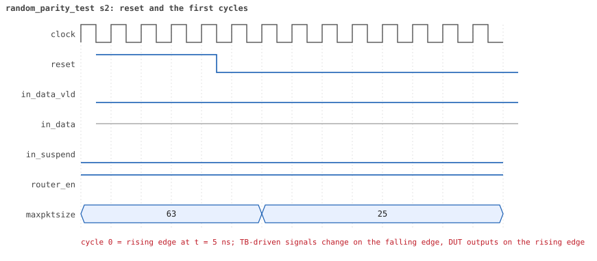
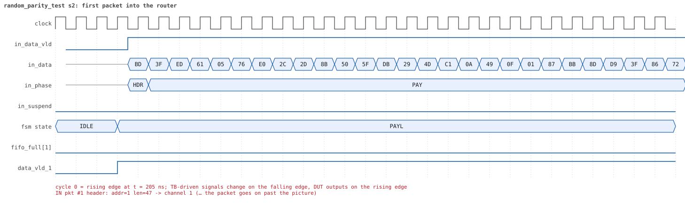
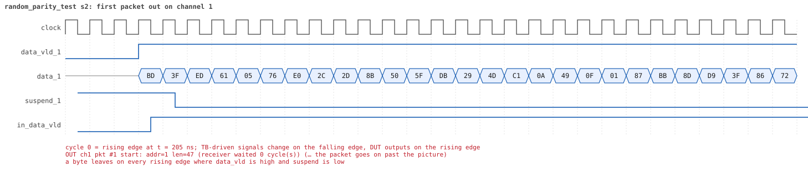
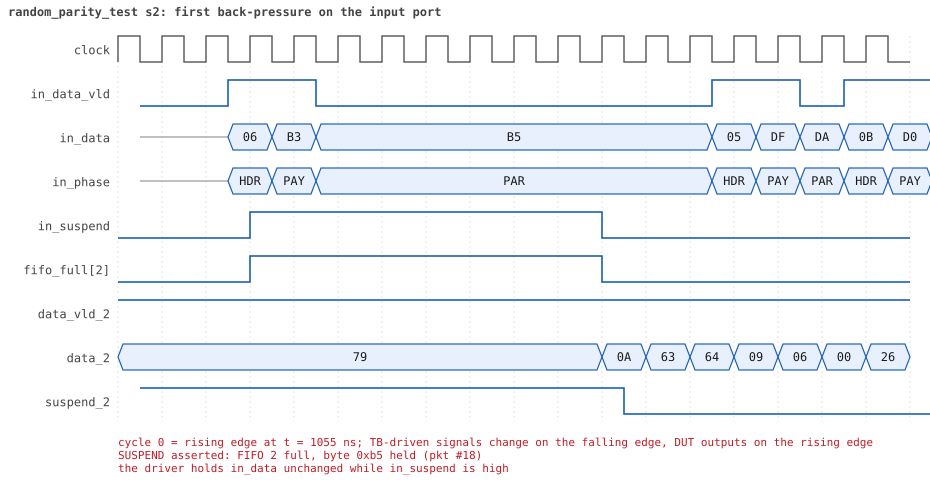
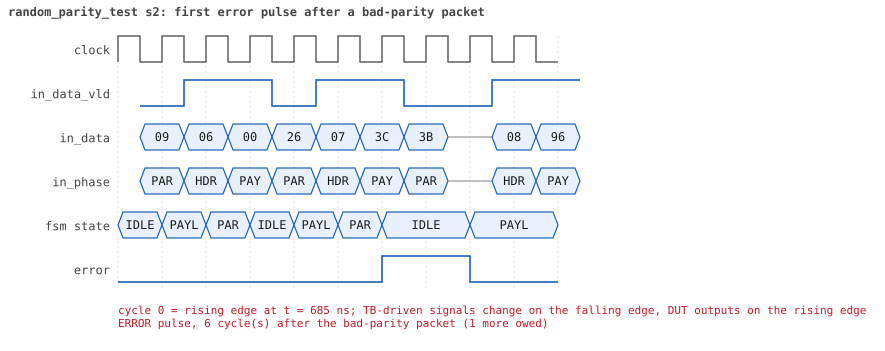
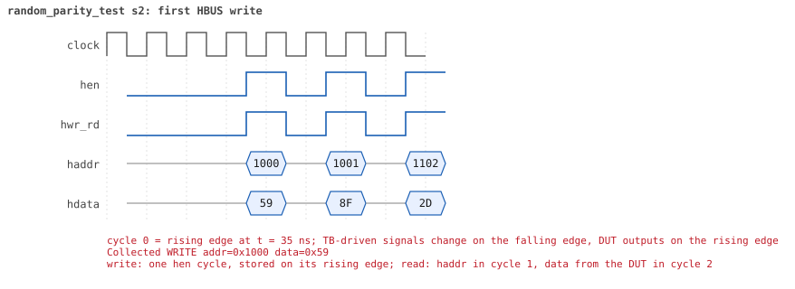
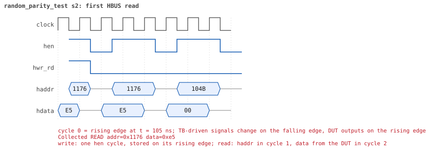

# random_parity_test  seed 2

**Result:** PASSED (0 UVM_ERROR, 0 UVM_WARNING, 0 UVM_FATAL) · bench `yapp_project_tb` · sim time 29us · log `random_parity_test_s2.log`

Waves: `random_parity_test_s2.fst` (GTKWave, Surfer or the VS Code wave viewer); signal trace: `signals.csv`.
[Open the waves in Surfer](https://app.surfer-project.org/?load_url=https%3A%2F%2Fraw.githubusercontent.com%2Ftamirgabgab%2FQcom-Mentoring%2Fmain%2Fyapp_project%2Fregression%2Fyapp_project_tb%2Frandom_parity_test_s2%2Frandom_parity_test_s2.fst&startup_commands=run_command_file_from_url%20https%3A%2F%2Fraw.githubusercontent.com%2Ftamirgabgab%2FQcom-Mentoring%2Fmain%2Fyapp_project%2Ftb%2Fyapp_router.sucl) (web app, the signals already in groups: `yapp_project/tb/yapp_router.sucl`).

## Summary

- YAPP driver sent **95** packet(s) (36 with bad parity); the input monitor saw 95.
- Router: **56** forwarded, **39** dropped (13 illegal address 3, 26 oversized).
- Packets out: ch0 **13**, ch1 **22**, ch2 **21**.
- Scoreboard: 56 matched, 0 mismatched, 0 unexpected.
- Back-pressure: in_suspend asserted **10** time(s), longest hold 33 cycle(s).
- Error pulses: 36.
- HBUS: 17 write(s), 85 read(s).

## Stages

| time (ns) | stage |
|---|---|
| 0 | receivers: ch0 RX_SLOW, ch1 RX_NORMAL, ch2 RX_SLOW |
| 0 | random scenario: 95 packets in 4 bursts |
| 400 | burst 1/4: ctrl=0x59 (maxpktsize 25) en=0x8f (router on, counter enables 1000111), 24 packet(s) -- storm: 1..3-byte packets back to back, half with bad parity |
| 1400 | burst 1/4 sent: addr0..3 3/9/6/6, bad parity 7, gap 0 21, length 1..3 |
| 1620 | burst 2/4: ctrl=0xff (maxpktsize 63) en=0x55 (router on, counter enables 0101010), 24 packet(s) -- storm: 1..3-byte packets back to back, half with bad parity |
| 2750 | burst 2/4 sent: addr0..3 5/8/8/3, bad parity 15, gap 0 20, length 1..3 |
| 2930 | burst 3/4: ctrl=0xd0 (maxpktsize 16) en=0xed (router on, counter enables 1110110), 24 packet(s) |
| 13350 | burst 3/4 sent: addr0..3 8/6/6/4, bad parity 10, gap 0 10, length 1..63 |
| 13510 | burst 4/4: ctrl=0x39 (maxpktsize 57) en=0x97 (router on, counter enables 1001011), 23 packet(s) |
| 26460 | burst 4/4 sent: addr0..3 6/5/9/3, bad parity 4, gap 0 7, length 3..63 |
| 26460 | final reads: every register and the stored packet, checked against the reference model |
| 28555 | done: 95 packets (56 forwarded, 39 dropped), 2 storm burst(s), 56 scoreboard matches, 84 HBUS reads checked, 36 error pulses for 36 bad packets |

## Pictures

**reset and the first cycles**

**first packet into the router**

**first packet out on channel 1**

**first back-pressure on the input port**

**first error pulse after a bad-parity packet**

**first HBUS write**

**first HBUS read**

## Timeline

1221 events (the same list is in `timeline.csv`).

| time (ns) | who | event |
|---|---|---|
| 0 | yapp monitor | YAPP monitor running |
| 0 | **test** | STAGE: receivers: ch0 RX_SLOW, ch1 RX_NORMAL, ch2 RX_SLOW |
| 0 | **test** | STAGE: random scenario: 95 packets in 4 bursts |
| 0 | clk/rst driver | Starting clock (period 10) and holding reset for 5 cycles |
| 0 | **DUT** | RESET asserted |
| 50 | **DUT** | RESET released: router_en=1 maxpktsize=63 |
| 70 | hbus driver | Executed WRITE addr=0x1000 data=0x59 |
| 75 | **DUT** | CONFIG router_en=1 maxpktsize=25 |
| 75 | hbus monitor | Collected WRITE addr=0x1000 data=0x59 |
| 75 | reference | maxpktsize is now 25 |
| 90 | hbus driver | Executed WRITE addr=0x1001 data=0x8f |
| 95 | hbus monitor | Collected WRITE addr=0x1001 data=0x8f |
| 95 | reference | router_en is now 1 (en_reg 0x8f) |
| 110 | hbus driver | Executed WRITE addr=0x1102 data=0x2d |
| 115 | hbus monitor | Collected WRITE addr=0x1102 data=0x2d |
| 140 | hbus driver | Executed READ  addr=0x1102 data=0x2d |
| 145 | hbus monitor | Collected READ  addr=0x1102 data=0x2d |
| 160 | hbus driver | Executed WRITE addr=0x1127 data=0xc7 |
| 165 | hbus monitor | Collected WRITE addr=0x1127 data=0xc7 |
| 190 | hbus driver | Executed READ  addr=0x1127 data=0xc7 |
| 195 | hbus monitor | Collected READ  addr=0x1127 data=0xc7 |
| 210 | hbus driver | Executed WRITE addr=0x11c0 data=0xa4 |
| 215 | hbus monitor | Collected WRITE addr=0x11c0 data=0xa4 |
| 240 | hbus driver | Executed READ  addr=0x11c0 data=0xa4 |
| 245 | hbus monitor | Collected READ  addr=0x11c0 data=0xa4 |
| 270 | hbus driver | Executed READ  addr=0x100a data=0x00 |
| 275 | hbus monitor | Collected READ  addr=0x100a data=0x00 |
| 290 | hbus driver | Executed WRITE addr=0x1119 data=0x78 |
| 295 | hbus monitor | Collected WRITE addr=0x1119 data=0x78 |
| 320 | hbus driver | Executed READ  addr=0x1119 data=0x78 |
| 325 | hbus monitor | Collected READ  addr=0x1119 data=0x78 |
| 350 | hbus driver | Executed READ  addr=0x100c data=0x00 |
| 355 | hbus monitor | Collected READ  addr=0x100c data=0x00 |
| 370 | hbus driver | Executed WRITE addr=0x1189 data=0x59 |
| 375 | hbus monitor | Collected WRITE addr=0x1189 data=0x59 |
| 400 | hbus driver | Executed READ  addr=0x1189 data=0x59 |
| 400 | **test** | STAGE: burst 1/4: ctrl=0x59 (maxpktsize 25) en=0x8f (router on, counter enables 1000111), 24 packet(s) -- storm: 1..3-byte packets back to back, half with bad parity |
| 400 | yapp driver | TX pkt #1: addr=3 len=2 parity=good delay=0 |
| 405 | hbus monitor | Collected READ  addr=0x1189 data=0x59 |
| 415 | **DUT** | IN  pkt #1 header: addr=3 len=2 -> DROP (illegal address 3) |
| 445 | **DUT** | IN  pkt #1 complete: addr=3 len=2 parity=ok dropped, 4 bytes in 4 cycles (held 0) |
| 445 | yapp monitor | RX pkt #1 on the input: addr=3 len=2 parity=good gap=36 |
| 445 | reference | Packet dropped: illegal address 3 (len=2) |
| 445 | **DUT** | ROUTER DROPS PACKET addr=3 length=2 (    illegal address) |
| 450 | yapp driver | TX pkt #1 accepted by the DUT |
| 450 | yapp driver | TX pkt #2: addr=2 len=1 parity=good delay=0 |
| 455 | **DUT** | IN  pkt #2 header: addr=2 len=1 -> channel 2 |
| 475 | **DUT** | IN  pkt #2 complete: addr=2 len=1 parity=ok forwarded, 3 bytes in 3 cycles (held 0) |
| 475 | yapp monitor | RX pkt #2 on the input: addr=2 len=1 parity=good gap=0 |
| 475 | reference | Packet forwarded: addr=2 len=1 -> channel 2 |
| 480 | yapp driver | TX pkt #2 accepted by the DUT |
| 480 | yapp driver | TX pkt #3: addr=0 len=2 parity=good delay=2 |
| 505 | **DUT** | IN  pkt #3 header: addr=0 len=2 -> channel 0 |
| 535 | **DUT** | IN  pkt #3 complete: addr=0 len=2 parity=ok forwarded, 4 bytes in 4 cycles (held 0) |
| 535 | yapp monitor | RX pkt #3 on the input: addr=0 len=2 parity=good gap=2 |
| 535 | reference | Packet forwarded: addr=0 len=2 -> channel 0 |
| 540 | yapp driver | TX pkt #3 accepted by the DUT |
| 540 | yapp driver | TX pkt #4: addr=1 len=1 parity=good delay=0 |
| 545 | **DUT** | IN  pkt #4 header: addr=1 len=1 -> channel 1 |
| 565 | **DUT** | IN  pkt #4 complete: addr=1 len=1 parity=ok forwarded, 3 bytes in 3 cycles (held 0) |
| 565 | yapp monitor | RX pkt #4 on the input: addr=1 len=1 parity=good gap=0 |
| 565 | reference | Packet forwarded: addr=1 len=1 -> channel 1 |
| 570 | yapp driver | TX pkt #4 accepted by the DUT |
| 570 | yapp driver | TX pkt #5: addr=1 len=2 parity=good delay=0 |
| 575 | **DUT** | IN  pkt #5 header: addr=1 len=2 -> channel 1 |
| 605 | **DUT** | IN  pkt #5 complete: addr=1 len=2 parity=ok forwarded, 4 bytes in 4 cycles (held 0) |
| 605 | yapp monitor | RX pkt #5 on the input: addr=1 len=2 parity=good gap=0 |
| 605 | reference | Packet forwarded: addr=1 len=2 -> channel 1 |
| 610 | yapp driver | TX pkt #5 accepted by the DUT |
| 610 | yapp driver | TX pkt #6: addr=1 len=2 parity=good delay=0 |
| 615 | **DUT** | IN  pkt #6 header: addr=1 len=2 -> channel 1 |
| 615 | **DUT** | OUT ch1 pkt #1 start: addr=1 len=1 (receiver waited 6 cycle(s)) |
| 630 | ch1 driver | ch1: packet consumed (response delay 6) |
| 645 | **DUT** | IN  pkt #6 complete: addr=1 len=2 parity=ok forwarded, 4 bytes in 4 cycles (held 0) |
| 645 | yapp monitor | RX pkt #6 on the input: addr=1 len=2 parity=good gap=0 |
| 645 | reference | Packet forwarded: addr=1 len=2 -> channel 1 |
| 650 | yapp driver | TX pkt #6 accepted by the DUT |
| 650 | yapp driver | TX pkt #7: addr=2 len=2 parity=bad delay=0 |
| 655 | **DUT** | IN  pkt #7 header: addr=2 len=2 -> channel 2 |
| 685 | **DUT** | IN  pkt #7 complete: addr=2 len=2 parity=BAD forwarded, 4 bytes in 4 cycles (held 0) |
| 685 | yapp monitor | RX pkt #7 on the input: addr=2 len=2 parity=bad gap=0 |
| 685 | reference | Packet forwarded: addr=2 len=2 -> channel 2 |
| 690 | yapp driver | TX pkt #7 accepted by the DUT |
| 690 | yapp driver | TX pkt #8: addr=2 len=1 parity=bad delay=0 |
| 695 | **DUT** | IN  pkt #8 header: addr=2 len=1 -> channel 2 |
| 715 | **DUT** | IN  pkt #8 complete: addr=2 len=1 parity=BAD forwarded, 3 bytes in 3 cycles (held 0) |
| 715 | yapp monitor | RX pkt #8 on the input: addr=2 len=1 parity=bad gap=0 |
| 715 | reference | Packet forwarded: addr=2 len=1 -> channel 2 |
| 720 | yapp driver | TX pkt #8 accepted by the DUT |
| 720 | yapp driver | TX pkt #9: addr=3 len=1 parity=good delay=0 |
| 725 | **DUT** | IN  pkt #9 header: addr=3 len=1 -> DROP (illegal address 3) |
| 735 | **DUT** | OUT ch1 pkt #1 done: 3 bytes in 13 cycles |
| 735 | ch1 monitor | ch1 RX pkt #1: addr=1 len=1 parity=good |
| 735 | scoreboard | ch1 pkt matched: addr=1 len=1 (1 matched so far) |
| 745 | **DUT** | IN  pkt #9 complete: addr=3 len=1 parity=ok dropped, 3 bytes in 3 cycles (held 0) |
| 745 | **DUT** | OUT ch1 pkt #2 start: addr=1 len=2 (receiver waited 0 cycle(s)) |
| 745 | yapp monitor | RX pkt #9 on the input: addr=3 len=1 parity=good gap=0 |
| 745 | reference | Packet dropped: illegal address 3 (len=1) |
| 745 | **DUT** | ROUTER DROPS PACKET addr=3 length=1 (    illegal address) |
| 750 | **DUT** | ERROR pulse, 6 cycle(s) after the bad-parity packet (1 more owed) |
| 750 | error checker | error pulse 6 cycles after the bad packet (1 still owed) |
| 750 | yapp driver | TX pkt #9 accepted by the DUT |
| 750 | yapp driver | TX pkt #10: addr=0 len=2 parity=good delay=1 |
| 760 | **DUT** | ERROR pulse, 4 cycle(s) after the bad-parity packet |
| 760 | error checker | error pulse 4 cycles after the bad packet (0 still owed) |
| 765 | **DUT** | IN  pkt #10 header: addr=0 len=2 -> channel 0 |
| 775 | **DUT** | OUT ch1 pkt #2 done: 4 bytes in 4 cycles |
| 775 | ch1 monitor | ch1 RX pkt #2: addr=1 len=2 parity=good |
| 775 | scoreboard | ch1 pkt matched: addr=1 len=2 (2 matched so far) |
| 785 | **DUT** | OUT ch1 pkt #3 start: addr=1 len=2 (receiver waited 0 cycle(s)) |
| 795 | **DUT** | IN  pkt #10 complete: addr=0 len=2 parity=ok forwarded, 4 bytes in 4 cycles (held 0) |
| 795 | **DUT** | OUT ch0 pkt #1 start: addr=0 len=2 (receiver waited 28 cycle(s)) |
| 795 | yapp monitor | RX pkt #10 on the input: addr=0 len=2 parity=good gap=1 |
| 795 | reference | Packet forwarded: addr=0 len=2 -> channel 0 |
| 800 | yapp driver | TX pkt #10 accepted by the DUT |
| 800 | yapp driver | TX pkt #11: addr=1 len=2 parity=bad delay=0 |
| 805 | **DUT** | IN  pkt #11 header: addr=1 len=2 -> channel 1 |
| 805 | **DUT** | OUT ch2 pkt #1 start: addr=2 len=1 (receiver waited 34 cycle(s)) |
| 815 | **DUT** | OUT ch1 pkt #3 done: 4 bytes in 4 cycles |
| 815 | ch1 monitor | ch1 RX pkt #3: addr=1 len=2 parity=good |
| 815 | scoreboard | ch1 pkt matched: addr=1 len=2 (3 matched so far) |
| 820 | ch0 driver | ch0: packet consumed (response delay 28) |
| 820 | ch2 driver | ch2: packet consumed (response delay 34) |
| 825 | **DUT** | OUT ch1 pkt #4 start: addr=1 len=2 (receiver waited 0 cycle(s)) |
| 835 | **DUT** | IN  pkt #11 complete: addr=1 len=2 parity=BAD forwarded, 4 bytes in 4 cycles (held 0) |
| 835 | yapp monitor | RX pkt #11 on the input: addr=1 len=2 parity=bad gap=0 |
| 835 | reference | Packet forwarded: addr=1 len=2 -> channel 1 |
| 840 | yapp driver | TX pkt #11 accepted by the DUT |
| 840 | yapp driver | TX pkt #12: addr=2 len=1 parity=bad delay=0 |
| 845 | **DUT** | IN  pkt #12 header: addr=2 len=1 -> channel 2 |
| 855 | **DUT** | OUT ch1 pkt #4 done: 4 bytes in 4 cycles |
| 855 | ch1 monitor | ch1 RX pkt #4: addr=1 len=2 parity=bad |
| 855 | scoreboard | ch1 pkt matched: addr=1 len=2 (4 matched so far) |
| 865 | **DUT** | IN  pkt #12 complete: addr=2 len=1 parity=BAD forwarded, 3 bytes in 3 cycles (held 0) |
| 865 | yapp monitor | RX pkt #12 on the input: addr=2 len=1 parity=bad gap=0 |
| 865 | reference | Packet forwarded: addr=2 len=1 -> channel 2 |
| 870 | yapp driver | TX pkt #12 accepted by the DUT |
| 870 | yapp driver | TX pkt #13: addr=1 len=2 parity=bad delay=0 |
| 875 | **DUT** | IN  pkt #13 header: addr=1 len=2 -> channel 1 |
| 885 | **DUT** | OUT ch1 pkt #5 start: addr=1 len=2 (receiver waited 0 cycle(s)) |
| 890 | **DUT** | ERROR pulse, 5 cycle(s) after the bad-parity packet (1 more owed) |
| 890 | error checker | error pulse 5 cycles after the bad packet (1 still owed) |
| 900 | **DUT** | ERROR pulse, 3 cycle(s) after the bad-parity packet |
| 900 | error checker | error pulse 3 cycles after the bad packet (0 still owed) |
| 905 | **DUT** | IN  pkt #13 complete: addr=1 len=2 parity=BAD forwarded, 4 bytes in 4 cycles (held 0) |
| 905 | yapp monitor | RX pkt #13 on the input: addr=1 len=2 parity=bad gap=0 |
| 905 | reference | Packet forwarded: addr=1 len=2 -> channel 1 |
| 910 | yapp driver | TX pkt #13 accepted by the DUT |
| 910 | yapp driver | TX pkt #14: addr=2 len=1 parity=good delay=0 |
| 915 | **DUT** | IN  pkt #14 header: addr=2 len=1 -> channel 2 |
| 915 | **DUT** | OUT ch1 pkt #5 done: 4 bytes in 4 cycles |
| 915 | ch1 monitor | ch1 RX pkt #5: addr=1 len=2 parity=bad |
| 915 | scoreboard | ch1 pkt matched: addr=1 len=2 (5 matched so far) |
| 935 | **DUT** | IN  pkt #14 complete: addr=2 len=1 parity=ok forwarded, 3 bytes in 3 cycles (held 0) |
| 935 | yapp monitor | RX pkt #14 on the input: addr=2 len=1 parity=good gap=0 |
| 935 | reference | Packet forwarded: addr=2 len=1 -> channel 2 |
| 940 | yapp driver | TX pkt #14 accepted by the DUT |
| 940 | yapp driver | TX pkt #15: addr=1 len=1 parity=good delay=0 |
| 945 | **DUT** | IN  pkt #15 header: addr=1 len=1 -> channel 1 |
| 955 | **DUT** | OUT ch1 pkt #6 start: addr=1 len=1 (receiver waited 0 cycle(s)) |
| 965 | **DUT** | IN  pkt #15 complete: addr=1 len=1 parity=ok forwarded, 3 bytes in 3 cycles (held 0) |
| 965 | yapp monitor | RX pkt #15 on the input: addr=1 len=1 parity=good gap=0 |
| 965 | reference | Packet forwarded: addr=1 len=1 -> channel 1 |
| 970 | **DUT** | ERROR pulse, 6 cycle(s) after the bad-parity packet |
| 970 | error checker | error pulse 6 cycles after the bad packet (0 still owed) |
| 970 | yapp driver | TX pkt #15 accepted by the DUT |
| 970 | yapp driver | TX pkt #16: addr=3 len=3 parity=good delay=0 |
| 975 | **DUT** | IN  pkt #16 header: addr=3 len=3 -> DROP (illegal address 3) |
| 975 | **DUT** | OUT ch1 pkt #6 done: 3 bytes in 3 cycles |
| 975 | ch1 monitor | ch1 RX pkt #6: addr=1 len=1 parity=good |
| 975 | scoreboard | ch1 pkt matched: addr=1 len=1 (6 matched so far) |
| 1015 | **DUT** | IN  pkt #16 complete: addr=3 len=3 parity=ok dropped, 5 bytes in 5 cycles (held 0) |
| 1015 | yapp monitor | RX pkt #16 on the input: addr=3 len=3 parity=good gap=0 |
| 1015 | reference | Packet dropped: illegal address 3 (len=3) |
| 1015 | **DUT** | ROUTER DROPS PACKET addr=3 length=3 (    illegal address) |
| 1020 | yapp driver | TX pkt #16 accepted by the DUT |
| 1020 | yapp driver | TX pkt #17: addr=3 len=1 parity=good delay=0 |
| 1025 | **DUT** | IN  pkt #17 header: addr=3 len=1 -> DROP (illegal address 3) |
| 1045 | **DUT** | IN  pkt #17 complete: addr=3 len=1 parity=ok dropped, 3 bytes in 3 cycles (held 0) |
| 1045 | yapp monitor | RX pkt #17 on the input: addr=3 len=1 parity=good gap=0 |
| 1045 | reference | Packet dropped: illegal address 3 (len=1) |
| 1045 | **DUT** | ROUTER DROPS PACKET addr=3 length=1 (    illegal address) |
| 1050 | yapp driver | TX pkt #17 accepted by the DUT |
| 1050 | yapp driver | TX pkt #18: addr=2 len=1 parity=good delay=2 |
| 1075 | **DUT** | IN  pkt #18 header: addr=2 len=1 -> channel 2 |
| 1075 | **DUT** | OUT ch0 pkt #1 done: 4 bytes in 29 cycles |
| 1075 | ch0 monitor | ch0 RX pkt #1: addr=0 len=2 parity=good |
| 1075 | scoreboard | ch0 pkt matched: addr=0 len=2 (7 matched so far) |
| 1085 | **DUT** | OUT ch0 pkt #2 start: addr=0 len=2 (receiver waited 0 cycle(s)) |
| 1095 | **DUT** | SUSPEND asserted: FIFO 2 full, byte 0xb5 held (pkt #18) |
| 1115 | **DUT** | OUT ch0 pkt #2 done: 4 bytes in 4 cycles |
| 1115 | ch0 monitor | ch0 RX pkt #2: addr=0 len=2 parity=good |
| 1115 | scoreboard | ch0 pkt matched: addr=0 len=2 (8 matched so far) |
| 1130 | ch1 driver | ch1: packet consumed (response delay 9) |
| 1165 | **DUT** | OUT ch2 pkt #1 done: 3 bytes in 37 cycles |
| 1165 | ch2 monitor | ch2 RX pkt #1: addr=2 len=1 parity=good |
| 1165 | scoreboard | ch2 pkt matched: addr=2 len=1 (9 matched so far) |
| 1175 | **DUT** | IN  pkt #18 complete: addr=2 len=1 parity=ok forwarded, 3 bytes in 11 cycles (held 8) |
| 1175 | **DUT** | SUSPEND released after 8 cycle(s) |
| 1175 | **DUT** | OUT ch2 pkt #2 start: addr=2 len=2 (receiver waited 0 cycle(s)) |
| 1175 | yapp monitor | RX pkt #18 on the input: addr=2 len=1 parity=good gap=2 |
| 1175 | reference | Packet forwarded: addr=2 len=1 -> channel 2 |
| 1180 | ch0 driver | ch0: packet consumed (response delay 24) |
| 1180 | yapp driver | TX pkt #18 accepted by the DUT |
| 1180 | yapp driver | TX pkt #19: addr=1 len=1 parity=good delay=0 |
| 1185 | **DUT** | IN  pkt #19 header: addr=1 len=1 -> channel 1 |
| 1205 | **DUT** | IN  pkt #19 complete: addr=1 len=1 parity=ok forwarded, 3 bytes in 3 cycles (held 0) |
| 1205 | **DUT** | OUT ch2 pkt #2 done: 4 bytes in 4 cycles |
| 1205 | ch2 monitor | ch2 RX pkt #2: addr=2 len=2 parity=bad |
| 1205 | scoreboard | ch2 pkt matched: addr=2 len=2 (10 matched so far) |
| 1205 | yapp monitor | RX pkt #19 on the input: addr=1 len=1 parity=good gap=0 |
| 1205 | reference | Packet forwarded: addr=1 len=1 -> channel 1 |
| 1210 | yapp driver | TX pkt #19 accepted by the DUT |
| 1210 | yapp driver | TX pkt #20: addr=3 len=2 parity=good delay=0 |
| 1215 | **DUT** | IN  pkt #20 header: addr=3 len=2 -> DROP (illegal address 3) |
| 1215 | **DUT** | OUT ch2 pkt #3 start: addr=2 len=1 (receiver waited 0 cycle(s)) |
| 1225 | **DUT** | OUT ch1 pkt #7 start: addr=1 len=1 (receiver waited 3 cycle(s)) |
| 1235 | **DUT** | OUT ch2 pkt #3 done: 3 bytes in 3 cycles |
| 1235 | ch2 monitor | ch2 RX pkt #3: addr=2 len=1 parity=bad |
| 1235 | scoreboard | ch2 pkt matched: addr=2 len=1 (11 matched so far) |
| 1240 | ch1 driver | ch1: packet consumed (response delay 3) |
| 1245 | **DUT** | IN  pkt #20 complete: addr=3 len=2 parity=ok dropped, 4 bytes in 4 cycles (held 0) |
| 1245 | **DUT** | OUT ch2 pkt #4 start: addr=2 len=1 (receiver waited 0 cycle(s)) |
| 1245 | yapp monitor | RX pkt #20 on the input: addr=3 len=2 parity=good gap=0 |
| 1245 | reference | Packet dropped: illegal address 3 (len=2) |
| 1245 | **DUT** | ROUTER DROPS PACKET addr=3 length=2 (    illegal address) |
| 1250 | yapp driver | TX pkt #20 accepted by the DUT |
| 1250 | yapp driver | TX pkt #21: addr=0 len=1 parity=bad delay=0 |
| 1255 | **DUT** | IN  pkt #21 header: addr=0 len=1 -> channel 0 |
| 1265 | **DUT** | OUT ch2 pkt #4 done: 3 bytes in 3 cycles |
| 1265 | ch2 monitor | ch2 RX pkt #4: addr=2 len=1 parity=bad |
| 1265 | scoreboard | ch2 pkt matched: addr=2 len=1 (12 matched so far) |
| 1275 | **DUT** | IN  pkt #21 complete: addr=0 len=1 parity=BAD forwarded, 3 bytes in 3 cycles (held 0) |
| 1275 | **DUT** | OUT ch2 pkt #5 start: addr=2 len=1 (receiver waited 0 cycle(s)) |
| 1275 | yapp monitor | RX pkt #21 on the input: addr=0 len=1 parity=bad gap=0 |
| 1275 | reference | Packet forwarded: addr=0 len=1 -> channel 0 |
| 1280 | yapp driver | TX pkt #21 accepted by the DUT |
| 1280 | yapp driver | TX pkt #22: addr=1 len=1 parity=good delay=0 |
| 1285 | **DUT** | IN  pkt #22 header: addr=1 len=1 -> channel 1 |
| 1290 | **DUT** | ERROR pulse, 1 cycle(s) after the bad-parity packet |
| 1290 | error checker | error pulse 1 cycles after the bad packet (0 still owed) |
| 1295 | **DUT** | OUT ch2 pkt #5 done: 3 bytes in 3 cycles |
| 1295 | ch2 monitor | ch2 RX pkt #5: addr=2 len=1 parity=good |
| 1295 | scoreboard | ch2 pkt matched: addr=2 len=1 (13 matched so far) |
| 1305 | **DUT** | IN  pkt #22 complete: addr=1 len=1 parity=ok forwarded, 3 bytes in 3 cycles (held 0) |
| 1305 | **DUT** | OUT ch2 pkt #6 start: addr=2 len=1 (receiver waited 0 cycle(s)) |
| 1305 | yapp monitor | RX pkt #22 on the input: addr=1 len=1 parity=good gap=0 |
| 1305 | reference | Packet forwarded: addr=1 len=1 -> channel 1 |
| 1310 | yapp driver | TX pkt #22 accepted by the DUT |
| 1310 | yapp driver | TX pkt #23: addr=3 len=3 parity=bad delay=0 |
| 1315 | **DUT** | IN  pkt #23 header: addr=3 len=3 -> DROP (illegal address 3) |
| 1315 | **DUT** | OUT ch1 pkt #7 done: 3 bytes in 10 cycles |
| 1315 | ch1 monitor | ch1 RX pkt #7: addr=1 len=1 parity=good |
| 1315 | scoreboard | ch1 pkt matched: addr=1 len=1 (14 matched so far) |
| 1325 | **DUT** | OUT ch1 pkt #8 start: addr=1 len=1 (receiver waited 0 cycle(s)) |
| 1325 | **DUT** | OUT ch2 pkt #6 done: 3 bytes in 3 cycles |
| 1325 | ch2 monitor | ch2 RX pkt #6: addr=2 len=1 parity=good |
| 1325 | scoreboard | ch2 pkt matched: addr=2 len=1 (15 matched so far) |
| 1345 | **DUT** | OUT ch1 pkt #8 done: 3 bytes in 3 cycles |
| 1345 | ch1 monitor | ch1 RX pkt #8: addr=1 len=1 parity=good |
| 1345 | scoreboard | ch1 pkt matched: addr=1 len=1 (16 matched so far) |
| 1355 | **DUT** | IN  pkt #23 complete: addr=3 len=3 parity=BAD dropped, 5 bytes in 5 cycles (held 0) |
| 1355 | yapp monitor | RX pkt #23 on the input: addr=3 len=3 parity=bad gap=0 |
| 1355 | reference | Packet dropped: illegal address 3 (len=3) |
| 1355 | **DUT** | ROUTER DROPS PACKET addr=3 length=3 (    illegal address) |
| 1360 | yapp driver | TX pkt #23 accepted by the DUT |
| 1360 | yapp driver | TX pkt #24: addr=1 len=2 parity=good delay=0 |
| 1365 | **DUT** | IN  pkt #24 header: addr=1 len=2 -> channel 1 |
| 1375 | **DUT** | OUT ch1 pkt #9 start: addr=1 len=2 (receiver waited 0 cycle(s)) |
| 1390 | **DUT** | ERROR pulse, 3 cycle(s) after the bad-parity packet |
| 1390 | error checker | error pulse 3 cycles after the bad packet (0 still owed) |
| 1395 | **DUT** | IN  pkt #24 complete: addr=1 len=2 parity=ok forwarded, 4 bytes in 4 cycles (held 0) |
| 1395 | yapp monitor | RX pkt #24 on the input: addr=1 len=2 parity=good gap=0 |
| 1395 | reference | Packet forwarded: addr=1 len=2 -> channel 1 |
| 1400 | yapp driver | TX pkt #24 accepted by the DUT |
| 1400 | **test** | STAGE: burst 1/4 sent: addr0..3 3/9/6/6, bad parity 7, gap 0 21, length 1..3 |
| 1405 | **DUT** | OUT ch1 pkt #9 done: 4 bytes in 4 cycles |
| 1405 | ch1 monitor | ch1 RX pkt #9: addr=1 len=2 parity=good |
| 1405 | scoreboard | ch1 pkt matched: addr=1 len=2 (17 matched so far) |
| 1420 | hbus driver | Executed WRITE addr=0x1000 data=0xff |
| 1425 | **DUT** | CONFIG router_en=1 maxpktsize=63 |
| 1425 | hbus monitor | Collected WRITE addr=0x1000 data=0xff |
| 1425 | reference | maxpktsize is now 63 |
| 1440 | hbus driver | Executed WRITE addr=0x1001 data=0x55 |
| 1445 | hbus monitor | Collected WRITE addr=0x1001 data=0x55 |
| 1445 | reference | router_en is now 1 (en_reg 0x55) |
| 1465 | **DUT** | OUT ch0 pkt #3 start: addr=0 len=1 (receiver waited 20 cycle(s)) |
| 1470 | ch2 driver | ch2: packet consumed (response delay 33) |
| 1470 | hbus driver | Executed READ  addr=0x104f data=0x00 |
| 1475 | hbus monitor | Collected READ  addr=0x104f data=0x00 |
| 1480 | ch0 driver | ch0: packet consumed (response delay 20) |
| 1490 | hbus driver | Executed WRITE addr=0x11d8 data=0xe0 |
| 1495 | hbus monitor | Collected WRITE addr=0x11d8 data=0xe0 |
| 1520 | hbus driver | Executed READ  addr=0x11d8 data=0xe0 |
| 1525 | hbus monitor | Collected READ  addr=0x11d8 data=0xe0 |
| 1540 | hbus driver | Executed WRITE addr=0x110e data=0xbd |
| 1545 | hbus monitor | Collected WRITE addr=0x110e data=0xbd |
| 1570 | hbus driver | Executed READ  addr=0x110e data=0xbd |
| 1575 | hbus monitor | Collected READ  addr=0x110e data=0xbd |
| 1590 | hbus driver | Executed WRITE addr=0x1128 data=0xd9 |
| 1595 | hbus monitor | Collected WRITE addr=0x1128 data=0xd9 |
| 1620 | hbus driver | Executed READ  addr=0x1128 data=0xd9 |
| 1620 | **test** | STAGE: burst 2/4: ctrl=0xff (maxpktsize 63) en=0x55 (router on, counter enables 0101010), 24 packet(s) -- storm: 1..3-byte packets back to back, half with bad parity |
| 1620 | yapp driver | TX pkt #25: addr=0 len=1 parity=bad delay=0 |
| 1625 | hbus monitor | Collected READ  addr=0x1128 data=0xd9 |
| 1635 | **DUT** | IN  pkt #25 header: addr=0 len=1 -> channel 0 |
| 1655 | **DUT** | IN  pkt #25 complete: addr=0 len=1 parity=BAD forwarded, 3 bytes in 3 cycles (held 0) |
| 1655 | yapp monitor | RX pkt #25 on the input: addr=0 len=1 parity=bad gap=23 |
| 1655 | reference | Packet forwarded: addr=0 len=1 -> channel 0 |
| 1660 | yapp driver | TX pkt #25 accepted by the DUT |
| 1660 | yapp driver | TX pkt #26: addr=0 len=1 parity=good delay=0 |
| 1665 | **DUT** | IN  pkt #26 header: addr=0 len=1 -> channel 0 |
| 1670 | **DUT** | ERROR pulse, 1 cycle(s) after the bad-parity packet |
| 1670 | error checker | error pulse 1 cycles after the bad packet (0 still owed) |
| 1685 | **DUT** | IN  pkt #26 complete: addr=0 len=1 parity=ok forwarded, 3 bytes in 3 cycles (held 0) |
| 1685 | yapp monitor | RX pkt #26 on the input: addr=0 len=1 parity=good gap=0 |
| 1685 | reference | Packet forwarded: addr=0 len=1 -> channel 0 |
| 1690 | yapp driver | TX pkt #26 accepted by the DUT |
| 1690 | yapp driver | TX pkt #27: addr=0 len=2 parity=good delay=0 |
| 1695 | **DUT** | IN  pkt #27 header: addr=0 len=2 -> channel 0 |
| 1705 | **DUT** | OUT ch0 pkt #3 done: 3 bytes in 25 cycles |
| 1705 | ch0 monitor | ch0 RX pkt #3: addr=0 len=1 parity=bad |
| 1705 | scoreboard | ch0 pkt matched: addr=0 len=1 (18 matched so far) |
| 1715 | **DUT** | OUT ch0 pkt #4 start: addr=0 len=1 (receiver waited 0 cycle(s)) |
| 1725 | **DUT** | IN  pkt #27 complete: addr=0 len=2 parity=ok forwarded, 4 bytes in 4 cycles (held 0) |
| 1725 | yapp monitor | RX pkt #27 on the input: addr=0 len=2 parity=good gap=0 |
| 1725 | reference | Packet forwarded: addr=0 len=2 -> channel 0 |
| 1730 | yapp driver | TX pkt #27 accepted by the DUT |
| 1730 | yapp driver | TX pkt #28: addr=2 len=1 parity=good delay=0 |
| 1735 | **DUT** | IN  pkt #28 header: addr=2 len=1 -> channel 2 |
| 1735 | **DUT** | OUT ch0 pkt #4 done: 3 bytes in 3 cycles |
| 1735 | ch0 monitor | ch0 RX pkt #4: addr=0 len=1 parity=bad |
| 1735 | scoreboard | ch0 pkt matched: addr=0 len=1 (19 matched so far) |
| 1745 | **DUT** | OUT ch0 pkt #5 start: addr=0 len=1 (receiver waited 0 cycle(s)) |
| 1755 | **DUT** | IN  pkt #28 complete: addr=2 len=1 parity=ok forwarded, 3 bytes in 3 cycles (held 0) |
| 1755 | yapp monitor | RX pkt #28 on the input: addr=2 len=1 parity=good gap=0 |
| 1755 | reference | Packet forwarded: addr=2 len=1 -> channel 2 |
| 1760 | yapp driver | TX pkt #28 accepted by the DUT |
| 1760 | yapp driver | TX pkt #29: addr=0 len=1 parity=bad delay=0 |
| 1765 | **DUT** | IN  pkt #29 header: addr=0 len=1 -> channel 0 |
| 1765 | **DUT** | OUT ch0 pkt #5 done: 3 bytes in 3 cycles |
| 1765 | ch0 monitor | ch0 RX pkt #5: addr=0 len=1 parity=good |
| 1765 | scoreboard | ch0 pkt matched: addr=0 len=1 (20 matched so far) |
| 1775 | **DUT** | OUT ch0 pkt #6 start: addr=0 len=2 (receiver waited 0 cycle(s)) |
| 1785 | **DUT** | IN  pkt #29 complete: addr=0 len=1 parity=BAD forwarded, 3 bytes in 3 cycles (held 0) |
| 1785 | yapp monitor | RX pkt #29 on the input: addr=0 len=1 parity=bad gap=0 |
| 1785 | reference | Packet forwarded: addr=0 len=1 -> channel 0 |
| 1790 | yapp driver | TX pkt #29 accepted by the DUT |
| 1790 | yapp driver | TX pkt #30: addr=2 len=1 parity=bad delay=0 |
| 1795 | **DUT** | IN  pkt #30 header: addr=2 len=1 -> channel 2 |
| 1805 | **DUT** | OUT ch0 pkt #6 done: 4 bytes in 4 cycles |
| 1805 | ch0 monitor | ch0 RX pkt #6: addr=0 len=2 parity=good |
| 1805 | scoreboard | ch0 pkt matched: addr=0 len=2 (21 matched so far) |
| 1815 | **DUT** | IN  pkt #30 complete: addr=2 len=1 parity=BAD forwarded, 3 bytes in 3 cycles (held 0) |
| 1815 | **DUT** | OUT ch0 pkt #7 start: addr=0 len=1 (receiver waited 0 cycle(s)) |
| 1815 | yapp monitor | RX pkt #30 on the input: addr=2 len=1 parity=bad gap=0 |
| 1815 | reference | Packet forwarded: addr=2 len=1 -> channel 2 |
| 1820 | yapp driver | TX pkt #30 accepted by the DUT |
| 1820 | yapp driver | TX pkt #31: addr=1 len=1 parity=bad delay=0 |
| 1825 | **DUT** | IN  pkt #31 header: addr=1 len=1 -> channel 1 |
| 1830 | **DUT** | ERROR pulse, 4 cycle(s) after the bad-parity packet (1 more owed) |
| 1830 | error checker | error pulse 4 cycles after the bad packet (1 still owed) |
| 1835 | **DUT** | OUT ch0 pkt #7 done: 3 bytes in 3 cycles |
| 1835 | **DUT** | OUT ch1 pkt #10 start: addr=1 len=1 (receiver waited 0 cycle(s)) |
| 1835 | ch0 monitor | ch0 RX pkt #7: addr=0 len=1 parity=bad |
| 1835 | scoreboard | ch0 pkt matched: addr=0 len=1 (22 matched so far) |
| 1840 | **DUT** | ERROR pulse, 2 cycle(s) after the bad-parity packet |
| 1840 | error checker | error pulse 2 cycles after the bad packet (0 still owed) |
| 1845 | **DUT** | IN  pkt #31 complete: addr=1 len=1 parity=BAD forwarded, 3 bytes in 3 cycles (held 0) |
| 1845 | yapp monitor | RX pkt #31 on the input: addr=1 len=1 parity=bad gap=0 |
| 1845 | reference | Packet forwarded: addr=1 len=1 -> channel 1 |
| 1850 | yapp driver | TX pkt #31 accepted by the DUT |
| 1850 | yapp driver | TX pkt #32: addr=1 len=1 parity=good delay=0 |
| 1855 | **DUT** | IN  pkt #32 header: addr=1 len=1 -> channel 1 |
| 1855 | **DUT** | OUT ch1 pkt #10 done: 3 bytes in 3 cycles |
| 1855 | ch1 monitor | ch1 RX pkt #10: addr=1 len=1 parity=bad |
| 1855 | scoreboard | ch1 pkt matched: addr=1 len=1 (23 matched so far) |
| 1860 | ch1 driver | ch1: packet consumed (response delay 6) |
| 1875 | **DUT** | IN  pkt #32 complete: addr=1 len=1 parity=ok forwarded, 3 bytes in 3 cycles (held 0) |
| 1875 | yapp monitor | RX pkt #32 on the input: addr=1 len=1 parity=good gap=0 |
| 1875 | reference | Packet forwarded: addr=1 len=1 -> channel 1 |
| 1880 | yapp driver | TX pkt #32 accepted by the DUT |
| 1880 | yapp driver | TX pkt #33: addr=2 len=1 parity=bad delay=0 |
| 1885 | **DUT** | IN  pkt #33 header: addr=2 len=1 -> channel 2 |
| 1890 | **DUT** | ERROR pulse, 4 cycle(s) after the bad-parity packet |
| 1890 | error checker | error pulse 4 cycles after the bad packet (0 still owed) |
| 1905 | **DUT** | IN  pkt #33 complete: addr=2 len=1 parity=BAD forwarded, 3 bytes in 3 cycles (held 0) |
| 1905 | **DUT** | OUT ch1 pkt #11 start: addr=1 len=1 (receiver waited 4 cycle(s)) |
| 1905 | yapp monitor | RX pkt #33 on the input: addr=2 len=1 parity=bad gap=0 |
| 1905 | reference | Packet forwarded: addr=2 len=1 -> channel 2 |
| 1910 | yapp driver | TX pkt #33 accepted by the DUT |
| 1910 | yapp driver | TX pkt #34: addr=1 len=1 parity=good delay=0 |
| 1915 | **DUT** | IN  pkt #34 header: addr=1 len=1 -> channel 1 |
| 1920 | ch1 driver | ch1: packet consumed (response delay 3) |
| 1935 | **DUT** | IN  pkt #34 complete: addr=1 len=1 parity=ok forwarded, 3 bytes in 3 cycles (held 0) |
| 1935 | yapp monitor | RX pkt #34 on the input: addr=1 len=1 parity=good gap=0 |
| 1935 | reference | Packet forwarded: addr=1 len=1 -> channel 1 |
| 1940 | yapp driver | TX pkt #34 accepted by the DUT |
| 1940 | yapp driver | TX pkt #35: addr=2 len=1 parity=bad delay=0 |
| 1945 | **DUT** | IN  pkt #35 header: addr=2 len=1 -> channel 2 |
| 1965 | **DUT** | IN  pkt #35 complete: addr=2 len=1 parity=BAD forwarded, 3 bytes in 3 cycles (held 0) |
| 1965 | yapp monitor | RX pkt #35 on the input: addr=2 len=1 parity=bad gap=0 |
| 1965 | reference | Packet forwarded: addr=2 len=1 -> channel 2 |
| 1970 | ch0 driver | ch0: packet consumed (response delay 21) |
| 1970 | yapp driver | TX pkt #35 accepted by the DUT |
| 1970 | yapp driver | TX pkt #36: addr=1 len=2 parity=bad delay=0 |
| 1975 | **DUT** | IN  pkt #36 header: addr=1 len=2 -> channel 1 |
| 2005 | **DUT** | IN  pkt #36 complete: addr=1 len=2 parity=BAD forwarded, 4 bytes in 4 cycles (held 0) |
| 2005 | yapp monitor | RX pkt #36 on the input: addr=1 len=2 parity=bad gap=0 |
| 2005 | reference | Packet forwarded: addr=1 len=2 -> channel 1 |
| 2010 | **DUT** | ERROR pulse, 10 cycle(s) after the bad-parity packet (2 more owed) |
| 2010 | error checker | error pulse 10 cycles after the bad packet (2 still owed) |
| 2010 | yapp driver | TX pkt #36 accepted by the DUT |
| 2010 | yapp driver | TX pkt #37: addr=2 len=1 parity=bad delay=0 |
| 2015 | **DUT** | IN  pkt #37 header: addr=2 len=1 -> channel 2 |
| 2030 | **DUT** | ERROR pulse, 6 cycle(s) after the bad-parity packet (1 more owed) |
| 2030 | error checker | error pulse 6 cycles after the bad packet (1 still owed) |
| 2035 | **DUT** | IN  pkt #37 complete: addr=2 len=1 parity=BAD forwarded, 3 bytes in 3 cycles (held 0) |
| 2035 | **DUT** | OUT ch1 pkt #11 done: 3 bytes in 14 cycles |
| 2035 | ch1 monitor | ch1 RX pkt #11: addr=1 len=1 parity=good |
| 2035 | scoreboard | ch1 pkt matched: addr=1 len=1 (24 matched so far) |
| 2035 | yapp monitor | RX pkt #37 on the input: addr=2 len=1 parity=bad gap=0 |
| 2035 | reference | Packet forwarded: addr=2 len=1 -> channel 2 |
| 2040 | yapp driver | TX pkt #37 accepted by the DUT |
| 2040 | yapp driver | TX pkt #38: addr=1 len=2 parity=bad delay=1 |
| 2045 | **DUT** | OUT ch1 pkt #12 start: addr=1 len=1 (receiver waited 0 cycle(s)) |
| 2050 | **DUT** | ERROR pulse, 4 cycle(s) after the bad-parity packet (1 more owed) |
| 2050 | error checker | error pulse 4 cycles after the bad packet (1 still owed) |
| 2055 | **DUT** | IN  pkt #38 header: addr=1 len=2 -> channel 1 |
| 2065 | **DUT** | OUT ch1 pkt #12 done: 3 bytes in 3 cycles |
| 2065 | ch1 monitor | ch1 RX pkt #12: addr=1 len=1 parity=good |
| 2065 | scoreboard | ch1 pkt matched: addr=1 len=1 (25 matched so far) |
| 2075 | **DUT** | OUT ch1 pkt #13 start: addr=1 len=2 (receiver waited 0 cycle(s)) |
| 2085 | **DUT** | IN  pkt #38 complete: addr=1 len=2 parity=BAD forwarded, 4 bytes in 4 cycles (held 0) |
| 2085 | yapp monitor | RX pkt #38 on the input: addr=1 len=2 parity=bad gap=1 |
| 2085 | reference | Packet forwarded: addr=1 len=2 -> channel 1 |
| 2090 | yapp driver | TX pkt #38 accepted by the DUT |
| 2090 | yapp driver | TX pkt #39: addr=2 len=3 parity=bad delay=0 |
| 2095 | **DUT** | IN  pkt #39 header: addr=2 len=3 -> channel 2 |
| 2095 | **DUT** | OUT ch2 pkt #7 start: addr=2 len=1 (receiver waited 35 cycle(s)) |
| 2105 | **DUT** | OUT ch1 pkt #13 done: 4 bytes in 4 cycles |
| 2105 | ch1 monitor | ch1 RX pkt #13: addr=1 len=2 parity=bad |
| 2105 | scoreboard | ch1 pkt matched: addr=1 len=2 (26 matched so far) |
| 2110 | **DUT** | ERROR pulse, 7 cycle(s) after the bad-parity packet (1 more owed) |
| 2110 | error checker | error pulse 7 cycles after the bad packet (1 still owed) |
| 2110 | ch2 driver | ch2: packet consumed (response delay 35) |
| 2115 | **DUT** | OUT ch1 pkt #14 start: addr=1 len=2 (receiver waited 0 cycle(s)) |
| 2120 | **DUT** | ERROR pulse, 3 cycle(s) after the bad-parity packet |
| 2120 | error checker | error pulse 3 cycles after the bad packet (0 still owed) |
| 2125 | **DUT** | SUSPEND asserted: FIFO 2 full, byte 0x48 held (pkt #39) |
| 2145 | **DUT** | OUT ch1 pkt #14 done: 4 bytes in 4 cycles |
| 2145 | ch1 monitor | ch1 RX pkt #14: addr=1 len=2 parity=bad |
| 2145 | scoreboard | ch1 pkt matched: addr=1 len=2 (27 matched so far) |
| 2330 | ch1 driver | ch1: packet consumed (response delay 10) |
| 2365 | **DUT** | OUT ch2 pkt #7 done: 3 bytes in 28 cycles |
| 2365 | ch2 monitor | ch2 RX pkt #7: addr=2 len=1 parity=good |
| 2365 | scoreboard | ch2 pkt matched: addr=2 len=1 (28 matched so far) |
| 2375 | **DUT** | SUSPEND released after 25 cycle(s) |
| 2375 | **DUT** | OUT ch2 pkt #8 start: addr=2 len=1 (receiver waited 0 cycle(s)) |
| 2385 | **DUT** | IN  pkt #39 complete: addr=2 len=3 parity=BAD forwarded, 5 bytes in 30 cycles (held 25) |
| 2385 | yapp monitor | RX pkt #39 on the input: addr=2 len=3 parity=bad gap=0 |
| 2385 | reference | Packet forwarded: addr=2 len=3 -> channel 2 |
| 2390 | yapp driver | TX pkt #39 accepted by the DUT |
| 2390 | yapp driver | TX pkt #40: addr=0 len=2 parity=bad delay=1 |
| 2395 | **DUT** | OUT ch2 pkt #8 done: 3 bytes in 3 cycles |
| 2395 | ch2 monitor | ch2 RX pkt #8: addr=2 len=1 parity=bad |
| 2395 | scoreboard | ch2 pkt matched: addr=2 len=1 (29 matched so far) |
| 2405 | **DUT** | IN  pkt #40 header: addr=0 len=2 -> channel 0 |
| 2405 | **DUT** | OUT ch2 pkt #9 start: addr=2 len=1 (receiver waited 0 cycle(s)) |
| 2425 | **DUT** | OUT ch2 pkt #9 done: 3 bytes in 3 cycles |
| 2425 | ch2 monitor | ch2 RX pkt #9: addr=2 len=1 parity=bad |
| 2425 | scoreboard | ch2 pkt matched: addr=2 len=1 (30 matched so far) |
| 2435 | **DUT** | IN  pkt #40 complete: addr=0 len=2 parity=BAD forwarded, 4 bytes in 4 cycles (held 0) |
| 2435 | **DUT** | OUT ch2 pkt #10 start: addr=2 len=1 (receiver waited 0 cycle(s)) |
| 2435 | yapp monitor | RX pkt #40 on the input: addr=0 len=2 parity=bad gap=1 |
| 2435 | reference | Packet forwarded: addr=0 len=2 -> channel 0 |
| 2440 | yapp driver | TX pkt #40 accepted by the DUT |
| 2440 | yapp driver | TX pkt #41: addr=3 len=3 parity=bad delay=0 |
| 2445 | **DUT** | IN  pkt #41 header: addr=3 len=3 -> DROP (illegal address 3) |
| 2455 | **DUT** | OUT ch2 pkt #10 done: 3 bytes in 3 cycles |
| 2455 | ch2 monitor | ch2 RX pkt #10: addr=2 len=1 parity=bad |
| 2455 | scoreboard | ch2 pkt matched: addr=2 len=1 (31 matched so far) |
| 2465 | **DUT** | OUT ch2 pkt #11 start: addr=2 len=1 (receiver waited 0 cycle(s)) |
| 2485 | **DUT** | IN  pkt #41 complete: addr=3 len=3 parity=BAD dropped, 5 bytes in 5 cycles (held 0) |
| 2485 | **DUT** | OUT ch2 pkt #11 done: 3 bytes in 3 cycles |
| 2485 | ch2 monitor | ch2 RX pkt #11: addr=2 len=1 parity=bad |
| 2485 | scoreboard | ch2 pkt matched: addr=2 len=1 (32 matched so far) |
| 2485 | yapp monitor | RX pkt #41 on the input: addr=3 len=3 parity=bad gap=0 |
| 2485 | reference | Packet dropped: illegal address 3 (len=3) |
| 2485 | **DUT** | ROUTER DROPS PACKET addr=3 length=3 (    illegal address) |
| 2490 | **DUT** | ERROR pulse, 10 cycle(s) after the bad-parity packet (2 more owed) |
| 2490 | error checker | error pulse 10 cycles after the bad packet (2 still owed) |
| 2490 | yapp driver | TX pkt #41 accepted by the DUT |
| 2490 | yapp driver | TX pkt #42: addr=2 len=1 parity=good delay=0 |
| 2495 | **DUT** | IN  pkt #42 header: addr=2 len=1 -> channel 2 |
| 2495 | **DUT** | OUT ch2 pkt #12 start: addr=2 len=3 (receiver waited 0 cycle(s)) |
| 2500 | **DUT** | ERROR pulse, 6 cycle(s) after the bad-parity packet (1 more owed) |
| 2500 | error checker | error pulse 6 cycles after the bad packet (1 still owed) |
| 2515 | **DUT** | IN  pkt #42 complete: addr=2 len=1 parity=ok forwarded, 3 bytes in 3 cycles (held 0) |
| 2515 | yapp monitor | RX pkt #42 on the input: addr=2 len=1 parity=good gap=0 |
| 2515 | reference | Packet forwarded: addr=2 len=1 -> channel 2 |
| 2520 | yapp driver | TX pkt #42 accepted by the DUT |
| 2520 | yapp driver | TX pkt #43: addr=1 len=1 parity=bad delay=2 |
| 2530 | **DUT** | ERROR pulse, 4 cycle(s) after the bad-parity packet |
| 2530 | error checker | error pulse 4 cycles after the bad packet (0 still owed) |
| 2535 | **DUT** | OUT ch2 pkt #12 done: 5 bytes in 5 cycles |
| 2535 | ch2 monitor | ch2 RX pkt #12: addr=2 len=3 parity=bad |
| 2535 | scoreboard | ch2 pkt matched: addr=2 len=3 (33 matched so far) |
| 2545 | **DUT** | IN  pkt #43 header: addr=1 len=1 -> channel 1 |
| 2545 | **DUT** | OUT ch2 pkt #13 start: addr=2 len=1 (receiver waited 0 cycle(s)) |
| 2565 | **DUT** | IN  pkt #43 complete: addr=1 len=1 parity=BAD forwarded, 3 bytes in 3 cycles (held 0) |
| 2565 | **DUT** | OUT ch2 pkt #13 done: 3 bytes in 3 cycles |
| 2565 | ch2 monitor | ch2 RX pkt #13: addr=2 len=1 parity=good |
| 2565 | scoreboard | ch2 pkt matched: addr=2 len=1 (34 matched so far) |
| 2565 | yapp monitor | RX pkt #43 on the input: addr=1 len=1 parity=bad gap=2 |
| 2565 | reference | Packet forwarded: addr=1 len=1 -> channel 1 |
| 2570 | yapp driver | TX pkt #43 accepted by the DUT |
| 2570 | yapp driver | TX pkt #44: addr=1 len=1 parity=bad delay=0 |
| 2575 | **DUT** | IN  pkt #44 header: addr=1 len=1 -> channel 1 |
| 2590 | **DUT** | ERROR pulse, 2 cycle(s) after the bad-parity packet |
| 2590 | error checker | error pulse 2 cycles after the bad packet (0 still owed) |
| 2595 | **DUT** | IN  pkt #44 complete: addr=1 len=1 parity=BAD forwarded, 3 bytes in 3 cycles (held 0) |
| 2595 | yapp monitor | RX pkt #44 on the input: addr=1 len=1 parity=bad gap=0 |
| 2595 | reference | Packet forwarded: addr=1 len=1 -> channel 1 |
| 2600 | yapp driver | TX pkt #44 accepted by the DUT |
| 2600 | yapp driver | TX pkt #45: addr=3 len=1 parity=good delay=0 |
| 2605 | **DUT** | IN  pkt #45 header: addr=3 len=1 -> DROP (illegal address 3) |
| 2615 | **DUT** | OUT ch0 pkt #8 start: addr=0 len=2 (receiver waited 20 cycle(s)) |
| 2625 | **DUT** | IN  pkt #45 complete: addr=3 len=1 parity=ok dropped, 3 bytes in 3 cycles (held 0) |
| 2625 | yapp monitor | RX pkt #45 on the input: addr=3 len=1 parity=good gap=0 |
| 2625 | reference | Packet dropped: illegal address 3 (len=1) |
| 2625 | **DUT** | ROUTER DROPS PACKET addr=3 length=1 (    illegal address) |
| 2630 | yapp driver | TX pkt #45 accepted by the DUT |
| 2630 | yapp driver | TX pkt #46: addr=3 len=1 parity=good delay=1 |
| 2640 | ch0 driver | ch0: packet consumed (response delay 20) |
| 2645 | **DUT** | IN  pkt #46 header: addr=3 len=1 -> DROP (illegal address 3) |
| 2650 | **DUT** | ERROR pulse, 5 cycle(s) after the bad-parity packet |
| 2650 | error checker | error pulse 5 cycles after the bad packet (0 still owed) |
| 2655 | **DUT** | OUT ch1 pkt #15 start: addr=1 len=1 (receiver waited 10 cycle(s)) |
| 2665 | **DUT** | IN  pkt #46 complete: addr=3 len=1 parity=ok dropped, 3 bytes in 3 cycles (held 0) |
| 2665 | yapp monitor | RX pkt #46 on the input: addr=3 len=1 parity=good gap=1 |
| 2665 | reference | Packet dropped: illegal address 3 (len=1) |
| 2665 | **DUT** | ROUTER DROPS PACKET addr=3 length=1 (    illegal address) |
| 2670 | ch1 driver | ch1: packet consumed (response delay 10) |
| 2670 | yapp driver | TX pkt #46 accepted by the DUT |
| 2670 | yapp driver | TX pkt #47: addr=1 len=3 parity=bad delay=0 |
| 2675 | **DUT** | IN  pkt #47 header: addr=1 len=3 -> channel 1 |
| 2700 | ch2 driver | ch2: packet consumed (response delay 24) |
| 2715 | **DUT** | IN  pkt #47 complete: addr=1 len=3 parity=BAD forwarded, 5 bytes in 5 cycles (held 0) |
| 2715 | **DUT** | OUT ch1 pkt #15 done: 3 bytes in 7 cycles |
| 2715 | ch1 monitor | ch1 RX pkt #15: addr=1 len=1 parity=bad |
| 2715 | scoreboard | ch1 pkt matched: addr=1 len=1 (35 matched so far) |
| 2715 | yapp monitor | RX pkt #47 on the input: addr=1 len=3 parity=bad gap=0 |
| 2715 | reference | Packet forwarded: addr=1 len=3 -> channel 1 |
| 2720 | yapp driver | TX pkt #47 accepted by the DUT |
| 2720 | yapp driver | TX pkt #48: addr=2 len=1 parity=good delay=0 |
| 2725 | **DUT** | IN  pkt #48 header: addr=2 len=1 -> channel 2 |
| 2725 | **DUT** | OUT ch1 pkt #16 start: addr=1 len=1 (receiver waited 0 cycle(s)) |
| 2730 | **DUT** | ERROR pulse, 1 cycle(s) after the bad-parity packet |
| 2730 | error checker | error pulse 1 cycles after the bad packet (0 still owed) |
| 2745 | **DUT** | IN  pkt #48 complete: addr=2 len=1 parity=ok forwarded, 3 bytes in 3 cycles (held 0) |
| 2745 | **DUT** | OUT ch1 pkt #16 done: 3 bytes in 3 cycles |
| 2745 | ch1 monitor | ch1 RX pkt #16: addr=1 len=1 parity=bad |
| 2745 | scoreboard | ch1 pkt matched: addr=1 len=1 (36 matched so far) |
| 2745 | yapp monitor | RX pkt #48 on the input: addr=2 len=1 parity=good gap=0 |
| 2745 | reference | Packet forwarded: addr=2 len=1 -> channel 2 |
| 2750 | yapp driver | TX pkt #48 accepted by the DUT |
| 2750 | **test** | STAGE: burst 2/4 sent: addr0..3 5/8/8/3, bad parity 15, gap 0 20, length 1..3 |
| 2755 | **DUT** | OUT ch1 pkt #17 start: addr=1 len=3 (receiver waited 0 cycle(s)) |
| 2770 | hbus driver | Executed WRITE addr=0x1000 data=0xd0 |
| 2775 | **DUT** | CONFIG router_en=1 maxpktsize=16 |
| 2775 | hbus monitor | Collected WRITE addr=0x1000 data=0xd0 |
| 2775 | reference | maxpktsize is now 16 |
| 2790 | hbus driver | Executed WRITE addr=0x1001 data=0xed |
| 2795 | **DUT** | OUT ch1 pkt #17 done: 5 bytes in 5 cycles |
| 2795 | ch1 monitor | ch1 RX pkt #17: addr=1 len=3 parity=bad |
| 2795 | scoreboard | ch1 pkt matched: addr=1 len=3 (37 matched so far) |
| 2795 | hbus monitor | Collected WRITE addr=0x1001 data=0xed |
| 2795 | reference | router_en is now 1 (en_reg 0xed) |
| 2820 | hbus driver | Executed READ  addr=0x1001 data=0xed |
| 2825 | hbus monitor | Collected READ  addr=0x1001 data=0xed |
| 2850 | hbus driver | Executed READ  addr=0x1006 data=0x06 |
| 2855 | hbus monitor | Collected READ  addr=0x1006 data=0x06 |
| 2870 | hbus driver | Executed WRITE addr=0x119b data=0xf6 |
| 2875 | hbus monitor | Collected WRITE addr=0x119b data=0xf6 |
| 2900 | hbus driver | Executed READ  addr=0x119b data=0xf6 |
| 2905 | hbus monitor | Collected READ  addr=0x119b data=0xf6 |
| 2915 | **DUT** | OUT ch0 pkt #8 done: 4 bytes in 31 cycles |
| 2915 | ch0 monitor | ch0 RX pkt #8: addr=0 len=2 parity=bad |
| 2915 | scoreboard | ch0 pkt matched: addr=0 len=2 (38 matched so far) |
| 2930 | hbus driver | Executed READ  addr=0x10d7 data=0x00 |
| 2930 | **test** | STAGE: burst 3/4: ctrl=0xd0 (maxpktsize 16) en=0xed (router on, counter enables 1110110), 24 packet(s) |
| 2930 | yapp driver | TX pkt #49: addr=3 len=63 parity=good delay=2 |
| 2935 | hbus monitor | Collected READ  addr=0x10d7 data=0x00 |
| 2965 | **DUT** | IN  pkt #49 header: addr=3 len=63 -> DROP (oversized: len 63 > maxpktsize 16) |
| 2970 | ch0 driver | ch0: packet consumed (response delay 26) |
| 3030 | ch1 driver | ch1: packet consumed (response delay 3) |
| 3075 | **DUT** | OUT ch2 pkt #14 start: addr=2 len=1 (receiver waited 34 cycle(s)) |
| 3090 | ch2 driver | ch2: packet consumed (response delay 34) |
| 3315 | **DUT** | OUT ch2 pkt #14 done: 3 bytes in 25 cycles |
| 3315 | ch2 monitor | ch2 RX pkt #14: addr=2 len=1 parity=good |
| 3315 | scoreboard | ch2 pkt matched: addr=2 len=1 (39 matched so far) |
| 3330 | ch2 driver | ch2: packet consumed (response delay 21) |
| 3605 | **DUT** | IN  pkt #49 complete: addr=3 len=63 parity=ok dropped, 65 bytes in 65 cycles (held 0) |
| 3605 | yapp monitor | RX pkt #49 on the input: addr=3 len=63 parity=good gap=21 |
| 3605 | reference | Packet dropped: illegal address 3 (len=63) |
| 3605 | **DUT** | ROUTER DROPS PACKET addr=3 length=63 (    illegal address) |
| 3610 | yapp driver | TX pkt #49 accepted by the DUT |
| 3610 | yapp driver | TX pkt #50: addr=1 len=24 parity=bad delay=1 |
| 3625 | **DUT** | IN  pkt #50 header: addr=1 len=24 -> DROP (oversized: len 24 > maxpktsize 16) |
| 3875 | **DUT** | IN  pkt #50 complete: addr=1 len=24 parity=BAD dropped, 26 bytes in 26 cycles (held 0) |
| 3875 | yapp monitor | RX pkt #50 on the input: addr=1 len=24 parity=bad gap=1 |
| 3875 | reference | Packet dropped: length 24 > maxpktsize 16 (addr=1) |
| 3875 | **DUT** | ROUTER DROPS PACKET addr=1 length=24 (length > maxpktsize) |
| 3880 | yapp driver | TX pkt #50 accepted by the DUT |
| 3880 | yapp driver | TX pkt #51: addr=1 len=5 parity=good delay=0 |
| 3885 | **DUT** | IN  pkt #51 header: addr=1 len=5 -> channel 1 |
| 3905 | **DUT** | OUT ch1 pkt #18 start: addr=1 len=5 (receiver waited 1 cycle(s)) |
| 3930 | **DUT** | ERROR pulse, 5 cycle(s) after the bad-parity packet |
| 3930 | error checker | error pulse 5 cycles after the bad packet (0 still owed) |
| 3945 | **DUT** | IN  pkt #51 complete: addr=1 len=5 parity=ok forwarded, 7 bytes in 7 cycles (held 0) |
| 3945 | yapp monitor | RX pkt #51 on the input: addr=1 len=5 parity=good gap=0 |
| 3945 | reference | Packet forwarded: addr=1 len=5 -> channel 1 |
| 3950 | yapp driver | TX pkt #51 accepted by the DUT |
| 3950 | yapp driver | TX pkt #52: addr=3 len=58 parity=good delay=1 |
| 3960 | ch1 driver | ch1: packet consumed (response delay 1) |
| 3965 | **DUT** | IN  pkt #52 header: addr=3 len=58 -> DROP (oversized: len 58 > maxpktsize 16) |
| 4075 | **DUT** | OUT ch1 pkt #18 done: 7 bytes in 18 cycles |
| 4075 | ch1 monitor | ch1 RX pkt #18: addr=1 len=5 parity=good |
| 4075 | scoreboard | ch1 pkt matched: addr=1 len=5 (40 matched so far) |
| 4555 | **DUT** | IN  pkt #52 complete: addr=3 len=58 parity=ok dropped, 60 bytes in 60 cycles (held 0) |
| 4555 | yapp monitor | RX pkt #52 on the input: addr=3 len=58 parity=good gap=1 |
| 4555 | reference | Packet dropped: illegal address 3 (len=58) |
| 4555 | **DUT** | ROUTER DROPS PACKET addr=3 length=58 (    illegal address) |
| 4560 | yapp driver | TX pkt #52 accepted by the DUT |
| 4560 | yapp driver | TX pkt #53: addr=2 len=63 parity=bad delay=0 |
| 4565 | **DUT** | IN  pkt #53 header: addr=2 len=63 -> DROP (oversized: len 63 > maxpktsize 16) |
| 4690 | ch1 driver | ch1: packet consumed (response delay 10) |
| 5205 | **DUT** | IN  pkt #53 complete: addr=2 len=63 parity=BAD dropped, 65 bytes in 65 cycles (held 0) |
| 5205 | yapp monitor | RX pkt #53 on the input: addr=2 len=63 parity=bad gap=0 |
| 5205 | reference | Packet dropped: length 63 > maxpktsize 16 (addr=2) |
| 5205 | **DUT** | ROUTER DROPS PACKET addr=2 length=63 (length > maxpktsize) |
| 5210 | yapp driver | TX pkt #53 accepted by the DUT |
| 5210 | yapp driver | TX pkt #54: addr=2 len=41 parity=bad delay=16 |
| 5250 | **DUT** | ERROR pulse, 4 cycle(s) after the bad-parity packet |
| 5250 | error checker | error pulse 4 cycles after the bad packet (0 still owed) |
| 5375 | **DUT** | IN  pkt #54 header: addr=2 len=41 -> DROP (oversized: len 41 > maxpktsize 16) |
| 5795 | **DUT** | IN  pkt #54 complete: addr=2 len=41 parity=BAD dropped, 43 bytes in 43 cycles (held 0) |
| 5795 | yapp monitor | RX pkt #54 on the input: addr=2 len=41 parity=bad gap=16 |
| 5795 | reference | Packet dropped: length 41 > maxpktsize 16 (addr=2) |
| 5795 | **DUT** | ROUTER DROPS PACKET addr=2 length=41 (length > maxpktsize) |
| 5800 | yapp driver | TX pkt #54 accepted by the DUT |
| 5800 | yapp driver | TX pkt #55: addr=0 len=3 parity=bad delay=1 |
| 5815 | **DUT** | IN  pkt #55 header: addr=0 len=3 -> channel 0 |
| 5850 | **DUT** | ERROR pulse, 5 cycle(s) after the bad-parity packet |
| 5850 | error checker | error pulse 5 cycles after the bad packet (0 still owed) |
| 5855 | **DUT** | IN  pkt #55 complete: addr=0 len=3 parity=BAD forwarded, 5 bytes in 5 cycles (held 0) |
| 5855 | yapp monitor | RX pkt #55 on the input: addr=0 len=3 parity=bad gap=1 |
| 5855 | reference | Packet forwarded: addr=0 len=3 -> channel 0 |
| 5860 | yapp driver | TX pkt #55 accepted by the DUT |
| 5860 | yapp driver | TX pkt #56: addr=1 len=15 parity=good delay=3 |
| 5895 | **DUT** | IN  pkt #56 header: addr=1 len=15 -> channel 1 |
| 5910 | **DUT** | ERROR pulse, 5 cycle(s) after the bad-parity packet |
| 5910 | error checker | error pulse 5 cycles after the bad packet (0 still owed) |
| 5995 | **DUT** | OUT ch1 pkt #19 start: addr=1 len=15 (receiver waited 9 cycle(s)) |
| 6055 | **DUT** | IN  pkt #56 complete: addr=1 len=15 parity=ok forwarded, 17 bytes in 17 cycles (held 0) |
| 6055 | yapp monitor | RX pkt #56 on the input: addr=1 len=15 parity=good gap=3 |
| 6055 | reference | Packet forwarded: addr=1 len=15 -> channel 1 |
| 6060 | yapp driver | TX pkt #56 accepted by the DUT |
| 6060 | yapp driver | TX pkt #57: addr=0 len=63 parity=bad delay=0 |
| 6065 | **DUT** | IN  pkt #57 header: addr=0 len=63 -> DROP (oversized: len 63 > maxpktsize 16) |
| 6150 | ch1 driver | ch1: packet consumed (response delay 9) |
| 6205 | **DUT** | OUT ch1 pkt #19 done: 17 bytes in 22 cycles |
| 6205 | ch1 monitor | ch1 RX pkt #19: addr=1 len=15 parity=good |
| 6205 | scoreboard | ch1 pkt matched: addr=1 len=15 (41 matched so far) |
| 6225 | **DUT** | OUT ch0 pkt #9 start: addr=0 len=3 (receiver waited 40 cycle(s)) |
| 6260 | ch0 driver | ch0: packet consumed (response delay 40) |
| 6675 | **DUT** | OUT ch0 pkt #9 done: 5 bytes in 46 cycles |
| 6675 | ch0 monitor | ch0 RX pkt #9: addr=0 len=3 parity=bad |
| 6675 | scoreboard | ch0 pkt matched: addr=0 len=3 (42 matched so far) |
| 6705 | **DUT** | IN  pkt #57 complete: addr=0 len=63 parity=BAD dropped, 65 bytes in 65 cycles (held 0) |
| 6705 | yapp monitor | RX pkt #57 on the input: addr=0 len=63 parity=bad gap=0 |
| 6705 | reference | Packet dropped: length 63 > maxpktsize 16 (addr=0) |
| 6705 | **DUT** | ROUTER DROPS PACKET addr=0 length=63 (length > maxpktsize) |
| 6710 | ch0 driver | ch0: packet consumed (response delay 40) |
| 6710 | yapp driver | TX pkt #57 accepted by the DUT |
| 6710 | yapp driver | TX pkt #58: addr=0 len=17 parity=bad delay=1 |
| 6725 | **DUT** | IN  pkt #58 header: addr=0 len=17 -> DROP (oversized: len 17 > maxpktsize 16) |
| 6800 | ch1 driver | ch1: packet consumed (response delay 4) |
| 6810 | **DUT** | ERROR pulse, 10 cycle(s) after the bad-parity packet |
| 6810 | error checker | error pulse 10 cycles after the bad packet (0 still owed) |
| 6905 | **DUT** | IN  pkt #58 complete: addr=0 len=17 parity=BAD dropped, 19 bytes in 19 cycles (held 0) |
| 6905 | yapp monitor | RX pkt #58 on the input: addr=0 len=17 parity=bad gap=1 |
| 6905 | reference | Packet dropped: length 17 > maxpktsize 16 (addr=0) |
| 6905 | **DUT** | ROUTER DROPS PACKET addr=0 length=17 (length > maxpktsize) |
| 6910 | yapp driver | TX pkt #58 accepted by the DUT |
| 6910 | yapp driver | TX pkt #59: addr=0 len=44 parity=good delay=19 |
| 6950 | **DUT** | ERROR pulse, 4 cycle(s) after the bad-parity packet |
| 6950 | error checker | error pulse 4 cycles after the bad packet (0 still owed) |
| 7105 | **DUT** | IN  pkt #59 header: addr=0 len=44 -> DROP (oversized: len 44 > maxpktsize 16) |
| 7555 | **DUT** | IN  pkt #59 complete: addr=0 len=44 parity=ok dropped, 46 bytes in 46 cycles (held 0) |
| 7555 | yapp monitor | RX pkt #59 on the input: addr=0 len=44 parity=good gap=19 |
| 7555 | reference | Packet dropped: length 44 > maxpktsize 16 (addr=0) |
| 7555 | **DUT** | ROUTER DROPS PACKET addr=0 length=44 (length > maxpktsize) |
| 7560 | yapp driver | TX pkt #59 accepted by the DUT |
| 7560 | yapp driver | TX pkt #60: addr=2 len=60 parity=bad delay=20 |
| 7765 | **DUT** | IN  pkt #60 header: addr=2 len=60 -> DROP (oversized: len 60 > maxpktsize 16) |
| 8375 | **DUT** | IN  pkt #60 complete: addr=2 len=60 parity=BAD dropped, 62 bytes in 62 cycles (held 0) |
| 8375 | yapp monitor | RX pkt #60 on the input: addr=2 len=60 parity=bad gap=20 |
| 8375 | reference | Packet dropped: length 60 > maxpktsize 16 (addr=2) |
| 8375 | **DUT** | ROUTER DROPS PACKET addr=2 length=60 (length > maxpktsize) |
| 8380 | yapp driver | TX pkt #60 accepted by the DUT |
| 8380 | yapp driver | TX pkt #61: addr=1 len=6 parity=good delay=0 |
| 8385 | **DUT** | IN  pkt #61 header: addr=1 len=6 -> channel 1 |
| 8390 | **DUT** | ERROR pulse, 1 cycle(s) after the bad-parity packet |
| 8390 | error checker | error pulse 1 cycles after the bad packet (0 still owed) |
| 8415 | **DUT** | OUT ch1 pkt #20 start: addr=1 len=6 (receiver waited 2 cycle(s)) |
| 8455 | **DUT** | IN  pkt #61 complete: addr=1 len=6 parity=ok forwarded, 8 bytes in 8 cycles (held 0) |
| 8455 | yapp monitor | RX pkt #61 on the input: addr=1 len=6 parity=good gap=0 |
| 8455 | reference | Packet forwarded: addr=1 len=6 -> channel 1 |
| 8460 | yapp driver | TX pkt #61 accepted by the DUT |
| 8460 | yapp driver | TX pkt #62: addr=2 len=1 parity=good delay=0 |
| 8465 | **DUT** | IN  pkt #62 header: addr=2 len=1 -> channel 2 |
| 8480 | ch1 driver | ch1: packet consumed (response delay 2) |
| 8485 | **DUT** | IN  pkt #62 complete: addr=2 len=1 parity=ok forwarded, 3 bytes in 3 cycles (held 0) |
| 8485 | yapp monitor | RX pkt #62 on the input: addr=2 len=1 parity=good gap=0 |
| 8485 | reference | Packet forwarded: addr=2 len=1 -> channel 2 |
| 8490 | yapp driver | TX pkt #62 accepted by the DUT |
| 8490 | yapp driver | TX pkt #63: addr=1 len=63 parity=bad delay=19 |
| 8585 | **DUT** | OUT ch1 pkt #20 done: 8 bytes in 18 cycles |
| 8585 | ch1 monitor | ch1 RX pkt #20: addr=1 len=6 parity=good |
| 8585 | scoreboard | ch1 pkt matched: addr=1 len=6 (43 matched so far) |
| 8685 | **DUT** | IN  pkt #63 header: addr=1 len=63 -> DROP (oversized: len 63 > maxpktsize 16) |
| 8775 | **DUT** | OUT ch2 pkt #15 start: addr=2 len=1 (receiver waited 30 cycle(s)) |
| 8790 | ch2 driver | ch2: packet consumed (response delay 30) |
| 9005 | **DUT** | OUT ch2 pkt #15 done: 3 bytes in 24 cycles |
| 9005 | ch2 monitor | ch2 RX pkt #15: addr=2 len=1 parity=good |
| 9005 | scoreboard | ch2 pkt matched: addr=2 len=1 (44 matched so far) |
| 9070 | ch1 driver | ch1: packet consumed (response delay 9) |
| 9170 | ch2 driver | ch2: packet consumed (response delay 20) |
| 9325 | **DUT** | IN  pkt #63 complete: addr=1 len=63 parity=BAD dropped, 65 bytes in 65 cycles (held 0) |
| 9325 | yapp monitor | RX pkt #63 on the input: addr=1 len=63 parity=bad gap=19 |
| 9325 | reference | Packet dropped: length 63 > maxpktsize 16 (addr=1) |
| 9325 | **DUT** | ROUTER DROPS PACKET addr=1 length=63 (length > maxpktsize) |
| 9330 | yapp driver | TX pkt #63 accepted by the DUT |
| 9330 | yapp driver | TX pkt #64: addr=2 len=58 parity=good delay=0 |
| 9335 | **DUT** | IN  pkt #64 header: addr=2 len=58 -> DROP (oversized: len 58 > maxpktsize 16) |
| 9390 | **DUT** | ERROR pulse, 6 cycle(s) after the bad-parity packet |
| 9390 | error checker | error pulse 6 cycles after the bad packet (0 still owed) |
| 9925 | **DUT** | IN  pkt #64 complete: addr=2 len=58 parity=ok dropped, 60 bytes in 60 cycles (held 0) |
| 9925 | yapp monitor | RX pkt #64 on the input: addr=2 len=58 parity=good gap=0 |
| 9925 | reference | Packet dropped: length 58 > maxpktsize 16 (addr=2) |
| 9925 | **DUT** | ROUTER DROPS PACKET addr=2 length=58 (length > maxpktsize) |
| 9930 | yapp driver | TX pkt #64 accepted by the DUT |
| 9930 | yapp driver | TX pkt #65: addr=3 len=15 parity=good delay=1 |
| 9945 | **DUT** | IN  pkt #65 header: addr=3 len=15 -> DROP (illegal address 3) |
| 10105 | **DUT** | IN  pkt #65 complete: addr=3 len=15 parity=ok dropped, 17 bytes in 17 cycles (held 0) |
| 10105 | yapp monitor | RX pkt #65 on the input: addr=3 len=15 parity=good gap=1 |
| 10105 | reference | Packet dropped: illegal address 3 (len=15) |
| 10105 | **DUT** | ROUTER DROPS PACKET addr=3 length=15 (    illegal address) |
| 10110 | yapp driver | TX pkt #65 accepted by the DUT |
| 10110 | yapp driver | TX pkt #66: addr=0 len=46 parity=good delay=0 |
| 10115 | **DUT** | IN  pkt #66 header: addr=0 len=46 -> DROP (oversized: len 46 > maxpktsize 16) |
| 10585 | **DUT** | IN  pkt #66 complete: addr=0 len=46 parity=ok dropped, 48 bytes in 48 cycles (held 0) |
| 10585 | yapp monitor | RX pkt #66 on the input: addr=0 len=46 parity=good gap=0 |
| 10585 | reference | Packet dropped: length 46 > maxpktsize 16 (addr=0) |
| 10585 | **DUT** | ROUTER DROPS PACKET addr=0 length=46 (length > maxpktsize) |
| 10590 | yapp driver | TX pkt #66 accepted by the DUT |
| 10590 | yapp driver | TX pkt #67: addr=0 len=63 parity=good delay=1 |
| 10605 | **DUT** | IN  pkt #67 header: addr=0 len=63 -> DROP (oversized: len 63 > maxpktsize 16) |
| 11245 | **DUT** | IN  pkt #67 complete: addr=0 len=63 parity=ok dropped, 65 bytes in 65 cycles (held 0) |
| 11245 | yapp monitor | RX pkt #67 on the input: addr=0 len=63 parity=good gap=1 |
| 11245 | reference | Packet dropped: length 63 > maxpktsize 16 (addr=0) |
| 11245 | **DUT** | ROUTER DROPS PACKET addr=0 length=63 (length > maxpktsize) |
| 11250 | yapp driver | TX pkt #67 accepted by the DUT |
| 11250 | yapp driver | TX pkt #68: addr=3 len=17 parity=good delay=20 |
| 11455 | **DUT** | IN  pkt #68 header: addr=3 len=17 -> DROP (oversized: len 17 > maxpktsize 16) |
| 11635 | **DUT** | IN  pkt #68 complete: addr=3 len=17 parity=ok dropped, 19 bytes in 19 cycles (held 0) |
| 11635 | yapp monitor | RX pkt #68 on the input: addr=3 len=17 parity=good gap=20 |
| 11635 | reference | Packet dropped: illegal address 3 (len=17) |
| 11635 | **DUT** | ROUTER DROPS PACKET addr=3 length=17 (    illegal address) |
| 11640 | yapp driver | TX pkt #68 accepted by the DUT |
| 11640 | yapp driver | TX pkt #69: addr=1 len=56 parity=bad delay=0 |
| 11645 | **DUT** | IN  pkt #69 header: addr=1 len=56 -> DROP (oversized: len 56 > maxpktsize 16) |
| 12215 | **DUT** | IN  pkt #69 complete: addr=1 len=56 parity=BAD dropped, 58 bytes in 58 cycles (held 0) |
| 12215 | yapp monitor | RX pkt #69 on the input: addr=1 len=56 parity=bad gap=0 |
| 12215 | reference | Packet dropped: length 56 > maxpktsize 16 (addr=1) |
| 12215 | **DUT** | ROUTER DROPS PACKET addr=1 length=56 (length > maxpktsize) |
| 12220 | yapp driver | TX pkt #69 accepted by the DUT |
| 12220 | yapp driver | TX pkt #70: addr=0 len=63 parity=good delay=2 |
| 12230 | **DUT** | ERROR pulse, 1 cycle(s) after the bad-parity packet |
| 12230 | error checker | error pulse 1 cycles after the bad packet (0 still owed) |
| 12245 | **DUT** | IN  pkt #70 header: addr=0 len=63 -> DROP (oversized: len 63 > maxpktsize 16) |
| 12885 | **DUT** | IN  pkt #70 complete: addr=0 len=63 parity=ok dropped, 65 bytes in 65 cycles (held 0) |
| 12885 | yapp monitor | RX pkt #70 on the input: addr=0 len=63 parity=good gap=2 |
| 12885 | reference | Packet dropped: length 63 > maxpktsize 16 (addr=0) |
| 12885 | **DUT** | ROUTER DROPS PACKET addr=0 length=63 (length > maxpktsize) |
| 12890 | yapp driver | TX pkt #70 accepted by the DUT |
| 12890 | yapp driver | TX pkt #71: addr=0 len=22 parity=good delay=0 |
| 12895 | **DUT** | IN  pkt #71 header: addr=0 len=22 -> DROP (oversized: len 22 > maxpktsize 16) |
| 13125 | **DUT** | IN  pkt #71 complete: addr=0 len=22 parity=ok dropped, 24 bytes in 24 cycles (held 0) |
| 13125 | yapp monitor | RX pkt #71 on the input: addr=0 len=22 parity=good gap=0 |
| 13125 | reference | Packet dropped: length 22 > maxpktsize 16 (addr=0) |
| 13125 | **DUT** | ROUTER DROPS PACKET addr=0 length=22 (length > maxpktsize) |
| 13130 | yapp driver | TX pkt #71 accepted by the DUT |
| 13130 | yapp driver | TX pkt #72: addr=2 len=20 parity=bad delay=0 |
| 13135 | **DUT** | IN  pkt #72 header: addr=2 len=20 -> DROP (oversized: len 20 > maxpktsize 16) |
| 13345 | **DUT** | IN  pkt #72 complete: addr=2 len=20 parity=BAD dropped, 22 bytes in 22 cycles (held 0) |
| 13345 | yapp monitor | RX pkt #72 on the input: addr=2 len=20 parity=bad gap=0 |
| 13345 | reference | Packet dropped: length 20 > maxpktsize 16 (addr=2) |
| 13345 | **DUT** | ROUTER DROPS PACKET addr=2 length=20 (length > maxpktsize) |
| 13350 | yapp driver | TX pkt #72 accepted by the DUT |
| 13350 | **test** | STAGE: burst 3/4 sent: addr0..3 8/6/6/4, bad parity 10, gap 0 10, length 1..63 |
| 13370 | **DUT** | ERROR pulse, 2 cycle(s) after the bad-parity packet |
| 13370 | error checker | error pulse 2 cycles after the bad packet (0 still owed) |
| 13370 | hbus driver | Executed WRITE addr=0x1000 data=0x39 |
| 13375 | **DUT** | CONFIG router_en=1 maxpktsize=57 |
| 13375 | hbus monitor | Collected WRITE addr=0x1000 data=0x39 |
| 13375 | reference | maxpktsize is now 57 |
| 13390 | hbus driver | Executed WRITE addr=0x1001 data=0x97 |
| 13395 | hbus monitor | Collected WRITE addr=0x1001 data=0x97 |
| 13395 | reference | router_en is now 1 (en_reg 0x97) |
| 13420 | hbus driver | Executed READ  addr=0x100d data=0x14 |
| 13425 | hbus monitor | Collected READ  addr=0x100d data=0x14 |
| 13450 | hbus driver | Executed READ  addr=0x1024 data=0xf3 |
| 13455 | hbus monitor | Collected READ  addr=0x1024 data=0xf3 |
| 13480 | hbus driver | Executed READ  addr=0x1019 data=0x86 |
| 13485 | hbus monitor | Collected READ  addr=0x1019 data=0x86 |
| 13510 | hbus driver | Executed READ  addr=0x1006 data=0x0a |
| 13510 | **test** | STAGE: burst 4/4: ctrl=0x39 (maxpktsize 57) en=0x97 (router on, counter enables 1001011), 23 packet(s) |
| 13510 | yapp driver | TX pkt #73: addr=0 len=6 parity=good delay=0 |
| 13515 | hbus monitor | Collected READ  addr=0x1006 data=0x0a |
| 13525 | **DUT** | IN  pkt #73 header: addr=0 len=6 -> channel 0 |
| 13595 | **DUT** | IN  pkt #73 complete: addr=0 len=6 parity=ok forwarded, 8 bytes in 8 cycles (held 0) |
| 13595 | yapp monitor | RX pkt #73 on the input: addr=0 len=6 parity=good gap=17 |
| 13595 | reference | Packet forwarded: addr=0 len=6 -> channel 0 |
| 13600 | yapp driver | TX pkt #73 accepted by the DUT |
| 13600 | yapp driver | TX pkt #74: addr=1 len=7 parity=good delay=20 |
| 13805 | **DUT** | IN  pkt #74 header: addr=1 len=7 -> channel 1 |
| 13885 | **DUT** | IN  pkt #74 complete: addr=1 len=7 parity=ok forwarded, 9 bytes in 9 cycles (held 0) |
| 13885 | yapp monitor | RX pkt #74 on the input: addr=1 len=7 parity=good gap=20 |
| 13885 | reference | Packet forwarded: addr=1 len=7 -> channel 1 |
| 13890 | yapp driver | TX pkt #74 accepted by the DUT |
| 13890 | yapp driver | TX pkt #75: addr=0 len=29 parity=good delay=0 |
| 13895 | **DUT** | IN  pkt #75 header: addr=0 len=29 -> channel 0 |
| 13905 | **DUT** | OUT ch1 pkt #21 start: addr=1 len=7 (receiver waited 9 cycle(s)) |
| 13935 | **DUT** | OUT ch0 pkt #10 start: addr=0 len=6 (receiver waited 40 cycle(s)) |
| 13980 | ch1 driver | ch1: packet consumed (response delay 9) |
| 14000 | ch0 driver | ch0: packet consumed (response delay 40) |
| 14045 | **DUT** | SUSPEND asserted: FIFO 0 full, byte 0x81 held (pkt #75) |
| 14095 | **DUT** | OUT ch1 pkt #21 done: 9 bytes in 20 cycles |
| 14095 | ch1 monitor | ch1 RX pkt #21: addr=1 len=7 parity=good |
| 14095 | scoreboard | ch1 pkt matched: addr=1 len=7 (45 matched so far) |
| 14365 | **DUT** | OUT ch0 pkt #10 done: 8 bytes in 44 cycles |
| 14365 | ch0 monitor | ch0 RX pkt #10: addr=0 len=6 parity=good |
| 14365 | scoreboard | ch0 pkt matched: addr=0 len=6 (46 matched so far) |
| 14375 | **DUT** | SUSPEND released after 33 cycle(s) |
| 14375 | **DUT** | OUT ch0 pkt #11 start: addr=0 len=29 (receiver waited 0 cycle(s)) |
| 14490 | ch0 driver | ch0: packet consumed (response delay 35) |
| 14505 | **DUT** | SUSPEND asserted: FIFO 0 full, byte 0x67 held (pkt #75) |
| 14700 | ch1 driver | ch1: packet consumed (response delay 10) |
| 14725 | **DUT** | SUSPEND released after 22 cycle(s) |
| 14745 | **DUT** | IN  pkt #75 complete: addr=0 len=29 parity=ok forwarded, 31 bytes in 86 cycles (held 55) |
| 14745 | yapp monitor | RX pkt #75 on the input: addr=0 len=29 parity=good gap=0 |
| 14745 | reference | Packet forwarded: addr=0 len=29 -> channel 0 |
| 14750 | yapp driver | TX pkt #75 accepted by the DUT |
| 14750 | yapp driver | TX pkt #76: addr=2 len=56 parity=good delay=2 |
| 14775 | **DUT** | IN  pkt #76 header: addr=2 len=56 -> channel 2 |
| 14895 | **DUT** | OUT ch0 pkt #11 done: 31 bytes in 53 cycles |
| 14895 | ch0 monitor | ch0 RX pkt #11: addr=0 len=29 parity=good |
| 14895 | scoreboard | ch0 pkt matched: addr=0 len=29 (47 matched so far) |
| 14935 | **DUT** | SUSPEND asserted: FIFO 2 full, byte 0xe3 held (pkt #76) |
| 14940 | ch0 driver | ch0: packet consumed (response delay 21) |
| 15005 | **DUT** | OUT ch2 pkt #16 start: addr=2 len=56 (receiver waited 22 cycle(s)) |
| 15015 | **DUT** | SUSPEND released after 8 cycle(s) |
| 15425 | **DUT** | IN  pkt #76 complete: addr=2 len=56 parity=ok forwarded, 58 bytes in 66 cycles (held 8) |
| 15425 | yapp monitor | RX pkt #76 on the input: addr=2 len=56 parity=good gap=2 |
| 15425 | reference | Packet forwarded: addr=2 len=56 -> channel 2 |
| 15430 | yapp driver | TX pkt #76 accepted by the DUT |
| 15430 | yapp driver | TX pkt #77: addr=0 len=58 parity=good delay=3 |
| 15465 | **DUT** | IN  pkt #77 header: addr=0 len=58 -> DROP (oversized: len 58 > maxpktsize 57) |
| 15570 | ch2 driver | ch2: packet consumed (response delay 22) |
| 15815 | **DUT** | OUT ch2 pkt #16 done: 58 bytes in 82 cycles |
| 15815 | ch2 monitor | ch2 RX pkt #16: addr=2 len=56 parity=good |
| 15815 | scoreboard | ch2 pkt matched: addr=2 len=56 (48 matched so far) |
| 15920 | ch2 driver | ch2: packet consumed (response delay 23) |
| 16055 | **DUT** | IN  pkt #77 complete: addr=0 len=58 parity=ok dropped, 60 bytes in 60 cycles (held 0) |
| 16055 | yapp monitor | RX pkt #77 on the input: addr=0 len=58 parity=good gap=3 |
| 16055 | reference | Packet dropped: length 58 > maxpktsize 57 (addr=0) |
| 16055 | **DUT** | ROUTER DROPS PACKET addr=0 length=58 (length > maxpktsize) |
| 16060 | yapp driver | TX pkt #77 accepted by the DUT |
| 16060 | yapp driver | TX pkt #78: addr=0 len=63 parity=good delay=17 |
| 16235 | **DUT** | IN  pkt #78 header: addr=0 len=63 -> DROP (oversized: len 63 > maxpktsize 57) |
| 16875 | **DUT** | IN  pkt #78 complete: addr=0 len=63 parity=ok dropped, 65 bytes in 65 cycles (held 0) |
| 16875 | yapp monitor | RX pkt #78 on the input: addr=0 len=63 parity=good gap=17 |
| 16875 | reference | Packet dropped: length 63 > maxpktsize 57 (addr=0) |
| 16875 | **DUT** | ROUTER DROPS PACKET addr=0 length=63 (length > maxpktsize) |
| 16880 | yapp driver | TX pkt #78 accepted by the DUT |
| 16880 | yapp driver | TX pkt #79: addr=3 len=40 parity=good delay=0 |
| 16885 | **DUT** | IN  pkt #79 header: addr=3 len=40 -> DROP (illegal address 3) |
| 17295 | **DUT** | IN  pkt #79 complete: addr=3 len=40 parity=ok dropped, 42 bytes in 42 cycles (held 0) |
| 17295 | yapp monitor | RX pkt #79 on the input: addr=3 len=40 parity=good gap=0 |
| 17295 | reference | Packet dropped: illegal address 3 (len=40) |
| 17295 | **DUT** | ROUTER DROPS PACKET addr=3 length=40 (    illegal address) |
| 17300 | yapp driver | TX pkt #79 accepted by the DUT |
| 17300 | yapp driver | TX pkt #80: addr=2 len=54 parity=good delay=0 |
| 17305 | **DUT** | IN  pkt #80 header: addr=2 len=54 -> channel 2 |
| 17465 | **DUT** | SUSPEND asserted: FIFO 2 full, byte 0x59 held (pkt #80) |
| 17645 | **DUT** | OUT ch2 pkt #17 start: addr=2 len=54 (receiver waited 33 cycle(s)) |
| 17655 | **DUT** | SUSPEND released after 19 cycle(s) |
| 18045 | **DUT** | IN  pkt #80 complete: addr=2 len=54 parity=ok forwarded, 56 bytes in 75 cycles (held 19) |
| 18045 | yapp monitor | RX pkt #80 on the input: addr=2 len=54 parity=good gap=0 |
| 18045 | reference | Packet forwarded: addr=2 len=54 -> channel 2 |
| 18050 | yapp driver | TX pkt #80 accepted by the DUT |
| 18050 | yapp driver | TX pkt #81: addr=2 len=38 parity=good delay=18 |
| 18190 | ch2 driver | ch2: packet consumed (response delay 33) |
| 18235 | **DUT** | IN  pkt #81 header: addr=2 len=38 -> channel 2 |
| 18385 | **DUT** | SUSPEND asserted: FIFO 2 full, byte 0xf7 held (pkt #81) |
| 18525 | **DUT** | OUT ch2 pkt #17 done: 56 bytes in 89 cycles |
| 18525 | ch2 monitor | ch2 RX pkt #17: addr=2 len=54 parity=good |
| 18525 | scoreboard | ch2 pkt matched: addr=2 len=54 (49 matched so far) |
| 18535 | **DUT** | SUSPEND released after 15 cycle(s) |
| 18535 | **DUT** | OUT ch2 pkt #18 start: addr=2 len=38 (receiver waited 0 cycle(s)) |
| 18775 | **DUT** | IN  pkt #81 complete: addr=2 len=38 parity=ok forwarded, 40 bytes in 55 cycles (held 15) |
| 18775 | yapp monitor | RX pkt #81 on the input: addr=2 len=38 parity=good gap=18 |
| 18775 | reference | Packet forwarded: addr=2 len=38 -> channel 2 |
| 18780 | yapp driver | TX pkt #81 accepted by the DUT |
| 18780 | yapp driver | TX pkt #82: addr=1 len=63 parity=good delay=0 |
| 18785 | **DUT** | IN  pkt #82 header: addr=1 len=63 -> DROP (oversized: len 63 > maxpktsize 57) |
| 18925 | **DUT** | OUT ch2 pkt #18 done: 40 bytes in 40 cycles |
| 18925 | ch2 monitor | ch2 RX pkt #18: addr=2 len=38 parity=good |
| 18925 | scoreboard | ch2 pkt matched: addr=2 len=38 (50 matched so far) |
| 19060 | ch2 driver | ch2: packet consumed (response delay 32) |
| 19425 | **DUT** | IN  pkt #82 complete: addr=1 len=63 parity=ok dropped, 65 bytes in 65 cycles (held 0) |
| 19425 | yapp monitor | RX pkt #82 on the input: addr=1 len=63 parity=good gap=0 |
| 19425 | reference | Packet dropped: length 63 > maxpktsize 57 (addr=1) |
| 19425 | **DUT** | ROUTER DROPS PACKET addr=1 length=63 (length > maxpktsize) |
| 19430 | yapp driver | TX pkt #82 accepted by the DUT |
| 19430 | yapp driver | TX pkt #83: addr=1 len=59 parity=bad delay=0 |
| 19435 | **DUT** | IN  pkt #83 header: addr=1 len=59 -> DROP (oversized: len 59 > maxpktsize 57) |
| 20035 | **DUT** | IN  pkt #83 complete: addr=1 len=59 parity=BAD dropped, 61 bytes in 61 cycles (held 0) |
| 20035 | yapp monitor | RX pkt #83 on the input: addr=1 len=59 parity=bad gap=0 |
| 20035 | reference | Packet dropped: length 59 > maxpktsize 57 (addr=1) |
| 20035 | **DUT** | ROUTER DROPS PACKET addr=1 length=59 (length > maxpktsize) |
| 20040 | yapp driver | TX pkt #83 accepted by the DUT |
| 20040 | yapp driver | TX pkt #84: addr=3 len=43 parity=good delay=10 |
| 20090 | **DUT** | ERROR pulse, 5 cycle(s) after the bad-parity packet |
| 20090 | error checker | error pulse 5 cycles after the bad packet (0 still owed) |
| 20145 | **DUT** | IN  pkt #84 header: addr=3 len=43 -> DROP (illegal address 3) |
| 20585 | **DUT** | IN  pkt #84 complete: addr=3 len=43 parity=ok dropped, 45 bytes in 45 cycles (held 0) |
| 20585 | yapp monitor | RX pkt #84 on the input: addr=3 len=43 parity=good gap=10 |
| 20585 | reference | Packet dropped: illegal address 3 (len=43) |
| 20585 | **DUT** | ROUTER DROPS PACKET addr=3 length=43 (    illegal address) |
| 20590 | yapp driver | TX pkt #84 accepted by the DUT |
| 20590 | yapp driver | TX pkt #85: addr=2 len=58 parity=good delay=5 |
| 20645 | **DUT** | IN  pkt #85 header: addr=2 len=58 -> DROP (oversized: len 58 > maxpktsize 57) |
| 21235 | **DUT** | IN  pkt #85 complete: addr=2 len=58 parity=ok dropped, 60 bytes in 60 cycles (held 0) |
| 21235 | yapp monitor | RX pkt #85 on the input: addr=2 len=58 parity=good gap=5 |
| 21235 | reference | Packet dropped: length 58 > maxpktsize 57 (addr=2) |
| 21235 | **DUT** | ROUTER DROPS PACKET addr=2 length=58 (length > maxpktsize) |
| 21240 | yapp driver | TX pkt #85 accepted by the DUT |
| 21240 | yapp driver | TX pkt #86: addr=2 len=17 parity=good delay=3 |
| 21275 | **DUT** | IN  pkt #86 header: addr=2 len=17 -> channel 2 |
| 21435 | **DUT** | SUSPEND asserted: FIFO 2 full, byte 0xde held (pkt #86) |
| 21575 | **DUT** | OUT ch2 pkt #19 start: addr=2 len=17 (receiver waited 29 cycle(s)) |
| 21585 | **DUT** | SUSPEND released after 15 cycle(s) |
| 21605 | **DUT** | IN  pkt #86 complete: addr=2 len=17 parity=ok forwarded, 19 bytes in 34 cycles (held 15) |
| 21605 | yapp monitor | RX pkt #86 on the input: addr=2 len=17 parity=good gap=3 |
| 21605 | reference | Packet forwarded: addr=2 len=17 -> channel 2 |
| 21610 | yapp driver | TX pkt #86 accepted by the DUT |
| 21610 | yapp driver | TX pkt #87: addr=0 len=5 parity=bad delay=1 |
| 21625 | **DUT** | IN  pkt #87 header: addr=0 len=5 -> channel 0 |
| 21685 | **DUT** | IN  pkt #87 complete: addr=0 len=5 parity=BAD forwarded, 7 bytes in 7 cycles (held 0) |
| 21685 | yapp monitor | RX pkt #87 on the input: addr=0 len=5 parity=bad gap=1 |
| 21685 | reference | Packet forwarded: addr=0 len=5 -> channel 0 |
| 21690 | yapp driver | TX pkt #87 accepted by the DUT |
| 21690 | yapp driver | TX pkt #88: addr=3 len=29 parity=good delay=2 |
| 21715 | **DUT** | IN  pkt #88 header: addr=3 len=29 -> DROP (illegal address 3) |
| 21730 | **DUT** | ERROR pulse, 4 cycle(s) after the bad-parity packet |
| 21730 | error checker | error pulse 4 cycles after the bad packet (0 still owed) |
| 21750 | ch2 driver | ch2: packet consumed (response delay 29) |
| 21995 | **DUT** | OUT ch0 pkt #12 start: addr=0 len=5 (receiver waited 36 cycle(s)) |
| 22015 | **DUT** | IN  pkt #88 complete: addr=3 len=29 parity=ok dropped, 31 bytes in 31 cycles (held 0) |
| 22015 | yapp monitor | RX pkt #88 on the input: addr=3 len=29 parity=good gap=2 |
| 22015 | reference | Packet dropped: illegal address 3 (len=29) |
| 22015 | **DUT** | ROUTER DROPS PACKET addr=3 length=29 (    illegal address) |
| 22020 | yapp driver | TX pkt #88 accepted by the DUT |
| 22020 | yapp driver | TX pkt #89: addr=1 len=63 parity=good delay=3 |
| 22050 | ch0 driver | ch0: packet consumed (response delay 36) |
| 22055 | **DUT** | IN  pkt #89 header: addr=1 len=63 -> DROP (oversized: len 63 > maxpktsize 57) |
| 22115 | **DUT** | OUT ch2 pkt #19 done: 19 bytes in 55 cycles |
| 22115 | ch2 monitor | ch2 RX pkt #19: addr=2 len=17 parity=good |
| 22115 | scoreboard | ch2 pkt matched: addr=2 len=17 (51 matched so far) |
| 22370 | ch2 driver | ch2: packet consumed (response delay 35) |
| 22405 | **DUT** | OUT ch0 pkt #12 done: 7 bytes in 42 cycles |
| 22405 | ch0 monitor | ch0 RX pkt #12: addr=0 len=5 parity=bad |
| 22405 | scoreboard | ch0 pkt matched: addr=0 len=5 (52 matched so far) |
| 22695 | **DUT** | IN  pkt #89 complete: addr=1 len=63 parity=ok dropped, 65 bytes in 65 cycles (held 0) |
| 22695 | yapp monitor | RX pkt #89 on the input: addr=1 len=63 parity=good gap=3 |
| 22695 | reference | Packet dropped: length 63 > maxpktsize 57 (addr=1) |
| 22695 | **DUT** | ROUTER DROPS PACKET addr=1 length=63 (length > maxpktsize) |
| 22700 | yapp driver | TX pkt #89 accepted by the DUT |
| 22700 | yapp driver | TX pkt #90: addr=0 len=3 parity=good delay=2 |
| 22725 | **DUT** | IN  pkt #90 header: addr=0 len=3 -> channel 0 |
| 22735 | **DUT** | OUT ch0 pkt #13 start: addr=0 len=3 (receiver waited 0 cycle(s)) |
| 22765 | **DUT** | IN  pkt #90 complete: addr=0 len=3 parity=ok forwarded, 5 bytes in 5 cycles (held 0) |
| 22765 | yapp monitor | RX pkt #90 on the input: addr=0 len=3 parity=good gap=2 |
| 22765 | reference | Packet forwarded: addr=0 len=3 -> channel 0 |
| 22770 | ch0 driver | ch0: packet consumed (response delay 34) |
| 22770 | yapp driver | TX pkt #90 accepted by the DUT |
| 22770 | yapp driver | TX pkt #91: addr=2 len=45 parity=good delay=20 |
| 22975 | **DUT** | IN  pkt #91 header: addr=2 len=45 -> channel 2 |
| 23095 | **DUT** | OUT ch0 pkt #13 done: 5 bytes in 37 cycles |
| 23095 | ch0 monitor | ch0 RX pkt #13: addr=0 len=3 parity=good |
| 23095 | scoreboard | ch0 pkt matched: addr=0 len=3 (53 matched so far) |
| 23135 | **DUT** | SUSPEND asserted: FIFO 2 full, byte 0x3b held (pkt #91) |
| 23225 | **DUT** | OUT ch2 pkt #20 start: addr=2 len=45 (receiver waited 24 cycle(s)) |
| 23235 | **DUT** | SUSPEND released after 10 cycle(s) |
| 23390 | ch0 driver | ch0: packet consumed (response delay 31) |
| 23535 | **DUT** | IN  pkt #91 complete: addr=2 len=45 parity=ok forwarded, 47 bytes in 57 cycles (held 10) |
| 23535 | yapp monitor | RX pkt #91 on the input: addr=2 len=45 parity=good gap=20 |
| 23535 | reference | Packet forwarded: addr=2 len=45 -> channel 2 |
| 23540 | yapp driver | TX pkt #91 accepted by the DUT |
| 23540 | yapp driver | TX pkt #92: addr=2 len=63 parity=good delay=2 |
| 23565 | **DUT** | IN  pkt #92 header: addr=2 len=63 -> DROP (oversized: len 63 > maxpktsize 57) |
| 23680 | ch2 driver | ch2: packet consumed (response delay 24) |
| 24015 | **DUT** | OUT ch2 pkt #20 done: 47 bytes in 80 cycles |
| 24015 | ch2 monitor | ch2 RX pkt #20: addr=2 len=45 parity=good |
| 24015 | scoreboard | ch2 pkt matched: addr=2 len=45 (54 matched so far) |
| 24205 | **DUT** | IN  pkt #92 complete: addr=2 len=63 parity=ok dropped, 65 bytes in 65 cycles (held 0) |
| 24205 | yapp monitor | RX pkt #92 on the input: addr=2 len=63 parity=good gap=2 |
| 24205 | reference | Packet dropped: length 63 > maxpktsize 57 (addr=2) |
| 24205 | **DUT** | ROUTER DROPS PACKET addr=2 length=63 (length > maxpktsize) |
| 24210 | yapp driver | TX pkt #92 accepted by the DUT |
| 24210 | yapp driver | TX pkt #93: addr=2 len=63 parity=bad delay=0 |
| 24215 | **DUT** | IN  pkt #93 header: addr=2 len=63 -> DROP (oversized: len 63 > maxpktsize 57) |
| 24390 | ch2 driver | ch2: packet consumed (response delay 32) |
| 24855 | **DUT** | IN  pkt #93 complete: addr=2 len=63 parity=BAD dropped, 65 bytes in 65 cycles (held 0) |
| 24855 | yapp monitor | RX pkt #93 on the input: addr=2 len=63 parity=bad gap=0 |
| 24855 | reference | Packet dropped: length 63 > maxpktsize 57 (addr=2) |
| 24855 | **DUT** | ROUTER DROPS PACKET addr=2 length=63 (length > maxpktsize) |
| 24860 | yapp driver | TX pkt #93 accepted by the DUT |
| 24860 | yapp driver | TX pkt #94: addr=1 len=56 parity=good delay=19 |
| 24870 | **DUT** | ERROR pulse, 1 cycle(s) after the bad-parity packet |
| 24870 | error checker | error pulse 1 cycles after the bad packet (0 still owed) |
| 25055 | **DUT** | IN  pkt #94 header: addr=1 len=56 -> channel 1 |
| 25105 | **DUT** | OUT ch1 pkt #22 start: addr=1 len=56 (receiver waited 4 cycle(s)) |
| 25625 | **DUT** | IN  pkt #94 complete: addr=1 len=56 parity=ok forwarded, 58 bytes in 58 cycles (held 0) |
| 25625 | yapp monitor | RX pkt #94 on the input: addr=1 len=56 parity=good gap=19 |
| 25625 | reference | Packet forwarded: addr=1 len=56 -> channel 1 |
| 25630 | yapp driver | TX pkt #94 accepted by the DUT |
| 25630 | yapp driver | TX pkt #95: addr=2 len=56 parity=bad delay=1 |
| 25645 | **DUT** | IN  pkt #95 header: addr=2 len=56 -> channel 2 |
| 25670 | ch1 driver | ch1: packet consumed (response delay 4) |
| 25765 | **DUT** | OUT ch1 pkt #22 done: 58 bytes in 67 cycles |
| 25765 | ch1 monitor | ch1 RX pkt #22: addr=1 len=56 parity=good |
| 25765 | scoreboard | ch1 pkt matched: addr=1 len=56 (55 matched so far) |
| 25805 | **DUT** | SUSPEND asserted: FIFO 2 full, byte 0x70 held (pkt #95) |
| 25830 | ch1 driver | ch1: packet consumed (response delay 8) |
| 26035 | **DUT** | OUT ch2 pkt #21 start: addr=2 len=56 (receiver waited 38 cycle(s)) |
| 26045 | **DUT** | SUSPEND released after 24 cycle(s) |
| 26455 | **DUT** | IN  pkt #95 complete: addr=2 len=56 parity=BAD forwarded, 58 bytes in 82 cycles (held 24) |
| 26455 | yapp monitor | RX pkt #95 on the input: addr=2 len=56 parity=bad gap=1 |
| 26455 | reference | Packet forwarded: addr=2 len=56 -> channel 2 |
| 26460 | yapp driver | TX pkt #95 accepted by the DUT |
| 26460 | **test** | STAGE: burst 4/4 sent: addr0..3 6/5/9/3, bad parity 4, gap 0 7, length 3..63 |
| 26460 | **test** | STAGE: final reads: every register and the stored packet, checked against the reference model |
| 26470 | **DUT** | ERROR pulse, 1 cycle(s) after the bad-parity packet |
| 26470 | error checker | error pulse 1 cycles after the bad packet (0 still owed) |
| 26490 | hbus driver | Executed READ  addr=0x1000 data=0x39 |
| 26495 | hbus monitor | Collected READ  addr=0x1000 data=0x39 |
| 26520 | hbus driver | Executed READ  addr=0x1001 data=0x97 |
| 26525 | hbus monitor | Collected READ  addr=0x1001 data=0x97 |
| 26550 | hbus driver | Executed READ  addr=0x1004 data=0x0b |
| 26555 | hbus monitor | Collected READ  addr=0x1004 data=0x0b |
| 26580 | hbus driver | Executed READ  addr=0x1005 data=0x1a |
| 26585 | hbus monitor | Collected READ  addr=0x1005 data=0x1a |
| 26600 | ch2 driver | ch2: packet consumed (response delay 38) |
| 26610 | hbus driver | Executed READ  addr=0x1006 data=0x0d |
| 26615 | hbus monitor | Collected READ  addr=0x1006 data=0x0d |
| 26640 | hbus driver | Executed READ  addr=0x1009 data=0x0b |
| 26645 | hbus monitor | Collected READ  addr=0x1009 data=0x0b |
| 26670 | hbus driver | Executed READ  addr=0x100a data=0x06 |
| 26675 | hbus monitor | Collected READ  addr=0x100a data=0x06 |
| 26700 | hbus driver | Executed READ  addr=0x100b data=0x0e |
| 26705 | hbus monitor | Collected READ  addr=0x100b data=0x0e |
| 26730 | hbus driver | Executed READ  addr=0x100d data=0x38 |
| 26735 | hbus monitor | Collected READ  addr=0x100d data=0x38 |
| 26760 | hbus driver | Executed READ  addr=0x1010 data=0xe2 |
| 26765 | hbus monitor | Collected READ  addr=0x1010 data=0xe2 |
| 26790 | hbus driver | Executed READ  addr=0x1011 data=0x6b |
| 26795 | hbus monitor | Collected READ  addr=0x1011 data=0x6b |
| 26820 | hbus driver | Executed READ  addr=0x1012 data=0x9f |
| 26825 | hbus monitor | Collected READ  addr=0x1012 data=0x9f |
| 26850 | hbus driver | Executed READ  addr=0x1013 data=0x5f |
| 26855 | hbus monitor | Collected READ  addr=0x1013 data=0x5f |
| 26880 | hbus driver | Executed READ  addr=0x1014 data=0xc7 |
| 26885 | hbus monitor | Collected READ  addr=0x1014 data=0xc7 |
| 26910 | hbus driver | Executed READ  addr=0x1015 data=0xfc |
| 26915 | hbus monitor | Collected READ  addr=0x1015 data=0xfc |
| 26925 | **DUT** | OUT ch2 pkt #21 done: 58 bytes in 90 cycles |
| 26925 | ch2 monitor | ch2 RX pkt #21: addr=2 len=56 parity=bad |
| 26925 | scoreboard | ch2 pkt matched: addr=2 len=56 (56 matched so far) |
| 26940 | hbus driver | Executed READ  addr=0x1016 data=0x44 |
| 26945 | hbus monitor | Collected READ  addr=0x1016 data=0x44 |
| 26970 | hbus driver | Executed READ  addr=0x1017 data=0xcb |
| 26975 | hbus monitor | Collected READ  addr=0x1017 data=0xcb |
| 27000 | hbus driver | Executed READ  addr=0x1018 data=0x4d |
| 27005 | hbus monitor | Collected READ  addr=0x1018 data=0x4d |
| 27030 | hbus driver | Executed READ  addr=0x1019 data=0xeb |
| 27035 | hbus monitor | Collected READ  addr=0x1019 data=0xeb |
| 27060 | hbus driver | Executed READ  addr=0x101a data=0xe4 |
| 27065 | hbus monitor | Collected READ  addr=0x101a data=0xe4 |
| 27090 | hbus driver | Executed READ  addr=0x101b data=0x79 |
| 27095 | hbus monitor | Collected READ  addr=0x101b data=0x79 |
| 27120 | hbus driver | Executed READ  addr=0x101c data=0x86 |
| 27125 | hbus monitor | Collected READ  addr=0x101c data=0x86 |
| 27150 | hbus driver | Executed READ  addr=0x101d data=0x41 |
| 27155 | hbus monitor | Collected READ  addr=0x101d data=0x41 |
| 27180 | hbus driver | Executed READ  addr=0x101e data=0xac |
| 27185 | hbus monitor | Collected READ  addr=0x101e data=0xac |
| 27210 | hbus driver | Executed READ  addr=0x101f data=0xd0 |
| 27215 | hbus monitor | Collected READ  addr=0x101f data=0xd0 |
| 27240 | hbus driver | Executed READ  addr=0x1020 data=0x70 |
| 27245 | hbus monitor | Collected READ  addr=0x1020 data=0x70 |
| 27270 | hbus driver | Executed READ  addr=0x1021 data=0x2c |
| 27275 | hbus monitor | Collected READ  addr=0x1021 data=0x2c |
| 27300 | hbus driver | Executed READ  addr=0x1022 data=0x9b |
| 27305 | hbus monitor | Collected READ  addr=0x1022 data=0x9b |
| 27330 | hbus driver | Executed READ  addr=0x1023 data=0x5e |
| 27335 | hbus monitor | Collected READ  addr=0x1023 data=0x5e |
| 27360 | hbus driver | Executed READ  addr=0x1024 data=0xc5 |
| 27365 | hbus monitor | Collected READ  addr=0x1024 data=0xc5 |
| 27390 | hbus driver | Executed READ  addr=0x1025 data=0x2b |
| 27395 | hbus monitor | Collected READ  addr=0x1025 data=0x2b |
| 27420 | hbus driver | Executed READ  addr=0x1026 data=0xbd |
| 27425 | hbus monitor | Collected READ  addr=0x1026 data=0xbd |
| 27450 | hbus driver | Executed READ  addr=0x1027 data=0xc4 |
| 27455 | hbus monitor | Collected READ  addr=0x1027 data=0xc4 |
| 27480 | hbus driver | Executed READ  addr=0x1028 data=0x0d |
| 27485 | hbus monitor | Collected READ  addr=0x1028 data=0x0d |
| 27510 | hbus driver | Executed READ  addr=0x1029 data=0x20 |
| 27515 | hbus monitor | Collected READ  addr=0x1029 data=0x20 |
| 27540 | hbus driver | Executed READ  addr=0x102a data=0x65 |
| 27545 | hbus monitor | Collected READ  addr=0x102a data=0x65 |
| 27550 | ch2 driver | ch2: packet consumed (response delay 31) |
| 27570 | hbus driver | Executed READ  addr=0x102b data=0x2e |
| 27575 | hbus monitor | Collected READ  addr=0x102b data=0x2e |
| 27600 | hbus driver | Executed READ  addr=0x102c data=0x58 |
| 27605 | hbus monitor | Collected READ  addr=0x102c data=0x58 |
| 27630 | hbus driver | Executed READ  addr=0x102d data=0xde |
| 27635 | hbus monitor | Collected READ  addr=0x102d data=0xde |
| 27660 | hbus driver | Executed READ  addr=0x102e data=0xde |
| 27665 | hbus monitor | Collected READ  addr=0x102e data=0xde |
| 27690 | hbus driver | Executed READ  addr=0x102f data=0xe3 |
| 27695 | hbus monitor | Collected READ  addr=0x102f data=0xe3 |
| 27720 | hbus driver | Executed READ  addr=0x1030 data=0xa3 |
| 27725 | hbus monitor | Collected READ  addr=0x1030 data=0xa3 |
| 27750 | hbus driver | Executed READ  addr=0x1031 data=0xa7 |
| 27755 | hbus monitor | Collected READ  addr=0x1031 data=0xa7 |
| 27780 | hbus driver | Executed READ  addr=0x1032 data=0xb3 |
| 27785 | hbus monitor | Collected READ  addr=0x1032 data=0xb3 |
| 27810 | hbus driver | Executed READ  addr=0x1033 data=0x8c |
| 27815 | hbus monitor | Collected READ  addr=0x1033 data=0x8c |
| 27840 | hbus driver | Executed READ  addr=0x1034 data=0xbb |
| 27845 | hbus monitor | Collected READ  addr=0x1034 data=0xbb |
| 27870 | hbus driver | Executed READ  addr=0x1035 data=0x3e |
| 27875 | hbus monitor | Collected READ  addr=0x1035 data=0x3e |
| 27900 | hbus driver | Executed READ  addr=0x1036 data=0xf2 |
| 27905 | hbus monitor | Collected READ  addr=0x1036 data=0xf2 |
| 27930 | hbus driver | Executed READ  addr=0x1037 data=0x80 |
| 27935 | hbus monitor | Collected READ  addr=0x1037 data=0x80 |
| 27960 | hbus driver | Executed READ  addr=0x1038 data=0x0f |
| 27965 | hbus monitor | Collected READ  addr=0x1038 data=0x0f |
| 27990 | hbus driver | Executed READ  addr=0x1039 data=0x55 |
| 27995 | hbus monitor | Collected READ  addr=0x1039 data=0x55 |
| 28020 | hbus driver | Executed READ  addr=0x103a data=0xbb |
| 28025 | hbus monitor | Collected READ  addr=0x103a data=0xbb |
| 28050 | hbus driver | Executed READ  addr=0x103b data=0xec |
| 28055 | hbus monitor | Collected READ  addr=0x103b data=0xec |
| 28080 | hbus driver | Executed READ  addr=0x103c data=0xd7 |
| 28085 | hbus monitor | Collected READ  addr=0x103c data=0xd7 |
| 28110 | hbus driver | Executed READ  addr=0x103d data=0x6e |
| 28115 | hbus monitor | Collected READ  addr=0x103d data=0x6e |
| 28140 | hbus driver | Executed READ  addr=0x103e data=0xb1 |
| 28145 | hbus monitor | Collected READ  addr=0x103e data=0xb1 |
| 28170 | hbus driver | Executed READ  addr=0x103f data=0x15 |
| 28175 | hbus monitor | Collected READ  addr=0x103f data=0x15 |
| 28200 | hbus driver | Executed READ  addr=0x1040 data=0xab |
| 28205 | hbus monitor | Collected READ  addr=0x1040 data=0xab |
| 28230 | hbus driver | Executed READ  addr=0x1041 data=0x27 |
| 28235 | hbus monitor | Collected READ  addr=0x1041 data=0x27 |
| 28260 | hbus driver | Executed READ  addr=0x1042 data=0x22 |
| 28265 | hbus monitor | Collected READ  addr=0x1042 data=0x22 |
| 28290 | hbus driver | Executed READ  addr=0x1043 data=0xd8 |
| 28295 | hbus monitor | Collected READ  addr=0x1043 data=0xd8 |
| 28320 | hbus driver | Executed READ  addr=0x1044 data=0x5b |
| 28325 | hbus monitor | Collected READ  addr=0x1044 data=0x5b |
| 28350 | hbus driver | Executed READ  addr=0x1045 data=0x6f |
| 28355 | hbus monitor | Collected READ  addr=0x1045 data=0x6f |
| 28380 | hbus driver | Executed READ  addr=0x1046 data=0xf4 |
| 28385 | hbus monitor | Collected READ  addr=0x1046 data=0xf4 |
| 28410 | hbus driver | Executed READ  addr=0x1047 data=0xf0 |
| 28415 | hbus monitor | Collected READ  addr=0x1047 data=0xf0 |
| 28440 | hbus driver | Executed READ  addr=0x1048 data=0xc9 |
| 28445 | hbus monitor | Collected READ  addr=0x1048 data=0xc9 |
| 28555 | **test** | STAGE: done: 95 packets (56 forwarded, 39 dropped), 2 storm burst(s), 56 scoreboard matches, 84 HBUS reads checked, 36 error pulses for 36 bad packets |
| 28755 | error checker | error pulse report: 36 bad packets, 36 pulses, 0 outside 1..10 cycles, at most 3 owed at once |
| 28755 | ch0 monitor | Channel 0 report: 13 packets collected |
| 28755 | ch1 monitor | Channel 1 report: 22 packets collected |
| 28755 | ch2 monitor | Channel 2 report: 21 packets collected |
| 28755 | hbus monitor | HBUS report: 17 writes, 85 reads |
| 28755 | coverage | Coverage of the router configuration: 73.9% |
| 28755 | reference |  |
| 28755 | reference | HBUS reads checked against the model: 84 (0 mismatches, 1 of memory bytes never written) |
| 28755 | scoreboard |  |
| 28755 | yapp driver | YAPP driver report: 95 packets sent |
| 28755 | coverage | YAPP gap coverage: 94 gaps sampled, coverage 100.0% |
| 28755 | yapp monitor | YAPP monitor report: 95 packets collected, 36 with bad parity |
| 28755 | yapp monitor | YAPP gaps: 55 back to back, 12 of 1 cycle, 8 of 2, 19 longer |
| 28755 | coverage | YAPP packet coverage: 95 packets sampled, coverage 96.7% |
