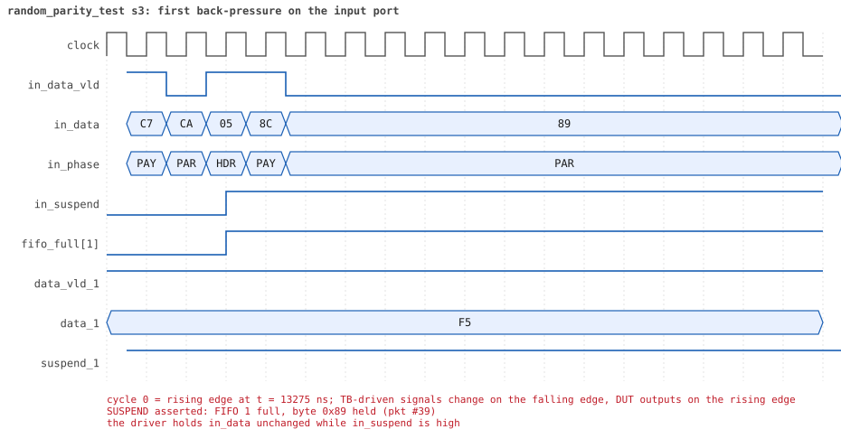

# random_parity_test seed 3

**Result:** PASSED (0 UVM_ERROR, 0 UVM_WARNING, 0 UVM_FATAL) · bench `yapp_project_tb` · sim time 21us · wall 18.7 s · log [`random_parity_test_s3.log`](random_parity_test_s3.log)

Waves: `random_parity_test_s3.fst` (GTKWave, Surfer or the VS Code wave viewer).
[Open the waves in Surfer](https://app.surfer-project.org/?load_url=https%3A%2F%2Fraw.githubusercontent.com%2Ftamirgabgab%2FQcom-Mentoring%2Fmain%2Fyapp_project%2Fregression%2Fyapp_project_tb%2Frandom_parity_test_s3%2Frandom_parity_test_s3.fst&startup_commands=run_command_file_from_url%20https%3A%2F%2Fraw.githubusercontent.com%2Ftamirgabgab%2FQcom-Mentoring%2Fmain%2Fyapp_project%2Ftb%2Fyapp_router.sucl) (web app, the signals already in groups: `yapp_project/tb/yapp_router.sucl`).

## Summary

- YAPP driver sent **66** packet(s) (25 with bad parity); the input monitor saw 66.
- Router: **29** forwarded, **37** dropped (32 oversized, 5 illegal address 3).
- Packets out: ch0 **5**, ch1 **10**, ch2 **14**.
- Scoreboard: 29 matched, 0 mismatched, 0 unexpected.
- Back-pressure: in_suspend asserted **1** time(s), longest hold 31 cycle(s).
- Error pulses: 25.
- HBUS: 20 write(s), 37 read(s).

## Stages

| time (ns) | stage |
|---|---|
| 0 | receivers: ch0 CHANNEL_RX_PROFILE_SLOW, ch1 CHANNEL_RX_PROFILE_SLOW, ch2 CHANNEL_RX_PROFILE_STALLY |
| 0 | random scenario: 66 packets in 5 bursts |
| 360 | burst 1/5: ctrl=0xc9 (maxpktsize 9) en=0x89 (router on, counter enables 1000100), 13 packet(s) |
| 6010 | burst 1/5 sent: addr0..3 3/3/4/3, bad parity 4, gap 0 6, length 1..63 |
| 6180 | burst 2/5: ctrl=0x47 (maxpktsize 7) en=0x61 (router on, counter enables 0110000), 13 packet(s) |
| 12510 | burst 2/5 sent: addr0..3 2/6/2/3, bad parity 2, gap 0 4, length 6..63 |
| 12770 | burst 3/5: ctrl=0x1f (maxpktsize 31) en=0xdb (router on, counter enables 1101101), 13 packet(s) -- storm: 1..3-byte packets back to back, half with bad parity |
| 13630 | burst 3/5 sent: addr0..3 0/5/4/4, bad parity 6, gap 0 10, length 1..3 |
| 13830 | burst 4/5: ctrl=0x41 (maxpktsize 1) en=0xf9 (router on, counter enables 1111100), 14 packet(s) |
| 19120 | burst 4/5 sent: addr0..3 2/1/10/1, bad parity 6, gap 0 2, length 1..63 |
| 19360 | burst 5/5: ctrl=0xfd (maxpktsize 61) en=0x01 (router on, counter enables 0000000), 13 packet(s) -- storm: 1..3-byte packets back to back, half with bad parity |
| 19920 | burst 5/5 sent: addr0..3 4/4/4/1, bad parity 7, gap 0 11, length 1..3 |
| 19920 | final reads: every register and the stored packet, checked against the reference model |
| 20945 | done: 66 packets (29 forwarded, 37 dropped), 2 storm burst(s), 29 scoreboard matches, 37 HBUS reads checked, 25 error pulses for 25 bad packets |

## Pictures

**reset and the first cycles**

**first packet into the router**

**first packet out on channel 2**

**first back-pressure on the input port**

**first error pulse after a bad-parity packet**

**first HBUS write**

**first HBUS read**

## Timeline

792 events.

| time (ns) | who | event |
|---|---|---|
| 0 | yapp monitor | YAPP monitor running |
| 0 | **test** | STAGE: receivers: ch0 CHANNEL_RX_PROFILE_SLOW, ch1 CHANNEL_RX_PROFILE_SLOW, ch2 CHANNEL_RX_PROFILE_STALLY |
| 0 | **test** | STAGE: random scenario: 66 packets in 5 bursts |
| 0 | clk/rst driver | Starting clock (period 10) and holding reset for 5 cycles |
| 0 | **DUT** | RESET asserted |
| 50 | **DUT** | RESET released: router_en=1 maxpktsize=63 |
| 70 | hbus driver | Executed WRITE addr=0x1000 data=0xc9 |
| 75 | **DUT** | CONFIG router_en=1 maxpktsize=9 |
| 75 | hbus monitor | Collected WRITE addr=0x1000 data=0xc9 |
| 75 | reference | maxpktsize is now 9 |
| 90 | hbus driver | Executed WRITE addr=0x1001 data=0x89 |
| 95 | hbus monitor | Collected WRITE addr=0x1001 data=0x89 |
| 95 | reference | router_en is now 1 (en_reg 0x89) |
| 120 | hbus driver | Executed READ  addr=0x1089 data=0x00 |
| 125 | hbus monitor | Collected READ  addr=0x1089 data=0x00 |
| 150 | hbus driver | Executed READ  addr=0x1004 data=0x00 |
| 155 | hbus monitor | Collected READ  addr=0x1004 data=0x00 |
| 170 | hbus driver | Executed WRITE addr=0x1182 data=0xb5 |
| 175 | hbus monitor | Collected WRITE addr=0x1182 data=0xb5 |
| 200 | hbus driver | Executed READ  addr=0x1182 data=0xb5 |
| 205 | hbus monitor | Collected READ  addr=0x1182 data=0xb5 |
| 230 | hbus driver | Executed READ  addr=0x1000 data=0xc9 |
| 235 | hbus monitor | Collected READ  addr=0x1000 data=0xc9 |
| 250 | hbus driver | Executed WRITE addr=0x1166 data=0x36 |
| 255 | hbus monitor | Collected WRITE addr=0x1166 data=0x36 |
| 280 | hbus driver | Executed READ  addr=0x1166 data=0x36 |
| 285 | hbus monitor | Collected READ  addr=0x1166 data=0x36 |
| 300 | hbus driver | Executed WRITE addr=0x112c data=0x71 |
| 305 | hbus monitor | Collected WRITE addr=0x112c data=0x71 |
| 330 | hbus driver | Executed READ  addr=0x112c data=0x71 |
| 335 | hbus monitor | Collected READ  addr=0x112c data=0x71 |
| 360 | hbus driver | Executed READ  addr=0x100d data=0x00 |
| 360 | **test** | STAGE: burst 1/5: ctrl=0xc9 (maxpktsize 9) en=0x89 (router on, counter enables 1000100), 13 packet(s) |
| 360 | yapp driver | TX pkt #1: addr=0 len=13 parity=bad delay=8 |
| 365 | hbus monitor | Collected READ  addr=0x100d data=0x00 |
| 455 | **DUT** | IN  pkt #1 header: addr=0 len=13 -> DROP (oversized: len 13 > maxpktsize 9) |
| 595 | **DUT** | IN  pkt #1 complete: addr=0 len=13 parity=BAD dropped, 15 bytes in 15 cycles (held 0) |
| 595 | yapp monitor | RX pkt #1 on the input: addr=0 len=13 parity=bad gap=40 |
| 595 | reference | Packet dropped: length 13 > maxpktsize 9 (addr=0) |
| 595 | **DUT** | ROUTER DROPS PACKET addr=0 length=13 (length > maxpktsize) |
| 600 | yapp driver | TX pkt #1 accepted by the DUT |
| 600 | yapp driver | TX pkt #2: addr=3 len=36 parity=good delay=1 |
| 615 | **DUT** | IN  pkt #2 header: addr=3 len=36 -> DROP (oversized: len 36 > maxpktsize 9) |
| 670 | **DUT** | ERROR pulse, 7 cycle(s) after the bad-parity packet |
| 670 | error checker | error pulse 7 cycles after the bad packet (0 still owed) |
| 985 | **DUT** | IN  pkt #2 complete: addr=3 len=36 parity=ok dropped, 38 bytes in 38 cycles (held 0) |
| 985 | yapp monitor | RX pkt #2 on the input: addr=3 len=36 parity=good gap=1 |
| 985 | reference | Packet dropped: illegal address 3 (len=36) |
| 985 | **DUT** | ROUTER DROPS PACKET addr=3 length=36 (    illegal address) |
| 990 | yapp driver | TX pkt #2 accepted by the DUT |
| 990 | yapp driver | TX pkt #3: addr=2 len=2 parity=good delay=3 |
| 1025 | **DUT** | IN  pkt #3 header: addr=2 len=2 -> channel 2 |
| 1055 | **DUT** | IN  pkt #3 complete: addr=2 len=2 parity=ok forwarded, 4 bytes in 4 cycles (held 0) |
| 1055 | yapp monitor | RX pkt #3 on the input: addr=2 len=2 parity=good gap=3 |
| 1055 | reference | Packet forwarded: addr=2 len=2 -> channel 2 |
| 1060 | yapp driver | TX pkt #3 accepted by the DUT |
| 1060 | yapp driver | TX pkt #4: addr=0 len=63 parity=good delay=0 |
| 1065 | **DUT** | IN  pkt #4 header: addr=0 len=63 -> DROP (oversized: len 63 > maxpktsize 9) |
| 1135 | **DUT** | OUT ch2 pkt #1 start: addr=2 len=2 (receiver waited 10 cycle(s)) |
| 1160 | ch2 driver | ch2: packet consumed (response delay 10) |
| 1705 | **DUT** | IN  pkt #4 complete: addr=0 len=63 parity=ok dropped, 65 bytes in 65 cycles (held 0) |
| 1705 | yapp monitor | RX pkt #4 on the input: addr=0 len=63 parity=good gap=0 |
| 1705 | reference | Packet dropped: length 63 > maxpktsize 9 (addr=0) |
| 1705 | **DUT** | ROUTER DROPS PACKET addr=0 length=63 (length > maxpktsize) |
| 1710 | yapp driver | TX pkt #4 accepted by the DUT |
| 1710 | yapp driver | TX pkt #5: addr=0 len=58 parity=good delay=0 |
| 1715 | **DUT** | IN  pkt #5 header: addr=0 len=58 -> DROP (oversized: len 58 > maxpktsize 9) |
| 2025 | **DUT** | OUT ch2 pkt #1 done: 4 bytes in 90 cycles |
| 2025 | ch2 monitor | ch2 RX pkt #1: addr=2 len=2 parity=good |
| 2025 | scoreboard | ch2 pkt matched: addr=2 len=2 (1 matched so far) |
| 2305 | **DUT** | IN  pkt #5 complete: addr=0 len=58 parity=ok dropped, 60 bytes in 60 cycles (held 0) |
| 2305 | yapp monitor | RX pkt #5 on the input: addr=0 len=58 parity=good gap=0 |
| 2305 | reference | Packet dropped: length 58 > maxpktsize 9 (addr=0) |
| 2305 | **DUT** | ROUTER DROPS PACKET addr=0 length=58 (length > maxpktsize) |
| 2310 | ch2 driver | ch2: packet consumed (response delay 85) |
| 2310 | yapp driver | TX pkt #5 accepted by the DUT |
| 2310 | yapp driver | TX pkt #6: addr=1 len=22 parity=bad delay=20 |
| 2515 | **DUT** | IN  pkt #6 header: addr=1 len=22 -> DROP (oversized: len 22 > maxpktsize 9) |
| 2745 | **DUT** | IN  pkt #6 complete: addr=1 len=22 parity=BAD dropped, 24 bytes in 24 cycles (held 0) |
| 2745 | yapp monitor | RX pkt #6 on the input: addr=1 len=22 parity=bad gap=20 |
| 2745 | reference | Packet dropped: length 22 > maxpktsize 9 (addr=1) |
| 2745 | **DUT** | ROUTER DROPS PACKET addr=1 length=22 (length > maxpktsize) |
| 2750 | yapp driver | TX pkt #6 accepted by the DUT |
| 2750 | yapp driver | TX pkt #7: addr=1 len=1 parity=bad delay=10 |
| 2790 | **DUT** | ERROR pulse, 4 cycle(s) after the bad-parity packet |
| 2790 | error checker | error pulse 4 cycles after the bad packet (0 still owed) |
| 2855 | **DUT** | IN  pkt #7 header: addr=1 len=1 -> channel 1 |
| 2875 | **DUT** | IN  pkt #7 complete: addr=1 len=1 parity=BAD forwarded, 3 bytes in 3 cycles (held 0) |
| 2875 | yapp monitor | RX pkt #7 on the input: addr=1 len=1 parity=bad gap=10 |
| 2875 | reference | Packet forwarded: addr=1 len=1 -> channel 1 |
| 2880 | yapp driver | TX pkt #7 accepted by the DUT |
| 2880 | yapp driver | TX pkt #8: addr=2 len=8 parity=good delay=0 |
| 2885 | **DUT** | IN  pkt #8 header: addr=2 len=8 -> channel 2 |
| 2890 | **DUT** | ERROR pulse, 1 cycle(s) after the bad-parity packet |
| 2890 | error checker | error pulse 1 cycles after the bad packet (0 still owed) |
| 2915 | **DUT** | OUT ch2 pkt #2 start: addr=2 len=8 (receiver waited 2 cycle(s)) |
| 2975 | **DUT** | IN  pkt #8 complete: addr=2 len=8 parity=ok forwarded, 10 bytes in 10 cycles (held 0) |
| 2975 | yapp monitor | RX pkt #8 on the input: addr=2 len=8 parity=good gap=0 |
| 2975 | reference | Packet forwarded: addr=2 len=8 -> channel 2 |
| 2980 | yapp driver | TX pkt #8 accepted by the DUT |
| 2980 | yapp driver | TX pkt #9: addr=3 len=63 parity=good delay=0 |
| 2985 | **DUT** | IN  pkt #9 header: addr=3 len=63 -> DROP (oversized: len 63 > maxpktsize 9) |
| 3000 | ch2 driver | ch2: packet consumed (response delay 2) |
| 3085 | **DUT** | OUT ch2 pkt #2 done: 10 bytes in 18 cycles |
| 3085 | ch2 monitor | ch2 RX pkt #2: addr=2 len=8 parity=good |
| 3085 | scoreboard | ch2 pkt matched: addr=2 len=8 (2 matched so far) |
| 3155 | **DUT** | OUT ch1 pkt #1 start: addr=1 len=1 (receiver waited 29 cycle(s)) |
| 3170 | ch1 driver | ch1: packet consumed (response delay 29) |
| 3585 | **DUT** | OUT ch1 pkt #1 done: 3 bytes in 44 cycles |
| 3585 | ch1 monitor | ch1 RX pkt #1: addr=1 len=1 parity=bad |
| 3585 | scoreboard | ch1 pkt matched: addr=1 len=1 (3 matched so far) |
| 3620 | ch2 driver | ch2: packet consumed (response delay 7) |
| 3625 | **DUT** | IN  pkt #9 complete: addr=3 len=63 parity=ok dropped, 65 bytes in 65 cycles (held 0) |
| 3625 | yapp monitor | RX pkt #9 on the input: addr=3 len=63 parity=good gap=0 |
| 3625 | reference | Packet dropped: illegal address 3 (len=63) |
| 3625 | **DUT** | ROUTER DROPS PACKET addr=3 length=63 (    illegal address) |
| 3630 | yapp driver | TX pkt #9 accepted by the DUT |
| 3630 | yapp driver | TX pkt #10: addr=1 len=63 parity=good delay=1 |
| 3645 | **DUT** | IN  pkt #10 header: addr=1 len=63 -> DROP (oversized: len 63 > maxpktsize 9) |
| 3920 | ch1 driver | ch1: packet consumed (response delay 40) |
| 4285 | **DUT** | IN  pkt #10 complete: addr=1 len=63 parity=ok dropped, 65 bytes in 65 cycles (held 0) |
| 4285 | yapp monitor | RX pkt #10 on the input: addr=1 len=63 parity=good gap=1 |
| 4285 | reference | Packet dropped: length 63 > maxpktsize 9 (addr=1) |
| 4285 | **DUT** | ROUTER DROPS PACKET addr=1 length=63 (length > maxpktsize) |
| 4290 | yapp driver | TX pkt #10 accepted by the DUT |
| 4290 | yapp driver | TX pkt #11: addr=2 len=36 parity=good delay=0 |
| 4295 | **DUT** | IN  pkt #11 header: addr=2 len=36 -> DROP (oversized: len 36 > maxpktsize 9) |
| 4665 | **DUT** | IN  pkt #11 complete: addr=2 len=36 parity=ok dropped, 38 bytes in 38 cycles (held 0) |
| 4665 | yapp monitor | RX pkt #11 on the input: addr=2 len=36 parity=good gap=0 |
| 4665 | reference | Packet dropped: length 36 > maxpktsize 9 (addr=2) |
| 4665 | **DUT** | ROUTER DROPS PACKET addr=2 length=36 (length > maxpktsize) |
| 4670 | yapp driver | TX pkt #11 accepted by the DUT |
| 4670 | yapp driver | TX pkt #12: addr=3 len=63 parity=bad delay=0 |
| 4675 | **DUT** | IN  pkt #12 header: addr=3 len=63 -> DROP (oversized: len 63 > maxpktsize 9) |
| 5315 | **DUT** | IN  pkt #12 complete: addr=3 len=63 parity=BAD dropped, 65 bytes in 65 cycles (held 0) |
| 5315 | yapp monitor | RX pkt #12 on the input: addr=3 len=63 parity=bad gap=0 |
| 5315 | reference | Packet dropped: illegal address 3 (len=63) |
| 5315 | **DUT** | ROUTER DROPS PACKET addr=3 length=63 (    illegal address) |
| 5320 | yapp driver | TX pkt #12 accepted by the DUT |
| 5320 | yapp driver | TX pkt #13: addr=2 len=54 parity=good delay=13 |
| 5370 | **DUT** | ERROR pulse, 5 cycle(s) after the bad-parity packet |
| 5370 | error checker | error pulse 5 cycles after the bad packet (0 still owed) |
| 5455 | **DUT** | IN  pkt #13 header: addr=2 len=54 -> DROP (oversized: len 54 > maxpktsize 9) |
| 6005 | **DUT** | IN  pkt #13 complete: addr=2 len=54 parity=ok dropped, 56 bytes in 56 cycles (held 0) |
| 6005 | yapp monitor | RX pkt #13 on the input: addr=2 len=54 parity=good gap=13 |
| 6005 | reference | Packet dropped: length 54 > maxpktsize 9 (addr=2) |
| 6005 | **DUT** | ROUTER DROPS PACKET addr=2 length=54 (length > maxpktsize) |
| 6010 | yapp driver | TX pkt #13 accepted by the DUT |
| 6010 | **test** | STAGE: burst 1/5 sent: addr0..3 3/3/4/3, bad parity 4, gap 0 6, length 1..63 |
| 6030 | hbus driver | Executed WRITE addr=0x1000 data=0x47 |
| 6035 | **DUT** | CONFIG router_en=1 maxpktsize=7 |
| 6035 | hbus monitor | Collected WRITE addr=0x1000 data=0x47 |
| 6035 | reference | maxpktsize is now 7 |
| 6050 | hbus driver | Executed WRITE addr=0x1001 data=0x61 |
| 6055 | hbus monitor | Collected WRITE addr=0x1001 data=0x61 |
| 6055 | reference | router_en is now 1 (en_reg 0x61) |
| 6080 | hbus driver | Executed READ  addr=0x100c data=0x00 |
| 6085 | hbus monitor | Collected READ  addr=0x100c data=0x00 |
| 6100 | hbus driver | Executed WRITE addr=0x11ac data=0xcb |
| 6105 | hbus monitor | Collected WRITE addr=0x11ac data=0xcb |
| 6130 | hbus driver | Executed READ  addr=0x11ac data=0xcb |
| 6135 | hbus monitor | Collected READ  addr=0x11ac data=0xcb |
| 6150 | hbus driver | Executed WRITE addr=0x1111 data=0xb3 |
| 6155 | hbus monitor | Collected WRITE addr=0x1111 data=0xb3 |
| 6180 | hbus driver | Executed READ  addr=0x1111 data=0xb3 |
| 6180 | **test** | STAGE: burst 2/5: ctrl=0x47 (maxpktsize 7) en=0x61 (router on, counter enables 0110000), 13 packet(s) |
| 6180 | yapp driver | TX pkt #14: addr=1 len=40 parity=good delay=0 |
| 6185 | hbus monitor | Collected READ  addr=0x1111 data=0xb3 |
| 6195 | **DUT** | IN  pkt #14 header: addr=1 len=40 -> DROP (oversized: len 40 > maxpktsize 7) |
| 6605 | **DUT** | IN  pkt #14 complete: addr=1 len=40 parity=ok dropped, 42 bytes in 42 cycles (held 0) |
| 6605 | yapp monitor | RX pkt #14 on the input: addr=1 len=40 parity=good gap=18 |
| 6605 | reference | Packet dropped: length 40 > maxpktsize 7 (addr=1) |
| 6605 | **DUT** | ROUTER DROPS PACKET addr=1 length=40 (length > maxpktsize) |
| 6610 | yapp driver | TX pkt #14 accepted by the DUT |
| 6610 | yapp driver | TX pkt #15: addr=1 len=63 parity=bad delay=4 |
| 6655 | **DUT** | IN  pkt #15 header: addr=1 len=63 -> DROP (oversized: len 63 > maxpktsize 7) |
| 7295 | **DUT** | IN  pkt #15 complete: addr=1 len=63 parity=BAD dropped, 65 bytes in 65 cycles (held 0) |
| 7295 | yapp monitor | RX pkt #15 on the input: addr=1 len=63 parity=bad gap=4 |
| 7295 | reference | Packet dropped: length 63 > maxpktsize 7 (addr=1) |
| 7295 | **DUT** | ROUTER DROPS PACKET addr=1 length=63 (length > maxpktsize) |
| 7300 | yapp driver | TX pkt #15 accepted by the DUT |
| 7300 | yapp driver | TX pkt #16: addr=3 len=38 parity=good delay=0 |
| 7305 | **DUT** | IN  pkt #16 header: addr=3 len=38 -> DROP (oversized: len 38 > maxpktsize 7) |
| 7350 | **DUT** | ERROR pulse, 5 cycle(s) after the bad-parity packet |
| 7350 | error checker | error pulse 5 cycles after the bad packet (0 still owed) |
| 7695 | **DUT** | IN  pkt #16 complete: addr=3 len=38 parity=ok dropped, 40 bytes in 40 cycles (held 0) |
| 7695 | yapp monitor | RX pkt #16 on the input: addr=3 len=38 parity=good gap=0 |
| 7695 | reference | Packet dropped: illegal address 3 (len=38) |
| 7695 | **DUT** | ROUTER DROPS PACKET addr=3 length=38 (    illegal address) |
| 7700 | yapp driver | TX pkt #16 accepted by the DUT |
| 7700 | yapp driver | TX pkt #17: addr=0 len=7 parity=good delay=20 |
| 7905 | **DUT** | IN  pkt #17 header: addr=0 len=7 -> channel 0 |
| 7985 | **DUT** | IN  pkt #17 complete: addr=0 len=7 parity=ok forwarded, 9 bytes in 9 cycles (held 0) |
| 7985 | yapp monitor | RX pkt #17 on the input: addr=0 len=7 parity=good gap=20 |
| 7985 | reference | Packet forwarded: addr=0 len=7 -> channel 0 |
| 7990 | yapp driver | TX pkt #17 accepted by the DUT |
| 7990 | yapp driver | TX pkt #18: addr=2 len=6 parity=good delay=5 |
| 8045 | **DUT** | IN  pkt #18 header: addr=2 len=6 -> channel 2 |
| 8105 | **DUT** | OUT ch2 pkt #3 start: addr=2 len=6 (receiver waited 5 cycle(s)) |
| 8115 | **DUT** | IN  pkt #18 complete: addr=2 len=6 parity=ok forwarded, 8 bytes in 8 cycles (held 0) |
| 8115 | yapp monitor | RX pkt #18 on the input: addr=2 len=6 parity=good gap=5 |
| 8115 | reference | Packet forwarded: addr=2 len=6 -> channel 2 |
| 8120 | yapp driver | TX pkt #18 accepted by the DUT |
| 8120 | yapp driver | TX pkt #19: addr=1 len=37 parity=bad delay=1 |
| 8135 | **DUT** | IN  pkt #19 header: addr=1 len=37 -> DROP (oversized: len 37 > maxpktsize 7) |
| 8135 | **DUT** | OUT ch0 pkt #1 start: addr=0 len=7 (receiver waited 22 cycle(s)) |
| 8170 | ch2 driver | ch2: packet consumed (response delay 5) |
| 8185 | **DUT** | OUT ch2 pkt #3 done: 8 bytes in 9 cycles |
| 8185 | ch2 monitor | ch2 RX pkt #3: addr=2 len=6 parity=good |
| 8185 | scoreboard | ch2 pkt matched: addr=2 len=6 (4 matched so far) |
| 8210 | ch0 driver | ch0: packet consumed (response delay 22) |
| 8515 | **DUT** | IN  pkt #19 complete: addr=1 len=37 parity=BAD dropped, 39 bytes in 39 cycles (held 0) |
| 8515 | yapp monitor | RX pkt #19 on the input: addr=1 len=37 parity=bad gap=1 |
| 8515 | reference | Packet dropped: length 37 > maxpktsize 7 (addr=1) |
| 8515 | **DUT** | ROUTER DROPS PACKET addr=1 length=37 (length > maxpktsize) |
| 8520 | yapp driver | TX pkt #19 accepted by the DUT |
| 8520 | yapp driver | TX pkt #20: addr=2 len=38 parity=good delay=1 |
| 8535 | **DUT** | IN  pkt #20 header: addr=2 len=38 -> DROP (oversized: len 38 > maxpktsize 7) |
| 8570 | **DUT** | ERROR pulse, 5 cycle(s) after the bad-parity packet |
| 8570 | error checker | error pulse 5 cycles after the bad packet (0 still owed) |
| 8615 | **DUT** | OUT ch0 pkt #1 done: 9 bytes in 49 cycles |
| 8615 | ch0 monitor | ch0 RX pkt #1: addr=0 len=7 parity=good |
| 8615 | scoreboard | ch0 pkt matched: addr=0 len=7 (5 matched so far) |
| 8710 | ch2 driver | ch2: packet consumed (response delay 0) |
| 8890 | ch0 driver | ch0: packet consumed (response delay 39) |
| 8925 | **DUT** | IN  pkt #20 complete: addr=2 len=38 parity=ok dropped, 40 bytes in 40 cycles (held 0) |
| 8925 | yapp monitor | RX pkt #20 on the input: addr=2 len=38 parity=good gap=1 |
| 8925 | reference | Packet dropped: length 38 > maxpktsize 7 (addr=2) |
| 8925 | **DUT** | ROUTER DROPS PACKET addr=2 length=38 (length > maxpktsize) |
| 8930 | yapp driver | TX pkt #20 accepted by the DUT |
| 8930 | yapp driver | TX pkt #21: addr=3 len=63 parity=good delay=3 |
| 8965 | **DUT** | IN  pkt #21 header: addr=3 len=63 -> DROP (oversized: len 63 > maxpktsize 7) |
| 9605 | **DUT** | IN  pkt #21 complete: addr=3 len=63 parity=ok dropped, 65 bytes in 65 cycles (held 0) |
| 9605 | yapp monitor | RX pkt #21 on the input: addr=3 len=63 parity=good gap=3 |
| 9605 | reference | Packet dropped: illegal address 3 (len=63) |
| 9605 | **DUT** | ROUTER DROPS PACKET addr=3 length=63 (    illegal address) |
| 9610 | yapp driver | TX pkt #21 accepted by the DUT |
| 9610 | yapp driver | TX pkt #22: addr=0 len=60 parity=good delay=0 |
| 9615 | **DUT** | IN  pkt #22 header: addr=0 len=60 -> DROP (oversized: len 60 > maxpktsize 7) |
| 10225 | **DUT** | IN  pkt #22 complete: addr=0 len=60 parity=ok dropped, 62 bytes in 62 cycles (held 0) |
| 10225 | yapp monitor | RX pkt #22 on the input: addr=0 len=60 parity=good gap=0 |
| 10225 | reference | Packet dropped: length 60 > maxpktsize 7 (addr=0) |
| 10225 | **DUT** | ROUTER DROPS PACKET addr=0 length=60 (length > maxpktsize) |
| 10230 | yapp driver | TX pkt #22 accepted by the DUT |
| 10230 | yapp driver | TX pkt #23: addr=1 len=63 parity=good delay=12 |
| 10355 | **DUT** | IN  pkt #23 header: addr=1 len=63 -> DROP (oversized: len 63 > maxpktsize 7) |
| 10995 | **DUT** | IN  pkt #23 complete: addr=1 len=63 parity=ok dropped, 65 bytes in 65 cycles (held 0) |
| 10995 | yapp monitor | RX pkt #23 on the input: addr=1 len=63 parity=good gap=12 |
| 10995 | reference | Packet dropped: length 63 > maxpktsize 7 (addr=1) |
| 10995 | **DUT** | ROUTER DROPS PACKET addr=1 length=63 (length > maxpktsize) |
| 11000 | yapp driver | TX pkt #23 accepted by the DUT |
| 11000 | yapp driver | TX pkt #24: addr=3 len=52 parity=good delay=0 |
| 11005 | **DUT** | IN  pkt #24 header: addr=3 len=52 -> DROP (oversized: len 52 > maxpktsize 7) |
| 11535 | **DUT** | IN  pkt #24 complete: addr=3 len=52 parity=ok dropped, 54 bytes in 54 cycles (held 0) |
| 11535 | yapp monitor | RX pkt #24 on the input: addr=3 len=52 parity=good gap=0 |
| 11535 | reference | Packet dropped: illegal address 3 (len=52) |
| 11535 | **DUT** | ROUTER DROPS PACKET addr=3 length=52 (    illegal address) |
| 11540 | yapp driver | TX pkt #24 accepted by the DUT |
| 11540 | yapp driver | TX pkt #25: addr=1 len=53 parity=good delay=3 |
| 11575 | **DUT** | IN  pkt #25 header: addr=1 len=53 -> DROP (oversized: len 53 > maxpktsize 7) |
| 12115 | **DUT** | IN  pkt #25 complete: addr=1 len=53 parity=ok dropped, 55 bytes in 55 cycles (held 0) |
| 12115 | yapp monitor | RX pkt #25 on the input: addr=1 len=53 parity=good gap=3 |
| 12115 | reference | Packet dropped: length 53 > maxpktsize 7 (addr=1) |
| 12115 | **DUT** | ROUTER DROPS PACKET addr=1 length=53 (length > maxpktsize) |
| 12120 | yapp driver | TX pkt #25 accepted by the DUT |
| 12120 | yapp driver | TX pkt #26: addr=1 len=34 parity=good delay=3 |
| 12155 | **DUT** | IN  pkt #26 header: addr=1 len=34 -> DROP (oversized: len 34 > maxpktsize 7) |
| 12505 | **DUT** | IN  pkt #26 complete: addr=1 len=34 parity=ok dropped, 36 bytes in 36 cycles (held 0) |
| 12505 | yapp monitor | RX pkt #26 on the input: addr=1 len=34 parity=good gap=3 |
| 12505 | reference | Packet dropped: length 34 > maxpktsize 7 (addr=1) |
| 12505 | **DUT** | ROUTER DROPS PACKET addr=1 length=34 (length > maxpktsize) |
| 12510 | yapp driver | TX pkt #26 accepted by the DUT |
| 12510 | **test** | STAGE: burst 2/5 sent: addr0..3 2/6/2/3, bad parity 2, gap 0 4, length 6..63 |
| 12530 | hbus driver | Executed WRITE addr=0x1000 data=0x1f |
| 12535 | **DUT** | CONFIG router_en=1 maxpktsize=31 |
| 12535 | hbus monitor | Collected WRITE addr=0x1000 data=0x1f |
| 12535 | reference | maxpktsize is now 31 |
| 12550 | hbus driver | Executed WRITE addr=0x1001 data=0xdb |
| 12555 | hbus monitor | Collected WRITE addr=0x1001 data=0xdb |
| 12555 | reference | router_en is now 1 (en_reg 0xdb) |
| 12580 | hbus driver | Executed READ  addr=0x1038 data=0x7a |
| 12585 | hbus monitor | Collected READ  addr=0x1038 data=0x7a |
| 12610 | hbus driver | Executed READ  addr=0x1008 data=0x00 |
| 12615 | hbus monitor | Collected READ  addr=0x1008 data=0x00 |
| 12630 | hbus driver | Executed WRITE addr=0x1139 data=0x32 |
| 12635 | hbus monitor | Collected WRITE addr=0x1139 data=0x32 |
| 12660 | hbus driver | Executed READ  addr=0x1139 data=0x32 |
| 12665 | hbus monitor | Collected READ  addr=0x1139 data=0x32 |
| 12680 | hbus driver | Executed WRITE addr=0x1110 data=0xd6 |
| 12685 | hbus monitor | Collected WRITE addr=0x1110 data=0xd6 |
| 12710 | hbus driver | Executed READ  addr=0x1110 data=0xd6 |
| 12715 | hbus monitor | Collected READ  addr=0x1110 data=0xd6 |
| 12740 | hbus driver | Executed READ  addr=0x100d data=0x22 |
| 12745 | hbus monitor | Collected READ  addr=0x100d data=0x22 |
| 12770 | hbus driver | Executed READ  addr=0x100d data=0x22 |
| 12770 | **test** | STAGE: burst 3/5: ctrl=0x1f (maxpktsize 31) en=0xdb (router on, counter enables 1101101), 13 packet(s) -- storm: 1..3-byte packets back to back, half with bad parity |
| 12770 | yapp driver | TX pkt #27: addr=2 len=1 parity=bad delay=0 |
| 12775 | hbus monitor | Collected READ  addr=0x100d data=0x22 |
| 12785 | **DUT** | IN  pkt #27 header: addr=2 len=1 -> channel 2 |
| 12805 | **DUT** | IN  pkt #27 complete: addr=2 len=1 parity=BAD forwarded, 3 bytes in 3 cycles (held 0) |
| 12805 | yapp monitor | RX pkt #27 on the input: addr=2 len=1 parity=bad gap=27 |
| 12805 | reference | Packet forwarded: addr=2 len=1 -> channel 2 |
| 12810 | yapp driver | TX pkt #27 accepted by the DUT |
| 12810 | yapp driver | TX pkt #28: addr=3 len=3 parity=good delay=0 |
| 12815 | **DUT** | IN  pkt #28 header: addr=3 len=3 -> DROP (illegal address 3) |
| 12825 | **DUT** | OUT ch2 pkt #4 start: addr=2 len=1 (receiver waited 3 cycle(s)) |
| 12830 | **DUT** | ERROR pulse, 2 cycle(s) after the bad-parity packet |
| 12830 | error checker | error pulse 2 cycles after the bad packet (0 still owed) |
| 12840 | ch2 driver | ch2: packet consumed (response delay 3) |
| 12855 | **DUT** | IN  pkt #28 complete: addr=3 len=3 parity=ok dropped, 5 bytes in 5 cycles (held 0) |
| 12855 | yapp monitor | RX pkt #28 on the input: addr=3 len=3 parity=good gap=0 |
| 12855 | reference | Packet dropped: illegal address 3 (len=3) |
| 12855 | **DUT** | ROUTER DROPS PACKET addr=3 length=3 (    illegal address) |
| 12860 | yapp driver | TX pkt #28 accepted by the DUT |
| 12860 | yapp driver | TX pkt #29: addr=3 len=2 parity=good delay=0 |
| 12865 | **DUT** | IN  pkt #29 header: addr=3 len=2 -> DROP (illegal address 3) |
| 12895 | **DUT** | IN  pkt #29 complete: addr=3 len=2 parity=ok dropped, 4 bytes in 4 cycles (held 0) |
| 12895 | yapp monitor | RX pkt #29 on the input: addr=3 len=2 parity=good gap=0 |
| 12895 | reference | Packet dropped: illegal address 3 (len=2) |
| 12895 | **DUT** | ROUTER DROPS PACKET addr=3 length=2 (    illegal address) |
| 12900 | yapp driver | TX pkt #29 accepted by the DUT |
| 12900 | yapp driver | TX pkt #30: addr=1 len=1 parity=good delay=0 |
| 12905 | **DUT** | IN  pkt #30 header: addr=1 len=1 -> channel 1 |
| 12925 | **DUT** | IN  pkt #30 complete: addr=1 len=1 parity=ok forwarded, 3 bytes in 3 cycles (held 0) |
| 12925 | yapp monitor | RX pkt #30 on the input: addr=1 len=1 parity=good gap=0 |
| 12925 | reference | Packet forwarded: addr=1 len=1 -> channel 1 |
| 12930 | yapp driver | TX pkt #30 accepted by the DUT |
| 12930 | yapp driver | TX pkt #31: addr=2 len=3 parity=bad delay=0 |
| 12935 | **DUT** | IN  pkt #31 header: addr=2 len=3 -> channel 2 |
| 12955 | **DUT** | OUT ch2 pkt #4 done: 3 bytes in 14 cycles |
| 12955 | ch2 monitor | ch2 RX pkt #4: addr=2 len=1 parity=bad |
| 12955 | scoreboard | ch2 pkt matched: addr=2 len=1 (6 matched so far) |
| 12965 | **DUT** | OUT ch2 pkt #5 start: addr=2 len=3 (receiver waited 0 cycle(s)) |
| 12975 | **DUT** | IN  pkt #31 complete: addr=2 len=3 parity=BAD forwarded, 5 bytes in 5 cycles (held 0) |
| 12975 | yapp monitor | RX pkt #31 on the input: addr=2 len=3 parity=bad gap=0 |
| 12975 | reference | Packet forwarded: addr=2 len=3 -> channel 2 |
| 12980 | yapp driver | TX pkt #31 accepted by the DUT |
| 12980 | yapp driver | TX pkt #32: addr=3 len=1 parity=bad delay=1 |
| 12995 | **DUT** | IN  pkt #32 header: addr=3 len=1 -> DROP (illegal address 3) |
| 13005 | **DUT** | OUT ch2 pkt #5 done: 5 bytes in 5 cycles |
| 13005 | ch2 monitor | ch2 RX pkt #5: addr=2 len=3 parity=bad |
| 13005 | scoreboard | ch2 pkt matched: addr=2 len=3 (7 matched so far) |
| 13010 | **DUT** | ERROR pulse, 3 cycle(s) after the bad-parity packet |
| 13010 | error checker | error pulse 3 cycles after the bad packet (0 still owed) |
| 13015 | **DUT** | IN  pkt #32 complete: addr=3 len=1 parity=BAD dropped, 3 bytes in 3 cycles (held 0) |
| 13015 | yapp monitor | RX pkt #32 on the input: addr=3 len=1 parity=bad gap=1 |
| 13015 | reference | Packet dropped: illegal address 3 (len=1) |
| 13015 | **DUT** | ROUTER DROPS PACKET addr=3 length=1 (    illegal address) |
| 13020 | yapp driver | TX pkt #32 accepted by the DUT |
| 13020 | yapp driver | TX pkt #33: addr=1 len=3 parity=good delay=0 |
| 13025 | **DUT** | IN  pkt #33 header: addr=1 len=3 -> channel 1 |
| 13030 | **DUT** | ERROR pulse, 1 cycle(s) after the bad-parity packet |
| 13030 | error checker | error pulse 1 cycles after the bad packet (0 still owed) |
| 13065 | **DUT** | IN  pkt #33 complete: addr=1 len=3 parity=ok forwarded, 5 bytes in 5 cycles (held 0) |
| 13065 | yapp monitor | RX pkt #33 on the input: addr=1 len=3 parity=good gap=0 |
| 13065 | reference | Packet forwarded: addr=1 len=3 -> channel 1 |
| 13070 | yapp driver | TX pkt #33 accepted by the DUT |
| 13070 | yapp driver | TX pkt #34: addr=2 len=1 parity=bad delay=0 |
| 13075 | **DUT** | IN  pkt #34 header: addr=2 len=1 -> channel 2 |
| 13085 | **DUT** | OUT ch2 pkt #6 start: addr=2 len=1 (receiver waited 0 cycle(s)) |
| 13095 | **DUT** | IN  pkt #34 complete: addr=2 len=1 parity=BAD forwarded, 3 bytes in 3 cycles (held 0) |
| 13095 | yapp monitor | RX pkt #34 on the input: addr=2 len=1 parity=bad gap=0 |
| 13095 | reference | Packet forwarded: addr=2 len=1 -> channel 2 |
| 13100 | yapp driver | TX pkt #34 accepted by the DUT |
| 13100 | yapp driver | TX pkt #35: addr=2 len=1 parity=good delay=0 |
| 13105 | **DUT** | IN  pkt #35 header: addr=2 len=1 -> channel 2 |
| 13105 | **DUT** | OUT ch2 pkt #6 done: 3 bytes in 3 cycles |
| 13105 | ch2 monitor | ch2 RX pkt #6: addr=2 len=1 parity=bad |
| 13105 | scoreboard | ch2 pkt matched: addr=2 len=1 (8 matched so far) |
| 13115 | **DUT** | OUT ch2 pkt #7 start: addr=2 len=1 (receiver waited 0 cycle(s)) |
| 13125 | **DUT** | IN  pkt #35 complete: addr=2 len=1 parity=ok forwarded, 3 bytes in 3 cycles (held 0) |
| 13125 | yapp monitor | RX pkt #35 on the input: addr=2 len=1 parity=good gap=0 |
| 13125 | reference | Packet forwarded: addr=2 len=1 -> channel 2 |
| 13130 | yapp driver | TX pkt #35 accepted by the DUT |
| 13130 | yapp driver | TX pkt #36: addr=3 len=1 parity=bad delay=3 |
| 13135 | **DUT** | OUT ch2 pkt #7 done: 3 bytes in 3 cycles |
| 13135 | ch2 monitor | ch2 RX pkt #7: addr=2 len=1 parity=good |
| 13135 | scoreboard | ch2 pkt matched: addr=2 len=1 (9 matched so far) |
| 13165 | **DUT** | IN  pkt #36 header: addr=3 len=1 -> DROP (illegal address 3) |
| 13185 | **DUT** | IN  pkt #36 complete: addr=3 len=1 parity=BAD dropped, 3 bytes in 3 cycles (held 0) |
| 13185 | **DUT** | OUT ch1 pkt #2 start: addr=1 len=1 (receiver waited 27 cycle(s)) |
| 13185 | yapp monitor | RX pkt #36 on the input: addr=3 len=1 parity=bad gap=3 |
| 13185 | reference | Packet dropped: illegal address 3 (len=1) |
| 13185 | **DUT** | ROUTER DROPS PACKET addr=3 length=1 (    illegal address) |
| 13190 | **DUT** | ERROR pulse, 9 cycle(s) after the bad-parity packet (1 more owed) |
| 13190 | error checker | error pulse 9 cycles after the bad packet (1 still owed) |
| 13190 | yapp driver | TX pkt #36 accepted by the DUT |
| 13190 | yapp driver | TX pkt #37: addr=1 len=3 parity=good delay=2 |
| 13200 | ch1 driver | ch1: packet consumed (response delay 27) |
| 13210 | **DUT** | ERROR pulse, 2 cycle(s) after the bad-parity packet |
| 13210 | error checker | error pulse 2 cycles after the bad packet (0 still owed) |
| 13215 | **DUT** | IN  pkt #37 header: addr=1 len=3 -> channel 1 |
| 13255 | **DUT** | IN  pkt #37 complete: addr=1 len=3 parity=ok forwarded, 5 bytes in 5 cycles (held 0) |
| 13255 | yapp monitor | RX pkt #37 on the input: addr=1 len=3 parity=good gap=2 |
| 13255 | reference | Packet forwarded: addr=1 len=3 -> channel 1 |
| 13260 | yapp driver | TX pkt #37 accepted by the DUT |
| 13260 | yapp driver | TX pkt #38: addr=1 len=1 parity=bad delay=0 |
| 13265 | **DUT** | IN  pkt #38 header: addr=1 len=1 -> channel 1 |
| 13285 | **DUT** | IN  pkt #38 complete: addr=1 len=1 parity=BAD forwarded, 3 bytes in 3 cycles (held 0) |
| 13285 | yapp monitor | RX pkt #38 on the input: addr=1 len=1 parity=bad gap=0 |
| 13285 | reference | Packet forwarded: addr=1 len=1 -> channel 1 |
| 13290 | yapp driver | TX pkt #38 accepted by the DUT |
| 13290 | yapp driver | TX pkt #39: addr=1 len=1 parity=good delay=0 |
| 13295 | **DUT** | IN  pkt #39 header: addr=1 len=1 -> channel 1 |
| 13310 | **DUT** | ERROR pulse, 2 cycle(s) after the bad-parity packet |
| 13310 | error checker | error pulse 2 cycles after the bad packet (0 still owed) |
| 13315 | **DUT** | SUSPEND asserted: FIFO 1 full, byte 0x89 held (pkt #39) |
| 13470 | ch2 driver | ch2: packet consumed (response delay 10) |
| 13615 | **DUT** | OUT ch1 pkt #2 done: 3 bytes in 44 cycles |
| 13615 | ch1 monitor | ch1 RX pkt #2: addr=1 len=1 parity=good |
| 13615 | scoreboard | ch1 pkt matched: addr=1 len=1 (10 matched so far) |
| 13625 | **DUT** | IN  pkt #39 complete: addr=1 len=1 parity=ok forwarded, 3 bytes in 34 cycles (held 31) |
| 13625 | **DUT** | SUSPEND released after 31 cycle(s) |
| 13625 | **DUT** | OUT ch1 pkt #3 start: addr=1 len=3 (receiver waited 0 cycle(s)) |
| 13625 | yapp monitor | RX pkt #39 on the input: addr=1 len=1 parity=good gap=0 |
| 13625 | reference | Packet forwarded: addr=1 len=1 -> channel 1 |
| 13630 | yapp driver | TX pkt #39 accepted by the DUT |
| 13630 | **test** | STAGE: burst 3/5 sent: addr0..3 0/5/4/4, bad parity 6, gap 0 10, length 1..3 |
| 13650 | hbus driver | Executed WRITE addr=0x1000 data=0x41 |
| 13655 | **DUT** | CONFIG router_en=1 maxpktsize=1 |
| 13655 | hbus monitor | Collected WRITE addr=0x1000 data=0x41 |
| 13655 | reference | maxpktsize is now 1 |
| 13665 | **DUT** | OUT ch1 pkt #3 done: 5 bytes in 5 cycles |
| 13665 | ch1 monitor | ch1 RX pkt #3: addr=1 len=3 parity=good |
| 13665 | scoreboard | ch1 pkt matched: addr=1 len=3 (11 matched so far) |
| 13670 | hbus driver | Executed WRITE addr=0x1001 data=0xf9 |
| 13675 | **DUT** | OUT ch1 pkt #4 start: addr=1 len=3 (receiver waited 0 cycle(s)) |
| 13675 | hbus monitor | Collected WRITE addr=0x1001 data=0xf9 |
| 13675 | reference | router_en is now 1 (en_reg 0xf9) |
| 13690 | hbus driver | Executed WRITE addr=0x1185 data=0x09 |
| 13695 | hbus monitor | Collected WRITE addr=0x1185 data=0x09 |
| 13715 | **DUT** | OUT ch1 pkt #4 done: 5 bytes in 5 cycles |
| 13715 | ch1 monitor | ch1 RX pkt #4: addr=1 len=3 parity=good |
| 13715 | scoreboard | ch1 pkt matched: addr=1 len=3 (12 matched so far) |
| 13720 | hbus driver | Executed READ  addr=0x1185 data=0x09 |
| 13725 | **DUT** | OUT ch1 pkt #5 start: addr=1 len=1 (receiver waited 0 cycle(s)) |
| 13725 | hbus monitor | Collected READ  addr=0x1185 data=0x09 |
| 13740 | hbus driver | Executed WRITE addr=0x11ff data=0x96 |
| 13745 | **DUT** | OUT ch1 pkt #5 done: 3 bytes in 3 cycles |
| 13745 | ch1 monitor | ch1 RX pkt #5: addr=1 len=1 parity=bad |
| 13745 | scoreboard | ch1 pkt matched: addr=1 len=1 (13 matched so far) |
| 13745 | hbus monitor | Collected WRITE addr=0x11ff data=0x96 |
| 13755 | **DUT** | OUT ch1 pkt #6 start: addr=1 len=1 (receiver waited 0 cycle(s)) |
| 13770 | hbus driver | Executed READ  addr=0x11ff data=0x96 |
| 13775 | **DUT** | OUT ch1 pkt #6 done: 3 bytes in 3 cycles |
| 13775 | ch1 monitor | ch1 RX pkt #6: addr=1 len=1 parity=good |
| 13775 | scoreboard | ch1 pkt matched: addr=1 len=1 (14 matched so far) |
| 13775 | hbus monitor | Collected READ  addr=0x11ff data=0x96 |
| 13800 | hbus driver | Executed READ  addr=0x1004 data=0x06 |
| 13805 | hbus monitor | Collected READ  addr=0x1004 data=0x06 |
| 13830 | hbus driver | Executed READ  addr=0x1048 data=0x61 |
| 13830 | **test** | STAGE: burst 4/5: ctrl=0x41 (maxpktsize 1) en=0xf9 (router on, counter enables 1111100), 14 packet(s) |
| 13830 | yapp driver | TX pkt #40: addr=2 len=1 parity=good delay=0 |
| 13835 | hbus monitor | Collected READ  addr=0x1048 data=0x61 |
| 13845 | **DUT** | IN  pkt #40 header: addr=2 len=1 -> channel 2 |
| 13865 | **DUT** | IN  pkt #40 complete: addr=2 len=1 parity=ok forwarded, 3 bytes in 3 cycles (held 0) |
| 13865 | yapp monitor | RX pkt #40 on the input: addr=2 len=1 parity=good gap=21 |
| 13865 | reference | Packet forwarded: addr=2 len=1 -> channel 2 |
| 13870 | yapp driver | TX pkt #40 accepted by the DUT |
| 13870 | yapp driver | TX pkt #41: addr=2 len=40 parity=bad delay=2 |
| 13875 | **DUT** | OUT ch2 pkt #8 start: addr=2 len=1 (receiver waited 2 cycle(s)) |
| 13890 | ch2 driver | ch2: packet consumed (response delay 2) |
| 13895 | **DUT** | IN  pkt #41 header: addr=2 len=40 -> DROP (oversized: len 40 > maxpktsize 1) |
| 14005 | **DUT** | OUT ch2 pkt #8 done: 3 bytes in 14 cycles |
| 14005 | ch2 monitor | ch2 RX pkt #8: addr=2 len=1 parity=good |
| 14005 | scoreboard | ch2 pkt matched: addr=2 len=1 (15 matched so far) |
| 14230 | ch1 driver | ch1: packet consumed (response delay 40) |
| 14305 | **DUT** | IN  pkt #41 complete: addr=2 len=40 parity=BAD dropped, 42 bytes in 42 cycles (held 0) |
| 14305 | yapp monitor | RX pkt #41 on the input: addr=2 len=40 parity=bad gap=2 |
| 14305 | reference | Packet dropped: length 40 > maxpktsize 1 (addr=2) |
| 14305 | **DUT** | ROUTER DROPS PACKET addr=2 length=40 (length > maxpktsize) |
| 14310 | yapp driver | TX pkt #41 accepted by the DUT |
| 14310 | yapp driver | TX pkt #42: addr=3 len=20 parity=good delay=12 |
| 14330 | **DUT** | ERROR pulse, 2 cycle(s) after the bad-parity packet |
| 14330 | error checker | error pulse 2 cycles after the bad packet (0 still owed) |
| 14435 | **DUT** | IN  pkt #42 header: addr=3 len=20 -> DROP (oversized: len 20 > maxpktsize 1) |
| 14450 | ch2 driver | ch2: packet consumed (response delay 10) |
| 14645 | **DUT** | IN  pkt #42 complete: addr=3 len=20 parity=ok dropped, 22 bytes in 22 cycles (held 0) |
| 14645 | yapp monitor | RX pkt #42 on the input: addr=3 len=20 parity=good gap=12 |
| 14645 | reference | Packet dropped: illegal address 3 (len=20) |
| 14645 | **DUT** | ROUTER DROPS PACKET addr=3 length=20 (    illegal address) |
| 14650 | yapp driver | TX pkt #42 accepted by the DUT |
| 14650 | yapp driver | TX pkt #43: addr=2 len=1 parity=bad delay=1 |
| 14665 | **DUT** | IN  pkt #43 header: addr=2 len=1 -> channel 2 |
| 14685 | **DUT** | IN  pkt #43 complete: addr=2 len=1 parity=BAD forwarded, 3 bytes in 3 cycles (held 0) |
| 14685 | yapp monitor | RX pkt #43 on the input: addr=2 len=1 parity=bad gap=1 |
| 14685 | reference | Packet forwarded: addr=2 len=1 -> channel 2 |
| 14690 | yapp driver | TX pkt #43 accepted by the DUT |
| 14690 | yapp driver | TX pkt #44: addr=0 len=63 parity=bad delay=3 |
| 14725 | **DUT** | IN  pkt #44 header: addr=0 len=63 -> DROP (oversized: len 63 > maxpktsize 1) |
| 14755 | **DUT** | OUT ch2 pkt #9 start: addr=2 len=1 (receiver waited 8 cycle(s)) |
| 14770 | **DUT** | ERROR pulse, 8 cycle(s) after the bad-parity packet |
| 14770 | error checker | error pulse 8 cycles after the bad packet (0 still owed) |
| 14770 | ch2 driver | ch2: packet consumed (response delay 8) |
| 14805 | **DUT** | OUT ch2 pkt #9 done: 3 bytes in 6 cycles |
| 14805 | ch2 monitor | ch2 RX pkt #9: addr=2 len=1 parity=bad |
| 14805 | scoreboard | ch2 pkt matched: addr=2 len=1 (16 matched so far) |
| 15350 | ch2 driver | ch2: packet consumed (response delay 2) |
| 15365 | **DUT** | IN  pkt #44 complete: addr=0 len=63 parity=BAD dropped, 65 bytes in 65 cycles (held 0) |
| 15365 | yapp monitor | RX pkt #44 on the input: addr=0 len=63 parity=bad gap=3 |
| 15365 | reference | Packet dropped: length 63 > maxpktsize 1 (addr=0) |
| 15365 | **DUT** | ROUTER DROPS PACKET addr=0 length=63 (length > maxpktsize) |
| 15370 | yapp driver | TX pkt #44 accepted by the DUT |
| 15370 | yapp driver | TX pkt #45: addr=2 len=1 parity=good delay=0 |
| 15375 | **DUT** | IN  pkt #45 header: addr=2 len=1 -> channel 2 |
| 15390 | **DUT** | ERROR pulse, 2 cycle(s) after the bad-parity packet |
| 15390 | error checker | error pulse 2 cycles after the bad packet (0 still owed) |
| 15395 | **DUT** | IN  pkt #45 complete: addr=2 len=1 parity=ok forwarded, 3 bytes in 3 cycles (held 0) |
| 15395 | yapp monitor | RX pkt #45 on the input: addr=2 len=1 parity=good gap=0 |
| 15395 | reference | Packet forwarded: addr=2 len=1 -> channel 2 |
| 15400 | yapp driver | TX pkt #45 accepted by the DUT |
| 15400 | yapp driver | TX pkt #46: addr=0 len=63 parity=bad delay=20 |
| 15485 | **DUT** | OUT ch2 pkt #10 start: addr=2 len=1 (receiver waited 10 cycle(s)) |
| 15500 | ch2 driver | ch2: packet consumed (response delay 10) |
| 15535 | **DUT** | OUT ch2 pkt #10 done: 3 bytes in 6 cycles |
| 15535 | ch2 monitor | ch2 RX pkt #10: addr=2 len=1 parity=good |
| 15535 | scoreboard | ch2 pkt matched: addr=2 len=1 (17 matched so far) |
| 15605 | **DUT** | IN  pkt #46 header: addr=0 len=63 -> DROP (oversized: len 63 > maxpktsize 1) |
| 15880 | ch2 driver | ch2: packet consumed (response delay 2) |
| 16245 | **DUT** | IN  pkt #46 complete: addr=0 len=63 parity=BAD dropped, 65 bytes in 65 cycles (held 0) |
| 16245 | yapp monitor | RX pkt #46 on the input: addr=0 len=63 parity=bad gap=20 |
| 16245 | reference | Packet dropped: length 63 > maxpktsize 1 (addr=0) |
| 16245 | **DUT** | ROUTER DROPS PACKET addr=0 length=63 (length > maxpktsize) |
| 16250 | yapp driver | TX pkt #46 accepted by the DUT |
| 16250 | yapp driver | TX pkt #47: addr=2 len=14 parity=good delay=1 |
| 16265 | **DUT** | IN  pkt #47 header: addr=2 len=14 -> DROP (oversized: len 14 > maxpktsize 1) |
| 16290 | **DUT** | ERROR pulse, 4 cycle(s) after the bad-parity packet |
| 16290 | error checker | error pulse 4 cycles after the bad packet (0 still owed) |
| 16415 | **DUT** | IN  pkt #47 complete: addr=2 len=14 parity=ok dropped, 16 bytes in 16 cycles (held 0) |
| 16415 | yapp monitor | RX pkt #47 on the input: addr=2 len=14 parity=good gap=1 |
| 16415 | reference | Packet dropped: length 14 > maxpktsize 1 (addr=2) |
| 16415 | **DUT** | ROUTER DROPS PACKET addr=2 length=14 (length > maxpktsize) |
| 16420 | yapp driver | TX pkt #47 accepted by the DUT |
| 16420 | yapp driver | TX pkt #48: addr=2 len=7 parity=good delay=17 |
| 16595 | **DUT** | IN  pkt #48 header: addr=2 len=7 -> DROP (oversized: len 7 > maxpktsize 1) |
| 16675 | **DUT** | IN  pkt #48 complete: addr=2 len=7 parity=ok dropped, 9 bytes in 9 cycles (held 0) |
| 16675 | yapp monitor | RX pkt #48 on the input: addr=2 len=7 parity=good gap=17 |
| 16675 | reference | Packet dropped: length 7 > maxpktsize 1 (addr=2) |
| 16675 | **DUT** | ROUTER DROPS PACKET addr=2 length=7 (length > maxpktsize) |
| 16680 | yapp driver | TX pkt #48 accepted by the DUT |
| 16680 | yapp driver | TX pkt #49: addr=2 len=63 parity=bad delay=14 |
| 16825 | **DUT** | IN  pkt #49 header: addr=2 len=63 -> DROP (oversized: len 63 > maxpktsize 1) |
| 17465 | **DUT** | IN  pkt #49 complete: addr=2 len=63 parity=BAD dropped, 65 bytes in 65 cycles (held 0) |
| 17465 | yapp monitor | RX pkt #49 on the input: addr=2 len=63 parity=bad gap=14 |
| 17465 | reference | Packet dropped: length 63 > maxpktsize 1 (addr=2) |
| 17465 | **DUT** | ROUTER DROPS PACKET addr=2 length=63 (length > maxpktsize) |
| 17470 | yapp driver | TX pkt #49 accepted by the DUT |
| 17470 | yapp driver | TX pkt #50: addr=2 len=53 parity=good delay=3 |
| 17505 | **DUT** | IN  pkt #50 header: addr=2 len=53 -> DROP (oversized: len 53 > maxpktsize 1) |
| 17510 | **DUT** | ERROR pulse, 4 cycle(s) after the bad-parity packet |
| 17510 | error checker | error pulse 4 cycles after the bad packet (0 still owed) |
| 18045 | **DUT** | IN  pkt #50 complete: addr=2 len=53 parity=ok dropped, 55 bytes in 55 cycles (held 0) |
| 18045 | yapp monitor | RX pkt #50 on the input: addr=2 len=53 parity=good gap=3 |
| 18045 | reference | Packet dropped: length 53 > maxpktsize 1 (addr=2) |
| 18045 | **DUT** | ROUTER DROPS PACKET addr=2 length=53 (length > maxpktsize) |
| 18050 | yapp driver | TX pkt #50 accepted by the DUT |
| 18050 | yapp driver | TX pkt #51: addr=1 len=11 parity=good delay=16 |
| 18215 | **DUT** | IN  pkt #51 header: addr=1 len=11 -> DROP (oversized: len 11 > maxpktsize 1) |
| 18335 | **DUT** | IN  pkt #51 complete: addr=1 len=11 parity=ok dropped, 13 bytes in 13 cycles (held 0) |
| 18335 | yapp monitor | RX pkt #51 on the input: addr=1 len=11 parity=good gap=16 |
| 18335 | reference | Packet dropped: length 11 > maxpktsize 1 (addr=1) |
| 18335 | **DUT** | ROUTER DROPS PACKET addr=1 length=11 (length > maxpktsize) |
| 18340 | yapp driver | TX pkt #51 accepted by the DUT |
| 18340 | yapp driver | TX pkt #52: addr=2 len=3 parity=good delay=20 |
| 18545 | **DUT** | IN  pkt #52 header: addr=2 len=3 -> DROP (oversized: len 3 > maxpktsize 1) |
| 18585 | **DUT** | IN  pkt #52 complete: addr=2 len=3 parity=ok dropped, 5 bytes in 5 cycles (held 0) |
| 18585 | yapp monitor | RX pkt #52 on the input: addr=2 len=3 parity=good gap=20 |
| 18585 | reference | Packet dropped: length 3 > maxpktsize 1 (addr=2) |
| 18585 | **DUT** | ROUTER DROPS PACKET addr=2 length=3 (length > maxpktsize) |
| 18590 | yapp driver | TX pkt #52 accepted by the DUT |
| 18590 | yapp driver | TX pkt #53: addr=2 len=50 parity=bad delay=1 |
| 18605 | **DUT** | IN  pkt #53 header: addr=2 len=50 -> DROP (oversized: len 50 > maxpktsize 1) |
| 19115 | **DUT** | IN  pkt #53 complete: addr=2 len=50 parity=BAD dropped, 52 bytes in 52 cycles (held 0) |
| 19115 | yapp monitor | RX pkt #53 on the input: addr=2 len=50 parity=bad gap=1 |
| 19115 | reference | Packet dropped: length 50 > maxpktsize 1 (addr=2) |
| 19115 | **DUT** | ROUTER DROPS PACKET addr=2 length=50 (length > maxpktsize) |
| 19120 | yapp driver | TX pkt #53 accepted by the DUT |
| 19120 | **test** | STAGE: burst 4/5 sent: addr0..3 2/1/10/1, bad parity 6, gap 0 2, length 1..63 |
| 19140 | hbus driver | Executed WRITE addr=0x1000 data=0xfd |
| 19145 | **DUT** | CONFIG router_en=1 maxpktsize=61 |
| 19145 | hbus monitor | Collected WRITE addr=0x1000 data=0xfd |
| 19145 | reference | maxpktsize is now 61 |
| 19150 | **DUT** | ERROR pulse, 3 cycle(s) after the bad-parity packet |
| 19150 | error checker | error pulse 3 cycles after the bad packet (0 still owed) |
| 19160 | hbus driver | Executed WRITE addr=0x1001 data=0x01 |
| 19165 | hbus monitor | Collected WRITE addr=0x1001 data=0x01 |
| 19165 | reference | router_en is now 1 (en_reg 0x01) |
| 19190 | hbus driver | Executed READ  addr=0x104b data=0x10 |
| 19195 | hbus monitor | Collected READ  addr=0x104b data=0x10 |
| 19220 | hbus driver | Executed READ  addr=0x1029 data=0x4c |
| 19225 | hbus monitor | Collected READ  addr=0x1029 data=0x4c |
| 19250 | hbus driver | Executed READ  addr=0x1002 data=0x00 |
| 19255 | hbus monitor | Collected READ  addr=0x1002 data=0x00 |
| 19280 | hbus driver | Executed READ  addr=0x1047 data=0xce |
| 19285 | hbus monitor | Collected READ  addr=0x1047 data=0xce |
| 19300 | hbus driver | Executed WRITE addr=0x1144 data=0xbc |
| 19305 | hbus monitor | Collected WRITE addr=0x1144 data=0xbc |
| 19330 | hbus driver | Executed READ  addr=0x1144 data=0xbc |
| 19335 | hbus monitor | Collected READ  addr=0x1144 data=0xbc |
| 19360 | hbus driver | Executed READ  addr=0x1000 data=0xfd |
| 19360 | **test** | STAGE: burst 5/5: ctrl=0xfd (maxpktsize 61) en=0x01 (router on, counter enables 0000000), 13 packet(s) -- storm: 1..3-byte packets back to back, half with bad parity |
| 19360 | yapp driver | TX pkt #54: addr=1 len=3 parity=bad delay=0 |
| 19365 | hbus monitor | Collected READ  addr=0x1000 data=0xfd |
| 19375 | **DUT** | IN  pkt #54 header: addr=1 len=3 -> channel 1 |
| 19415 | **DUT** | IN  pkt #54 complete: addr=1 len=3 parity=BAD forwarded, 5 bytes in 5 cycles (held 0) |
| 19415 | yapp monitor | RX pkt #54 on the input: addr=1 len=3 parity=bad gap=25 |
| 19415 | reference | Packet forwarded: addr=1 len=3 -> channel 1 |
| 19420 | yapp driver | TX pkt #54 accepted by the DUT |
| 19420 | yapp driver | TX pkt #55: addr=2 len=2 parity=good delay=0 |
| 19425 | **DUT** | IN  pkt #55 header: addr=2 len=2 -> channel 2 |
| 19430 | **DUT** | ERROR pulse, 1 cycle(s) after the bad-parity packet |
| 19430 | error checker | error pulse 1 cycles after the bad packet (0 still owed) |
| 19455 | **DUT** | IN  pkt #55 complete: addr=2 len=2 parity=ok forwarded, 4 bytes in 4 cycles (held 0) |
| 19455 | yapp monitor | RX pkt #55 on the input: addr=2 len=2 parity=good gap=0 |
| 19455 | reference | Packet forwarded: addr=2 len=2 -> channel 2 |
| 19460 | yapp driver | TX pkt #55 accepted by the DUT |
| 19460 | yapp driver | TX pkt #56: addr=1 len=3 parity=bad delay=2 |
| 19485 | **DUT** | IN  pkt #56 header: addr=1 len=3 -> channel 1 |
| 19525 | **DUT** | IN  pkt #56 complete: addr=1 len=3 parity=BAD forwarded, 5 bytes in 5 cycles (held 0) |
| 19525 | **DUT** | OUT ch2 pkt #11 start: addr=2 len=2 (receiver waited 9 cycle(s)) |
| 19525 | yapp monitor | RX pkt #56 on the input: addr=1 len=3 parity=bad gap=2 |
| 19525 | reference | Packet forwarded: addr=1 len=3 -> channel 1 |
| 19530 | yapp driver | TX pkt #56 accepted by the DUT |
| 19530 | yapp driver | TX pkt #57: addr=2 len=2 parity=bad delay=0 |
| 19535 | **DUT** | IN  pkt #57 header: addr=2 len=2 -> channel 2 |
| 19550 | **DUT** | ERROR pulse, 2 cycle(s) after the bad-parity packet |
| 19550 | error checker | error pulse 2 cycles after the bad packet (0 still owed) |
| 19550 | ch2 driver | ch2: packet consumed (response delay 9) |
| 19565 | **DUT** | IN  pkt #57 complete: addr=2 len=2 parity=BAD forwarded, 4 bytes in 4 cycles (held 0) |
| 19565 | yapp monitor | RX pkt #57 on the input: addr=2 len=2 parity=bad gap=0 |
| 19565 | reference | Packet forwarded: addr=2 len=2 -> channel 2 |
| 19570 | yapp driver | TX pkt #57 accepted by the DUT |
| 19570 | yapp driver | TX pkt #58: addr=0 len=2 parity=bad delay=1 |
| 19585 | **DUT** | IN  pkt #58 header: addr=0 len=2 -> channel 0 |
| 19615 | **DUT** | IN  pkt #58 complete: addr=0 len=2 parity=BAD forwarded, 4 bytes in 4 cycles (held 0) |
| 19615 | **DUT** | OUT ch2 pkt #11 done: 4 bytes in 10 cycles |
| 19615 | ch2 monitor | ch2 RX pkt #11: addr=2 len=2 parity=good |
| 19615 | scoreboard | ch2 pkt matched: addr=2 len=2 (18 matched so far) |
| 19615 | yapp monitor | RX pkt #58 on the input: addr=0 len=2 parity=bad gap=1 |
| 19615 | reference | Packet forwarded: addr=0 len=2 -> channel 0 |
| 19620 | yapp driver | TX pkt #58 accepted by the DUT |
| 19620 | yapp driver | TX pkt #59: addr=2 len=3 parity=good delay=0 |
| 19625 | **DUT** | IN  pkt #59 header: addr=2 len=3 -> channel 2 |
| 19625 | **DUT** | OUT ch2 pkt #12 start: addr=2 len=2 (receiver waited 0 cycle(s)) |
| 19630 | **DUT** | ERROR pulse, 6 cycle(s) after the bad-parity packet (1 more owed) |
| 19630 | error checker | error pulse 6 cycles after the bad packet (1 still owed) |
| 19655 | **DUT** | OUT ch2 pkt #12 done: 4 bytes in 4 cycles |
| 19655 | ch2 monitor | ch2 RX pkt #12: addr=2 len=2 parity=bad |
| 19655 | scoreboard | ch2 pkt matched: addr=2 len=2 (19 matched so far) |
| 19665 | **DUT** | IN  pkt #59 complete: addr=2 len=3 parity=ok forwarded, 5 bytes in 5 cycles (held 0) |
| 19665 | **DUT** | OUT ch2 pkt #13 start: addr=2 len=3 (receiver waited 0 cycle(s)) |
| 19665 | yapp monitor | RX pkt #59 on the input: addr=2 len=3 parity=good gap=0 |
| 19665 | reference | Packet forwarded: addr=2 len=3 -> channel 2 |
| 19670 | **DUT** | ERROR pulse, 5 cycle(s) after the bad-parity packet |
| 19670 | error checker | error pulse 5 cycles after the bad packet (0 still owed) |
| 19670 | yapp driver | TX pkt #59 accepted by the DUT |
| 19670 | yapp driver | TX pkt #60: addr=0 len=1 parity=good delay=0 |
| 19675 | **DUT** | IN  pkt #60 header: addr=0 len=1 -> channel 0 |
| 19695 | **DUT** | IN  pkt #60 complete: addr=0 len=1 parity=ok forwarded, 3 bytes in 3 cycles (held 0) |
| 19695 | yapp monitor | RX pkt #60 on the input: addr=0 len=1 parity=good gap=0 |
| 19695 | reference | Packet forwarded: addr=0 len=1 -> channel 0 |
| 19700 | yapp driver | TX pkt #60 accepted by the DUT |
| 19700 | yapp driver | TX pkt #61: addr=0 len=2 parity=bad delay=0 |
| 19705 | **DUT** | IN  pkt #61 header: addr=0 len=2 -> channel 0 |
| 19705 | **DUT** | OUT ch2 pkt #13 done: 5 bytes in 5 cycles |
| 19705 | ch2 monitor | ch2 RX pkt #13: addr=2 len=3 parity=good |
| 19705 | scoreboard | ch2 pkt matched: addr=2 len=3 (20 matched so far) |
| 19735 | **DUT** | IN  pkt #61 complete: addr=0 len=2 parity=BAD forwarded, 4 bytes in 4 cycles (held 0) |
| 19735 | yapp monitor | RX pkt #61 on the input: addr=0 len=2 parity=bad gap=0 |
| 19735 | reference | Packet forwarded: addr=0 len=2 -> channel 0 |
| 19740 | yapp driver | TX pkt #61 accepted by the DUT |
| 19740 | yapp driver | TX pkt #62: addr=0 len=1 parity=good delay=0 |
| 19745 | **DUT** | IN  pkt #62 header: addr=0 len=1 -> channel 0 |
| 19745 | **DUT** | OUT ch1 pkt #7 start: addr=1 len=3 (receiver waited 36 cycle(s)) |
| 19750 | **DUT** | ERROR pulse, 1 cycle(s) after the bad-parity packet |
| 19750 | error checker | error pulse 1 cycles after the bad packet (0 still owed) |
| 19765 | **DUT** | IN  pkt #62 complete: addr=0 len=1 parity=ok forwarded, 3 bytes in 3 cycles (held 0) |
| 19765 | yapp monitor | RX pkt #62 on the input: addr=0 len=1 parity=good gap=0 |
| 19765 | reference | Packet forwarded: addr=0 len=1 -> channel 0 |
| 19770 | yapp driver | TX pkt #62 accepted by the DUT |
| 19770 | yapp driver | TX pkt #63: addr=2 len=1 parity=good delay=0 |
| 19775 | **DUT** | IN  pkt #63 header: addr=2 len=1 -> channel 2 |
| 19780 | ch1 driver | ch1: packet consumed (response delay 36) |
| 19785 | **DUT** | OUT ch2 pkt #14 start: addr=2 len=1 (receiver waited 0 cycle(s)) |
| 19795 | **DUT** | IN  pkt #63 complete: addr=2 len=1 parity=ok forwarded, 3 bytes in 3 cycles (held 0) |
| 19795 | yapp monitor | RX pkt #63 on the input: addr=2 len=1 parity=good gap=0 |
| 19795 | reference | Packet forwarded: addr=2 len=1 -> channel 2 |
| 19800 | yapp driver | TX pkt #63 accepted by the DUT |
| 19800 | yapp driver | TX pkt #64: addr=1 len=3 parity=good delay=0 |
| 19805 | **DUT** | IN  pkt #64 header: addr=1 len=3 -> channel 1 |
| 19805 | **DUT** | OUT ch2 pkt #14 done: 3 bytes in 3 cycles |
| 19805 | ch2 monitor | ch2 RX pkt #14: addr=2 len=1 parity=good |
| 19805 | scoreboard | ch2 pkt matched: addr=2 len=1 (21 matched so far) |
| 19845 | **DUT** | IN  pkt #64 complete: addr=1 len=3 parity=ok forwarded, 5 bytes in 5 cycles (held 0) |
| 19845 | yapp monitor | RX pkt #64 on the input: addr=1 len=3 parity=good gap=0 |
| 19845 | reference | Packet forwarded: addr=1 len=3 -> channel 1 |
| 19850 | yapp driver | TX pkt #64 accepted by the DUT |
| 19850 | yapp driver | TX pkt #65: addr=3 len=2 parity=bad delay=0 |
| 19855 | **DUT** | IN  pkt #65 header: addr=3 len=2 -> DROP (illegal address 3) |
| 19875 | **DUT** | OUT ch0 pkt #2 start: addr=0 len=2 (receiver waited 28 cycle(s)) |
| 19885 | **DUT** | IN  pkt #65 complete: addr=3 len=2 parity=BAD dropped, 4 bytes in 4 cycles (held 0) |
| 19885 | yapp monitor | RX pkt #65 on the input: addr=3 len=2 parity=bad gap=0 |
| 19885 | reference | Packet dropped: illegal address 3 (len=2) |
| 19885 | **DUT** | ROUTER DROPS PACKET addr=3 length=2 (    illegal address) |
| 19890 | yapp driver | TX pkt #65 accepted by the DUT |
| 19890 | yapp driver | TX pkt #66: addr=1 len=1 parity=bad delay=0 |
| 19895 | **DUT** | IN  pkt #66 header: addr=1 len=1 -> channel 1 |
| 19900 | ch0 driver | ch0: packet consumed (response delay 28) |
| 19915 | **DUT** | IN  pkt #66 complete: addr=1 len=1 parity=BAD forwarded, 3 bytes in 3 cycles (held 0) |
| 19915 | yapp monitor | RX pkt #66 on the input: addr=1 len=1 parity=bad gap=0 |
| 19915 | reference | Packet forwarded: addr=1 len=1 -> channel 1 |
| 19920 | yapp driver | TX pkt #66 accepted by the DUT |
| 19920 | **test** | STAGE: burst 5/5 sent: addr0..3 4/4/4/1, bad parity 7, gap 0 11, length 1..3 |
| 19920 | **test** | STAGE: final reads: every register and the stored packet, checked against the reference model |
| 19950 | **DUT** | ERROR pulse, 6 cycle(s) after the bad-parity packet (1 more owed) |
| 19950 | error checker | error pulse 6 cycles after the bad packet (1 still owed) |
| 19950 | hbus driver | Executed READ  addr=0x1000 data=0xfd |
| 19955 | hbus monitor | Collected READ  addr=0x1000 data=0xfd |
| 19960 | **DUT** | ERROR pulse, 4 cycle(s) after the bad-parity packet |
| 19960 | error checker | error pulse 4 cycles after the bad packet (0 still owed) |
| 19980 | ch2 driver | ch2: packet consumed (response delay 5) |
| 19980 | hbus driver | Executed READ  addr=0x1001 data=0x01 |
| 19985 | hbus monitor | Collected READ  addr=0x1001 data=0x01 |
| 19995 | **DUT** | OUT ch1 pkt #7 done: 5 bytes in 26 cycles |
| 19995 | ch1 monitor | ch1 RX pkt #7: addr=1 len=3 parity=bad |
| 19995 | scoreboard | ch1 pkt matched: addr=1 len=3 (22 matched so far) |
| 20005 | **DUT** | OUT ch1 pkt #8 start: addr=1 len=3 (receiver waited 0 cycle(s)) |
| 20010 | hbus driver | Executed READ  addr=0x1004 data=0x06 |
| 20015 | hbus monitor | Collected READ  addr=0x1004 data=0x06 |
| 20040 | hbus driver | Executed READ  addr=0x1005 data=0x00 |
| 20045 | **DUT** | OUT ch1 pkt #8 done: 5 bytes in 5 cycles |
| 20045 | ch1 monitor | ch1 RX pkt #8: addr=1 len=3 parity=bad |
| 20045 | scoreboard | ch1 pkt matched: addr=1 len=3 (23 matched so far) |
| 20045 | hbus monitor | Collected READ  addr=0x1005 data=0x00 |
| 20055 | **DUT** | OUT ch1 pkt #9 start: addr=1 len=3 (receiver waited 0 cycle(s)) |
| 20070 | hbus driver | Executed READ  addr=0x1006 data=0x08 |
| 20075 | hbus monitor | Collected READ  addr=0x1006 data=0x08 |
| 20095 | **DUT** | OUT ch1 pkt #9 done: 5 bytes in 5 cycles |
| 20095 | ch1 monitor | ch1 RX pkt #9: addr=1 len=3 parity=good |
| 20095 | scoreboard | ch1 pkt matched: addr=1 len=3 (24 matched so far) |
| 20100 | hbus driver | Executed READ  addr=0x1009 data=0x02 |
| 20105 | **DUT** | OUT ch1 pkt #10 start: addr=1 len=1 (receiver waited 0 cycle(s)) |
| 20105 | hbus monitor | Collected READ  addr=0x1009 data=0x02 |
| 20125 | **DUT** | OUT ch1 pkt #10 done: 3 bytes in 3 cycles |
| 20125 | ch1 monitor | ch1 RX pkt #10: addr=1 len=1 parity=bad |
| 20125 | scoreboard | ch1 pkt matched: addr=1 len=1 (25 matched so far) |
| 20130 | hbus driver | Executed READ  addr=0x100a data=0x07 |
| 20135 | hbus monitor | Collected READ  addr=0x100a data=0x07 |
| 20160 | hbus driver | Executed READ  addr=0x100b data=0x10 |
| 20165 | hbus monitor | Collected READ  addr=0x100b data=0x10 |
| 20190 | hbus driver | Executed READ  addr=0x100d data=0x01 |
| 20195 | hbus monitor | Collected READ  addr=0x100d data=0x01 |
| 20220 | hbus driver | Executed READ  addr=0x1010 data=0x05 |
| 20225 | hbus monitor | Collected READ  addr=0x1010 data=0x05 |
| 20250 | hbus driver | Executed READ  addr=0x1011 data=0xb4 |
| 20255 | hbus monitor | Collected READ  addr=0x1011 data=0xb4 |
| 20315 | **DUT** | OUT ch0 pkt #2 done: 4 bytes in 45 cycles |
| 20315 | ch0 monitor | ch0 RX pkt #2: addr=0 len=2 parity=bad |
| 20315 | scoreboard | ch0 pkt matched: addr=0 len=2 (26 matched so far) |
| 20325 | **DUT** | OUT ch0 pkt #3 start: addr=0 len=1 (receiver waited 0 cycle(s)) |
| 20345 | **DUT** | OUT ch0 pkt #3 done: 3 bytes in 3 cycles |
| 20345 | ch0 monitor | ch0 RX pkt #3: addr=0 len=1 parity=good |
| 20345 | scoreboard | ch0 pkt matched: addr=0 len=1 (27 matched so far) |
| 20355 | **DUT** | OUT ch0 pkt #4 start: addr=0 len=2 (receiver waited 0 cycle(s)) |
| 20385 | **DUT** | OUT ch0 pkt #4 done: 4 bytes in 4 cycles |
| 20385 | ch0 monitor | ch0 RX pkt #4: addr=0 len=2 parity=bad |
| 20385 | scoreboard | ch0 pkt matched: addr=0 len=2 (28 matched so far) |
| 20395 | **DUT** | OUT ch0 pkt #5 start: addr=0 len=1 (receiver waited 0 cycle(s)) |
| 20410 | ch0 driver | ch0: packet consumed (response delay 40) |
| 20540 | ch1 driver | ch1: packet consumed (response delay 20) |
| 20825 | **DUT** | OUT ch0 pkt #5 done: 3 bytes in 44 cycles |
| 20825 | ch0 monitor | ch0 RX pkt #5: addr=0 len=1 parity=good |
| 20825 | scoreboard | ch0 pkt matched: addr=0 len=1 (29 matched so far) |
| 20945 | **test** | STAGE: done: 66 packets (29 forwarded, 37 dropped), 2 storm burst(s), 29 scoreboard matches, 37 HBUS reads checked, 25 error pulses for 25 bad packets |
| 21145 | error checker | error pulse report: 25 bad packets, 25 pulses, 0 outside 1..10 cycles, at most 2 owed at once |
| 21145 | ch0 monitor | Channel 0 report: 5 packets collected |
| 21145 | ch1 monitor | Channel 1 report: 10 packets collected |
| 21145 | ch2 monitor | Channel 2 report: 14 packets collected |
| 21145 | hbus monitor | HBUS report: 20 writes, 37 reads |
| 21145 | coverage | Coverage of the router configuration: 78.3% · maxpktsize 0 / 1 / 2..61 / 62 / 63 : 0 / 14 / 52 / 0 / 0 packets · length < max / = max / max+1 / > max+1 : 30 / 4 / 0 / 32 · forwarded good / bad : 17 / 12 · dropped address 3 good / bad : 8 / 4 · dropped oversized good / bad : 16 / 9 · counter enables none / mixed / all : 13 / 53 / 0 |
| 21145 | coverage | HBUS address coverage: 57 accesses sampled, coverage 51.9% |
| 21145 | coverage | HBUS register bits coverage: 10 writes to ctrl_reg/en_reg, coverage 93.2% |
| 21145 | coverage | HBUS counter value coverage: 8 counter reads sampled, coverage 55.6% |
| 21145 | coverage | HBUS yapp_mem data coverage: 20 accesses sampled, coverage 29.4% |
| 21145 | reference | --- Reference model report --- · forwarded to scoreboard : 29 · dropped (router disabled) : 0 · dropped (oversized) : 25 · dropped (address 3) : 12 · counters parity/oversized/addr0..3 : 6 / 0 / 2 7 16 8 |
| 21145 | reference | HBUS reads checked against the model: 37 (0 mismatches, 0 of memory bytes never written) |
| 21145 | scoreboard | --- Scoreboard report --- · packets received : 29 · packets matched : 29 · packets mismatched: 0 · packets unexpected: 0 · packets to addr 3 : 0 · left in queue 0/1/2: 0 / 0 / 0 |
| 21145 | yapp driver | YAPP driver report: 66 packets sent |
| 21145 | coverage | YAPP gap coverage: 65 gaps sampled, coverage 100.0% |
| 21145 | yapp monitor | YAPP monitor report: 66 packets collected, 25 with bad parity |
| 21145 | yapp monitor | YAPP gaps: 29 back to back, 9 of 1 cycle, 3 of 2, 24 longer |
| 21145 | coverage | YAPP packet coverage: 66 packets sampled, coverage 90.0% |
