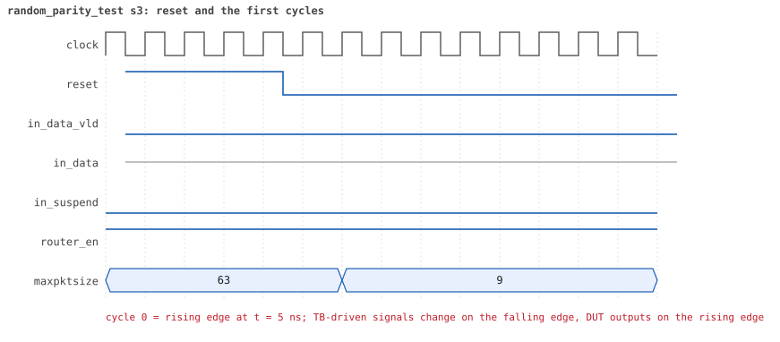
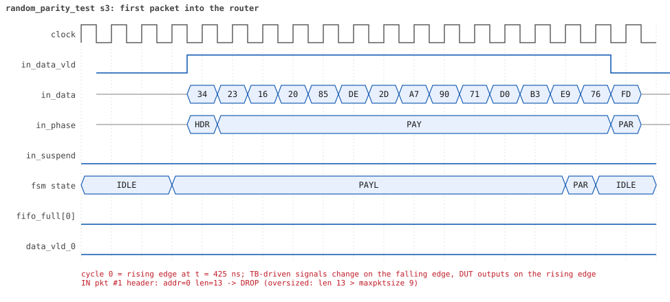
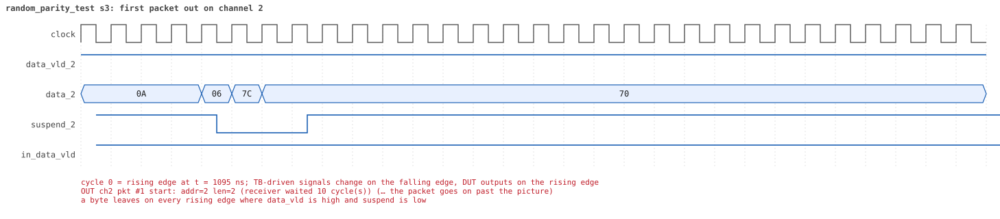
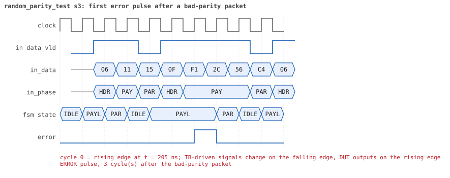
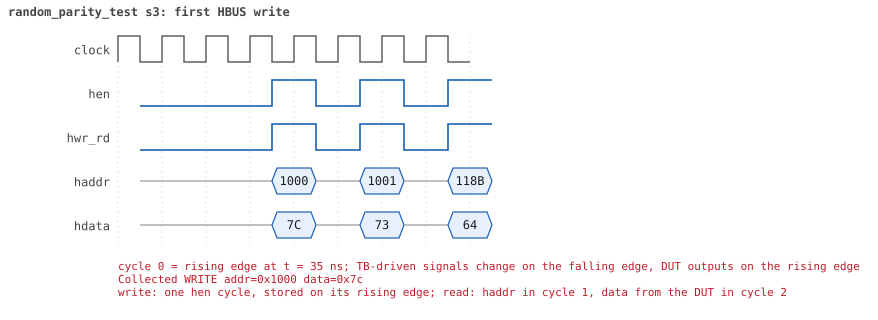
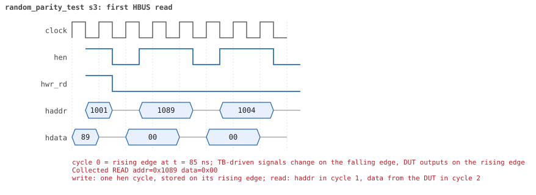

# random_parity_test  seed 3

**Result:** PASSED (0 UVM_ERROR, 0 UVM_WARNING, 0 UVM_FATAL) · bench `yapp_project_tb` · sim time 10us · log `random_parity_test_s3.log`

Waves: `random_parity_test_s3.fst` (GTKWave, Surfer or the VS Code wave viewer); signal trace: `signals.csv`.
[Open the waves in Surfer](https://app.surfer-project.org/?load_url=https%3A%2F%2Fraw.githubusercontent.com%2Ftamirgabgab%2FQcom-Mentoring%2Fmain%2Fyapp_project%2Fregression%2Fyapp_project_tb%2Frandom_parity_test_s3%2Frandom_parity_test_s3.fst&startup_commands=run_command_file_from_url%20https%3A%2F%2Fraw.githubusercontent.com%2Ftamirgabgab%2FQcom-Mentoring%2Fmain%2Fyapp_project%2Ftb%2Fyapp_router.sucl) (web app, the signals already in groups: `yapp_project/tb/yapp_router.sucl`).

## Summary

- YAPP driver sent **41** packet(s) (21 with bad parity); the input monitor saw 41.
- Router: **27** forwarded, **14** dropped (5 illegal address 3, 9 oversized).
- Packets out: ch0 **7**, ch1 **8**, ch2 **12**.
- Scoreboard: 27 matched, 0 mismatched, 0 unexpected.
- Back-pressure: in_suspend asserted **0** time(s).
- Error pulses: 21.
- HBUS: 13 write(s), 88 read(s).

## Stages

| time (ns) | stage |
|---|---|
| 0 | receivers: ch0 RX_STALLY, ch1 RX_STALLY, ch2 RX_FAST |
| 0 | random scenario: 41 packets in 3 bursts |
| 200 | burst 1/3: ctrl=0x7c (maxpktsize 60) en=0x73 (router on, counter enables 0111001), 14 packet(s) -- storm: 1..3-byte packets back to back, half with bad parity |
| 820 | burst 1/3 sent: addr0..3 4/3/4/3, bad parity 9, gap 0 13, length 1..3 |
| 1020 | burst 2/3: ctrl=0x38 (maxpktsize 56) en=0x73 (router on, counter enables 0111001), 13 packet(s) -- storm: 1..3-byte packets back to back, half with bad parity |
| 1560 | burst 2/3 sent: addr0..3 2/4/6/1, bad parity 6, gap 0 11, length 1..3 |
| 1920 | burst 3/3: ctrl=0xd1 (maxpktsize 17) en=0x01 (router on, counter enables 0000000), 14 packet(s) |
| 7100 | burst 3/3 sent: addr0..3 2/5/6/1, bad parity 6, gap 0 5, length 1..63 |
| 7100 | final reads: every register and the stored packet, checked against the reference model |
| 9405 | done: 41 packets (27 forwarded, 14 dropped), 2 storm burst(s), 27 scoreboard matches, 84 HBUS reads checked, 21 error pulses for 21 bad packets |

## Pictures

**reset and the first cycles**

**first packet into the router**

**first packet out on channel 2**

**first error pulse after a bad-parity packet**

**first HBUS write**

**first HBUS read**

## Timeline

676 events (the same list is in `timeline.csv`).

| time (ns) | who | event |
|---|---|---|
| 0 | yapp monitor | YAPP monitor running |
| 0 | **test** | STAGE: receivers: ch0 RX_STALLY, ch1 RX_STALLY, ch2 RX_FAST |
| 0 | **test** | STAGE: random scenario: 41 packets in 3 bursts |
| 0 | clk/rst driver | Starting clock (period 10) and holding reset for 5 cycles |
| 0 | **DUT** | RESET asserted |
| 50 | **DUT** | RESET released: router_en=1 maxpktsize=63 |
| 70 | hbus driver | Executed WRITE addr=0x1000 data=0x7c |
| 75 | **DUT** | CONFIG router_en=1 maxpktsize=60 |
| 75 | hbus monitor | Collected WRITE addr=0x1000 data=0x7c |
| 75 | reference | maxpktsize is now 60 |
| 90 | hbus driver | Executed WRITE addr=0x1001 data=0x73 |
| 95 | hbus monitor | Collected WRITE addr=0x1001 data=0x73 |
| 95 | reference | router_en is now 1 (en_reg 0x73) |
| 110 | hbus driver | Executed WRITE addr=0x118b data=0x64 |
| 115 | hbus monitor | Collected WRITE addr=0x118b data=0x64 |
| 140 | hbus driver | Executed READ  addr=0x118b data=0x64 |
| 145 | hbus monitor | Collected READ  addr=0x118b data=0x64 |
| 170 | hbus driver | Executed READ  addr=0x1000 data=0x7c |
| 175 | hbus monitor | Collected READ  addr=0x1000 data=0x7c |
| 200 | hbus driver | Executed READ  addr=0x101e data=0x00 |
| 200 | **test** | STAGE: burst 1/3: ctrl=0x7c (maxpktsize 60) en=0x73 (router on, counter enables 0111001), 14 packet(s) -- storm: 1..3-byte packets back to back, half with bad parity |
| 200 | yapp driver | TX pkt #1: addr=2 len=1 parity=bad delay=0 |
| 205 | hbus monitor | Collected READ  addr=0x101e data=0x00 |
| 215 | **DUT** | IN  pkt #1 header: addr=2 len=1 -> channel 2 |
| 225 | **DUT** | OUT ch2 pkt #1 start: addr=2 len=1 (receiver waited 0 cycle(s)) |
| 235 | **DUT** | IN  pkt #1 complete: addr=2 len=1 parity=BAD forwarded, 3 bytes in 3 cycles (held 0) |
| 235 | yapp monitor | RX pkt #1 on the input: addr=2 len=1 parity=bad gap=16 |
| 235 | reference | Packet forwarded: addr=2 len=1 -> channel 2 |
| 240 | ch2 driver | ch2: packet consumed (response delay 0) |
| 240 | yapp driver | TX pkt #1 accepted by the DUT |
| 240 | yapp driver | TX pkt #2: addr=3 len=3 parity=bad delay=0 |
| 245 | **DUT** | IN  pkt #2 header: addr=3 len=3 -> DROP (illegal address 3) |
| 255 | **DUT** | OUT ch2 pkt #1 done: 3 bytes in 4 cycles |
| 255 | ch2 monitor | ch2 RX pkt #1: addr=2 len=1 parity=bad |
| 255 | scoreboard | ch2 pkt matched: addr=2 len=1 (1 matched so far) |
| 270 | **DUT** | ERROR pulse, 3 cycle(s) after the bad-parity packet |
| 270 | error checker | error pulse 3 cycles after the bad packet (0 still owed) |
| 285 | **DUT** | IN  pkt #2 complete: addr=3 len=3 parity=BAD dropped, 5 bytes in 5 cycles (held 0) |
| 285 | yapp monitor | RX pkt #2 on the input: addr=3 len=3 parity=bad gap=0 |
| 285 | reference | Packet dropped: illegal address 3 (len=3) |
| 285 | **DUT** | ROUTER DROPS PACKET addr=3 length=3 (    illegal address) |
| 290 | yapp driver | TX pkt #2 accepted by the DUT |
| 290 | yapp driver | TX pkt #3: addr=2 len=1 parity=bad delay=0 |
| 295 | **DUT** | IN  pkt #3 header: addr=2 len=1 -> channel 2 |
| 305 | **DUT** | OUT ch2 pkt #2 start: addr=2 len=1 (receiver waited 0 cycle(s)) |
| 310 | ch2 driver | ch2: packet consumed (response delay 0) |
| 315 | **DUT** | IN  pkt #3 complete: addr=2 len=1 parity=BAD forwarded, 3 bytes in 3 cycles (held 0) |
| 315 | yapp monitor | RX pkt #3 on the input: addr=2 len=1 parity=bad gap=0 |
| 315 | reference | Packet forwarded: addr=2 len=1 -> channel 2 |
| 320 | yapp driver | TX pkt #3 accepted by the DUT |
| 320 | yapp driver | TX pkt #4: addr=0 len=3 parity=bad delay=0 |
| 325 | **DUT** | IN  pkt #4 header: addr=0 len=3 -> channel 0 |
| 330 | **DUT** | ERROR pulse, 4 cycle(s) after the bad-parity packet (1 more owed) |
| 330 | error checker | error pulse 4 cycles after the bad packet (1 still owed) |
| 335 | **DUT** | OUT ch0 pkt #1 start: addr=0 len=3 (receiver waited 0 cycle(s)) |
| 335 | **DUT** | OUT ch2 pkt #2 done: 3 bytes in 4 cycles |
| 335 | ch2 monitor | ch2 RX pkt #2: addr=2 len=1 parity=bad |
| 335 | scoreboard | ch2 pkt matched: addr=2 len=1 (2 matched so far) |
| 365 | **DUT** | IN  pkt #4 complete: addr=0 len=3 parity=BAD forwarded, 5 bytes in 5 cycles (held 0) |
| 365 | yapp monitor | RX pkt #4 on the input: addr=0 len=3 parity=bad gap=0 |
| 365 | reference | Packet forwarded: addr=0 len=3 -> channel 0 |
| 370 | **DUT** | ERROR pulse, 5 cycle(s) after the bad-parity packet (1 more owed) |
| 370 | error checker | error pulse 5 cycles after the bad packet (1 still owed) |
| 370 | ch0 driver | ch0: packet consumed (response delay 0) |
| 370 | yapp driver | TX pkt #4 accepted by the DUT |
| 370 | yapp driver | TX pkt #5: addr=1 len=3 parity=bad delay=3 |
| 405 | **DUT** | IN  pkt #5 header: addr=1 len=3 -> channel 1 |
| 430 | **DUT** | ERROR pulse, 6 cycle(s) after the bad-parity packet |
| 430 | error checker | error pulse 6 cycles after the bad packet (0 still owed) |
| 445 | **DUT** | IN  pkt #5 complete: addr=1 len=3 parity=BAD forwarded, 5 bytes in 5 cycles (held 0) |
| 445 | yapp monitor | RX pkt #5 on the input: addr=1 len=3 parity=bad gap=3 |
| 445 | reference | Packet forwarded: addr=1 len=3 -> channel 1 |
| 450 | yapp driver | TX pkt #5 accepted by the DUT |
| 450 | yapp driver | TX pkt #6: addr=0 len=3 parity=good delay=0 |
| 455 | **DUT** | IN  pkt #6 header: addr=0 len=3 -> channel 0 |
| 465 | **DUT** | OUT ch0 pkt #1 done: 5 bytes in 14 cycles |
| 465 | ch0 monitor | ch0 RX pkt #1: addr=0 len=3 parity=bad |
| 465 | scoreboard | ch0 pkt matched: addr=0 len=3 (3 matched so far) |
| 475 | **DUT** | OUT ch0 pkt #2 start: addr=0 len=3 (receiver waited 0 cycle(s)) |
| 495 | **DUT** | IN  pkt #6 complete: addr=0 len=3 parity=ok forwarded, 5 bytes in 5 cycles (held 0) |
| 495 | yapp monitor | RX pkt #6 on the input: addr=0 len=3 parity=good gap=0 |
| 495 | reference | Packet forwarded: addr=0 len=3 -> channel 0 |
| 500 | yapp driver | TX pkt #6 accepted by the DUT |
| 500 | yapp driver | TX pkt #7: addr=2 len=3 parity=good delay=0 |
| 505 | **DUT** | IN  pkt #7 header: addr=2 len=3 -> channel 2 |
| 505 | **DUT** | OUT ch1 pkt #1 start: addr=1 len=3 (receiver waited 9 cycle(s)) |
| 515 | **DUT** | OUT ch0 pkt #2 done: 5 bytes in 5 cycles |
| 515 | **DUT** | OUT ch2 pkt #3 start: addr=2 len=3 (receiver waited 0 cycle(s)) |
| 515 | ch0 monitor | ch0 RX pkt #2: addr=0 len=3 parity=good |
| 515 | scoreboard | ch0 pkt matched: addr=0 len=3 (4 matched so far) |
| 530 | **DUT** | ERROR pulse, 8 cycle(s) after the bad-parity packet |
| 530 | error checker | error pulse 8 cycles after the bad packet (0 still owed) |
| 540 | ch1 driver | ch1: packet consumed (response delay 9) |
| 545 | **DUT** | IN  pkt #7 complete: addr=2 len=3 parity=ok forwarded, 5 bytes in 5 cycles (held 0) |
| 545 | yapp monitor | RX pkt #7 on the input: addr=2 len=3 parity=good gap=0 |
| 545 | reference | Packet forwarded: addr=2 len=3 -> channel 2 |
| 550 | yapp driver | TX pkt #7 accepted by the DUT |
| 550 | yapp driver | TX pkt #8: addr=2 len=1 parity=bad delay=0 |
| 555 | **DUT** | IN  pkt #8 header: addr=2 len=1 -> channel 2 |
| 555 | **DUT** | OUT ch2 pkt #3 done: 5 bytes in 5 cycles |
| 555 | ch2 monitor | ch2 RX pkt #3: addr=2 len=3 parity=good |
| 555 | scoreboard | ch2 pkt matched: addr=2 len=3 (5 matched so far) |
| 565 | **DUT** | OUT ch2 pkt #4 start: addr=2 len=1 (receiver waited 0 cycle(s)) |
| 575 | **DUT** | IN  pkt #8 complete: addr=2 len=1 parity=BAD forwarded, 3 bytes in 3 cycles (held 0) |
| 575 | yapp monitor | RX pkt #8 on the input: addr=2 len=1 parity=bad gap=0 |
| 575 | reference | Packet forwarded: addr=2 len=1 -> channel 2 |
| 580 | yapp driver | TX pkt #8 accepted by the DUT |
| 580 | yapp driver | TX pkt #9: addr=0 len=2 parity=bad delay=0 |
| 585 | **DUT** | IN  pkt #9 header: addr=0 len=2 -> channel 0 |
| 585 | **DUT** | OUT ch2 pkt #4 done: 3 bytes in 3 cycles |
| 585 | ch2 monitor | ch2 RX pkt #4: addr=2 len=1 parity=bad |
| 585 | scoreboard | ch2 pkt matched: addr=2 len=1 (6 matched so far) |
| 590 | ch0 driver | ch0: packet consumed (response delay 8) |
| 615 | **DUT** | IN  pkt #9 complete: addr=0 len=2 parity=BAD forwarded, 4 bytes in 4 cycles (held 0) |
| 615 | yapp monitor | RX pkt #9 on the input: addr=0 len=2 parity=bad gap=0 |
| 615 | reference | Packet forwarded: addr=0 len=2 -> channel 0 |
| 620 | yapp driver | TX pkt #9 accepted by the DUT |
| 620 | yapp driver | TX pkt #10: addr=0 len=1 parity=good delay=0 |
| 625 | **DUT** | IN  pkt #10 header: addr=0 len=1 -> channel 0 |
| 625 | **DUT** | OUT ch1 pkt #1 done: 5 bytes in 13 cycles |
| 625 | ch1 monitor | ch1 RX pkt #1: addr=1 len=3 parity=bad |
| 625 | scoreboard | ch1 pkt matched: addr=1 len=3 (7 matched so far) |
| 630 | **DUT** | ERROR pulse, 5 cycle(s) after the bad-parity packet (1 more owed) |
| 630 | error checker | error pulse 5 cycles after the bad packet (1 still owed) |
| 645 | **DUT** | IN  pkt #10 complete: addr=0 len=1 parity=ok forwarded, 3 bytes in 3 cycles (held 0) |
| 645 | yapp monitor | RX pkt #10 on the input: addr=0 len=1 parity=good gap=0 |
| 645 | reference | Packet forwarded: addr=0 len=1 -> channel 0 |
| 650 | yapp driver | TX pkt #10 accepted by the DUT |
| 650 | yapp driver | TX pkt #11: addr=3 len=3 parity=bad delay=0 |
| 655 | **DUT** | IN  pkt #11 header: addr=3 len=3 -> DROP (illegal address 3) |
| 665 | **DUT** | OUT ch0 pkt #3 start: addr=0 len=2 (receiver waited 7 cycle(s)) |
| 690 | ch0 driver | ch0: packet consumed (response delay 6) |
| 695 | **DUT** | IN  pkt #11 complete: addr=3 len=3 parity=BAD dropped, 5 bytes in 5 cycles (held 0) |
| 695 | yapp monitor | RX pkt #11 on the input: addr=3 len=3 parity=bad gap=0 |
| 695 | reference | Packet dropped: illegal address 3 (len=3) |
| 695 | **DUT** | ROUTER DROPS PACKET addr=3 length=3 (    illegal address) |
| 700 | yapp driver | TX pkt #11 accepted by the DUT |
| 700 | yapp driver | TX pkt #12: addr=1 len=2 parity=good delay=0 |
| 705 | **DUT** | IN  pkt #12 header: addr=1 len=2 -> channel 1 |
| 710 | **DUT** | ERROR pulse, 9 cycle(s) after the bad-parity packet (1 more owed) |
| 710 | error checker | error pulse 9 cycles after the bad packet (1 still owed) |
| 715 | **DUT** | OUT ch1 pkt #2 start: addr=1 len=2 (receiver waited 0 cycle(s)) |
| 720 | **DUT** | ERROR pulse, 2 cycle(s) after the bad-parity packet |
| 720 | error checker | error pulse 2 cycles after the bad packet (0 still owed) |
| 735 | **DUT** | IN  pkt #12 complete: addr=1 len=2 parity=ok forwarded, 4 bytes in 4 cycles (held 0) |
| 735 | yapp monitor | RX pkt #12 on the input: addr=1 len=2 parity=good gap=0 |
| 735 | reference | Packet forwarded: addr=1 len=2 -> channel 1 |
| 740 | yapp driver | TX pkt #12 accepted by the DUT |
| 740 | yapp driver | TX pkt #13: addr=3 len=3 parity=bad delay=0 |
| 745 | **DUT** | IN  pkt #13 header: addr=3 len=3 -> DROP (illegal address 3) |
| 745 | **DUT** | OUT ch0 pkt #3 done: 4 bytes in 9 cycles |
| 745 | **DUT** | OUT ch1 pkt #2 done: 4 bytes in 4 cycles |
| 745 | ch0 monitor | ch0 RX pkt #3: addr=0 len=2 parity=bad |
| 745 | scoreboard | ch0 pkt matched: addr=0 len=2 (8 matched so far) |
| 745 | ch1 monitor | ch1 RX pkt #2: addr=1 len=2 parity=good |
| 745 | scoreboard | ch1 pkt matched: addr=1 len=2 (9 matched so far) |
| 755 | **DUT** | OUT ch0 pkt #4 start: addr=0 len=1 (receiver waited 0 cycle(s)) |
| 770 | ch2 driver | ch2: packet consumed (response delay 0) |
| 775 | **DUT** | OUT ch0 pkt #4 done: 3 bytes in 3 cycles |
| 775 | ch0 monitor | ch0 RX pkt #4: addr=0 len=1 parity=good |
| 775 | scoreboard | ch0 pkt matched: addr=0 len=1 (10 matched so far) |
| 785 | **DUT** | IN  pkt #13 complete: addr=3 len=3 parity=BAD dropped, 5 bytes in 5 cycles (held 0) |
| 785 | yapp monitor | RX pkt #13 on the input: addr=3 len=3 parity=bad gap=0 |
| 785 | reference | Packet dropped: illegal address 3 (len=3) |
| 785 | **DUT** | ROUTER DROPS PACKET addr=3 length=3 (    illegal address) |
| 790 | yapp driver | TX pkt #13 accepted by the DUT |
| 790 | yapp driver | TX pkt #14: addr=1 len=1 parity=good delay=0 |
| 795 | **DUT** | IN  pkt #14 header: addr=1 len=1 -> channel 1 |
| 805 | **DUT** | OUT ch1 pkt #3 start: addr=1 len=1 (receiver waited 0 cycle(s)) |
| 815 | **DUT** | IN  pkt #14 complete: addr=1 len=1 parity=ok forwarded, 3 bytes in 3 cycles (held 0) |
| 815 | yapp monitor | RX pkt #14 on the input: addr=1 len=1 parity=good gap=0 |
| 815 | reference | Packet forwarded: addr=1 len=1 -> channel 1 |
| 820 | yapp driver | TX pkt #14 accepted by the DUT |
| 820 | **test** | STAGE: burst 1/3 sent: addr0..3 4/3/4/3, bad parity 9, gap 0 13, length 1..3 |
| 825 | **DUT** | OUT ch1 pkt #3 done: 3 bytes in 3 cycles |
| 825 | ch1 monitor | ch1 RX pkt #3: addr=1 len=1 parity=good |
| 825 | scoreboard | ch1 pkt matched: addr=1 len=1 (11 matched so far) |
| 840 | hbus driver | Executed WRITE addr=0x1000 data=0x38 |
| 845 | **DUT** | CONFIG router_en=1 maxpktsize=56 |
| 845 | hbus monitor | Collected WRITE addr=0x1000 data=0x38 |
| 845 | reference | maxpktsize is now 56 |
| 860 | hbus driver | Executed WRITE addr=0x1001 data=0x73 |
| 865 | hbus monitor | Collected WRITE addr=0x1001 data=0x73 |
| 865 | reference | router_en is now 1 (en_reg 0x73) |
| 890 | **DUT** | ERROR pulse, 10 cycle(s) after the bad-parity packet |
| 890 | error checker | error pulse 10 cycles after the bad packet (0 still owed) |
| 890 | hbus driver | Executed READ  addr=0x1005 data=0x00 |
| 895 | hbus monitor | Collected READ  addr=0x1005 data=0x00 |
| 910 | hbus driver | Executed WRITE addr=0x1121 data=0xfb |
| 915 | hbus monitor | Collected WRITE addr=0x1121 data=0xfb |
| 940 | hbus driver | Executed READ  addr=0x1121 data=0xfb |
| 945 | hbus monitor | Collected READ  addr=0x1121 data=0xfb |
| 970 | hbus driver | Executed READ  addr=0x1005 data=0x00 |
| 975 | hbus monitor | Collected READ  addr=0x1005 data=0x00 |
| 990 | hbus driver | Executed WRITE addr=0x11f6 data=0x69 |
| 995 | hbus monitor | Collected WRITE addr=0x11f6 data=0x69 |
| 1020 | hbus driver | Executed READ  addr=0x11f6 data=0x69 |
| 1020 | **test** | STAGE: burst 2/3: ctrl=0x38 (maxpktsize 56) en=0x73 (router on, counter enables 0111001), 13 packet(s) -- storm: 1..3-byte packets back to back, half with bad parity |
| 1020 | yapp driver | TX pkt #15: addr=1 len=1 parity=good delay=0 |
| 1025 | hbus monitor | Collected READ  addr=0x11f6 data=0x69 |
| 1030 | ch1 driver | ch1: packet consumed (response delay 7) |
| 1035 | **DUT** | IN  pkt #15 header: addr=1 len=1 -> channel 1 |
| 1045 | **DUT** | OUT ch1 pkt #4 start: addr=1 len=1 (receiver waited 0 cycle(s)) |
| 1055 | **DUT** | IN  pkt #15 complete: addr=1 len=1 parity=ok forwarded, 3 bytes in 3 cycles (held 0) |
| 1055 | yapp monitor | RX pkt #15 on the input: addr=1 len=1 parity=good gap=21 |
| 1055 | reference | Packet forwarded: addr=1 len=1 -> channel 1 |
| 1060 | ch1 driver | ch1: packet consumed (response delay 0) |
| 1060 | yapp driver | TX pkt #15 accepted by the DUT |
| 1060 | yapp driver | TX pkt #16: addr=1 len=1 parity=good delay=0 |
| 1065 | **DUT** | IN  pkt #16 header: addr=1 len=1 -> channel 1 |
| 1085 | **DUT** | IN  pkt #16 complete: addr=1 len=1 parity=ok forwarded, 3 bytes in 3 cycles (held 0) |
| 1085 | yapp monitor | RX pkt #16 on the input: addr=1 len=1 parity=good gap=0 |
| 1085 | reference | Packet forwarded: addr=1 len=1 -> channel 1 |
| 1090 | yapp driver | TX pkt #16 accepted by the DUT |
| 1090 | yapp driver | TX pkt #17: addr=2 len=3 parity=bad delay=0 |
| 1095 | **DUT** | IN  pkt #17 header: addr=2 len=3 -> channel 2 |
| 1105 | **DUT** | OUT ch2 pkt #5 start: addr=2 len=3 (receiver waited 0 cycle(s)) |
| 1130 | ch0 driver | ch0: packet consumed (response delay 4) |
| 1135 | **DUT** | IN  pkt #17 complete: addr=2 len=3 parity=BAD forwarded, 5 bytes in 5 cycles (held 0) |
| 1135 | yapp monitor | RX pkt #17 on the input: addr=2 len=3 parity=bad gap=0 |
| 1135 | reference | Packet forwarded: addr=2 len=3 -> channel 2 |
| 1140 | ch2 driver | ch2: packet consumed (response delay 0) |
| 1140 | yapp driver | TX pkt #17 accepted by the DUT |
| 1140 | yapp driver | TX pkt #18: addr=2 len=1 parity=bad delay=0 |
| 1145 | **DUT** | IN  pkt #18 header: addr=2 len=1 -> channel 2 |
| 1155 | **DUT** | OUT ch2 pkt #5 done: 5 bytes in 6 cycles |
| 1155 | ch2 monitor | ch2 RX pkt #5: addr=2 len=3 parity=bad |
| 1155 | scoreboard | ch2 pkt matched: addr=2 len=3 (12 matched so far) |
| 1165 | **DUT** | IN  pkt #18 complete: addr=2 len=1 parity=BAD forwarded, 3 bytes in 3 cycles (held 0) |
| 1165 | **DUT** | OUT ch2 pkt #6 start: addr=2 len=1 (receiver waited 0 cycle(s)) |
| 1165 | yapp monitor | RX pkt #18 on the input: addr=2 len=1 parity=bad gap=0 |
| 1165 | reference | Packet forwarded: addr=2 len=1 -> channel 2 |
| 1170 | **DUT** | ERROR pulse, 3 cycle(s) after the bad-parity packet (1 more owed) |
| 1170 | error checker | error pulse 3 cycles after the bad packet (1 still owed) |
| 1170 | yapp driver | TX pkt #18 accepted by the DUT |
| 1170 | yapp driver | TX pkt #19: addr=3 len=3 parity=bad delay=0 |
| 1175 | **DUT** | IN  pkt #19 header: addr=3 len=3 -> DROP (illegal address 3) |
| 1185 | **DUT** | OUT ch2 pkt #6 done: 3 bytes in 3 cycles |
| 1185 | ch2 monitor | ch2 RX pkt #6: addr=2 len=1 parity=bad |
| 1185 | scoreboard | ch2 pkt matched: addr=2 len=1 (13 matched so far) |
| 1190 | ch2 driver | ch2: packet consumed (response delay 0) |
| 1215 | **DUT** | IN  pkt #19 complete: addr=3 len=3 parity=BAD dropped, 5 bytes in 5 cycles (held 0) |
| 1215 | yapp monitor | RX pkt #19 on the input: addr=3 len=3 parity=bad gap=0 |
| 1215 | reference | Packet dropped: illegal address 3 (len=3) |
| 1215 | **DUT** | ROUTER DROPS PACKET addr=3 length=3 (    illegal address) |
| 1220 | yapp driver | TX pkt #19 accepted by the DUT |
| 1220 | yapp driver | TX pkt #20: addr=2 len=3 parity=bad delay=1 |
| 1230 | **DUT** | ERROR pulse, 6 cycle(s) after the bad-parity packet (1 more owed) |
| 1230 | error checker | error pulse 6 cycles after the bad packet (1 still owed) |
| 1235 | **DUT** | IN  pkt #20 header: addr=2 len=3 -> channel 2 |
| 1245 | **DUT** | OUT ch2 pkt #7 start: addr=2 len=3 (receiver waited 0 cycle(s)) |
| 1270 | **DUT** | ERROR pulse, 5 cycle(s) after the bad-parity packet |
| 1270 | error checker | error pulse 5 cycles after the bad packet (0 still owed) |
| 1275 | **DUT** | IN  pkt #20 complete: addr=2 len=3 parity=BAD forwarded, 5 bytes in 5 cycles (held 0) |
| 1275 | yapp monitor | RX pkt #20 on the input: addr=2 len=3 parity=bad gap=1 |
| 1275 | reference | Packet forwarded: addr=2 len=3 -> channel 2 |
| 1280 | ch2 driver | ch2: packet consumed (response delay 0) |
| 1280 | yapp driver | TX pkt #20 accepted by the DUT |
| 1280 | yapp driver | TX pkt #21: addr=1 len=2 parity=good delay=3 |
| 1290 | **DUT** | ERROR pulse, 1 cycle(s) after the bad-parity packet |
| 1290 | error checker | error pulse 1 cycles after the bad packet (0 still owed) |
| 1295 | **DUT** | OUT ch2 pkt #7 done: 5 bytes in 6 cycles |
| 1295 | ch2 monitor | ch2 RX pkt #7: addr=2 len=3 parity=bad |
| 1295 | scoreboard | ch2 pkt matched: addr=2 len=3 (14 matched so far) |
| 1315 | **DUT** | IN  pkt #21 header: addr=1 len=2 -> channel 1 |
| 1345 | **DUT** | IN  pkt #21 complete: addr=1 len=2 parity=ok forwarded, 4 bytes in 4 cycles (held 0) |
| 1345 | yapp monitor | RX pkt #21 on the input: addr=1 len=2 parity=good gap=3 |
| 1345 | reference | Packet forwarded: addr=1 len=2 -> channel 1 |
| 1350 | yapp driver | TX pkt #21 accepted by the DUT |
| 1350 | yapp driver | TX pkt #22: addr=2 len=1 parity=good delay=0 |
| 1355 | **DUT** | IN  pkt #22 header: addr=2 len=1 -> channel 2 |
| 1365 | **DUT** | OUT ch2 pkt #8 start: addr=2 len=1 (receiver waited 0 cycle(s)) |
| 1375 | **DUT** | IN  pkt #22 complete: addr=2 len=1 parity=ok forwarded, 3 bytes in 3 cycles (held 0) |
| 1375 | yapp monitor | RX pkt #22 on the input: addr=2 len=1 parity=good gap=0 |
| 1375 | reference | Packet forwarded: addr=2 len=1 -> channel 2 |
| 1380 | yapp driver | TX pkt #22 accepted by the DUT |
| 1380 | yapp driver | TX pkt #23: addr=2 len=1 parity=good delay=0 |
| 1385 | **DUT** | IN  pkt #23 header: addr=2 len=1 -> channel 2 |
| 1385 | **DUT** | OUT ch2 pkt #8 done: 3 bytes in 3 cycles |
| 1385 | ch2 monitor | ch2 RX pkt #8: addr=2 len=1 parity=good |
| 1385 | scoreboard | ch2 pkt matched: addr=2 len=1 (15 matched so far) |
| 1395 | **DUT** | OUT ch2 pkt #9 start: addr=2 len=1 (receiver waited 0 cycle(s)) |
| 1405 | **DUT** | IN  pkt #23 complete: addr=2 len=1 parity=ok forwarded, 3 bytes in 3 cycles (held 0) |
| 1405 | yapp monitor | RX pkt #23 on the input: addr=2 len=1 parity=good gap=0 |
| 1405 | reference | Packet forwarded: addr=2 len=1 -> channel 2 |
| 1410 | yapp driver | TX pkt #23 accepted by the DUT |
| 1410 | yapp driver | TX pkt #24: addr=0 len=3 parity=bad delay=0 |
| 1415 | **DUT** | IN  pkt #24 header: addr=0 len=3 -> channel 0 |
| 1415 | **DUT** | OUT ch2 pkt #9 done: 3 bytes in 3 cycles |
| 1415 | ch2 monitor | ch2 RX pkt #9: addr=2 len=1 parity=good |
| 1415 | scoreboard | ch2 pkt matched: addr=2 len=1 (16 matched so far) |
| 1455 | **DUT** | IN  pkt #24 complete: addr=0 len=3 parity=BAD forwarded, 5 bytes in 5 cycles (held 0) |
| 1455 | yapp monitor | RX pkt #24 on the input: addr=0 len=3 parity=bad gap=0 |
| 1455 | reference | Packet forwarded: addr=0 len=3 -> channel 0 |
| 1460 | yapp driver | TX pkt #24 accepted by the DUT |
| 1460 | yapp driver | TX pkt #25: addr=0 len=1 parity=bad delay=0 |
| 1465 | **DUT** | IN  pkt #25 header: addr=0 len=1 -> channel 0 |
| 1485 | **DUT** | IN  pkt #25 complete: addr=0 len=1 parity=BAD forwarded, 3 bytes in 3 cycles (held 0) |
| 1485 | yapp monitor | RX pkt #25 on the input: addr=0 len=1 parity=bad gap=0 |
| 1485 | reference | Packet forwarded: addr=0 len=1 -> channel 0 |
| 1490 | **DUT** | ERROR pulse, 3 cycle(s) after the bad-parity packet (1 more owed) |
| 1490 | error checker | error pulse 3 cycles after the bad packet (1 still owed) |
| 1490 | yapp driver | TX pkt #25 accepted by the DUT |
| 1490 | yapp driver | TX pkt #26: addr=2 len=1 parity=good delay=0 |
| 1495 | **DUT** | IN  pkt #26 header: addr=2 len=1 -> channel 2 |
| 1505 | **DUT** | OUT ch2 pkt #10 start: addr=2 len=1 (receiver waited 0 cycle(s)) |
| 1515 | **DUT** | IN  pkt #26 complete: addr=2 len=1 parity=ok forwarded, 3 bytes in 3 cycles (held 0) |
| 1515 | yapp monitor | RX pkt #26 on the input: addr=2 len=1 parity=good gap=0 |
| 1515 | reference | Packet forwarded: addr=2 len=1 -> channel 2 |
| 1520 | yapp driver | TX pkt #26 accepted by the DUT |
| 1520 | yapp driver | TX pkt #27: addr=1 len=2 parity=good delay=0 |
| 1525 | **DUT** | IN  pkt #27 header: addr=1 len=2 -> channel 1 |
| 1525 | **DUT** | OUT ch0 pkt #5 start: addr=0 len=3 (receiver waited 10 cycle(s)) |
| 1525 | **DUT** | OUT ch2 pkt #10 done: 3 bytes in 3 cycles |
| 1525 | ch2 monitor | ch2 RX pkt #10: addr=2 len=1 parity=good |
| 1525 | scoreboard | ch2 pkt matched: addr=2 len=1 (17 matched so far) |
| 1550 | **DUT** | ERROR pulse, 6 cycle(s) after the bad-parity packet |
| 1550 | error checker | error pulse 6 cycles after the bad packet (0 still owed) |
| 1555 | **DUT** | IN  pkt #27 complete: addr=1 len=2 parity=ok forwarded, 4 bytes in 4 cycles (held 0) |
| 1555 | yapp monitor | RX pkt #27 on the input: addr=1 len=2 parity=good gap=0 |
| 1555 | reference | Packet forwarded: addr=1 len=2 -> channel 1 |
| 1560 | ch0 driver | ch0: packet consumed (response delay 10) |
| 1560 | yapp driver | TX pkt #27 accepted by the DUT |
| 1560 | **test** | STAGE: burst 2/3 sent: addr0..3 2/4/6/1, bad parity 6, gap 0 11, length 1..3 |
| 1575 | **DUT** | OUT ch0 pkt #5 done: 5 bytes in 6 cycles |
| 1575 | ch0 monitor | ch0 RX pkt #5: addr=0 len=3 parity=bad |
| 1575 | scoreboard | ch0 pkt matched: addr=0 len=3 (18 matched so far) |
| 1580 | hbus driver | Executed WRITE addr=0x1000 data=0xd1 |
| 1585 | **DUT** | OUT ch0 pkt #6 start: addr=0 len=1 (receiver waited 0 cycle(s)) |
| 1585 | **DUT** | CONFIG router_en=1 maxpktsize=17 |
| 1585 | hbus monitor | Collected WRITE addr=0x1000 data=0xd1 |
| 1585 | reference | maxpktsize is now 17 |
| 1600 | hbus driver | Executed WRITE addr=0x1001 data=0x01 |
| 1605 | **DUT** | OUT ch0 pkt #6 done: 3 bytes in 3 cycles |
| 1605 | ch0 monitor | ch0 RX pkt #6: addr=0 len=1 parity=bad |
| 1605 | scoreboard | ch0 pkt matched: addr=0 len=1 (19 matched so far) |
| 1605 | hbus monitor | Collected WRITE addr=0x1001 data=0x01 |
| 1605 | reference | router_en is now 1 (en_reg 0x01) |
| 1630 | hbus driver | Executed READ  addr=0x1000 data=0xd1 |
| 1635 | hbus monitor | Collected READ  addr=0x1000 data=0xd1 |
| 1650 | hbus driver | Executed WRITE addr=0x118b data=0x56 |
| 1655 | hbus monitor | Collected WRITE addr=0x118b data=0x56 |
| 1670 | ch2 driver | ch2: packet consumed (response delay 0) |
| 1680 | hbus driver | Executed READ  addr=0x118b data=0x56 |
| 1685 | hbus monitor | Collected READ  addr=0x118b data=0x56 |
| 1700 | hbus driver | Executed WRITE addr=0x1120 data=0xdd |
| 1705 | hbus monitor | Collected WRITE addr=0x1120 data=0xdd |
| 1730 | hbus driver | Executed READ  addr=0x1120 data=0xdd |
| 1735 | hbus monitor | Collected READ  addr=0x1120 data=0xdd |
| 1760 | ch0 driver | ch0: packet consumed (response delay 0) |
| 1760 | hbus driver | Executed READ  addr=0x101c data=0x00 |
| 1765 | hbus monitor | Collected READ  addr=0x101c data=0x00 |
| 1790 | hbus driver | Executed READ  addr=0x1015 data=0x00 |
| 1795 | hbus monitor | Collected READ  addr=0x1015 data=0x00 |
| 1810 | hbus driver | Executed WRITE addr=0x11d0 data=0x86 |
| 1815 | hbus monitor | Collected WRITE addr=0x11d0 data=0x86 |
| 1840 | hbus driver | Executed READ  addr=0x11d0 data=0x86 |
| 1845 | **DUT** | OUT ch1 pkt #4 done: 3 bytes in 81 cycles |
| 1845 | ch1 monitor | ch1 RX pkt #4: addr=1 len=1 parity=good |
| 1845 | scoreboard | ch1 pkt matched: addr=1 len=1 (20 matched so far) |
| 1845 | hbus monitor | Collected READ  addr=0x11d0 data=0x86 |
| 1855 | **DUT** | OUT ch1 pkt #5 start: addr=1 len=1 (receiver waited 0 cycle(s)) |
| 1860 | hbus driver | Executed WRITE addr=0x1110 data=0x16 |
| 1865 | hbus monitor | Collected WRITE addr=0x1110 data=0x16 |
| 1875 | **DUT** | OUT ch1 pkt #5 done: 3 bytes in 3 cycles |
| 1875 | ch1 monitor | ch1 RX pkt #5: addr=1 len=1 parity=good |
| 1875 | scoreboard | ch1 pkt matched: addr=1 len=1 (21 matched so far) |
| 1885 | **DUT** | OUT ch1 pkt #6 start: addr=1 len=2 (receiver waited 0 cycle(s)) |
| 1890 | hbus driver | Executed READ  addr=0x1110 data=0x16 |
| 1895 | hbus monitor | Collected READ  addr=0x1110 data=0x16 |
| 1915 | **DUT** | OUT ch1 pkt #6 done: 4 bytes in 4 cycles |
| 1915 | ch1 monitor | ch1 RX pkt #6: addr=1 len=2 parity=good |
| 1915 | scoreboard | ch1 pkt matched: addr=1 len=2 (22 matched so far) |
| 1920 | hbus driver | Executed READ  addr=0x1039 data=0x00 |
| 1920 | **test** | STAGE: burst 3/3: ctrl=0xd1 (maxpktsize 17) en=0x01 (router on, counter enables 0000000), 14 packet(s) |
| 1920 | yapp driver | TX pkt #28: addr=1 len=63 parity=bad delay=18 |
| 1925 | **DUT** | OUT ch1 pkt #7 start: addr=1 len=2 (receiver waited 0 cycle(s)) |
| 1925 | hbus monitor | Collected READ  addr=0x1039 data=0x00 |
| 1955 | **DUT** | OUT ch1 pkt #7 done: 4 bytes in 4 cycles |
| 1955 | ch1 monitor | ch1 RX pkt #7: addr=1 len=2 parity=good |
| 1955 | scoreboard | ch1 pkt matched: addr=1 len=2 (23 matched so far) |
| 2115 | **DUT** | IN  pkt #28 header: addr=1 len=63 -> DROP (oversized: len 63 > maxpktsize 17) |
| 2410 | ch1 driver | ch1: packet consumed (response delay 77) |
| 2755 | **DUT** | IN  pkt #28 complete: addr=1 len=63 parity=BAD dropped, 65 bytes in 65 cycles (held 0) |
| 2755 | yapp monitor | RX pkt #28 on the input: addr=1 len=63 parity=bad gap=55 |
| 2755 | reference | Packet dropped: length 63 > maxpktsize 17 (addr=1) |
| 2755 | **DUT** | ROUTER DROPS PACKET addr=1 length=63 (length > maxpktsize) |
| 2760 | yapp driver | TX pkt #28 accepted by the DUT |
| 2760 | yapp driver | TX pkt #29: addr=2 len=51 parity=bad delay=0 |
| 2765 | **DUT** | IN  pkt #29 header: addr=2 len=51 -> DROP (oversized: len 51 > maxpktsize 17) |
| 2810 | **DUT** | ERROR pulse, 5 cycle(s) after the bad-parity packet |
| 2810 | error checker | error pulse 5 cycles after the bad packet (0 still owed) |
| 3285 | **DUT** | IN  pkt #29 complete: addr=2 len=51 parity=BAD dropped, 53 bytes in 53 cycles (held 0) |
| 3285 | yapp monitor | RX pkt #29 on the input: addr=2 len=51 parity=bad gap=0 |
| 3285 | reference | Packet dropped: length 51 > maxpktsize 17 (addr=2) |
| 3285 | **DUT** | ROUTER DROPS PACKET addr=2 length=51 (length > maxpktsize) |
| 3290 | yapp driver | TX pkt #29 accepted by the DUT |
| 3290 | yapp driver | TX pkt #30: addr=1 len=25 parity=good delay=2 |
| 3315 | **DUT** | IN  pkt #30 header: addr=1 len=25 -> DROP (oversized: len 25 > maxpktsize 17) |
| 3330 | **DUT** | ERROR pulse, 4 cycle(s) after the bad-parity packet |
| 3330 | error checker | error pulse 4 cycles after the bad packet (0 still owed) |
| 3575 | **DUT** | IN  pkt #30 complete: addr=1 len=25 parity=ok dropped, 27 bytes in 27 cycles (held 0) |
| 3575 | yapp monitor | RX pkt #30 on the input: addr=1 len=25 parity=good gap=2 |
| 3575 | reference | Packet dropped: length 25 > maxpktsize 17 (addr=1) |
| 3575 | **DUT** | ROUTER DROPS PACKET addr=1 length=25 (length > maxpktsize) |
| 3580 | yapp driver | TX pkt #30 accepted by the DUT |
| 3580 | yapp driver | TX pkt #31: addr=1 len=63 parity=good delay=0 |
| 3585 | **DUT** | IN  pkt #31 header: addr=1 len=63 -> DROP (oversized: len 63 > maxpktsize 17) |
| 4225 | **DUT** | IN  pkt #31 complete: addr=1 len=63 parity=ok dropped, 65 bytes in 65 cycles (held 0) |
| 4225 | yapp monitor | RX pkt #31 on the input: addr=1 len=63 parity=good gap=0 |
| 4225 | reference | Packet dropped: length 63 > maxpktsize 17 (addr=1) |
| 4225 | **DUT** | ROUTER DROPS PACKET addr=1 length=63 (length > maxpktsize) |
| 4230 | yapp driver | TX pkt #31 accepted by the DUT |
| 4230 | yapp driver | TX pkt #32: addr=1 len=61 parity=good delay=3 |
| 4265 | **DUT** | IN  pkt #32 header: addr=1 len=61 -> DROP (oversized: len 61 > maxpktsize 17) |
| 4885 | **DUT** | IN  pkt #32 complete: addr=1 len=61 parity=ok dropped, 63 bytes in 63 cycles (held 0) |
| 4885 | yapp monitor | RX pkt #32 on the input: addr=1 len=61 parity=good gap=3 |
| 4885 | reference | Packet dropped: length 61 > maxpktsize 17 (addr=1) |
| 4885 | **DUT** | ROUTER DROPS PACKET addr=1 length=61 (length > maxpktsize) |
| 4890 | yapp driver | TX pkt #32 accepted by the DUT |
| 4890 | yapp driver | TX pkt #33: addr=1 len=1 parity=good delay=0 |
| 4895 | **DUT** | IN  pkt #33 header: addr=1 len=1 -> channel 1 |
| 4915 | **DUT** | IN  pkt #33 complete: addr=1 len=1 parity=ok forwarded, 3 bytes in 3 cycles (held 0) |
| 4915 | yapp monitor | RX pkt #33 on the input: addr=1 len=1 parity=good gap=0 |
| 4915 | reference | Packet forwarded: addr=1 len=1 -> channel 1 |
| 4920 | yapp driver | TX pkt #33 accepted by the DUT |
| 4920 | yapp driver | TX pkt #34: addr=0 len=18 parity=good delay=5 |
| 4955 | **DUT** | OUT ch1 pkt #8 start: addr=1 len=1 (receiver waited 5 cycle(s)) |
| 4970 | ch1 driver | ch1: packet consumed (response delay 5) |
| 4975 | **DUT** | IN  pkt #34 header: addr=0 len=18 -> DROP (oversized: len 18 > maxpktsize 17) |
| 5075 | **DUT** | OUT ch1 pkt #8 done: 3 bytes in 13 cycles |
| 5075 | ch1 monitor | ch1 RX pkt #8: addr=1 len=1 parity=good |
| 5075 | scoreboard | ch1 pkt matched: addr=1 len=1 (24 matched so far) |
| 5090 | ch1 driver | ch1: packet consumed (response delay 9) |
| 5165 | **DUT** | IN  pkt #34 complete: addr=0 len=18 parity=ok dropped, 20 bytes in 20 cycles (held 0) |
| 5165 | yapp monitor | RX pkt #34 on the input: addr=0 len=18 parity=good gap=5 |
| 5165 | reference | Packet dropped: length 18 > maxpktsize 17 (addr=0) |
| 5165 | **DUT** | ROUTER DROPS PACKET addr=0 length=18 (length > maxpktsize) |
| 5170 | yapp driver | TX pkt #34 accepted by the DUT |
| 5170 | yapp driver | TX pkt #35: addr=2 len=1 parity=bad delay=2 |
| 5195 | **DUT** | IN  pkt #35 header: addr=2 len=1 -> channel 2 |
| 5205 | **DUT** | OUT ch2 pkt #11 start: addr=2 len=1 (receiver waited 0 cycle(s)) |
| 5215 | **DUT** | IN  pkt #35 complete: addr=2 len=1 parity=BAD forwarded, 3 bytes in 3 cycles (held 0) |
| 5215 | yapp monitor | RX pkt #35 on the input: addr=2 len=1 parity=bad gap=2 |
| 5215 | reference | Packet forwarded: addr=2 len=1 -> channel 2 |
| 5220 | ch2 driver | ch2: packet consumed (response delay 0) |
| 5220 | yapp driver | TX pkt #35 accepted by the DUT |
| 5220 | yapp driver | TX pkt #36: addr=2 len=15 parity=good delay=4 |
| 5235 | **DUT** | OUT ch2 pkt #11 done: 3 bytes in 4 cycles |
| 5235 | ch2 monitor | ch2 RX pkt #11: addr=2 len=1 parity=bad |
| 5235 | scoreboard | ch2 pkt matched: addr=2 len=1 (25 matched so far) |
| 5265 | **DUT** | IN  pkt #36 header: addr=2 len=15 -> channel 2 |
| 5270 | **DUT** | ERROR pulse, 5 cycle(s) after the bad-parity packet |
| 5270 | error checker | error pulse 5 cycles after the bad packet (0 still owed) |
| 5275 | **DUT** | OUT ch2 pkt #12 start: addr=2 len=15 (receiver waited 0 cycle(s)) |
| 5425 | **DUT** | IN  pkt #36 complete: addr=2 len=15 parity=ok forwarded, 17 bytes in 17 cycles (held 0) |
| 5425 | yapp monitor | RX pkt #36 on the input: addr=2 len=15 parity=good gap=4 |
| 5425 | reference | Packet forwarded: addr=2 len=15 -> channel 2 |
| 5430 | yapp driver | TX pkt #36 accepted by the DUT |
| 5430 | yapp driver | TX pkt #37: addr=0 len=4 parity=bad delay=4 |
| 5435 | **DUT** | OUT ch2 pkt #12 done: 17 bytes in 17 cycles |
| 5435 | ch2 monitor | ch2 RX pkt #12: addr=2 len=15 parity=good |
| 5435 | scoreboard | ch2 pkt matched: addr=2 len=15 (26 matched so far) |
| 5450 | ch2 driver | ch2: packet consumed (response delay 0) |
| 5475 | **DUT** | IN  pkt #37 header: addr=0 len=4 -> channel 0 |
| 5525 | **DUT** | IN  pkt #37 complete: addr=0 len=4 parity=BAD forwarded, 6 bytes in 6 cycles (held 0) |
| 5525 | **DUT** | OUT ch0 pkt #7 start: addr=0 len=4 (receiver waited 4 cycle(s)) |
| 5525 | yapp monitor | RX pkt #37 on the input: addr=0 len=4 parity=bad gap=4 |
| 5525 | reference | Packet forwarded: addr=0 len=4 -> channel 0 |
| 5530 | yapp driver | TX pkt #37 accepted by the DUT |
| 5530 | yapp driver | TX pkt #38: addr=3 len=16 parity=good delay=0 |
| 5535 | **DUT** | IN  pkt #38 header: addr=3 len=16 -> DROP (illegal address 3) |
| 5570 | **DUT** | ERROR pulse, 4 cycle(s) after the bad-parity packet |
| 5570 | error checker | error pulse 4 cycles after the bad packet (0 still owed) |
| 5570 | ch0 driver | ch0: packet consumed (response delay 4) |
| 5595 | **DUT** | OUT ch0 pkt #7 done: 6 bytes in 8 cycles |
| 5595 | ch0 monitor | ch0 RX pkt #7: addr=0 len=4 parity=bad |
| 5595 | scoreboard | ch0 pkt matched: addr=0 len=4 (27 matched so far) |
| 5705 | **DUT** | IN  pkt #38 complete: addr=3 len=16 parity=ok dropped, 18 bytes in 18 cycles (held 0) |
| 5705 | yapp monitor | RX pkt #38 on the input: addr=3 len=16 parity=good gap=0 |
| 5705 | reference | Packet dropped: illegal address 3 (len=16) |
| 5705 | **DUT** | ROUTER DROPS PACKET addr=3 length=16 (    illegal address) |
| 5710 | yapp driver | TX pkt #38 accepted by the DUT |
| 5710 | yapp driver | TX pkt #39: addr=2 len=50 parity=bad delay=1 |
| 5725 | **DUT** | IN  pkt #39 header: addr=2 len=50 -> DROP (oversized: len 50 > maxpktsize 17) |
| 6120 | ch0 driver | ch0: packet consumed (response delay 1) |
| 6235 | **DUT** | IN  pkt #39 complete: addr=2 len=50 parity=BAD dropped, 52 bytes in 52 cycles (held 0) |
| 6235 | yapp monitor | RX pkt #39 on the input: addr=2 len=50 parity=bad gap=1 |
| 6235 | reference | Packet dropped: length 50 > maxpktsize 17 (addr=2) |
| 6235 | **DUT** | ROUTER DROPS PACKET addr=2 length=50 (length > maxpktsize) |
| 6240 | yapp driver | TX pkt #39 accepted by the DUT |
| 6240 | yapp driver | TX pkt #40: addr=2 len=18 parity=bad delay=0 |
| 6245 | **DUT** | IN  pkt #40 header: addr=2 len=18 -> DROP (oversized: len 18 > maxpktsize 17) |
| 6250 | **DUT** | ERROR pulse, 1 cycle(s) after the bad-parity packet |
| 6250 | error checker | error pulse 1 cycles after the bad packet (0 still owed) |
| 6435 | **DUT** | IN  pkt #40 complete: addr=2 len=18 parity=BAD dropped, 20 bytes in 20 cycles (held 0) |
| 6435 | yapp monitor | RX pkt #40 on the input: addr=2 len=18 parity=bad gap=0 |
| 6435 | reference | Packet dropped: length 18 > maxpktsize 17 (addr=2) |
| 6435 | **DUT** | ROUTER DROPS PACKET addr=2 length=18 (length > maxpktsize) |
| 6440 | yapp driver | TX pkt #40 accepted by the DUT |
| 6440 | yapp driver | TX pkt #41: addr=2 len=63 parity=good delay=1 |
| 6455 | **DUT** | IN  pkt #41 header: addr=2 len=63 -> DROP (oversized: len 63 > maxpktsize 17) |
| 6490 | **DUT** | ERROR pulse, 5 cycle(s) after the bad-parity packet |
| 6490 | error checker | error pulse 5 cycles after the bad packet (0 still owed) |
| 7095 | **DUT** | IN  pkt #41 complete: addr=2 len=63 parity=ok dropped, 65 bytes in 65 cycles (held 0) |
| 7095 | yapp monitor | RX pkt #41 on the input: addr=2 len=63 parity=good gap=1 |
| 7095 | reference | Packet dropped: length 63 > maxpktsize 17 (addr=2) |
| 7095 | **DUT** | ROUTER DROPS PACKET addr=2 length=63 (length > maxpktsize) |
| 7100 | yapp driver | TX pkt #41 accepted by the DUT |
| 7100 | **test** | STAGE: burst 3/3 sent: addr0..3 2/5/6/1, bad parity 6, gap 0 5, length 1..63 |
| 7100 | **test** | STAGE: final reads: every register and the stored packet, checked against the reference model |
| 7130 | hbus driver | Executed READ  addr=0x1000 data=0xd1 |
| 7135 | hbus monitor | Collected READ  addr=0x1000 data=0xd1 |
| 7160 | hbus driver | Executed READ  addr=0x1001 data=0x01 |
| 7165 | hbus monitor | Collected READ  addr=0x1001 data=0x01 |
| 7190 | hbus driver | Executed READ  addr=0x1004 data=0x0f |
| 7195 | hbus monitor | Collected READ  addr=0x1004 data=0x0f |
| 7220 | hbus driver | Executed READ  addr=0x1005 data=0x00 |
| 7225 | hbus monitor | Collected READ  addr=0x1005 data=0x00 |
| 7250 | hbus driver | Executed READ  addr=0x1006 data=0x00 |
| 7255 | hbus monitor | Collected READ  addr=0x1006 data=0x00 |
| 7280 | hbus driver | Executed READ  addr=0x1009 data=0x06 |
| 7285 | hbus monitor | Collected READ  addr=0x1009 data=0x06 |
| 7310 | hbus driver | Executed READ  addr=0x100a data=0x07 |
| 7315 | hbus monitor | Collected READ  addr=0x100a data=0x07 |
| 7340 | hbus driver | Executed READ  addr=0x100b data=0x0a |
| 7345 | hbus monitor | Collected READ  addr=0x100b data=0x0a |
| 7370 | hbus driver | Executed READ  addr=0x100d data=0x3f |
| 7375 | hbus monitor | Collected READ  addr=0x100d data=0x3f |
| 7400 | hbus driver | Executed READ  addr=0x1010 data=0xfe |
| 7405 | hbus monitor | Collected READ  addr=0x1010 data=0xfe |
| 7430 | hbus driver | Executed READ  addr=0x1011 data=0x82 |
| 7435 | hbus monitor | Collected READ  addr=0x1011 data=0x82 |
| 7460 | hbus driver | Executed READ  addr=0x1012 data=0xa2 |
| 7465 | hbus monitor | Collected READ  addr=0x1012 data=0xa2 |
| 7490 | hbus driver | Executed READ  addr=0x1013 data=0xcb |
| 7495 | hbus monitor | Collected READ  addr=0x1013 data=0xcb |
| 7520 | hbus driver | Executed READ  addr=0x1014 data=0x3e |
| 7525 | hbus monitor | Collected READ  addr=0x1014 data=0x3e |
| 7550 | hbus driver | Executed READ  addr=0x1015 data=0x29 |
| 7555 | hbus monitor | Collected READ  addr=0x1015 data=0x29 |
| 7580 | hbus driver | Executed READ  addr=0x1016 data=0x3a |
| 7585 | hbus monitor | Collected READ  addr=0x1016 data=0x3a |
| 7610 | hbus driver | Executed READ  addr=0x1017 data=0x6e |
| 7615 | hbus monitor | Collected READ  addr=0x1017 data=0x6e |
| 7640 | hbus driver | Executed READ  addr=0x1018 data=0x8a |
| 7645 | hbus monitor | Collected READ  addr=0x1018 data=0x8a |
| 7670 | hbus driver | Executed READ  addr=0x1019 data=0x51 |
| 7675 | hbus monitor | Collected READ  addr=0x1019 data=0x51 |
| 7700 | hbus driver | Executed READ  addr=0x101a data=0x5e |
| 7705 | hbus monitor | Collected READ  addr=0x101a data=0x5e |
| 7730 | hbus driver | Executed READ  addr=0x101b data=0x90 |
| 7735 | hbus monitor | Collected READ  addr=0x101b data=0x90 |
| 7760 | hbus driver | Executed READ  addr=0x101c data=0xfc |
| 7765 | hbus monitor | Collected READ  addr=0x101c data=0xfc |
| 7790 | hbus driver | Executed READ  addr=0x101d data=0x7f |
| 7795 | hbus monitor | Collected READ  addr=0x101d data=0x7f |
| 7820 | hbus driver | Executed READ  addr=0x101e data=0x30 |
| 7825 | hbus monitor | Collected READ  addr=0x101e data=0x30 |
| 7850 | hbus driver | Executed READ  addr=0x101f data=0x78 |
| 7855 | hbus monitor | Collected READ  addr=0x101f data=0x78 |
| 7880 | hbus driver | Executed READ  addr=0x1020 data=0x52 |
| 7885 | hbus monitor | Collected READ  addr=0x1020 data=0x52 |
| 7910 | hbus driver | Executed READ  addr=0x1021 data=0x48 |
| 7915 | hbus monitor | Collected READ  addr=0x1021 data=0x48 |
| 7940 | hbus driver | Executed READ  addr=0x1022 data=0x01 |
| 7945 | hbus monitor | Collected READ  addr=0x1022 data=0x01 |
| 7970 | hbus driver | Executed READ  addr=0x1023 data=0x49 |
| 7975 | hbus monitor | Collected READ  addr=0x1023 data=0x49 |
| 8000 | hbus driver | Executed READ  addr=0x1024 data=0x81 |
| 8005 | hbus monitor | Collected READ  addr=0x1024 data=0x81 |
| 8030 | hbus driver | Executed READ  addr=0x1025 data=0x8f |
| 8035 | hbus monitor | Collected READ  addr=0x1025 data=0x8f |
| 8060 | hbus driver | Executed READ  addr=0x1026 data=0xc0 |
| 8065 | hbus monitor | Collected READ  addr=0x1026 data=0xc0 |
| 8090 | hbus driver | Executed READ  addr=0x1027 data=0x5e |
| 8095 | hbus monitor | Collected READ  addr=0x1027 data=0x5e |
| 8120 | hbus driver | Executed READ  addr=0x1028 data=0x07 |
| 8125 | hbus monitor | Collected READ  addr=0x1028 data=0x07 |
| 8150 | hbus driver | Executed READ  addr=0x1029 data=0xc5 |
| 8155 | hbus monitor | Collected READ  addr=0x1029 data=0xc5 |
| 8180 | hbus driver | Executed READ  addr=0x102a data=0x89 |
| 8185 | hbus monitor | Collected READ  addr=0x102a data=0x89 |
| 8210 | hbus driver | Executed READ  addr=0x102b data=0x97 |
| 8215 | hbus monitor | Collected READ  addr=0x102b data=0x97 |
| 8240 | hbus driver | Executed READ  addr=0x102c data=0xc3 |
| 8245 | hbus monitor | Collected READ  addr=0x102c data=0xc3 |
| 8270 | hbus driver | Executed READ  addr=0x102d data=0xe3 |
| 8275 | hbus monitor | Collected READ  addr=0x102d data=0xe3 |
| 8300 | hbus driver | Executed READ  addr=0x102e data=0x4e |
| 8305 | hbus monitor | Collected READ  addr=0x102e data=0x4e |
| 8330 | hbus driver | Executed READ  addr=0x102f data=0x89 |
| 8335 | hbus monitor | Collected READ  addr=0x102f data=0x89 |
| 8360 | hbus driver | Executed READ  addr=0x1030 data=0x78 |
| 8365 | hbus monitor | Collected READ  addr=0x1030 data=0x78 |
| 8390 | hbus driver | Executed READ  addr=0x1031 data=0xe6 |
| 8395 | hbus monitor | Collected READ  addr=0x1031 data=0xe6 |
| 8420 | hbus driver | Executed READ  addr=0x1032 data=0xc0 |
| 8425 | hbus monitor | Collected READ  addr=0x1032 data=0xc0 |
| 8450 | hbus driver | Executed READ  addr=0x1033 data=0x7c |
| 8455 | hbus monitor | Collected READ  addr=0x1033 data=0x7c |
| 8480 | hbus driver | Executed READ  addr=0x1034 data=0xa1 |
| 8485 | hbus monitor | Collected READ  addr=0x1034 data=0xa1 |
| 8510 | hbus driver | Executed READ  addr=0x1035 data=0x3c |
| 8515 | hbus monitor | Collected READ  addr=0x1035 data=0x3c |
| 8540 | hbus driver | Executed READ  addr=0x1036 data=0x8d |
| 8545 | hbus monitor | Collected READ  addr=0x1036 data=0x8d |
| 8570 | hbus driver | Executed READ  addr=0x1037 data=0x88 |
| 8575 | hbus monitor | Collected READ  addr=0x1037 data=0x88 |
| 8600 | hbus driver | Executed READ  addr=0x1038 data=0xe7 |
| 8605 | hbus monitor | Collected READ  addr=0x1038 data=0xe7 |
| 8630 | hbus driver | Executed READ  addr=0x1039 data=0x92 |
| 8635 | hbus monitor | Collected READ  addr=0x1039 data=0x92 |
| 8660 | hbus driver | Executed READ  addr=0x103a data=0xdf |
| 8665 | hbus monitor | Collected READ  addr=0x103a data=0xdf |
| 8690 | hbus driver | Executed READ  addr=0x103b data=0x2f |
| 8695 | hbus monitor | Collected READ  addr=0x103b data=0x2f |
| 8720 | hbus driver | Executed READ  addr=0x103c data=0x45 |
| 8725 | hbus monitor | Collected READ  addr=0x103c data=0x45 |
| 8750 | hbus driver | Executed READ  addr=0x103d data=0x8a |
| 8755 | hbus monitor | Collected READ  addr=0x103d data=0x8a |
| 8780 | hbus driver | Executed READ  addr=0x103e data=0x7d |
| 8785 | hbus monitor | Collected READ  addr=0x103e data=0x7d |
| 8810 | hbus driver | Executed READ  addr=0x103f data=0x8e |
| 8815 | hbus monitor | Collected READ  addr=0x103f data=0x8e |
| 8840 | hbus driver | Executed READ  addr=0x1040 data=0xe1 |
| 8845 | hbus monitor | Collected READ  addr=0x1040 data=0xe1 |
| 8870 | hbus driver | Executed READ  addr=0x1041 data=0xa6 |
| 8875 | hbus monitor | Collected READ  addr=0x1041 data=0xa6 |
| 8900 | hbus driver | Executed READ  addr=0x1042 data=0xd4 |
| 8905 | hbus monitor | Collected READ  addr=0x1042 data=0xd4 |
| 8930 | hbus driver | Executed READ  addr=0x1043 data=0x37 |
| 8935 | hbus monitor | Collected READ  addr=0x1043 data=0x37 |
| 8960 | hbus driver | Executed READ  addr=0x1044 data=0x23 |
| 8965 | hbus monitor | Collected READ  addr=0x1044 data=0x23 |
| 8990 | hbus driver | Executed READ  addr=0x1045 data=0xd1 |
| 8995 | hbus monitor | Collected READ  addr=0x1045 data=0xd1 |
| 9020 | hbus driver | Executed READ  addr=0x1046 data=0x01 |
| 9025 | hbus monitor | Collected READ  addr=0x1046 data=0x01 |
| 9050 | hbus driver | Executed READ  addr=0x1047 data=0xd7 |
| 9055 | hbus monitor | Collected READ  addr=0x1047 data=0xd7 |
| 9080 | hbus driver | Executed READ  addr=0x1048 data=0xe9 |
| 9085 | hbus monitor | Collected READ  addr=0x1048 data=0xe9 |
| 9110 | hbus driver | Executed READ  addr=0x1049 data=0xc3 |
| 9115 | hbus monitor | Collected READ  addr=0x1049 data=0xc3 |
| 9140 | hbus driver | Executed READ  addr=0x104a data=0x96 |
| 9145 | hbus monitor | Collected READ  addr=0x104a data=0x96 |
| 9170 | hbus driver | Executed READ  addr=0x104b data=0xe1 |
| 9175 | hbus monitor | Collected READ  addr=0x104b data=0xe1 |
| 9200 | hbus driver | Executed READ  addr=0x104c data=0x4c |
| 9205 | hbus monitor | Collected READ  addr=0x104c data=0x4c |
| 9230 | hbus driver | Executed READ  addr=0x104d data=0x1b |
| 9235 | hbus monitor | Collected READ  addr=0x104d data=0x1b |
| 9260 | hbus driver | Executed READ  addr=0x104e data=0x27 |
| 9265 | hbus monitor | Collected READ  addr=0x104e data=0x27 |
| 9290 | hbus driver | Executed READ  addr=0x104f data=0xf6 |
| 9295 | hbus monitor | Collected READ  addr=0x104f data=0xf6 |
| 9405 | **test** | STAGE: done: 41 packets (27 forwarded, 14 dropped), 2 storm burst(s), 27 scoreboard matches, 84 HBUS reads checked, 21 error pulses for 21 bad packets |
| 9605 | error checker | error pulse report: 21 bad packets, 21 pulses, 0 outside 1..10 cycles, at most 2 owed at once |
| 9605 | ch0 monitor | Channel 0 report: 7 packets collected |
| 9605 | ch1 monitor | Channel 1 report: 8 packets collected |
| 9605 | ch2 monitor | Channel 2 report: 12 packets collected |
| 9605 | hbus monitor | HBUS report: 13 writes, 88 reads |
| 9605 | coverage | Coverage of the router configuration: 73.9% |
| 9605 | coverage | HBUS address coverage: 101 accesses sampled, coverage 40.3% |
| 9605 | coverage | HBUS register bits coverage: 6 writes to ctrl_reg/en_reg, coverage 86.4% |
| 9605 | coverage | HBUS counter value coverage: 8 counter reads sampled, coverage 51.9% |
| 9605 | coverage | HBUS yapp_mem data coverage: 14 accesses sampled, coverage 29.4% |
| 9605 | reference |  |
| 9605 | reference | HBUS reads checked against the model: 84 (0 mismatches, 4 of memory bytes never written) |
| 9605 | scoreboard |  |
| 9605 | yapp driver | YAPP driver report: 41 packets sent |
| 9605 | coverage | YAPP gap coverage: 40 gaps sampled, coverage 100.0% |
| 9605 | yapp monitor | YAPP monitor report: 41 packets collected, 21 with bad parity |
| 9605 | yapp monitor | YAPP gaps: 27 back to back, 3 of 1 cycle, 2 of 2, 8 longer |
| 9605 | coverage | YAPP packet coverage: 41 packets sampled, coverage 76.7% |
