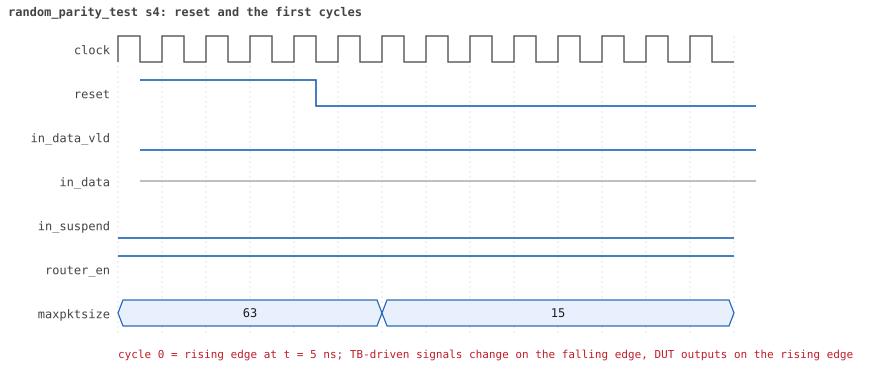
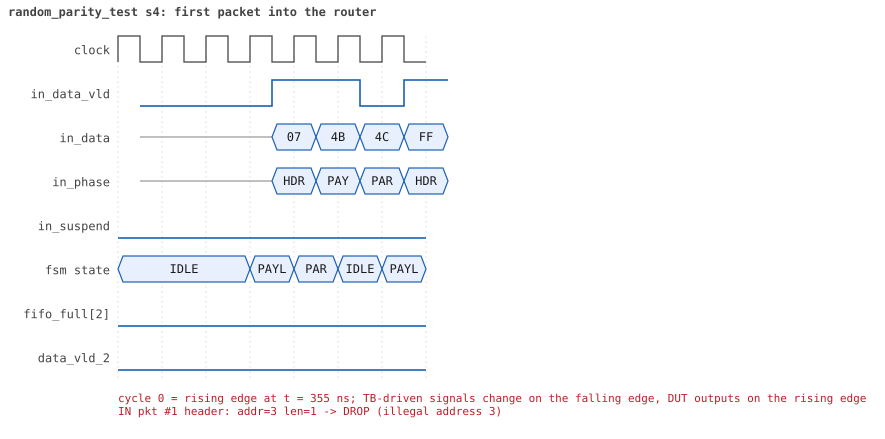
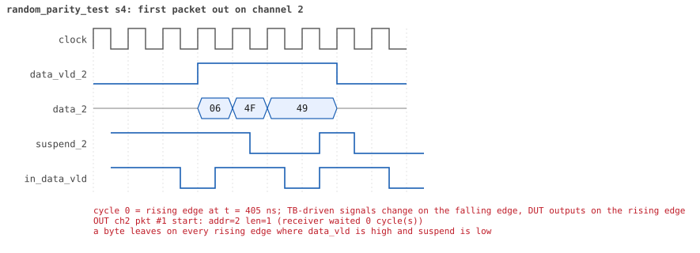
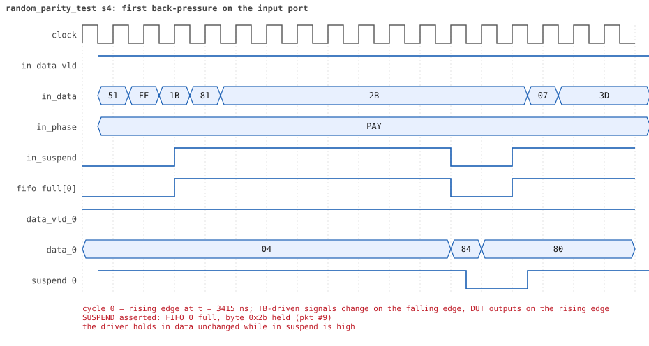
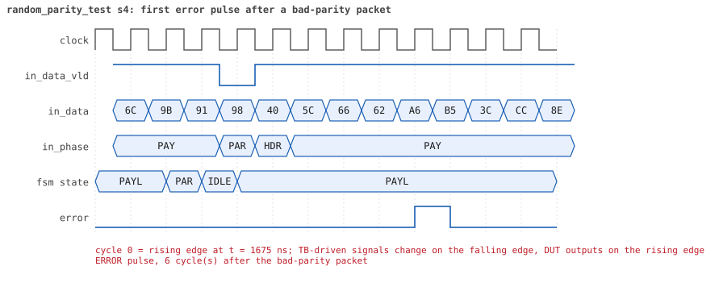
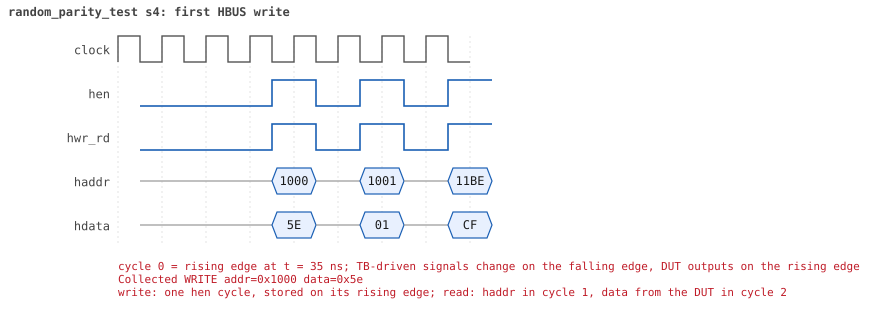
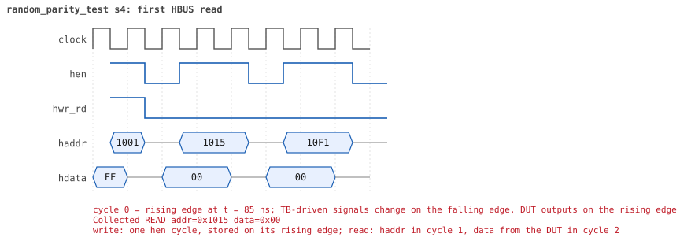

# random_parity_test seed 4

**Result:** PASSED (0 UVM_ERROR, 0 UVM_WARNING, 0 UVM_FATAL) · bench `yapp_project_tb` · sim time 13us · wall 12.7 s · log [`random_parity_test_s4.log`](random_parity_test_s4.log)

Waves: `random_parity_test_s4.fst` (GTKWave, Surfer or the VS Code wave viewer).
[Open the waves in Surfer](https://app.surfer-project.org/?load_url=https%3A%2F%2Fraw.githubusercontent.com%2Ftamirgabgab%2FQcom-Mentoring%2Fmain%2Fyapp_project%2Fregression%2Fyapp_project_tb%2Frandom_parity_test_s4%2Frandom_parity_test_s4.fst&startup_commands=run_command_file_from_url%20https%3A%2F%2Fraw.githubusercontent.com%2Ftamirgabgab%2FQcom-Mentoring%2Fmain%2Fyapp_project%2Ftb%2Fyapp_router.sucl) (web app, the signals already in groups: `yapp_project/tb/yapp_router.sucl`).

## Summary

- YAPP driver sent **39** packet(s) (11 with bad parity); the input monitor saw 39.
- Router: **26** forwarded, **13** dropped (5 illegal address 3, 8 oversized).
- Packets out: ch0 **7**, ch1 **6**, ch2 **13**.
- Scoreboard: 26 matched, 0 mismatched, 0 unexpected.
- Back-pressure: in_suspend asserted **2** time(s), longest hold 14 cycle(s).
- Error pulses: 11.
- HBUS: 25 write(s), 48 read(s).

## Stages

| time (ns) | stage |
|---|---|
| 0 | receivers: ch0 CHANNEL_RX_PROFILE_NORMAL, ch1 CHANNEL_RX_PROFILE_SLOW, ch2 CHANNEL_RX_PROFILE_FAST |
| 0 | random scenario: 39 packets in 5 bursts |
| 370 | burst 1/5: ctrl=0x5e (maxpktsize 30) en=0x01 (router on, counter enables 0000000), 8 packet(s) -- storm: 1..3-byte packets back to back, half with bad parity |
| 700 | burst 1/5 sent: addr0..3 3/1/3/1, bad parity 3, gap 0 8, length 1..3 |
| 1040 | burst 2/5: ctrl=0xd4 (maxpktsize 20) en=0x13 (router on, counter enables 0001001), 8 packet(s) |
| 4020 | burst 2/5 sent: addr0..3 1/4/1/2, bad parity 2, gap 0 4, length 3..63 |
| 4230 | burst 3/5: ctrl=0x70 (maxpktsize 48) en=0xc3 (router on, counter enables 1100001), 7 packet(s) -- storm: 1..3-byte packets back to back, half with bad parity |
| 4530 | burst 3/5 sent: addr0..3 1/3/2/1, bad parity 1, gap 0 7, length 1..3 |
| 4870 | burst 4/5: ctrl=0xfd (maxpktsize 61) en=0xff (router on, counter enables 1111111), 8 packet(s) |
| 7470 | burst 4/5 sent: addr0..3 1/0/5/2, bad parity 2, gap 0 3, length 1..63 |
| 7780 | burst 5/5: ctrl=0xfe (maxpktsize 62) en=0xf9 (router on, counter enables 1111100), 8 packet(s) |
| 12170 | burst 5/5 sent: addr0..3 2/2/3/1, bad parity 3, gap 0 1, length 4..63 |
| 12170 | final reads: every register and the stored packet, checked against the reference model |
| 12705 | done: 39 packets (26 forwarded, 13 dropped), 2 storm burst(s), 26 scoreboard matches, 45 HBUS reads checked, 11 error pulses for 11 bad packets |

## Pictures

**reset and the first cycles**

**first packet into the router**

**first packet out on channel 2**

**first back-pressure on the input port**

**first error pulse after a bad-parity packet**

**first HBUS write**

**first HBUS read**

## Timeline

610 events.

| time (ns) | who | event |
|---|---|---|
| 0 | yapp monitor | YAPP monitor running |
| 0 | **test** | STAGE: receivers: ch0 CHANNEL_RX_PROFILE_NORMAL, ch1 CHANNEL_RX_PROFILE_SLOW, ch2 CHANNEL_RX_PROFILE_FAST |
| 0 | **test** | STAGE: random scenario: 39 packets in 5 bursts |
| 0 | clk/rst driver | Starting clock (period 10) and holding reset for 5 cycles |
| 0 | **DUT** | RESET asserted |
| 50 | **DUT** | RESET released: router_en=1 maxpktsize=63 |
| 70 | hbus driver | Executed WRITE addr=0x1000 data=0x5e |
| 75 | **DUT** | CONFIG router_en=1 maxpktsize=30 |
| 75 | hbus monitor | Collected WRITE addr=0x1000 data=0x5e |
| 75 | reference | maxpktsize is now 30 |
| 90 | hbus driver | Executed WRITE addr=0x1001 data=0x01 |
| 95 | hbus monitor | Collected WRITE addr=0x1001 data=0x01 |
| 95 | reference | router_en is now 1 (en_reg 0x01) |
| 110 | hbus driver | Executed WRITE addr=0x11be data=0xcf |
| 115 | hbus monitor | Collected WRITE addr=0x11be data=0xcf |
| 140 | hbus driver | Executed READ  addr=0x11be data=0xcf |
| 145 | hbus monitor | Collected READ  addr=0x11be data=0xcf |
| 160 | hbus driver | Executed WRITE addr=0x11ab data=0x3d |
| 165 | hbus monitor | Collected WRITE addr=0x11ab data=0x3d |
| 190 | hbus driver | Executed READ  addr=0x11ab data=0x3d |
| 195 | hbus monitor | Collected READ  addr=0x11ab data=0x3d |
| 220 | hbus driver | Executed READ  addr=0x1004 data=0x00 |
| 225 | hbus monitor | Collected READ  addr=0x1004 data=0x00 |
| 240 | hbus driver | Executed WRITE addr=0x117c data=0x53 |
| 245 | hbus monitor | Collected WRITE addr=0x117c data=0x53 |
| 270 | hbus driver | Executed READ  addr=0x117c data=0x53 |
| 275 | hbus monitor | Collected READ  addr=0x117c data=0x53 |
| 290 | hbus driver | Executed WRITE addr=0x1168 data=0xde |
| 295 | hbus monitor | Collected WRITE addr=0x1168 data=0xde |
| 320 | hbus driver | Executed READ  addr=0x1168 data=0xde |
| 325 | hbus monitor | Collected READ  addr=0x1168 data=0xde |
| 340 | hbus driver | Executed WRITE addr=0x1177 data=0x48 |
| 345 | hbus monitor | Collected WRITE addr=0x1177 data=0x48 |
| 370 | hbus driver | Executed READ  addr=0x1177 data=0x48 |
| 370 | **test** | STAGE: burst 1/5: ctrl=0x5e (maxpktsize 30) en=0x01 (router on, counter enables 0000000), 8 packet(s) -- storm: 1..3-byte packets back to back, half with bad parity |
| 370 | yapp driver | TX pkt #1: addr=3 len=3 parity=good delay=0 |
| 375 | hbus monitor | Collected READ  addr=0x1177 data=0x48 |
| 385 | **DUT** | IN  pkt #1 header: addr=3 len=3 -> DROP (illegal address 3) |
| 425 | **DUT** | IN  pkt #1 complete: addr=3 len=3 parity=ok dropped, 5 bytes in 5 cycles (held 0) |
| 425 | yapp monitor | RX pkt #1 on the input: addr=3 len=3 parity=good gap=33 |
| 425 | reference | Packet dropped: illegal address 3 (len=3) |
| 425 | **DUT** | ROUTER DROPS PACKET addr=3 length=3 (    illegal address) |
| 430 | yapp driver | TX pkt #1 accepted by the DUT |
| 430 | yapp driver | TX pkt #2: addr=2 len=1 parity=good delay=0 |
| 435 | **DUT** | IN  pkt #2 header: addr=2 len=1 -> channel 2 |
| 445 | **DUT** | OUT ch2 pkt #1 start: addr=2 len=1 (receiver waited 0 cycle(s)) |
| 455 | **DUT** | IN  pkt #2 complete: addr=2 len=1 parity=ok forwarded, 3 bytes in 3 cycles (held 0) |
| 455 | yapp monitor | RX pkt #2 on the input: addr=2 len=1 parity=good gap=0 |
| 455 | reference | Packet forwarded: addr=2 len=1 -> channel 2 |
| 460 | ch2 driver | ch2: packet consumed (response delay 0) |
| 460 | yapp driver | TX pkt #2 accepted by the DUT |
| 460 | yapp driver | TX pkt #3: addr=1 len=1 parity=good delay=0 |
| 465 | **DUT** | IN  pkt #3 header: addr=1 len=1 -> channel 1 |
| 475 | **DUT** | OUT ch2 pkt #1 done: 3 bytes in 4 cycles |
| 475 | ch2 monitor | ch2 RX pkt #1: addr=2 len=1 parity=good |
| 475 | scoreboard | ch2 pkt matched: addr=2 len=1 (1 matched so far) |
| 485 | **DUT** | IN  pkt #3 complete: addr=1 len=1 parity=ok forwarded, 3 bytes in 3 cycles (held 0) |
| 485 | yapp monitor | RX pkt #3 on the input: addr=1 len=1 parity=good gap=0 |
| 485 | reference | Packet forwarded: addr=1 len=1 -> channel 1 |
| 490 | yapp driver | TX pkt #3 accepted by the DUT |
| 490 | yapp driver | TX pkt #4: addr=0 len=2 parity=good delay=0 |
| 495 | **DUT** | IN  pkt #4 header: addr=0 len=2 -> channel 0 |
| 525 | **DUT** | IN  pkt #4 complete: addr=0 len=2 parity=ok forwarded, 4 bytes in 4 cycles (held 0) |
| 525 | yapp monitor | RX pkt #4 on the input: addr=0 len=2 parity=good gap=0 |
| 525 | reference | Packet forwarded: addr=0 len=2 -> channel 0 |
| 530 | yapp driver | TX pkt #4 accepted by the DUT |
| 530 | yapp driver | TX pkt #5: addr=0 len=3 parity=bad delay=0 |
| 535 | **DUT** | IN  pkt #5 header: addr=0 len=3 -> channel 0 |
| 535 | **DUT** | OUT ch0 pkt #1 start: addr=0 len=2 (receiver waited 3 cycle(s)) |
| 560 | ch0 driver | ch0: packet consumed (response delay 3) |
| 575 | **DUT** | IN  pkt #5 complete: addr=0 len=3 parity=BAD forwarded, 5 bytes in 5 cycles (held 0) |
| 575 | yapp monitor | RX pkt #5 on the input: addr=0 len=3 parity=bad gap=0 |
| 575 | reference | Packet forwarded: addr=0 len=3 -> channel 0 |
| 580 | yapp driver | TX pkt #5 accepted by the DUT |
| 580 | yapp driver | TX pkt #6: addr=0 len=2 parity=bad delay=0 |
| 585 | **DUT** | IN  pkt #6 header: addr=0 len=2 -> channel 0 |
| 615 | **DUT** | IN  pkt #6 complete: addr=0 len=2 parity=BAD forwarded, 4 bytes in 4 cycles (held 0) |
| 615 | yapp monitor | RX pkt #6 on the input: addr=0 len=2 parity=bad gap=0 |
| 615 | reference | Packet forwarded: addr=0 len=2 -> channel 0 |
| 620 | yapp driver | TX pkt #6 accepted by the DUT |
| 620 | yapp driver | TX pkt #7: addr=2 len=3 parity=good delay=0 |
| 625 | **DUT** | IN  pkt #7 header: addr=2 len=3 -> channel 2 |
| 630 | **DUT** | ERROR pulse, 5 cycle(s) after the bad-parity packet (1 more owed) |
| 630 | error checker | error pulse 5 cycles after the bad packet (1 still owed) |
| 635 | **DUT** | OUT ch2 pkt #2 start: addr=2 len=3 (receiver waited 0 cycle(s)) |
| 660 | ch2 driver | ch2: packet consumed (response delay 0) |
| 665 | **DUT** | IN  pkt #7 complete: addr=2 len=3 parity=ok forwarded, 5 bytes in 5 cycles (held 0) |
| 665 | yapp monitor | RX pkt #7 on the input: addr=2 len=3 parity=good gap=0 |
| 665 | reference | Packet forwarded: addr=2 len=3 -> channel 2 |
| 670 | yapp driver | TX pkt #7 accepted by the DUT |
| 670 | yapp driver | TX pkt #8: addr=2 len=1 parity=bad delay=0 |
| 675 | **DUT** | IN  pkt #8 header: addr=2 len=1 -> channel 2 |
| 675 | **DUT** | OUT ch0 pkt #1 done: 4 bytes in 15 cycles |
| 675 | ch0 monitor | ch0 RX pkt #1: addr=0 len=2 parity=good |
| 675 | scoreboard | ch0 pkt matched: addr=0 len=2 (2 matched so far) |
| 685 | **DUT** | OUT ch0 pkt #2 start: addr=0 len=3 (receiver waited 0 cycle(s)) |
| 685 | **DUT** | OUT ch2 pkt #2 done: 5 bytes in 6 cycles |
| 685 | ch2 monitor | ch2 RX pkt #2: addr=2 len=3 parity=good |
| 685 | scoreboard | ch2 pkt matched: addr=2 len=3 (3 matched so far) |
| 695 | **DUT** | IN  pkt #8 complete: addr=2 len=1 parity=BAD forwarded, 3 bytes in 3 cycles (held 0) |
| 695 | **DUT** | OUT ch2 pkt #3 start: addr=2 len=1 (receiver waited 0 cycle(s)) |
| 695 | yapp monitor | RX pkt #8 on the input: addr=2 len=1 parity=bad gap=0 |
| 695 | reference | Packet forwarded: addr=2 len=1 -> channel 2 |
| 700 | yapp driver | TX pkt #8 accepted by the DUT |
| 700 | **test** | STAGE: burst 1/5 sent: addr0..3 3/1/3/1, bad parity 3, gap 0 8, length 1..3 |
| 710 | **DUT** | ERROR pulse, 9 cycle(s) after the bad-parity packet (1 more owed) |
| 710 | error checker | error pulse 9 cycles after the bad packet (1 still owed) |
| 715 | **DUT** | OUT ch2 pkt #3 done: 3 bytes in 3 cycles |
| 715 | ch2 monitor | ch2 RX pkt #3: addr=2 len=1 parity=bad |
| 715 | scoreboard | ch2 pkt matched: addr=2 len=1 (4 matched so far) |
| 720 | **DUT** | ERROR pulse, 2 cycle(s) after the bad-parity packet |
| 720 | error checker | error pulse 2 cycles after the bad packet (0 still owed) |
| 720 | hbus driver | Executed WRITE addr=0x1000 data=0xd4 |
| 725 | **DUT** | OUT ch0 pkt #2 done: 5 bytes in 5 cycles |
| 725 | **DUT** | CONFIG router_en=1 maxpktsize=20 |
| 725 | ch0 monitor | ch0 RX pkt #2: addr=0 len=3 parity=bad |
| 725 | scoreboard | ch0 pkt matched: addr=0 len=3 (5 matched so far) |
| 725 | hbus monitor | Collected WRITE addr=0x1000 data=0xd4 |
| 725 | reference | maxpktsize is now 20 |
| 735 | **DUT** | OUT ch0 pkt #3 start: addr=0 len=2 (receiver waited 0 cycle(s)) |
| 740 | hbus driver | Executed WRITE addr=0x1001 data=0x13 |
| 745 | hbus monitor | Collected WRITE addr=0x1001 data=0x13 |
| 745 | reference | router_en is now 1 (en_reg 0x13) |
| 765 | **DUT** | OUT ch0 pkt #3 done: 4 bytes in 4 cycles |
| 765 | ch0 monitor | ch0 RX pkt #3: addr=0 len=2 parity=bad |
| 765 | scoreboard | ch0 pkt matched: addr=0 len=2 (6 matched so far) |
| 770 | hbus driver | Executed READ  addr=0x100d data=0x01 |
| 775 | hbus monitor | Collected READ  addr=0x100d data=0x01 |
| 790 | hbus driver | Executed WRITE addr=0x1149 data=0x4d |
| 795 | hbus monitor | Collected WRITE addr=0x1149 data=0x4d |
| 820 | hbus driver | Executed READ  addr=0x1149 data=0x4d |
| 825 | hbus monitor | Collected READ  addr=0x1149 data=0x4d |
| 850 | hbus driver | Executed READ  addr=0x100d data=0x01 |
| 855 | hbus monitor | Collected READ  addr=0x100d data=0x01 |
| 870 | hbus driver | Executed WRITE addr=0x110b data=0xf4 |
| 875 | **DUT** | OUT ch1 pkt #1 start: addr=1 len=1 (receiver waited 40 cycle(s)) |
| 875 | hbus monitor | Collected WRITE addr=0x110b data=0xf4 |
| 890 | ch1 driver | ch1: packet consumed (response delay 40) |
| 900 | ch2 driver | ch2: packet consumed (response delay 0) |
| 900 | hbus driver | Executed READ  addr=0x110b data=0xf4 |
| 905 | hbus monitor | Collected READ  addr=0x110b data=0xf4 |
| 920 | hbus driver | Executed WRITE addr=0x111b data=0x45 |
| 925 | hbus monitor | Collected WRITE addr=0x111b data=0x45 |
| 950 | hbus driver | Executed READ  addr=0x111b data=0x45 |
| 955 | hbus monitor | Collected READ  addr=0x111b data=0x45 |
| 980 | hbus driver | Executed READ  addr=0x1020 data=0x00 |
| 985 | hbus monitor | Collected READ  addr=0x1020 data=0x00 |
| 1010 | hbus driver | Executed READ  addr=0x101c data=0x00 |
| 1015 | hbus monitor | Collected READ  addr=0x101c data=0x00 |
| 1040 | hbus driver | Executed READ  addr=0x1047 data=0x00 |
| 1040 | **test** | STAGE: burst 2/5: ctrl=0xd4 (maxpktsize 20) en=0x13 (router on, counter enables 0001001), 8 packet(s) |
| 1040 | yapp driver | TX pkt #9: addr=1 len=20 parity=good delay=0 |
| 1045 | hbus monitor | Collected READ  addr=0x1047 data=0x00 |
| 1055 | **DUT** | IN  pkt #9 header: addr=1 len=20 -> channel 1 |
| 1110 | ch0 driver | ch0: packet consumed (response delay 10) |
| 1205 | **DUT** | SUSPEND asserted: FIFO 1 full, byte 0xba held (pkt #9) |
| 1305 | **DUT** | OUT ch1 pkt #1 done: 3 bytes in 44 cycles |
| 1305 | ch1 monitor | ch1 RX pkt #1: addr=1 len=1 parity=good |
| 1305 | scoreboard | ch1 pkt matched: addr=1 len=1 (7 matched so far) |
| 1315 | **DUT** | SUSPEND released after 11 cycle(s) |
| 1315 | **DUT** | OUT ch1 pkt #2 start: addr=1 len=20 (receiver waited 0 cycle(s)) |
| 1375 | **DUT** | IN  pkt #9 complete: addr=1 len=20 parity=ok forwarded, 22 bytes in 33 cycles (held 11) |
| 1375 | yapp monitor | RX pkt #9 on the input: addr=1 len=20 parity=good gap=35 |
| 1375 | reference | Packet forwarded: addr=1 len=20 -> channel 1 |
| 1380 | yapp driver | TX pkt #9 accepted by the DUT |
| 1380 | yapp driver | TX pkt #10: addr=1 len=34 parity=good delay=1 |
| 1395 | **DUT** | IN  pkt #10 header: addr=1 len=34 -> DROP (oversized: len 34 > maxpktsize 20) |
| 1525 | **DUT** | OUT ch1 pkt #2 done: 22 bytes in 22 cycles |
| 1525 | ch1 monitor | ch1 RX pkt #2: addr=1 len=20 parity=good |
| 1525 | scoreboard | ch1 pkt matched: addr=1 len=20 (8 matched so far) |
| 1745 | **DUT** | IN  pkt #10 complete: addr=1 len=34 parity=ok dropped, 36 bytes in 36 cycles (held 0) |
| 1745 | yapp monitor | RX pkt #10 on the input: addr=1 len=34 parity=good gap=1 |
| 1745 | reference | Packet dropped: length 34 > maxpktsize 20 (addr=1) |
| 1745 | **DUT** | ROUTER DROPS PACKET addr=1 length=34 (length > maxpktsize) |
| 1750 | yapp driver | TX pkt #10 accepted by the DUT |
| 1750 | yapp driver | TX pkt #11: addr=2 len=3 parity=good delay=0 |
| 1755 | **DUT** | IN  pkt #11 header: addr=2 len=3 -> channel 2 |
| 1765 | **DUT** | OUT ch2 pkt #4 start: addr=2 len=3 (receiver waited 0 cycle(s)) |
| 1795 | **DUT** | IN  pkt #11 complete: addr=2 len=3 parity=ok forwarded, 5 bytes in 5 cycles (held 0) |
| 1795 | yapp monitor | RX pkt #11 on the input: addr=2 len=3 parity=good gap=0 |
| 1795 | reference | Packet forwarded: addr=2 len=3 -> channel 2 |
| 1800 | ch2 driver | ch2: packet consumed (response delay 0) |
| 1800 | yapp driver | TX pkt #11 accepted by the DUT |
| 1800 | yapp driver | TX pkt #12: addr=3 len=20 parity=good delay=7 |
| 1815 | **DUT** | OUT ch2 pkt #4 done: 5 bytes in 6 cycles |
| 1815 | ch2 monitor | ch2 RX pkt #4: addr=2 len=3 parity=good |
| 1815 | scoreboard | ch2 pkt matched: addr=2 len=3 (9 matched so far) |
| 1875 | **DUT** | IN  pkt #12 header: addr=3 len=20 -> DROP (illegal address 3) |
| 1910 | ch1 driver | ch1: packet consumed (response delay 40) |
| 2085 | **DUT** | IN  pkt #12 complete: addr=3 len=20 parity=ok dropped, 22 bytes in 22 cycles (held 0) |
| 2085 | yapp monitor | RX pkt #12 on the input: addr=3 len=20 parity=good gap=7 |
| 2085 | reference | Packet dropped: illegal address 3 (len=20) |
| 2085 | **DUT** | ROUTER DROPS PACKET addr=3 length=20 (    illegal address) |
| 2090 | yapp driver | TX pkt #12 accepted by the DUT |
| 2090 | yapp driver | TX pkt #13: addr=3 len=14 parity=bad delay=6 |
| 2155 | **DUT** | IN  pkt #13 header: addr=3 len=14 -> DROP (illegal address 3) |
| 2300 | ch2 driver | ch2: packet consumed (response delay 0) |
| 2305 | **DUT** | IN  pkt #13 complete: addr=3 len=14 parity=BAD dropped, 16 bytes in 16 cycles (held 0) |
| 2305 | yapp monitor | RX pkt #13 on the input: addr=3 len=14 parity=bad gap=6 |
| 2305 | reference | Packet dropped: illegal address 3 (len=14) |
| 2305 | **DUT** | ROUTER DROPS PACKET addr=3 length=14 (    illegal address) |
| 2310 | yapp driver | TX pkt #13 accepted by the DUT |
| 2310 | yapp driver | TX pkt #14: addr=1 len=63 parity=bad delay=0 |
| 2315 | **DUT** | IN  pkt #14 header: addr=1 len=63 -> DROP (oversized: len 63 > maxpktsize 20) |
| 2330 | **DUT** | ERROR pulse, 2 cycle(s) after the bad-parity packet |
| 2330 | error checker | error pulse 2 cycles after the bad packet (0 still owed) |
| 2955 | **DUT** | IN  pkt #14 complete: addr=1 len=63 parity=BAD dropped, 65 bytes in 65 cycles (held 0) |
| 2955 | yapp monitor | RX pkt #14 on the input: addr=1 len=63 parity=bad gap=0 |
| 2955 | reference | Packet dropped: length 63 > maxpktsize 20 (addr=1) |
| 2955 | **DUT** | ROUTER DROPS PACKET addr=1 length=63 (length > maxpktsize) |
| 2960 | yapp driver | TX pkt #14 accepted by the DUT |
| 2960 | yapp driver | TX pkt #15: addr=1 len=63 parity=good delay=20 |
| 2990 | **DUT** | ERROR pulse, 3 cycle(s) after the bad-parity packet |
| 2990 | error checker | error pulse 3 cycles after the bad packet (0 still owed) |
| 3165 | **DUT** | IN  pkt #15 header: addr=1 len=63 -> DROP (oversized: len 63 > maxpktsize 20) |
| 3805 | **DUT** | IN  pkt #15 complete: addr=1 len=63 parity=ok dropped, 65 bytes in 65 cycles (held 0) |
| 3805 | yapp monitor | RX pkt #15 on the input: addr=1 len=63 parity=good gap=20 |
| 3805 | reference | Packet dropped: length 63 > maxpktsize 20 (addr=1) |
| 3805 | **DUT** | ROUTER DROPS PACKET addr=1 length=63 (length > maxpktsize) |
| 3810 | yapp driver | TX pkt #15 accepted by the DUT |
| 3810 | yapp driver | TX pkt #16: addr=0 len=19 parity=good delay=0 |
| 3815 | **DUT** | IN  pkt #16 header: addr=0 len=19 -> channel 0 |
| 3825 | **DUT** | OUT ch0 pkt #4 start: addr=0 len=19 (receiver waited 0 cycle(s)) |
| 4015 | **DUT** | IN  pkt #16 complete: addr=0 len=19 parity=ok forwarded, 21 bytes in 21 cycles (held 0) |
| 4015 | yapp monitor | RX pkt #16 on the input: addr=0 len=19 parity=good gap=0 |
| 4015 | reference | Packet forwarded: addr=0 len=19 -> channel 0 |
| 4020 | ch0 driver | ch0: packet consumed (response delay 0) |
| 4020 | yapp driver | TX pkt #16 accepted by the DUT |
| 4020 | **test** | STAGE: burst 2/5 sent: addr0..3 1/4/1/2, bad parity 2, gap 0 4, length 3..63 |
| 4040 | hbus driver | Executed WRITE addr=0x1000 data=0x70 |
| 4045 | **DUT** | CONFIG router_en=1 maxpktsize=48 |
| 4045 | hbus monitor | Collected WRITE addr=0x1000 data=0x70 |
| 4045 | reference | maxpktsize is now 48 |
| 4055 | **DUT** | OUT ch0 pkt #4 done: 21 bytes in 24 cycles |
| 4055 | ch0 monitor | ch0 RX pkt #4: addr=0 len=19 parity=good |
| 4055 | scoreboard | ch0 pkt matched: addr=0 len=19 (10 matched so far) |
| 4060 | hbus driver | Executed WRITE addr=0x1001 data=0xc3 |
| 4065 | hbus monitor | Collected WRITE addr=0x1001 data=0xc3 |
| 4065 | reference | router_en is now 1 (en_reg 0xc3) |
| 4090 | hbus driver | Executed READ  addr=0x100d data=0x13 |
| 4095 | hbus monitor | Collected READ  addr=0x100d data=0x13 |
| 4110 | hbus driver | Executed WRITE addr=0x1131 data=0x0a |
| 4115 | hbus monitor | Collected WRITE addr=0x1131 data=0x0a |
| 4140 | hbus driver | Executed READ  addr=0x1131 data=0x0a |
| 4145 | hbus monitor | Collected READ  addr=0x1131 data=0x0a |
| 4170 | hbus driver | Executed READ  addr=0x1023 data=0xf8 |
| 4175 | hbus monitor | Collected READ  addr=0x1023 data=0xf8 |
| 4200 | hbus driver | Executed READ  addr=0x1002 data=0x00 |
| 4205 | hbus monitor | Collected READ  addr=0x1002 data=0x00 |
| 4230 | hbus driver | Executed READ  addr=0x1000 data=0x70 |
| 4230 | **test** | STAGE: burst 3/5: ctrl=0x70 (maxpktsize 48) en=0xc3 (router on, counter enables 1100001), 7 packet(s) -- storm: 1..3-byte packets back to back, half with bad parity |
| 4230 | yapp driver | TX pkt #17: addr=2 len=3 parity=good delay=0 |
| 4235 | hbus monitor | Collected READ  addr=0x1000 data=0x70 |
| 4245 | **DUT** | IN  pkt #17 header: addr=2 len=3 -> channel 2 |
| 4255 | **DUT** | OUT ch2 pkt #5 start: addr=2 len=3 (receiver waited 0 cycle(s)) |
| 4285 | **DUT** | IN  pkt #17 complete: addr=2 len=3 parity=ok forwarded, 5 bytes in 5 cycles (held 0) |
| 4285 | yapp monitor | RX pkt #17 on the input: addr=2 len=3 parity=good gap=22 |
| 4285 | reference | Packet forwarded: addr=2 len=3 -> channel 2 |
| 4290 | ch2 driver | ch2: packet consumed (response delay 0) |
| 4290 | yapp driver | TX pkt #17 accepted by the DUT |
| 4290 | yapp driver | TX pkt #18: addr=0 len=1 parity=good delay=0 |
| 4295 | **DUT** | IN  pkt #18 header: addr=0 len=1 -> channel 0 |
| 4300 | ch0 driver | ch0: packet consumed (response delay 2) |
| 4305 | **DUT** | OUT ch2 pkt #5 done: 5 bytes in 6 cycles |
| 4305 | ch2 monitor | ch2 RX pkt #5: addr=2 len=3 parity=good |
| 4305 | scoreboard | ch2 pkt matched: addr=2 len=3 (11 matched so far) |
| 4315 | **DUT** | IN  pkt #18 complete: addr=0 len=1 parity=ok forwarded, 3 bytes in 3 cycles (held 0) |
| 4315 | yapp monitor | RX pkt #18 on the input: addr=0 len=1 parity=good gap=0 |
| 4315 | reference | Packet forwarded: addr=0 len=1 -> channel 0 |
| 4320 | yapp driver | TX pkt #18 accepted by the DUT |
| 4320 | yapp driver | TX pkt #19: addr=1 len=1 parity=good delay=0 |
| 4325 | **DUT** | IN  pkt #19 header: addr=1 len=1 -> channel 1 |
| 4345 | **DUT** | IN  pkt #19 complete: addr=1 len=1 parity=ok forwarded, 3 bytes in 3 cycles (held 0) |
| 4345 | yapp monitor | RX pkt #19 on the input: addr=1 len=1 parity=good gap=0 |
| 4345 | reference | Packet forwarded: addr=1 len=1 -> channel 1 |
| 4350 | yapp driver | TX pkt #19 accepted by the DUT |
| 4350 | yapp driver | TX pkt #20: addr=1 len=1 parity=good delay=0 |
| 4355 | **DUT** | IN  pkt #20 header: addr=1 len=1 -> channel 1 |
| 4375 | **DUT** | IN  pkt #20 complete: addr=1 len=1 parity=ok forwarded, 3 bytes in 3 cycles (held 0) |
| 4375 | yapp monitor | RX pkt #20 on the input: addr=1 len=1 parity=good gap=0 |
| 4375 | reference | Packet forwarded: addr=1 len=1 -> channel 1 |
| 4380 | yapp driver | TX pkt #20 accepted by the DUT |
| 4380 | yapp driver | TX pkt #21: addr=2 len=3 parity=good delay=0 |
| 4385 | **DUT** | IN  pkt #21 header: addr=2 len=3 -> channel 2 |
| 4395 | **DUT** | OUT ch0 pkt #5 start: addr=0 len=1 (receiver waited 9 cycle(s)) |
| 4395 | **DUT** | OUT ch2 pkt #6 start: addr=2 len=3 (receiver waited 0 cycle(s)) |
| 4410 | ch0 driver | ch0: packet consumed (response delay 8) |
| 4425 | **DUT** | IN  pkt #21 complete: addr=2 len=3 parity=ok forwarded, 5 bytes in 5 cycles (held 0) |
| 4425 | yapp monitor | RX pkt #21 on the input: addr=2 len=3 parity=good gap=0 |
| 4425 | reference | Packet forwarded: addr=2 len=3 -> channel 2 |
| 4430 | yapp driver | TX pkt #21 accepted by the DUT |
| 4430 | yapp driver | TX pkt #22: addr=1 len=3 parity=good delay=0 |
| 4435 | **DUT** | IN  pkt #22 header: addr=1 len=3 -> channel 1 |
| 4435 | **DUT** | OUT ch2 pkt #6 done: 5 bytes in 5 cycles |
| 4435 | ch2 monitor | ch2 RX pkt #6: addr=2 len=3 parity=good |
| 4435 | scoreboard | ch2 pkt matched: addr=2 len=3 (12 matched so far) |
| 4445 | **DUT** | OUT ch0 pkt #5 done: 3 bytes in 6 cycles |
| 4445 | ch0 monitor | ch0 RX pkt #5: addr=0 len=1 parity=good |
| 4445 | scoreboard | ch0 pkt matched: addr=0 len=1 (13 matched so far) |
| 4475 | **DUT** | IN  pkt #22 complete: addr=1 len=3 parity=ok forwarded, 5 bytes in 5 cycles (held 0) |
| 4475 | yapp monitor | RX pkt #22 on the input: addr=1 len=3 parity=good gap=0 |
| 4475 | reference | Packet forwarded: addr=1 len=3 -> channel 1 |
| 4480 | yapp driver | TX pkt #22 accepted by the DUT |
| 4480 | yapp driver | TX pkt #23: addr=3 len=3 parity=bad delay=0 |
| 4485 | **DUT** | IN  pkt #23 header: addr=3 len=3 -> DROP (illegal address 3) |
| 4525 | **DUT** | IN  pkt #23 complete: addr=3 len=3 parity=BAD dropped, 5 bytes in 5 cycles (held 0) |
| 4525 | yapp monitor | RX pkt #23 on the input: addr=3 len=3 parity=bad gap=0 |
| 4525 | reference | Packet dropped: illegal address 3 (len=3) |
| 4525 | **DUT** | ROUTER DROPS PACKET addr=3 length=3 (    illegal address) |
| 4530 | yapp driver | TX pkt #23 accepted by the DUT |
| 4530 | **test** | STAGE: burst 3/5 sent: addr0..3 1/3/2/1, bad parity 1, gap 0 7, length 1..3 |
| 4550 | hbus driver | Executed WRITE addr=0x1000 data=0xfd |
| 4555 | **DUT** | CONFIG router_en=1 maxpktsize=61 |
| 4555 | hbus monitor | Collected WRITE addr=0x1000 data=0xfd |
| 4555 | reference | maxpktsize is now 61 |
| 4565 | **DUT** | OUT ch1 pkt #3 start: addr=1 len=1 (receiver waited 23 cycle(s)) |
| 4570 | hbus driver | Executed WRITE addr=0x1001 data=0xff |
| 4575 | hbus monitor | Collected WRITE addr=0x1001 data=0xff |
| 4575 | reference | router_en is now 1 (en_reg 0xff) |
| 4580 | ch1 driver | ch1: packet consumed (response delay 23) |
| 4590 | **DUT** | ERROR pulse, 6 cycle(s) after the bad-parity packet |
| 4590 | error checker | error pulse 6 cycles after the bad packet (0 still owed) |
| 4600 | hbus driver | Executed READ  addr=0x1048 data=0x2c |
| 4605 | hbus monitor | Collected READ  addr=0x1048 data=0x2c |
| 4620 | hbus driver | Executed WRITE addr=0x1184 data=0x78 |
| 4625 | hbus monitor | Collected WRITE addr=0x1184 data=0x78 |
| 4650 | hbus driver | Executed READ  addr=0x1184 data=0x78 |
| 4655 | hbus monitor | Collected READ  addr=0x1184 data=0x78 |
| 4680 | hbus driver | Executed READ  addr=0x100d data=0x03 |
| 4685 | hbus monitor | Collected READ  addr=0x100d data=0x03 |
| 4710 | hbus driver | Executed READ  addr=0x108e data=0x00 |
| 4715 | hbus monitor | Collected READ  addr=0x108e data=0x00 |
| 4740 | hbus driver | Executed READ  addr=0x1005 data=0x00 |
| 4745 | hbus monitor | Collected READ  addr=0x1005 data=0x00 |
| 4760 | hbus driver | Executed WRITE addr=0x1172 data=0x4d |
| 4765 | hbus monitor | Collected WRITE addr=0x1172 data=0x4d |
| 4790 | ch0 driver | ch0: packet consumed (response delay 2) |
| 4790 | hbus driver | Executed READ  addr=0x1172 data=0x4d |
| 4795 | hbus monitor | Collected READ  addr=0x1172 data=0x4d |
| 4820 | hbus driver | Executed READ  addr=0x1005 data=0x00 |
| 4825 | hbus monitor | Collected READ  addr=0x1005 data=0x00 |
| 4840 | hbus driver | Executed WRITE addr=0x1121 data=0xb5 |
| 4845 | hbus monitor | Collected WRITE addr=0x1121 data=0xb5 |
| 4870 | hbus driver | Executed READ  addr=0x1121 data=0xb5 |
| 4870 | **test** | STAGE: burst 4/5: ctrl=0xfd (maxpktsize 61) en=0xff (router on, counter enables 1111111), 8 packet(s) |
| 4870 | yapp driver | TX pkt #24: addr=2 len=10 parity=good delay=1 |
| 4875 | hbus monitor | Collected READ  addr=0x1121 data=0xb5 |
| 4890 | ch2 driver | ch2: packet consumed (response delay 0) |
| 4895 | **DUT** | IN  pkt #24 header: addr=2 len=10 -> channel 2 |
| 4905 | **DUT** | OUT ch2 pkt #7 start: addr=2 len=10 (receiver waited 0 cycle(s)) |
| 4995 | **DUT** | OUT ch1 pkt #3 done: 3 bytes in 44 cycles |
| 4995 | ch1 monitor | ch1 RX pkt #3: addr=1 len=1 parity=good |
| 4995 | scoreboard | ch1 pkt matched: addr=1 len=1 (14 matched so far) |
| 5005 | **DUT** | IN  pkt #24 complete: addr=2 len=10 parity=ok forwarded, 12 bytes in 12 cycles (held 0) |
| 5005 | **DUT** | OUT ch1 pkt #4 start: addr=1 len=1 (receiver waited 0 cycle(s)) |
| 5005 | yapp monitor | RX pkt #24 on the input: addr=2 len=10 parity=good gap=36 |
| 5005 | reference | Packet forwarded: addr=2 len=10 -> channel 2 |
| 5010 | ch2 driver | ch2: packet consumed (response delay 0) |
| 5010 | yapp driver | TX pkt #24 accepted by the DUT |
| 5010 | yapp driver | TX pkt #25: addr=3 len=63 parity=good delay=1 |
| 5025 | **DUT** | IN  pkt #25 header: addr=3 len=63 -> DROP (oversized: len 63 > maxpktsize 61) |
| 5025 | **DUT** | OUT ch1 pkt #4 done: 3 bytes in 3 cycles |
| 5025 | **DUT** | OUT ch2 pkt #7 done: 12 bytes in 13 cycles |
| 5025 | ch1 monitor | ch1 RX pkt #4: addr=1 len=1 parity=good |
| 5025 | scoreboard | ch1 pkt matched: addr=1 len=1 (15 matched so far) |
| 5025 | ch2 monitor | ch2 RX pkt #7: addr=2 len=10 parity=good |
| 5025 | scoreboard | ch2 pkt matched: addr=2 len=10 (16 matched so far) |
| 5035 | **DUT** | OUT ch1 pkt #5 start: addr=1 len=3 (receiver waited 0 cycle(s)) |
| 5075 | **DUT** | OUT ch1 pkt #5 done: 5 bytes in 5 cycles |
| 5075 | ch1 monitor | ch1 RX pkt #5: addr=1 len=3 parity=good |
| 5075 | scoreboard | ch1 pkt matched: addr=1 len=3 (17 matched so far) |
| 5180 | ch1 driver | ch1: packet consumed (response delay 40) |
| 5510 | ch2 driver | ch2: packet consumed (response delay 0) |
| 5665 | **DUT** | IN  pkt #25 complete: addr=3 len=63 parity=ok dropped, 65 bytes in 65 cycles (held 0) |
| 5665 | yapp monitor | RX pkt #25 on the input: addr=3 len=63 parity=good gap=1 |
| 5665 | reference | Packet dropped: illegal address 3 (len=63) |
| 5665 | **DUT** | ROUTER DROPS PACKET addr=3 length=63 (    illegal address) |
| 5670 | yapp driver | TX pkt #25 accepted by the DUT |
| 5670 | yapp driver | TX pkt #26: addr=3 len=1 parity=bad delay=0 |
| 5675 | **DUT** | IN  pkt #26 header: addr=3 len=1 -> DROP (illegal address 3) |
| 5695 | **DUT** | IN  pkt #26 complete: addr=3 len=1 parity=BAD dropped, 3 bytes in 3 cycles (held 0) |
| 5695 | yapp monitor | RX pkt #26 on the input: addr=3 len=1 parity=bad gap=0 |
| 5695 | reference | Packet dropped: illegal address 3 (len=1) |
| 5695 | **DUT** | ROUTER DROPS PACKET addr=3 length=1 (    illegal address) |
| 5700 | yapp driver | TX pkt #26 accepted by the DUT |
| 5700 | yapp driver | TX pkt #27: addr=2 len=1 parity=bad delay=0 |
| 5705 | **DUT** | IN  pkt #27 header: addr=2 len=1 -> channel 2 |
| 5715 | **DUT** | OUT ch2 pkt #8 start: addr=2 len=1 (receiver waited 0 cycle(s)) |
| 5725 | **DUT** | IN  pkt #27 complete: addr=2 len=1 parity=BAD forwarded, 3 bytes in 3 cycles (held 0) |
| 5725 | yapp monitor | RX pkt #27 on the input: addr=2 len=1 parity=bad gap=0 |
| 5725 | reference | Packet forwarded: addr=2 len=1 -> channel 2 |
| 5730 | ch2 driver | ch2: packet consumed (response delay 0) |
| 5730 | yapp driver | TX pkt #27 accepted by the DUT |
| 5730 | yapp driver | TX pkt #28: addr=2 len=18 parity=good delay=1 |
| 5745 | **DUT** | IN  pkt #28 header: addr=2 len=18 -> channel 2 |
| 5745 | **DUT** | OUT ch2 pkt #8 done: 3 bytes in 4 cycles |
| 5745 | ch2 monitor | ch2 RX pkt #8: addr=2 len=1 parity=bad |
| 5745 | scoreboard | ch2 pkt matched: addr=2 len=1 (18 matched so far) |
| 5750 | **DUT** | ERROR pulse, 5 cycle(s) after the bad-parity packet (1 more owed) |
| 5750 | error checker | error pulse 5 cycles after the bad packet (1 still owed) |
| 5755 | **DUT** | OUT ch2 pkt #9 start: addr=2 len=18 (receiver waited 0 cycle(s)) |
| 5810 | **DUT** | ERROR pulse, 8 cycle(s) after the bad-parity packet |
| 5810 | error checker | error pulse 8 cycles after the bad packet (0 still owed) |
| 5935 | **DUT** | IN  pkt #28 complete: addr=2 len=18 parity=ok forwarded, 20 bytes in 20 cycles (held 0) |
| 5935 | yapp monitor | RX pkt #28 on the input: addr=2 len=18 parity=good gap=1 |
| 5935 | reference | Packet forwarded: addr=2 len=18 -> channel 2 |
| 5940 | ch2 driver | ch2: packet consumed (response delay 0) |
| 5940 | yapp driver | TX pkt #28 accepted by the DUT |
| 5940 | yapp driver | TX pkt #29: addr=2 len=63 parity=good delay=2 |
| 5955 | **DUT** | OUT ch2 pkt #9 done: 20 bytes in 21 cycles |
| 5955 | ch2 monitor | ch2 RX pkt #9: addr=2 len=18 parity=good |
| 5955 | scoreboard | ch2 pkt matched: addr=2 len=18 (19 matched so far) |
| 5965 | **DUT** | IN  pkt #29 header: addr=2 len=63 -> DROP (oversized: len 63 > maxpktsize 61) |
| 6370 | ch2 driver | ch2: packet consumed (response delay 0) |
| 6605 | **DUT** | IN  pkt #29 complete: addr=2 len=63 parity=ok dropped, 65 bytes in 65 cycles (held 0) |
| 6605 | yapp monitor | RX pkt #29 on the input: addr=2 len=63 parity=good gap=2 |
| 6605 | reference | Packet dropped: length 63 > maxpktsize 61 (addr=2) |
| 6605 | **DUT** | ROUTER DROPS PACKET addr=2 length=63 (length > maxpktsize) |
| 6610 | yapp driver | TX pkt #29 accepted by the DUT |
| 6610 | yapp driver | TX pkt #30: addr=2 len=18 parity=good delay=1 |
| 6625 | **DUT** | IN  pkt #30 header: addr=2 len=18 -> channel 2 |
| 6635 | **DUT** | OUT ch2 pkt #10 start: addr=2 len=18 (receiver waited 0 cycle(s)) |
| 6815 | **DUT** | IN  pkt #30 complete: addr=2 len=18 parity=ok forwarded, 20 bytes in 20 cycles (held 0) |
| 6815 | yapp monitor | RX pkt #30 on the input: addr=2 len=18 parity=good gap=1 |
| 6815 | reference | Packet forwarded: addr=2 len=18 -> channel 2 |
| 6820 | ch2 driver | ch2: packet consumed (response delay 0) |
| 6820 | yapp driver | TX pkt #30 accepted by the DUT |
| 6820 | yapp driver | TX pkt #31: addr=0 len=63 parity=good delay=0 |
| 6825 | **DUT** | IN  pkt #31 header: addr=0 len=63 -> DROP (oversized: len 63 > maxpktsize 61) |
| 6835 | **DUT** | OUT ch2 pkt #10 done: 20 bytes in 21 cycles |
| 6835 | ch2 monitor | ch2 RX pkt #10: addr=2 len=18 parity=good |
| 6835 | scoreboard | ch2 pkt matched: addr=2 len=18 (20 matched so far) |
| 7020 | ch2 driver | ch2: packet consumed (response delay 0) |
| 7465 | **DUT** | IN  pkt #31 complete: addr=0 len=63 parity=ok dropped, 65 bytes in 65 cycles (held 0) |
| 7465 | yapp monitor | RX pkt #31 on the input: addr=0 len=63 parity=good gap=0 |
| 7465 | reference | Packet dropped: length 63 > maxpktsize 61 (addr=0) |
| 7465 | **DUT** | ROUTER DROPS PACKET addr=0 length=63 (length > maxpktsize) |
| 7470 | yapp driver | TX pkt #31 accepted by the DUT |
| 7470 | **test** | STAGE: burst 4/5 sent: addr0..3 1/0/5/2, bad parity 2, gap 0 3, length 1..63 |
| 7490 | hbus driver | Executed WRITE addr=0x1000 data=0xfe |
| 7495 | **DUT** | CONFIG router_en=1 maxpktsize=62 |
| 7495 | hbus monitor | Collected WRITE addr=0x1000 data=0xfe |
| 7495 | reference | maxpktsize is now 62 |
| 7510 | hbus driver | Executed WRITE addr=0x1001 data=0xf9 |
| 7515 | hbus monitor | Collected WRITE addr=0x1001 data=0xf9 |
| 7515 | reference | router_en is now 1 (en_reg 0xf9) |
| 7530 | hbus driver | Executed WRITE addr=0x11f2 data=0x9a |
| 7535 | hbus monitor | Collected WRITE addr=0x11f2 data=0x9a |
| 7560 | hbus driver | Executed READ  addr=0x11f2 data=0x9a |
| 7565 | hbus monitor | Collected READ  addr=0x11f2 data=0x9a |
| 7590 | hbus driver | Executed READ  addr=0x100d data=0x3f |
| 7595 | hbus monitor | Collected READ  addr=0x100d data=0x3f |
| 7610 | hbus driver | Executed WRITE addr=0x11d9 data=0xb6 |
| 7615 | hbus monitor | Collected WRITE addr=0x11d9 data=0xb6 |
| 7640 | hbus driver | Executed READ  addr=0x11d9 data=0xb6 |
| 7645 | hbus monitor | Collected READ  addr=0x11d9 data=0xb6 |
| 7670 | hbus driver | Executed READ  addr=0x1001 data=0xf9 |
| 7675 | hbus monitor | Collected READ  addr=0x1001 data=0xf9 |
| 7690 | hbus driver | Executed WRITE addr=0x1150 data=0xaf |
| 7695 | hbus monitor | Collected WRITE addr=0x1150 data=0xaf |
| 7720 | hbus driver | Executed READ  addr=0x1150 data=0xaf |
| 7725 | hbus monitor | Collected READ  addr=0x1150 data=0xaf |
| 7750 | hbus driver | Executed READ  addr=0x100d data=0x3f |
| 7755 | hbus monitor | Collected READ  addr=0x100d data=0x3f |
| 7780 | hbus driver | Executed READ  addr=0x100f data=0x00 |
| 7780 | **test** | STAGE: burst 5/5: ctrl=0xfe (maxpktsize 62) en=0xf9 (router on, counter enables 1111100), 8 packet(s) |
| 7780 | yapp driver | TX pkt #32: addr=0 len=30 parity=good delay=1 |
| 7785 | hbus monitor | Collected READ  addr=0x100f data=0x00 |
| 7805 | **DUT** | IN  pkt #32 header: addr=0 len=30 -> channel 0 |
| 7915 | **DUT** | OUT ch0 pkt #6 start: addr=0 len=30 (receiver waited 10 cycle(s)) |
| 8115 | **DUT** | IN  pkt #32 complete: addr=0 len=30 parity=ok forwarded, 32 bytes in 32 cycles (held 0) |
| 8115 | yapp monitor | RX pkt #32 on the input: addr=0 len=30 parity=good gap=33 |
| 8115 | reference | Packet forwarded: addr=0 len=30 -> channel 0 |
| 8120 | yapp driver | TX pkt #32 accepted by the DUT |
| 8120 | yapp driver | TX pkt #33: addr=2 len=39 parity=bad delay=4 |
| 8165 | **DUT** | IN  pkt #33 header: addr=2 len=39 -> channel 2 |
| 8175 | **DUT** | OUT ch2 pkt #11 start: addr=2 len=39 (receiver waited 0 cycle(s)) |
| 8220 | ch0 driver | ch0: packet consumed (response delay 10) |
| 8335 | **DUT** | OUT ch0 pkt #6 done: 32 bytes in 43 cycles |
| 8335 | ch0 monitor | ch0 RX pkt #6: addr=0 len=30 parity=good |
| 8335 | scoreboard | ch0 pkt matched: addr=0 len=30 (21 matched so far) |
| 8360 | ch0 driver | ch0: packet consumed (response delay 10) |
| 8565 | **DUT** | IN  pkt #33 complete: addr=2 len=39 parity=BAD forwarded, 41 bytes in 41 cycles (held 0) |
| 8565 | yapp monitor | RX pkt #33 on the input: addr=2 len=39 parity=bad gap=4 |
| 8565 | reference | Packet forwarded: addr=2 len=39 -> channel 2 |
| 8570 | ch2 driver | ch2: packet consumed (response delay 0) |
| 8570 | yapp driver | TX pkt #33 accepted by the DUT |
| 8570 | yapp driver | TX pkt #34: addr=1 len=60 parity=good delay=4 |
| 8585 | **DUT** | OUT ch2 pkt #11 done: 41 bytes in 42 cycles |
| 8585 | ch2 monitor | ch2 RX pkt #11: addr=2 len=39 parity=bad |
| 8585 | scoreboard | ch2 pkt matched: addr=2 len=39 (22 matched so far) |
| 8610 | **DUT** | ERROR pulse, 4 cycle(s) after the bad-parity packet |
| 8610 | error checker | error pulse 4 cycles after the bad packet (0 still owed) |
| 8615 | **DUT** | IN  pkt #34 header: addr=1 len=60 -> channel 1 |
| 8775 | **DUT** | SUSPEND asserted: FIFO 1 full, byte 0x35 held (pkt #34) |
| 8870 | ch2 driver | ch2: packet consumed (response delay 0) |
| 8905 | **DUT** | OUT ch1 pkt #6 start: addr=1 len=60 (receiver waited 28 cycle(s)) |
| 8915 | **DUT** | SUSPEND released after 14 cycle(s) |
| 9365 | **DUT** | IN  pkt #34 complete: addr=1 len=60 parity=ok forwarded, 62 bytes in 76 cycles (held 14) |
| 9365 | yapp monitor | RX pkt #34 on the input: addr=1 len=60 parity=good gap=4 |
| 9365 | reference | Packet forwarded: addr=1 len=60 -> channel 1 |
| 9370 | yapp driver | TX pkt #34 accepted by the DUT |
| 9370 | yapp driver | TX pkt #35: addr=3 len=63 parity=good delay=19 |
| 9510 | ch1 driver | ch1: packet consumed (response delay 28) |
| 9565 | **DUT** | IN  pkt #35 header: addr=3 len=63 -> DROP (oversized: len 63 > maxpktsize 62) |
| 9895 | **DUT** | OUT ch1 pkt #6 done: 62 bytes in 100 cycles |
| 9895 | ch1 monitor | ch1 RX pkt #6: addr=1 len=60 parity=good |
| 9895 | scoreboard | ch1 pkt matched: addr=1 len=60 (23 matched so far) |
| 9980 | ch1 driver | ch1: packet consumed (response delay 37) |
| 10205 | **DUT** | IN  pkt #35 complete: addr=3 len=63 parity=ok dropped, 65 bytes in 65 cycles (held 0) |
| 10205 | yapp monitor | RX pkt #35 on the input: addr=3 len=63 parity=good gap=19 |
| 10205 | reference | Packet dropped: illegal address 3 (len=63) |
| 10205 | **DUT** | ROUTER DROPS PACKET addr=3 length=63 (    illegal address) |
| 10210 | yapp driver | TX pkt #35 accepted by the DUT |
| 10210 | yapp driver | TX pkt #36: addr=1 len=63 parity=bad delay=3 |
| 10245 | **DUT** | IN  pkt #36 header: addr=1 len=63 -> DROP (oversized: len 63 > maxpktsize 62) |
| 10885 | **DUT** | IN  pkt #36 complete: addr=1 len=63 parity=BAD dropped, 65 bytes in 65 cycles (held 0) |
| 10885 | yapp monitor | RX pkt #36 on the input: addr=1 len=63 parity=bad gap=3 |
| 10885 | reference | Packet dropped: length 63 > maxpktsize 62 (addr=1) |
| 10885 | **DUT** | ROUTER DROPS PACKET addr=1 length=63 (length > maxpktsize) |
| 10890 | yapp driver | TX pkt #36 accepted by the DUT |
| 10890 | yapp driver | TX pkt #37: addr=2 len=46 parity=bad delay=15 |
| 10910 | **DUT** | ERROR pulse, 2 cycle(s) after the bad-parity packet |
| 10910 | error checker | error pulse 2 cycles after the bad packet (0 still owed) |
| 11045 | **DUT** | IN  pkt #37 header: addr=2 len=46 -> channel 2 |
| 11055 | **DUT** | OUT ch2 pkt #12 start: addr=2 len=46 (receiver waited 0 cycle(s)) |
| 11515 | **DUT** | IN  pkt #37 complete: addr=2 len=46 parity=BAD forwarded, 48 bytes in 48 cycles (held 0) |
| 11515 | yapp monitor | RX pkt #37 on the input: addr=2 len=46 parity=bad gap=15 |
| 11515 | reference | Packet forwarded: addr=2 len=46 -> channel 2 |
| 11520 | ch2 driver | ch2: packet consumed (response delay 0) |
| 11520 | yapp driver | TX pkt #37 accepted by the DUT |
| 11520 | yapp driver | TX pkt #38: addr=0 len=55 parity=good delay=0 |
| 11525 | **DUT** | IN  pkt #38 header: addr=0 len=55 -> channel 0 |
| 11530 | **DUT** | ERROR pulse, 1 cycle(s) after the bad-parity packet |
| 11530 | error checker | error pulse 1 cycles after the bad packet (0 still owed) |
| 11535 | **DUT** | OUT ch2 pkt #12 done: 48 bytes in 49 cycles |
| 11535 | ch2 monitor | ch2 RX pkt #12: addr=2 len=46 parity=bad |
| 11535 | scoreboard | ch2 pkt matched: addr=2 len=46 (24 matched so far) |
| 11615 | **DUT** | OUT ch0 pkt #7 start: addr=0 len=55 (receiver waited 8 cycle(s)) |
| 11800 | ch2 driver | ch2: packet consumed (response delay 0) |
| 12085 | **DUT** | IN  pkt #38 complete: addr=0 len=55 parity=ok forwarded, 57 bytes in 57 cycles (held 0) |
| 12085 | yapp monitor | RX pkt #38 on the input: addr=0 len=55 parity=good gap=0 |
| 12085 | reference | Packet forwarded: addr=0 len=55 -> channel 0 |
| 12090 | yapp driver | TX pkt #38 accepted by the DUT |
| 12090 | yapp driver | TX pkt #39: addr=2 len=4 parity=good delay=2 |
| 12115 | **DUT** | IN  pkt #39 header: addr=2 len=4 -> channel 2 |
| 12125 | **DUT** | OUT ch2 pkt #13 start: addr=2 len=4 (receiver waited 0 cycle(s)) |
| 12165 | **DUT** | IN  pkt #39 complete: addr=2 len=4 parity=ok forwarded, 6 bytes in 6 cycles (held 0) |
| 12165 | yapp monitor | RX pkt #39 on the input: addr=2 len=4 parity=good gap=2 |
| 12165 | reference | Packet forwarded: addr=2 len=4 -> channel 2 |
| 12170 | ch0 driver | ch0: packet consumed (response delay 8) |
| 12170 | ch2 driver | ch2: packet consumed (response delay 0) |
| 12170 | yapp driver | TX pkt #39 accepted by the DUT |
| 12170 | **test** | STAGE: burst 5/5 sent: addr0..3 2/2/3/1, bad parity 3, gap 0 1, length 4..63 |
| 12170 | **test** | STAGE: final reads: every register and the stored packet, checked against the reference model |
| 12185 | **DUT** | OUT ch2 pkt #13 done: 6 bytes in 7 cycles |
| 12185 | ch2 monitor | ch2 RX pkt #13: addr=2 len=4 parity=good |
| 12185 | scoreboard | ch2 pkt matched: addr=2 len=4 (25 matched so far) |
| 12200 | hbus driver | Executed READ  addr=0x1000 data=0xfe |
| 12205 | hbus monitor | Collected READ  addr=0x1000 data=0xfe |
| 12230 | hbus driver | Executed READ  addr=0x1001 data=0xf9 |
| 12235 | hbus monitor | Collected READ  addr=0x1001 data=0xf9 |
| 12260 | hbus driver | Executed READ  addr=0x1004 data=0x05 |
| 12265 | hbus monitor | Collected READ  addr=0x1004 data=0x05 |
| 12285 | **DUT** | OUT ch0 pkt #7 done: 57 bytes in 68 cycles |
| 12285 | ch0 monitor | ch0 RX pkt #7: addr=0 len=55 parity=good |
| 12285 | scoreboard | ch0 pkt matched: addr=0 len=55 (26 matched so far) |
| 12290 | hbus driver | Executed READ  addr=0x1005 data=0x03 |
| 12295 | hbus monitor | Collected READ  addr=0x1005 data=0x03 |
| 12320 | hbus driver | Executed READ  addr=0x1006 data=0x04 |
| 12325 | hbus monitor | Collected READ  addr=0x1006 data=0x04 |
| 12350 | hbus driver | Executed READ  addr=0x1009 data=0x04 |
| 12355 | hbus monitor | Collected READ  addr=0x1009 data=0x04 |
| 12380 | hbus driver | Executed READ  addr=0x100a data=0x02 |
| 12385 | hbus monitor | Collected READ  addr=0x100a data=0x02 |
| 12410 | hbus driver | Executed READ  addr=0x100b data=0x0a |
| 12415 | hbus monitor | Collected READ  addr=0x100b data=0x0a |
| 12440 | hbus driver | Executed READ  addr=0x100d data=0x04 |
| 12445 | hbus monitor | Collected READ  addr=0x100d data=0x04 |
| 12470 | hbus driver | Executed READ  addr=0x1010 data=0x12 |
| 12475 | hbus monitor | Collected READ  addr=0x1010 data=0x12 |
| 12500 | hbus driver | Executed READ  addr=0x1011 data=0x6e |
| 12505 | hbus monitor | Collected READ  addr=0x1011 data=0x6e |
| 12530 | hbus driver | Executed READ  addr=0x1012 data=0x64 |
| 12535 | hbus monitor | Collected READ  addr=0x1012 data=0x64 |
| 12560 | hbus driver | Executed READ  addr=0x1013 data=0x78 |
| 12565 | hbus monitor | Collected READ  addr=0x1013 data=0x78 |
| 12590 | hbus driver | Executed READ  addr=0x1014 data=0xda |
| 12595 | hbus monitor | Collected READ  addr=0x1014 data=0xda |
| 12650 | ch2 driver | ch2: packet consumed (response delay 0) |
| 12705 | **test** | STAGE: done: 39 packets (26 forwarded, 13 dropped), 2 storm burst(s), 26 scoreboard matches, 45 HBUS reads checked, 11 error pulses for 11 bad packets |
| 12820 | ch0 driver | ch0: packet consumed (response delay 10) |
| 12905 | error checker | error pulse report: 11 bad packets, 11 pulses, 0 outside 1..10 cycles, at most 2 owed at once |
| 12905 | ch0 monitor | Channel 0 report: 7 packets collected |
| 12905 | ch1 monitor | Channel 1 report: 6 packets collected |
| 12905 | ch2 monitor | Channel 2 report: 13 packets collected |
| 12905 | hbus monitor | HBUS report: 25 writes, 48 reads |
| 12905 | coverage | Coverage of the router configuration: 87.0% · maxpktsize 0 / 1 / 2..61 / 62 / 63 : 0 / 0 / 31 / 8 / 0 packets · length < max / = max / max+1 / > max+1 : 29 / 2 / 2 / 6 · forwarded good / bad : 20 / 6 · dropped address 3 good / bad : 4 / 3 · dropped oversized good / bad : 4 / 2 · counter enables none / mixed / all : 8 / 23 / 8 |
| 12905 | coverage | HBUS address coverage: 73 accesses sampled, coverage 45.5% |
| 12905 | coverage | HBUS register bits coverage: 10 writes to ctrl_reg/en_reg, coverage 93.2% |
| 12905 | coverage | HBUS counter value coverage: 9 counter reads sampled, coverage 59.3% |
| 12905 | coverage | HBUS yapp_mem data coverage: 30 accesses sampled, coverage 29.4% |
| 12905 | reference | --- Reference model report --- · forwarded to scoreboard : 26 · dropped (router disabled) : 0 · dropped (oversized) : 6 · dropped (address 3) : 7 · counters parity/oversized/addr0..3 : 5 / 3 / 4 2 10 4 |
| 12905 | reference | HBUS reads checked against the model: 45 (0 mismatches, 3 of memory bytes never written) |
| 12905 | scoreboard | --- Scoreboard report --- · packets received : 26 · packets matched : 26 · packets mismatched: 0 · packets unexpected: 0 · packets to addr 3 : 0 · left in queue 0/1/2: 0 / 0 / 0 |
| 12905 | yapp driver | YAPP driver report: 39 packets sent |
| 12905 | coverage | YAPP gap coverage: 38 gaps sampled, coverage 100.0% |
| 12905 | yapp monitor | YAPP monitor report: 39 packets collected, 11 with bad parity |
| 12905 | yapp monitor | YAPP gaps: 20 back to back, 4 of 1 cycle, 2 of 2, 12 longer |
| 12905 | coverage | YAPP packet coverage: 39 packets sampled, coverage 66.7% |
