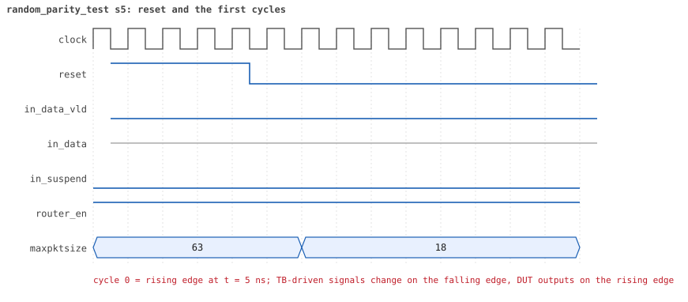
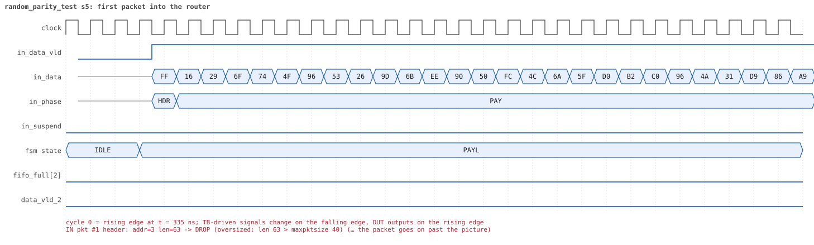
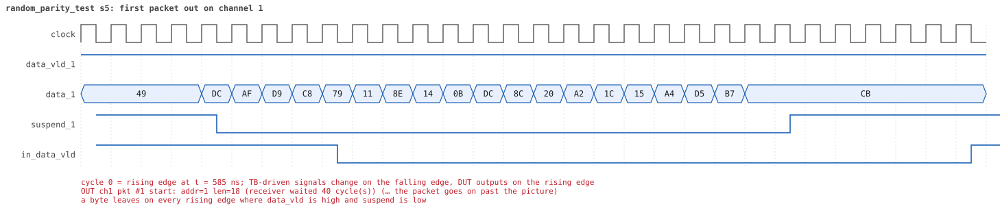
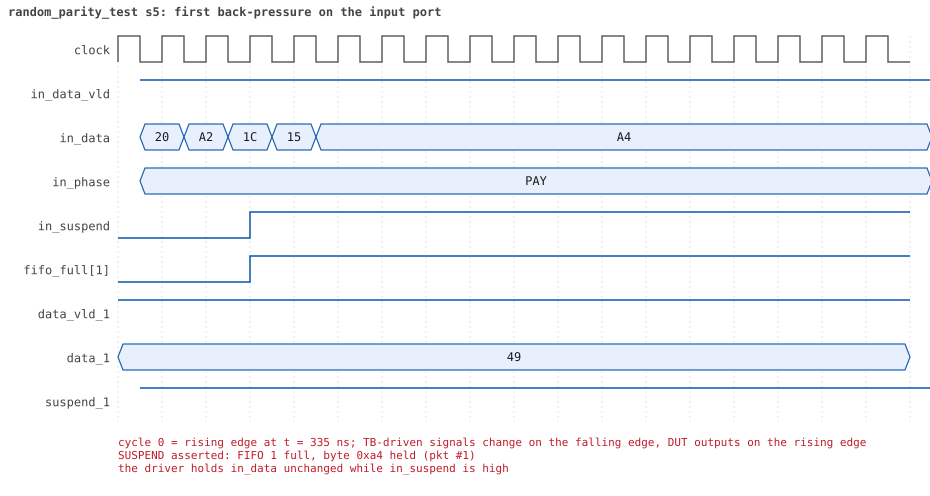
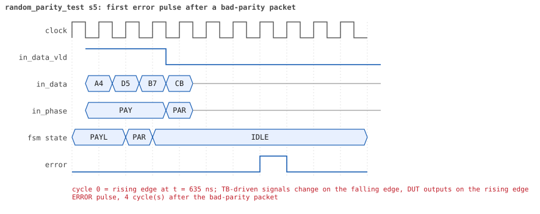
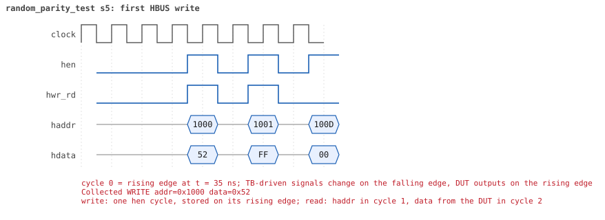
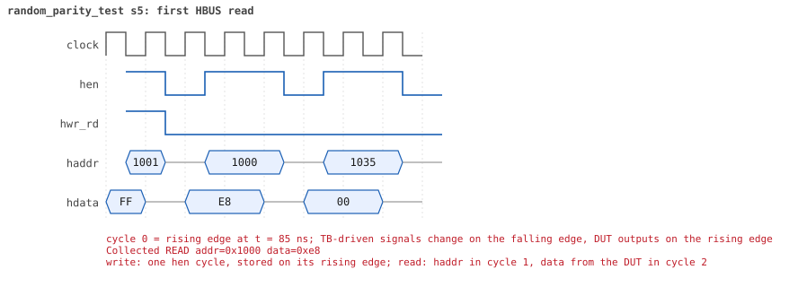

# random_parity_test  seed 5

**Result:** PASSED (0 UVM_ERROR, 0 UVM_WARNING, 0 UVM_FATAL) · bench `yapp_project_tb` · sim time 16us · log `random_parity_test_s5.log`

Waves: `random_parity_test_s5.fst` (GTKWave, Surfer or the VS Code wave viewer); signal trace: `signals.csv`.
[Open the waves in Surfer](https://app.surfer-project.org/?load_url=https%3A%2F%2Fraw.githubusercontent.com%2Ftamirgabgab%2FQcom-Mentoring%2Fmain%2Fyapp_project%2Fregression%2Fyapp_project_tb%2Frandom_parity_test_s5%2Frandom_parity_test_s5.fst&startup_commands=run_command_file_from_url%20https%3A%2F%2Fraw.githubusercontent.com%2Ftamirgabgab%2FQcom-Mentoring%2Fmain%2Fyapp_project%2Ftb%2Fyapp_router.sucl) (web app, the signals already in groups: `yapp_project/tb/yapp_router.sucl`).

## Summary

- YAPP driver sent **48** packet(s) (21 with bad parity); the input monitor saw 48.
- Router: **10** forwarded, **38** dropped (2 illegal address 3, 19 oversized, 17 router disabled).
- Packets out: ch0 **2**, ch1 **2**, ch2 **6**.
- Scoreboard: 10 matched, 0 mismatched, 0 unexpected.
- Back-pressure: in_suspend asserted **2** time(s), longest hold 26 cycle(s).
- Error pulses: 17.
- HBUS: 11 write(s), 25 read(s).

## Stages

| time (ns) | stage |
|---|---|
| 0 | receivers: ch0 RX_FAST, ch1 RX_SLOW, ch2 RX_NORMAL |
| 0 | random scenario: 48 packets in 3 bursts |
| 200 | burst 1/3: ctrl=0x52 (maxpktsize 18) en=0xff (router on, counter enables 1111111), 16 packet(s) |
| 8550 | burst 1/3 sent: addr0..3 4/5/3/4, bad parity 7, gap 0 6, length 1..63 |
| 8700 | burst 2/3: ctrl=0xd9 (maxpktsize 25) en=0x95 (router on, counter enables 1001010), 15 packet(s) |
| 14130 | burst 2/3 sent: addr0..3 3/1/8/3, bad parity 10, gap 0 3, length 1..63 |
| 14470 | burst 3/3: ctrl=0xea (maxpktsize 42) en=0xbc (router OFF, counter enables 1011110), 17 packet(s) -- storm: 1..3-byte packets back to back, half with bad parity |
| 15140 | burst 3/3 sent: addr0..3 2/1/14/0, bad parity 4, gap 0 16, length 1..3 |
| 15140 | final reads: every register and the stored packet, checked against the reference model |
| 15585 | done: 48 packets (10 forwarded, 38 dropped), 1 storm burst(s), 10 scoreboard matches, 25 HBUS reads checked, 17 error pulses for 17 bad packets |

## Pictures

**reset and the first cycles**

**first packet into the router**

**first packet out on channel 1**

**first back-pressure on the input port**

**first error pulse after a bad-parity packet**

**first HBUS write**

**first HBUS read**

## Timeline

532 events (the same list is in `timeline.csv`).

| time (ns) | who | event |
|---|---|---|
| 0 | yapp monitor | YAPP monitor running |
| 0 | **test** | STAGE: receivers: ch0 RX_FAST, ch1 RX_SLOW, ch2 RX_NORMAL |
| 0 | **test** | STAGE: random scenario: 48 packets in 3 bursts |
| 0 | clk/rst driver | Starting clock (period 10) and holding reset for 5 cycles |
| 0 | **DUT** | RESET asserted |
| 50 | **DUT** | RESET released: router_en=1 maxpktsize=63 |
| 70 | hbus driver | Executed WRITE addr=0x1000 data=0x52 |
| 75 | **DUT** | CONFIG router_en=1 maxpktsize=18 |
| 75 | hbus monitor | Collected WRITE addr=0x1000 data=0x52 |
| 75 | reference | maxpktsize is now 18 |
| 90 | hbus driver | Executed WRITE addr=0x1001 data=0xff |
| 95 | hbus monitor | Collected WRITE addr=0x1001 data=0xff |
| 95 | reference | router_en is now 1 (en_reg 0xff) |
| 120 | hbus driver | Executed READ  addr=0x100d data=0x00 |
| 125 | hbus monitor | Collected READ  addr=0x100d data=0x00 |
| 140 | hbus driver | Executed WRITE addr=0x11ef data=0xe8 |
| 145 | hbus monitor | Collected WRITE addr=0x11ef data=0xe8 |
| 170 | hbus driver | Executed READ  addr=0x11ef data=0xe8 |
| 175 | hbus monitor | Collected READ  addr=0x11ef data=0xe8 |
| 200 | hbus driver | Executed READ  addr=0x1003 data=0x00 |
| 200 | **test** | STAGE: burst 1/3: ctrl=0x52 (maxpktsize 18) en=0xff (router on, counter enables 1111111), 16 packet(s) |
| 200 | yapp driver | TX pkt #1: addr=1 len=18 parity=bad delay=0 |
| 205 | hbus monitor | Collected READ  addr=0x1003 data=0x00 |
| 215 | **DUT** | IN  pkt #1 header: addr=1 len=18 -> channel 1 |
| 375 | **DUT** | SUSPEND asserted: FIFO 1 full, byte 0xa4 held (pkt #1) |
| 625 | **DUT** | OUT ch1 pkt #1 start: addr=1 len=18 (receiver waited 40 cycle(s)) |
| 635 | **DUT** | SUSPEND released after 26 cycle(s) |
| 665 | **DUT** | IN  pkt #1 complete: addr=1 len=18 parity=BAD forwarded, 20 bytes in 46 cycles (held 26) |
| 665 | yapp monitor | RX pkt #1 on the input: addr=1 len=18 parity=bad gap=16 |
| 665 | reference | Packet forwarded: addr=1 len=18 -> channel 1 |
| 670 | yapp driver | TX pkt #1 accepted by the DUT |
| 670 | yapp driver | TX pkt #2: addr=3 len=18 parity=good delay=20 |
| 710 | **DUT** | ERROR pulse, 4 cycle(s) after the bad-parity packet |
| 710 | error checker | error pulse 4 cycles after the bad packet (0 still owed) |
| 810 | ch1 driver | ch1: packet consumed (response delay 40) |
| 875 | **DUT** | IN  pkt #2 header: addr=3 len=18 -> DROP (illegal address 3) |
| 1065 | **DUT** | IN  pkt #2 complete: addr=3 len=18 parity=ok dropped, 20 bytes in 20 cycles (held 0) |
| 1065 | yapp monitor | RX pkt #2 on the input: addr=3 len=18 parity=good gap=20 |
| 1065 | reference | Packet dropped: illegal address 3 (len=18) |
| 1065 | **DUT** | ROUTER DROPS PACKET addr=3 length=18 (    illegal address) |
| 1070 | yapp driver | TX pkt #2 accepted by the DUT |
| 1070 | yapp driver | TX pkt #3: addr=2 len=12 parity=bad delay=18 |
| 1125 | **DUT** | OUT ch1 pkt #1 done: 20 bytes in 51 cycles |
| 1125 | ch1 monitor | ch1 RX pkt #1: addr=1 len=18 parity=bad |
| 1125 | scoreboard | ch1 pkt matched: addr=1 len=18 (1 matched so far) |
| 1255 | **DUT** | IN  pkt #3 header: addr=2 len=12 -> channel 2 |
| 1305 | **DUT** | OUT ch2 pkt #1 start: addr=2 len=12 (receiver waited 4 cycle(s)) |
| 1385 | **DUT** | IN  pkt #3 complete: addr=2 len=12 parity=BAD forwarded, 14 bytes in 14 cycles (held 0) |
| 1385 | yapp monitor | RX pkt #3 on the input: addr=2 len=12 parity=bad gap=18 |
| 1385 | reference | Packet forwarded: addr=2 len=12 -> channel 2 |
| 1390 | yapp driver | TX pkt #3 accepted by the DUT |
| 1390 | yapp driver | TX pkt #4: addr=0 len=63 parity=good delay=0 |
| 1395 | **DUT** | IN  pkt #4 header: addr=0 len=63 -> DROP (oversized: len 63 > maxpktsize 18) |
| 1430 | ch2 driver | ch2: packet consumed (response delay 4) |
| 1450 | **DUT** | ERROR pulse, 6 cycle(s) after the bad-parity packet |
| 1450 | error checker | error pulse 6 cycles after the bad packet (0 still owed) |
| 1495 | **DUT** | OUT ch2 pkt #1 done: 14 bytes in 20 cycles |
| 1495 | ch2 monitor | ch2 RX pkt #1: addr=2 len=12 parity=bad |
| 1495 | scoreboard | ch2 pkt matched: addr=2 len=12 (2 matched so far) |
| 1630 | ch1 driver | ch1: packet consumed (response delay 30) |
| 2035 | **DUT** | IN  pkt #4 complete: addr=0 len=63 parity=ok dropped, 65 bytes in 65 cycles (held 0) |
| 2035 | yapp monitor | RX pkt #4 on the input: addr=0 len=63 parity=good gap=0 |
| 2035 | reference | Packet dropped: length 63 > maxpktsize 18 (addr=0) |
| 2035 | **DUT** | ROUTER DROPS PACKET addr=0 length=63 (length > maxpktsize) |
| 2040 | yapp driver | TX pkt #4 accepted by the DUT |
| 2040 | yapp driver | TX pkt #5: addr=1 len=63 parity=good delay=20 |
| 2060 | ch2 driver | ch2: packet consumed (response delay 5) |
| 2245 | **DUT** | IN  pkt #5 header: addr=1 len=63 -> DROP (oversized: len 63 > maxpktsize 18) |
| 2885 | **DUT** | IN  pkt #5 complete: addr=1 len=63 parity=ok dropped, 65 bytes in 65 cycles (held 0) |
| 2885 | yapp monitor | RX pkt #5 on the input: addr=1 len=63 parity=good gap=20 |
| 2885 | reference | Packet dropped: length 63 > maxpktsize 18 (addr=1) |
| 2885 | **DUT** | ROUTER DROPS PACKET addr=1 length=63 (length > maxpktsize) |
| 2890 | yapp driver | TX pkt #5 accepted by the DUT |
| 2890 | yapp driver | TX pkt #6: addr=1 len=63 parity=good delay=0 |
| 2895 | **DUT** | IN  pkt #6 header: addr=1 len=63 -> DROP (oversized: len 63 > maxpktsize 18) |
| 3535 | **DUT** | IN  pkt #6 complete: addr=1 len=63 parity=ok dropped, 65 bytes in 65 cycles (held 0) |
| 3535 | yapp monitor | RX pkt #6 on the input: addr=1 len=63 parity=good gap=0 |
| 3535 | reference | Packet dropped: length 63 > maxpktsize 18 (addr=1) |
| 3535 | **DUT** | ROUTER DROPS PACKET addr=1 length=63 (length > maxpktsize) |
| 3540 | yapp driver | TX pkt #6 accepted by the DUT |
| 3540 | yapp driver | TX pkt #7: addr=3 len=19 parity=bad delay=2 |
| 3565 | **DUT** | IN  pkt #7 header: addr=3 len=19 -> DROP (oversized: len 19 > maxpktsize 18) |
| 3765 | **DUT** | IN  pkt #7 complete: addr=3 len=19 parity=BAD dropped, 21 bytes in 21 cycles (held 0) |
| 3765 | yapp monitor | RX pkt #7 on the input: addr=3 len=19 parity=bad gap=2 |
| 3765 | reference | Packet dropped: illegal address 3 (len=19) |
| 3765 | **DUT** | ROUTER DROPS PACKET addr=3 length=19 (    illegal address) |
| 3770 | yapp driver | TX pkt #7 accepted by the DUT |
| 3770 | yapp driver | TX pkt #8: addr=3 len=43 parity=bad delay=0 |
| 3775 | **DUT** | IN  pkt #8 header: addr=3 len=43 -> DROP (oversized: len 43 > maxpktsize 18) |
| 3810 | **DUT** | ERROR pulse, 4 cycle(s) after the bad-parity packet |
| 3810 | error checker | error pulse 4 cycles after the bad packet (0 still owed) |
| 4215 | **DUT** | IN  pkt #8 complete: addr=3 len=43 parity=BAD dropped, 45 bytes in 45 cycles (held 0) |
| 4215 | yapp monitor | RX pkt #8 on the input: addr=3 len=43 parity=bad gap=0 |
| 4215 | reference | Packet dropped: illegal address 3 (len=43) |
| 4215 | **DUT** | ROUTER DROPS PACKET addr=3 length=43 (    illegal address) |
| 4220 | yapp driver | TX pkt #8 accepted by the DUT |
| 4220 | yapp driver | TX pkt #9: addr=2 len=58 parity=good delay=0 |
| 4225 | **DUT** | IN  pkt #9 header: addr=2 len=58 -> DROP (oversized: len 58 > maxpktsize 18) |
| 4230 | **DUT** | ERROR pulse, 1 cycle(s) after the bad-parity packet |
| 4230 | error checker | error pulse 1 cycles after the bad packet (0 still owed) |
| 4815 | **DUT** | IN  pkt #9 complete: addr=2 len=58 parity=ok dropped, 60 bytes in 60 cycles (held 0) |
| 4815 | yapp monitor | RX pkt #9 on the input: addr=2 len=58 parity=good gap=0 |
| 4815 | reference | Packet dropped: length 58 > maxpktsize 18 (addr=2) |
| 4815 | **DUT** | ROUTER DROPS PACKET addr=2 length=58 (length > maxpktsize) |
| 4820 | yapp driver | TX pkt #9 accepted by the DUT |
| 4820 | yapp driver | TX pkt #10: addr=3 len=63 parity=good delay=9 |
| 4915 | **DUT** | IN  pkt #10 header: addr=3 len=63 -> DROP (oversized: len 63 > maxpktsize 18) |
| 5555 | **DUT** | IN  pkt #10 complete: addr=3 len=63 parity=ok dropped, 65 bytes in 65 cycles (held 0) |
| 5555 | yapp monitor | RX pkt #10 on the input: addr=3 len=63 parity=good gap=9 |
| 5555 | reference | Packet dropped: illegal address 3 (len=63) |
| 5555 | **DUT** | ROUTER DROPS PACKET addr=3 length=63 (    illegal address) |
| 5560 | yapp driver | TX pkt #10 accepted by the DUT |
| 5560 | yapp driver | TX pkt #11: addr=0 len=59 parity=good delay=20 |
| 5765 | **DUT** | IN  pkt #11 header: addr=0 len=59 -> DROP (oversized: len 59 > maxpktsize 18) |
| 6365 | **DUT** | IN  pkt #11 complete: addr=0 len=59 parity=ok dropped, 61 bytes in 61 cycles (held 0) |
| 6365 | yapp monitor | RX pkt #11 on the input: addr=0 len=59 parity=good gap=20 |
| 6365 | reference | Packet dropped: length 59 > maxpktsize 18 (addr=0) |
| 6365 | **DUT** | ROUTER DROPS PACKET addr=0 length=59 (length > maxpktsize) |
| 6370 | yapp driver | TX pkt #11 accepted by the DUT |
| 6370 | yapp driver | TX pkt #12: addr=1 len=63 parity=bad delay=0 |
| 6375 | **DUT** | IN  pkt #12 header: addr=1 len=63 -> DROP (oversized: len 63 > maxpktsize 18) |
| 7015 | **DUT** | IN  pkt #12 complete: addr=1 len=63 parity=BAD dropped, 65 bytes in 65 cycles (held 0) |
| 7015 | yapp monitor | RX pkt #12 on the input: addr=1 len=63 parity=bad gap=0 |
| 7015 | reference | Packet dropped: length 63 > maxpktsize 18 (addr=1) |
| 7015 | **DUT** | ROUTER DROPS PACKET addr=1 length=63 (length > maxpktsize) |
| 7020 | yapp driver | TX pkt #12 accepted by the DUT |
| 7020 | yapp driver | TX pkt #13: addr=2 len=40 parity=bad delay=1 |
| 7035 | **DUT** | IN  pkt #13 header: addr=2 len=40 -> DROP (oversized: len 40 > maxpktsize 18) |
| 7110 | **DUT** | ERROR pulse, 9 cycle(s) after the bad-parity packet |
| 7110 | error checker | error pulse 9 cycles after the bad packet (0 still owed) |
| 7445 | **DUT** | IN  pkt #13 complete: addr=2 len=40 parity=BAD dropped, 42 bytes in 42 cycles (held 0) |
| 7445 | yapp monitor | RX pkt #13 on the input: addr=2 len=40 parity=bad gap=1 |
| 7445 | reference | Packet dropped: length 40 > maxpktsize 18 (addr=2) |
| 7445 | **DUT** | ROUTER DROPS PACKET addr=2 length=40 (length > maxpktsize) |
| 7450 | yapp driver | TX pkt #13 accepted by the DUT |
| 7450 | yapp driver | TX pkt #14: addr=0 len=34 parity=bad delay=3 |
| 7485 | **DUT** | IN  pkt #14 header: addr=0 len=34 -> DROP (oversized: len 34 > maxpktsize 18) |
| 7490 | **DUT** | ERROR pulse, 4 cycle(s) after the bad-parity packet |
| 7490 | error checker | error pulse 4 cycles after the bad packet (0 still owed) |
| 7835 | **DUT** | IN  pkt #14 complete: addr=0 len=34 parity=BAD dropped, 36 bytes in 36 cycles (held 0) |
| 7835 | yapp monitor | RX pkt #14 on the input: addr=0 len=34 parity=bad gap=3 |
| 7835 | reference | Packet dropped: length 34 > maxpktsize 18 (addr=0) |
| 7835 | **DUT** | ROUTER DROPS PACKET addr=0 length=34 (length > maxpktsize) |
| 7840 | yapp driver | TX pkt #14 accepted by the DUT |
| 7840 | yapp driver | TX pkt #15: addr=0 len=63 parity=good delay=2 |
| 7850 | **DUT** | ERROR pulse, 1 cycle(s) after the bad-parity packet |
| 7850 | error checker | error pulse 1 cycles after the bad packet (0 still owed) |
| 7865 | **DUT** | IN  pkt #15 header: addr=0 len=63 -> DROP (oversized: len 63 > maxpktsize 18) |
| 8505 | **DUT** | IN  pkt #15 complete: addr=0 len=63 parity=ok dropped, 65 bytes in 65 cycles (held 0) |
| 8505 | yapp monitor | RX pkt #15 on the input: addr=0 len=63 parity=good gap=2 |
| 8505 | reference | Packet dropped: length 63 > maxpktsize 18 (addr=0) |
| 8505 | **DUT** | ROUTER DROPS PACKET addr=0 length=63 (length > maxpktsize) |
| 8510 | yapp driver | TX pkt #15 accepted by the DUT |
| 8510 | yapp driver | TX pkt #16: addr=1 len=1 parity=good delay=1 |
| 8525 | **DUT** | IN  pkt #16 header: addr=1 len=1 -> channel 1 |
| 8545 | **DUT** | IN  pkt #16 complete: addr=1 len=1 parity=ok forwarded, 3 bytes in 3 cycles (held 0) |
| 8545 | yapp monitor | RX pkt #16 on the input: addr=1 len=1 parity=good gap=1 |
| 8545 | reference | Packet forwarded: addr=1 len=1 -> channel 1 |
| 8550 | yapp driver | TX pkt #16 accepted by the DUT |
| 8550 | **test** | STAGE: burst 1/3 sent: addr0..3 4/5/3/4, bad parity 7, gap 0 6, length 1..63 |
| 8570 | hbus driver | Executed WRITE addr=0x1000 data=0xd9 |
| 8575 | **DUT** | CONFIG router_en=1 maxpktsize=25 |
| 8575 | hbus monitor | Collected WRITE addr=0x1000 data=0xd9 |
| 8575 | reference | maxpktsize is now 25 |
| 8590 | hbus driver | Executed WRITE addr=0x1001 data=0x95 |
| 8595 | hbus monitor | Collected WRITE addr=0x1001 data=0x95 |
| 8595 | reference | router_en is now 1 (en_reg 0x95) |
| 8620 | hbus driver | Executed READ  addr=0x102d data=0x69 |
| 8625 | hbus monitor | Collected READ  addr=0x102d data=0x69 |
| 8640 | hbus driver | Executed WRITE addr=0x1196 data=0x2b |
| 8645 | hbus monitor | Collected WRITE addr=0x1196 data=0x2b |
| 8670 | hbus driver | Executed READ  addr=0x1196 data=0x2b |
| 8675 | hbus monitor | Collected READ  addr=0x1196 data=0x2b |
| 8700 | hbus driver | Executed READ  addr=0x100d data=0x01 |
| 8700 | **test** | STAGE: burst 2/3: ctrl=0xd9 (maxpktsize 25) en=0x95 (router on, counter enables 1001010), 15 packet(s) |
| 8700 | yapp driver | TX pkt #17: addr=2 len=17 parity=bad delay=11 |
| 8705 | hbus monitor | Collected READ  addr=0x100d data=0x01 |
| 8825 | **DUT** | IN  pkt #17 header: addr=2 len=17 -> channel 2 |
| 8855 | **DUT** | OUT ch1 pkt #2 start: addr=1 len=1 (receiver waited 32 cycle(s)) |
| 8870 | ch1 driver | ch1: packet consumed (response delay 32) |
| 8935 | **DUT** | OUT ch2 pkt #2 start: addr=2 len=17 (receiver waited 10 cycle(s)) |
| 9005 | **DUT** | IN  pkt #17 complete: addr=2 len=17 parity=BAD forwarded, 19 bytes in 19 cycles (held 0) |
| 9005 | yapp monitor | RX pkt #17 on the input: addr=2 len=17 parity=bad gap=27 |
| 9005 | reference | Packet forwarded: addr=2 len=17 -> channel 2 |
| 9010 | yapp driver | TX pkt #17 accepted by the DUT |
| 9010 | yapp driver | TX pkt #18: addr=2 len=15 parity=bad delay=2 |
| 9035 | **DUT** | IN  pkt #18 header: addr=2 len=15 -> channel 2 |
| 9070 | **DUT** | ERROR pulse, 6 cycle(s) after the bad-parity packet |
| 9070 | error checker | error pulse 6 cycles after the bad packet (0 still owed) |
| 9110 | ch2 driver | ch2: packet consumed (response delay 10) |
| 9115 | **DUT** | OUT ch1 pkt #2 done: 3 bytes in 27 cycles |
| 9115 | ch1 monitor | ch1 RX pkt #2: addr=1 len=1 parity=good |
| 9115 | scoreboard | ch1 pkt matched: addr=1 len=1 (3 matched so far) |
| 9155 | **DUT** | OUT ch2 pkt #2 done: 19 bytes in 23 cycles |
| 9155 | ch2 monitor | ch2 RX pkt #2: addr=2 len=17 parity=bad |
| 9155 | scoreboard | ch2 pkt matched: addr=2 len=17 (4 matched so far) |
| 9165 | **DUT** | OUT ch2 pkt #3 start: addr=2 len=15 (receiver waited 0 cycle(s)) |
| 9195 | **DUT** | IN  pkt #18 complete: addr=2 len=15 parity=BAD forwarded, 17 bytes in 17 cycles (held 0) |
| 9195 | yapp monitor | RX pkt #18 on the input: addr=2 len=15 parity=bad gap=2 |
| 9195 | reference | Packet forwarded: addr=2 len=15 -> channel 2 |
| 9200 | yapp driver | TX pkt #18 accepted by the DUT |
| 9200 | yapp driver | TX pkt #19: addr=2 len=24 parity=good delay=16 |
| 9230 | **DUT** | ERROR pulse, 3 cycle(s) after the bad-parity packet |
| 9230 | error checker | error pulse 3 cycles after the bad packet (0 still owed) |
| 9300 | ch1 driver | ch1: packet consumed (response delay 23) |
| 9325 | **DUT** | OUT ch2 pkt #3 done: 17 bytes in 17 cycles |
| 9325 | ch2 monitor | ch2 RX pkt #3: addr=2 len=15 parity=bad |
| 9325 | scoreboard | ch2 pkt matched: addr=2 len=15 (5 matched so far) |
| 9365 | **DUT** | IN  pkt #19 header: addr=2 len=24 -> channel 2 |
| 9375 | **DUT** | OUT ch2 pkt #4 start: addr=2 len=24 (receiver waited 0 cycle(s)) |
| 9420 | ch2 driver | ch2: packet consumed (response delay 3) |
| 9530 | ch2 driver | ch2: packet consumed (response delay 7) |
| 9605 | **DUT** | SUSPEND asserted: FIFO 2 full, byte 0x04 held (pkt #19) |
| 9615 | **DUT** | SUSPEND released after 1 cycle(s) |
| 9625 | **DUT** | IN  pkt #19 complete: addr=2 len=24 parity=ok forwarded, 26 bytes in 27 cycles (held 1) |
| 9625 | yapp monitor | RX pkt #19 on the input: addr=2 len=24 parity=good gap=16 |
| 9625 | reference | Packet forwarded: addr=2 len=24 -> channel 2 |
| 9630 | yapp driver | TX pkt #19 accepted by the DUT |
| 9630 | yapp driver | TX pkt #20: addr=1 len=26 parity=bad delay=3 |
| 9665 | **DUT** | IN  pkt #20 header: addr=1 len=26 -> DROP (oversized: len 26 > maxpktsize 25) |
| 9775 | **DUT** | OUT ch2 pkt #4 done: 26 bytes in 41 cycles |
| 9775 | ch2 monitor | ch2 RX pkt #4: addr=2 len=24 parity=good |
| 9775 | scoreboard | ch2 pkt matched: addr=2 len=24 (6 matched so far) |
| 9935 | **DUT** | IN  pkt #20 complete: addr=1 len=26 parity=BAD dropped, 28 bytes in 28 cycles (held 0) |
| 9935 | yapp monitor | RX pkt #20 on the input: addr=1 len=26 parity=bad gap=3 |
| 9935 | reference | Packet dropped: length 26 > maxpktsize 25 (addr=1) |
| 9935 | **DUT** | ROUTER DROPS PACKET addr=1 length=26 (length > maxpktsize) |
| 9940 | yapp driver | TX pkt #20 accepted by the DUT |
| 9940 | yapp driver | TX pkt #21: addr=2 len=63 parity=good delay=0 |
| 9945 | **DUT** | IN  pkt #21 header: addr=2 len=63 -> DROP (oversized: len 63 > maxpktsize 25) |
| 9970 | **DUT** | ERROR pulse, 3 cycle(s) after the bad-parity packet |
| 9970 | error checker | error pulse 3 cycles after the bad packet (0 still owed) |
| 10030 | ch2 driver | ch2: packet consumed (response delay 6) |
| 10585 | **DUT** | IN  pkt #21 complete: addr=2 len=63 parity=ok dropped, 65 bytes in 65 cycles (held 0) |
| 10585 | yapp monitor | RX pkt #21 on the input: addr=2 len=63 parity=good gap=0 |
| 10585 | reference | Packet dropped: length 63 > maxpktsize 25 (addr=2) |
| 10585 | **DUT** | ROUTER DROPS PACKET addr=2 length=63 (length > maxpktsize) |
| 10590 | yapp driver | TX pkt #21 accepted by the DUT |
| 10590 | yapp driver | TX pkt #22: addr=2 len=63 parity=bad delay=16 |
| 10755 | **DUT** | IN  pkt #22 header: addr=2 len=63 -> DROP (oversized: len 63 > maxpktsize 25) |
| 11395 | **DUT** | IN  pkt #22 complete: addr=2 len=63 parity=BAD dropped, 65 bytes in 65 cycles (held 0) |
| 11395 | yapp monitor | RX pkt #22 on the input: addr=2 len=63 parity=bad gap=16 |
| 11395 | reference | Packet dropped: length 63 > maxpktsize 25 (addr=2) |
| 11395 | **DUT** | ROUTER DROPS PACKET addr=2 length=63 (length > maxpktsize) |
| 11400 | yapp driver | TX pkt #22 accepted by the DUT |
| 11400 | yapp driver | TX pkt #23: addr=0 len=31 parity=bad delay=1 |
| 11415 | **DUT** | IN  pkt #23 header: addr=0 len=31 -> DROP (oversized: len 31 > maxpktsize 25) |
| 11450 | **DUT** | ERROR pulse, 5 cycle(s) after the bad-parity packet |
| 11450 | error checker | error pulse 5 cycles after the bad packet (0 still owed) |
| 11735 | **DUT** | IN  pkt #23 complete: addr=0 len=31 parity=BAD dropped, 33 bytes in 33 cycles (held 0) |
| 11735 | yapp monitor | RX pkt #23 on the input: addr=0 len=31 parity=bad gap=1 |
| 11735 | reference | Packet dropped: length 31 > maxpktsize 25 (addr=0) |
| 11735 | **DUT** | ROUTER DROPS PACKET addr=0 length=31 (length > maxpktsize) |
| 11740 | yapp driver | TX pkt #23 accepted by the DUT |
| 11740 | yapp driver | TX pkt #24: addr=0 len=1 parity=bad delay=1 |
| 11750 | **DUT** | ERROR pulse, 1 cycle(s) after the bad-parity packet |
| 11750 | error checker | error pulse 1 cycles after the bad packet (0 still owed) |
| 11755 | **DUT** | IN  pkt #24 header: addr=0 len=1 -> channel 0 |
| 11765 | **DUT** | OUT ch0 pkt #1 start: addr=0 len=1 (receiver waited 0 cycle(s)) |
| 11775 | **DUT** | IN  pkt #24 complete: addr=0 len=1 parity=BAD forwarded, 3 bytes in 3 cycles (held 0) |
| 11775 | yapp monitor | RX pkt #24 on the input: addr=0 len=1 parity=bad gap=1 |
| 11775 | reference | Packet forwarded: addr=0 len=1 -> channel 0 |
| 11780 | ch0 driver | ch0: packet consumed (response delay 0) |
| 11780 | yapp driver | TX pkt #24 accepted by the DUT |
| 11780 | yapp driver | TX pkt #25: addr=2 len=23 parity=bad delay=20 |
| 11795 | **DUT** | OUT ch0 pkt #1 done: 3 bytes in 4 cycles |
| 11795 | ch0 monitor | ch0 RX pkt #1: addr=0 len=1 parity=bad |
| 11795 | scoreboard | ch0 pkt matched: addr=0 len=1 (7 matched so far) |
| 11830 | **DUT** | ERROR pulse, 5 cycle(s) after the bad-parity packet |
| 11830 | error checker | error pulse 5 cycles after the bad packet (0 still owed) |
| 11985 | **DUT** | IN  pkt #25 header: addr=2 len=23 -> channel 2 |
| 12005 | **DUT** | OUT ch2 pkt #5 start: addr=2 len=23 (receiver waited 1 cycle(s)) |
| 12090 | ch0 driver | ch0: packet consumed (response delay 0) |
| 12225 | **DUT** | IN  pkt #25 complete: addr=2 len=23 parity=BAD forwarded, 25 bytes in 25 cycles (held 0) |
| 12225 | yapp monitor | RX pkt #25 on the input: addr=2 len=23 parity=bad gap=20 |
| 12225 | reference | Packet forwarded: addr=2 len=23 -> channel 2 |
| 12230 | yapp driver | TX pkt #25 accepted by the DUT |
| 12230 | yapp driver | TX pkt #26: addr=3 len=63 parity=bad delay=1 |
| 12240 | ch2 driver | ch2: packet consumed (response delay 1) |
| 12245 | **DUT** | IN  pkt #26 header: addr=3 len=63 -> DROP (oversized: len 63 > maxpktsize 25) |
| 12250 | **DUT** | ERROR pulse, 2 cycle(s) after the bad-parity packet |
| 12250 | error checker | error pulse 2 cycles after the bad packet (0 still owed) |
| 12295 | **DUT** | OUT ch2 pkt #5 done: 25 bytes in 30 cycles |
| 12295 | ch2 monitor | ch2 RX pkt #5: addr=2 len=23 parity=bad |
| 12295 | scoreboard | ch2 pkt matched: addr=2 len=23 (8 matched so far) |
| 12690 | ch2 driver | ch2: packet consumed (response delay 4) |
| 12885 | **DUT** | IN  pkt #26 complete: addr=3 len=63 parity=BAD dropped, 65 bytes in 65 cycles (held 0) |
| 12885 | yapp monitor | RX pkt #26 on the input: addr=3 len=63 parity=bad gap=1 |
| 12885 | reference | Packet dropped: illegal address 3 (len=63) |
| 12885 | **DUT** | ROUTER DROPS PACKET addr=3 length=63 (    illegal address) |
| 12890 | yapp driver | TX pkt #26 accepted by the DUT |
| 12890 | yapp driver | TX pkt #27: addr=3 len=31 parity=good delay=0 |
| 12895 | **DUT** | IN  pkt #27 header: addr=3 len=31 -> DROP (oversized: len 31 > maxpktsize 25) |
| 12930 | **DUT** | ERROR pulse, 4 cycle(s) after the bad-parity packet |
| 12930 | error checker | error pulse 4 cycles after the bad packet (0 still owed) |
| 13215 | **DUT** | IN  pkt #27 complete: addr=3 len=31 parity=ok dropped, 33 bytes in 33 cycles (held 0) |
| 13215 | yapp monitor | RX pkt #27 on the input: addr=3 len=31 parity=good gap=0 |
| 13215 | reference | Packet dropped: illegal address 3 (len=31) |
| 13215 | **DUT** | ROUTER DROPS PACKET addr=3 length=31 (    illegal address) |
| 13220 | yapp driver | TX pkt #27 accepted by the DUT |
| 13220 | yapp driver | TX pkt #28: addr=0 len=1 parity=bad delay=0 |
| 13225 | **DUT** | IN  pkt #28 header: addr=0 len=1 -> channel 0 |
| 13235 | **DUT** | OUT ch0 pkt #2 start: addr=0 len=1 (receiver waited 0 cycle(s)) |
| 13245 | **DUT** | IN  pkt #28 complete: addr=0 len=1 parity=BAD forwarded, 3 bytes in 3 cycles (held 0) |
| 13245 | yapp monitor | RX pkt #28 on the input: addr=0 len=1 parity=bad gap=0 |
| 13245 | reference | Packet forwarded: addr=0 len=1 -> channel 0 |
| 13250 | ch0 driver | ch0: packet consumed (response delay 0) |
| 13250 | yapp driver | TX pkt #28 accepted by the DUT |
| 13250 | yapp driver | TX pkt #29: addr=2 len=63 parity=good delay=1 |
| 13265 | **DUT** | IN  pkt #29 header: addr=2 len=63 -> DROP (oversized: len 63 > maxpktsize 25) |
| 13265 | **DUT** | OUT ch0 pkt #2 done: 3 bytes in 4 cycles |
| 13265 | ch0 monitor | ch0 RX pkt #2: addr=0 len=1 parity=bad |
| 13265 | scoreboard | ch0 pkt matched: addr=0 len=1 (9 matched so far) |
| 13270 | ch0 driver | ch0: packet consumed (response delay 0) |
| 13330 | **DUT** | ERROR pulse, 8 cycle(s) after the bad-parity packet |
| 13330 | error checker | error pulse 8 cycles after the bad packet (0 still owed) |
| 13905 | **DUT** | IN  pkt #29 complete: addr=2 len=63 parity=ok dropped, 65 bytes in 65 cycles (held 0) |
| 13905 | yapp monitor | RX pkt #29 on the input: addr=2 len=63 parity=good gap=1 |
| 13905 | reference | Packet dropped: length 63 > maxpktsize 25 (addr=2) |
| 13905 | **DUT** | ROUTER DROPS PACKET addr=2 length=63 (length > maxpktsize) |
| 13910 | yapp driver | TX pkt #29 accepted by the DUT |
| 13910 | yapp driver | TX pkt #30: addr=2 len=14 parity=good delay=1 |
| 13925 | **DUT** | IN  pkt #30 header: addr=2 len=14 -> channel 2 |
| 13975 | **DUT** | OUT ch2 pkt #6 start: addr=2 len=14 (receiver waited 4 cycle(s)) |
| 14075 | **DUT** | IN  pkt #30 complete: addr=2 len=14 parity=ok forwarded, 16 bytes in 16 cycles (held 0) |
| 14075 | yapp monitor | RX pkt #30 on the input: addr=2 len=14 parity=good gap=1 |
| 14075 | reference | Packet forwarded: addr=2 len=14 -> channel 2 |
| 14080 | yapp driver | TX pkt #30 accepted by the DUT |
| 14080 | yapp driver | TX pkt #31: addr=3 len=1 parity=bad delay=2 |
| 14105 | **DUT** | IN  pkt #31 header: addr=3 len=1 -> DROP (illegal address 3) |
| 14120 | ch2 driver | ch2: packet consumed (response delay 4) |
| 14125 | **DUT** | IN  pkt #31 complete: addr=3 len=1 parity=BAD dropped, 3 bytes in 3 cycles (held 0) |
| 14125 | yapp monitor | RX pkt #31 on the input: addr=3 len=1 parity=bad gap=2 |
| 14125 | reference | Packet dropped: illegal address 3 (len=1) |
| 14125 | **DUT** | ROUTER DROPS PACKET addr=3 length=1 (    illegal address) |
| 14130 | yapp driver | TX pkt #31 accepted by the DUT |
| 14130 | **test** | STAGE: burst 2/3 sent: addr0..3 3/1/8/3, bad parity 10, gap 0 3, length 1..63 |
| 14150 | hbus driver | Executed WRITE addr=0x1000 data=0xea |
| 14155 | **DUT** | CONFIG router_en=1 maxpktsize=42 |
| 14155 | hbus monitor | Collected WRITE addr=0x1000 data=0xea |
| 14155 | reference | maxpktsize is now 42 |
| 14170 | hbus driver | Executed WRITE addr=0x1001 data=0xbc |
| 14175 | **DUT** | CONFIG router_en=0 maxpktsize=42 |
| 14175 | hbus monitor | Collected WRITE addr=0x1001 data=0xbc |
| 14175 | reference | router_en is now 0 (en_reg 0xbc) |
| 14190 | **DUT** | ERROR pulse, 6 cycle(s) after the bad-parity packet |
| 14190 | error checker | error pulse 6 cycles after the bad packet (0 still owed) |
| 14190 | hbus driver | Executed WRITE addr=0x11c5 data=0x2c |
| 14195 | hbus monitor | Collected WRITE addr=0x11c5 data=0x2c |
| 14220 | hbus driver | Executed READ  addr=0x11c5 data=0x2c |
| 14225 | **DUT** | OUT ch2 pkt #6 done: 16 bytes in 26 cycles |
| 14225 | ch2 monitor | ch2 RX pkt #6: addr=2 len=14 parity=good |
| 14225 | scoreboard | ch2 pkt matched: addr=2 len=14 (10 matched so far) |
| 14225 | hbus monitor | Collected READ  addr=0x11c5 data=0x2c |
| 14250 | hbus driver | Executed READ  addr=0x100d data=0x01 |
| 14255 | hbus monitor | Collected READ  addr=0x100d data=0x01 |
| 14280 | hbus driver | Executed READ  addr=0x1038 data=0xb6 |
| 14285 | hbus monitor | Collected READ  addr=0x1038 data=0xb6 |
| 14300 | hbus driver | Executed WRITE addr=0x1127 data=0xdc |
| 14305 | hbus monitor | Collected WRITE addr=0x1127 data=0xdc |
| 14330 | hbus driver | Executed READ  addr=0x1127 data=0xdc |
| 14335 | hbus monitor | Collected READ  addr=0x1127 data=0xdc |
| 14350 | hbus driver | Executed WRITE addr=0x1136 data=0xdb |
| 14355 | hbus monitor | Collected WRITE addr=0x1136 data=0xdb |
| 14380 | hbus driver | Executed READ  addr=0x1136 data=0xdb |
| 14385 | hbus monitor | Collected READ  addr=0x1136 data=0xdb |
| 14410 | hbus driver | Executed READ  addr=0x100d data=0x01 |
| 14415 | hbus monitor | Collected READ  addr=0x100d data=0x01 |
| 14440 | hbus driver | Executed READ  addr=0x10f9 data=0x00 |
| 14445 | hbus monitor | Collected READ  addr=0x10f9 data=0x00 |
| 14470 | hbus driver | Executed READ  addr=0x1008 data=0x00 |
| 14470 | **test** | STAGE: burst 3/3: ctrl=0xea (maxpktsize 42) en=0xbc (router OFF, counter enables 1011110), 17 packet(s) -- storm: 1..3-byte packets back to back, half with bad parity |
| 14470 | yapp driver | TX pkt #32: addr=2 len=1 parity=good delay=0 |
| 14475 | hbus monitor | Collected READ  addr=0x1008 data=0x00 |
| 14485 | **DUT** | IN  pkt #32 header: addr=2 len=1 -> DROP (router disabled) |
| 14490 | ch2 driver | ch2: packet consumed (response delay 9) |
| 14505 | **DUT** | IN  pkt #32 complete: addr=2 len=1 parity=ok dropped, 3 bytes in 3 cycles (held 0) |
| 14505 | yapp monitor | RX pkt #32 on the input: addr=2 len=1 parity=good gap=35 |
| 14505 | reference | Packet dropped: router disabled (addr=2 len=1) |
| 14505 | **DUT** | ROUTER DROPS PACKET addr=2 length=1 (router disabled) |
| 14510 | yapp driver | TX pkt #32 accepted by the DUT |
| 14510 | yapp driver | TX pkt #33: addr=2 len=1 parity=bad delay=0 |
| 14515 | **DUT** | IN  pkt #33 header: addr=2 len=1 -> DROP (router disabled) |
| 14535 | **DUT** | IN  pkt #33 complete: addr=2 len=1 parity=BAD dropped, 3 bytes in 3 cycles (held 0) |
| 14535 | yapp monitor | RX pkt #33 on the input: addr=2 len=1 parity=bad gap=0 |
| 14535 | reference | Packet dropped: router disabled (addr=2 len=1) |
| 14535 | **DUT** | ROUTER DROPS PACKET addr=2 length=1 (router disabled) |
| 14540 | yapp driver | TX pkt #33 accepted by the DUT |
| 14540 | yapp driver | TX pkt #34: addr=0 len=2 parity=good delay=0 |
| 14545 | **DUT** | IN  pkt #34 header: addr=0 len=2 -> DROP (router disabled) |
| 14575 | **DUT** | IN  pkt #34 complete: addr=0 len=2 parity=ok dropped, 4 bytes in 4 cycles (held 0) |
| 14575 | yapp monitor | RX pkt #34 on the input: addr=0 len=2 parity=good gap=0 |
| 14575 | reference | Packet dropped: router disabled (addr=0 len=2) |
| 14575 | **DUT** | ROUTER DROPS PACKET addr=0 length=2 (router disabled) |
| 14580 | yapp driver | TX pkt #34 accepted by the DUT |
| 14580 | yapp driver | TX pkt #35: addr=0 len=2 parity=bad delay=0 |
| 14585 | **DUT** | IN  pkt #35 header: addr=0 len=2 -> DROP (router disabled) |
| 14615 | **DUT** | IN  pkt #35 complete: addr=0 len=2 parity=BAD dropped, 4 bytes in 4 cycles (held 0) |
| 14615 | yapp monitor | RX pkt #35 on the input: addr=0 len=2 parity=bad gap=0 |
| 14615 | reference | Packet dropped: router disabled (addr=0 len=2) |
| 14615 | **DUT** | ROUTER DROPS PACKET addr=0 length=2 (router disabled) |
| 14620 | yapp driver | TX pkt #35 accepted by the DUT |
| 14620 | yapp driver | TX pkt #36: addr=2 len=1 parity=good delay=0 |
| 14625 | **DUT** | IN  pkt #36 header: addr=2 len=1 -> DROP (router disabled) |
| 14645 | **DUT** | IN  pkt #36 complete: addr=2 len=1 parity=ok dropped, 3 bytes in 3 cycles (held 0) |
| 14645 | yapp monitor | RX pkt #36 on the input: addr=2 len=1 parity=good gap=0 |
| 14645 | reference | Packet dropped: router disabled (addr=2 len=1) |
| 14645 | **DUT** | ROUTER DROPS PACKET addr=2 length=1 (router disabled) |
| 14650 | yapp driver | TX pkt #36 accepted by the DUT |
| 14650 | yapp driver | TX pkt #37: addr=2 len=1 parity=good delay=0 |
| 14655 | **DUT** | IN  pkt #37 header: addr=2 len=1 -> DROP (router disabled) |
| 14675 | **DUT** | IN  pkt #37 complete: addr=2 len=1 parity=ok dropped, 3 bytes in 3 cycles (held 0) |
| 14675 | yapp monitor | RX pkt #37 on the input: addr=2 len=1 parity=good gap=0 |
| 14675 | reference | Packet dropped: router disabled (addr=2 len=1) |
| 14675 | **DUT** | ROUTER DROPS PACKET addr=2 length=1 (router disabled) |
| 14680 | yapp driver | TX pkt #37 accepted by the DUT |
| 14680 | yapp driver | TX pkt #38: addr=2 len=1 parity=good delay=1 |
| 14695 | **DUT** | IN  pkt #38 header: addr=2 len=1 -> DROP (router disabled) |
| 14715 | **DUT** | IN  pkt #38 complete: addr=2 len=1 parity=ok dropped, 3 bytes in 3 cycles (held 0) |
| 14715 | yapp monitor | RX pkt #38 on the input: addr=2 len=1 parity=good gap=1 |
| 14715 | reference | Packet dropped: router disabled (addr=2 len=1) |
| 14715 | **DUT** | ROUTER DROPS PACKET addr=2 length=1 (router disabled) |
| 14720 | yapp driver | TX pkt #38 accepted by the DUT |
| 14720 | yapp driver | TX pkt #39: addr=2 len=2 parity=good delay=0 |
| 14725 | **DUT** | IN  pkt #39 header: addr=2 len=2 -> DROP (router disabled) |
| 14755 | **DUT** | IN  pkt #39 complete: addr=2 len=2 parity=ok dropped, 4 bytes in 4 cycles (held 0) |
| 14755 | yapp monitor | RX pkt #39 on the input: addr=2 len=2 parity=good gap=0 |
| 14755 | reference | Packet dropped: router disabled (addr=2 len=2) |
| 14755 | **DUT** | ROUTER DROPS PACKET addr=2 length=2 (router disabled) |
| 14760 | yapp driver | TX pkt #39 accepted by the DUT |
| 14760 | yapp driver | TX pkt #40: addr=1 len=2 parity=good delay=0 |
| 14765 | **DUT** | IN  pkt #40 header: addr=1 len=2 -> DROP (router disabled) |
| 14795 | **DUT** | IN  pkt #40 complete: addr=1 len=2 parity=ok dropped, 4 bytes in 4 cycles (held 0) |
| 14795 | yapp monitor | RX pkt #40 on the input: addr=1 len=2 parity=good gap=0 |
| 14795 | reference | Packet dropped: router disabled (addr=1 len=2) |
| 14795 | **DUT** | ROUTER DROPS PACKET addr=1 length=2 (router disabled) |
| 14800 | yapp driver | TX pkt #40 accepted by the DUT |
| 14800 | yapp driver | TX pkt #41: addr=2 len=2 parity=good delay=0 |
| 14805 | **DUT** | IN  pkt #41 header: addr=2 len=2 -> DROP (router disabled) |
| 14835 | **DUT** | IN  pkt #41 complete: addr=2 len=2 parity=ok dropped, 4 bytes in 4 cycles (held 0) |
| 14835 | yapp monitor | RX pkt #41 on the input: addr=2 len=2 parity=good gap=0 |
| 14835 | reference | Packet dropped: router disabled (addr=2 len=2) |
| 14835 | **DUT** | ROUTER DROPS PACKET addr=2 length=2 (router disabled) |
| 14840 | yapp driver | TX pkt #41 accepted by the DUT |
| 14840 | yapp driver | TX pkt #42: addr=2 len=3 parity=bad delay=0 |
| 14845 | **DUT** | IN  pkt #42 header: addr=2 len=3 -> DROP (router disabled) |
| 14885 | **DUT** | IN  pkt #42 complete: addr=2 len=3 parity=BAD dropped, 5 bytes in 5 cycles (held 0) |
| 14885 | yapp monitor | RX pkt #42 on the input: addr=2 len=3 parity=bad gap=0 |
| 14885 | reference | Packet dropped: router disabled (addr=2 len=3) |
| 14885 | **DUT** | ROUTER DROPS PACKET addr=2 length=3 (router disabled) |
| 14890 | yapp driver | TX pkt #42 accepted by the DUT |
| 14890 | yapp driver | TX pkt #43: addr=2 len=3 parity=good delay=0 |
| 14895 | **DUT** | IN  pkt #43 header: addr=2 len=3 -> DROP (router disabled) |
| 14935 | **DUT** | IN  pkt #43 complete: addr=2 len=3 parity=ok dropped, 5 bytes in 5 cycles (held 0) |
| 14935 | yapp monitor | RX pkt #43 on the input: addr=2 len=3 parity=good gap=0 |
| 14935 | reference | Packet dropped: router disabled (addr=2 len=3) |
| 14935 | **DUT** | ROUTER DROPS PACKET addr=2 length=3 (router disabled) |
| 14940 | yapp driver | TX pkt #43 accepted by the DUT |
| 14940 | yapp driver | TX pkt #44: addr=2 len=2 parity=good delay=0 |
| 14945 | **DUT** | IN  pkt #44 header: addr=2 len=2 -> DROP (router disabled) |
| 14975 | **DUT** | IN  pkt #44 complete: addr=2 len=2 parity=ok dropped, 4 bytes in 4 cycles (held 0) |
| 14975 | yapp monitor | RX pkt #44 on the input: addr=2 len=2 parity=good gap=0 |
| 14975 | reference | Packet dropped: router disabled (addr=2 len=2) |
| 14975 | **DUT** | ROUTER DROPS PACKET addr=2 length=2 (router disabled) |
| 14980 | yapp driver | TX pkt #44 accepted by the DUT |
| 14980 | yapp driver | TX pkt #45: addr=2 len=1 parity=bad delay=0 |
| 14985 | **DUT** | IN  pkt #45 header: addr=2 len=1 -> DROP (router disabled) |
| 15005 | **DUT** | IN  pkt #45 complete: addr=2 len=1 parity=BAD dropped, 3 bytes in 3 cycles (held 0) |
| 15005 | yapp monitor | RX pkt #45 on the input: addr=2 len=1 parity=bad gap=0 |
| 15005 | reference | Packet dropped: router disabled (addr=2 len=1) |
| 15005 | **DUT** | ROUTER DROPS PACKET addr=2 length=1 (router disabled) |
| 15010 | yapp driver | TX pkt #45 accepted by the DUT |
| 15010 | yapp driver | TX pkt #46: addr=2 len=3 parity=good delay=0 |
| 15015 | **DUT** | IN  pkt #46 header: addr=2 len=3 -> DROP (router disabled) |
| 15055 | **DUT** | IN  pkt #46 complete: addr=2 len=3 parity=ok dropped, 5 bytes in 5 cycles (held 0) |
| 15055 | yapp monitor | RX pkt #46 on the input: addr=2 len=3 parity=good gap=0 |
| 15055 | reference | Packet dropped: router disabled (addr=2 len=3) |
| 15055 | **DUT** | ROUTER DROPS PACKET addr=2 length=3 (router disabled) |
| 15060 | yapp driver | TX pkt #46 accepted by the DUT |
| 15060 | yapp driver | TX pkt #47: addr=2 len=1 parity=good delay=0 |
| 15065 | **DUT** | IN  pkt #47 header: addr=2 len=1 -> DROP (router disabled) |
| 15085 | **DUT** | IN  pkt #47 complete: addr=2 len=1 parity=ok dropped, 3 bytes in 3 cycles (held 0) |
| 15085 | yapp monitor | RX pkt #47 on the input: addr=2 len=1 parity=good gap=0 |
| 15085 | reference | Packet dropped: router disabled (addr=2 len=1) |
| 15085 | **DUT** | ROUTER DROPS PACKET addr=2 length=1 (router disabled) |
| 15090 | yapp driver | TX pkt #47 accepted by the DUT |
| 15090 | yapp driver | TX pkt #48: addr=2 len=3 parity=good delay=0 |
| 15095 | **DUT** | IN  pkt #48 header: addr=2 len=3 -> DROP (router disabled) |
| 15135 | **DUT** | IN  pkt #48 complete: addr=2 len=3 parity=ok dropped, 5 bytes in 5 cycles (held 0) |
| 15135 | yapp monitor | RX pkt #48 on the input: addr=2 len=3 parity=good gap=0 |
| 15135 | reference | Packet dropped: router disabled (addr=2 len=3) |
| 15135 | **DUT** | ROUTER DROPS PACKET addr=2 length=3 (router disabled) |
| 15140 | yapp driver | TX pkt #48 accepted by the DUT |
| 15140 | **test** | STAGE: burst 3/3 sent: addr0..3 2/1/14/0, bad parity 4, gap 0 16, length 1..3 |
| 15140 | **test** | STAGE: final reads: every register and the stored packet, checked against the reference model |
| 15170 | hbus driver | Executed READ  addr=0x1000 data=0xea |
| 15175 | hbus monitor | Collected READ  addr=0x1000 data=0xea |
| 15200 | hbus driver | Executed READ  addr=0x1001 data=0xbc |
| 15205 | hbus monitor | Collected READ  addr=0x1001 data=0xbc |
| 15230 | hbus driver | Executed READ  addr=0x1004 data=0x07 |
| 15235 | hbus monitor | Collected READ  addr=0x1004 data=0x07 |
| 15260 | hbus driver | Executed READ  addr=0x1005 data=0x13 |
| 15265 | hbus monitor | Collected READ  addr=0x1005 data=0x13 |
| 15290 | hbus driver | Executed READ  addr=0x1006 data=0x07 |
| 15295 | hbus monitor | Collected READ  addr=0x1006 data=0x07 |
| 15320 | hbus driver | Executed READ  addr=0x1009 data=0x07 |
| 15325 | hbus monitor | Collected READ  addr=0x1009 data=0x07 |
| 15350 | hbus driver | Executed READ  addr=0x100a data=0x05 |
| 15355 | hbus monitor | Collected READ  addr=0x100a data=0x05 |
| 15380 | hbus driver | Executed READ  addr=0x100b data=0x03 |
| 15385 | hbus monitor | Collected READ  addr=0x100b data=0x03 |
| 15410 | hbus driver | Executed READ  addr=0x100d data=0x01 |
| 15415 | hbus monitor | Collected READ  addr=0x100d data=0x01 |
| 15440 | hbus driver | Executed READ  addr=0x1010 data=0x07 |
| 15445 | hbus monitor | Collected READ  addr=0x1010 data=0x07 |
| 15470 | hbus driver | Executed READ  addr=0x1011 data=0x43 |
| 15475 | hbus monitor | Collected READ  addr=0x1011 data=0x43 |
| 15585 | **test** | STAGE: done: 48 packets (10 forwarded, 38 dropped), 1 storm burst(s), 10 scoreboard matches, 25 HBUS reads checked, 17 error pulses for 17 bad packets |
| 15785 | error checker | error pulse report: 17 bad packets, 17 pulses, 0 outside 1..10 cycles, at most 1 owed at once |
| 15785 | ch0 monitor | Channel 0 report: 2 packets collected |
| 15785 | ch1 monitor | Channel 1 report: 2 packets collected |
| 15785 | ch2 monitor | Channel 2 report: 6 packets collected |
| 15785 | hbus monitor | HBUS report: 11 writes, 25 reads |
| 15785 | coverage | Coverage of the router configuration: 78.3% |
| 15785 | reference |  |
| 15785 | reference | HBUS reads checked against the model: 25 (0 mismatches, 0 of memory bytes never written) |
| 15785 | scoreboard |  |
| 15785 | yapp driver | YAPP driver report: 48 packets sent |
| 15785 | coverage | YAPP gap coverage: 47 gaps sampled, coverage 100.0% |
| 15785 | yapp monitor | YAPP monitor report: 48 packets collected, 21 with bad parity |
| 15785 | yapp monitor | YAPP gaps: 23 back to back, 8 of 1 cycle, 4 of 2, 12 longer |
| 15785 | coverage | YAPP packet coverage: 48 packets sampled, coverage 80.0% |
