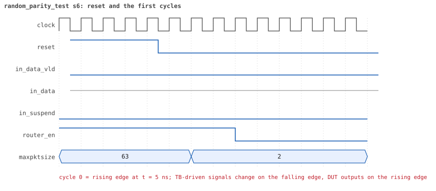
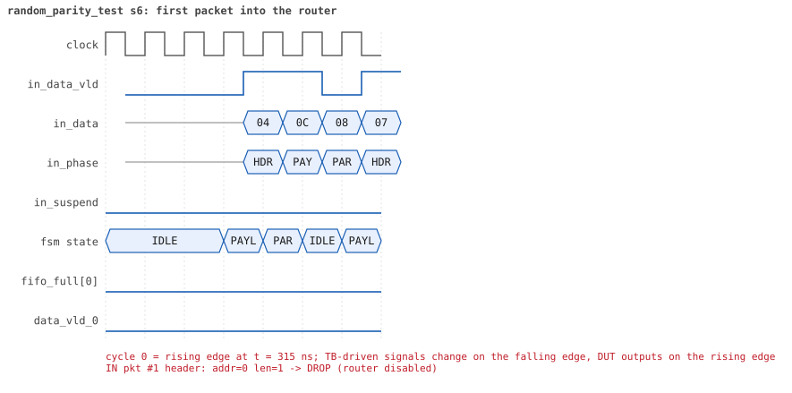
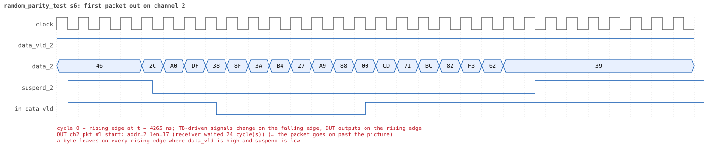
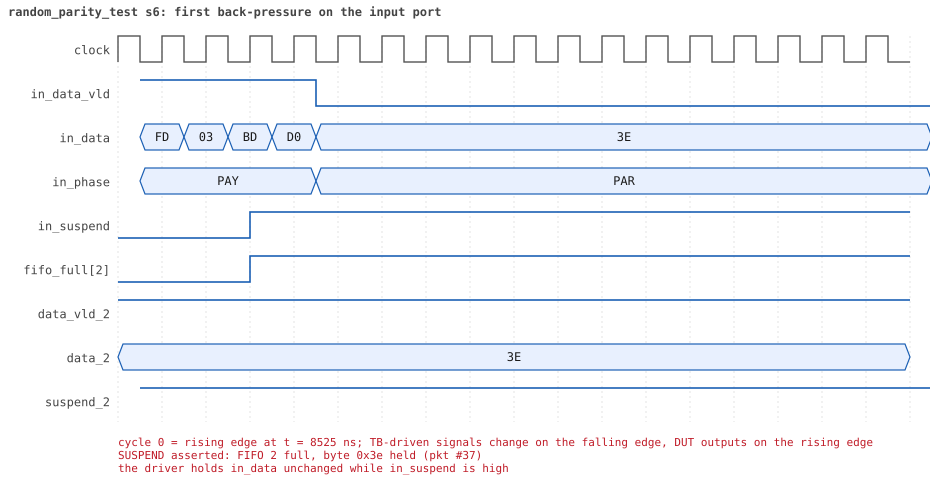
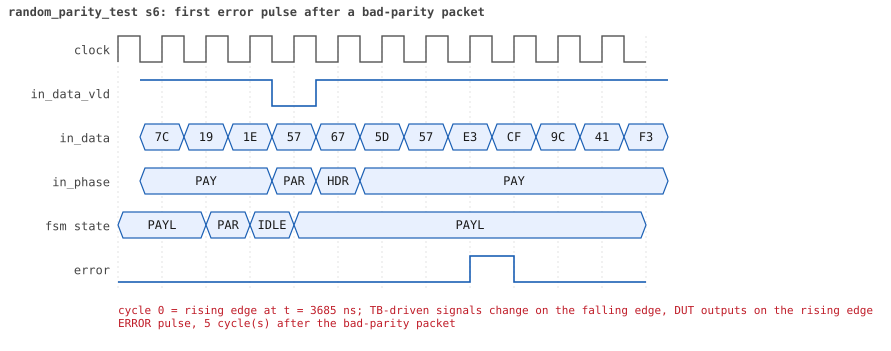
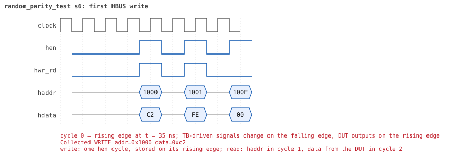
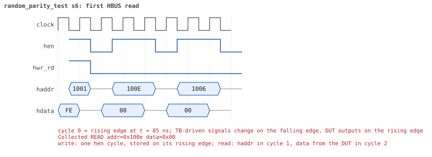

# random_parity_test seed 6

**Result:** PASSED (0 UVM_ERROR, 0 UVM_WARNING, 0 UVM_FATAL) · bench `yapp_project_tb` · sim time 24us · wall 19.7 s · log [`random_parity_test_s6.log`](random_parity_test_s6.log)

Waves: `random_parity_test_s6.fst` (GTKWave, Surfer or the VS Code wave viewer).
[Open the waves in Surfer](https://app.surfer-project.org/?load_url=https%3A%2F%2Fraw.githubusercontent.com%2Ftamirgabgab%2FQcom-Mentoring%2Fmain%2Fyapp_project%2Fregression%2Fyapp_project_tb%2Frandom_parity_test_s6%2Frandom_parity_test_s6.fst&startup_commands=run_command_file_from_url%20https%3A%2F%2Fraw.githubusercontent.com%2Ftamirgabgab%2FQcom-Mentoring%2Fmain%2Fyapp_project%2Ftb%2Fyapp_router.sucl) (web app, the signals already in groups: `yapp_project/tb/yapp_router.sucl`).

## Summary

- YAPP driver sent **83** packet(s) (28 with bad parity); the input monitor saw 83.
- Router: **35** forwarded, **48** dropped (22 router disabled, 23 oversized, 3 illegal address 3).
- Packets out: ch0 **10**, ch1 **14**, ch2 **11**.
- Scoreboard: 35 matched, 0 mismatched, 0 unexpected.
- Back-pressure: in_suspend asserted **8** time(s), longest hold 54 cycle(s).
- Error pulses: 23.
- HBUS: 18 write(s), 54 read(s).

## Stages

| time (ns) | stage |
|---|---|
| 0 | receivers: ch0 CHANNEL_RX_PROFILE_STALLY, ch1 CHANNEL_RX_PROFILE_FAST, ch2 CHANNEL_RX_PROFILE_SLOW |
| 0 | random scenario: 83 packets in 4 bursts |
| 330 | burst 1/4: ctrl=0xc2 (maxpktsize 2) en=0xfe (router OFF, counter enables 1111111), 22 packet(s) -- storm: 1..3-byte packets back to back, half with bad parity |
| 1180 | burst 1/4 sent: addr0..3 3/7/7/5, bad parity 5, gap 0 22, length 1..3 |
| 1350 | burst 2/4: ctrl=0x12 (maxpktsize 18) en=0xff (router on, counter enables 1111111), 21 packet(s) |
| 11210 | burst 2/4 sent: addr0..3 6/2/7/6, bad parity 6, gap 0 6, length 5..63 |
| 11380 | burst 3/4: ctrl=0x3e (maxpktsize 62) en=0xf1 (router on, counter enables 1111000), 20 packet(s) -- storm: 1..3-byte packets back to back, half with bad parity |
| 12500 | burst 3/4 sent: addr0..3 4/8/7/1, bad parity 7, gap 0 17, length 1..3 |
| 12780 | burst 4/4: ctrl=0xe5 (maxpktsize 37) en=0xb7 (router on, counter enables 1011011), 20 packet(s) |
| 22850 | burst 4/4 sent: addr0..3 4/7/6/3, bad parity 10, gap 0 9, length 6..63 |
| 22850 | final reads: every register and the stored packet, checked against the reference model |
| 24045 | done: 83 packets (35 forwarded, 48 dropped), 2 storm burst(s), 35 scoreboard matches, 53 HBUS reads checked, 23 error pulses for 23 bad packets |

## Pictures

**reset and the first cycles**

**first packet into the router**

**first packet out on channel 2**

**first back-pressure on the input port**

**first error pulse after a bad-parity packet**

**first HBUS write**

**first HBUS read**

## Timeline

982 events.

| time (ns) | who | event |
|---|---|---|
| 0 | yapp monitor | YAPP monitor running |
| 0 | **test** | STAGE: receivers: ch0 CHANNEL_RX_PROFILE_STALLY, ch1 CHANNEL_RX_PROFILE_FAST, ch2 CHANNEL_RX_PROFILE_SLOW |
| 0 | **test** | STAGE: random scenario: 83 packets in 4 bursts |
| 0 | clk/rst driver | Starting clock (period 10) and holding reset for 5 cycles |
| 0 | **DUT** | RESET asserted |
| 50 | **DUT** | RESET released: router_en=1 maxpktsize=63 |
| 70 | hbus driver | Executed WRITE addr=0x1000 data=0xc2 |
| 75 | **DUT** | CONFIG router_en=1 maxpktsize=2 |
| 75 | hbus monitor | Collected WRITE addr=0x1000 data=0xc2 |
| 75 | reference | maxpktsize is now 2 |
| 90 | hbus driver | Executed WRITE addr=0x1001 data=0xfe |
| 95 | **DUT** | CONFIG router_en=0 maxpktsize=2 |
| 95 | hbus monitor | Collected WRITE addr=0x1001 data=0xfe |
| 95 | reference | router_en is now 0 (en_reg 0xfe) |
| 120 | hbus driver | Executed READ  addr=0x100e data=0x00 |
| 125 | hbus monitor | Collected READ  addr=0x100e data=0x00 |
| 150 | hbus driver | Executed READ  addr=0x1006 data=0x00 |
| 155 | hbus monitor | Collected READ  addr=0x1006 data=0x00 |
| 170 | hbus driver | Executed WRITE addr=0x1124 data=0xdf |
| 175 | hbus monitor | Collected WRITE addr=0x1124 data=0xdf |
| 200 | hbus driver | Executed READ  addr=0x1124 data=0xdf |
| 205 | hbus monitor | Collected READ  addr=0x1124 data=0xdf |
| 220 | hbus driver | Executed WRITE addr=0x1171 data=0xa1 |
| 225 | hbus monitor | Collected WRITE addr=0x1171 data=0xa1 |
| 250 | hbus driver | Executed READ  addr=0x1171 data=0xa1 |
| 255 | hbus monitor | Collected READ  addr=0x1171 data=0xa1 |
| 270 | hbus driver | Executed WRITE addr=0x1167 data=0x2a |
| 275 | hbus monitor | Collected WRITE addr=0x1167 data=0x2a |
| 300 | hbus driver | Executed READ  addr=0x1167 data=0x2a |
| 305 | hbus monitor | Collected READ  addr=0x1167 data=0x2a |
| 330 | hbus driver | Executed READ  addr=0x1048 data=0x00 |
| 330 | **test** | STAGE: burst 1/4: ctrl=0xc2 (maxpktsize 2) en=0xfe (router OFF, counter enables 1111111), 22 packet(s) -- storm: 1..3-byte packets back to back, half with bad parity |
| 330 | yapp driver | TX pkt #1: addr=0 len=1 parity=good delay=0 |
| 335 | hbus monitor | Collected READ  addr=0x1048 data=0x00 |
| 345 | **DUT** | IN  pkt #1 header: addr=0 len=1 -> DROP (router disabled) |
| 365 | **DUT** | IN  pkt #1 complete: addr=0 len=1 parity=ok dropped, 3 bytes in 3 cycles (held 0) |
| 365 | yapp monitor | RX pkt #1 on the input: addr=0 len=1 parity=good gap=29 |
| 365 | reference | Packet dropped: router disabled (addr=0 len=1) |
| 365 | **DUT** | ROUTER DROPS PACKET addr=0 length=1 (router disabled) |
| 370 | yapp driver | TX pkt #1 accepted by the DUT |
| 370 | yapp driver | TX pkt #2: addr=3 len=1 parity=good delay=0 |
| 375 | **DUT** | IN  pkt #2 header: addr=3 len=1 -> DROP (router disabled) |
| 395 | **DUT** | IN  pkt #2 complete: addr=3 len=1 parity=ok dropped, 3 bytes in 3 cycles (held 0) |
| 395 | yapp monitor | RX pkt #2 on the input: addr=3 len=1 parity=good gap=0 |
| 395 | reference | Packet dropped: router disabled (addr=3 len=1) |
| 395 | **DUT** | ROUTER DROPS PACKET addr=3 length=1 (router disabled) |
| 400 | yapp driver | TX pkt #2 accepted by the DUT |
| 400 | yapp driver | TX pkt #3: addr=0 len=2 parity=good delay=0 |
| 405 | **DUT** | IN  pkt #3 header: addr=0 len=2 -> DROP (router disabled) |
| 435 | **DUT** | IN  pkt #3 complete: addr=0 len=2 parity=ok dropped, 4 bytes in 4 cycles (held 0) |
| 435 | yapp monitor | RX pkt #3 on the input: addr=0 len=2 parity=good gap=0 |
| 435 | reference | Packet dropped: router disabled (addr=0 len=2) |
| 435 | **DUT** | ROUTER DROPS PACKET addr=0 length=2 (router disabled) |
| 440 | yapp driver | TX pkt #3 accepted by the DUT |
| 440 | yapp driver | TX pkt #4: addr=2 len=2 parity=good delay=0 |
| 445 | **DUT** | IN  pkt #4 header: addr=2 len=2 -> DROP (router disabled) |
| 475 | **DUT** | IN  pkt #4 complete: addr=2 len=2 parity=ok dropped, 4 bytes in 4 cycles (held 0) |
| 475 | yapp monitor | RX pkt #4 on the input: addr=2 len=2 parity=good gap=0 |
| 475 | reference | Packet dropped: router disabled (addr=2 len=2) |
| 475 | **DUT** | ROUTER DROPS PACKET addr=2 length=2 (router disabled) |
| 480 | yapp driver | TX pkt #4 accepted by the DUT |
| 480 | yapp driver | TX pkt #5: addr=1 len=1 parity=good delay=0 |
| 485 | **DUT** | IN  pkt #5 header: addr=1 len=1 -> DROP (router disabled) |
| 505 | **DUT** | IN  pkt #5 complete: addr=1 len=1 parity=ok dropped, 3 bytes in 3 cycles (held 0) |
| 505 | yapp monitor | RX pkt #5 on the input: addr=1 len=1 parity=good gap=0 |
| 505 | reference | Packet dropped: router disabled (addr=1 len=1) |
| 505 | **DUT** | ROUTER DROPS PACKET addr=1 length=1 (router disabled) |
| 510 | yapp driver | TX pkt #5 accepted by the DUT |
| 510 | yapp driver | TX pkt #6: addr=1 len=3 parity=bad delay=0 |
| 515 | **DUT** | IN  pkt #6 header: addr=1 len=3 -> DROP (router disabled) |
| 555 | **DUT** | IN  pkt #6 complete: addr=1 len=3 parity=BAD dropped, 5 bytes in 5 cycles (held 0) |
| 555 | yapp monitor | RX pkt #6 on the input: addr=1 len=3 parity=bad gap=0 |
| 555 | reference | Packet dropped: router disabled (addr=1 len=3) |
| 555 | **DUT** | ROUTER DROPS PACKET addr=1 length=3 (router disabled) |
| 560 | yapp driver | TX pkt #6 accepted by the DUT |
| 560 | yapp driver | TX pkt #7: addr=2 len=2 parity=good delay=0 |
| 565 | **DUT** | IN  pkt #7 header: addr=2 len=2 -> DROP (router disabled) |
| 595 | **DUT** | IN  pkt #7 complete: addr=2 len=2 parity=ok dropped, 4 bytes in 4 cycles (held 0) |
| 595 | yapp monitor | RX pkt #7 on the input: addr=2 len=2 parity=good gap=0 |
| 595 | reference | Packet dropped: router disabled (addr=2 len=2) |
| 595 | **DUT** | ROUTER DROPS PACKET addr=2 length=2 (router disabled) |
| 600 | yapp driver | TX pkt #7 accepted by the DUT |
| 600 | yapp driver | TX pkt #8: addr=3 len=1 parity=good delay=0 |
| 605 | **DUT** | IN  pkt #8 header: addr=3 len=1 -> DROP (router disabled) |
| 625 | **DUT** | IN  pkt #8 complete: addr=3 len=1 parity=ok dropped, 3 bytes in 3 cycles (held 0) |
| 625 | yapp monitor | RX pkt #8 on the input: addr=3 len=1 parity=good gap=0 |
| 625 | reference | Packet dropped: router disabled (addr=3 len=1) |
| 625 | **DUT** | ROUTER DROPS PACKET addr=3 length=1 (router disabled) |
| 630 | yapp driver | TX pkt #8 accepted by the DUT |
| 630 | yapp driver | TX pkt #9: addr=2 len=3 parity=good delay=0 |
| 635 | **DUT** | IN  pkt #9 header: addr=2 len=3 -> DROP (router disabled) |
| 675 | **DUT** | IN  pkt #9 complete: addr=2 len=3 parity=ok dropped, 5 bytes in 5 cycles (held 0) |
| 675 | yapp monitor | RX pkt #9 on the input: addr=2 len=3 parity=good gap=0 |
| 675 | reference | Packet dropped: router disabled (addr=2 len=3) |
| 675 | **DUT** | ROUTER DROPS PACKET addr=2 length=3 (router disabled) |
| 680 | yapp driver | TX pkt #9 accepted by the DUT |
| 680 | yapp driver | TX pkt #10: addr=3 len=1 parity=good delay=0 |
| 685 | **DUT** | IN  pkt #10 header: addr=3 len=1 -> DROP (router disabled) |
| 705 | **DUT** | IN  pkt #10 complete: addr=3 len=1 parity=ok dropped, 3 bytes in 3 cycles (held 0) |
| 705 | yapp monitor | RX pkt #10 on the input: addr=3 len=1 parity=good gap=0 |
| 705 | reference | Packet dropped: router disabled (addr=3 len=1) |
| 705 | **DUT** | ROUTER DROPS PACKET addr=3 length=1 (router disabled) |
| 710 | yapp driver | TX pkt #10 accepted by the DUT |
| 710 | yapp driver | TX pkt #11: addr=1 len=1 parity=good delay=0 |
| 715 | **DUT** | IN  pkt #11 header: addr=1 len=1 -> DROP (router disabled) |
| 735 | **DUT** | IN  pkt #11 complete: addr=1 len=1 parity=ok dropped, 3 bytes in 3 cycles (held 0) |
| 735 | yapp monitor | RX pkt #11 on the input: addr=1 len=1 parity=good gap=0 |
| 735 | reference | Packet dropped: router disabled (addr=1 len=1) |
| 735 | **DUT** | ROUTER DROPS PACKET addr=1 length=1 (router disabled) |
| 740 | yapp driver | TX pkt #11 accepted by the DUT |
| 740 | yapp driver | TX pkt #12: addr=3 len=1 parity=good delay=0 |
| 745 | **DUT** | IN  pkt #12 header: addr=3 len=1 -> DROP (router disabled) |
| 765 | **DUT** | IN  pkt #12 complete: addr=3 len=1 parity=ok dropped, 3 bytes in 3 cycles (held 0) |
| 765 | yapp monitor | RX pkt #12 on the input: addr=3 len=1 parity=good gap=0 |
| 765 | reference | Packet dropped: router disabled (addr=3 len=1) |
| 765 | **DUT** | ROUTER DROPS PACKET addr=3 length=1 (router disabled) |
| 770 | yapp driver | TX pkt #12 accepted by the DUT |
| 770 | yapp driver | TX pkt #13: addr=3 len=1 parity=bad delay=0 |
| 775 | **DUT** | IN  pkt #13 header: addr=3 len=1 -> DROP (router disabled) |
| 795 | **DUT** | IN  pkt #13 complete: addr=3 len=1 parity=BAD dropped, 3 bytes in 3 cycles (held 0) |
| 795 | yapp monitor | RX pkt #13 on the input: addr=3 len=1 parity=bad gap=0 |
| 795 | reference | Packet dropped: router disabled (addr=3 len=1) |
| 795 | **DUT** | ROUTER DROPS PACKET addr=3 length=1 (router disabled) |
| 800 | yapp driver | TX pkt #13 accepted by the DUT |
| 800 | yapp driver | TX pkt #14: addr=1 len=1 parity=good delay=0 |
| 805 | **DUT** | IN  pkt #14 header: addr=1 len=1 -> DROP (router disabled) |
| 825 | **DUT** | IN  pkt #14 complete: addr=1 len=1 parity=ok dropped, 3 bytes in 3 cycles (held 0) |
| 825 | yapp monitor | RX pkt #14 on the input: addr=1 len=1 parity=good gap=0 |
| 825 | reference | Packet dropped: router disabled (addr=1 len=1) |
| 825 | **DUT** | ROUTER DROPS PACKET addr=1 length=1 (router disabled) |
| 830 | yapp driver | TX pkt #14 accepted by the DUT |
| 830 | yapp driver | TX pkt #15: addr=2 len=3 parity=bad delay=0 |
| 835 | **DUT** | IN  pkt #15 header: addr=2 len=3 -> DROP (router disabled) |
| 875 | **DUT** | IN  pkt #15 complete: addr=2 len=3 parity=BAD dropped, 5 bytes in 5 cycles (held 0) |
| 875 | yapp monitor | RX pkt #15 on the input: addr=2 len=3 parity=bad gap=0 |
| 875 | reference | Packet dropped: router disabled (addr=2 len=3) |
| 875 | **DUT** | ROUTER DROPS PACKET addr=2 length=3 (router disabled) |
| 880 | yapp driver | TX pkt #15 accepted by the DUT |
| 880 | yapp driver | TX pkt #16: addr=1 len=3 parity=good delay=0 |
| 885 | **DUT** | IN  pkt #16 header: addr=1 len=3 -> DROP (router disabled) |
| 925 | **DUT** | IN  pkt #16 complete: addr=1 len=3 parity=ok dropped, 5 bytes in 5 cycles (held 0) |
| 925 | yapp monitor | RX pkt #16 on the input: addr=1 len=3 parity=good gap=0 |
| 925 | reference | Packet dropped: router disabled (addr=1 len=3) |
| 925 | **DUT** | ROUTER DROPS PACKET addr=1 length=3 (router disabled) |
| 930 | yapp driver | TX pkt #16 accepted by the DUT |
| 930 | yapp driver | TX pkt #17: addr=2 len=3 parity=bad delay=0 |
| 935 | **DUT** | IN  pkt #17 header: addr=2 len=3 -> DROP (router disabled) |
| 975 | **DUT** | IN  pkt #17 complete: addr=2 len=3 parity=BAD dropped, 5 bytes in 5 cycles (held 0) |
| 975 | yapp monitor | RX pkt #17 on the input: addr=2 len=3 parity=bad gap=0 |
| 975 | reference | Packet dropped: router disabled (addr=2 len=3) |
| 975 | **DUT** | ROUTER DROPS PACKET addr=2 length=3 (router disabled) |
| 980 | yapp driver | TX pkt #17 accepted by the DUT |
| 980 | yapp driver | TX pkt #18: addr=1 len=3 parity=good delay=0 |
| 985 | **DUT** | IN  pkt #18 header: addr=1 len=3 -> DROP (router disabled) |
| 1025 | **DUT** | IN  pkt #18 complete: addr=1 len=3 parity=ok dropped, 5 bytes in 5 cycles (held 0) |
| 1025 | yapp monitor | RX pkt #18 on the input: addr=1 len=3 parity=good gap=0 |
| 1025 | reference | Packet dropped: router disabled (addr=1 len=3) |
| 1025 | **DUT** | ROUTER DROPS PACKET addr=1 length=3 (router disabled) |
| 1030 | yapp driver | TX pkt #18 accepted by the DUT |
| 1030 | yapp driver | TX pkt #19: addr=0 len=2 parity=good delay=0 |
| 1035 | **DUT** | IN  pkt #19 header: addr=0 len=2 -> DROP (router disabled) |
| 1065 | **DUT** | IN  pkt #19 complete: addr=0 len=2 parity=ok dropped, 4 bytes in 4 cycles (held 0) |
| 1065 | yapp monitor | RX pkt #19 on the input: addr=0 len=2 parity=good gap=0 |
| 1065 | reference | Packet dropped: router disabled (addr=0 len=2) |
| 1065 | **DUT** | ROUTER DROPS PACKET addr=0 length=2 (router disabled) |
| 1070 | yapp driver | TX pkt #19 accepted by the DUT |
| 1070 | yapp driver | TX pkt #20: addr=2 len=1 parity=bad delay=0 |
| 1075 | **DUT** | IN  pkt #20 header: addr=2 len=1 -> DROP (router disabled) |
| 1095 | **DUT** | IN  pkt #20 complete: addr=2 len=1 parity=BAD dropped, 3 bytes in 3 cycles (held 0) |
| 1095 | yapp monitor | RX pkt #20 on the input: addr=2 len=1 parity=bad gap=0 |
| 1095 | reference | Packet dropped: router disabled (addr=2 len=1) |
| 1095 | **DUT** | ROUTER DROPS PACKET addr=2 length=1 (router disabled) |
| 1100 | yapp driver | TX pkt #20 accepted by the DUT |
| 1100 | yapp driver | TX pkt #21: addr=2 len=3 parity=good delay=0 |
| 1105 | **DUT** | IN  pkt #21 header: addr=2 len=3 -> DROP (router disabled) |
| 1145 | **DUT** | IN  pkt #21 complete: addr=2 len=3 parity=ok dropped, 5 bytes in 5 cycles (held 0) |
| 1145 | yapp monitor | RX pkt #21 on the input: addr=2 len=3 parity=good gap=0 |
| 1145 | reference | Packet dropped: router disabled (addr=2 len=3) |
| 1145 | **DUT** | ROUTER DROPS PACKET addr=2 length=3 (router disabled) |
| 1150 | yapp driver | TX pkt #21 accepted by the DUT |
| 1150 | yapp driver | TX pkt #22: addr=1 len=1 parity=good delay=0 |
| 1155 | **DUT** | IN  pkt #22 header: addr=1 len=1 -> DROP (router disabled) |
| 1175 | **DUT** | IN  pkt #22 complete: addr=1 len=1 parity=ok dropped, 3 bytes in 3 cycles (held 0) |
| 1175 | yapp monitor | RX pkt #22 on the input: addr=1 len=1 parity=good gap=0 |
| 1175 | reference | Packet dropped: router disabled (addr=1 len=1) |
| 1175 | **DUT** | ROUTER DROPS PACKET addr=1 length=1 (router disabled) |
| 1180 | yapp driver | TX pkt #22 accepted by the DUT |
| 1180 | **test** | STAGE: burst 1/4 sent: addr0..3 3/7/7/5, bad parity 5, gap 0 22, length 1..3 |
| 1200 | hbus driver | Executed WRITE addr=0x1000 data=0x12 |
| 1205 | **DUT** | CONFIG router_en=0 maxpktsize=18 |
| 1205 | hbus monitor | Collected WRITE addr=0x1000 data=0x12 |
| 1205 | reference | maxpktsize is now 18 |
| 1220 | hbus driver | Executed WRITE addr=0x1001 data=0xff |
| 1225 | **DUT** | CONFIG router_en=1 maxpktsize=18 |
| 1225 | hbus monitor | Collected WRITE addr=0x1001 data=0xff |
| 1225 | reference | router_en is now 1 (en_reg 0xff) |
| 1250 | hbus driver | Executed READ  addr=0x100d data=0x00 |
| 1255 | hbus monitor | Collected READ  addr=0x100d data=0x00 |
| 1270 | hbus driver | Executed WRITE addr=0x1163 data=0xa2 |
| 1275 | hbus monitor | Collected WRITE addr=0x1163 data=0xa2 |
| 1300 | hbus driver | Executed READ  addr=0x1163 data=0xa2 |
| 1305 | hbus monitor | Collected READ  addr=0x1163 data=0xa2 |
| 1320 | hbus driver | Executed WRITE addr=0x114a data=0x3f |
| 1325 | hbus monitor | Collected WRITE addr=0x114a data=0x3f |
| 1350 | hbus driver | Executed READ  addr=0x114a data=0x3f |
| 1350 | **test** | STAGE: burst 2/4: ctrl=0x12 (maxpktsize 18) en=0xff (router on, counter enables 1111111), 21 packet(s) |
| 1350 | yapp driver | TX pkt #23: addr=0 len=63 parity=good delay=20 |
| 1355 | hbus monitor | Collected READ  addr=0x114a data=0x3f |
| 1565 | **DUT** | IN  pkt #23 header: addr=0 len=63 -> DROP (oversized: len 63 > maxpktsize 18) |
| 2205 | **DUT** | IN  pkt #23 complete: addr=0 len=63 parity=ok dropped, 65 bytes in 65 cycles (held 0) |
| 2205 | yapp monitor | RX pkt #23 on the input: addr=0 len=63 parity=good gap=38 |
| 2205 | reference | Packet dropped: length 63 > maxpktsize 18 (addr=0) |
| 2205 | **DUT** | ROUTER DROPS PACKET addr=0 length=63 (length > maxpktsize) |
| 2210 | yapp driver | TX pkt #23 accepted by the DUT |
| 2210 | yapp driver | TX pkt #24: addr=2 len=63 parity=good delay=1 |
| 2225 | **DUT** | IN  pkt #24 header: addr=2 len=63 -> DROP (oversized: len 63 > maxpktsize 18) |
| 2865 | **DUT** | IN  pkt #24 complete: addr=2 len=63 parity=ok dropped, 65 bytes in 65 cycles (held 0) |
| 2865 | yapp monitor | RX pkt #24 on the input: addr=2 len=63 parity=good gap=1 |
| 2865 | reference | Packet dropped: length 63 > maxpktsize 18 (addr=2) |
| 2865 | **DUT** | ROUTER DROPS PACKET addr=2 length=63 (length > maxpktsize) |
| 2870 | yapp driver | TX pkt #24 accepted by the DUT |
| 2870 | yapp driver | TX pkt #25: addr=0 len=32 parity=good delay=2 |
| 2895 | **DUT** | IN  pkt #25 header: addr=0 len=32 -> DROP (oversized: len 32 > maxpktsize 18) |
| 3225 | **DUT** | IN  pkt #25 complete: addr=0 len=32 parity=ok dropped, 34 bytes in 34 cycles (held 0) |
| 3225 | yapp monitor | RX pkt #25 on the input: addr=0 len=32 parity=good gap=2 |
| 3225 | reference | Packet dropped: length 32 > maxpktsize 18 (addr=0) |
| 3225 | **DUT** | ROUTER DROPS PACKET addr=0 length=32 (length > maxpktsize) |
| 3230 | yapp driver | TX pkt #25 accepted by the DUT |
| 3230 | yapp driver | TX pkt #26: addr=2 len=46 parity=bad delay=1 |
| 3245 | **DUT** | IN  pkt #26 header: addr=2 len=46 -> DROP (oversized: len 46 > maxpktsize 18) |
| 3715 | **DUT** | IN  pkt #26 complete: addr=2 len=46 parity=BAD dropped, 48 bytes in 48 cycles (held 0) |
| 3715 | yapp monitor | RX pkt #26 on the input: addr=2 len=46 parity=bad gap=1 |
| 3715 | reference | Packet dropped: length 46 > maxpktsize 18 (addr=2) |
| 3715 | **DUT** | ROUTER DROPS PACKET addr=2 length=46 (length > maxpktsize) |
| 3720 | yapp driver | TX pkt #26 accepted by the DUT |
| 3720 | yapp driver | TX pkt #27: addr=3 len=25 parity=bad delay=0 |
| 3725 | **DUT** | IN  pkt #27 header: addr=3 len=25 -> DROP (oversized: len 25 > maxpktsize 18) |
| 3770 | **DUT** | ERROR pulse, 5 cycle(s) after the bad-parity packet |
| 3770 | error checker | error pulse 5 cycles after the bad packet (0 still owed) |
| 3985 | **DUT** | IN  pkt #27 complete: addr=3 len=25 parity=BAD dropped, 27 bytes in 27 cycles (held 0) |
| 3985 | yapp monitor | RX pkt #27 on the input: addr=3 len=25 parity=bad gap=0 |
| 3985 | reference | Packet dropped: illegal address 3 (len=25) |
| 3985 | **DUT** | ROUTER DROPS PACKET addr=3 length=25 (    illegal address) |
| 3990 | yapp driver | TX pkt #27 accepted by the DUT |
| 3990 | yapp driver | TX pkt #28: addr=2 len=17 parity=good delay=6 |
| 4055 | **DUT** | IN  pkt #28 header: addr=2 len=17 -> channel 2 |
| 4090 | **DUT** | ERROR pulse, 10 cycle(s) after the bad-parity packet |
| 4090 | error checker | error pulse 10 cycles after the bad packet (0 still owed) |
| 4215 | **DUT** | SUSPEND asserted: FIFO 2 full, byte 0xf3 held (pkt #28) |
| 4305 | **DUT** | OUT ch2 pkt #1 start: addr=2 len=17 (receiver waited 24 cycle(s)) |
| 4315 | **DUT** | SUSPEND released after 10 cycle(s) |
| 4335 | **DUT** | IN  pkt #28 complete: addr=2 len=17 parity=ok forwarded, 19 bytes in 29 cycles (held 10) |
| 4335 | yapp monitor | RX pkt #28 on the input: addr=2 len=17 parity=good gap=6 |
| 4335 | reference | Packet forwarded: addr=2 len=17 -> channel 2 |
| 4340 | yapp driver | TX pkt #28 accepted by the DUT |
| 4340 | yapp driver | TX pkt #29: addr=2 len=63 parity=good delay=6 |
| 4405 | **DUT** | IN  pkt #29 header: addr=2 len=63 -> DROP (oversized: len 63 > maxpktsize 18) |
| 4480 | ch2 driver | ch2: packet consumed (response delay 24) |
| 4755 | **DUT** | OUT ch2 pkt #1 done: 19 bytes in 46 cycles |
| 4755 | ch2 monitor | ch2 RX pkt #1: addr=2 len=17 parity=good |
| 4755 | scoreboard | ch2 pkt matched: addr=2 len=17 (1 matched so far) |
| 4900 | ch2 driver | ch2: packet consumed (response delay 26) |
| 5045 | **DUT** | IN  pkt #29 complete: addr=2 len=63 parity=ok dropped, 65 bytes in 65 cycles (held 0) |
| 5045 | yapp monitor | RX pkt #29 on the input: addr=2 len=63 parity=good gap=6 |
| 5045 | reference | Packet dropped: length 63 > maxpktsize 18 (addr=2) |
| 5045 | **DUT** | ROUTER DROPS PACKET addr=2 length=63 (length > maxpktsize) |
| 5050 | yapp driver | TX pkt #29 accepted by the DUT |
| 5050 | yapp driver | TX pkt #30: addr=0 len=63 parity=good delay=14 |
| 5195 | **DUT** | IN  pkt #30 header: addr=0 len=63 -> DROP (oversized: len 63 > maxpktsize 18) |
| 5835 | **DUT** | IN  pkt #30 complete: addr=0 len=63 parity=ok dropped, 65 bytes in 65 cycles (held 0) |
| 5835 | yapp monitor | RX pkt #30 on the input: addr=0 len=63 parity=good gap=14 |
| 5835 | reference | Packet dropped: length 63 > maxpktsize 18 (addr=0) |
| 5835 | **DUT** | ROUTER DROPS PACKET addr=0 length=63 (length > maxpktsize) |
| 5840 | yapp driver | TX pkt #30 accepted by the DUT |
| 5840 | yapp driver | TX pkt #31: addr=0 len=18 parity=good delay=20 |
| 6045 | **DUT** | IN  pkt #31 header: addr=0 len=18 -> channel 0 |
| 6205 | **DUT** | SUSPEND asserted: FIFO 0 full, byte 0xf5 held (pkt #31) |
| 6735 | **DUT** | OUT ch0 pkt #1 start: addr=0 len=18 (receiver waited 68 cycle(s)) |
| 6745 | **DUT** | SUSPEND released after 54 cycle(s) |
| 6775 | **DUT** | IN  pkt #31 complete: addr=0 len=18 parity=ok forwarded, 20 bytes in 74 cycles (held 54) |
| 6775 | yapp monitor | RX pkt #31 on the input: addr=0 len=18 parity=good gap=20 |
| 6775 | reference | Packet forwarded: addr=0 len=18 -> channel 0 |
| 6780 | yapp driver | TX pkt #31 accepted by the DUT |
| 6780 | yapp driver | TX pkt #32: addr=0 len=18 parity=good delay=3 |
| 6815 | **DUT** | IN  pkt #32 header: addr=0 len=18 -> channel 0 |
| 6920 | ch0 driver | ch0: packet consumed (response delay 68) |
| 6965 | **DUT** | SUSPEND asserted: FIFO 0 full, byte 0xe5 held (pkt #32) |
| 6975 | **DUT** | OUT ch0 pkt #1 done: 20 bytes in 25 cycles |
| 6975 | ch0 monitor | ch0 RX pkt #1: addr=0 len=18 parity=good |
| 6975 | scoreboard | ch0 pkt matched: addr=0 len=18 (2 matched so far) |
| 6985 | **DUT** | SUSPEND released after 2 cycle(s) |
| 6985 | **DUT** | OUT ch0 pkt #2 start: addr=0 len=18 (receiver waited 0 cycle(s)) |
| 7025 | **DUT** | IN  pkt #32 complete: addr=0 len=18 parity=ok forwarded, 20 bytes in 22 cycles (held 2) |
| 7025 | yapp monitor | RX pkt #32 on the input: addr=0 len=18 parity=good gap=3 |
| 7025 | reference | Packet forwarded: addr=0 len=18 -> channel 0 |
| 7030 | yapp driver | TX pkt #32 accepted by the DUT |
| 7030 | yapp driver | TX pkt #33: addr=3 len=63 parity=bad delay=1 |
| 7045 | **DUT** | IN  pkt #33 header: addr=3 len=63 -> DROP (oversized: len 63 > maxpktsize 18) |
| 7175 | **DUT** | OUT ch0 pkt #2 done: 20 bytes in 20 cycles |
| 7175 | ch0 monitor | ch0 RX pkt #2: addr=0 len=18 parity=good |
| 7175 | scoreboard | ch0 pkt matched: addr=0 len=18 (3 matched so far) |
| 7430 | ch0 driver | ch0: packet consumed (response delay 4) |
| 7685 | **DUT** | IN  pkt #33 complete: addr=3 len=63 parity=BAD dropped, 65 bytes in 65 cycles (held 0) |
| 7685 | yapp monitor | RX pkt #33 on the input: addr=3 len=63 parity=bad gap=1 |
| 7685 | reference | Packet dropped: illegal address 3 (len=63) |
| 7685 | **DUT** | ROUTER DROPS PACKET addr=3 length=63 (    illegal address) |
| 7690 | yapp driver | TX pkt #33 accepted by the DUT |
| 7690 | yapp driver | TX pkt #34: addr=3 len=30 parity=bad delay=3 |
| 7710 | **DUT** | ERROR pulse, 2 cycle(s) after the bad-parity packet |
| 7710 | error checker | error pulse 2 cycles after the bad packet (0 still owed) |
| 7725 | **DUT** | IN  pkt #34 header: addr=3 len=30 -> DROP (oversized: len 30 > maxpktsize 18) |
| 8035 | **DUT** | IN  pkt #34 complete: addr=3 len=30 parity=BAD dropped, 32 bytes in 32 cycles (held 0) |
| 8035 | yapp monitor | RX pkt #34 on the input: addr=3 len=30 parity=bad gap=3 |
| 8035 | reference | Packet dropped: illegal address 3 (len=30) |
| 8035 | **DUT** | ROUTER DROPS PACKET addr=3 length=30 (    illegal address) |
| 8040 | yapp driver | TX pkt #34 accepted by the DUT |
| 8040 | yapp driver | TX pkt #35: addr=3 len=44 parity=good delay=20 |
| 8090 | **DUT** | ERROR pulse, 5 cycle(s) after the bad-parity packet |
| 8090 | error checker | error pulse 5 cycles after the bad packet (0 still owed) |
| 8245 | **DUT** | IN  pkt #35 header: addr=3 len=44 -> DROP (oversized: len 44 > maxpktsize 18) |
| 8695 | **DUT** | IN  pkt #35 complete: addr=3 len=44 parity=ok dropped, 46 bytes in 46 cycles (held 0) |
| 8695 | yapp monitor | RX pkt #35 on the input: addr=3 len=44 parity=good gap=20 |
| 8695 | reference | Packet dropped: illegal address 3 (len=44) |
| 8695 | **DUT** | ROUTER DROPS PACKET addr=3 length=44 (    illegal address) |
| 8700 | yapp driver | TX pkt #35 accepted by the DUT |
| 8700 | yapp driver | TX pkt #36: addr=3 len=21 parity=good delay=0 |
| 8705 | **DUT** | IN  pkt #36 header: addr=3 len=21 -> DROP (oversized: len 21 > maxpktsize 18) |
| 8925 | **DUT** | IN  pkt #36 complete: addr=3 len=21 parity=ok dropped, 23 bytes in 23 cycles (held 0) |
| 8925 | yapp monitor | RX pkt #36 on the input: addr=3 len=21 parity=good gap=0 |
| 8925 | reference | Packet dropped: illegal address 3 (len=21) |
| 8925 | **DUT** | ROUTER DROPS PACKET addr=3 length=21 (    illegal address) |
| 8930 | yapp driver | TX pkt #36 accepted by the DUT |
| 8930 | yapp driver | TX pkt #37: addr=2 len=18 parity=good delay=18 |
| 9115 | **DUT** | IN  pkt #37 header: addr=2 len=18 -> channel 2 |
| 9275 | **DUT** | SUSPEND asserted: FIFO 2 full, byte 0xed held (pkt #37) |
| 9425 | **DUT** | OUT ch2 pkt #2 start: addr=2 len=18 (receiver waited 30 cycle(s)) |
| 9435 | **DUT** | SUSPEND released after 16 cycle(s) |
| 9465 | **DUT** | IN  pkt #37 complete: addr=2 len=18 parity=ok forwarded, 20 bytes in 36 cycles (held 16) |
| 9465 | yapp monitor | RX pkt #37 on the input: addr=2 len=18 parity=good gap=18 |
| 9465 | reference | Packet forwarded: addr=2 len=18 -> channel 2 |
| 9470 | yapp driver | TX pkt #37 accepted by the DUT |
| 9470 | yapp driver | TX pkt #38: addr=0 len=17 parity=good delay=0 |
| 9475 | **DUT** | IN  pkt #38 header: addr=0 len=17 -> channel 0 |
| 9585 | **DUT** | OUT ch0 pkt #3 start: addr=0 len=17 (receiver waited 10 cycle(s)) |
| 9610 | ch2 driver | ch2: packet consumed (response delay 30) |
| 9655 | **DUT** | IN  pkt #38 complete: addr=0 len=17 parity=ok forwarded, 19 bytes in 19 cycles (held 0) |
| 9655 | yapp monitor | RX pkt #38 on the input: addr=0 len=17 parity=good gap=0 |
| 9655 | reference | Packet forwarded: addr=0 len=17 -> channel 0 |
| 9660 | yapp driver | TX pkt #38 accepted by the DUT |
| 9660 | yapp driver | TX pkt #39: addr=2 len=18 parity=good delay=0 |
| 9665 | **DUT** | IN  pkt #39 header: addr=2 len=18 -> channel 2 |
| 9760 | ch0 driver | ch0: packet consumed (response delay 10) |
| 9815 | **DUT** | SUSPEND asserted: FIFO 2 full, byte 0xd2 held (pkt #39) |
| 9845 | **DUT** | OUT ch0 pkt #3 done: 19 bytes in 27 cycles |
| 9845 | ch0 monitor | ch0 RX pkt #3: addr=0 len=17 parity=good |
| 9845 | scoreboard | ch0 pkt matched: addr=0 len=17 (4 matched so far) |
| 10025 | **DUT** | OUT ch2 pkt #2 done: 20 bytes in 61 cycles |
| 10025 | ch2 monitor | ch2 RX pkt #2: addr=2 len=18 parity=good |
| 10025 | scoreboard | ch2 pkt matched: addr=2 len=18 (5 matched so far) |
| 10035 | **DUT** | SUSPEND released after 22 cycle(s) |
| 10035 | **DUT** | OUT ch2 pkt #3 start: addr=2 len=18 (receiver waited 0 cycle(s)) |
| 10075 | **DUT** | IN  pkt #39 complete: addr=2 len=18 parity=ok forwarded, 20 bytes in 42 cycles (held 22) |
| 10075 | yapp monitor | RX pkt #39 on the input: addr=2 len=18 parity=good gap=0 |
| 10075 | reference | Packet forwarded: addr=2 len=18 -> channel 2 |
| 10080 | yapp driver | TX pkt #39 accepted by the DUT |
| 10080 | yapp driver | TX pkt #40: addr=1 len=5 parity=bad delay=0 |
| 10085 | **DUT** | IN  pkt #40 header: addr=1 len=5 -> channel 1 |
| 10095 | **DUT** | OUT ch1 pkt #1 start: addr=1 len=5 (receiver waited 0 cycle(s)) |
| 10145 | **DUT** | IN  pkt #40 complete: addr=1 len=5 parity=BAD forwarded, 7 bytes in 7 cycles (held 0) |
| 10145 | yapp monitor | RX pkt #40 on the input: addr=1 len=5 parity=bad gap=0 |
| 10145 | reference | Packet forwarded: addr=1 len=5 -> channel 1 |
| 10150 | ch1 driver | ch1: packet consumed (response delay 0) |
| 10150 | yapp driver | TX pkt #40 accepted by the DUT |
| 10150 | yapp driver | TX pkt #41: addr=3 len=56 parity=good delay=0 |
| 10155 | **DUT** | IN  pkt #41 header: addr=3 len=56 -> DROP (oversized: len 56 > maxpktsize 18) |
| 10165 | **DUT** | OUT ch1 pkt #1 done: 7 bytes in 8 cycles |
| 10165 | ch1 monitor | ch1 RX pkt #1: addr=1 len=5 parity=bad |
| 10165 | scoreboard | ch1 pkt matched: addr=1 len=5 (6 matched so far) |
| 10170 | **DUT** | ERROR pulse, 2 cycle(s) after the bad-parity packet |
| 10170 | error checker | error pulse 2 cycles after the bad packet (0 still owed) |
| 10225 | **DUT** | OUT ch2 pkt #3 done: 20 bytes in 20 cycles |
| 10225 | ch2 monitor | ch2 RX pkt #3: addr=2 len=18 parity=good |
| 10225 | scoreboard | ch2 pkt matched: addr=2 len=18 (7 matched so far) |
| 10410 | ch0 driver | ch0: packet consumed (response delay 7) |
| 10490 | ch2 driver | ch2: packet consumed (response delay 40) |
| 10570 | ch1 driver | ch1: packet consumed (response delay 0) |
| 10725 | **DUT** | IN  pkt #41 complete: addr=3 len=56 parity=ok dropped, 58 bytes in 58 cycles (held 0) |
| 10725 | yapp monitor | RX pkt #41 on the input: addr=3 len=56 parity=good gap=0 |
| 10725 | reference | Packet dropped: illegal address 3 (len=56) |
| 10725 | **DUT** | ROUTER DROPS PACKET addr=3 length=56 (    illegal address) |
| 10730 | yapp driver | TX pkt #41 accepted by the DUT |
| 10730 | yapp driver | TX pkt #42: addr=2 len=19 parity=bad delay=1 |
| 10745 | **DUT** | IN  pkt #42 header: addr=2 len=19 -> DROP (oversized: len 19 > maxpktsize 18) |
| 10945 | **DUT** | IN  pkt #42 complete: addr=2 len=19 parity=BAD dropped, 21 bytes in 21 cycles (held 0) |
| 10945 | yapp monitor | RX pkt #42 on the input: addr=2 len=19 parity=bad gap=1 |
| 10945 | reference | Packet dropped: length 19 > maxpktsize 18 (addr=2) |
| 10945 | **DUT** | ROUTER DROPS PACKET addr=2 length=19 (length > maxpktsize) |
| 10950 | yapp driver | TX pkt #42 accepted by the DUT |
| 10950 | yapp driver | TX pkt #43: addr=1 len=22 parity=good delay=2 |
| 10970 | **DUT** | ERROR pulse, 2 cycle(s) after the bad-parity packet |
| 10970 | error checker | error pulse 2 cycles after the bad packet (0 still owed) |
| 10975 | **DUT** | IN  pkt #43 header: addr=1 len=22 -> DROP (oversized: len 22 > maxpktsize 18) |
| 11205 | **DUT** | IN  pkt #43 complete: addr=1 len=22 parity=ok dropped, 24 bytes in 24 cycles (held 0) |
| 11205 | yapp monitor | RX pkt #43 on the input: addr=1 len=22 parity=good gap=2 |
| 11205 | reference | Packet dropped: length 22 > maxpktsize 18 (addr=1) |
| 11205 | **DUT** | ROUTER DROPS PACKET addr=1 length=22 (length > maxpktsize) |
| 11210 | yapp driver | TX pkt #43 accepted by the DUT |
| 11210 | **test** | STAGE: burst 2/4 sent: addr0..3 6/2/7/6, bad parity 6, gap 0 6, length 5..63 |
| 11230 | hbus driver | Executed WRITE addr=0x1000 data=0x3e |
| 11235 | **DUT** | CONFIG router_en=1 maxpktsize=62 |
| 11235 | hbus monitor | Collected WRITE addr=0x1000 data=0x3e |
| 11235 | reference | maxpktsize is now 62 |
| 11250 | hbus driver | Executed WRITE addr=0x1001 data=0xf1 |
| 11255 | hbus monitor | Collected WRITE addr=0x1001 data=0xf1 |
| 11255 | reference | router_en is now 1 (en_reg 0xf1) |
| 11280 | hbus driver | Executed READ  addr=0x100d data=0x16 |
| 11285 | hbus monitor | Collected READ  addr=0x100d data=0x16 |
| 11300 | hbus driver | Executed WRITE addr=0x115c data=0xd7 |
| 11305 | hbus monitor | Collected WRITE addr=0x115c data=0xd7 |
| 11330 | hbus driver | Executed READ  addr=0x115c data=0xd7 |
| 11335 | hbus monitor | Collected READ  addr=0x115c data=0xd7 |
| 11350 | hbus driver | Executed WRITE addr=0x112f data=0xa0 |
| 11355 | hbus monitor | Collected WRITE addr=0x112f data=0xa0 |
| 11380 | hbus driver | Executed READ  addr=0x112f data=0xa0 |
| 11380 | **test** | STAGE: burst 3/4: ctrl=0x3e (maxpktsize 62) en=0xf1 (router on, counter enables 1111000), 20 packet(s) -- storm: 1..3-byte packets back to back, half with bad parity |
| 11380 | yapp driver | TX pkt #44: addr=0 len=3 parity=bad delay=0 |
| 11385 | hbus monitor | Collected READ  addr=0x112f data=0xa0 |
| 11395 | **DUT** | IN  pkt #44 header: addr=0 len=3 -> channel 0 |
| 11435 | **DUT** | IN  pkt #44 complete: addr=0 len=3 parity=BAD forwarded, 5 bytes in 5 cycles (held 0) |
| 11435 | yapp monitor | RX pkt #44 on the input: addr=0 len=3 parity=bad gap=18 |
| 11435 | reference | Packet forwarded: addr=0 len=3 -> channel 0 |
| 11440 | yapp driver | TX pkt #44 accepted by the DUT |
| 11440 | yapp driver | TX pkt #45: addr=1 len=1 parity=bad delay=0 |
| 11445 | **DUT** | IN  pkt #45 header: addr=1 len=1 -> channel 1 |
| 11455 | **DUT** | OUT ch1 pkt #2 start: addr=1 len=1 (receiver waited 0 cycle(s)) |
| 11465 | **DUT** | IN  pkt #45 complete: addr=1 len=1 parity=BAD forwarded, 3 bytes in 3 cycles (held 0) |
| 11465 | yapp monitor | RX pkt #45 on the input: addr=1 len=1 parity=bad gap=0 |
| 11465 | reference | Packet forwarded: addr=1 len=1 -> channel 1 |
| 11470 | **DUT** | ERROR pulse, 3 cycle(s) after the bad-parity packet (1 more owed) |
| 11470 | error checker | error pulse 3 cycles after the bad packet (1 still owed) |
| 11470 | ch1 driver | ch1: packet consumed (response delay 0) |
| 11470 | yapp driver | TX pkt #45 accepted by the DUT |
| 11470 | yapp driver | TX pkt #46: addr=1 len=1 parity=good delay=0 |
| 11475 | **DUT** | IN  pkt #46 header: addr=1 len=1 -> channel 1 |
| 11485 | **DUT** | OUT ch1 pkt #2 done: 3 bytes in 4 cycles |
| 11485 | ch1 monitor | ch1 RX pkt #2: addr=1 len=1 parity=bad |
| 11485 | scoreboard | ch1 pkt matched: addr=1 len=1 (8 matched so far) |
| 11495 | **DUT** | IN  pkt #46 complete: addr=1 len=1 parity=ok forwarded, 3 bytes in 3 cycles (held 0) |
| 11495 | **DUT** | OUT ch1 pkt #3 start: addr=1 len=1 (receiver waited 0 cycle(s)) |
| 11495 | yapp monitor | RX pkt #46 on the input: addr=1 len=1 parity=good gap=0 |
| 11495 | reference | Packet forwarded: addr=1 len=1 -> channel 1 |
| 11500 | yapp driver | TX pkt #46 accepted by the DUT |
| 11500 | yapp driver | TX pkt #47: addr=0 len=1 parity=good delay=0 |
| 11505 | **DUT** | IN  pkt #47 header: addr=0 len=1 -> channel 0 |
| 11505 | **DUT** | OUT ch0 pkt #4 start: addr=0 len=3 (receiver waited 10 cycle(s)) |
| 11515 | **DUT** | OUT ch1 pkt #3 done: 3 bytes in 3 cycles |
| 11515 | ch1 monitor | ch1 RX pkt #3: addr=1 len=1 parity=good |
| 11515 | scoreboard | ch1 pkt matched: addr=1 len=1 (9 matched so far) |
| 11525 | **DUT** | IN  pkt #47 complete: addr=0 len=1 parity=ok forwarded, 3 bytes in 3 cycles (held 0) |
| 11525 | yapp monitor | RX pkt #47 on the input: addr=0 len=1 parity=good gap=0 |
| 11525 | reference | Packet forwarded: addr=0 len=1 -> channel 0 |
| 11530 | **DUT** | ERROR pulse, 6 cycle(s) after the bad-parity packet |
| 11530 | error checker | error pulse 6 cycles after the bad packet (0 still owed) |
| 11530 | yapp driver | TX pkt #47 accepted by the DUT |
| 11530 | yapp driver | TX pkt #48: addr=0 len=1 parity=bad delay=0 |
| 11535 | **DUT** | IN  pkt #48 header: addr=0 len=1 -> channel 0 |
| 11540 | ch0 driver | ch0: packet consumed (response delay 10) |
| 11555 | **DUT** | IN  pkt #48 complete: addr=0 len=1 parity=BAD forwarded, 3 bytes in 3 cycles (held 0) |
| 11555 | yapp monitor | RX pkt #48 on the input: addr=0 len=1 parity=bad gap=0 |
| 11555 | reference | Packet forwarded: addr=0 len=1 -> channel 0 |
| 11560 | yapp driver | TX pkt #48 accepted by the DUT |
| 11560 | yapp driver | TX pkt #49: addr=3 len=1 parity=good delay=0 |
| 11565 | **DUT** | IN  pkt #49 header: addr=3 len=1 -> DROP (illegal address 3) |
| 11585 | **DUT** | IN  pkt #49 complete: addr=3 len=1 parity=ok dropped, 3 bytes in 3 cycles (held 0) |
| 11585 | yapp monitor | RX pkt #49 on the input: addr=3 len=1 parity=good gap=0 |
| 11585 | reference | Packet dropped: illegal address 3 (len=1) |
| 11585 | **DUT** | ROUTER DROPS PACKET addr=3 length=1 (    illegal address) |
| 11590 | yapp driver | TX pkt #49 accepted by the DUT |
| 11590 | yapp driver | TX pkt #50: addr=1 len=2 parity=good delay=0 |
| 11595 | **DUT** | IN  pkt #50 header: addr=1 len=2 -> channel 1 |
| 11595 | **DUT** | OUT ch0 pkt #4 done: 5 bytes in 10 cycles |
| 11595 | ch0 monitor | ch0 RX pkt #4: addr=0 len=3 parity=bad |
| 11595 | scoreboard | ch0 pkt matched: addr=0 len=3 (10 matched so far) |
| 11605 | **DUT** | OUT ch0 pkt #5 start: addr=0 len=1 (receiver waited 0 cycle(s)) |
| 11605 | **DUT** | OUT ch1 pkt #4 start: addr=1 len=2 (receiver waited 0 cycle(s)) |
| 11610 | **DUT** | ERROR pulse, 5 cycle(s) after the bad-parity packet |
| 11610 | error checker | error pulse 5 cycles after the bad packet (0 still owed) |
| 11625 | **DUT** | IN  pkt #50 complete: addr=1 len=2 parity=ok forwarded, 4 bytes in 4 cycles (held 0) |
| 11625 | **DUT** | OUT ch0 pkt #5 done: 3 bytes in 3 cycles |
| 11625 | ch0 monitor | ch0 RX pkt #5: addr=0 len=1 parity=good |
| 11625 | scoreboard | ch0 pkt matched: addr=0 len=1 (11 matched so far) |
| 11625 | yapp monitor | RX pkt #50 on the input: addr=1 len=2 parity=good gap=0 |
| 11625 | reference | Packet forwarded: addr=1 len=2 -> channel 1 |
| 11630 | yapp driver | TX pkt #50 accepted by the DUT |
| 11630 | yapp driver | TX pkt #51: addr=1 len=1 parity=good delay=0 |
| 11635 | **DUT** | IN  pkt #51 header: addr=1 len=1 -> channel 1 |
| 11635 | **DUT** | OUT ch0 pkt #6 start: addr=0 len=1 (receiver waited 0 cycle(s)) |
| 11635 | **DUT** | OUT ch1 pkt #4 done: 4 bytes in 4 cycles |
| 11635 | ch1 monitor | ch1 RX pkt #4: addr=1 len=2 parity=good |
| 11635 | scoreboard | ch1 pkt matched: addr=1 len=2 (12 matched so far) |
| 11645 | **DUT** | OUT ch1 pkt #5 start: addr=1 len=1 (receiver waited 0 cycle(s)) |
| 11655 | **DUT** | IN  pkt #51 complete: addr=1 len=1 parity=ok forwarded, 3 bytes in 3 cycles (held 0) |
| 11655 | **DUT** | OUT ch0 pkt #6 done: 3 bytes in 3 cycles |
| 11655 | ch0 monitor | ch0 RX pkt #6: addr=0 len=1 parity=bad |
| 11655 | scoreboard | ch0 pkt matched: addr=0 len=1 (13 matched so far) |
| 11655 | yapp monitor | RX pkt #51 on the input: addr=1 len=1 parity=good gap=0 |
| 11655 | reference | Packet forwarded: addr=1 len=1 -> channel 1 |
| 11660 | yapp driver | TX pkt #51 accepted by the DUT |
| 11660 | yapp driver | TX pkt #52: addr=2 len=1 parity=good delay=0 |
| 11665 | **DUT** | IN  pkt #52 header: addr=2 len=1 -> channel 2 |
| 11665 | **DUT** | OUT ch1 pkt #5 done: 3 bytes in 3 cycles |
| 11665 | ch1 monitor | ch1 RX pkt #5: addr=1 len=1 parity=good |
| 11665 | scoreboard | ch1 pkt matched: addr=1 len=1 (14 matched so far) |
| 11685 | **DUT** | IN  pkt #52 complete: addr=2 len=1 parity=ok forwarded, 3 bytes in 3 cycles (held 0) |
| 11685 | yapp monitor | RX pkt #52 on the input: addr=2 len=1 parity=good gap=0 |
| 11685 | reference | Packet forwarded: addr=2 len=1 -> channel 2 |
| 11690 | yapp driver | TX pkt #52 accepted by the DUT |
| 11690 | yapp driver | TX pkt #53: addr=1 len=1 parity=bad delay=2 |
| 11715 | **DUT** | IN  pkt #53 header: addr=1 len=1 -> channel 1 |
| 11725 | **DUT** | OUT ch1 pkt #6 start: addr=1 len=1 (receiver waited 0 cycle(s)) |
| 11735 | **DUT** | IN  pkt #53 complete: addr=1 len=1 parity=BAD forwarded, 3 bytes in 3 cycles (held 0) |
| 11735 | yapp monitor | RX pkt #53 on the input: addr=1 len=1 parity=bad gap=2 |
| 11735 | reference | Packet forwarded: addr=1 len=1 -> channel 1 |
| 11740 | yapp driver | TX pkt #53 accepted by the DUT |
| 11740 | yapp driver | TX pkt #54: addr=2 len=1 parity=good delay=0 |
| 11745 | **DUT** | IN  pkt #54 header: addr=2 len=1 -> channel 2 |
| 11745 | **DUT** | OUT ch1 pkt #6 done: 3 bytes in 3 cycles |
| 11745 | ch1 monitor | ch1 RX pkt #6: addr=1 len=1 parity=bad |
| 11745 | scoreboard | ch1 pkt matched: addr=1 len=1 (15 matched so far) |
| 11750 | **DUT** | ERROR pulse, 1 cycle(s) after the bad-parity packet |
| 11750 | error checker | error pulse 1 cycles after the bad packet (0 still owed) |
| 11765 | **DUT** | IN  pkt #54 complete: addr=2 len=1 parity=ok forwarded, 3 bytes in 3 cycles (held 0) |
| 11765 | yapp monitor | RX pkt #54 on the input: addr=2 len=1 parity=good gap=0 |
| 11765 | reference | Packet forwarded: addr=2 len=1 -> channel 2 |
| 11770 | yapp driver | TX pkt #54 accepted by the DUT |
| 11770 | yapp driver | TX pkt #55: addr=2 len=3 parity=good delay=1 |
| 11785 | **DUT** | IN  pkt #55 header: addr=2 len=3 -> channel 2 |
| 11820 | ch0 driver | ch0: packet consumed (response delay 4) |
| 11825 | **DUT** | IN  pkt #55 complete: addr=2 len=3 parity=ok forwarded, 5 bytes in 5 cycles (held 0) |
| 11825 | yapp monitor | RX pkt #55 on the input: addr=2 len=3 parity=good gap=1 |
| 11825 | reference | Packet forwarded: addr=2 len=3 -> channel 2 |
| 11830 | ch1 driver | ch1: packet consumed (response delay 0) |
| 11830 | yapp driver | TX pkt #55 accepted by the DUT |
| 11830 | yapp driver | TX pkt #56: addr=1 len=1 parity=good delay=0 |
| 11835 | **DUT** | IN  pkt #56 header: addr=1 len=1 -> channel 1 |
| 11845 | **DUT** | OUT ch1 pkt #7 start: addr=1 len=1 (receiver waited 0 cycle(s)) |
| 11855 | **DUT** | IN  pkt #56 complete: addr=1 len=1 parity=ok forwarded, 3 bytes in 3 cycles (held 0) |
| 11855 | yapp monitor | RX pkt #56 on the input: addr=1 len=1 parity=good gap=0 |
| 11855 | reference | Packet forwarded: addr=1 len=1 -> channel 1 |
| 11860 | ch1 driver | ch1: packet consumed (response delay 0) |
| 11860 | yapp driver | TX pkt #56 accepted by the DUT |
| 11860 | yapp driver | TX pkt #57: addr=2 len=1 parity=good delay=0 |
| 11865 | **DUT** | IN  pkt #57 header: addr=2 len=1 -> channel 2 |
| 11875 | **DUT** | OUT ch1 pkt #7 done: 3 bytes in 4 cycles |
| 11875 | ch1 monitor | ch1 RX pkt #7: addr=1 len=1 parity=good |
| 11875 | scoreboard | ch1 pkt matched: addr=1 len=1 (16 matched so far) |
| 11885 | **DUT** | IN  pkt #57 complete: addr=2 len=1 parity=ok forwarded, 3 bytes in 3 cycles (held 0) |
| 11885 | yapp monitor | RX pkt #57 on the input: addr=2 len=1 parity=good gap=0 |
| 11885 | reference | Packet forwarded: addr=2 len=1 -> channel 2 |
| 11890 | ch1 driver | ch1: packet consumed (response delay 0) |
| 11890 | yapp driver | TX pkt #57 accepted by the DUT |
| 11890 | yapp driver | TX pkt #58: addr=2 len=1 parity=bad delay=0 |
| 11895 | **DUT** | IN  pkt #58 header: addr=2 len=1 -> channel 2 |
| 11915 | **DUT** | SUSPEND asserted: FIFO 2 full, byte 0x48 held (pkt #58) |
| 12055 | **DUT** | OUT ch2 pkt #4 start: addr=2 len=1 (receiver waited 38 cycle(s)) |
| 12065 | **DUT** | IN  pkt #58 complete: addr=2 len=1 parity=BAD forwarded, 3 bytes in 18 cycles (held 15) |
| 12065 | **DUT** | SUSPEND released after 15 cycle(s) |
| 12065 | yapp monitor | RX pkt #58 on the input: addr=2 len=1 parity=bad gap=0 |
| 12065 | reference | Packet forwarded: addr=2 len=1 -> channel 2 |
| 12070 | ch2 driver | ch2: packet consumed (response delay 38) |
| 12070 | yapp driver | TX pkt #58 accepted by the DUT |
| 12070 | yapp driver | TX pkt #59: addr=0 len=2 parity=good delay=0 |
| 12075 | **DUT** | IN  pkt #59 header: addr=0 len=2 -> channel 0 |
| 12090 | **DUT** | ERROR pulse, 2 cycle(s) after the bad-parity packet |
| 12090 | error checker | error pulse 2 cycles after the bad packet (0 still owed) |
| 12105 | **DUT** | IN  pkt #59 complete: addr=0 len=2 parity=ok forwarded, 4 bytes in 4 cycles (held 0) |
| 12105 | yapp monitor | RX pkt #59 on the input: addr=0 len=2 parity=good gap=0 |
| 12105 | reference | Packet forwarded: addr=0 len=2 -> channel 0 |
| 12110 | yapp driver | TX pkt #59 accepted by the DUT |
| 12110 | yapp driver | TX pkt #60: addr=1 len=1 parity=bad delay=0 |
| 12115 | **DUT** | IN  pkt #60 header: addr=1 len=1 -> channel 1 |
| 12125 | **DUT** | OUT ch1 pkt #8 start: addr=1 len=1 (receiver waited 0 cycle(s)) |
| 12135 | **DUT** | IN  pkt #60 complete: addr=1 len=1 parity=BAD forwarded, 3 bytes in 3 cycles (held 0) |
| 12135 | yapp monitor | RX pkt #60 on the input: addr=1 len=1 parity=bad gap=0 |
| 12135 | reference | Packet forwarded: addr=1 len=1 -> channel 1 |
| 12140 | ch1 driver | ch1: packet consumed (response delay 0) |
| 12140 | yapp driver | TX pkt #60 accepted by the DUT |
| 12140 | yapp driver | TX pkt #61: addr=2 len=1 parity=good delay=0 |
| 12145 | **DUT** | IN  pkt #61 header: addr=2 len=1 -> channel 2 |
| 12145 | **DUT** | OUT ch0 pkt #7 start: addr=0 len=2 (receiver waited 6 cycle(s)) |
| 12155 | **DUT** | SUSPEND asserted: FIFO 2 full, byte 0x1d held (pkt #61) |
| 12155 | **DUT** | OUT ch1 pkt #8 done: 3 bytes in 4 cycles |
| 12155 | ch1 monitor | ch1 RX pkt #8: addr=1 len=1 parity=bad |
| 12155 | scoreboard | ch1 pkt matched: addr=1 len=1 (17 matched so far) |
| 12170 | ch0 driver | ch0: packet consumed (response delay 6) |
| 12215 | **DUT** | OUT ch0 pkt #7 done: 4 bytes in 8 cycles |
| 12215 | ch0 monitor | ch0 RX pkt #7: addr=0 len=2 parity=good |
| 12215 | scoreboard | ch0 pkt matched: addr=0 len=2 (18 matched so far) |
| 12230 | **DUT** | ERROR pulse, 9 cycle(s) after the bad-parity packet |
| 12230 | error checker | error pulse 9 cycles after the bad packet (0 still owed) |
| 12260 | ch1 driver | ch1: packet consumed (response delay 0) |
| 12310 | ch0 driver | ch0: packet consumed (response delay 3) |
| 12395 | **DUT** | OUT ch2 pkt #4 done: 3 bytes in 35 cycles |
| 12395 | ch2 monitor | ch2 RX pkt #4: addr=2 len=1 parity=good |
| 12395 | scoreboard | ch2 pkt matched: addr=2 len=1 (19 matched so far) |
| 12405 | **DUT** | SUSPEND released after 25 cycle(s) |
| 12405 | **DUT** | OUT ch2 pkt #5 start: addr=2 len=1 (receiver waited 0 cycle(s)) |
| 12415 | **DUT** | IN  pkt #61 complete: addr=2 len=1 parity=ok forwarded, 3 bytes in 28 cycles (held 25) |
| 12415 | yapp monitor | RX pkt #61 on the input: addr=2 len=1 parity=good gap=0 |
| 12415 | reference | Packet forwarded: addr=2 len=1 -> channel 2 |
| 12420 | yapp driver | TX pkt #61 accepted by the DUT |
| 12420 | yapp driver | TX pkt #62: addr=2 len=2 parity=good delay=1 |
| 12425 | **DUT** | OUT ch2 pkt #5 done: 3 bytes in 3 cycles |
| 12425 | ch2 monitor | ch2 RX pkt #5: addr=2 len=1 parity=good |
| 12425 | scoreboard | ch2 pkt matched: addr=2 len=1 (20 matched so far) |
| 12435 | **DUT** | IN  pkt #62 header: addr=2 len=2 -> channel 2 |
| 12435 | **DUT** | OUT ch2 pkt #6 start: addr=2 len=3 (receiver waited 0 cycle(s)) |
| 12465 | **DUT** | IN  pkt #62 complete: addr=2 len=2 parity=ok forwarded, 4 bytes in 4 cycles (held 0) |
| 12465 | yapp monitor | RX pkt #62 on the input: addr=2 len=2 parity=good gap=1 |
| 12465 | reference | Packet forwarded: addr=2 len=2 -> channel 2 |
| 12470 | yapp driver | TX pkt #62 accepted by the DUT |
| 12470 | yapp driver | TX pkt #63: addr=1 len=1 parity=bad delay=0 |
| 12475 | **DUT** | IN  pkt #63 header: addr=1 len=1 -> channel 1 |
| 12475 | **DUT** | OUT ch2 pkt #6 done: 5 bytes in 5 cycles |
| 12475 | ch2 monitor | ch2 RX pkt #6: addr=2 len=3 parity=good |
| 12475 | scoreboard | ch2 pkt matched: addr=2 len=3 (21 matched so far) |
| 12485 | **DUT** | OUT ch1 pkt #9 start: addr=1 len=1 (receiver waited 0 cycle(s)) |
| 12485 | **DUT** | OUT ch2 pkt #7 start: addr=2 len=1 (receiver waited 0 cycle(s)) |
| 12495 | **DUT** | IN  pkt #63 complete: addr=1 len=1 parity=BAD forwarded, 3 bytes in 3 cycles (held 0) |
| 12495 | yapp monitor | RX pkt #63 on the input: addr=1 len=1 parity=bad gap=0 |
| 12495 | reference | Packet forwarded: addr=1 len=1 -> channel 1 |
| 12500 | ch1 driver | ch1: packet consumed (response delay 0) |
| 12500 | yapp driver | TX pkt #63 accepted by the DUT |
| 12500 | **test** | STAGE: burst 3/4 sent: addr0..3 4/8/7/1, bad parity 7, gap 0 17, length 1..3 |
| 12505 | **DUT** | OUT ch2 pkt #7 done: 3 bytes in 3 cycles |
| 12505 | ch2 monitor | ch2 RX pkt #7: addr=2 len=1 parity=good |
| 12505 | scoreboard | ch2 pkt matched: addr=2 len=1 (22 matched so far) |
| 12515 | **DUT** | OUT ch1 pkt #9 done: 3 bytes in 4 cycles |
| 12515 | **DUT** | OUT ch2 pkt #8 start: addr=2 len=1 (receiver waited 0 cycle(s)) |
| 12515 | ch1 monitor | ch1 RX pkt #9: addr=1 len=1 parity=bad |
| 12515 | scoreboard | ch1 pkt matched: addr=1 len=1 (23 matched so far) |
| 12520 | hbus driver | Executed WRITE addr=0x1000 data=0xe5 |
| 12525 | **DUT** | CONFIG router_en=1 maxpktsize=37 |
| 12525 | hbus monitor | Collected WRITE addr=0x1000 data=0xe5 |
| 12525 | reference | maxpktsize is now 37 |
| 12530 | **DUT** | ERROR pulse, 3 cycle(s) after the bad-parity packet |
| 12530 | error checker | error pulse 3 cycles after the bad packet (0 still owed) |
| 12535 | **DUT** | OUT ch2 pkt #8 done: 3 bytes in 3 cycles |
| 12535 | ch2 monitor | ch2 RX pkt #8: addr=2 len=1 parity=bad |
| 12535 | scoreboard | ch2 pkt matched: addr=2 len=1 (24 matched so far) |
| 12540 | hbus driver | Executed WRITE addr=0x1001 data=0xb7 |
| 12545 | **DUT** | OUT ch2 pkt #9 start: addr=2 len=1 (receiver waited 0 cycle(s)) |
| 12545 | hbus monitor | Collected WRITE addr=0x1001 data=0xb7 |
| 12545 | reference | router_en is now 1 (en_reg 0xb7) |
| 12565 | **DUT** | OUT ch2 pkt #9 done: 3 bytes in 3 cycles |
| 12565 | ch2 monitor | ch2 RX pkt #9: addr=2 len=1 parity=good |
| 12565 | scoreboard | ch2 pkt matched: addr=2 len=1 (25 matched so far) |
| 12570 | hbus driver | Executed READ  addr=0x1000 data=0xe5 |
| 12575 | **DUT** | OUT ch2 pkt #10 start: addr=2 len=2 (receiver waited 0 cycle(s)) |
| 12575 | hbus monitor | Collected READ  addr=0x1000 data=0xe5 |
| 12590 | hbus driver | Executed WRITE addr=0x11c1 data=0x61 |
| 12595 | hbus monitor | Collected WRITE addr=0x11c1 data=0x61 |
| 12605 | **DUT** | OUT ch2 pkt #10 done: 4 bytes in 4 cycles |
| 12605 | ch2 monitor | ch2 RX pkt #10: addr=2 len=2 parity=good |
| 12605 | scoreboard | ch2 pkt matched: addr=2 len=2 (26 matched so far) |
| 12620 | hbus driver | Executed READ  addr=0x11c1 data=0x61 |
| 12625 | hbus monitor | Collected READ  addr=0x11c1 data=0x61 |
| 12640 | hbus driver | Executed WRITE addr=0x119c data=0x07 |
| 12645 | hbus monitor | Collected WRITE addr=0x119c data=0x07 |
| 12670 | hbus driver | Executed READ  addr=0x119c data=0x07 |
| 12675 | hbus monitor | Collected READ  addr=0x119c data=0x07 |
| 12700 | hbus driver | Executed READ  addr=0x1020 data=0xa1 |
| 12705 | hbus monitor | Collected READ  addr=0x1020 data=0xa1 |
| 12730 | hbus driver | Executed READ  addr=0x100d data=0x01 |
| 12735 | hbus monitor | Collected READ  addr=0x100d data=0x01 |
| 12750 | hbus driver | Executed WRITE addr=0x111e data=0xaf |
| 12755 | hbus monitor | Collected WRITE addr=0x111e data=0xaf |
| 12780 | hbus driver | Executed READ  addr=0x111e data=0xaf |
| 12780 | **test** | STAGE: burst 4/4: ctrl=0xe5 (maxpktsize 37) en=0xb7 (router on, counter enables 1011011), 20 packet(s) |
| 12780 | yapp driver | TX pkt #64: addr=2 len=37 parity=good delay=13 |
| 12785 | hbus monitor | Collected READ  addr=0x111e data=0xaf |
| 12900 | ch2 driver | ch2: packet consumed (response delay 31) |
| 12925 | **DUT** | IN  pkt #64 header: addr=2 len=37 -> channel 2 |
| 13000 | ch1 driver | ch1: packet consumed (response delay 0) |
| 13085 | **DUT** | SUSPEND asserted: FIFO 2 full, byte 0x70 held (pkt #64) |
| 13315 | **DUT** | OUT ch2 pkt #11 start: addr=2 len=37 (receiver waited 38 cycle(s)) |
| 13325 | **DUT** | SUSPEND released after 24 cycle(s) |
| 13545 | **DUT** | IN  pkt #64 complete: addr=2 len=37 parity=ok forwarded, 39 bytes in 63 cycles (held 24) |
| 13545 | yapp monitor | RX pkt #64 on the input: addr=2 len=37 parity=good gap=42 |
| 13545 | reference | Packet forwarded: addr=2 len=37 -> channel 2 |
| 13550 | yapp driver | TX pkt #64 accepted by the DUT |
| 13550 | yapp driver | TX pkt #65: addr=1 len=37 parity=bad delay=18 |
| 13690 | ch2 driver | ch2: packet consumed (response delay 38) |
| 13735 | **DUT** | IN  pkt #65 header: addr=1 len=37 -> channel 1 |
| 13745 | **DUT** | OUT ch1 pkt #10 start: addr=1 len=37 (receiver waited 0 cycle(s)) |
| 14105 | **DUT** | OUT ch2 pkt #11 done: 39 bytes in 80 cycles |
| 14105 | ch2 monitor | ch2 RX pkt #11: addr=2 len=37 parity=good |
| 14105 | scoreboard | ch2 pkt matched: addr=2 len=37 (27 matched so far) |
| 14115 | **DUT** | IN  pkt #65 complete: addr=1 len=37 parity=BAD forwarded, 39 bytes in 39 cycles (held 0) |
| 14115 | yapp monitor | RX pkt #65 on the input: addr=1 len=37 parity=bad gap=18 |
| 14115 | reference | Packet forwarded: addr=1 len=37 -> channel 1 |
| 14120 | ch1 driver | ch1: packet consumed (response delay 0) |
| 14120 | yapp driver | TX pkt #65 accepted by the DUT |
| 14120 | yapp driver | TX pkt #66: addr=1 len=38 parity=good delay=2 |
| 14135 | **DUT** | OUT ch1 pkt #10 done: 39 bytes in 40 cycles |
| 14135 | ch1 monitor | ch1 RX pkt #10: addr=1 len=37 parity=bad |
| 14135 | scoreboard | ch1 pkt matched: addr=1 len=37 (28 matched so far) |
| 14145 | **DUT** | IN  pkt #66 header: addr=1 len=38 -> DROP (oversized: len 38 > maxpktsize 37) |
| 14170 | **DUT** | ERROR pulse, 5 cycle(s) after the bad-parity packet |
| 14170 | error checker | error pulse 5 cycles after the bad packet (0 still owed) |
| 14220 | ch1 driver | ch1: packet consumed (response delay 0) |
| 14440 | ch2 driver | ch2: packet consumed (response delay 40) |
| 14535 | **DUT** | IN  pkt #66 complete: addr=1 len=38 parity=ok dropped, 40 bytes in 40 cycles (held 0) |
| 14535 | yapp monitor | RX pkt #66 on the input: addr=1 len=38 parity=good gap=2 |
| 14535 | reference | Packet dropped: length 38 > maxpktsize 37 (addr=1) |
| 14535 | **DUT** | ROUTER DROPS PACKET addr=1 length=38 (length > maxpktsize) |
| 14540 | yapp driver | TX pkt #66 accepted by the DUT |
| 14540 | yapp driver | TX pkt #67: addr=1 len=63 parity=good delay=2 |
| 14565 | **DUT** | IN  pkt #67 header: addr=1 len=63 -> DROP (oversized: len 63 > maxpktsize 37) |
| 15205 | **DUT** | IN  pkt #67 complete: addr=1 len=63 parity=ok dropped, 65 bytes in 65 cycles (held 0) |
| 15205 | yapp monitor | RX pkt #67 on the input: addr=1 len=63 parity=good gap=2 |
| 15205 | reference | Packet dropped: length 63 > maxpktsize 37 (addr=1) |
| 15205 | **DUT** | ROUTER DROPS PACKET addr=1 length=63 (length > maxpktsize) |
| 15210 | yapp driver | TX pkt #67 accepted by the DUT |
| 15210 | yapp driver | TX pkt #68: addr=2 len=63 parity=bad delay=0 |
| 15215 | **DUT** | IN  pkt #68 header: addr=2 len=63 -> DROP (oversized: len 63 > maxpktsize 37) |
| 15855 | **DUT** | IN  pkt #68 complete: addr=2 len=63 parity=BAD dropped, 65 bytes in 65 cycles (held 0) |
| 15855 | yapp monitor | RX pkt #68 on the input: addr=2 len=63 parity=bad gap=0 |
| 15855 | reference | Packet dropped: length 63 > maxpktsize 37 (addr=2) |
| 15855 | **DUT** | ROUTER DROPS PACKET addr=2 length=63 (length > maxpktsize) |
| 15860 | yapp driver | TX pkt #68 accepted by the DUT |
| 15860 | yapp driver | TX pkt #69: addr=0 len=36 parity=bad delay=0 |
| 15865 | **DUT** | IN  pkt #69 header: addr=0 len=36 -> channel 0 |
| 15890 | **DUT** | ERROR pulse, 3 cycle(s) after the bad-parity packet |
| 15890 | error checker | error pulse 3 cycles after the bad packet (0 still owed) |
| 15965 | **DUT** | OUT ch0 pkt #8 start: addr=0 len=36 (receiver waited 9 cycle(s)) |
| 16235 | **DUT** | IN  pkt #69 complete: addr=0 len=36 parity=BAD forwarded, 38 bytes in 38 cycles (held 0) |
| 16235 | yapp monitor | RX pkt #69 on the input: addr=0 len=36 parity=bad gap=0 |
| 16235 | reference | Packet forwarded: addr=0 len=36 -> channel 0 |
| 16240 | yapp driver | TX pkt #69 accepted by the DUT |
| 16240 | yapp driver | TX pkt #70: addr=1 len=37 parity=bad delay=0 |
| 16245 | **DUT** | IN  pkt #70 header: addr=1 len=37 -> channel 1 |
| 16255 | **DUT** | OUT ch1 pkt #11 start: addr=1 len=37 (receiver waited 0 cycle(s)) |
| 16270 | **DUT** | ERROR pulse, 3 cycle(s) after the bad-parity packet |
| 16270 | error checker | error pulse 3 cycles after the bad packet (0 still owed) |
| 16330 | ch0 driver | ch0: packet consumed (response delay 9) |
| 16445 | **DUT** | OUT ch0 pkt #8 done: 38 bytes in 49 cycles |
| 16445 | ch0 monitor | ch0 RX pkt #8: addr=0 len=36 parity=bad |
| 16445 | scoreboard | ch0 pkt matched: addr=0 len=36 (29 matched so far) |
| 16625 | **DUT** | IN  pkt #70 complete: addr=1 len=37 parity=BAD forwarded, 39 bytes in 39 cycles (held 0) |
| 16625 | yapp monitor | RX pkt #70 on the input: addr=1 len=37 parity=bad gap=0 |
| 16625 | reference | Packet forwarded: addr=1 len=37 -> channel 1 |
| 16630 | ch1 driver | ch1: packet consumed (response delay 0) |
| 16630 | yapp driver | TX pkt #70 accepted by the DUT |
| 16630 | yapp driver | TX pkt #71: addr=2 len=63 parity=good delay=0 |
| 16635 | **DUT** | IN  pkt #71 header: addr=2 len=63 -> DROP (oversized: len 63 > maxpktsize 37) |
| 16645 | **DUT** | OUT ch1 pkt #11 done: 39 bytes in 40 cycles |
| 16645 | ch1 monitor | ch1 RX pkt #11: addr=1 len=37 parity=bad |
| 16645 | scoreboard | ch1 pkt matched: addr=1 len=37 (30 matched so far) |
| 16730 | **DUT** | ERROR pulse, 10 cycle(s) after the bad-parity packet |
| 16730 | error checker | error pulse 10 cycles after the bad packet (0 still owed) |
| 16960 | ch0 driver | ch0: packet consumed (response delay 10) |
| 17050 | ch1 driver | ch1: packet consumed (response delay 0) |
| 17275 | **DUT** | IN  pkt #71 complete: addr=2 len=63 parity=ok dropped, 65 bytes in 65 cycles (held 0) |
| 17275 | yapp monitor | RX pkt #71 on the input: addr=2 len=63 parity=good gap=0 |
| 17275 | reference | Packet dropped: length 63 > maxpktsize 37 (addr=2) |
| 17275 | **DUT** | ROUTER DROPS PACKET addr=2 length=63 (length > maxpktsize) |
| 17280 | yapp driver | TX pkt #71 accepted by the DUT |
| 17280 | yapp driver | TX pkt #72: addr=0 len=63 parity=bad delay=0 |
| 17285 | **DUT** | IN  pkt #72 header: addr=0 len=63 -> DROP (oversized: len 63 > maxpktsize 37) |
| 17925 | **DUT** | IN  pkt #72 complete: addr=0 len=63 parity=BAD dropped, 65 bytes in 65 cycles (held 0) |
| 17925 | yapp monitor | RX pkt #72 on the input: addr=0 len=63 parity=bad gap=0 |
| 17925 | reference | Packet dropped: length 63 > maxpktsize 37 (addr=0) |
| 17925 | **DUT** | ROUTER DROPS PACKET addr=0 length=63 (length > maxpktsize) |
| 17930 | yapp driver | TX pkt #72 accepted by the DUT |
| 17930 | yapp driver | TX pkt #73: addr=2 len=63 parity=good delay=18 |
| 17950 | **DUT** | ERROR pulse, 2 cycle(s) after the bad-parity packet |
| 17950 | error checker | error pulse 2 cycles after the bad packet (0 still owed) |
| 18115 | **DUT** | IN  pkt #73 header: addr=2 len=63 -> DROP (oversized: len 63 > maxpktsize 37) |
| 18755 | **DUT** | IN  pkt #73 complete: addr=2 len=63 parity=ok dropped, 65 bytes in 65 cycles (held 0) |
| 18755 | yapp monitor | RX pkt #73 on the input: addr=2 len=63 parity=good gap=18 |
| 18755 | reference | Packet dropped: length 63 > maxpktsize 37 (addr=2) |
| 18755 | **DUT** | ROUTER DROPS PACKET addr=2 length=63 (length > maxpktsize) |
| 18760 | yapp driver | TX pkt #73 accepted by the DUT |
| 18760 | yapp driver | TX pkt #74: addr=1 len=26 parity=bad delay=0 |
| 18765 | **DUT** | IN  pkt #74 header: addr=1 len=26 -> channel 1 |
| 18775 | **DUT** | OUT ch1 pkt #12 start: addr=1 len=26 (receiver waited 0 cycle(s)) |
| 19035 | **DUT** | IN  pkt #74 complete: addr=1 len=26 parity=BAD forwarded, 28 bytes in 28 cycles (held 0) |
| 19035 | yapp monitor | RX pkt #74 on the input: addr=1 len=26 parity=bad gap=0 |
| 19035 | reference | Packet forwarded: addr=1 len=26 -> channel 1 |
| 19040 | ch1 driver | ch1: packet consumed (response delay 0) |
| 19040 | yapp driver | TX pkt #74 accepted by the DUT |
| 19040 | yapp driver | TX pkt #75: addr=3 len=37 parity=bad delay=16 |
| 19050 | **DUT** | ERROR pulse, 1 cycle(s) after the bad-parity packet |
| 19050 | error checker | error pulse 1 cycles after the bad packet (0 still owed) |
| 19055 | **DUT** | OUT ch1 pkt #12 done: 28 bytes in 29 cycles |
| 19055 | ch1 monitor | ch1 RX pkt #12: addr=1 len=26 parity=bad |
| 19055 | scoreboard | ch1 pkt matched: addr=1 len=26 (31 matched so far) |
| 19140 | ch1 driver | ch1: packet consumed (response delay 0) |
| 19205 | **DUT** | IN  pkt #75 header: addr=3 len=37 -> DROP (illegal address 3) |
| 19585 | **DUT** | IN  pkt #75 complete: addr=3 len=37 parity=BAD dropped, 39 bytes in 39 cycles (held 0) |
| 19585 | yapp monitor | RX pkt #75 on the input: addr=3 len=37 parity=bad gap=16 |
| 19585 | reference | Packet dropped: illegal address 3 (len=37) |
| 19585 | **DUT** | ROUTER DROPS PACKET addr=3 length=37 (    illegal address) |
| 19590 | yapp driver | TX pkt #75 accepted by the DUT |
| 19590 | yapp driver | TX pkt #76: addr=1 len=24 parity=bad delay=6 |
| 19610 | **DUT** | ERROR pulse, 2 cycle(s) after the bad-parity packet |
| 19610 | error checker | error pulse 2 cycles after the bad packet (0 still owed) |
| 19655 | **DUT** | IN  pkt #76 header: addr=1 len=24 -> channel 1 |
| 19665 | **DUT** | OUT ch1 pkt #13 start: addr=1 len=24 (receiver waited 0 cycle(s)) |
| 19905 | **DUT** | IN  pkt #76 complete: addr=1 len=24 parity=BAD forwarded, 26 bytes in 26 cycles (held 0) |
| 19905 | yapp monitor | RX pkt #76 on the input: addr=1 len=24 parity=bad gap=6 |
| 19905 | reference | Packet forwarded: addr=1 len=24 -> channel 1 |
| 19910 | ch1 driver | ch1: packet consumed (response delay 0) |
| 19910 | yapp driver | TX pkt #76 accepted by the DUT |
| 19910 | yapp driver | TX pkt #77: addr=3 len=47 parity=bad delay=12 |
| 19925 | **DUT** | OUT ch1 pkt #13 done: 26 bytes in 27 cycles |
| 19925 | ch1 monitor | ch1 RX pkt #13: addr=1 len=24 parity=bad |
| 19925 | scoreboard | ch1 pkt matched: addr=1 len=24 (32 matched so far) |
| 19930 | **DUT** | ERROR pulse, 2 cycle(s) after the bad-parity packet |
| 19930 | error checker | error pulse 2 cycles after the bad packet (0 still owed) |
| 20035 | **DUT** | IN  pkt #77 header: addr=3 len=47 -> DROP (oversized: len 47 > maxpktsize 37) |
| 20110 | ch1 driver | ch1: packet consumed (response delay 0) |
| 20515 | **DUT** | IN  pkt #77 complete: addr=3 len=47 parity=BAD dropped, 49 bytes in 49 cycles (held 0) |
| 20515 | yapp monitor | RX pkt #77 on the input: addr=3 len=47 parity=bad gap=12 |
| 20515 | reference | Packet dropped: illegal address 3 (len=47) |
| 20515 | **DUT** | ROUTER DROPS PACKET addr=3 length=47 (    illegal address) |
| 20520 | yapp driver | TX pkt #77 accepted by the DUT |
| 20520 | yapp driver | TX pkt #78: addr=3 len=24 parity=good delay=1 |
| 20535 | **DUT** | IN  pkt #78 header: addr=3 len=24 -> DROP (illegal address 3) |
| 20570 | **DUT** | ERROR pulse, 5 cycle(s) after the bad-parity packet |
| 20570 | error checker | error pulse 5 cycles after the bad packet (0 still owed) |
| 20785 | **DUT** | IN  pkt #78 complete: addr=3 len=24 parity=ok dropped, 26 bytes in 26 cycles (held 0) |
| 20785 | yapp monitor | RX pkt #78 on the input: addr=3 len=24 parity=good gap=1 |
| 20785 | reference | Packet dropped: illegal address 3 (len=24) |
| 20785 | **DUT** | ROUTER DROPS PACKET addr=3 length=24 (    illegal address) |
| 20790 | yapp driver | TX pkt #78 accepted by the DUT |
| 20790 | yapp driver | TX pkt #79: addr=2 len=58 parity=good delay=4 |
| 20835 | **DUT** | IN  pkt #79 header: addr=2 len=58 -> DROP (oversized: len 58 > maxpktsize 37) |
| 21425 | **DUT** | IN  pkt #79 complete: addr=2 len=58 parity=ok dropped, 60 bytes in 60 cycles (held 0) |
| 21425 | yapp monitor | RX pkt #79 on the input: addr=2 len=58 parity=good gap=4 |
| 21425 | reference | Packet dropped: length 58 > maxpktsize 37 (addr=2) |
| 21425 | **DUT** | ROUTER DROPS PACKET addr=2 length=58 (length > maxpktsize) |
| 21430 | yapp driver | TX pkt #79 accepted by the DUT |
| 21430 | yapp driver | TX pkt #80: addr=0 len=6 parity=good delay=0 |
| 21435 | **DUT** | IN  pkt #80 header: addr=0 len=6 -> channel 0 |
| 21505 | **DUT** | IN  pkt #80 complete: addr=0 len=6 parity=ok forwarded, 8 bytes in 8 cycles (held 0) |
| 21505 | yapp monitor | RX pkt #80 on the input: addr=0 len=6 parity=good gap=0 |
| 21505 | reference | Packet forwarded: addr=0 len=6 -> channel 0 |
| 21510 | yapp driver | TX pkt #80 accepted by the DUT |
| 21510 | yapp driver | TX pkt #81: addr=1 len=36 parity=good delay=3 |
| 21545 | **DUT** | IN  pkt #81 header: addr=1 len=36 -> channel 1 |
| 21545 | **DUT** | OUT ch0 pkt #9 start: addr=0 len=6 (receiver waited 10 cycle(s)) |
| 21555 | **DUT** | OUT ch1 pkt #14 start: addr=1 len=36 (receiver waited 0 cycle(s)) |
| 21610 | ch0 driver | ch0: packet consumed (response delay 10) |
| 21705 | **DUT** | OUT ch0 pkt #9 done: 8 bytes in 17 cycles |
| 21705 | ch0 monitor | ch0 RX pkt #9: addr=0 len=6 parity=good |
| 21705 | scoreboard | ch0 pkt matched: addr=0 len=6 (33 matched so far) |
| 21800 | ch0 driver | ch0: packet consumed (response delay 8) |
| 21915 | **DUT** | IN  pkt #81 complete: addr=1 len=36 parity=ok forwarded, 38 bytes in 38 cycles (held 0) |
| 21915 | yapp monitor | RX pkt #81 on the input: addr=1 len=36 parity=good gap=3 |
| 21915 | reference | Packet forwarded: addr=1 len=36 -> channel 1 |
| 21920 | ch1 driver | ch1: packet consumed (response delay 0) |
| 21920 | yapp driver | TX pkt #81 accepted by the DUT |
| 21920 | yapp driver | TX pkt #82: addr=2 len=63 parity=good delay=0 |
| 21925 | **DUT** | IN  pkt #82 header: addr=2 len=63 -> DROP (oversized: len 63 > maxpktsize 37) |
| 21935 | **DUT** | OUT ch1 pkt #14 done: 38 bytes in 39 cycles |
| 21935 | ch1 monitor | ch1 RX pkt #14: addr=1 len=36 parity=good |
| 21935 | scoreboard | ch1 pkt matched: addr=1 len=36 (34 matched so far) |
| 22170 | ch1 driver | ch1: packet consumed (response delay 0) |
| 22565 | **DUT** | IN  pkt #82 complete: addr=2 len=63 parity=ok dropped, 65 bytes in 65 cycles (held 0) |
| 22565 | yapp monitor | RX pkt #82 on the input: addr=2 len=63 parity=good gap=0 |
| 22565 | reference | Packet dropped: length 63 > maxpktsize 37 (addr=2) |
| 22565 | **DUT** | ROUTER DROPS PACKET addr=2 length=63 (length > maxpktsize) |
| 22570 | yapp driver | TX pkt #82 accepted by the DUT |
| 22570 | yapp driver | TX pkt #83: addr=0 len=26 parity=bad delay=0 |
| 22575 | **DUT** | IN  pkt #83 header: addr=0 len=26 -> channel 0 |
| 22645 | **DUT** | OUT ch0 pkt #10 start: addr=0 len=26 (receiver waited 6 cycle(s)) |
| 22845 | **DUT** | IN  pkt #83 complete: addr=0 len=26 parity=BAD forwarded, 28 bytes in 28 cycles (held 0) |
| 22845 | yapp monitor | RX pkt #83 on the input: addr=0 len=26 parity=bad gap=0 |
| 22845 | reference | Packet forwarded: addr=0 len=26 -> channel 0 |
| 22850 | yapp driver | TX pkt #83 accepted by the DUT |
| 22850 | **test** | STAGE: burst 4/4 sent: addr0..3 4/7/6/3, bad parity 10, gap 0 9, length 6..63 |
| 22850 | **test** | STAGE: final reads: every register and the stored packet, checked against the reference model |
| 22880 | hbus driver | Executed READ  addr=0x1000 data=0xe5 |
| 22885 | hbus monitor | Collected READ  addr=0x1000 data=0xe5 |
| 22910 | ch0 driver | ch0: packet consumed (response delay 6) |
| 22910 | hbus driver | Executed READ  addr=0x1001 data=0xb7 |
| 22915 | hbus monitor | Collected READ  addr=0x1001 data=0xb7 |
| 22930 | **DUT** | ERROR pulse, 8 cycle(s) after the bad-parity packet |
| 22930 | error checker | error pulse 8 cycles after the bad packet (0 still owed) |
| 22940 | hbus driver | Executed READ  addr=0x1004 data=0x10 |
| 22945 | hbus monitor | Collected READ  addr=0x1004 data=0x10 |
| 22970 | hbus driver | Executed READ  addr=0x1005 data=0x17 |
| 22975 | hbus monitor | Collected READ  addr=0x1005 data=0x17 |
| 23000 | hbus driver | Executed READ  addr=0x1006 data=0x0a |
| 23005 | **DUT** | OUT ch0 pkt #10 done: 28 bytes in 37 cycles |
| 23005 | ch0 monitor | ch0 RX pkt #10: addr=0 len=26 parity=bad |
| 23005 | scoreboard | ch0 pkt matched: addr=0 len=26 (35 matched so far) |
| 23005 | hbus monitor | Collected READ  addr=0x1006 data=0x0a |
| 23010 | ch0 driver | ch0: packet consumed (response delay 8) |
| 23030 | hbus driver | Executed READ  addr=0x1009 data=0x0e |
| 23035 | hbus monitor | Collected READ  addr=0x1009 data=0x0e |
| 23060 | hbus driver | Executed READ  addr=0x100a data=0x11 |
| 23065 | hbus monitor | Collected READ  addr=0x100a data=0x11 |
| 23090 | hbus driver | Executed READ  addr=0x100b data=0x0e |
| 23095 | hbus monitor | Collected READ  addr=0x100b data=0x0e |
| 23120 | hbus driver | Executed READ  addr=0x100d data=0x1a |
| 23125 | hbus monitor | Collected READ  addr=0x100d data=0x1a |
| 23150 | hbus driver | Executed READ  addr=0x1010 data=0x68 |
| 23155 | hbus monitor | Collected READ  addr=0x1010 data=0x68 |
| 23180 | hbus driver | Executed READ  addr=0x1011 data=0x79 |
| 23185 | hbus monitor | Collected READ  addr=0x1011 data=0x79 |
| 23210 | hbus driver | Executed READ  addr=0x1012 data=0xe7 |
| 23215 | hbus monitor | Collected READ  addr=0x1012 data=0xe7 |
| 23240 | hbus driver | Executed READ  addr=0x1013 data=0xf1 |
| 23245 | hbus monitor | Collected READ  addr=0x1013 data=0xf1 |
| 23270 | hbus driver | Executed READ  addr=0x1014 data=0xab |
| 23275 | hbus monitor | Collected READ  addr=0x1014 data=0xab |
| 23300 | hbus driver | Executed READ  addr=0x1015 data=0xc0 |
| 23305 | hbus monitor | Collected READ  addr=0x1015 data=0xc0 |
| 23330 | hbus driver | Executed READ  addr=0x1016 data=0x32 |
| 23335 | hbus monitor | Collected READ  addr=0x1016 data=0x32 |
| 23360 | hbus driver | Executed READ  addr=0x1017 data=0x81 |
| 23365 | hbus monitor | Collected READ  addr=0x1017 data=0x81 |
| 23390 | hbus driver | Executed READ  addr=0x1018 data=0xbb |
| 23395 | hbus monitor | Collected READ  addr=0x1018 data=0xbb |
| 23420 | hbus driver | Executed READ  addr=0x1019 data=0xd2 |
| 23425 | hbus monitor | Collected READ  addr=0x1019 data=0xd2 |
| 23450 | hbus driver | Executed READ  addr=0x101a data=0x0c |
| 23455 | hbus monitor | Collected READ  addr=0x101a data=0x0c |
| 23480 | hbus driver | Executed READ  addr=0x101b data=0x35 |
| 23485 | hbus monitor | Collected READ  addr=0x101b data=0x35 |
| 23510 | hbus driver | Executed READ  addr=0x101c data=0x8c |
| 23515 | hbus monitor | Collected READ  addr=0x101c data=0x8c |
| 23540 | hbus driver | Executed READ  addr=0x101d data=0x9a |
| 23545 | hbus monitor | Collected READ  addr=0x101d data=0x9a |
| 23570 | hbus driver | Executed READ  addr=0x101e data=0xd8 |
| 23575 | hbus monitor | Collected READ  addr=0x101e data=0xd8 |
| 23600 | hbus driver | Executed READ  addr=0x101f data=0xeb |
| 23605 | hbus monitor | Collected READ  addr=0x101f data=0xeb |
| 23630 | hbus driver | Executed READ  addr=0x1020 data=0x7a |
| 23635 | hbus monitor | Collected READ  addr=0x1020 data=0x7a |
| 23660 | hbus driver | Executed READ  addr=0x1021 data=0x6a |
| 23665 | hbus monitor | Collected READ  addr=0x1021 data=0x6a |
| 23690 | hbus driver | Executed READ  addr=0x1022 data=0x5f |
| 23695 | hbus monitor | Collected READ  addr=0x1022 data=0x5f |
| 23720 | hbus driver | Executed READ  addr=0x1023 data=0x70 |
| 23725 | hbus monitor | Collected READ  addr=0x1023 data=0x70 |
| 23750 | hbus driver | Executed READ  addr=0x1024 data=0xa5 |
| 23755 | hbus monitor | Collected READ  addr=0x1024 data=0xa5 |
| 23780 | hbus driver | Executed READ  addr=0x1025 data=0xeb |
| 23785 | hbus monitor | Collected READ  addr=0x1025 data=0xeb |
| 23810 | hbus driver | Executed READ  addr=0x1026 data=0xc1 |
| 23815 | hbus monitor | Collected READ  addr=0x1026 data=0xc1 |
| 23840 | hbus driver | Executed READ  addr=0x1027 data=0x0e |
| 23845 | hbus monitor | Collected READ  addr=0x1027 data=0x0e |
| 23870 | hbus driver | Executed READ  addr=0x1028 data=0xce |
| 23875 | hbus monitor | Collected READ  addr=0x1028 data=0xce |
| 23900 | hbus driver | Executed READ  addr=0x1029 data=0xb2 |
| 23905 | hbus monitor | Collected READ  addr=0x1029 data=0xb2 |
| 23930 | hbus driver | Executed READ  addr=0x102a data=0x6b |
| 23935 | hbus monitor | Collected READ  addr=0x102a data=0x6b |
| 24045 | **test** | STAGE: done: 83 packets (35 forwarded, 48 dropped), 2 storm burst(s), 35 scoreboard matches, 53 HBUS reads checked, 23 error pulses for 23 bad packets |
| 24245 | error checker | error pulse report: 23 bad packets, 23 pulses, 0 outside 1..10 cycles, at most 2 owed at once |
| 24245 | ch0 monitor | Channel 0 report: 10 packets collected |
| 24245 | ch1 monitor | Channel 1 report: 14 packets collected |
| 24245 | ch2 monitor | Channel 2 report: 11 packets collected |
| 24245 | hbus monitor | HBUS report: 18 writes, 54 reads |
| 24245 | coverage | Coverage of the router configuration: 82.6% · maxpktsize 0 / 1 / 2..61 / 62 / 63 : 0 / 0 / 41 / 20 / 0 packets · length < max / = max / max+1 / > max+1 : 30 / 8 / 2 / 21 · forwarded good / bad : 21 / 14 · dropped address 3 good / bad : 5 / 5 · dropped oversized good / bad : 12 / 4 · counter enables none / mixed / all : 0 / 40 / 21 |
| 24245 | coverage | HBUS address coverage: 72 accesses sampled, coverage 40.3% |
| 24245 | coverage | HBUS register bits coverage: 8 writes to ctrl_reg/en_reg, coverage 93.2% |
| 24245 | coverage | HBUS counter value coverage: 7 counter reads sampled, coverage 55.6% |
| 24245 | coverage | HBUS yapp_mem data coverage: 20 accesses sampled, coverage 29.4% |
| 24245 | reference | --- Reference model report --- · forwarded to scoreboard : 35 · dropped (router disabled) : 22 · dropped (oversized) : 16 · dropped (address 3) : 10 · counters parity/oversized/addr0..3 : 16 / 23 / 14 17 14 10 |
| 24245 | reference | HBUS reads checked against the model: 53 (0 mismatches, 1 of memory bytes never written) |
| 24245 | scoreboard | --- Scoreboard report --- · packets received : 35 · packets matched : 35 · packets mismatched: 0 · packets unexpected: 0 · packets to addr 3 : 0 · left in queue 0/1/2: 0 / 0 / 0 |
| 24245 | yapp driver | YAPP driver report: 83 packets sent |
| 24245 | coverage | YAPP gap coverage: 82 gaps sampled, coverage 100.0% |
| 24245 | yapp monitor | YAPP monitor report: 83 packets collected, 28 with bad parity |
| 24245 | yapp monitor | YAPP gaps: 52 back to back, 7 of 1 cycle, 5 of 2, 18 longer |
| 24245 | coverage | YAPP packet coverage: 83 packets sampled, coverage 90.0% |
