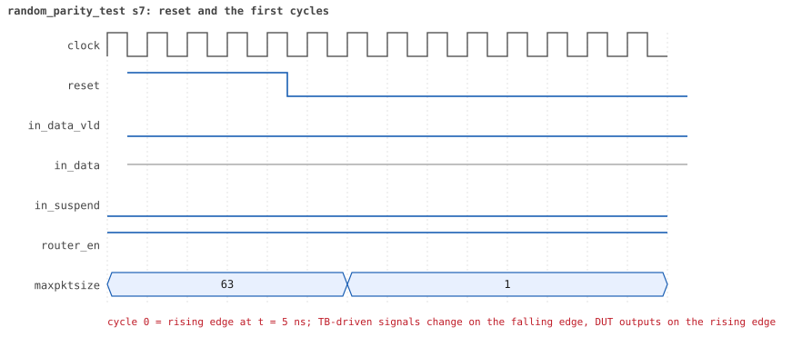
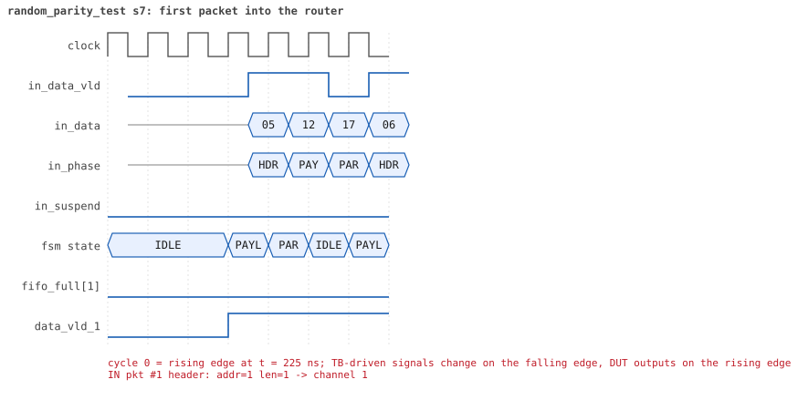
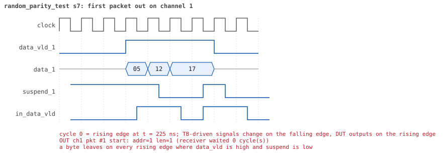
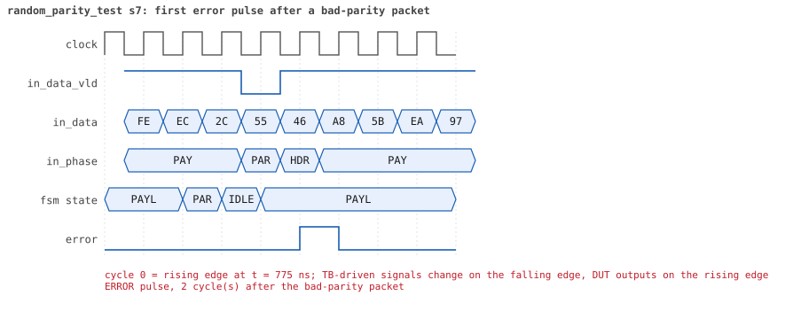
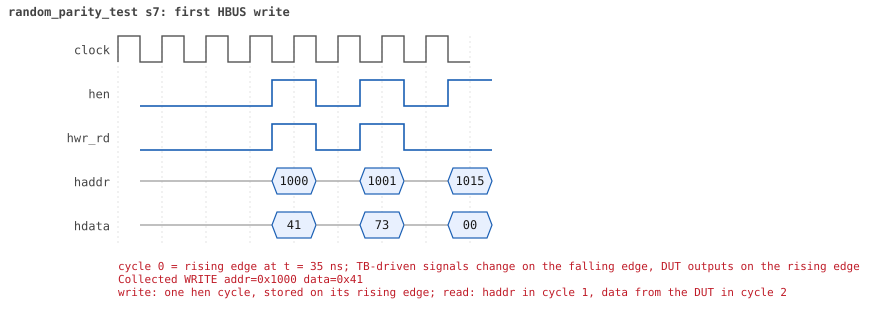
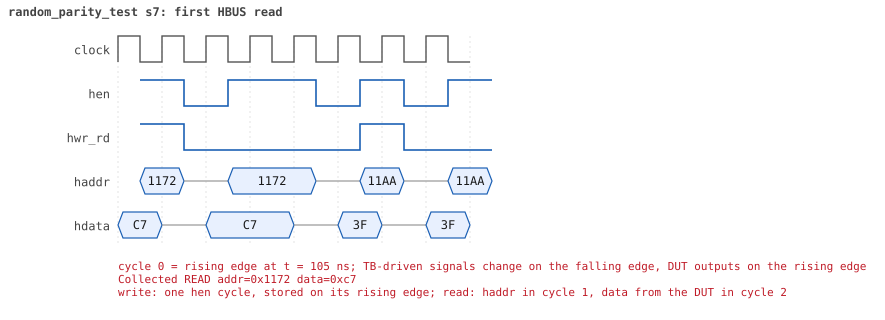

# random_parity_test  seed 7

**Result:** PASSED (0 UVM_ERROR, 0 UVM_WARNING, 0 UVM_FATAL) · bench `yapp_project_tb` · sim time 10us · log `random_parity_test_s7.log`

Waves: `random_parity_test_s7.fst` (GTKWave, Surfer or the VS Code wave viewer); signal trace: `signals.csv`.
[Open the waves in Surfer](https://app.surfer-project.org/?load_url=https%3A%2F%2Fraw.githubusercontent.com%2Ftamirgabgab%2FQcom-Mentoring%2Fmain%2Fyapp_project%2Fregression%2Fyapp_project_tb%2Frandom_parity_test_s7%2Frandom_parity_test_s7.fst&startup_commands=run_command_file_from_url%20https%3A%2F%2Fraw.githubusercontent.com%2Ftamirgabgab%2FQcom-Mentoring%2Fmain%2Fyapp_project%2Ftb%2Fyapp_router.sucl) (web app, the signals already in groups: `yapp_project/tb/yapp_router.sucl`).

## Summary

- YAPP driver sent **14** packet(s) (4 with bad parity); the input monitor saw 14.
- Router: **2** forwarded, **12** dropped (10 oversized, 2 illegal address 3).
- Packets out: ch0 **0**, ch1 **1**, ch2 **1**.
- Scoreboard: 2 matched, 0 mismatched, 0 unexpected.
- Back-pressure: in_suspend asserted **0** time(s).
- Error pulses: 4.
- HBUS: 35 write(s), 87 read(s).

## Stages

| time (ns) | stage |
|---|---|
| 0 | receivers: ch0 RX_NORMAL, ch1 RX_NORMAL, ch2 RX_FAST |
| 0 | random scenario: 14 packets in 6 bursts |
| 200 | burst 1/6: ctrl=0x41 (maxpktsize 1) en=0x73 (router on, counter enables 0111001), 2 packet(s) |
| 1000 | burst 1/6 sent: addr0..3 0/1/1/0, bad parity 2, gap 0 1, length 17..42 |
| 1330 | burst 2/6: ctrl=0x80 (maxpktsize 0) en=0x9f (router on, counter enables 1001111), 2 packet(s) |
| 2260 | burst 2/6 sent: addr0..3 2/0/0/0, bad parity 0, gap 0 1, length 27..50 |
| 2540 | burst 3/6: ctrl=0x01 (maxpktsize 1) en=0x25 (router on, counter enables 0010010), 2 packet(s) |
| 3750 | burst 3/6 sent: addr0..3 1/1/0/0, bad parity 0, gap 0 2, length 57..59 |
| 4020 | burst 4/6: ctrl=0x42 (maxpktsize 2) en=0xdb (router on, counter enables 1101101), 3 packet(s) |
| 4590 | burst 4/6 sent: addr0..3 0/1/1/1, bad parity 0, gap 0 0, length 1..23 |
| 4990 | burst 5/6: ctrl=0xff (maxpktsize 63) en=0xa3 (router on, counter enables 1010001), 2 packet(s) |
| 5980 | burst 5/6 sent: addr0..3 0/1/0/1, bad parity 0, gap 0 2, length 31..63 |
| 6300 | burst 6/6: ctrl=0x93 (maxpktsize 19) en=0xa5 (router on, counter enables 1010010), 3 packet(s) |
| 7920 | burst 6/6 sent: addr0..3 1/0/2/0, bad parity 2, gap 0 0, length 42..45 |
| 7920 | final reads: every register and the stored packet, checked against the reference model |
| 9595 | done: 14 packets (2 forwarded, 12 dropped), 0 storm burst(s), 2 scoreboard matches, 84 HBUS reads checked, 4 error pulses for 4 bad packets |

## Pictures

**reset and the first cycles**

**first packet into the router**

**first packet out on channel 2**

**first error pulse after a bad-parity packet**

**first HBUS write**

**first HBUS read**

## Timeline

416 events (the same list is in `timeline.csv`).

| time (ns) | who | event |
|---|---|---|
| 0 | yapp monitor | YAPP monitor running |
| 0 | **test** | STAGE: receivers: ch0 RX_NORMAL, ch1 RX_NORMAL, ch2 RX_FAST |
| 0 | **test** | STAGE: random scenario: 14 packets in 6 bursts |
| 0 | clk/rst driver | Starting clock (period 10) and holding reset for 5 cycles |
| 0 | **DUT** | RESET asserted |
| 50 | **DUT** | RESET released: router_en=1 maxpktsize=63 |
| 70 | hbus driver | Executed WRITE addr=0x1000 data=0x41 |
| 75 | **DUT** | CONFIG router_en=1 maxpktsize=1 |
| 75 | hbus monitor | Collected WRITE addr=0x1000 data=0x41 |
| 75 | reference | maxpktsize is now 1 |
| 90 | hbus driver | Executed WRITE addr=0x1001 data=0x73 |
| 95 | hbus monitor | Collected WRITE addr=0x1001 data=0x73 |
| 95 | reference | router_en is now 1 (en_reg 0x73) |
| 120 | hbus driver | Executed READ  addr=0x1015 data=0x00 |
| 125 | hbus monitor | Collected READ  addr=0x1015 data=0x00 |
| 140 | hbus driver | Executed WRITE addr=0x11b6 data=0x31 |
| 145 | hbus monitor | Collected WRITE addr=0x11b6 data=0x31 |
| 170 | hbus driver | Executed READ  addr=0x11b6 data=0x31 |
| 175 | hbus monitor | Collected READ  addr=0x11b6 data=0x31 |
| 200 | hbus driver | Executed READ  addr=0x1048 data=0x00 |
| 200 | **test** | STAGE: burst 1/6: ctrl=0x41 (maxpktsize 1) en=0x73 (router on, counter enables 0111001), 2 packet(s) |
| 200 | yapp driver | TX pkt #1: addr=1 len=42 parity=bad delay=16 |
| 205 | hbus monitor | Collected READ  addr=0x1048 data=0x00 |
| 375 | **DUT** | IN  pkt #1 header: addr=1 len=42 -> DROP (oversized: len 42 > maxpktsize 1) |
| 805 | **DUT** | IN  pkt #1 complete: addr=1 len=42 parity=BAD dropped, 44 bytes in 44 cycles (held 0) |
| 805 | yapp monitor | RX pkt #1 on the input: addr=1 len=42 parity=bad gap=32 |
| 805 | reference | Packet dropped: length 42 > maxpktsize 1 (addr=1) |
| 805 | **DUT** | ROUTER DROPS PACKET addr=1 length=42 (length > maxpktsize) |
| 810 | yapp driver | TX pkt #1 accepted by the DUT |
| 810 | yapp driver | TX pkt #2: addr=2 len=17 parity=bad delay=0 |
| 815 | **DUT** | IN  pkt #2 header: addr=2 len=17 -> DROP (oversized: len 17 > maxpktsize 1) |
| 830 | **DUT** | ERROR pulse, 2 cycle(s) after the bad-parity packet |
| 830 | error checker | error pulse 2 cycles after the bad packet (0 still owed) |
| 995 | **DUT** | IN  pkt #2 complete: addr=2 len=17 parity=BAD dropped, 19 bytes in 19 cycles (held 0) |
| 995 | yapp monitor | RX pkt #2 on the input: addr=2 len=17 parity=bad gap=0 |
| 995 | reference | Packet dropped: length 17 > maxpktsize 1 (addr=2) |
| 995 | **DUT** | ROUTER DROPS PACKET addr=2 length=17 (length > maxpktsize) |
| 1000 | yapp driver | TX pkt #2 accepted by the DUT |
| 1000 | **test** | STAGE: burst 1/6 sent: addr0..3 0/1/1/0, bad parity 2, gap 0 1, length 17..42 |
| 1020 | hbus driver | Executed WRITE addr=0x1000 data=0x80 |
| 1025 | **DUT** | CONFIG router_en=1 maxpktsize=0 |
| 1025 | hbus monitor | Collected WRITE addr=0x1000 data=0x80 |
| 1025 | reference | maxpktsize is now 0 |
| 1040 | hbus driver | Executed WRITE addr=0x1001 data=0x9f |
| 1045 | hbus monitor | Collected WRITE addr=0x1001 data=0x9f |
| 1045 | reference | router_en is now 1 (en_reg 0x9f) |
| 1050 | **DUT** | ERROR pulse, 5 cycle(s) after the bad-parity packet |
| 1050 | error checker | error pulse 5 cycles after the bad packet (0 still owed) |
| 1060 | hbus driver | Executed WRITE addr=0x114c data=0x1f |
| 1065 | hbus monitor | Collected WRITE addr=0x114c data=0x1f |
| 1090 | hbus driver | Executed READ  addr=0x114c data=0x1f |
| 1095 | hbus monitor | Collected READ  addr=0x114c data=0x1f |
| 1110 | hbus driver | Executed WRITE addr=0x119f data=0xe0 |
| 1115 | hbus monitor | Collected WRITE addr=0x119f data=0xe0 |
| 1140 | hbus driver | Executed READ  addr=0x119f data=0xe0 |
| 1145 | hbus monitor | Collected READ  addr=0x119f data=0xe0 |
| 1170 | hbus driver | Executed READ  addr=0x1030 data=0x95 |
| 1175 | hbus monitor | Collected READ  addr=0x1030 data=0x95 |
| 1190 | hbus driver | Executed WRITE addr=0x11e9 data=0xd6 |
| 1195 | hbus monitor | Collected WRITE addr=0x11e9 data=0xd6 |
| 1220 | hbus driver | Executed READ  addr=0x11e9 data=0xd6 |
| 1225 | hbus monitor | Collected READ  addr=0x11e9 data=0xd6 |
| 1250 | hbus driver | Executed READ  addr=0x100d data=0x11 |
| 1255 | hbus monitor | Collected READ  addr=0x100d data=0x11 |
| 1270 | hbus driver | Executed WRITE addr=0x11e8 data=0xe3 |
| 1275 | hbus monitor | Collected WRITE addr=0x11e8 data=0xe3 |
| 1300 | hbus driver | Executed READ  addr=0x11e8 data=0xe3 |
| 1305 | hbus monitor | Collected READ  addr=0x11e8 data=0xe3 |
| 1330 | hbus driver | Executed READ  addr=0x100d data=0x11 |
| 1330 | **test** | STAGE: burst 2/6: ctrl=0x80 (maxpktsize 0) en=0x9f (router on, counter enables 1001111), 2 packet(s) |
| 1330 | yapp driver | TX pkt #3: addr=0 len=27 parity=good delay=0 |
| 1335 | hbus monitor | Collected READ  addr=0x100d data=0x11 |
| 1345 | **DUT** | IN  pkt #3 header: addr=0 len=27 -> DROP (oversized: len 27 > maxpktsize 0) |
| 1625 | **DUT** | IN  pkt #3 complete: addr=0 len=27 parity=ok dropped, 29 bytes in 29 cycles (held 0) |
| 1625 | yapp monitor | RX pkt #3 on the input: addr=0 len=27 parity=good gap=34 |
| 1625 | reference | Packet dropped: length 27 > maxpktsize 0 (addr=0) |
| 1625 | **DUT** | ROUTER DROPS PACKET addr=0 length=27 (length > maxpktsize) |
| 1630 | yapp driver | TX pkt #3 accepted by the DUT |
| 1630 | yapp driver | TX pkt #4: addr=0 len=50 parity=good delay=11 |
| 1745 | **DUT** | IN  pkt #4 header: addr=0 len=50 -> DROP (oversized: len 50 > maxpktsize 0) |
| 2255 | **DUT** | IN  pkt #4 complete: addr=0 len=50 parity=ok dropped, 52 bytes in 52 cycles (held 0) |
| 2255 | yapp monitor | RX pkt #4 on the input: addr=0 len=50 parity=good gap=11 |
| 2255 | reference | Packet dropped: length 50 > maxpktsize 0 (addr=0) |
| 2255 | **DUT** | ROUTER DROPS PACKET addr=0 length=50 (length > maxpktsize) |
| 2260 | yapp driver | TX pkt #4 accepted by the DUT |
| 2260 | **test** | STAGE: burst 2/6 sent: addr0..3 2/0/0/0, bad parity 0, gap 0 1, length 27..50 |
| 2280 | hbus driver | Executed WRITE addr=0x1000 data=0x01 |
| 2285 | **DUT** | CONFIG router_en=1 maxpktsize=1 |
| 2285 | hbus monitor | Collected WRITE addr=0x1000 data=0x01 |
| 2285 | reference | maxpktsize is now 1 |
| 2300 | hbus driver | Executed WRITE addr=0x1001 data=0x25 |
| 2305 | hbus monitor | Collected WRITE addr=0x1001 data=0x25 |
| 2305 | reference | router_en is now 1 (en_reg 0x25) |
| 2320 | hbus driver | Executed WRITE addr=0x11f9 data=0x72 |
| 2325 | hbus monitor | Collected WRITE addr=0x11f9 data=0x72 |
| 2350 | hbus driver | Executed READ  addr=0x11f9 data=0x72 |
| 2355 | hbus monitor | Collected READ  addr=0x11f9 data=0x72 |
| 2380 | hbus driver | Executed READ  addr=0x102b data=0xf0 |
| 2385 | hbus monitor | Collected READ  addr=0x102b data=0xf0 |
| 2410 | hbus driver | Executed READ  addr=0x100d data=0x32 |
| 2415 | hbus monitor | Collected READ  addr=0x100d data=0x32 |
| 2430 | hbus driver | Executed WRITE addr=0x117c data=0x47 |
| 2435 | hbus monitor | Collected WRITE addr=0x117c data=0x47 |
| 2460 | hbus driver | Executed READ  addr=0x117c data=0x47 |
| 2465 | hbus monitor | Collected READ  addr=0x117c data=0x47 |
| 2480 | hbus driver | Executed WRITE addr=0x112b data=0x63 |
| 2485 | hbus monitor | Collected WRITE addr=0x112b data=0x63 |
| 2510 | hbus driver | Executed READ  addr=0x112b data=0x63 |
| 2515 | hbus monitor | Collected READ  addr=0x112b data=0x63 |
| 2540 | hbus driver | Executed READ  addr=0x100d data=0x32 |
| 2540 | **test** | STAGE: burst 3/6: ctrl=0x01 (maxpktsize 1) en=0x25 (router on, counter enables 0010010), 2 packet(s) |
| 2540 | yapp driver | TX pkt #5: addr=0 len=59 parity=good delay=0 |
| 2545 | hbus monitor | Collected READ  addr=0x100d data=0x32 |
| 2555 | **DUT** | IN  pkt #5 header: addr=0 len=59 -> DROP (oversized: len 59 > maxpktsize 1) |
| 3155 | **DUT** | IN  pkt #5 complete: addr=0 len=59 parity=ok dropped, 61 bytes in 61 cycles (held 0) |
| 3155 | yapp monitor | RX pkt #5 on the input: addr=0 len=59 parity=good gap=29 |
| 3155 | reference | Packet dropped: length 59 > maxpktsize 1 (addr=0) |
| 3155 | **DUT** | ROUTER DROPS PACKET addr=0 length=59 (length > maxpktsize) |
| 3160 | yapp driver | TX pkt #5 accepted by the DUT |
| 3160 | yapp driver | TX pkt #6: addr=1 len=57 parity=good delay=0 |
| 3165 | **DUT** | IN  pkt #6 header: addr=1 len=57 -> DROP (oversized: len 57 > maxpktsize 1) |
| 3745 | **DUT** | IN  pkt #6 complete: addr=1 len=57 parity=ok dropped, 59 bytes in 59 cycles (held 0) |
| 3745 | yapp monitor | RX pkt #6 on the input: addr=1 len=57 parity=good gap=0 |
| 3745 | reference | Packet dropped: length 57 > maxpktsize 1 (addr=1) |
| 3745 | **DUT** | ROUTER DROPS PACKET addr=1 length=57 (length > maxpktsize) |
| 3750 | yapp driver | TX pkt #6 accepted by the DUT |
| 3750 | **test** | STAGE: burst 3/6 sent: addr0..3 1/1/0/0, bad parity 0, gap 0 2, length 57..59 |
| 3770 | hbus driver | Executed WRITE addr=0x1000 data=0x42 |
| 3775 | **DUT** | CONFIG router_en=1 maxpktsize=2 |
| 3775 | hbus monitor | Collected WRITE addr=0x1000 data=0x42 |
| 3775 | reference | maxpktsize is now 2 |
| 3790 | hbus driver | Executed WRITE addr=0x1001 data=0xdb |
| 3795 | hbus monitor | Collected WRITE addr=0x1001 data=0xdb |
| 3795 | reference | router_en is now 1 (en_reg 0xdb) |
| 3810 | hbus driver | Executed WRITE addr=0x11c1 data=0xb4 |
| 3815 | hbus monitor | Collected WRITE addr=0x11c1 data=0xb4 |
| 3840 | hbus driver | Executed READ  addr=0x11c1 data=0xb4 |
| 3845 | hbus monitor | Collected READ  addr=0x11c1 data=0xb4 |
| 3860 | hbus driver | Executed WRITE addr=0x112f data=0xeb |
| 3865 | hbus monitor | Collected WRITE addr=0x112f data=0xeb |
| 3890 | hbus driver | Executed READ  addr=0x112f data=0xeb |
| 3895 | hbus monitor | Collected READ  addr=0x112f data=0xeb |
| 3910 | hbus driver | Executed WRITE addr=0x112e data=0xad |
| 3915 | hbus monitor | Collected WRITE addr=0x112e data=0xad |
| 3940 | hbus driver | Executed READ  addr=0x112e data=0xad |
| 3945 | hbus monitor | Collected READ  addr=0x112e data=0xad |
| 3970 | hbus driver | Executed READ  addr=0x10f2 data=0x00 |
| 3975 | hbus monitor | Collected READ  addr=0x10f2 data=0x00 |
| 3990 | hbus driver | Executed WRITE addr=0x11cf data=0xeb |
| 3995 | hbus monitor | Collected WRITE addr=0x11cf data=0xeb |
| 4020 | hbus driver | Executed READ  addr=0x11cf data=0xeb |
| 4020 | **test** | STAGE: burst 4/6: ctrl=0x42 (maxpktsize 2) en=0xdb (router on, counter enables 1101101), 3 packet(s) |
| 4020 | yapp driver | TX pkt #7: addr=3 len=2 parity=good delay=3 |
| 4025 | hbus monitor | Collected READ  addr=0x11cf data=0xeb |
| 4065 | **DUT** | IN  pkt #7 header: addr=3 len=2 -> DROP (illegal address 3) |
| 4095 | **DUT** | IN  pkt #7 complete: addr=3 len=2 parity=ok dropped, 4 bytes in 4 cycles (held 0) |
| 4095 | yapp monitor | RX pkt #7 on the input: addr=3 len=2 parity=good gap=31 |
| 4095 | reference | Packet dropped: illegal address 3 (len=2) |
| 4095 | **DUT** | ROUTER DROPS PACKET addr=3 length=2 (    illegal address) |
| 4100 | yapp driver | TX pkt #7 accepted by the DUT |
| 4100 | yapp driver | TX pkt #8: addr=1 len=23 parity=good delay=1 |
| 4115 | **DUT** | IN  pkt #8 header: addr=1 len=23 -> DROP (oversized: len 23 > maxpktsize 2) |
| 4355 | **DUT** | IN  pkt #8 complete: addr=1 len=23 parity=ok dropped, 25 bytes in 25 cycles (held 0) |
| 4355 | yapp monitor | RX pkt #8 on the input: addr=1 len=23 parity=good gap=1 |
| 4355 | reference | Packet dropped: length 23 > maxpktsize 2 (addr=1) |
| 4355 | **DUT** | ROUTER DROPS PACKET addr=1 length=23 (length > maxpktsize) |
| 4360 | yapp driver | TX pkt #8 accepted by the DUT |
| 4360 | yapp driver | TX pkt #9: addr=2 len=1 parity=good delay=20 |
| 4565 | **DUT** | IN  pkt #9 header: addr=2 len=1 -> channel 2 |
| 4575 | **DUT** | OUT ch2 pkt #1 start: addr=2 len=1 (receiver waited 0 cycle(s)) |
| 4585 | **DUT** | IN  pkt #9 complete: addr=2 len=1 parity=ok forwarded, 3 bytes in 3 cycles (held 0) |
| 4585 | yapp monitor | RX pkt #9 on the input: addr=2 len=1 parity=good gap=20 |
| 4585 | reference | Packet forwarded: addr=2 len=1 -> channel 2 |
| 4590 | ch2 driver | ch2: packet consumed (response delay 0) |
| 4590 | yapp driver | TX pkt #9 accepted by the DUT |
| 4590 | **test** | STAGE: burst 4/6 sent: addr0..3 0/1/1/1, bad parity 0, gap 0 0, length 1..23 |
| 4605 | **DUT** | OUT ch2 pkt #1 done: 3 bytes in 4 cycles |
| 4605 | ch2 monitor | ch2 RX pkt #1: addr=2 len=1 parity=good |
| 4605 | scoreboard | ch2 pkt matched: addr=2 len=1 (1 matched so far) |
| 4610 | hbus driver | Executed WRITE addr=0x1000 data=0xff |
| 4615 | **DUT** | CONFIG router_en=1 maxpktsize=63 |
| 4615 | hbus monitor | Collected WRITE addr=0x1000 data=0xff |
| 4615 | reference | maxpktsize is now 63 |
| 4630 | hbus driver | Executed WRITE addr=0x1001 data=0xa3 |
| 4635 | hbus monitor | Collected WRITE addr=0x1001 data=0xa3 |
| 4635 | reference | router_en is now 1 (en_reg 0xa3) |
| 4650 | hbus driver | Executed WRITE addr=0x11a7 data=0xdf |
| 4655 | hbus monitor | Collected WRITE addr=0x11a7 data=0xdf |
| 4680 | hbus driver | Executed READ  addr=0x11a7 data=0xdf |
| 4685 | hbus monitor | Collected READ  addr=0x11a7 data=0xdf |
| 4700 | hbus driver | Executed WRITE addr=0x1159 data=0xe5 |
| 4705 | hbus monitor | Collected WRITE addr=0x1159 data=0xe5 |
| 4730 | hbus driver | Executed READ  addr=0x1159 data=0xe5 |
| 4735 | hbus monitor | Collected READ  addr=0x1159 data=0xe5 |
| 4750 | hbus driver | Executed WRITE addr=0x1199 data=0x20 |
| 4755 | hbus monitor | Collected WRITE addr=0x1199 data=0x20 |
| 4780 | hbus driver | Executed READ  addr=0x1199 data=0x20 |
| 4785 | hbus monitor | Collected READ  addr=0x1199 data=0x20 |
| 4810 | hbus driver | Executed READ  addr=0x104c data=0x00 |
| 4815 | hbus monitor | Collected READ  addr=0x104c data=0x00 |
| 4840 | hbus driver | Executed READ  addr=0x10df data=0x00 |
| 4845 | hbus monitor | Collected READ  addr=0x10df data=0x00 |
| 4860 | hbus driver | Executed WRITE addr=0x1174 data=0xc2 |
| 4865 | hbus monitor | Collected WRITE addr=0x1174 data=0xc2 |
| 4890 | hbus driver | Executed READ  addr=0x1174 data=0xc2 |
| 4895 | hbus monitor | Collected READ  addr=0x1174 data=0xc2 |
| 4910 | hbus driver | Executed WRITE addr=0x1165 data=0x89 |
| 4915 | hbus monitor | Collected WRITE addr=0x1165 data=0x89 |
| 4940 | hbus driver | Executed READ  addr=0x1165 data=0x89 |
| 4945 | hbus monitor | Collected READ  addr=0x1165 data=0x89 |
| 4960 | hbus driver | Executed WRITE addr=0x119c data=0xa9 |
| 4965 | hbus monitor | Collected WRITE addr=0x119c data=0xa9 |
| 4980 | ch2 driver | ch2: packet consumed (response delay 0) |
| 4990 | hbus driver | Executed READ  addr=0x119c data=0xa9 |
| 4990 | **test** | STAGE: burst 5/6: ctrl=0xff (maxpktsize 63) en=0xa3 (router on, counter enables 1010001), 2 packet(s) |
| 4990 | yapp driver | TX pkt #10: addr=3 len=63 parity=good delay=0 |
| 4995 | hbus monitor | Collected READ  addr=0x119c data=0xa9 |
| 5005 | **DUT** | IN  pkt #10 header: addr=3 len=63 -> DROP (illegal address 3) |
| 5645 | **DUT** | IN  pkt #10 complete: addr=3 len=63 parity=ok dropped, 65 bytes in 65 cycles (held 0) |
| 5645 | yapp monitor | RX pkt #10 on the input: addr=3 len=63 parity=good gap=41 |
| 5645 | reference | Packet dropped: illegal address 3 (len=63) |
| 5645 | **DUT** | ROUTER DROPS PACKET addr=3 length=63 (    illegal address) |
| 5650 | yapp driver | TX pkt #10 accepted by the DUT |
| 5650 | yapp driver | TX pkt #11: addr=1 len=31 parity=good delay=0 |
| 5655 | **DUT** | IN  pkt #11 header: addr=1 len=31 -> channel 1 |
| 5715 | **DUT** | OUT ch1 pkt #1 start: addr=1 len=31 (receiver waited 5 cycle(s)) |
| 5975 | **DUT** | IN  pkt #11 complete: addr=1 len=31 parity=ok forwarded, 33 bytes in 33 cycles (held 0) |
| 5975 | yapp monitor | RX pkt #11 on the input: addr=1 len=31 parity=good gap=0 |
| 5975 | reference | Packet forwarded: addr=1 len=31 -> channel 1 |
| 5980 | yapp driver | TX pkt #11 accepted by the DUT |
| 5980 | **test** | STAGE: burst 5/6 sent: addr0..3 0/1/0/1, bad parity 0, gap 0 2, length 31..63 |
| 6000 | hbus driver | Executed WRITE addr=0x1000 data=0x93 |
| 6005 | **DUT** | CONFIG router_en=1 maxpktsize=19 |
| 6005 | hbus monitor | Collected WRITE addr=0x1000 data=0x93 |
| 6005 | reference | maxpktsize is now 19 |
| 6020 | hbus driver | Executed WRITE addr=0x1001 data=0xa5 |
| 6025 | hbus monitor | Collected WRITE addr=0x1001 data=0xa5 |
| 6025 | reference | router_en is now 1 (en_reg 0xa5) |
| 6030 | ch1 driver | ch1: packet consumed (response delay 5) |
| 6045 | **DUT** | OUT ch1 pkt #1 done: 33 bytes in 34 cycles |
| 6045 | ch1 monitor | ch1 RX pkt #1: addr=1 len=31 parity=good |
| 6045 | scoreboard | ch1 pkt matched: addr=1 len=31 (2 matched so far) |
| 6050 | hbus driver | Executed READ  addr=0x100d data=0x1f |
| 6055 | hbus monitor | Collected READ  addr=0x100d data=0x1f |
| 6070 | hbus driver | Executed WRITE addr=0x1132 data=0xc0 |
| 6075 | hbus monitor | Collected WRITE addr=0x1132 data=0xc0 |
| 6100 | hbus driver | Executed READ  addr=0x1132 data=0xc0 |
| 6105 | hbus monitor | Collected READ  addr=0x1132 data=0xc0 |
| 6120 | hbus driver | Executed WRITE addr=0x1163 data=0x04 |
| 6125 | hbus monitor | Collected WRITE addr=0x1163 data=0x04 |
| 6150 | hbus driver | Executed READ  addr=0x1163 data=0x04 |
| 6155 | hbus monitor | Collected READ  addr=0x1163 data=0x04 |
| 6170 | hbus driver | Executed WRITE addr=0x1122 data=0xdf |
| 6175 | hbus monitor | Collected WRITE addr=0x1122 data=0xdf |
| 6200 | hbus driver | Executed READ  addr=0x1122 data=0xdf |
| 6205 | hbus monitor | Collected READ  addr=0x1122 data=0xdf |
| 6220 | hbus driver | Executed WRITE addr=0x11d9 data=0xf3 |
| 6225 | hbus monitor | Collected WRITE addr=0x11d9 data=0xf3 |
| 6250 | hbus driver | Executed READ  addr=0x11d9 data=0xf3 |
| 6255 | hbus monitor | Collected READ  addr=0x11d9 data=0xf3 |
| 6270 | hbus driver | Executed WRITE addr=0x11b2 data=0x1e |
| 6275 | hbus monitor | Collected WRITE addr=0x11b2 data=0x1e |
| 6300 | hbus driver | Executed READ  addr=0x11b2 data=0x1e |
| 6300 | **test** | STAGE: burst 6/6: ctrl=0x93 (maxpktsize 19) en=0xa5 (router on, counter enables 1010010), 3 packet(s) |
| 6300 | yapp driver | TX pkt #12: addr=2 len=45 parity=bad delay=20 |
| 6305 | hbus monitor | Collected READ  addr=0x11b2 data=0x1e |
| 6515 | **DUT** | IN  pkt #12 header: addr=2 len=45 -> DROP (oversized: len 45 > maxpktsize 19) |
| 6530 | ch1 driver | ch1: packet consumed (response delay 0) |
| 6975 | **DUT** | IN  pkt #12 complete: addr=2 len=45 parity=BAD dropped, 47 bytes in 47 cycles (held 0) |
| 6975 | yapp monitor | RX pkt #12 on the input: addr=2 len=45 parity=bad gap=53 |
| 6975 | reference | Packet dropped: length 45 > maxpktsize 19 (addr=2) |
| 6975 | **DUT** | ROUTER DROPS PACKET addr=2 length=45 (length > maxpktsize) |
| 6980 | yapp driver | TX pkt #12 accepted by the DUT |
| 6980 | yapp driver | TX pkt #13: addr=0 len=44 parity=bad delay=2 |
| 7005 | **DUT** | IN  pkt #13 header: addr=0 len=44 -> DROP (oversized: len 44 > maxpktsize 19) |
| 7030 | **DUT** | ERROR pulse, 5 cycle(s) after the bad-parity packet |
| 7030 | error checker | error pulse 5 cycles after the bad packet (0 still owed) |
| 7455 | **DUT** | IN  pkt #13 complete: addr=0 len=44 parity=BAD dropped, 46 bytes in 46 cycles (held 0) |
| 7455 | yapp monitor | RX pkt #13 on the input: addr=0 len=44 parity=bad gap=2 |
| 7455 | reference | Packet dropped: length 44 > maxpktsize 19 (addr=0) |
| 7455 | **DUT** | ROUTER DROPS PACKET addr=0 length=44 (length > maxpktsize) |
| 7460 | yapp driver | TX pkt #13 accepted by the DUT |
| 7460 | yapp driver | TX pkt #14: addr=2 len=42 parity=good delay=2 |
| 7485 | **DUT** | IN  pkt #14 header: addr=2 len=42 -> DROP (oversized: len 42 > maxpktsize 19) |
| 7510 | **DUT** | ERROR pulse, 5 cycle(s) after the bad-parity packet |
| 7510 | error checker | error pulse 5 cycles after the bad packet (0 still owed) |
| 7915 | **DUT** | IN  pkt #14 complete: addr=2 len=42 parity=ok dropped, 44 bytes in 44 cycles (held 0) |
| 7915 | yapp monitor | RX pkt #14 on the input: addr=2 len=42 parity=good gap=2 |
| 7915 | reference | Packet dropped: length 42 > maxpktsize 19 (addr=2) |
| 7915 | **DUT** | ROUTER DROPS PACKET addr=2 length=42 (length > maxpktsize) |
| 7920 | yapp driver | TX pkt #14 accepted by the DUT |
| 7920 | **test** | STAGE: burst 6/6 sent: addr0..3 1/0/2/0, bad parity 2, gap 0 0, length 42..45 |
| 7920 | **test** | STAGE: final reads: every register and the stored packet, checked against the reference model |
| 7950 | hbus driver | Executed READ  addr=0x1000 data=0x93 |
| 7955 | hbus monitor | Collected READ  addr=0x1000 data=0x93 |
| 7980 | hbus driver | Executed READ  addr=0x1001 data=0xa5 |
| 7985 | hbus monitor | Collected READ  addr=0x1001 data=0xa5 |
| 8010 | hbus driver | Executed READ  addr=0x1004 data=0x02 |
| 8015 | hbus monitor | Collected READ  addr=0x1004 data=0x02 |
| 8040 | hbus driver | Executed READ  addr=0x1005 data=0x07 |
| 8045 | hbus monitor | Collected READ  addr=0x1005 data=0x07 |
| 8070 | hbus driver | Executed READ  addr=0x1006 data=0x02 |
| 8075 | hbus monitor | Collected READ  addr=0x1006 data=0x02 |
| 8100 | hbus driver | Executed READ  addr=0x1009 data=0x02 |
| 8105 | hbus monitor | Collected READ  addr=0x1009 data=0x02 |
| 8130 | hbus driver | Executed READ  addr=0x100a data=0x03 |
| 8135 | hbus monitor | Collected READ  addr=0x100a data=0x03 |
| 8160 | hbus driver | Executed READ  addr=0x100b data=0x02 |
| 8165 | hbus monitor | Collected READ  addr=0x100b data=0x02 |
| 8190 | hbus driver | Executed READ  addr=0x100d data=0x2a |
| 8195 | hbus monitor | Collected READ  addr=0x100d data=0x2a |
| 8220 | hbus driver | Executed READ  addr=0x1010 data=0xaa |
| 8225 | hbus monitor | Collected READ  addr=0x1010 data=0xaa |
| 8250 | hbus driver | Executed READ  addr=0x1011 data=0x9b |
| 8255 | hbus monitor | Collected READ  addr=0x1011 data=0x9b |
| 8280 | hbus driver | Executed READ  addr=0x1012 data=0x3d |
| 8285 | hbus monitor | Collected READ  addr=0x1012 data=0x3d |
| 8310 | hbus driver | Executed READ  addr=0x1013 data=0x5b |
| 8315 | hbus monitor | Collected READ  addr=0x1013 data=0x5b |
| 8340 | hbus driver | Executed READ  addr=0x1014 data=0x19 |
| 8345 | hbus monitor | Collected READ  addr=0x1014 data=0x19 |
| 8370 | hbus driver | Executed READ  addr=0x1015 data=0x9b |
| 8375 | hbus monitor | Collected READ  addr=0x1015 data=0x9b |
| 8400 | hbus driver | Executed READ  addr=0x1016 data=0xd2 |
| 8405 | hbus monitor | Collected READ  addr=0x1016 data=0xd2 |
| 8430 | hbus driver | Executed READ  addr=0x1017 data=0xb1 |
| 8435 | hbus monitor | Collected READ  addr=0x1017 data=0xb1 |
| 8460 | hbus driver | Executed READ  addr=0x1018 data=0x73 |
| 8465 | hbus monitor | Collected READ  addr=0x1018 data=0x73 |
| 8490 | hbus driver | Executed READ  addr=0x1019 data=0xe5 |
| 8495 | hbus monitor | Collected READ  addr=0x1019 data=0xe5 |
| 8520 | hbus driver | Executed READ  addr=0x101a data=0x10 |
| 8525 | hbus monitor | Collected READ  addr=0x101a data=0x10 |
| 8550 | hbus driver | Executed READ  addr=0x101b data=0xd2 |
| 8555 | hbus monitor | Collected READ  addr=0x101b data=0xd2 |
| 8580 | hbus driver | Executed READ  addr=0x101c data=0xa8 |
| 8585 | hbus monitor | Collected READ  addr=0x101c data=0xa8 |
| 8610 | hbus driver | Executed READ  addr=0x101d data=0x84 |
| 8615 | hbus monitor | Collected READ  addr=0x101d data=0x84 |
| 8640 | hbus driver | Executed READ  addr=0x101e data=0x7f |
| 8645 | hbus monitor | Collected READ  addr=0x101e data=0x7f |
| 8670 | hbus driver | Executed READ  addr=0x101f data=0x61 |
| 8675 | hbus monitor | Collected READ  addr=0x101f data=0x61 |
| 8700 | hbus driver | Executed READ  addr=0x1020 data=0xe2 |
| 8705 | hbus monitor | Collected READ  addr=0x1020 data=0xe2 |
| 8730 | hbus driver | Executed READ  addr=0x1021 data=0x84 |
| 8735 | hbus monitor | Collected READ  addr=0x1021 data=0x84 |
| 8760 | hbus driver | Executed READ  addr=0x1022 data=0xdf |
| 8765 | hbus monitor | Collected READ  addr=0x1022 data=0xdf |
| 8790 | hbus driver | Executed READ  addr=0x1023 data=0x5c |
| 8795 | hbus monitor | Collected READ  addr=0x1023 data=0x5c |
| 8820 | hbus driver | Executed READ  addr=0x1024 data=0xf3 |
| 8825 | hbus monitor | Collected READ  addr=0x1024 data=0xf3 |
| 8850 | hbus driver | Executed READ  addr=0x1025 data=0x2f |
| 8855 | hbus monitor | Collected READ  addr=0x1025 data=0x2f |
| 8880 | hbus driver | Executed READ  addr=0x1026 data=0xc0 |
| 8885 | hbus monitor | Collected READ  addr=0x1026 data=0xc0 |
| 8910 | hbus driver | Executed READ  addr=0x1027 data=0x07 |
| 8915 | hbus monitor | Collected READ  addr=0x1027 data=0x07 |
| 8940 | hbus driver | Executed READ  addr=0x1028 data=0x3e |
| 8945 | hbus monitor | Collected READ  addr=0x1028 data=0x3e |
| 8970 | hbus driver | Executed READ  addr=0x1029 data=0x8a |
| 8975 | hbus monitor | Collected READ  addr=0x1029 data=0x8a |
| 9000 | hbus driver | Executed READ  addr=0x102a data=0xf8 |
| 9005 | hbus monitor | Collected READ  addr=0x102a data=0xf8 |
| 9030 | hbus driver | Executed READ  addr=0x102b data=0xfe |
| 9035 | hbus monitor | Collected READ  addr=0x102b data=0xfe |
| 9060 | hbus driver | Executed READ  addr=0x102c data=0x41 |
| 9065 | hbus monitor | Collected READ  addr=0x102c data=0x41 |
| 9090 | hbus driver | Executed READ  addr=0x102d data=0x2a |
| 9095 | hbus monitor | Collected READ  addr=0x102d data=0x2a |
| 9120 | hbus driver | Executed READ  addr=0x102e data=0xb8 |
| 9125 | hbus monitor | Collected READ  addr=0x102e data=0xb8 |
| 9150 | hbus driver | Executed READ  addr=0x102f data=0xa3 |
| 9155 | hbus monitor | Collected READ  addr=0x102f data=0xa3 |
| 9180 | hbus driver | Executed READ  addr=0x1030 data=0x09 |
| 9185 | hbus monitor | Collected READ  addr=0x1030 data=0x09 |
| 9210 | hbus driver | Executed READ  addr=0x1031 data=0x2e |
| 9215 | hbus monitor | Collected READ  addr=0x1031 data=0x2e |
| 9240 | hbus driver | Executed READ  addr=0x1032 data=0x71 |
| 9245 | hbus monitor | Collected READ  addr=0x1032 data=0x71 |
| 9270 | hbus driver | Executed READ  addr=0x1033 data=0x1e |
| 9275 | hbus monitor | Collected READ  addr=0x1033 data=0x1e |
| 9300 | hbus driver | Executed READ  addr=0x1034 data=0x6b |
| 9305 | hbus monitor | Collected READ  addr=0x1034 data=0x6b |
| 9330 | hbus driver | Executed READ  addr=0x1035 data=0x56 |
| 9335 | hbus monitor | Collected READ  addr=0x1035 data=0x56 |
| 9360 | hbus driver | Executed READ  addr=0x1036 data=0x53 |
| 9365 | hbus monitor | Collected READ  addr=0x1036 data=0x53 |
| 9390 | hbus driver | Executed READ  addr=0x1037 data=0x5a |
| 9395 | hbus monitor | Collected READ  addr=0x1037 data=0x5a |
| 9420 | hbus driver | Executed READ  addr=0x1038 data=0x82 |
| 9425 | hbus monitor | Collected READ  addr=0x1038 data=0x82 |
| 9450 | hbus driver | Executed READ  addr=0x1039 data=0x77 |
| 9455 | hbus monitor | Collected READ  addr=0x1039 data=0x77 |
| 9480 | hbus driver | Executed READ  addr=0x103a data=0x24 |
| 9485 | hbus monitor | Collected READ  addr=0x103a data=0x24 |
| 9595 | **test** | STAGE: done: 14 packets (2 forwarded, 12 dropped), 0 storm burst(s), 2 scoreboard matches, 84 HBUS reads checked, 4 error pulses for 4 bad packets |
| 9795 | error checker | error pulse report: 4 bad packets, 4 pulses, 0 outside 1..10 cycles, at most 1 owed at once |
| 9795 | ch0 monitor | Channel 0 report: 0 packets collected |
| 9795 | ch1 monitor | Channel 1 report: 1 packets collected |
| 9795 | ch2 monitor | Channel 2 report: 1 packets collected |
| 9795 | hbus monitor | HBUS report: 35 writes, 87 reads |
| 9795 | coverage | Coverage of the router configuration: 73.9% |
| 9795 | coverage | HBUS address coverage: 122 accesses sampled, coverage 40.3% |
| 9795 | coverage | HBUS register bits coverage: 12 writes to ctrl_reg/en_reg, coverage 97.7% |
| 9795 | coverage | HBUS counter value coverage: 6 counter reads sampled, coverage 48.1% |
| 9795 | coverage | HBUS yapp_mem data coverage: 46 accesses sampled, coverage 29.4% |
| 9795 | reference |  |
| 9795 | reference | HBUS reads checked against the model: 84 (0 mismatches, 3 of memory bytes never written) |
| 9795 | scoreboard |  |
| 9795 | yapp driver | YAPP driver report: 14 packets sent |
| 9795 | coverage | YAPP gap coverage: 13 gaps sampled, coverage 100.0% |
| 9795 | yapp monitor | YAPP monitor report: 14 packets collected, 4 with bad parity |
| 9795 | yapp monitor | YAPP gaps: 3 back to back, 1 of 1 cycle, 2 of 2, 7 longer |
| 9795 | coverage | YAPP packet coverage: 14 packets sampled, coverage 63.3% |
