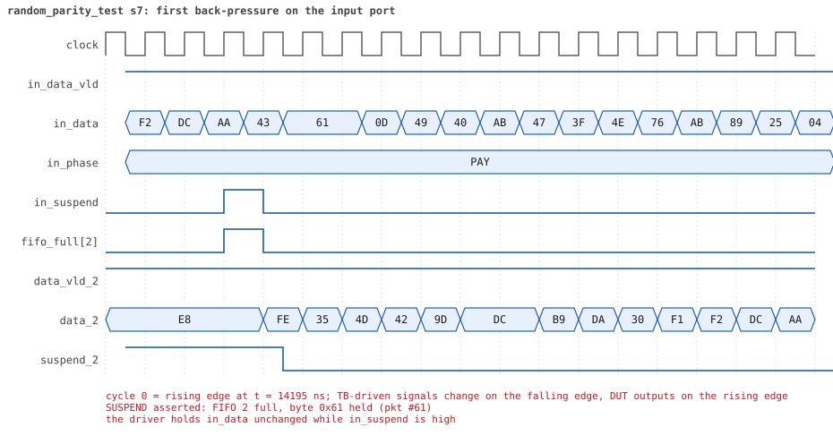

# random_parity_test seed 7

**Result:** PASSED (0 UVM_ERROR, 0 UVM_WARNING, 0 UVM_FATAL) · bench `yapp_project_tb` · sim time 37us · wall 23.8 s · log [`random_parity_test_s7.log`](random_parity_test_s7.log)

Waves: `random_parity_test_s7.fst` (GTKWave, Surfer or the VS Code wave viewer).
[Open the waves in Surfer](https://app.surfer-project.org/?load_url=https%3A%2F%2Fraw.githubusercontent.com%2Ftamirgabgab%2FQcom-Mentoring%2Fmain%2Fyapp_project%2Fregression%2Fyapp_project_tb%2Frandom_parity_test_s7%2Frandom_parity_test_s7.fst&startup_commands=run_command_file_from_url%20https%3A%2F%2Fraw.githubusercontent.com%2Ftamirgabgab%2FQcom-Mentoring%2Fmain%2Fyapp_project%2Ftb%2Fyapp_router.sucl) (web app, the signals already in groups: `yapp_project/tb/yapp_router.sucl`).

## Summary

- YAPP driver sent **96** packet(s) (31 with bad parity); the input monitor saw 96.
- Router: **53** forwarded, **43** dropped (5 illegal address 3, 20 router disabled, 18 oversized).
- Packets out: ch0 **13**, ch1 **14**, ch2 **26**.
- Scoreboard: 53 matched, 0 mismatched, 0 unexpected.
- Back-pressure: in_suspend asserted **12** time(s), longest hold 140 cycle(s).
- Error pulses: 21.
- HBUS: 25 write(s), 68 read(s).

## Stages

| time (ns) | stage |
|---|---|
| 0 | receivers: ch0 CHANNEL_RX_PROFILE_STALLY, ch1 CHANNEL_RX_PROFILE_FAST, ch2 CHANNEL_RX_PROFILE_STALLY |
| 0 | random scenario: 96 packets in 5 bursts |
| 240 | burst 1/5: ctrl=0xe2 (maxpktsize 34) en=0x71 (router on, counter enables 0111000), 19 packet(s) -- storm: 1..3-byte packets back to back, half with bad parity |
| 950 | burst 1/5 sent: addr0..3 2/8/7/2, bad parity 7, gap 0 17, length 1..3 |
| 1300 | burst 2/5: ctrl=0xbf (maxpktsize 63) en=0x01 (router on, counter enables 0000000), 19 packet(s) -- storm: 1..3-byte packets back to back, half with bad parity |
| 2110 | burst 2/5 sent: addr0..3 6/4/8/1, bad parity 4, gap 0 16, length 1..3 |
| 2320 | burst 3/5: ctrl=0xfc (maxpktsize 60) en=0x4e (router OFF, counter enables 0100111), 20 packet(s) |
| 12600 | burst 3/5 sent: addr0..3 5/7/4/4, bad parity 10, gap 0 8, length 2..63 |
| 12820 | burst 4/5: ctrl=0xff (maxpktsize 63) en=0x51 (router on, counter enables 0101000), 19 packet(s) |
| 26040 | burst 4/5 sent: addr0..3 5/1/11/2, bad parity 7, gap 0 8, length 7..63 |
| 26380 | burst 5/5: ctrl=0x03 (maxpktsize 3) en=0xcd (router on, counter enables 1100110), 19 packet(s) |
| 35700 | burst 5/5 sent: addr0..3 3/9/7/0, bad parity 3, gap 0 6, length 1..63 |
| 35700 | final reads: every register and the stored packet, checked against the reference model |
| 37045 | done: 96 packets (53 forwarded, 43 dropped), 2 storm burst(s), 53 scoreboard matches, 67 HBUS reads checked, 21 error pulses for 21 bad packets |

## Pictures

**reset and the first cycles**

**first packet into the router**

**first packet out on channel 1**

**first back-pressure on the input port**

**first error pulse after a bad-parity packet**

**first HBUS write**

**first HBUS read**

## Timeline

1186 events.

| time (ns) | who | event |
|---|---|---|
| 0 | yapp monitor | YAPP monitor running |
| 0 | **test** | STAGE: receivers: ch0 CHANNEL_RX_PROFILE_STALLY, ch1 CHANNEL_RX_PROFILE_FAST, ch2 CHANNEL_RX_PROFILE_STALLY |
| 0 | **test** | STAGE: random scenario: 96 packets in 5 bursts |
| 0 | clk/rst driver | Starting clock (period 10) and holding reset for 5 cycles |
| 0 | **DUT** | RESET asserted |
| 50 | **DUT** | RESET released: router_en=1 maxpktsize=63 |
| 70 | hbus driver | Executed WRITE addr=0x1000 data=0xe2 |
| 75 | **DUT** | CONFIG router_en=1 maxpktsize=34 |
| 75 | hbus monitor | Collected WRITE addr=0x1000 data=0xe2 |
| 75 | reference | maxpktsize is now 34 |
| 90 | hbus driver | Executed WRITE addr=0x1001 data=0x71 |
| 95 | hbus monitor | Collected WRITE addr=0x1001 data=0x71 |
| 95 | reference | router_en is now 1 (en_reg 0x71) |
| 110 | hbus driver | Executed WRITE addr=0x1172 data=0xc7 |
| 115 | hbus monitor | Collected WRITE addr=0x1172 data=0xc7 |
| 140 | hbus driver | Executed READ  addr=0x1172 data=0xc7 |
| 145 | hbus monitor | Collected READ  addr=0x1172 data=0xc7 |
| 160 | hbus driver | Executed WRITE addr=0x11aa data=0x3f |
| 165 | hbus monitor | Collected WRITE addr=0x11aa data=0x3f |
| 190 | hbus driver | Executed READ  addr=0x11aa data=0x3f |
| 195 | hbus monitor | Collected READ  addr=0x11aa data=0x3f |
| 210 | hbus driver | Executed WRITE addr=0x11b3 data=0xd7 |
| 215 | hbus monitor | Collected WRITE addr=0x11b3 data=0xd7 |
| 240 | hbus driver | Executed READ  addr=0x11b3 data=0xd7 |
| 240 | **test** | STAGE: burst 1/5: ctrl=0xe2 (maxpktsize 34) en=0x71 (router on, counter enables 0111000), 19 packet(s) -- storm: 1..3-byte packets back to back, half with bad parity |
| 240 | yapp driver | TX pkt #1: addr=1 len=1 parity=good delay=0 |
| 245 | hbus monitor | Collected READ  addr=0x11b3 data=0xd7 |
| 255 | **DUT** | IN  pkt #1 header: addr=1 len=1 -> channel 1 |
| 265 | **DUT** | OUT ch1 pkt #1 start: addr=1 len=1 (receiver waited 0 cycle(s)) |
| 275 | **DUT** | IN  pkt #1 complete: addr=1 len=1 parity=ok forwarded, 3 bytes in 3 cycles (held 0) |
| 275 | yapp monitor | RX pkt #1 on the input: addr=1 len=1 parity=good gap=20 |
| 275 | reference | Packet forwarded: addr=1 len=1 -> channel 1 |
| 280 | ch1 driver | ch1: packet consumed (response delay 0) |
| 280 | yapp driver | TX pkt #1 accepted by the DUT |
| 280 | yapp driver | TX pkt #2: addr=2 len=1 parity=bad delay=0 |
| 285 | **DUT** | IN  pkt #2 header: addr=2 len=1 -> channel 2 |
| 295 | **DUT** | OUT ch1 pkt #1 done: 3 bytes in 4 cycles |
| 295 | ch1 monitor | ch1 RX pkt #1: addr=1 len=1 parity=good |
| 295 | scoreboard | ch1 pkt matched: addr=1 len=1 (1 matched so far) |
| 305 | **DUT** | IN  pkt #2 complete: addr=2 len=1 parity=BAD forwarded, 3 bytes in 3 cycles (held 0) |
| 305 | yapp monitor | RX pkt #2 on the input: addr=2 len=1 parity=bad gap=0 |
| 305 | reference | Packet forwarded: addr=2 len=1 -> channel 2 |
| 310 | yapp driver | TX pkt #2 accepted by the DUT |
| 310 | yapp driver | TX pkt #3: addr=2 len=1 parity=good delay=0 |
| 315 | **DUT** | IN  pkt #3 header: addr=2 len=1 -> channel 2 |
| 335 | **DUT** | IN  pkt #3 complete: addr=2 len=1 parity=ok forwarded, 3 bytes in 3 cycles (held 0) |
| 335 | yapp monitor | RX pkt #3 on the input: addr=2 len=1 parity=good gap=0 |
| 335 | reference | Packet forwarded: addr=2 len=1 -> channel 2 |
| 340 | yapp driver | TX pkt #3 accepted by the DUT |
| 340 | yapp driver | TX pkt #4: addr=0 len=1 parity=bad delay=0 |
| 345 | **DUT** | IN  pkt #4 header: addr=0 len=1 -> channel 0 |
| 345 | **DUT** | OUT ch2 pkt #1 start: addr=2 len=1 (receiver waited 5 cycle(s)) |
| 350 | ch1 driver | ch1: packet consumed (response delay 0) |
| 360 | ch2 driver | ch2: packet consumed (response delay 5) |
| 365 | **DUT** | IN  pkt #4 complete: addr=0 len=1 parity=BAD forwarded, 3 bytes in 3 cycles (held 0) |
| 365 | yapp monitor | RX pkt #4 on the input: addr=0 len=1 parity=bad gap=0 |
| 365 | reference | Packet forwarded: addr=0 len=1 -> channel 0 |
| 370 | yapp driver | TX pkt #4 accepted by the DUT |
| 370 | yapp driver | TX pkt #5: addr=1 len=1 parity=good delay=0 |
| 375 | **DUT** | IN  pkt #5 header: addr=1 len=1 -> channel 1 |
| 385 | **DUT** | OUT ch1 pkt #2 start: addr=1 len=1 (receiver waited 0 cycle(s)) |
| 395 | **DUT** | IN  pkt #5 complete: addr=1 len=1 parity=ok forwarded, 3 bytes in 3 cycles (held 0) |
| 395 | yapp monitor | RX pkt #5 on the input: addr=1 len=1 parity=good gap=0 |
| 395 | reference | Packet forwarded: addr=1 len=1 -> channel 1 |
| 400 | ch1 driver | ch1: packet consumed (response delay 0) |
| 400 | yapp driver | TX pkt #5 accepted by the DUT |
| 400 | yapp driver | TX pkt #6: addr=1 len=3 parity=good delay=2 |
| 410 | **DUT** | ERROR pulse, 10 cycle(s) after the bad-parity packet (1 more owed) |
| 410 | error checker | error pulse 10 cycles after the bad packet (1 still owed) |
| 415 | **DUT** | OUT ch1 pkt #2 done: 3 bytes in 4 cycles |
| 415 | ch1 monitor | ch1 RX pkt #2: addr=1 len=1 parity=good |
| 415 | scoreboard | ch1 pkt matched: addr=1 len=1 (2 matched so far) |
| 425 | **DUT** | IN  pkt #6 header: addr=1 len=3 -> channel 1 |
| 430 | **DUT** | ERROR pulse, 6 cycle(s) after the bad-parity packet |
| 430 | error checker | error pulse 6 cycles after the bad packet (0 still owed) |
| 435 | **DUT** | OUT ch1 pkt #3 start: addr=1 len=3 (receiver waited 0 cycle(s)) |
| 455 | **DUT** | OUT ch0 pkt #1 start: addr=0 len=1 (receiver waited 10 cycle(s)) |
| 455 | **DUT** | OUT ch2 pkt #1 done: 3 bytes in 12 cycles |
| 455 | ch2 monitor | ch2 RX pkt #1: addr=2 len=1 parity=bad |
| 455 | scoreboard | ch2 pkt matched: addr=2 len=1 (3 matched so far) |
| 465 | **DUT** | IN  pkt #6 complete: addr=1 len=3 parity=ok forwarded, 5 bytes in 5 cycles (held 0) |
| 465 | **DUT** | OUT ch2 pkt #2 start: addr=2 len=1 (receiver waited 0 cycle(s)) |
| 465 | yapp monitor | RX pkt #6 on the input: addr=1 len=3 parity=good gap=2 |
| 465 | reference | Packet forwarded: addr=1 len=3 -> channel 1 |
| 470 | ch0 driver | ch0: packet consumed (response delay 10) |
| 470 | yapp driver | TX pkt #6 accepted by the DUT |
| 470 | yapp driver | TX pkt #7: addr=1 len=3 parity=good delay=1 |
| 475 | **DUT** | OUT ch1 pkt #3 done: 5 bytes in 5 cycles |
| 475 | ch1 monitor | ch1 RX pkt #3: addr=1 len=3 parity=good |
| 475 | scoreboard | ch1 pkt matched: addr=1 len=3 (4 matched so far) |
| 485 | **DUT** | IN  pkt #7 header: addr=1 len=3 -> channel 1 |
| 485 | **DUT** | OUT ch0 pkt #1 done: 3 bytes in 4 cycles |
| 485 | **DUT** | OUT ch2 pkt #2 done: 3 bytes in 3 cycles |
| 485 | ch0 monitor | ch0 RX pkt #1: addr=0 len=1 parity=bad |
| 485 | scoreboard | ch0 pkt matched: addr=0 len=1 (5 matched so far) |
| 485 | ch2 monitor | ch2 RX pkt #2: addr=2 len=1 parity=good |
| 485 | scoreboard | ch2 pkt matched: addr=2 len=1 (6 matched so far) |
| 495 | **DUT** | OUT ch1 pkt #4 start: addr=1 len=3 (receiver waited 0 cycle(s)) |
| 525 | **DUT** | IN  pkt #7 complete: addr=1 len=3 parity=ok forwarded, 5 bytes in 5 cycles (held 0) |
| 525 | yapp monitor | RX pkt #7 on the input: addr=1 len=3 parity=good gap=1 |
| 525 | reference | Packet forwarded: addr=1 len=3 -> channel 1 |
| 530 | yapp driver | TX pkt #7 accepted by the DUT |
| 530 | yapp driver | TX pkt #8: addr=3 len=2 parity=good delay=0 |
| 535 | **DUT** | IN  pkt #8 header: addr=3 len=2 -> DROP (illegal address 3) |
| 535 | **DUT** | OUT ch1 pkt #4 done: 5 bytes in 5 cycles |
| 535 | ch1 monitor | ch1 RX pkt #4: addr=1 len=3 parity=good |
| 535 | scoreboard | ch1 pkt matched: addr=1 len=3 (7 matched so far) |
| 565 | **DUT** | IN  pkt #8 complete: addr=3 len=2 parity=ok dropped, 4 bytes in 4 cycles (held 0) |
| 565 | yapp monitor | RX pkt #8 on the input: addr=3 len=2 parity=good gap=0 |
| 565 | reference | Packet dropped: illegal address 3 (len=2) |
| 565 | **DUT** | ROUTER DROPS PACKET addr=3 length=2 (    illegal address) |
| 570 | yapp driver | TX pkt #8 accepted by the DUT |
| 570 | yapp driver | TX pkt #9: addr=1 len=1 parity=good delay=0 |
| 575 | **DUT** | IN  pkt #9 header: addr=1 len=1 -> channel 1 |
| 585 | **DUT** | OUT ch1 pkt #5 start: addr=1 len=1 (receiver waited 0 cycle(s)) |
| 595 | **DUT** | IN  pkt #9 complete: addr=1 len=1 parity=ok forwarded, 3 bytes in 3 cycles (held 0) |
| 595 | yapp monitor | RX pkt #9 on the input: addr=1 len=1 parity=good gap=0 |
| 595 | reference | Packet forwarded: addr=1 len=1 -> channel 1 |
| 600 | yapp driver | TX pkt #9 accepted by the DUT |
| 600 | yapp driver | TX pkt #10: addr=1 len=2 parity=good delay=0 |
| 605 | **DUT** | IN  pkt #10 header: addr=1 len=2 -> channel 1 |
| 605 | **DUT** | OUT ch1 pkt #5 done: 3 bytes in 3 cycles |
| 605 | ch1 monitor | ch1 RX pkt #5: addr=1 len=1 parity=good |
| 605 | scoreboard | ch1 pkt matched: addr=1 len=1 (8 matched so far) |
| 615 | **DUT** | OUT ch1 pkt #6 start: addr=1 len=2 (receiver waited 0 cycle(s)) |
| 635 | **DUT** | IN  pkt #10 complete: addr=1 len=2 parity=ok forwarded, 4 bytes in 4 cycles (held 0) |
| 635 | yapp monitor | RX pkt #10 on the input: addr=1 len=2 parity=good gap=0 |
| 635 | reference | Packet forwarded: addr=1 len=2 -> channel 1 |
| 640 | yapp driver | TX pkt #10 accepted by the DUT |
| 640 | yapp driver | TX pkt #11: addr=2 len=3 parity=bad delay=0 |
| 645 | **DUT** | IN  pkt #11 header: addr=2 len=3 -> channel 2 |
| 645 | **DUT** | OUT ch1 pkt #6 done: 4 bytes in 4 cycles |
| 645 | ch1 monitor | ch1 RX pkt #6: addr=1 len=2 parity=good |
| 645 | scoreboard | ch1 pkt matched: addr=1 len=2 (9 matched so far) |
| 655 | **DUT** | OUT ch2 pkt #3 start: addr=2 len=3 (receiver waited 0 cycle(s)) |
| 670 | ch1 driver | ch1: packet consumed (response delay 0) |
| 685 | **DUT** | IN  pkt #11 complete: addr=2 len=3 parity=BAD forwarded, 5 bytes in 5 cycles (held 0) |
| 685 | yapp monitor | RX pkt #11 on the input: addr=2 len=3 parity=bad gap=0 |
| 685 | reference | Packet forwarded: addr=2 len=3 -> channel 2 |
| 690 | yapp driver | TX pkt #11 accepted by the DUT |
| 690 | yapp driver | TX pkt #12: addr=2 len=1 parity=good delay=0 |
| 695 | **DUT** | IN  pkt #12 header: addr=2 len=1 -> channel 2 |
| 695 | **DUT** | OUT ch2 pkt #3 done: 5 bytes in 5 cycles |
| 695 | ch2 monitor | ch2 RX pkt #3: addr=2 len=3 parity=bad |
| 695 | scoreboard | ch2 pkt matched: addr=2 len=3 (10 matched so far) |
| 705 | **DUT** | OUT ch2 pkt #4 start: addr=2 len=1 (receiver waited 0 cycle(s)) |
| 715 | **DUT** | IN  pkt #12 complete: addr=2 len=1 parity=ok forwarded, 3 bytes in 3 cycles (held 0) |
| 715 | yapp monitor | RX pkt #12 on the input: addr=2 len=1 parity=good gap=0 |
| 715 | reference | Packet forwarded: addr=2 len=1 -> channel 2 |
| 720 | yapp driver | TX pkt #12 accepted by the DUT |
| 720 | yapp driver | TX pkt #13: addr=1 len=1 parity=good delay=0 |
| 725 | **DUT** | IN  pkt #13 header: addr=1 len=1 -> channel 1 |
| 725 | **DUT** | OUT ch2 pkt #4 done: 3 bytes in 3 cycles |
| 725 | ch2 monitor | ch2 RX pkt #4: addr=2 len=1 parity=good |
| 725 | scoreboard | ch2 pkt matched: addr=2 len=1 (11 matched so far) |
| 735 | **DUT** | OUT ch1 pkt #7 start: addr=1 len=1 (receiver waited 0 cycle(s)) |
| 745 | **DUT** | IN  pkt #13 complete: addr=1 len=1 parity=ok forwarded, 3 bytes in 3 cycles (held 0) |
| 745 | yapp monitor | RX pkt #13 on the input: addr=1 len=1 parity=good gap=0 |
| 745 | reference | Packet forwarded: addr=1 len=1 -> channel 1 |
| 750 | **DUT** | ERROR pulse, 6 cycle(s) after the bad-parity packet |
| 750 | error checker | error pulse 6 cycles after the bad packet (0 still owed) |
| 750 | ch1 driver | ch1: packet consumed (response delay 0) |
| 750 | yapp driver | TX pkt #13 accepted by the DUT |
| 750 | yapp driver | TX pkt #14: addr=3 len=2 parity=bad delay=0 |
| 755 | **DUT** | IN  pkt #14 header: addr=3 len=2 -> DROP (illegal address 3) |
| 765 | **DUT** | OUT ch1 pkt #7 done: 3 bytes in 4 cycles |
| 765 | ch1 monitor | ch1 RX pkt #7: addr=1 len=1 parity=good |
| 765 | scoreboard | ch1 pkt matched: addr=1 len=1 (12 matched so far) |
| 785 | **DUT** | IN  pkt #14 complete: addr=3 len=2 parity=BAD dropped, 4 bytes in 4 cycles (held 0) |
| 785 | yapp monitor | RX pkt #14 on the input: addr=3 len=2 parity=bad gap=0 |
| 785 | reference | Packet dropped: illegal address 3 (len=2) |
| 785 | **DUT** | ROUTER DROPS PACKET addr=3 length=2 (    illegal address) |
| 790 | yapp driver | TX pkt #14 accepted by the DUT |
| 790 | yapp driver | TX pkt #15: addr=2 len=1 parity=bad delay=0 |
| 795 | **DUT** | IN  pkt #15 header: addr=2 len=1 -> channel 2 |
| 805 | **DUT** | OUT ch2 pkt #5 start: addr=2 len=1 (receiver waited 0 cycle(s)) |
| 815 | **DUT** | IN  pkt #15 complete: addr=2 len=1 parity=BAD forwarded, 3 bytes in 3 cycles (held 0) |
| 815 | yapp monitor | RX pkt #15 on the input: addr=2 len=1 parity=bad gap=0 |
| 815 | reference | Packet forwarded: addr=2 len=1 -> channel 2 |
| 820 | yapp driver | TX pkt #15 accepted by the DUT |
| 820 | yapp driver | TX pkt #16: addr=2 len=1 parity=bad delay=0 |
| 825 | **DUT** | IN  pkt #16 header: addr=2 len=1 -> channel 2 |
| 825 | **DUT** | OUT ch2 pkt #5 done: 3 bytes in 3 cycles |
| 825 | ch2 monitor | ch2 RX pkt #5: addr=2 len=1 parity=bad |
| 825 | scoreboard | ch2 pkt matched: addr=2 len=1 (13 matched so far) |
| 835 | **DUT** | OUT ch2 pkt #6 start: addr=2 len=1 (receiver waited 0 cycle(s)) |
| 845 | **DUT** | IN  pkt #16 complete: addr=2 len=1 parity=BAD forwarded, 3 bytes in 3 cycles (held 0) |
| 845 | yapp monitor | RX pkt #16 on the input: addr=2 len=1 parity=bad gap=0 |
| 845 | reference | Packet forwarded: addr=2 len=1 -> channel 2 |
| 850 | **DUT** | ERROR pulse, 6 cycle(s) after the bad-parity packet (2 more owed) |
| 850 | error checker | error pulse 6 cycles after the bad packet (2 still owed) |
| 850 | yapp driver | TX pkt #16 accepted by the DUT |
| 850 | yapp driver | TX pkt #17: addr=0 len=1 parity=bad delay=0 |
| 855 | **DUT** | IN  pkt #17 header: addr=0 len=1 -> channel 0 |
| 855 | **DUT** | OUT ch2 pkt #6 done: 3 bytes in 3 cycles |
| 855 | ch2 monitor | ch2 RX pkt #6: addr=2 len=1 parity=bad |
| 855 | scoreboard | ch2 pkt matched: addr=2 len=1 (14 matched so far) |
| 860 | ch2 driver | ch2: packet consumed (response delay 8) |
| 865 | **DUT** | OUT ch0 pkt #2 start: addr=0 len=1 (receiver waited 0 cycle(s)) |
| 875 | **DUT** | IN  pkt #17 complete: addr=0 len=1 parity=BAD forwarded, 3 bytes in 3 cycles (held 0) |
| 875 | yapp monitor | RX pkt #17 on the input: addr=0 len=1 parity=bad gap=0 |
| 875 | reference | Packet forwarded: addr=0 len=1 -> channel 0 |
| 880 | yapp driver | TX pkt #17 accepted by the DUT |
| 880 | yapp driver | TX pkt #18: addr=1 len=2 parity=good delay=0 |
| 885 | **DUT** | IN  pkt #18 header: addr=1 len=2 -> channel 1 |
| 885 | **DUT** | OUT ch0 pkt #2 done: 3 bytes in 3 cycles |
| 885 | ch0 monitor | ch0 RX pkt #2: addr=0 len=1 parity=bad |
| 885 | scoreboard | ch0 pkt matched: addr=0 len=1 (15 matched so far) |
| 890 | **DUT** | ERROR pulse, 7 cycle(s) after the bad-parity packet (2 more owed) |
| 890 | error checker | error pulse 7 cycles after the bad packet (2 still owed) |
| 895 | **DUT** | OUT ch1 pkt #8 start: addr=1 len=2 (receiver waited 0 cycle(s)) |
| 910 | **DUT** | ERROR pulse, 6 cycle(s) after the bad-parity packet (1 more owed) |
| 910 | error checker | error pulse 6 cycles after the bad packet (1 still owed) |
| 915 | **DUT** | IN  pkt #18 complete: addr=1 len=2 parity=ok forwarded, 4 bytes in 4 cycles (held 0) |
| 915 | yapp monitor | RX pkt #18 on the input: addr=1 len=2 parity=good gap=0 |
| 915 | reference | Packet forwarded: addr=1 len=2 -> channel 1 |
| 920 | **DUT** | ERROR pulse, 4 cycle(s) after the bad-parity packet |
| 920 | error checker | error pulse 4 cycles after the bad packet (0 still owed) |
| 920 | yapp driver | TX pkt #18 accepted by the DUT |
| 920 | yapp driver | TX pkt #19: addr=2 len=1 parity=good delay=0 |
| 925 | **DUT** | IN  pkt #19 header: addr=2 len=1 -> channel 2 |
| 925 | **DUT** | OUT ch1 pkt #8 done: 4 bytes in 4 cycles |
| 925 | ch1 monitor | ch1 RX pkt #8: addr=1 len=2 parity=good |
| 925 | scoreboard | ch1 pkt matched: addr=1 len=2 (16 matched so far) |
| 930 | ch0 driver | ch0: packet consumed (response delay 0) |
| 930 | ch1 driver | ch1: packet consumed (response delay 0) |
| 945 | **DUT** | IN  pkt #19 complete: addr=2 len=1 parity=ok forwarded, 3 bytes in 3 cycles (held 0) |
| 945 | **DUT** | OUT ch2 pkt #7 start: addr=2 len=1 (receiver waited 1 cycle(s)) |
| 945 | yapp monitor | RX pkt #19 on the input: addr=2 len=1 parity=good gap=0 |
| 945 | reference | Packet forwarded: addr=2 len=1 -> channel 2 |
| 950 | yapp driver | TX pkt #19 accepted by the DUT |
| 950 | **test** | STAGE: burst 1/5 sent: addr0..3 2/8/7/2, bad parity 7, gap 0 17, length 1..3 |
| 960 | ch2 driver | ch2: packet consumed (response delay 1) |
| 970 | hbus driver | Executed WRITE addr=0x1000 data=0xbf |
| 975 | **DUT** | CONFIG router_en=1 maxpktsize=63 |
| 975 | hbus monitor | Collected WRITE addr=0x1000 data=0xbf |
| 975 | reference | maxpktsize is now 63 |
| 990 | hbus driver | Executed WRITE addr=0x1001 data=0x01 |
| 995 | hbus monitor | Collected WRITE addr=0x1001 data=0x01 |
| 995 | reference | router_en is now 1 (en_reg 0x01) |
| 1010 | hbus driver | Executed WRITE addr=0x111b data=0xb6 |
| 1015 | hbus monitor | Collected WRITE addr=0x111b data=0xb6 |
| 1040 | hbus driver | Executed READ  addr=0x111b data=0xb6 |
| 1045 | hbus monitor | Collected READ  addr=0x111b data=0xb6 |
| 1065 | **DUT** | OUT ch2 pkt #7 done: 3 bytes in 13 cycles |
| 1065 | ch2 monitor | ch2 RX pkt #7: addr=2 len=1 parity=good |
| 1065 | scoreboard | ch2 pkt matched: addr=2 len=1 (17 matched so far) |
| 1070 | hbus driver | Executed READ  addr=0x1004 data=0x00 |
| 1075 | hbus monitor | Collected READ  addr=0x1004 data=0x00 |
| 1090 | hbus driver | Executed WRITE addr=0x117c data=0x62 |
| 1095 | hbus monitor | Collected WRITE addr=0x117c data=0x62 |
| 1120 | hbus driver | Executed READ  addr=0x117c data=0x62 |
| 1125 | hbus monitor | Collected READ  addr=0x117c data=0x62 |
| 1140 | hbus driver | Executed WRITE addr=0x11f7 data=0xbb |
| 1145 | hbus monitor | Collected WRITE addr=0x11f7 data=0xbb |
| 1170 | hbus driver | Executed READ  addr=0x11f7 data=0xbb |
| 1175 | hbus monitor | Collected READ  addr=0x11f7 data=0xbb |
| 1200 | hbus driver | Executed READ  addr=0x1005 data=0x00 |
| 1205 | hbus monitor | Collected READ  addr=0x1005 data=0x00 |
| 1220 | hbus driver | Executed WRITE addr=0x1110 data=0x17 |
| 1225 | hbus monitor | Collected WRITE addr=0x1110 data=0x17 |
| 1250 | hbus driver | Executed READ  addr=0x1110 data=0x17 |
| 1255 | hbus monitor | Collected READ  addr=0x1110 data=0x17 |
| 1270 | hbus driver | Executed WRITE addr=0x118d data=0xc1 |
| 1275 | hbus monitor | Collected WRITE addr=0x118d data=0xc1 |
| 1300 | hbus driver | Executed READ  addr=0x118d data=0xc1 |
| 1300 | **test** | STAGE: burst 2/5: ctrl=0xbf (maxpktsize 63) en=0x01 (router on, counter enables 0000000), 19 packet(s) -- storm: 1..3-byte packets back to back, half with bad parity |
| 1300 | yapp driver | TX pkt #20: addr=0 len=1 parity=bad delay=1 |
| 1305 | hbus monitor | Collected READ  addr=0x118d data=0xc1 |
| 1325 | **DUT** | IN  pkt #20 header: addr=0 len=1 -> channel 0 |
| 1345 | **DUT** | IN  pkt #20 complete: addr=0 len=1 parity=BAD forwarded, 3 bytes in 3 cycles (held 0) |
| 1345 | yapp monitor | RX pkt #20 on the input: addr=0 len=1 parity=bad gap=37 |
| 1345 | reference | Packet forwarded: addr=0 len=1 -> channel 0 |
| 1350 | yapp driver | TX pkt #20 accepted by the DUT |
| 1350 | yapp driver | TX pkt #21: addr=0 len=2 parity=good delay=0 |
| 1355 | **DUT** | IN  pkt #21 header: addr=0 len=2 -> channel 0 |
| 1370 | **DUT** | ERROR pulse, 2 cycle(s) after the bad-parity packet |
| 1370 | error checker | error pulse 2 cycles after the bad packet (0 still owed) |
| 1385 | **DUT** | IN  pkt #21 complete: addr=0 len=2 parity=ok forwarded, 4 bytes in 4 cycles (held 0) |
| 1385 | yapp monitor | RX pkt #21 on the input: addr=0 len=2 parity=good gap=0 |
| 1385 | reference | Packet forwarded: addr=0 len=2 -> channel 0 |
| 1390 | yapp driver | TX pkt #21 accepted by the DUT |
| 1390 | yapp driver | TX pkt #22: addr=1 len=2 parity=good delay=0 |
| 1395 | **DUT** | IN  pkt #22 header: addr=1 len=2 -> channel 1 |
| 1405 | **DUT** | OUT ch1 pkt #9 start: addr=1 len=2 (receiver waited 0 cycle(s)) |
| 1425 | **DUT** | IN  pkt #22 complete: addr=1 len=2 parity=ok forwarded, 4 bytes in 4 cycles (held 0) |
| 1425 | yapp monitor | RX pkt #22 on the input: addr=1 len=2 parity=good gap=0 |
| 1425 | reference | Packet forwarded: addr=1 len=2 -> channel 1 |
| 1430 | ch1 driver | ch1: packet consumed (response delay 0) |
| 1430 | yapp driver | TX pkt #22 accepted by the DUT |
| 1430 | yapp driver | TX pkt #23: addr=2 len=2 parity=good delay=0 |
| 1435 | **DUT** | IN  pkt #23 header: addr=2 len=2 -> channel 2 |
| 1435 | **DUT** | OUT ch0 pkt #3 start: addr=0 len=1 (receiver waited 10 cycle(s)) |
| 1445 | **DUT** | OUT ch1 pkt #9 done: 4 bytes in 5 cycles |
| 1445 | **DUT** | OUT ch2 pkt #8 start: addr=2 len=2 (receiver waited 0 cycle(s)) |
| 1445 | ch1 monitor | ch1 RX pkt #9: addr=1 len=2 parity=good |
| 1445 | scoreboard | ch1 pkt matched: addr=1 len=2 (18 matched so far) |
| 1450 | ch0 driver | ch0: packet consumed (response delay 10) |
| 1465 | **DUT** | IN  pkt #23 complete: addr=2 len=2 parity=ok forwarded, 4 bytes in 4 cycles (held 0) |
| 1465 | **DUT** | OUT ch0 pkt #3 done: 3 bytes in 4 cycles |
| 1465 | ch0 monitor | ch0 RX pkt #3: addr=0 len=1 parity=bad |
| 1465 | scoreboard | ch0 pkt matched: addr=0 len=1 (19 matched so far) |
| 1465 | yapp monitor | RX pkt #23 on the input: addr=2 len=2 parity=good gap=0 |
| 1465 | reference | Packet forwarded: addr=2 len=2 -> channel 2 |
| 1470 | yapp driver | TX pkt #23 accepted by the DUT |
| 1470 | yapp driver | TX pkt #24: addr=3 len=3 parity=bad delay=0 |
| 1475 | **DUT** | IN  pkt #24 header: addr=3 len=3 -> DROP (illegal address 3) |
| 1475 | **DUT** | OUT ch0 pkt #4 start: addr=0 len=2 (receiver waited 0 cycle(s)) |
| 1475 | **DUT** | OUT ch2 pkt #8 done: 4 bytes in 4 cycles |
| 1475 | ch2 monitor | ch2 RX pkt #8: addr=2 len=2 parity=good |
| 1475 | scoreboard | ch2 pkt matched: addr=2 len=2 (20 matched so far) |
| 1505 | **DUT** | OUT ch0 pkt #4 done: 4 bytes in 4 cycles |
| 1505 | ch0 monitor | ch0 RX pkt #4: addr=0 len=2 parity=good |
| 1505 | scoreboard | ch0 pkt matched: addr=0 len=2 (21 matched so far) |
| 1515 | **DUT** | IN  pkt #24 complete: addr=3 len=3 parity=BAD dropped, 5 bytes in 5 cycles (held 0) |
| 1515 | yapp monitor | RX pkt #24 on the input: addr=3 len=3 parity=bad gap=0 |
| 1515 | reference | Packet dropped: illegal address 3 (len=3) |
| 1515 | **DUT** | ROUTER DROPS PACKET addr=3 length=3 (    illegal address) |
| 1520 | yapp driver | TX pkt #24 accepted by the DUT |
| 1520 | yapp driver | TX pkt #25: addr=2 len=1 parity=good delay=0 |
| 1525 | **DUT** | IN  pkt #25 header: addr=2 len=1 -> channel 2 |
| 1535 | **DUT** | OUT ch2 pkt #9 start: addr=2 len=1 (receiver waited 0 cycle(s)) |
| 1545 | **DUT** | IN  pkt #25 complete: addr=2 len=1 parity=ok forwarded, 3 bytes in 3 cycles (held 0) |
| 1545 | yapp monitor | RX pkt #25 on the input: addr=2 len=1 parity=good gap=0 |
| 1545 | reference | Packet forwarded: addr=2 len=1 -> channel 2 |
| 1550 | **DUT** | ERROR pulse, 3 cycle(s) after the bad-parity packet |
| 1550 | error checker | error pulse 3 cycles after the bad packet (0 still owed) |
| 1550 | yapp driver | TX pkt #25 accepted by the DUT |
| 1550 | yapp driver | TX pkt #26: addr=0 len=1 parity=good delay=0 |
| 1555 | **DUT** | IN  pkt #26 header: addr=0 len=1 -> channel 0 |
| 1555 | **DUT** | OUT ch2 pkt #9 done: 3 bytes in 3 cycles |
| 1555 | ch2 monitor | ch2 RX pkt #9: addr=2 len=1 parity=good |
| 1555 | scoreboard | ch2 pkt matched: addr=2 len=1 (22 matched so far) |
| 1565 | **DUT** | OUT ch0 pkt #5 start: addr=0 len=1 (receiver waited 0 cycle(s)) |
| 1575 | **DUT** | IN  pkt #26 complete: addr=0 len=1 parity=ok forwarded, 3 bytes in 3 cycles (held 0) |
| 1575 | yapp monitor | RX pkt #26 on the input: addr=0 len=1 parity=good gap=0 |
| 1575 | reference | Packet forwarded: addr=0 len=1 -> channel 0 |
| 1580 | yapp driver | TX pkt #26 accepted by the DUT |
| 1580 | yapp driver | TX pkt #27: addr=2 len=1 parity=good delay=0 |
| 1585 | **DUT** | IN  pkt #27 header: addr=2 len=1 -> channel 2 |
| 1585 | **DUT** | OUT ch0 pkt #5 done: 3 bytes in 3 cycles |
| 1585 | ch0 monitor | ch0 RX pkt #5: addr=0 len=1 parity=good |
| 1585 | scoreboard | ch0 pkt matched: addr=0 len=1 (23 matched so far) |
| 1595 | **DUT** | OUT ch2 pkt #10 start: addr=2 len=1 (receiver waited 0 cycle(s)) |
| 1605 | **DUT** | IN  pkt #27 complete: addr=2 len=1 parity=ok forwarded, 3 bytes in 3 cycles (held 0) |
| 1605 | yapp monitor | RX pkt #27 on the input: addr=2 len=1 parity=good gap=0 |
| 1605 | reference | Packet forwarded: addr=2 len=1 -> channel 2 |
| 1610 | yapp driver | TX pkt #27 accepted by the DUT |
| 1610 | yapp driver | TX pkt #28: addr=2 len=3 parity=good delay=0 |
| 1615 | **DUT** | IN  pkt #28 header: addr=2 len=3 -> channel 2 |
| 1615 | **DUT** | OUT ch2 pkt #10 done: 3 bytes in 3 cycles |
| 1615 | ch2 monitor | ch2 RX pkt #10: addr=2 len=1 parity=good |
| 1615 | scoreboard | ch2 pkt matched: addr=2 len=1 (24 matched so far) |
| 1625 | **DUT** | OUT ch2 pkt #11 start: addr=2 len=3 (receiver waited 0 cycle(s)) |
| 1655 | **DUT** | IN  pkt #28 complete: addr=2 len=3 parity=ok forwarded, 5 bytes in 5 cycles (held 0) |
| 1655 | yapp monitor | RX pkt #28 on the input: addr=2 len=3 parity=good gap=0 |
| 1655 | reference | Packet forwarded: addr=2 len=3 -> channel 2 |
| 1660 | yapp driver | TX pkt #28 accepted by the DUT |
| 1660 | yapp driver | TX pkt #29: addr=2 len=1 parity=good delay=0 |
| 1665 | **DUT** | IN  pkt #29 header: addr=2 len=1 -> channel 2 |
| 1665 | **DUT** | OUT ch2 pkt #11 done: 5 bytes in 5 cycles |
| 1665 | ch2 monitor | ch2 RX pkt #11: addr=2 len=3 parity=good |
| 1665 | scoreboard | ch2 pkt matched: addr=2 len=3 (25 matched so far) |
| 1675 | **DUT** | OUT ch2 pkt #12 start: addr=2 len=1 (receiver waited 0 cycle(s)) |
| 1685 | **DUT** | IN  pkt #29 complete: addr=2 len=1 parity=ok forwarded, 3 bytes in 3 cycles (held 0) |
| 1685 | yapp monitor | RX pkt #29 on the input: addr=2 len=1 parity=good gap=0 |
| 1685 | reference | Packet forwarded: addr=2 len=1 -> channel 2 |
| 1690 | ch2 driver | ch2: packet consumed (response delay 9) |
| 1690 | yapp driver | TX pkt #29 accepted by the DUT |
| 1690 | yapp driver | TX pkt #30: addr=1 len=1 parity=good delay=0 |
| 1695 | **DUT** | IN  pkt #30 header: addr=1 len=1 -> channel 1 |
| 1705 | **DUT** | OUT ch1 pkt #10 start: addr=1 len=1 (receiver waited 0 cycle(s)) |
| 1715 | **DUT** | IN  pkt #30 complete: addr=1 len=1 parity=ok forwarded, 3 bytes in 3 cycles (held 0) |
| 1715 | yapp monitor | RX pkt #30 on the input: addr=1 len=1 parity=good gap=0 |
| 1715 | reference | Packet forwarded: addr=1 len=1 -> channel 1 |
| 1720 | yapp driver | TX pkt #30 accepted by the DUT |
| 1720 | yapp driver | TX pkt #31: addr=2 len=3 parity=good delay=0 |
| 1725 | **DUT** | IN  pkt #31 header: addr=2 len=3 -> channel 2 |
| 1725 | **DUT** | OUT ch1 pkt #10 done: 3 bytes in 3 cycles |
| 1725 | **DUT** | OUT ch2 pkt #12 done: 3 bytes in 6 cycles |
| 1725 | ch1 monitor | ch1 RX pkt #10: addr=1 len=1 parity=good |
| 1725 | scoreboard | ch1 pkt matched: addr=1 len=1 (26 matched so far) |
| 1725 | ch2 monitor | ch2 RX pkt #12: addr=2 len=1 parity=good |
| 1725 | scoreboard | ch2 pkt matched: addr=2 len=1 (27 matched so far) |
| 1735 | **DUT** | OUT ch2 pkt #13 start: addr=2 len=3 (receiver waited 0 cycle(s)) |
| 1765 | **DUT** | IN  pkt #31 complete: addr=2 len=3 parity=ok forwarded, 5 bytes in 5 cycles (held 0) |
| 1765 | yapp monitor | RX pkt #31 on the input: addr=2 len=3 parity=good gap=0 |
| 1765 | reference | Packet forwarded: addr=2 len=3 -> channel 2 |
| 1770 | yapp driver | TX pkt #31 accepted by the DUT |
| 1770 | yapp driver | TX pkt #32: addr=0 len=1 parity=bad delay=3 |
| 1775 | **DUT** | OUT ch2 pkt #13 done: 5 bytes in 5 cycles |
| 1775 | ch2 monitor | ch2 RX pkt #13: addr=2 len=3 parity=good |
| 1775 | scoreboard | ch2 pkt matched: addr=2 len=3 (28 matched so far) |
| 1805 | **DUT** | IN  pkt #32 header: addr=0 len=1 -> channel 0 |
| 1815 | **DUT** | OUT ch0 pkt #6 start: addr=0 len=1 (receiver waited 0 cycle(s)) |
| 1825 | **DUT** | IN  pkt #32 complete: addr=0 len=1 parity=BAD forwarded, 3 bytes in 3 cycles (held 0) |
| 1825 | yapp monitor | RX pkt #32 on the input: addr=0 len=1 parity=bad gap=3 |
| 1825 | reference | Packet forwarded: addr=0 len=1 -> channel 0 |
| 1830 | yapp driver | TX pkt #32 accepted by the DUT |
| 1830 | yapp driver | TX pkt #33: addr=2 len=3 parity=bad delay=0 |
| 1835 | **DUT** | IN  pkt #33 header: addr=2 len=3 -> channel 2 |
| 1835 | **DUT** | OUT ch0 pkt #6 done: 3 bytes in 3 cycles |
| 1835 | ch0 monitor | ch0 RX pkt #6: addr=0 len=1 parity=bad |
| 1835 | scoreboard | ch0 pkt matched: addr=0 len=1 (29 matched so far) |
| 1845 | **DUT** | OUT ch2 pkt #14 start: addr=2 len=3 (receiver waited 0 cycle(s)) |
| 1850 | **DUT** | ERROR pulse, 2 cycle(s) after the bad-parity packet |
| 1850 | error checker | error pulse 2 cycles after the bad packet (0 still owed) |
| 1875 | **DUT** | IN  pkt #33 complete: addr=2 len=3 parity=BAD forwarded, 5 bytes in 5 cycles (held 0) |
| 1875 | yapp monitor | RX pkt #33 on the input: addr=2 len=3 parity=bad gap=0 |
| 1875 | reference | Packet forwarded: addr=2 len=3 -> channel 2 |
| 1880 | ch1 driver | ch1: packet consumed (response delay 0) |
| 1880 | yapp driver | TX pkt #33 accepted by the DUT |
| 1880 | yapp driver | TX pkt #34: addr=2 len=1 parity=good delay=0 |
| 1885 | **DUT** | IN  pkt #34 header: addr=2 len=1 -> channel 2 |
| 1885 | **DUT** | OUT ch2 pkt #14 done: 5 bytes in 5 cycles |
| 1885 | ch2 monitor | ch2 RX pkt #14: addr=2 len=3 parity=bad |
| 1885 | scoreboard | ch2 pkt matched: addr=2 len=3 (30 matched so far) |
| 1895 | **DUT** | OUT ch2 pkt #15 start: addr=2 len=1 (receiver waited 0 cycle(s)) |
| 1905 | **DUT** | IN  pkt #34 complete: addr=2 len=1 parity=ok forwarded, 3 bytes in 3 cycles (held 0) |
| 1905 | yapp monitor | RX pkt #34 on the input: addr=2 len=1 parity=good gap=0 |
| 1905 | reference | Packet forwarded: addr=2 len=1 -> channel 2 |
| 1910 | ch0 driver | ch0: packet consumed (response delay 0) |
| 1910 | yapp driver | TX pkt #34 accepted by the DUT |
| 1910 | yapp driver | TX pkt #35: addr=0 len=2 parity=good delay=0 |
| 1915 | **DUT** | IN  pkt #35 header: addr=0 len=2 -> channel 0 |
| 1915 | **DUT** | OUT ch2 pkt #15 done: 3 bytes in 3 cycles |
| 1915 | ch2 monitor | ch2 RX pkt #15: addr=2 len=1 parity=good |
| 1915 | scoreboard | ch2 pkt matched: addr=2 len=1 (31 matched so far) |
| 1945 | **DUT** | IN  pkt #35 complete: addr=0 len=2 parity=ok forwarded, 4 bytes in 4 cycles (held 0) |
| 1945 | yapp monitor | RX pkt #35 on the input: addr=0 len=2 parity=good gap=0 |
| 1945 | reference | Packet forwarded: addr=0 len=2 -> channel 0 |
| 1950 | **DUT** | ERROR pulse, 7 cycle(s) after the bad-parity packet |
| 1950 | error checker | error pulse 7 cycles after the bad packet (0 still owed) |
| 1950 | yapp driver | TX pkt #35 accepted by the DUT |
| 1950 | yapp driver | TX pkt #36: addr=1 len=3 parity=good delay=3 |
| 1985 | **DUT** | IN  pkt #36 header: addr=1 len=3 -> channel 1 |
| 1995 | **DUT** | OUT ch1 pkt #11 start: addr=1 len=3 (receiver waited 0 cycle(s)) |
| 2025 | **DUT** | IN  pkt #36 complete: addr=1 len=3 parity=ok forwarded, 5 bytes in 5 cycles (held 0) |
| 2025 | **DUT** | OUT ch0 pkt #7 start: addr=0 len=2 (receiver waited 10 cycle(s)) |
| 2025 | yapp monitor | RX pkt #36 on the input: addr=1 len=3 parity=good gap=3 |
| 2025 | reference | Packet forwarded: addr=1 len=3 -> channel 1 |
| 2030 | ch1 driver | ch1: packet consumed (response delay 0) |
| 2030 | yapp driver | TX pkt #36 accepted by the DUT |
| 2030 | yapp driver | TX pkt #37: addr=1 len=1 parity=good delay=0 |
| 2035 | **DUT** | IN  pkt #37 header: addr=1 len=1 -> channel 1 |
| 2045 | **DUT** | OUT ch1 pkt #11 done: 5 bytes in 6 cycles |
| 2045 | ch1 monitor | ch1 RX pkt #11: addr=1 len=3 parity=good |
| 2045 | scoreboard | ch1 pkt matched: addr=1 len=3 (32 matched so far) |
| 2050 | ch0 driver | ch0: packet consumed (response delay 10) |
| 2055 | **DUT** | IN  pkt #37 complete: addr=1 len=1 parity=ok forwarded, 3 bytes in 3 cycles (held 0) |
| 2055 | **DUT** | OUT ch1 pkt #12 start: addr=1 len=1 (receiver waited 0 cycle(s)) |
| 2055 | yapp monitor | RX pkt #37 on the input: addr=1 len=1 parity=good gap=0 |
| 2055 | reference | Packet forwarded: addr=1 len=1 -> channel 1 |
| 2060 | yapp driver | TX pkt #37 accepted by the DUT |
| 2060 | yapp driver | TX pkt #38: addr=0 len=3 parity=good delay=0 |
| 2065 | **DUT** | IN  pkt #38 header: addr=0 len=3 -> channel 0 |
| 2075 | **DUT** | OUT ch1 pkt #12 done: 3 bytes in 3 cycles |
| 2075 | ch1 monitor | ch1 RX pkt #12: addr=1 len=1 parity=good |
| 2075 | scoreboard | ch1 pkt matched: addr=1 len=1 (33 matched so far) |
| 2105 | **DUT** | IN  pkt #38 complete: addr=0 len=3 parity=ok forwarded, 5 bytes in 5 cycles (held 0) |
| 2105 | yapp monitor | RX pkt #38 on the input: addr=0 len=3 parity=good gap=0 |
| 2105 | reference | Packet forwarded: addr=0 len=3 -> channel 0 |
| 2110 | ch1 driver | ch1: packet consumed (response delay 0) |
| 2110 | yapp driver | TX pkt #38 accepted by the DUT |
| 2110 | **test** | STAGE: burst 2/5 sent: addr0..3 6/4/8/1, bad parity 4, gap 0 16, length 1..3 |
| 2130 | hbus driver | Executed WRITE addr=0x1000 data=0xfc |
| 2135 | **DUT** | CONFIG router_en=1 maxpktsize=60 |
| 2135 | hbus monitor | Collected WRITE addr=0x1000 data=0xfc |
| 2135 | reference | maxpktsize is now 60 |
| 2150 | hbus driver | Executed WRITE addr=0x1001 data=0x4e |
| 2155 | **DUT** | CONFIG router_en=0 maxpktsize=60 |
| 2155 | hbus monitor | Collected WRITE addr=0x1001 data=0x4e |
| 2155 | reference | router_en is now 0 (en_reg 0x4e) |
| 2170 | hbus driver | Executed WRITE addr=0x1125 data=0xd4 |
| 2175 | hbus monitor | Collected WRITE addr=0x1125 data=0xd4 |
| 2200 | hbus driver | Executed READ  addr=0x1125 data=0xd4 |
| 2205 | hbus monitor | Collected READ  addr=0x1125 data=0xd4 |
| 2230 | hbus driver | Executed READ  addr=0x100b data=0x07 |
| 2235 | hbus monitor | Collected READ  addr=0x100b data=0x07 |
| 2260 | hbus driver | Executed READ  addr=0x1005 data=0x00 |
| 2265 | hbus monitor | Collected READ  addr=0x1005 data=0x00 |
| 2290 | hbus driver | Executed READ  addr=0x101e data=0x00 |
| 2295 | hbus monitor | Collected READ  addr=0x101e data=0x00 |
| 2320 | hbus driver | Executed READ  addr=0x1003 data=0x00 |
| 2320 | **test** | STAGE: burst 3/5: ctrl=0xfc (maxpktsize 60) en=0x4e (router OFF, counter enables 0100111), 20 packet(s) |
| 2320 | yapp driver | TX pkt #39: addr=3 len=5 parity=bad delay=0 |
| 2325 | hbus monitor | Collected READ  addr=0x1003 data=0x00 |
| 2335 | **DUT** | IN  pkt #39 header: addr=3 len=5 -> DROP (router disabled) |
| 2340 | ch2 driver | ch2: packet consumed (response delay 2) |
| 2395 | **DUT** | IN  pkt #39 complete: addr=3 len=5 parity=BAD dropped, 7 bytes in 7 cycles (held 0) |
| 2395 | yapp monitor | RX pkt #39 on the input: addr=3 len=5 parity=bad gap=22 |
| 2395 | reference | Packet dropped: router disabled (addr=3 len=5) |
| 2395 | **DUT** | ROUTER DROPS PACKET addr=3 length=5 (router disabled) |
| 2400 | yapp driver | TX pkt #39 accepted by the DUT |
| 2400 | yapp driver | TX pkt #40: addr=0 len=2 parity=good delay=0 |
| 2405 | **DUT** | IN  pkt #40 header: addr=0 len=2 -> DROP (router disabled) |
| 2435 | **DUT** | IN  pkt #40 complete: addr=0 len=2 parity=ok dropped, 4 bytes in 4 cycles (held 0) |
| 2435 | yapp monitor | RX pkt #40 on the input: addr=0 len=2 parity=good gap=0 |
| 2435 | reference | Packet dropped: router disabled (addr=0 len=2) |
| 2435 | **DUT** | ROUTER DROPS PACKET addr=0 length=2 (router disabled) |
| 2440 | yapp driver | TX pkt #40 accepted by the DUT |
| 2440 | yapp driver | TX pkt #41: addr=3 len=63 parity=bad delay=3 |
| 2475 | **DUT** | IN  pkt #41 header: addr=3 len=63 -> DROP (router disabled) |
| 2585 | **DUT** | OUT ch0 pkt #7 done: 4 bytes in 57 cycles |
| 2585 | ch0 monitor | ch0 RX pkt #7: addr=0 len=2 parity=good |
| 2585 | scoreboard | ch0 pkt matched: addr=0 len=2 (34 matched so far) |
| 2595 | **DUT** | OUT ch0 pkt #8 start: addr=0 len=3 (receiver waited 0 cycle(s)) |
| 2635 | **DUT** | OUT ch0 pkt #8 done: 5 bytes in 5 cycles |
| 2635 | ch0 monitor | ch0 RX pkt #8: addr=0 len=3 parity=good |
| 2635 | scoreboard | ch0 pkt matched: addr=0 len=3 (35 matched so far) |
| 3070 | ch0 driver | ch0: packet consumed (response delay 52) |
| 3115 | **DUT** | IN  pkt #41 complete: addr=3 len=63 parity=BAD dropped, 65 bytes in 65 cycles (held 0) |
| 3115 | yapp monitor | RX pkt #41 on the input: addr=3 len=63 parity=bad gap=3 |
| 3115 | reference | Packet dropped: router disabled (addr=3 len=63) |
| 3115 | **DUT** | ROUTER DROPS PACKET addr=3 length=63 (router disabled) |
| 3120 | yapp driver | TX pkt #41 accepted by the DUT |
| 3120 | yapp driver | TX pkt #42: addr=2 len=62 parity=bad delay=0 |
| 3125 | **DUT** | IN  pkt #42 header: addr=2 len=62 -> DROP (router disabled) |
| 3755 | **DUT** | IN  pkt #42 complete: addr=2 len=62 parity=BAD dropped, 64 bytes in 64 cycles (held 0) |
| 3755 | yapp monitor | RX pkt #42 on the input: addr=2 len=62 parity=bad gap=0 |
| 3755 | reference | Packet dropped: router disabled (addr=2 len=62) |
| 3755 | **DUT** | ROUTER DROPS PACKET addr=2 length=62 (router disabled) |
| 3760 | yapp driver | TX pkt #42 accepted by the DUT |
| 3760 | yapp driver | TX pkt #43: addr=0 len=56 parity=bad delay=0 |
| 3765 | **DUT** | IN  pkt #43 header: addr=0 len=56 -> DROP (router disabled) |
| 4335 | **DUT** | IN  pkt #43 complete: addr=0 len=56 parity=BAD dropped, 58 bytes in 58 cycles (held 0) |
| 4335 | yapp monitor | RX pkt #43 on the input: addr=0 len=56 parity=bad gap=0 |
| 4335 | reference | Packet dropped: router disabled (addr=0 len=56) |
| 4335 | **DUT** | ROUTER DROPS PACKET addr=0 length=56 (router disabled) |
| 4340 | yapp driver | TX pkt #43 accepted by the DUT |
| 4340 | yapp driver | TX pkt #44: addr=0 len=26 parity=good delay=1 |
| 4355 | **DUT** | IN  pkt #44 header: addr=0 len=26 -> DROP (router disabled) |
| 4625 | **DUT** | IN  pkt #44 complete: addr=0 len=26 parity=ok dropped, 28 bytes in 28 cycles (held 0) |
| 4625 | yapp monitor | RX pkt #44 on the input: addr=0 len=26 parity=good gap=1 |
| 4625 | reference | Packet dropped: router disabled (addr=0 len=26) |
| 4625 | **DUT** | ROUTER DROPS PACKET addr=0 length=26 (router disabled) |
| 4630 | yapp driver | TX pkt #44 accepted by the DUT |
| 4630 | yapp driver | TX pkt #45: addr=0 len=28 parity=bad delay=13 |
| 4765 | **DUT** | IN  pkt #45 header: addr=0 len=28 -> DROP (router disabled) |
| 5055 | **DUT** | IN  pkt #45 complete: addr=0 len=28 parity=BAD dropped, 30 bytes in 30 cycles (held 0) |
| 5055 | yapp monitor | RX pkt #45 on the input: addr=0 len=28 parity=bad gap=13 |
| 5055 | reference | Packet dropped: router disabled (addr=0 len=28) |
| 5055 | **DUT** | ROUTER DROPS PACKET addr=0 length=28 (router disabled) |
| 5060 | yapp driver | TX pkt #45 accepted by the DUT |
| 5060 | yapp driver | TX pkt #46: addr=3 len=59 parity=good delay=19 |
| 5255 | **DUT** | IN  pkt #46 header: addr=3 len=59 -> DROP (router disabled) |
| 5855 | **DUT** | IN  pkt #46 complete: addr=3 len=59 parity=ok dropped, 61 bytes in 61 cycles (held 0) |
| 5855 | yapp monitor | RX pkt #46 on the input: addr=3 len=59 parity=good gap=19 |
| 5855 | reference | Packet dropped: router disabled (addr=3 len=59) |
| 5855 | **DUT** | ROUTER DROPS PACKET addr=3 length=59 (router disabled) |
| 5860 | yapp driver | TX pkt #46 accepted by the DUT |
| 5860 | yapp driver | TX pkt #47: addr=1 len=60 parity=bad delay=0 |
| 5865 | **DUT** | IN  pkt #47 header: addr=1 len=60 -> DROP (router disabled) |
| 6475 | **DUT** | IN  pkt #47 complete: addr=1 len=60 parity=BAD dropped, 62 bytes in 62 cycles (held 0) |
| 6475 | yapp monitor | RX pkt #47 on the input: addr=1 len=60 parity=bad gap=0 |
| 6475 | reference | Packet dropped: router disabled (addr=1 len=60) |
| 6475 | **DUT** | ROUTER DROPS PACKET addr=1 length=60 (router disabled) |
| 6480 | yapp driver | TX pkt #47 accepted by the DUT |
| 6480 | yapp driver | TX pkt #48: addr=1 len=63 parity=good delay=1 |
| 6495 | **DUT** | IN  pkt #48 header: addr=1 len=63 -> DROP (router disabled) |
| 7135 | **DUT** | IN  pkt #48 complete: addr=1 len=63 parity=ok dropped, 65 bytes in 65 cycles (held 0) |
| 7135 | yapp monitor | RX pkt #48 on the input: addr=1 len=63 parity=good gap=1 |
| 7135 | reference | Packet dropped: router disabled (addr=1 len=63) |
| 7135 | **DUT** | ROUTER DROPS PACKET addr=1 length=63 (router disabled) |
| 7140 | yapp driver | TX pkt #48 accepted by the DUT |
| 7140 | yapp driver | TX pkt #49: addr=1 len=63 parity=bad delay=5 |
| 7195 | **DUT** | IN  pkt #49 header: addr=1 len=63 -> DROP (router disabled) |
| 7835 | **DUT** | IN  pkt #49 complete: addr=1 len=63 parity=BAD dropped, 65 bytes in 65 cycles (held 0) |
| 7835 | yapp monitor | RX pkt #49 on the input: addr=1 len=63 parity=bad gap=5 |
| 7835 | reference | Packet dropped: router disabled (addr=1 len=63) |
| 7835 | **DUT** | ROUTER DROPS PACKET addr=1 length=63 (router disabled) |
| 7840 | yapp driver | TX pkt #49 accepted by the DUT |
| 7840 | yapp driver | TX pkt #50: addr=1 len=61 parity=good delay=18 |
| 8025 | **DUT** | IN  pkt #50 header: addr=1 len=61 -> DROP (router disabled) |
| 8645 | **DUT** | IN  pkt #50 complete: addr=1 len=61 parity=ok dropped, 63 bytes in 63 cycles (held 0) |
| 8645 | yapp monitor | RX pkt #50 on the input: addr=1 len=61 parity=good gap=18 |
| 8645 | reference | Packet dropped: router disabled (addr=1 len=61) |
| 8645 | **DUT** | ROUTER DROPS PACKET addr=1 length=61 (router disabled) |
| 8650 | yapp driver | TX pkt #50 accepted by the DUT |
| 8650 | yapp driver | TX pkt #51: addr=0 len=44 parity=bad delay=1 |
| 8665 | **DUT** | IN  pkt #51 header: addr=0 len=44 -> DROP (router disabled) |
| 9115 | **DUT** | IN  pkt #51 complete: addr=0 len=44 parity=BAD dropped, 46 bytes in 46 cycles (held 0) |
| 9115 | yapp monitor | RX pkt #51 on the input: addr=0 len=44 parity=bad gap=1 |
| 9115 | reference | Packet dropped: router disabled (addr=0 len=44) |
| 9115 | **DUT** | ROUTER DROPS PACKET addr=0 length=44 (router disabled) |
| 9120 | yapp driver | TX pkt #51 accepted by the DUT |
| 9120 | yapp driver | TX pkt #52: addr=1 len=58 parity=good delay=0 |
| 9125 | **DUT** | IN  pkt #52 header: addr=1 len=58 -> DROP (router disabled) |
| 9715 | **DUT** | IN  pkt #52 complete: addr=1 len=58 parity=ok dropped, 60 bytes in 60 cycles (held 0) |
| 9715 | yapp monitor | RX pkt #52 on the input: addr=1 len=58 parity=good gap=0 |
| 9715 | reference | Packet dropped: router disabled (addr=1 len=58) |
| 9715 | **DUT** | ROUTER DROPS PACKET addr=1 length=58 (router disabled) |
| 9720 | yapp driver | TX pkt #52 accepted by the DUT |
| 9720 | yapp driver | TX pkt #53: addr=3 len=60 parity=good delay=0 |
| 9725 | **DUT** | IN  pkt #53 header: addr=3 len=60 -> DROP (router disabled) |
| 10335 | **DUT** | IN  pkt #53 complete: addr=3 len=60 parity=ok dropped, 62 bytes in 62 cycles (held 0) |
| 10335 | yapp monitor | RX pkt #53 on the input: addr=3 len=60 parity=good gap=0 |
| 10335 | reference | Packet dropped: router disabled (addr=3 len=60) |
| 10335 | **DUT** | ROUTER DROPS PACKET addr=3 length=60 (router disabled) |
| 10340 | yapp driver | TX pkt #53 accepted by the DUT |
| 10340 | yapp driver | TX pkt #54: addr=1 len=55 parity=good delay=1 |
| 10355 | **DUT** | IN  pkt #54 header: addr=1 len=55 -> DROP (router disabled) |
| 10915 | **DUT** | IN  pkt #54 complete: addr=1 len=55 parity=ok dropped, 57 bytes in 57 cycles (held 0) |
| 10915 | yapp monitor | RX pkt #54 on the input: addr=1 len=55 parity=good gap=1 |
| 10915 | reference | Packet dropped: router disabled (addr=1 len=55) |
| 10915 | **DUT** | ROUTER DROPS PACKET addr=1 length=55 (router disabled) |
| 10920 | yapp driver | TX pkt #54 accepted by the DUT |
| 10920 | yapp driver | TX pkt #55: addr=2 len=4 parity=good delay=0 |
| 10925 | **DUT** | IN  pkt #55 header: addr=2 len=4 -> DROP (router disabled) |
| 10975 | **DUT** | IN  pkt #55 complete: addr=2 len=4 parity=ok dropped, 6 bytes in 6 cycles (held 0) |
| 10975 | yapp monitor | RX pkt #55 on the input: addr=2 len=4 parity=good gap=0 |
| 10975 | reference | Packet dropped: router disabled (addr=2 len=4) |
| 10975 | **DUT** | ROUTER DROPS PACKET addr=2 length=4 (router disabled) |
| 10980 | yapp driver | TX pkt #55 accepted by the DUT |
| 10980 | yapp driver | TX pkt #56: addr=2 len=63 parity=bad delay=3 |
| 11015 | **DUT** | IN  pkt #56 header: addr=2 len=63 -> DROP (router disabled) |
| 11655 | **DUT** | IN  pkt #56 complete: addr=2 len=63 parity=BAD dropped, 65 bytes in 65 cycles (held 0) |
| 11655 | yapp monitor | RX pkt #56 on the input: addr=2 len=63 parity=bad gap=3 |
| 11655 | reference | Packet dropped: router disabled (addr=2 len=63) |
| 11655 | **DUT** | ROUTER DROPS PACKET addr=2 length=63 (router disabled) |
| 11660 | yapp driver | TX pkt #56 accepted by the DUT |
| 11660 | yapp driver | TX pkt #57: addr=1 len=29 parity=bad delay=1 |
| 11675 | **DUT** | IN  pkt #57 header: addr=1 len=29 -> DROP (router disabled) |
| 11975 | **DUT** | IN  pkt #57 complete: addr=1 len=29 parity=BAD dropped, 31 bytes in 31 cycles (held 0) |
| 11975 | yapp monitor | RX pkt #57 on the input: addr=1 len=29 parity=bad gap=1 |
| 11975 | reference | Packet dropped: router disabled (addr=1 len=29) |
| 11975 | **DUT** | ROUTER DROPS PACKET addr=1 length=29 (router disabled) |
| 11980 | yapp driver | TX pkt #57 accepted by the DUT |
| 11980 | yapp driver | TX pkt #58: addr=2 len=40 parity=good delay=20 |
| 12185 | **DUT** | IN  pkt #58 header: addr=2 len=40 -> DROP (router disabled) |
| 12595 | **DUT** | IN  pkt #58 complete: addr=2 len=40 parity=ok dropped, 42 bytes in 42 cycles (held 0) |
| 12595 | yapp monitor | RX pkt #58 on the input: addr=2 len=40 parity=good gap=20 |
| 12595 | reference | Packet dropped: router disabled (addr=2 len=40) |
| 12595 | **DUT** | ROUTER DROPS PACKET addr=2 length=40 (router disabled) |
| 12600 | yapp driver | TX pkt #58 accepted by the DUT |
| 12600 | **test** | STAGE: burst 3/5 sent: addr0..3 5/7/4/4, bad parity 10, gap 0 8, length 2..63 |
| 12620 | hbus driver | Executed WRITE addr=0x1000 data=0xff |
| 12625 | **DUT** | CONFIG router_en=0 maxpktsize=63 |
| 12625 | hbus monitor | Collected WRITE addr=0x1000 data=0xff |
| 12625 | reference | maxpktsize is now 63 |
| 12640 | hbus driver | Executed WRITE addr=0x1001 data=0x51 |
| 12645 | **DUT** | CONFIG router_en=1 maxpktsize=63 |
| 12645 | hbus monitor | Collected WRITE addr=0x1001 data=0x51 |
| 12645 | reference | router_en is now 1 (en_reg 0x51) |
| 12660 | hbus driver | Executed WRITE addr=0x1193 data=0xf0 |
| 12665 | hbus monitor | Collected WRITE addr=0x1193 data=0xf0 |
| 12690 | hbus driver | Executed READ  addr=0x1193 data=0xf0 |
| 12695 | hbus monitor | Collected READ  addr=0x1193 data=0xf0 |
| 12720 | hbus driver | Executed READ  addr=0x10d3 data=0x00 |
| 12725 | hbus monitor | Collected READ  addr=0x10d3 data=0x00 |
| 12740 | hbus driver | Executed WRITE addr=0x1160 data=0x96 |
| 12745 | hbus monitor | Collected WRITE addr=0x1160 data=0x96 |
| 12770 | hbus driver | Executed READ  addr=0x1160 data=0x96 |
| 12775 | hbus monitor | Collected READ  addr=0x1160 data=0x96 |
| 12790 | hbus driver | Executed WRITE addr=0x1139 data=0x65 |
| 12795 | hbus monitor | Collected WRITE addr=0x1139 data=0x65 |
| 12820 | hbus driver | Executed READ  addr=0x1139 data=0x65 |
| 12820 | **test** | STAGE: burst 4/5: ctrl=0xff (maxpktsize 63) en=0x51 (router on, counter enables 0101000), 19 packet(s) |
| 12820 | yapp driver | TX pkt #59: addr=0 len=61 parity=good delay=3 |
| 12825 | hbus monitor | Collected READ  addr=0x1139 data=0x65 |
| 12865 | **DUT** | IN  pkt #59 header: addr=0 len=61 -> channel 0 |
| 12945 | **DUT** | OUT ch0 pkt #9 start: addr=0 len=61 (receiver waited 7 cycle(s)) |
| 13485 | **DUT** | IN  pkt #59 complete: addr=0 len=61 parity=ok forwarded, 63 bytes in 63 cycles (held 0) |
| 13485 | yapp monitor | RX pkt #59 on the input: addr=0 len=61 parity=good gap=26 |
| 13485 | reference | Packet forwarded: addr=0 len=61 -> channel 0 |
| 13490 | yapp driver | TX pkt #59 accepted by the DUT |
| 13490 | yapp driver | TX pkt #60: addr=2 len=54 parity=bad delay=3 |
| 13525 | **DUT** | IN  pkt #60 header: addr=2 len=54 -> channel 2 |
| 13560 | ch0 driver | ch0: packet consumed (response delay 7) |
| 13615 | **DUT** | OUT ch2 pkt #16 start: addr=2 len=54 (receiver waited 8 cycle(s)) |
| 14075 | **DUT** | IN  pkt #60 complete: addr=2 len=54 parity=BAD forwarded, 56 bytes in 56 cycles (held 0) |
| 14075 | yapp monitor | RX pkt #60 on the input: addr=2 len=54 parity=bad gap=3 |
| 14075 | reference | Packet forwarded: addr=2 len=54 -> channel 2 |
| 14080 | yapp driver | TX pkt #60 accepted by the DUT |
| 14080 | yapp driver | TX pkt #61: addr=2 len=63 parity=good delay=0 |
| 14085 | **DUT** | IN  pkt #61 header: addr=2 len=63 -> channel 2 |
| 14090 | **DUT** | ERROR pulse, 1 cycle(s) after the bad-parity packet |
| 14090 | error checker | error pulse 1 cycles after the bad packet (0 still owed) |
| 14160 | ch2 driver | ch2: packet consumed (response delay 8) |
| 14235 | **DUT** | SUSPEND asserted: FIFO 2 full, byte 0x61 held (pkt #61) |
| 14235 | **DUT** | OUT ch2 pkt #16 done: 56 bytes in 63 cycles |
| 14235 | ch2 monitor | ch2 RX pkt #16: addr=2 len=54 parity=bad |
| 14235 | scoreboard | ch2 pkt matched: addr=2 len=54 (36 matched so far) |
| 14245 | **DUT** | SUSPEND released after 1 cycle(s) |
| 14245 | **DUT** | OUT ch2 pkt #17 start: addr=2 len=63 (receiver waited 0 cycle(s)) |
| 14735 | **DUT** | IN  pkt #61 complete: addr=2 len=63 parity=ok forwarded, 65 bytes in 66 cycles (held 1) |
| 14735 | yapp monitor | RX pkt #61 on the input: addr=2 len=63 parity=good gap=0 |
| 14735 | reference | Packet forwarded: addr=2 len=63 -> channel 2 |
| 14740 | yapp driver | TX pkt #61 accepted by the DUT |
| 14740 | yapp driver | TX pkt #62: addr=2 len=63 parity=good delay=0 |
| 14745 | **DUT** | IN  pkt #62 header: addr=2 len=63 -> channel 2 |
| 14820 | ch2 driver | ch2: packet consumed (response delay 6) |
| 14835 | **DUT** | SUSPEND asserted: FIFO 2 full, byte 0x7f held (pkt #62) |
| 14855 | **DUT** | SUSPEND released after 2 cycle(s) |
| 14905 | **DUT** | OUT ch2 pkt #17 done: 65 bytes in 67 cycles |
| 14905 | ch2 monitor | ch2 RX pkt #17: addr=2 len=63 parity=good |
| 14905 | scoreboard | ch2 pkt matched: addr=2 len=63 (37 matched so far) |
| 14915 | **DUT** | OUT ch2 pkt #18 start: addr=2 len=63 (receiver waited 0 cycle(s)) |
| 14920 | ch2 driver | ch2: packet consumed (response delay 1) |
| 14935 | **DUT** | SUSPEND asserted: FIFO 2 full, byte 0xc2 held (pkt #62) |
| 14975 | **DUT** | OUT ch0 pkt #9 done: 63 bytes in 204 cycles |
| 14975 | ch0 monitor | ch0 RX pkt #9: addr=0 len=61 parity=good |
| 14975 | scoreboard | ch0 pkt matched: addr=0 len=61 (38 matched so far) |
| 15045 | **DUT** | SUSPEND released after 11 cycle(s) |
| 15330 | ch2 driver | ch2: packet consumed (response delay 10) |
| 15345 | **DUT** | SUSPEND asserted: FIFO 2 full, byte 0x5b held (pkt #62) |
| 15410 | ch0 driver | ch0: packet consumed (response delay 140) |
| 15435 | **DUT** | SUSPEND released after 9 cycle(s) |
| 15605 | **DUT** | IN  pkt #62 complete: addr=2 len=63 parity=ok forwarded, 65 bytes in 87 cycles (held 22) |
| 15605 | yapp monitor | RX pkt #62 on the input: addr=2 len=63 parity=good gap=0 |
| 15605 | reference | Packet forwarded: addr=2 len=63 -> channel 2 |
| 15610 | yapp driver | TX pkt #62 accepted by the DUT |
| 15610 | yapp driver | TX pkt #63: addr=2 len=63 parity=good delay=1 |
| 15625 | **DUT** | IN  pkt #63 header: addr=2 len=63 -> channel 2 |
| 15755 | **DUT** | OUT ch2 pkt #18 done: 65 bytes in 85 cycles |
| 15755 | ch2 monitor | ch2 RX pkt #18: addr=2 len=63 parity=good |
| 15755 | scoreboard | ch2 pkt matched: addr=2 len=63 (39 matched so far) |
| 15765 | **DUT** | OUT ch2 pkt #19 start: addr=2 len=63 (receiver waited 0 cycle(s)) |
| 15940 | ch2 driver | ch2: packet consumed (response delay 8) |
| 15965 | **DUT** | SUSPEND asserted: FIFO 2 full, byte 0x2c held (pkt #63) |
| 17365 | **DUT** | SUSPEND released after 140 cycle(s) |
| 17665 | **DUT** | IN  pkt #63 complete: addr=2 len=63 parity=ok forwarded, 65 bytes in 205 cycles (held 140) |
| 17665 | yapp monitor | RX pkt #63 on the input: addr=2 len=63 parity=good gap=1 |
| 17665 | reference | Packet forwarded: addr=2 len=63 -> channel 2 |
| 17670 | yapp driver | TX pkt #63 accepted by the DUT |
| 17670 | yapp driver | TX pkt #64: addr=2 len=35 parity=good delay=3 |
| 17705 | **DUT** | IN  pkt #64 header: addr=2 len=35 -> channel 2 |
| 17780 | ch2 driver | ch2: packet consumed (response delay 140) |
| 17825 | **DUT** | SUSPEND asserted: FIFO 2 full, byte 0x00 held (pkt #64) |
| 17905 | **DUT** | SUSPEND released after 8 cycle(s) |
| 17925 | **DUT** | OUT ch2 pkt #19 done: 65 bytes in 217 cycles |
| 17925 | ch2 monitor | ch2 RX pkt #19: addr=2 len=63 parity=good |
| 17925 | scoreboard | ch2 pkt matched: addr=2 len=63 (40 matched so far) |
| 17935 | **DUT** | OUT ch2 pkt #20 start: addr=2 len=35 (receiver waited 0 cycle(s)) |
| 18090 | ch2 driver | ch2: packet consumed (response delay 10) |
| 18105 | **DUT** | SUSPEND asserted: FIFO 2 full, byte 0x29 held (pkt #64) |
| 18165 | **DUT** | SUSPEND released after 6 cycle(s) |
| 18205 | **DUT** | IN  pkt #64 complete: addr=2 len=35 parity=ok forwarded, 37 bytes in 51 cycles (held 14) |
| 18205 | yapp monitor | RX pkt #64 on the input: addr=2 len=35 parity=good gap=3 |
| 18205 | reference | Packet forwarded: addr=2 len=35 -> channel 2 |
| 18210 | yapp driver | TX pkt #64 accepted by the DUT |
| 18210 | yapp driver | TX pkt #65: addr=1 len=33 parity=good delay=0 |
| 18215 | **DUT** | IN  pkt #65 header: addr=1 len=33 -> channel 1 |
| 18225 | **DUT** | OUT ch1 pkt #13 start: addr=1 len=33 (receiver waited 0 cycle(s)) |
| 18355 | **DUT** | OUT ch2 pkt #20 done: 37 bytes in 43 cycles |
| 18355 | ch2 monitor | ch2 RX pkt #20: addr=2 len=35 parity=good |
| 18355 | scoreboard | ch2 pkt matched: addr=2 len=35 (41 matched so far) |
| 18450 | ch2 driver | ch2: packet consumed (response delay 5) |
| 18555 | **DUT** | IN  pkt #65 complete: addr=1 len=33 parity=ok forwarded, 35 bytes in 35 cycles (held 0) |
| 18555 | yapp monitor | RX pkt #65 on the input: addr=1 len=33 parity=good gap=0 |
| 18555 | reference | Packet forwarded: addr=1 len=33 -> channel 1 |
| 18560 | ch1 driver | ch1: packet consumed (response delay 0) |
| 18560 | yapp driver | TX pkt #65 accepted by the DUT |
| 18560 | yapp driver | TX pkt #66: addr=3 len=24 parity=bad delay=0 |
| 18565 | **DUT** | IN  pkt #66 header: addr=3 len=24 -> DROP (illegal address 3) |
| 18575 | **DUT** | OUT ch1 pkt #13 done: 35 bytes in 36 cycles |
| 18575 | ch1 monitor | ch1 RX pkt #13: addr=1 len=33 parity=good |
| 18575 | scoreboard | ch1 pkt matched: addr=1 len=33 (42 matched so far) |
| 18815 | **DUT** | IN  pkt #66 complete: addr=3 len=24 parity=BAD dropped, 26 bytes in 26 cycles (held 0) |
| 18815 | yapp monitor | RX pkt #66 on the input: addr=3 len=24 parity=bad gap=0 |
| 18815 | reference | Packet dropped: illegal address 3 (len=24) |
| 18815 | **DUT** | ROUTER DROPS PACKET addr=3 length=24 (    illegal address) |
| 18820 | yapp driver | TX pkt #66 accepted by the DUT |
| 18820 | yapp driver | TX pkt #67: addr=2 len=36 parity=good delay=3 |
| 18855 | **DUT** | IN  pkt #67 header: addr=2 len=36 -> channel 2 |
| 18870 | **DUT** | ERROR pulse, 5 cycle(s) after the bad-parity packet |
| 18870 | error checker | error pulse 5 cycles after the bad packet (0 still owed) |
| 18945 | **DUT** | OUT ch2 pkt #21 start: addr=2 len=36 (receiver waited 8 cycle(s)) |
| 19190 | ch1 driver | ch1: packet consumed (response delay 0) |
| 19225 | **DUT** | IN  pkt #67 complete: addr=2 len=36 parity=ok forwarded, 38 bytes in 38 cycles (held 0) |
| 19225 | yapp monitor | RX pkt #67 on the input: addr=2 len=36 parity=good gap=3 |
| 19225 | reference | Packet forwarded: addr=2 len=36 -> channel 2 |
| 19230 | yapp driver | TX pkt #67 accepted by the DUT |
| 19230 | yapp driver | TX pkt #68: addr=0 len=7 parity=bad delay=0 |
| 19235 | **DUT** | IN  pkt #68 header: addr=0 len=7 -> channel 0 |
| 19310 | ch2 driver | ch2: packet consumed (response delay 8) |
| 19315 | **DUT** | IN  pkt #68 complete: addr=0 len=7 parity=BAD forwarded, 9 bytes in 9 cycles (held 0) |
| 19315 | yapp monitor | RX pkt #68 on the input: addr=0 len=7 parity=bad gap=0 |
| 19315 | reference | Packet forwarded: addr=0 len=7 -> channel 0 |
| 19320 | yapp driver | TX pkt #68 accepted by the DUT |
| 19320 | yapp driver | TX pkt #69: addr=0 len=13 parity=good delay=2 |
| 19335 | **DUT** | OUT ch0 pkt #10 start: addr=0 len=7 (receiver waited 9 cycle(s)) |
| 19345 | **DUT** | IN  pkt #69 header: addr=0 len=13 -> channel 0 |
| 19390 | **DUT** | ERROR pulse, 7 cycle(s) after the bad-parity packet |
| 19390 | error checker | error pulse 7 cycles after the bad packet (0 still owed) |
| 19410 | ch0 driver | ch0: packet consumed (response delay 9) |
| 19485 | **DUT** | IN  pkt #69 complete: addr=0 len=13 parity=ok forwarded, 15 bytes in 15 cycles (held 0) |
| 19485 | yapp monitor | RX pkt #69 on the input: addr=0 len=13 parity=good gap=2 |
| 19485 | reference | Packet forwarded: addr=0 len=13 -> channel 0 |
| 19490 | yapp driver | TX pkt #69 accepted by the DUT |
| 19490 | yapp driver | TX pkt #70: addr=0 len=62 parity=good delay=2 |
| 19515 | **DUT** | SUSPEND asserted: FIFO 0 full, byte 0xf8 held (pkt #70) |
| 19525 | **DUT** | OUT ch0 pkt #10 done: 9 bytes in 20 cycles |
| 19525 | ch0 monitor | ch0 RX pkt #10: addr=0 len=7 parity=bad |
| 19525 | scoreboard | ch0 pkt matched: addr=0 len=7 (43 matched so far) |
| 19535 | **DUT** | IN  pkt #70 header: addr=0 len=62 -> channel 0 |
| 19535 | **DUT** | SUSPEND released after 2 cycle(s) |
| 19535 | **DUT** | OUT ch0 pkt #11 start: addr=0 len=13 (receiver waited 0 cycle(s)) |
| 19675 | **DUT** | OUT ch0 pkt #11 done: 15 bytes in 15 cycles |
| 19675 | ch0 monitor | ch0 RX pkt #11: addr=0 len=13 parity=good |
| 19675 | scoreboard | ch0 pkt matched: addr=0 len=13 (44 matched so far) |
| 19685 | **DUT** | OUT ch0 pkt #12 start: addr=0 len=62 (receiver waited 0 cycle(s)) |
| 20040 | ch0 driver | ch0: packet consumed (response delay 10) |
| 20055 | **DUT** | SUSPEND asserted: FIFO 0 full, byte 0xdc held (pkt #70) |
| 20165 | **DUT** | SUSPEND released after 11 cycle(s) |
| 20255 | **DUT** | OUT ch2 pkt #21 done: 38 bytes in 132 cycles |
| 20255 | ch2 monitor | ch2 RX pkt #21: addr=2 len=36 parity=good |
| 20255 | scoreboard | ch2 pkt matched: addr=2 len=36 (45 matched so far) |
| 20275 | **DUT** | IN  pkt #70 complete: addr=0 len=62 parity=ok forwarded, 64 bytes in 75 cycles (held 11) |
| 20275 | yapp monitor | RX pkt #70 on the input: addr=0 len=62 parity=good gap=2 |
| 20275 | reference | Packet forwarded: addr=0 len=62 -> channel 0 |
| 20280 | yapp driver | TX pkt #70 accepted by the DUT |
| 20280 | yapp driver | TX pkt #71: addr=2 len=13 parity=bad delay=19 |
| 20300 | ch2 driver | ch2: packet consumed (response delay 93) |
| 20425 | **DUT** | OUT ch0 pkt #12 done: 64 bytes in 75 cycles |
| 20425 | ch0 monitor | ch0 RX pkt #12: addr=0 len=62 parity=good |
| 20425 | scoreboard | ch0 pkt matched: addr=0 len=62 (46 matched so far) |
| 20475 | **DUT** | IN  pkt #71 header: addr=2 len=13 -> channel 2 |
| 20615 | **DUT** | IN  pkt #71 complete: addr=2 len=13 parity=BAD forwarded, 15 bytes in 15 cycles (held 0) |
| 20615 | yapp monitor | RX pkt #71 on the input: addr=2 len=13 parity=bad gap=19 |
| 20615 | reference | Packet forwarded: addr=2 len=13 -> channel 2 |
| 20620 | yapp driver | TX pkt #71 accepted by the DUT |
| 20620 | yapp driver | TX pkt #72: addr=2 len=56 parity=bad delay=0 |
| 20625 | **DUT** | IN  pkt #72 header: addr=2 len=56 -> channel 2 |
| 20635 | **DUT** | SUSPEND asserted: FIFO 2 full, byte 0xe5 held (pkt #72) |
| 20710 | **DUT** | ERROR pulse, 9 cycle(s) after the bad-parity packet |
| 20710 | error checker | error pulse 9 cycles after the bad packet (0 still owed) |
| 20790 | ch0 driver | ch0: packet consumed (response delay 10) |
| 21845 | **DUT** | OUT ch2 pkt #22 start: addr=2 len=13 (receiver waited 136 cycle(s)) |
| 21855 | **DUT** | SUSPEND released after 122 cycle(s) |
| 21980 | ch2 driver | ch2: packet consumed (response delay 136) |
| 21995 | **DUT** | SUSPEND asserted: FIFO 2 full, byte 0x45 held (pkt #72) |
| 22695 | **DUT** | OUT ch2 pkt #22 done: 15 bytes in 86 cycles |
| 22695 | ch2 monitor | ch2 RX pkt #22: addr=2 len=13 parity=bad |
| 22695 | scoreboard | ch2 pkt matched: addr=2 len=13 (47 matched so far) |
| 22705 | **DUT** | SUSPEND released after 71 cycle(s) |
| 22705 | **DUT** | OUT ch2 pkt #23 start: addr=2 len=56 (receiver waited 0 cycle(s)) |
| 23125 | **DUT** | IN  pkt #72 complete: addr=2 len=56 parity=BAD forwarded, 58 bytes in 251 cycles (held 193) |
| 23125 | yapp monitor | RX pkt #72 on the input: addr=2 len=56 parity=bad gap=0 |
| 23125 | reference | Packet forwarded: addr=2 len=56 -> channel 2 |
| 23130 | yapp driver | TX pkt #72 accepted by the DUT |
| 23130 | yapp driver | TX pkt #73: addr=3 len=63 parity=bad delay=2 |
| 23155 | **DUT** | IN  pkt #73 header: addr=3 len=63 -> DROP (illegal address 3) |
| 23170 | **DUT** | ERROR pulse, 4 cycle(s) after the bad-parity packet |
| 23170 | error checker | error pulse 4 cycles after the bad packet (0 still owed) |
| 23180 | ch2 driver | ch2: packet consumed (response delay 70) |
| 23305 | **DUT** | OUT ch2 pkt #23 done: 58 bytes in 61 cycles |
| 23305 | ch2 monitor | ch2 RX pkt #23: addr=2 len=56 parity=bad |
| 23305 | scoreboard | ch2 pkt matched: addr=2 len=56 (48 matched so far) |
| 23680 | ch2 driver | ch2: packet consumed (response delay 2) |
| 23795 | **DUT** | IN  pkt #73 complete: addr=3 len=63 parity=BAD dropped, 65 bytes in 65 cycles (held 0) |
| 23795 | yapp monitor | RX pkt #73 on the input: addr=3 len=63 parity=bad gap=2 |
| 23795 | reference | Packet dropped: illegal address 3 (len=63) |
| 23795 | **DUT** | ROUTER DROPS PACKET addr=3 length=63 (    illegal address) |
| 23800 | yapp driver | TX pkt #73 accepted by the DUT |
| 23800 | yapp driver | TX pkt #74: addr=0 len=54 parity=good delay=0 |
| 23805 | **DUT** | IN  pkt #74 header: addr=0 len=54 -> channel 0 |
| 23870 | **DUT** | ERROR pulse, 7 cycle(s) after the bad-parity packet |
| 23870 | error checker | error pulse 7 cycles after the bad packet (0 still owed) |
| 23915 | **DUT** | OUT ch0 pkt #13 start: addr=0 len=54 (receiver waited 10 cycle(s)) |
| 24355 | **DUT** | IN  pkt #74 complete: addr=0 len=54 parity=ok forwarded, 56 bytes in 56 cycles (held 0) |
| 24355 | yapp monitor | RX pkt #74 on the input: addr=0 len=54 parity=good gap=0 |
| 24355 | reference | Packet forwarded: addr=0 len=54 -> channel 0 |
| 24360 | yapp driver | TX pkt #74 accepted by the DUT |
| 24360 | yapp driver | TX pkt #75: addr=2 len=12 parity=good delay=0 |
| 24365 | **DUT** | IN  pkt #75 header: addr=2 len=12 -> channel 2 |
| 24375 | **DUT** | OUT ch2 pkt #24 start: addr=2 len=12 (receiver waited 0 cycle(s)) |
| 24460 | ch0 driver | ch0: packet consumed (response delay 10) |
| 24495 | **DUT** | IN  pkt #75 complete: addr=2 len=12 parity=ok forwarded, 14 bytes in 14 cycles (held 0) |
| 24495 | yapp monitor | RX pkt #75 on the input: addr=2 len=12 parity=good gap=0 |
| 24495 | reference | Packet forwarded: addr=2 len=12 -> channel 2 |
| 24500 | ch2 driver | ch2: packet consumed (response delay 0) |
| 24500 | yapp driver | TX pkt #75 accepted by the DUT |
| 24500 | yapp driver | TX pkt #76: addr=2 len=62 parity=good delay=17 |
| 24515 | **DUT** | OUT ch2 pkt #24 done: 14 bytes in 15 cycles |
| 24515 | ch2 monitor | ch2 RX pkt #24: addr=2 len=12 parity=good |
| 24515 | scoreboard | ch2 pkt matched: addr=2 len=12 (49 matched so far) |
| 24570 | ch2 driver | ch2: packet consumed (response delay 0) |
| 24675 | **DUT** | IN  pkt #76 header: addr=2 len=62 -> channel 2 |
| 24705 | **DUT** | OUT ch2 pkt #25 start: addr=2 len=62 (receiver waited 2 cycle(s)) |
| 25305 | **DUT** | IN  pkt #76 complete: addr=2 len=62 parity=ok forwarded, 64 bytes in 64 cycles (held 0) |
| 25305 | yapp monitor | RX pkt #76 on the input: addr=2 len=62 parity=good gap=17 |
| 25305 | reference | Packet forwarded: addr=2 len=62 -> channel 2 |
| 25310 | yapp driver | TX pkt #76 accepted by the DUT |
| 25310 | yapp driver | TX pkt #77: addr=2 len=63 parity=bad delay=2 |
| 25330 | ch2 driver | ch2: packet consumed (response delay 2) |
| 25335 | **DUT** | IN  pkt #77 header: addr=2 len=63 -> channel 2 |
| 25445 | **DUT** | OUT ch2 pkt #25 done: 64 bytes in 75 cycles |
| 25445 | ch2 monitor | ch2 RX pkt #25: addr=2 len=62 parity=good |
| 25445 | scoreboard | ch2 pkt matched: addr=2 len=62 (50 matched so far) |
| 25455 | **DUT** | OUT ch2 pkt #26 start: addr=2 len=63 (receiver waited 0 cycle(s)) |
| 25690 | ch2 driver | ch2: packet consumed (response delay 10) |
| 25735 | **DUT** | SUSPEND asserted: FIFO 2 full, byte 0xcf held (pkt #77) |
| 25795 | **DUT** | SUSPEND released after 6 cycle(s) |
| 25815 | **DUT** | OUT ch0 pkt #13 done: 56 bytes in 191 cycles |
| 25815 | ch0 monitor | ch0 RX pkt #13: addr=0 len=54 parity=good |
| 25815 | scoreboard | ch0 pkt matched: addr=0 len=54 (51 matched so far) |
| 26035 | **DUT** | IN  pkt #77 complete: addr=2 len=63 parity=BAD forwarded, 65 bytes in 71 cycles (held 6) |
| 26035 | yapp monitor | RX pkt #77 on the input: addr=2 len=63 parity=bad gap=2 |
| 26035 | reference | Packet forwarded: addr=2 len=63 -> channel 2 |
| 26040 | yapp driver | TX pkt #77 accepted by the DUT |
| 26040 | **test** | STAGE: burst 4/5 sent: addr0..3 5/1/11/2, bad parity 7, gap 0 8, length 7..63 |
| 26060 | hbus driver | Executed WRITE addr=0x1000 data=0x03 |
| 26065 | **DUT** | CONFIG router_en=1 maxpktsize=3 |
| 26065 | hbus monitor | Collected WRITE addr=0x1000 data=0x03 |
| 26065 | reference | maxpktsize is now 3 |
| 26080 | hbus driver | Executed WRITE addr=0x1001 data=0xcd |
| 26085 | hbus monitor | Collected WRITE addr=0x1001 data=0xcd |
| 26085 | reference | router_en is now 1 (en_reg 0xcd) |
| 26100 | hbus driver | Executed WRITE addr=0x11a7 data=0xd3 |
| 26105 | hbus monitor | Collected WRITE addr=0x11a7 data=0xd3 |
| 26110 | **DUT** | ERROR pulse, 7 cycle(s) after the bad-parity packet |
| 26110 | error checker | error pulse 7 cycles after the bad packet (0 still owed) |
| 26130 | hbus driver | Executed READ  addr=0x11a7 data=0xd3 |
| 26135 | hbus monitor | Collected READ  addr=0x11a7 data=0xd3 |
| 26160 | hbus driver | Executed READ  addr=0x1055 data=0x00 |
| 26165 | hbus monitor | Collected READ  addr=0x1055 data=0x00 |
| 26185 | **DUT** | OUT ch2 pkt #26 done: 65 bytes in 74 cycles |
| 26185 | ch2 monitor | ch2 RX pkt #26: addr=2 len=63 parity=bad |
| 26185 | scoreboard | ch2 pkt matched: addr=2 len=63 (52 matched so far) |
| 26190 | hbus driver | Executed READ  addr=0x1032 data=0xd1 |
| 26195 | hbus monitor | Collected READ  addr=0x1032 data=0xd1 |
| 26220 | hbus driver | Executed READ  addr=0x10f0 data=0x00 |
| 26225 | hbus monitor | Collected READ  addr=0x10f0 data=0x00 |
| 26250 | hbus driver | Executed READ  addr=0x100d data=0x3f |
| 26255 | hbus monitor | Collected READ  addr=0x100d data=0x3f |
| 26270 | ch0 driver | ch0: packet consumed (response delay 134) |
| 26270 | hbus driver | Executed WRITE addr=0x1142 data=0xd2 |
| 26275 | hbus monitor | Collected WRITE addr=0x1142 data=0xd2 |
| 26300 | hbus driver | Executed READ  addr=0x1142 data=0xd2 |
| 26305 | hbus monitor | Collected READ  addr=0x1142 data=0xd2 |
| 26320 | hbus driver | Executed WRITE addr=0x11d8 data=0x05 |
| 26325 | hbus monitor | Collected WRITE addr=0x11d8 data=0x05 |
| 26350 | hbus driver | Executed READ  addr=0x11d8 data=0x05 |
| 26355 | hbus monitor | Collected READ  addr=0x11d8 data=0x05 |
| 26380 | hbus driver | Executed READ  addr=0x100d data=0x3f |
| 26380 | **test** | STAGE: burst 5/5: ctrl=0x03 (maxpktsize 3) en=0xcd (router on, counter enables 1100110), 19 packet(s) |
| 26380 | yapp driver | TX pkt #78: addr=1 len=37 parity=good delay=0 |
| 26385 | hbus monitor | Collected READ  addr=0x100d data=0x3f |
| 26395 | **DUT** | IN  pkt #78 header: addr=1 len=37 -> DROP (oversized: len 37 > maxpktsize 3) |
| 26410 | ch2 driver | ch2: packet consumed (response delay 8) |
| 26775 | **DUT** | IN  pkt #78 complete: addr=1 len=37 parity=ok dropped, 39 bytes in 39 cycles (held 0) |
| 26775 | yapp monitor | RX pkt #78 on the input: addr=1 len=37 parity=good gap=35 |
| 26775 | reference | Packet dropped: length 37 > maxpktsize 3 (addr=1) |
| 26775 | **DUT** | ROUTER DROPS PACKET addr=1 length=37 (length > maxpktsize) |
| 26780 | yapp driver | TX pkt #78 accepted by the DUT |
| 26780 | yapp driver | TX pkt #79: addr=1 len=26 parity=bad delay=0 |
| 26785 | **DUT** | IN  pkt #79 header: addr=1 len=26 -> DROP (oversized: len 26 > maxpktsize 3) |
| 27055 | **DUT** | IN  pkt #79 complete: addr=1 len=26 parity=BAD dropped, 28 bytes in 28 cycles (held 0) |
| 27055 | yapp monitor | RX pkt #79 on the input: addr=1 len=26 parity=bad gap=0 |
| 27055 | reference | Packet dropped: length 26 > maxpktsize 3 (addr=1) |
| 27055 | **DUT** | ROUTER DROPS PACKET addr=1 length=26 (length > maxpktsize) |
| 27060 | yapp driver | TX pkt #79 accepted by the DUT |
| 27060 | yapp driver | TX pkt #80: addr=2 len=50 parity=good delay=3 |
| 27090 | **DUT** | ERROR pulse, 3 cycle(s) after the bad-parity packet |
| 27090 | error checker | error pulse 3 cycles after the bad packet (0 still owed) |
| 27095 | **DUT** | IN  pkt #80 header: addr=2 len=50 -> DROP (oversized: len 50 > maxpktsize 3) |
| 27605 | **DUT** | IN  pkt #80 complete: addr=2 len=50 parity=ok dropped, 52 bytes in 52 cycles (held 0) |
| 27605 | yapp monitor | RX pkt #80 on the input: addr=2 len=50 parity=good gap=3 |
| 27605 | reference | Packet dropped: length 50 > maxpktsize 3 (addr=2) |
| 27605 | **DUT** | ROUTER DROPS PACKET addr=2 length=50 (length > maxpktsize) |
| 27610 | yapp driver | TX pkt #80 accepted by the DUT |
| 27610 | yapp driver | TX pkt #81: addr=0 len=12 parity=bad delay=0 |
| 27615 | **DUT** | IN  pkt #81 header: addr=0 len=12 -> DROP (oversized: len 12 > maxpktsize 3) |
| 27745 | **DUT** | IN  pkt #81 complete: addr=0 len=12 parity=BAD dropped, 14 bytes in 14 cycles (held 0) |
| 27745 | yapp monitor | RX pkt #81 on the input: addr=0 len=12 parity=bad gap=0 |
| 27745 | reference | Packet dropped: length 12 > maxpktsize 3 (addr=0) |
| 27745 | **DUT** | ROUTER DROPS PACKET addr=0 length=12 (length > maxpktsize) |
| 27750 | yapp driver | TX pkt #81 accepted by the DUT |
| 27750 | yapp driver | TX pkt #82: addr=1 len=63 parity=good delay=1 |
| 27765 | **DUT** | IN  pkt #82 header: addr=1 len=63 -> DROP (oversized: len 63 > maxpktsize 3) |
| 27770 | **DUT** | ERROR pulse, 2 cycle(s) after the bad-parity packet |
| 27770 | error checker | error pulse 2 cycles after the bad packet (0 still owed) |
| 28405 | **DUT** | IN  pkt #82 complete: addr=1 len=63 parity=ok dropped, 65 bytes in 65 cycles (held 0) |
| 28405 | yapp monitor | RX pkt #82 on the input: addr=1 len=63 parity=good gap=1 |
| 28405 | reference | Packet dropped: length 63 > maxpktsize 3 (addr=1) |
| 28405 | **DUT** | ROUTER DROPS PACKET addr=1 length=63 (length > maxpktsize) |
| 28410 | yapp driver | TX pkt #82 accepted by the DUT |
| 28410 | yapp driver | TX pkt #83: addr=2 len=35 parity=good delay=0 |
| 28415 | **DUT** | IN  pkt #83 header: addr=2 len=35 -> DROP (oversized: len 35 > maxpktsize 3) |
| 28775 | **DUT** | IN  pkt #83 complete: addr=2 len=35 parity=ok dropped, 37 bytes in 37 cycles (held 0) |
| 28775 | yapp monitor | RX pkt #83 on the input: addr=2 len=35 parity=good gap=0 |
| 28775 | reference | Packet dropped: length 35 > maxpktsize 3 (addr=2) |
| 28775 | **DUT** | ROUTER DROPS PACKET addr=2 length=35 (length > maxpktsize) |
| 28780 | yapp driver | TX pkt #83 accepted by the DUT |
| 28780 | yapp driver | TX pkt #84: addr=2 len=63 parity=good delay=19 |
| 28975 | **DUT** | IN  pkt #84 header: addr=2 len=63 -> DROP (oversized: len 63 > maxpktsize 3) |
| 29615 | **DUT** | IN  pkt #84 complete: addr=2 len=63 parity=ok dropped, 65 bytes in 65 cycles (held 0) |
| 29615 | yapp monitor | RX pkt #84 on the input: addr=2 len=63 parity=good gap=19 |
| 29615 | reference | Packet dropped: length 63 > maxpktsize 3 (addr=2) |
| 29615 | **DUT** | ROUTER DROPS PACKET addr=2 length=63 (length > maxpktsize) |
| 29620 | yapp driver | TX pkt #84 accepted by the DUT |
| 29620 | yapp driver | TX pkt #85: addr=1 len=29 parity=good delay=11 |
| 29735 | **DUT** | IN  pkt #85 header: addr=1 len=29 -> DROP (oversized: len 29 > maxpktsize 3) |
| 30035 | **DUT** | IN  pkt #85 complete: addr=1 len=29 parity=ok dropped, 31 bytes in 31 cycles (held 0) |
| 30035 | yapp monitor | RX pkt #85 on the input: addr=1 len=29 parity=good gap=11 |
| 30035 | reference | Packet dropped: length 29 > maxpktsize 3 (addr=1) |
| 30035 | **DUT** | ROUTER DROPS PACKET addr=1 length=29 (length > maxpktsize) |
| 30040 | yapp driver | TX pkt #85 accepted by the DUT |
| 30040 | yapp driver | TX pkt #86: addr=2 len=33 parity=good delay=1 |
| 30055 | **DUT** | IN  pkt #86 header: addr=2 len=33 -> DROP (oversized: len 33 > maxpktsize 3) |
| 30395 | **DUT** | IN  pkt #86 complete: addr=2 len=33 parity=ok dropped, 35 bytes in 35 cycles (held 0) |
| 30395 | yapp monitor | RX pkt #86 on the input: addr=2 len=33 parity=good gap=1 |
| 30395 | reference | Packet dropped: length 33 > maxpktsize 3 (addr=2) |
| 30395 | **DUT** | ROUTER DROPS PACKET addr=2 length=33 (length > maxpktsize) |
| 30400 | yapp driver | TX pkt #86 accepted by the DUT |
| 30400 | yapp driver | TX pkt #87: addr=1 len=63 parity=good delay=1 |
| 30415 | **DUT** | IN  pkt #87 header: addr=1 len=63 -> DROP (oversized: len 63 > maxpktsize 3) |
| 31055 | **DUT** | IN  pkt #87 complete: addr=1 len=63 parity=ok dropped, 65 bytes in 65 cycles (held 0) |
| 31055 | yapp monitor | RX pkt #87 on the input: addr=1 len=63 parity=good gap=1 |
| 31055 | reference | Packet dropped: length 63 > maxpktsize 3 (addr=1) |
| 31055 | **DUT** | ROUTER DROPS PACKET addr=1 length=63 (length > maxpktsize) |
| 31060 | yapp driver | TX pkt #87 accepted by the DUT |
| 31060 | yapp driver | TX pkt #88: addr=0 len=63 parity=good delay=1 |
| 31075 | **DUT** | IN  pkt #88 header: addr=0 len=63 -> DROP (oversized: len 63 > maxpktsize 3) |
| 31715 | **DUT** | IN  pkt #88 complete: addr=0 len=63 parity=ok dropped, 65 bytes in 65 cycles (held 0) |
| 31715 | yapp monitor | RX pkt #88 on the input: addr=0 len=63 parity=good gap=1 |
| 31715 | reference | Packet dropped: length 63 > maxpktsize 3 (addr=0) |
| 31715 | **DUT** | ROUTER DROPS PACKET addr=0 length=63 (length > maxpktsize) |
| 31720 | yapp driver | TX pkt #88 accepted by the DUT |
| 31720 | yapp driver | TX pkt #89: addr=1 len=63 parity=good delay=13 |
| 31855 | **DUT** | IN  pkt #89 header: addr=1 len=63 -> DROP (oversized: len 63 > maxpktsize 3) |
| 32495 | **DUT** | IN  pkt #89 complete: addr=1 len=63 parity=ok dropped, 65 bytes in 65 cycles (held 0) |
| 32495 | yapp monitor | RX pkt #89 on the input: addr=1 len=63 parity=good gap=13 |
| 32495 | reference | Packet dropped: length 63 > maxpktsize 3 (addr=1) |
| 32495 | **DUT** | ROUTER DROPS PACKET addr=1 length=63 (length > maxpktsize) |
| 32500 | yapp driver | TX pkt #89 accepted by the DUT |
| 32500 | yapp driver | TX pkt #90: addr=1 len=53 parity=good delay=0 |
| 32505 | **DUT** | IN  pkt #90 header: addr=1 len=53 -> DROP (oversized: len 53 > maxpktsize 3) |
| 33045 | **DUT** | IN  pkt #90 complete: addr=1 len=53 parity=ok dropped, 55 bytes in 55 cycles (held 0) |
| 33045 | yapp monitor | RX pkt #90 on the input: addr=1 len=53 parity=good gap=0 |
| 33045 | reference | Packet dropped: length 53 > maxpktsize 3 (addr=1) |
| 33045 | **DUT** | ROUTER DROPS PACKET addr=1 length=53 (length > maxpktsize) |
| 33050 | yapp driver | TX pkt #90 accepted by the DUT |
| 33050 | yapp driver | TX pkt #91: addr=1 len=52 parity=good delay=1 |
| 33065 | **DUT** | IN  pkt #91 header: addr=1 len=52 -> DROP (oversized: len 52 > maxpktsize 3) |
| 33595 | **DUT** | IN  pkt #91 complete: addr=1 len=52 parity=ok dropped, 54 bytes in 54 cycles (held 0) |
| 33595 | yapp monitor | RX pkt #91 on the input: addr=1 len=52 parity=good gap=1 |
| 33595 | reference | Packet dropped: length 52 > maxpktsize 3 (addr=1) |
| 33595 | **DUT** | ROUTER DROPS PACKET addr=1 length=52 (length > maxpktsize) |
| 33600 | yapp driver | TX pkt #91 accepted by the DUT |
| 33600 | yapp driver | TX pkt #92: addr=2 len=52 parity=bad delay=20 |
| 33805 | **DUT** | IN  pkt #92 header: addr=2 len=52 -> DROP (oversized: len 52 > maxpktsize 3) |
| 34335 | **DUT** | IN  pkt #92 complete: addr=2 len=52 parity=BAD dropped, 54 bytes in 54 cycles (held 0) |
| 34335 | yapp monitor | RX pkt #92 on the input: addr=2 len=52 parity=bad gap=20 |
| 34335 | reference | Packet dropped: length 52 > maxpktsize 3 (addr=2) |
| 34335 | **DUT** | ROUTER DROPS PACKET addr=2 length=52 (length > maxpktsize) |
| 34340 | yapp driver | TX pkt #92 accepted by the DUT |
| 34340 | yapp driver | TX pkt #93: addr=2 len=55 parity=good delay=1 |
| 34355 | **DUT** | IN  pkt #93 header: addr=2 len=55 -> DROP (oversized: len 55 > maxpktsize 3) |
| 34390 | **DUT** | ERROR pulse, 5 cycle(s) after the bad-parity packet |
| 34390 | error checker | error pulse 5 cycles after the bad packet (0 still owed) |
| 34915 | **DUT** | IN  pkt #93 complete: addr=2 len=55 parity=ok dropped, 57 bytes in 57 cycles (held 0) |
| 34915 | yapp monitor | RX pkt #93 on the input: addr=2 len=55 parity=good gap=1 |
| 34915 | reference | Packet dropped: length 55 > maxpktsize 3 (addr=2) |
| 34915 | **DUT** | ROUTER DROPS PACKET addr=2 length=55 (length > maxpktsize) |
| 34920 | yapp driver | TX pkt #93 accepted by the DUT |
| 34920 | yapp driver | TX pkt #94: addr=1 len=1 parity=good delay=6 |
| 34985 | **DUT** | IN  pkt #94 header: addr=1 len=1 -> channel 1 |
| 34995 | **DUT** | OUT ch1 pkt #14 start: addr=1 len=1 (receiver waited 0 cycle(s)) |
| 35005 | **DUT** | IN  pkt #94 complete: addr=1 len=1 parity=ok forwarded, 3 bytes in 3 cycles (held 0) |
| 35005 | yapp monitor | RX pkt #94 on the input: addr=1 len=1 parity=good gap=6 |
| 35005 | reference | Packet forwarded: addr=1 len=1 -> channel 1 |
| 35010 | ch1 driver | ch1: packet consumed (response delay 0) |
| 35010 | yapp driver | TX pkt #94 accepted by the DUT |
| 35010 | yapp driver | TX pkt #95: addr=0 len=31 parity=good delay=0 |
| 35015 | **DUT** | IN  pkt #95 header: addr=0 len=31 -> DROP (oversized: len 31 > maxpktsize 3) |
| 35025 | **DUT** | OUT ch1 pkt #14 done: 3 bytes in 4 cycles |
| 35025 | ch1 monitor | ch1 RX pkt #14: addr=1 len=1 parity=good |
| 35025 | scoreboard | ch1 pkt matched: addr=1 len=1 (53 matched so far) |
| 35335 | **DUT** | IN  pkt #95 complete: addr=0 len=31 parity=ok dropped, 33 bytes in 33 cycles (held 0) |
| 35335 | yapp monitor | RX pkt #95 on the input: addr=0 len=31 parity=good gap=0 |
| 35335 | reference | Packet dropped: length 31 > maxpktsize 3 (addr=0) |
| 35335 | **DUT** | ROUTER DROPS PACKET addr=0 length=31 (length > maxpktsize) |
| 35340 | yapp driver | TX pkt #95 accepted by the DUT |
| 35340 | yapp driver | TX pkt #96: addr=2 len=31 parity=good delay=3 |
| 35375 | **DUT** | IN  pkt #96 header: addr=2 len=31 -> DROP (oversized: len 31 > maxpktsize 3) |
| 35500 | ch1 driver | ch1: packet consumed (response delay 0) |
| 35695 | **DUT** | IN  pkt #96 complete: addr=2 len=31 parity=ok dropped, 33 bytes in 33 cycles (held 0) |
| 35695 | yapp monitor | RX pkt #96 on the input: addr=2 len=31 parity=good gap=3 |
| 35695 | reference | Packet dropped: length 31 > maxpktsize 3 (addr=2) |
| 35695 | **DUT** | ROUTER DROPS PACKET addr=2 length=31 (length > maxpktsize) |
| 35700 | yapp driver | TX pkt #96 accepted by the DUT |
| 35700 | **test** | STAGE: burst 5/5 sent: addr0..3 3/9/7/0, bad parity 3, gap 0 6, length 1..63 |
| 35700 | **test** | STAGE: final reads: every register and the stored packet, checked against the reference model |
| 35730 | hbus driver | Executed READ  addr=0x1000 data=0x03 |
| 35735 | hbus monitor | Collected READ  addr=0x1000 data=0x03 |
| 35760 | hbus driver | Executed READ  addr=0x1001 data=0xcd |
| 35765 | hbus monitor | Collected READ  addr=0x1001 data=0xcd |
| 35790 | hbus driver | Executed READ  addr=0x1004 data=0x00 |
| 35795 | hbus monitor | Collected READ  addr=0x1004 data=0x00 |
| 35820 | hbus driver | Executed READ  addr=0x1005 data=0x12 |
| 35825 | hbus monitor | Collected READ  addr=0x1005 data=0x12 |
| 35850 | hbus driver | Executed READ  addr=0x1006 data=0x00 |
| 35855 | hbus monitor | Collected READ  addr=0x1006 data=0x00 |
| 35880 | hbus driver | Executed READ  addr=0x1009 data=0x07 |
| 35885 | hbus monitor | Collected READ  addr=0x1009 data=0x07 |
| 35910 | hbus driver | Executed READ  addr=0x100a data=0x08 |
| 35915 | hbus monitor | Collected READ  addr=0x100a data=0x08 |
| 35940 | hbus driver | Executed READ  addr=0x100b data=0x19 |
| 35945 | hbus monitor | Collected READ  addr=0x100b data=0x19 |
| 35970 | hbus driver | Executed READ  addr=0x100d data=0x1f |
| 35975 | hbus monitor | Collected READ  addr=0x100d data=0x1f |
| 36000 | hbus driver | Executed READ  addr=0x1010 data=0x7e |
| 36005 | hbus monitor | Collected READ  addr=0x1010 data=0x7e |
| 36030 | hbus driver | Executed READ  addr=0x1011 data=0x83 |
| 36035 | hbus monitor | Collected READ  addr=0x1011 data=0x83 |
| 36060 | hbus driver | Executed READ  addr=0x1012 data=0x5e |
| 36065 | hbus monitor | Collected READ  addr=0x1012 data=0x5e |
| 36090 | hbus driver | Executed READ  addr=0x1013 data=0x43 |
| 36095 | hbus monitor | Collected READ  addr=0x1013 data=0x43 |
| 36120 | hbus driver | Executed READ  addr=0x1014 data=0x7c |
| 36125 | hbus monitor | Collected READ  addr=0x1014 data=0x7c |
| 36150 | hbus driver | Executed READ  addr=0x1015 data=0x39 |
| 36155 | hbus monitor | Collected READ  addr=0x1015 data=0x39 |
| 36180 | hbus driver | Executed READ  addr=0x1016 data=0x1d |
| 36185 | hbus monitor | Collected READ  addr=0x1016 data=0x1d |
| 36210 | hbus driver | Executed READ  addr=0x1017 data=0x98 |
| 36215 | hbus monitor | Collected READ  addr=0x1017 data=0x98 |
| 36240 | hbus driver | Executed READ  addr=0x1018 data=0x6c |
| 36245 | hbus monitor | Collected READ  addr=0x1018 data=0x6c |
| 36270 | hbus driver | Executed READ  addr=0x1019 data=0xcb |
| 36275 | hbus monitor | Collected READ  addr=0x1019 data=0xcb |
| 36300 | hbus driver | Executed READ  addr=0x101a data=0xe8 |
| 36305 | hbus monitor | Collected READ  addr=0x101a data=0xe8 |
| 36330 | hbus driver | Executed READ  addr=0x101b data=0x7b |
| 36335 | hbus monitor | Collected READ  addr=0x101b data=0x7b |
| 36360 | hbus driver | Executed READ  addr=0x101c data=0x76 |
| 36365 | hbus monitor | Collected READ  addr=0x101c data=0x76 |
| 36390 | hbus driver | Executed READ  addr=0x101d data=0x26 |
| 36395 | hbus monitor | Collected READ  addr=0x101d data=0x26 |
| 36420 | hbus driver | Executed READ  addr=0x101e data=0xfc |
| 36425 | hbus monitor | Collected READ  addr=0x101e data=0xfc |
| 36450 | hbus driver | Executed READ  addr=0x101f data=0xb3 |
| 36455 | hbus monitor | Collected READ  addr=0x101f data=0xb3 |
| 36480 | hbus driver | Executed READ  addr=0x1020 data=0xd3 |
| 36485 | hbus monitor | Collected READ  addr=0x1020 data=0xd3 |
| 36510 | hbus driver | Executed READ  addr=0x1021 data=0x58 |
| 36515 | hbus monitor | Collected READ  addr=0x1021 data=0x58 |
| 36540 | hbus driver | Executed READ  addr=0x1022 data=0x9b |
| 36545 | hbus monitor | Collected READ  addr=0x1022 data=0x9b |
| 36570 | hbus driver | Executed READ  addr=0x1023 data=0x3b |
| 36575 | hbus monitor | Collected READ  addr=0x1023 data=0x3b |
| 36600 | hbus driver | Executed READ  addr=0x1024 data=0x93 |
| 36605 | hbus monitor | Collected READ  addr=0x1024 data=0x93 |
| 36630 | hbus driver | Executed READ  addr=0x1025 data=0xfb |
| 36635 | hbus monitor | Collected READ  addr=0x1025 data=0xfb |
| 36660 | hbus driver | Executed READ  addr=0x1026 data=0x2e |
| 36665 | hbus monitor | Collected READ  addr=0x1026 data=0x2e |
| 36690 | hbus driver | Executed READ  addr=0x1027 data=0x93 |
| 36695 | hbus monitor | Collected READ  addr=0x1027 data=0x93 |
| 36720 | hbus driver | Executed READ  addr=0x1028 data=0xa8 |
| 36725 | hbus monitor | Collected READ  addr=0x1028 data=0xa8 |
| 36750 | hbus driver | Executed READ  addr=0x1029 data=0xb2 |
| 36755 | hbus monitor | Collected READ  addr=0x1029 data=0xb2 |
| 36780 | hbus driver | Executed READ  addr=0x102a data=0x8a |
| 36785 | hbus monitor | Collected READ  addr=0x102a data=0x8a |
| 36810 | hbus driver | Executed READ  addr=0x102b data=0xb1 |
| 36815 | hbus monitor | Collected READ  addr=0x102b data=0xb1 |
| 36840 | hbus driver | Executed READ  addr=0x102c data=0x3b |
| 36845 | hbus monitor | Collected READ  addr=0x102c data=0x3b |
| 36870 | hbus driver | Executed READ  addr=0x102d data=0x69 |
| 36875 | hbus monitor | Collected READ  addr=0x102d data=0x69 |
| 36900 | hbus driver | Executed READ  addr=0x102e data=0x45 |
| 36905 | hbus monitor | Collected READ  addr=0x102e data=0x45 |
| 36930 | hbus driver | Executed READ  addr=0x102f data=0xd0 |
| 36935 | hbus monitor | Collected READ  addr=0x102f data=0xd0 |
| 37045 | **test** | STAGE: done: 96 packets (53 forwarded, 43 dropped), 2 storm burst(s), 53 scoreboard matches, 67 HBUS reads checked, 21 error pulses for 21 bad packets |
| 37245 | error checker | error pulse report: 21 bad packets, 21 pulses, 0 outside 1..10 cycles, at most 3 owed at once |
| 37245 | ch0 monitor | Channel 0 report: 13 packets collected |
| 37245 | ch1 monitor | Channel 1 report: 14 packets collected |
| 37245 | ch2 monitor | Channel 2 report: 26 packets collected |
| 37245 | hbus monitor | HBUS report: 25 writes, 68 reads |
| 37245 | coverage | Coverage of the router configuration: 78.3% · maxpktsize 0 / 1 / 2..61 / 62 / 63 : 0 / 0 / 38 / 0 / 38 packets · length < max / = max / max+1 / > max+1 : 53 / 5 / 0 / 18 · forwarded good / bad : 39 / 14 · dropped address 3 good / bad : 1 / 4 · dropped oversized good / bad : 15 / 3 · counter enables none / mixed / all : 19 / 57 / 0 |
| 37245 | coverage | HBUS address coverage: 93 accesses sampled, coverage 42.9% |
| 37245 | coverage | HBUS register bits coverage: 10 writes to ctrl_reg/en_reg, coverage 100.0% |
| 37245 | coverage | HBUS counter value coverage: 10 counter reads sampled, coverage 55.6% |
| 37245 | coverage | HBUS yapp_mem data coverage: 30 accesses sampled, coverage 29.4% |
| 37245 | reference | --- Reference model report --- · forwarded to scoreboard : 53 · dropped (router disabled) : 20 · dropped (oversized) : 18 · dropped (address 3) : 5 · counters parity/oversized/addr0..3 : 0 / 18 / 7 8 25 0 |
| 37245 | reference | HBUS reads checked against the model: 67 (0 mismatches, 1 of memory bytes never written) |
| 37245 | scoreboard | --- Scoreboard report --- · packets received : 53 · packets matched : 53 · packets mismatched: 0 · packets unexpected: 0 · packets to addr 3 : 0 · left in queue 0/1/2: 0 / 0 / 0 |
| 37245 | yapp driver | YAPP driver report: 96 packets sent |
| 37245 | coverage | YAPP gap coverage: 95 gaps sampled, coverage 100.0% |
| 37245 | yapp monitor | YAPP monitor report: 96 packets collected, 31 with bad parity |
| 37245 | yapp monitor | YAPP gaps: 52 back to back, 13 of 1 cycle, 5 of 2, 25 longer |
| 37245 | coverage | YAPP packet coverage: 96 packets sampled, coverage 90.0% |
