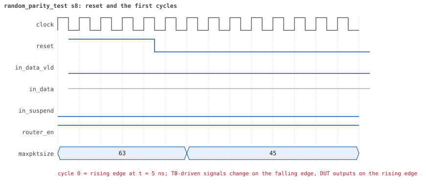
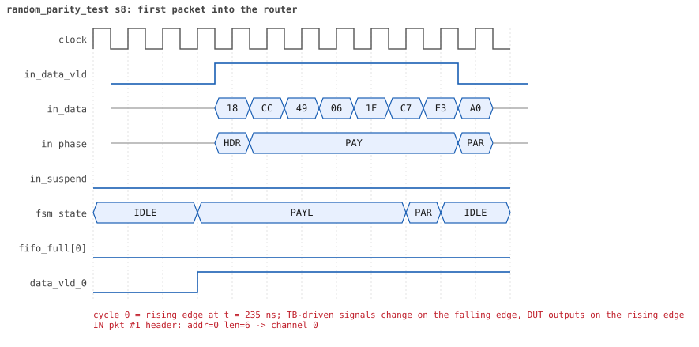
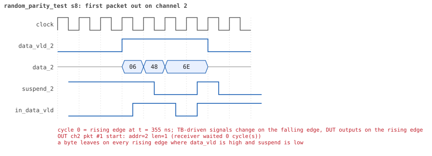
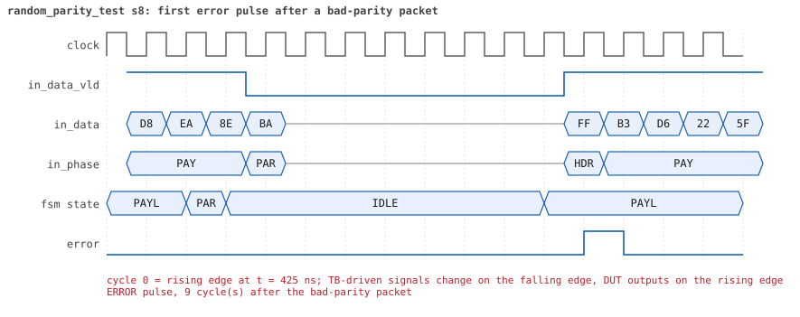
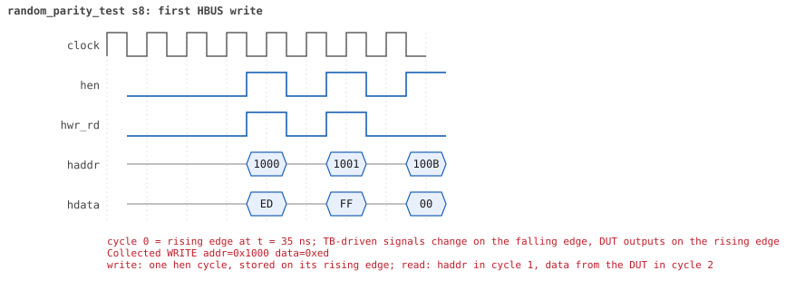
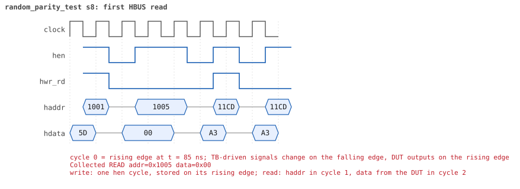

# random_parity_test  seed 8

**Result:** PASSED (0 UVM_ERROR, 0 UVM_WARNING, 0 UVM_FATAL) · bench `yapp_project_tb` · sim time 17us · log `random_parity_test_s8.log`

Waves: `random_parity_test_s8.fst` (GTKWave, Surfer or the VS Code wave viewer); signal trace: `signals.csv`.
[Open the waves in Surfer](https://app.surfer-project.org/?load_url=https%3A%2F%2Fraw.githubusercontent.com%2Ftamirgabgab%2FQcom-Mentoring%2Fmain%2Fyapp_project%2Fregression%2Fyapp_project_tb%2Frandom_parity_test_s8%2Frandom_parity_test_s8.fst&startup_commands=run_command_file_from_url%20https%3A%2F%2Fraw.githubusercontent.com%2Ftamirgabgab%2FQcom-Mentoring%2Fmain%2Fyapp_project%2Ftb%2Fyapp_router.sucl) (web app, the signals already in groups: `yapp_project/tb/yapp_router.sucl`).

## Summary

- YAPP driver sent **55** packet(s) (16 with bad parity); the input monitor saw 55.
- Router: **13** forwarded, **42** dropped (24 oversized, 18 router disabled).
- Packets out: ch0 **7**, ch1 **1**, ch2 **5**.
- Scoreboard: 13 matched, 0 mismatched, 0 unexpected.
- Back-pressure: in_suspend asserted **0** time(s).
- Error pulses: 10.
- HBUS: 9 write(s), 51 read(s).

## Stages

| time (ns) | stage |
|---|---|
| 0 | receivers: ch0 RX_FAST, ch1 RX_SLOW, ch2 RX_NORMAL |
| 0 | random scenario: 55 packets in 3 bursts |
| 230 | burst 1/3: ctrl=0xf5 (maxpktsize 53) en=0x5d (router on, counter enables 0101110), 19 packet(s) |
| 8990 | burst 1/3 sent: addr0..3 8/3/6/2, bad parity 5, gap 0 7, length 1..63 |
| 9190 | burst 2/3: ctrl=0x00 (maxpktsize 0) en=0x1d (router on, counter enables 0001110), 18 packet(s) |
| 14970 | burst 2/3 sent: addr0..3 5/4/5/4, bad parity 5, gap 0 7, length 1..63 |
| 15100 | burst 3/3: ctrl=0x23 (maxpktsize 35) en=0xac (router OFF, counter enables 1010110), 18 packet(s) -- storm: 1..3-byte packets back to back, half with bad parity |
| 15750 | burst 3/3 sent: addr0..3 3/3/11/1, bad parity 6, gap 0 18, length 1..3 |
| 15750 | final reads: every register and the stored packet, checked against the reference model |
| 17065 | done: 55 packets (13 forwarded, 42 dropped), 1 storm burst(s), 13 scoreboard matches, 51 HBUS reads checked, 10 error pulses for 10 bad packets |

## Pictures

**reset and the first cycles**

**first packet into the router**

**first packet out on channel 0**

**first error pulse after a bad-parity packet**

**first HBUS write**

**first HBUS read**

## Timeline

627 events (the same list is in `timeline.csv`).

| time (ns) | who | event |
|---|---|---|
| 0 | yapp monitor | YAPP monitor running |
| 0 | **test** | STAGE: receivers: ch0 RX_FAST, ch1 RX_SLOW, ch2 RX_NORMAL |
| 0 | **test** | STAGE: random scenario: 55 packets in 3 bursts |
| 0 | clk/rst driver | Starting clock (period 10) and holding reset for 5 cycles |
| 0 | **DUT** | RESET asserted |
| 50 | **DUT** | RESET released: router_en=1 maxpktsize=63 |
| 70 | hbus driver | Executed WRITE addr=0x1000 data=0xf5 |
| 75 | **DUT** | CONFIG router_en=1 maxpktsize=53 |
| 75 | hbus monitor | Collected WRITE addr=0x1000 data=0xf5 |
| 75 | reference | maxpktsize is now 53 |
| 90 | hbus driver | Executed WRITE addr=0x1001 data=0x5d |
| 95 | hbus monitor | Collected WRITE addr=0x1001 data=0x5d |
| 95 | reference | router_en is now 1 (en_reg 0x5d) |
| 120 | hbus driver | Executed READ  addr=0x1005 data=0x00 |
| 125 | hbus monitor | Collected READ  addr=0x1005 data=0x00 |
| 140 | hbus driver | Executed WRITE addr=0x11cd data=0xa3 |
| 145 | hbus monitor | Collected WRITE addr=0x11cd data=0xa3 |
| 170 | hbus driver | Executed READ  addr=0x11cd data=0xa3 |
| 175 | hbus monitor | Collected READ  addr=0x11cd data=0xa3 |
| 200 | hbus driver | Executed READ  addr=0x100d data=0x00 |
| 205 | hbus monitor | Collected READ  addr=0x100d data=0x00 |
| 230 | hbus driver | Executed READ  addr=0x1000 data=0xf5 |
| 230 | **test** | STAGE: burst 1/3: ctrl=0xf5 (maxpktsize 53) en=0x5d (router on, counter enables 0101110), 19 packet(s) |
| 230 | yapp driver | TX pkt #1: addr=0 len=6 parity=good delay=2 |
| 235 | hbus monitor | Collected READ  addr=0x1000 data=0xf5 |
| 265 | **DUT** | IN  pkt #1 header: addr=0 len=6 -> channel 0 |
| 275 | **DUT** | OUT ch0 pkt #1 start: addr=0 len=6 (receiver waited 0 cycle(s)) |
| 335 | **DUT** | IN  pkt #1 complete: addr=0 len=6 parity=ok forwarded, 8 bytes in 8 cycles (held 0) |
| 335 | yapp monitor | RX pkt #1 on the input: addr=0 len=6 parity=good gap=21 |
| 335 | reference | Packet forwarded: addr=0 len=6 -> channel 0 |
| 340 | ch0 driver | ch0: packet consumed (response delay 0) |
| 340 | yapp driver | TX pkt #1 accepted by the DUT |
| 340 | yapp driver | TX pkt #2: addr=2 len=7 parity=bad delay=3 |
| 355 | **DUT** | OUT ch0 pkt #1 done: 8 bytes in 9 cycles |
| 355 | ch0 monitor | ch0 RX pkt #1: addr=0 len=6 parity=good |
| 355 | scoreboard | ch0 pkt matched: addr=0 len=6 (1 matched so far) |
| 375 | **DUT** | IN  pkt #2 header: addr=2 len=7 -> channel 2 |
| 455 | **DUT** | IN  pkt #2 complete: addr=2 len=7 parity=BAD forwarded, 9 bytes in 9 cycles (held 0) |
| 455 | yapp monitor | RX pkt #2 on the input: addr=2 len=7 parity=bad gap=3 |
| 455 | reference | Packet forwarded: addr=2 len=7 -> channel 2 |
| 460 | yapp driver | TX pkt #2 accepted by the DUT |
| 460 | yapp driver | TX pkt #3: addr=3 len=63 parity=bad delay=7 |
| 485 | **DUT** | OUT ch2 pkt #1 start: addr=2 len=7 (receiver waited 10 cycle(s)) |
| 535 | **DUT** | IN  pkt #3 header: addr=3 len=63 -> DROP (oversized: len 63 > maxpktsize 53) |
| 550 | **DUT** | ERROR pulse, 9 cycle(s) after the bad-parity packet |
| 550 | error checker | error pulse 9 cycles after the bad packet (0 still owed) |
| 560 | ch2 driver | ch2: packet consumed (response delay 10) |
| 655 | **DUT** | OUT ch2 pkt #1 done: 9 bytes in 18 cycles |
| 655 | ch2 monitor | ch2 RX pkt #1: addr=2 len=7 parity=bad |
| 655 | scoreboard | ch2 pkt matched: addr=2 len=7 (2 matched so far) |
| 760 | ch0 driver | ch0: packet consumed (response delay 0) |
| 1120 | ch2 driver | ch2: packet consumed (response delay 8) |
| 1175 | **DUT** | IN  pkt #3 complete: addr=3 len=63 parity=BAD dropped, 65 bytes in 65 cycles (held 0) |
| 1175 | yapp monitor | RX pkt #3 on the input: addr=3 len=63 parity=bad gap=7 |
| 1175 | reference | Packet dropped: illegal address 3 (len=63) |
| 1175 | **DUT** | ROUTER DROPS PACKET addr=3 length=63 (    illegal address) |
| 1180 | yapp driver | TX pkt #3 accepted by the DUT |
| 1180 | yapp driver | TX pkt #4: addr=2 len=1 parity=bad delay=5 |
| 1190 | **DUT** | ERROR pulse, 1 cycle(s) after the bad-parity packet |
| 1190 | error checker | error pulse 1 cycles after the bad packet (0 still owed) |
| 1235 | **DUT** | IN  pkt #4 header: addr=2 len=1 -> channel 2 |
| 1255 | **DUT** | IN  pkt #4 complete: addr=2 len=1 parity=BAD forwarded, 3 bytes in 3 cycles (held 0) |
| 1255 | yapp monitor | RX pkt #4 on the input: addr=2 len=1 parity=bad gap=5 |
| 1255 | reference | Packet forwarded: addr=2 len=1 -> channel 2 |
| 1260 | yapp driver | TX pkt #4 accepted by the DUT |
| 1260 | yapp driver | TX pkt #5: addr=1 len=63 parity=good delay=13 |
| 1305 | **DUT** | OUT ch2 pkt #2 start: addr=2 len=1 (receiver waited 6 cycle(s)) |
| 1320 | ch2 driver | ch2: packet consumed (response delay 6) |
| 1350 | **DUT** | ERROR pulse, 9 cycle(s) after the bad-parity packet |
| 1350 | error checker | error pulse 9 cycles after the bad packet (0 still owed) |
| 1395 | **DUT** | IN  pkt #5 header: addr=1 len=63 -> DROP (oversized: len 63 > maxpktsize 53) |
| 1435 | **DUT** | OUT ch2 pkt #2 done: 3 bytes in 14 cycles |
| 1435 | ch2 monitor | ch2 RX pkt #2: addr=2 len=1 parity=bad |
| 1435 | scoreboard | ch2 pkt matched: addr=2 len=1 (3 matched so far) |
| 1440 | ch2 driver | ch2: packet consumed (response delay 10) |
| 2035 | **DUT** | IN  pkt #5 complete: addr=1 len=63 parity=ok dropped, 65 bytes in 65 cycles (held 0) |
| 2035 | yapp monitor | RX pkt #5 on the input: addr=1 len=63 parity=good gap=13 |
| 2035 | reference | Packet dropped: length 63 > maxpktsize 53 (addr=1) |
| 2035 | **DUT** | ROUTER DROPS PACKET addr=1 length=63 (length > maxpktsize) |
| 2040 | yapp driver | TX pkt #5 accepted by the DUT |
| 2040 | yapp driver | TX pkt #6: addr=0 len=29 parity=good delay=2 |
| 2065 | **DUT** | IN  pkt #6 header: addr=0 len=29 -> channel 0 |
| 2075 | **DUT** | OUT ch0 pkt #2 start: addr=0 len=29 (receiver waited 0 cycle(s)) |
| 2365 | **DUT** | IN  pkt #6 complete: addr=0 len=29 parity=ok forwarded, 31 bytes in 31 cycles (held 0) |
| 2365 | yapp monitor | RX pkt #6 on the input: addr=0 len=29 parity=good gap=2 |
| 2365 | reference | Packet forwarded: addr=0 len=29 -> channel 0 |
| 2370 | ch0 driver | ch0: packet consumed (response delay 0) |
| 2370 | yapp driver | TX pkt #6 accepted by the DUT |
| 2370 | yapp driver | TX pkt #7: addr=0 len=35 parity=good delay=1 |
| 2385 | **DUT** | IN  pkt #7 header: addr=0 len=35 -> channel 0 |
| 2385 | **DUT** | OUT ch0 pkt #2 done: 31 bytes in 32 cycles |
| 2385 | ch0 monitor | ch0 RX pkt #2: addr=0 len=29 parity=good |
| 2385 | scoreboard | ch0 pkt matched: addr=0 len=29 (4 matched so far) |
| 2395 | **DUT** | OUT ch0 pkt #3 start: addr=0 len=35 (receiver waited 0 cycle(s)) |
| 2510 | ch0 driver | ch0: packet consumed (response delay 0) |
| 2745 | **DUT** | IN  pkt #7 complete: addr=0 len=35 parity=ok forwarded, 37 bytes in 37 cycles (held 0) |
| 2745 | yapp monitor | RX pkt #7 on the input: addr=0 len=35 parity=good gap=1 |
| 2745 | reference | Packet forwarded: addr=0 len=35 -> channel 0 |
| 2750 | yapp driver | TX pkt #7 accepted by the DUT |
| 2750 | yapp driver | TX pkt #8: addr=3 len=63 parity=good delay=0 |
| 2755 | **DUT** | IN  pkt #8 header: addr=3 len=63 -> DROP (oversized: len 63 > maxpktsize 53) |
| 2765 | **DUT** | OUT ch0 pkt #3 done: 37 bytes in 38 cycles |
| 2765 | ch0 monitor | ch0 RX pkt #3: addr=0 len=35 parity=good |
| 2765 | scoreboard | ch0 pkt matched: addr=0 len=35 (5 matched so far) |
| 3110 | ch0 driver | ch0: packet consumed (response delay 0) |
| 3395 | **DUT** | IN  pkt #8 complete: addr=3 len=63 parity=ok dropped, 65 bytes in 65 cycles (held 0) |
| 3395 | yapp monitor | RX pkt #8 on the input: addr=3 len=63 parity=good gap=0 |
| 3395 | reference | Packet dropped: illegal address 3 (len=63) |
| 3395 | **DUT** | ROUTER DROPS PACKET addr=3 length=63 (    illegal address) |
| 3400 | yapp driver | TX pkt #8 accepted by the DUT |
| 3400 | yapp driver | TX pkt #9: addr=1 len=6 parity=good delay=0 |
| 3405 | **DUT** | IN  pkt #9 header: addr=1 len=6 -> channel 1 |
| 3475 | **DUT** | IN  pkt #9 complete: addr=1 len=6 parity=ok forwarded, 8 bytes in 8 cycles (held 0) |
| 3475 | yapp monitor | RX pkt #9 on the input: addr=1 len=6 parity=good gap=0 |
| 3475 | reference | Packet forwarded: addr=1 len=6 -> channel 1 |
| 3480 | yapp driver | TX pkt #9 accepted by the DUT |
| 3480 | yapp driver | TX pkt #10: addr=0 len=63 parity=good delay=0 |
| 3485 | **DUT** | IN  pkt #10 header: addr=0 len=63 -> DROP (oversized: len 63 > maxpktsize 53) |
| 3735 | **DUT** | OUT ch1 pkt #1 start: addr=1 len=6 (receiver waited 32 cycle(s)) |
| 3800 | ch1 driver | ch1: packet consumed (response delay 32) |
| 4035 | **DUT** | OUT ch1 pkt #1 done: 8 bytes in 31 cycles |
| 4035 | ch1 monitor | ch1 RX pkt #1: addr=1 len=6 parity=good |
| 4035 | scoreboard | ch1 pkt matched: addr=1 len=6 (6 matched so far) |
| 4125 | **DUT** | IN  pkt #10 complete: addr=0 len=63 parity=ok dropped, 65 bytes in 65 cycles (held 0) |
| 4125 | yapp monitor | RX pkt #10 on the input: addr=0 len=63 parity=good gap=0 |
| 4125 | reference | Packet dropped: length 63 > maxpktsize 53 (addr=0) |
| 4125 | **DUT** | ROUTER DROPS PACKET addr=0 length=63 (length > maxpktsize) |
| 4130 | yapp driver | TX pkt #10 accepted by the DUT |
| 4130 | yapp driver | TX pkt #11: addr=0 len=52 parity=bad delay=1 |
| 4145 | **DUT** | IN  pkt #11 header: addr=0 len=52 -> channel 0 |
| 4155 | **DUT** | OUT ch0 pkt #4 start: addr=0 len=52 (receiver waited 0 cycle(s)) |
| 4650 | ch1 driver | ch1: packet consumed (response delay 22) |
| 4675 | **DUT** | IN  pkt #11 complete: addr=0 len=52 parity=BAD forwarded, 54 bytes in 54 cycles (held 0) |
| 4675 | yapp monitor | RX pkt #11 on the input: addr=0 len=52 parity=bad gap=1 |
| 4675 | reference | Packet forwarded: addr=0 len=52 -> channel 0 |
| 4680 | ch0 driver | ch0: packet consumed (response delay 0) |
| 4680 | yapp driver | TX pkt #11 accepted by the DUT |
| 4680 | yapp driver | TX pkt #12: addr=0 len=19 parity=good delay=1 |
| 4695 | **DUT** | IN  pkt #12 header: addr=0 len=19 -> channel 0 |
| 4695 | **DUT** | OUT ch0 pkt #4 done: 54 bytes in 55 cycles |
| 4695 | ch0 monitor | ch0 RX pkt #4: addr=0 len=52 parity=bad |
| 4695 | scoreboard | ch0 pkt matched: addr=0 len=52 (7 matched so far) |
| 4705 | **DUT** | OUT ch0 pkt #5 start: addr=0 len=19 (receiver waited 0 cycle(s)) |
| 4730 | **DUT** | ERROR pulse, 5 cycle(s) after the bad-parity packet |
| 4730 | error checker | error pulse 5 cycles after the bad packet (0 still owed) |
| 4895 | **DUT** | IN  pkt #12 complete: addr=0 len=19 parity=ok forwarded, 21 bytes in 21 cycles (held 0) |
| 4895 | yapp monitor | RX pkt #12 on the input: addr=0 len=19 parity=good gap=1 |
| 4895 | reference | Packet forwarded: addr=0 len=19 -> channel 0 |
| 4900 | ch0 driver | ch0: packet consumed (response delay 0) |
| 4900 | yapp driver | TX pkt #12 accepted by the DUT |
| 4900 | yapp driver | TX pkt #13: addr=2 len=63 parity=good delay=0 |
| 4905 | **DUT** | IN  pkt #13 header: addr=2 len=63 -> DROP (oversized: len 63 > maxpktsize 53) |
| 4915 | **DUT** | OUT ch0 pkt #5 done: 21 bytes in 22 cycles |
| 4915 | ch0 monitor | ch0 RX pkt #5: addr=0 len=19 parity=good |
| 4915 | scoreboard | ch0 pkt matched: addr=0 len=19 (8 matched so far) |
| 5370 | ch0 driver | ch0: packet consumed (response delay 0) |
| 5545 | **DUT** | IN  pkt #13 complete: addr=2 len=63 parity=ok dropped, 65 bytes in 65 cycles (held 0) |
| 5545 | yapp monitor | RX pkt #13 on the input: addr=2 len=63 parity=good gap=0 |
| 5545 | reference | Packet dropped: length 63 > maxpktsize 53 (addr=2) |
| 5545 | **DUT** | ROUTER DROPS PACKET addr=2 length=63 (length > maxpktsize) |
| 5550 | yapp driver | TX pkt #13 accepted by the DUT |
| 5550 | yapp driver | TX pkt #14: addr=0 len=53 parity=bad delay=3 |
| 5585 | **DUT** | IN  pkt #14 header: addr=0 len=53 -> channel 0 |
| 5595 | **DUT** | OUT ch0 pkt #6 start: addr=0 len=53 (receiver waited 0 cycle(s)) |
| 6125 | **DUT** | IN  pkt #14 complete: addr=0 len=53 parity=BAD forwarded, 55 bytes in 55 cycles (held 0) |
| 6125 | yapp monitor | RX pkt #14 on the input: addr=0 len=53 parity=bad gap=3 |
| 6125 | reference | Packet forwarded: addr=0 len=53 -> channel 0 |
| 6130 | ch0 driver | ch0: packet consumed (response delay 0) |
| 6130 | yapp driver | TX pkt #14 accepted by the DUT |
| 6130 | yapp driver | TX pkt #15: addr=1 len=63 parity=good delay=1 |
| 6145 | **DUT** | IN  pkt #15 header: addr=1 len=63 -> DROP (oversized: len 63 > maxpktsize 53) |
| 6145 | **DUT** | OUT ch0 pkt #6 done: 55 bytes in 56 cycles |
| 6145 | ch0 monitor | ch0 RX pkt #6: addr=0 len=53 parity=bad |
| 6145 | scoreboard | ch0 pkt matched: addr=0 len=53 (9 matched so far) |
| 6190 | **DUT** | ERROR pulse, 6 cycle(s) after the bad-parity packet |
| 6190 | error checker | error pulse 6 cycles after the bad packet (0 still owed) |
| 6190 | ch0 driver | ch0: packet consumed (response delay 0) |
| 6785 | **DUT** | IN  pkt #15 complete: addr=1 len=63 parity=ok dropped, 65 bytes in 65 cycles (held 0) |
| 6785 | yapp monitor | RX pkt #15 on the input: addr=1 len=63 parity=good gap=1 |
| 6785 | reference | Packet dropped: length 63 > maxpktsize 53 (addr=1) |
| 6785 | **DUT** | ROUTER DROPS PACKET addr=1 length=63 (length > maxpktsize) |
| 6790 | yapp driver | TX pkt #15 accepted by the DUT |
| 6790 | yapp driver | TX pkt #16: addr=2 len=53 parity=good delay=0 |
| 6795 | **DUT** | IN  pkt #16 header: addr=2 len=53 -> channel 2 |
| 6875 | **DUT** | OUT ch2 pkt #3 start: addr=2 len=53 (receiver waited 7 cycle(s)) |
| 7335 | **DUT** | IN  pkt #16 complete: addr=2 len=53 parity=ok forwarded, 55 bytes in 55 cycles (held 0) |
| 7335 | yapp monitor | RX pkt #16 on the input: addr=2 len=53 parity=good gap=0 |
| 7335 | reference | Packet forwarded: addr=2 len=53 -> channel 2 |
| 7340 | yapp driver | TX pkt #16 accepted by the DUT |
| 7340 | yapp driver | TX pkt #17: addr=2 len=52 parity=good delay=0 |
| 7345 | **DUT** | IN  pkt #17 header: addr=2 len=52 -> channel 2 |
| 7410 | ch2 driver | ch2: packet consumed (response delay 7) |
| 7485 | **DUT** | OUT ch2 pkt #3 done: 55 bytes in 62 cycles |
| 7485 | ch2 monitor | ch2 RX pkt #3: addr=2 len=53 parity=good |
| 7485 | scoreboard | ch2 pkt matched: addr=2 len=53 (10 matched so far) |
| 7495 | **DUT** | OUT ch2 pkt #4 start: addr=2 len=52 (receiver waited 0 cycle(s)) |
| 7875 | **DUT** | IN  pkt #17 complete: addr=2 len=52 parity=ok forwarded, 54 bytes in 54 cycles (held 0) |
| 7875 | yapp monitor | RX pkt #17 on the input: addr=2 len=52 parity=good gap=0 |
| 7875 | reference | Packet forwarded: addr=2 len=52 -> channel 2 |
| 7880 | yapp driver | TX pkt #17 accepted by the DUT |
| 7880 | yapp driver | TX pkt #18: addr=2 len=41 parity=good delay=20 |
| 8025 | **DUT** | OUT ch2 pkt #4 done: 54 bytes in 54 cycles |
| 8025 | ch2 monitor | ch2 RX pkt #4: addr=2 len=52 parity=good |
| 8025 | scoreboard | ch2 pkt matched: addr=2 len=52 (11 matched so far) |
| 8085 | **DUT** | IN  pkt #18 header: addr=2 len=41 -> channel 2 |
| 8095 | **DUT** | OUT ch2 pkt #5 start: addr=2 len=41 (receiver waited 0 cycle(s)) |
| 8120 | ch2 driver | ch2: packet consumed (response delay 6) |
| 8505 | **DUT** | IN  pkt #18 complete: addr=2 len=41 parity=ok forwarded, 43 bytes in 43 cycles (held 0) |
| 8505 | yapp monitor | RX pkt #18 on the input: addr=2 len=41 parity=good gap=20 |
| 8505 | reference | Packet forwarded: addr=2 len=41 -> channel 2 |
| 8510 | yapp driver | TX pkt #18 accepted by the DUT |
| 8510 | yapp driver | TX pkt #19: addr=0 len=46 parity=good delay=0 |
| 8515 | **DUT** | IN  pkt #19 header: addr=0 len=46 -> channel 0 |
| 8525 | **DUT** | OUT ch0 pkt #7 start: addr=0 len=46 (receiver waited 0 cycle(s)) |
| 8605 | **DUT** | OUT ch2 pkt #5 done: 43 bytes in 52 cycles |
| 8605 | ch2 monitor | ch2 RX pkt #5: addr=2 len=41 parity=good |
| 8605 | scoreboard | ch2 pkt matched: addr=2 len=41 (12 matched so far) |
| 8850 | ch2 driver | ch2: packet consumed (response delay 8) |
| 8985 | **DUT** | IN  pkt #19 complete: addr=0 len=46 parity=ok forwarded, 48 bytes in 48 cycles (held 0) |
| 8985 | yapp monitor | RX pkt #19 on the input: addr=0 len=46 parity=good gap=0 |
| 8985 | reference | Packet forwarded: addr=0 len=46 -> channel 0 |
| 8990 | ch0 driver | ch0: packet consumed (response delay 0) |
| 8990 | yapp driver | TX pkt #19 accepted by the DUT |
| 8990 | **test** | STAGE: burst 1/3 sent: addr0..3 8/3/6/2, bad parity 5, gap 0 7, length 1..63 |
| 9005 | **DUT** | OUT ch0 pkt #7 done: 48 bytes in 49 cycles |
| 9005 | ch0 monitor | ch0 RX pkt #7: addr=0 len=46 parity=good |
| 9005 | scoreboard | ch0 pkt matched: addr=0 len=46 (13 matched so far) |
| 9010 | hbus driver | Executed WRITE addr=0x1000 data=0x00 |
| 9015 | **DUT** | CONFIG router_en=1 maxpktsize=0 |
| 9015 | hbus monitor | Collected WRITE addr=0x1000 data=0x00 |
| 9015 | reference | maxpktsize is now 0 |
| 9030 | hbus driver | Executed WRITE addr=0x1001 data=0x1d |
| 9035 | hbus monitor | Collected WRITE addr=0x1001 data=0x1d |
| 9035 | reference | router_en is now 1 (en_reg 0x1d) |
| 9060 | hbus driver | Executed READ  addr=0x1005 data=0x06 |
| 9065 | hbus monitor | Collected READ  addr=0x1005 data=0x06 |
| 9080 | hbus driver | Executed WRITE addr=0x1171 data=0x43 |
| 9085 | hbus monitor | Collected WRITE addr=0x1171 data=0x43 |
| 9110 | hbus driver | Executed READ  addr=0x1171 data=0x43 |
| 9115 | hbus monitor | Collected READ  addr=0x1171 data=0x43 |
| 9140 | hbus driver | Executed READ  addr=0x1000 data=0x00 |
| 9145 | hbus monitor | Collected READ  addr=0x1000 data=0x00 |
| 9160 | hbus driver | Executed WRITE addr=0x1187 data=0x9a |
| 9165 | hbus monitor | Collected WRITE addr=0x1187 data=0x9a |
| 9190 | hbus driver | Executed READ  addr=0x1187 data=0x9a |
| 9190 | **test** | STAGE: burst 2/3: ctrl=0x00 (maxpktsize 0) en=0x1d (router on, counter enables 0001110), 18 packet(s) |
| 9190 | yapp driver | TX pkt #20: addr=0 len=44 parity=bad delay=0 |
| 9195 | hbus monitor | Collected READ  addr=0x1187 data=0x9a |
| 9205 | **DUT** | IN  pkt #20 header: addr=0 len=44 -> DROP (oversized: len 44 > maxpktsize 0) |
| 9410 | ch0 driver | ch0: packet consumed (response delay 0) |
| 9655 | **DUT** | IN  pkt #20 complete: addr=0 len=44 parity=BAD dropped, 46 bytes in 46 cycles (held 0) |
| 9655 | yapp monitor | RX pkt #20 on the input: addr=0 len=44 parity=bad gap=21 |
| 9655 | reference | Packet dropped: length 44 > maxpktsize 0 (addr=0) |
| 9655 | **DUT** | ROUTER DROPS PACKET addr=0 length=44 (length > maxpktsize) |
| 9660 | yapp driver | TX pkt #20 accepted by the DUT |
| 9660 | yapp driver | TX pkt #21: addr=2 len=1 parity=good delay=3 |
| 9670 | **DUT** | ERROR pulse, 1 cycle(s) after the bad-parity packet |
| 9670 | error checker | error pulse 1 cycles after the bad packet (0 still owed) |
| 9695 | **DUT** | IN  pkt #21 header: addr=2 len=1 -> DROP (oversized: len 1 > maxpktsize 0) |
| 9715 | **DUT** | IN  pkt #21 complete: addr=2 len=1 parity=ok dropped, 3 bytes in 3 cycles (held 0) |
| 9715 | yapp monitor | RX pkt #21 on the input: addr=2 len=1 parity=good gap=3 |
| 9715 | reference | Packet dropped: length 1 > maxpktsize 0 (addr=2) |
| 9715 | **DUT** | ROUTER DROPS PACKET addr=2 length=1 (length > maxpktsize) |
| 9720 | yapp driver | TX pkt #21 accepted by the DUT |
| 9720 | yapp driver | TX pkt #22: addr=3 len=56 parity=good delay=3 |
| 9755 | **DUT** | IN  pkt #22 header: addr=3 len=56 -> DROP (oversized: len 56 > maxpktsize 0) |
| 10325 | **DUT** | IN  pkt #22 complete: addr=3 len=56 parity=ok dropped, 58 bytes in 58 cycles (held 0) |
| 10325 | yapp monitor | RX pkt #22 on the input: addr=3 len=56 parity=good gap=3 |
| 10325 | reference | Packet dropped: illegal address 3 (len=56) |
| 10325 | **DUT** | ROUTER DROPS PACKET addr=3 length=56 (    illegal address) |
| 10330 | yapp driver | TX pkt #22 accepted by the DUT |
| 10330 | yapp driver | TX pkt #23: addr=2 len=62 parity=good delay=0 |
| 10335 | **DUT** | IN  pkt #23 header: addr=2 len=62 -> DROP (oversized: len 62 > maxpktsize 0) |
| 10965 | **DUT** | IN  pkt #23 complete: addr=2 len=62 parity=ok dropped, 64 bytes in 64 cycles (held 0) |
| 10965 | yapp monitor | RX pkt #23 on the input: addr=2 len=62 parity=good gap=0 |
| 10965 | reference | Packet dropped: length 62 > maxpktsize 0 (addr=2) |
| 10965 | **DUT** | ROUTER DROPS PACKET addr=2 length=62 (length > maxpktsize) |
| 10970 | yapp driver | TX pkt #23 accepted by the DUT |
| 10970 | yapp driver | TX pkt #24: addr=0 len=1 parity=good delay=1 |
| 10985 | **DUT** | IN  pkt #24 header: addr=0 len=1 -> DROP (oversized: len 1 > maxpktsize 0) |
| 11005 | **DUT** | IN  pkt #24 complete: addr=0 len=1 parity=ok dropped, 3 bytes in 3 cycles (held 0) |
| 11005 | yapp monitor | RX pkt #24 on the input: addr=0 len=1 parity=good gap=1 |
| 11005 | reference | Packet dropped: length 1 > maxpktsize 0 (addr=0) |
| 11005 | **DUT** | ROUTER DROPS PACKET addr=0 length=1 (length > maxpktsize) |
| 11010 | yapp driver | TX pkt #24 accepted by the DUT |
| 11010 | yapp driver | TX pkt #25: addr=2 len=1 parity=good delay=1 |
| 11025 | **DUT** | IN  pkt #25 header: addr=2 len=1 -> DROP (oversized: len 1 > maxpktsize 0) |
| 11045 | **DUT** | IN  pkt #25 complete: addr=2 len=1 parity=ok dropped, 3 bytes in 3 cycles (held 0) |
| 11045 | yapp monitor | RX pkt #25 on the input: addr=2 len=1 parity=good gap=1 |
| 11045 | reference | Packet dropped: length 1 > maxpktsize 0 (addr=2) |
| 11045 | **DUT** | ROUTER DROPS PACKET addr=2 length=1 (length > maxpktsize) |
| 11050 | yapp driver | TX pkt #25 accepted by the DUT |
| 11050 | yapp driver | TX pkt #26: addr=1 len=15 parity=bad delay=16 |
| 11215 | **DUT** | IN  pkt #26 header: addr=1 len=15 -> DROP (oversized: len 15 > maxpktsize 0) |
| 11375 | **DUT** | IN  pkt #26 complete: addr=1 len=15 parity=BAD dropped, 17 bytes in 17 cycles (held 0) |
| 11375 | yapp monitor | RX pkt #26 on the input: addr=1 len=15 parity=bad gap=16 |
| 11375 | reference | Packet dropped: length 15 > maxpktsize 0 (addr=1) |
| 11375 | **DUT** | ROUTER DROPS PACKET addr=1 length=15 (length > maxpktsize) |
| 11380 | yapp driver | TX pkt #26 accepted by the DUT |
| 11380 | yapp driver | TX pkt #27: addr=2 len=29 parity=bad delay=0 |
| 11385 | **DUT** | IN  pkt #27 header: addr=2 len=29 -> DROP (oversized: len 29 > maxpktsize 0) |
| 11410 | **DUT** | ERROR pulse, 3 cycle(s) after the bad-parity packet |
| 11410 | error checker | error pulse 3 cycles after the bad packet (0 still owed) |
| 11685 | **DUT** | IN  pkt #27 complete: addr=2 len=29 parity=BAD dropped, 31 bytes in 31 cycles (held 0) |
| 11685 | yapp monitor | RX pkt #27 on the input: addr=2 len=29 parity=bad gap=0 |
| 11685 | reference | Packet dropped: length 29 > maxpktsize 0 (addr=2) |
| 11685 | **DUT** | ROUTER DROPS PACKET addr=2 length=29 (length > maxpktsize) |
| 11690 | yapp driver | TX pkt #27 accepted by the DUT |
| 11690 | yapp driver | TX pkt #28: addr=0 len=63 parity=good delay=11 |
| 11710 | **DUT** | ERROR pulse, 2 cycle(s) after the bad-parity packet |
| 11710 | error checker | error pulse 2 cycles after the bad packet (0 still owed) |
| 11805 | **DUT** | IN  pkt #28 header: addr=0 len=63 -> DROP (oversized: len 63 > maxpktsize 0) |
| 12445 | **DUT** | IN  pkt #28 complete: addr=0 len=63 parity=ok dropped, 65 bytes in 65 cycles (held 0) |
| 12445 | yapp monitor | RX pkt #28 on the input: addr=0 len=63 parity=good gap=11 |
| 12445 | reference | Packet dropped: length 63 > maxpktsize 0 (addr=0) |
| 12445 | **DUT** | ROUTER DROPS PACKET addr=0 length=63 (length > maxpktsize) |
| 12450 | yapp driver | TX pkt #28 accepted by the DUT |
| 12450 | yapp driver | TX pkt #29: addr=3 len=9 parity=bad delay=7 |
| 12525 | **DUT** | IN  pkt #29 header: addr=3 len=9 -> DROP (oversized: len 9 > maxpktsize 0) |
| 12625 | **DUT** | IN  pkt #29 complete: addr=3 len=9 parity=BAD dropped, 11 bytes in 11 cycles (held 0) |
| 12625 | yapp monitor | RX pkt #29 on the input: addr=3 len=9 parity=bad gap=7 |
| 12625 | reference | Packet dropped: illegal address 3 (len=9) |
| 12625 | **DUT** | ROUTER DROPS PACKET addr=3 length=9 (    illegal address) |
| 12630 | yapp driver | TX pkt #29 accepted by the DUT |
| 12630 | yapp driver | TX pkt #30: addr=3 len=63 parity=good delay=3 |
| 12665 | **DUT** | IN  pkt #30 header: addr=3 len=63 -> DROP (oversized: len 63 > maxpktsize 0) |
| 12730 | **DUT** | ERROR pulse, 10 cycle(s) after the bad-parity packet |
| 12730 | error checker | error pulse 10 cycles after the bad packet (0 still owed) |
| 13305 | **DUT** | IN  pkt #30 complete: addr=3 len=63 parity=ok dropped, 65 bytes in 65 cycles (held 0) |
| 13305 | yapp monitor | RX pkt #30 on the input: addr=3 len=63 parity=good gap=3 |
| 13305 | reference | Packet dropped: illegal address 3 (len=63) |
| 13305 | **DUT** | ROUTER DROPS PACKET addr=3 length=63 (    illegal address) |
| 13310 | yapp driver | TX pkt #30 accepted by the DUT |
| 13310 | yapp driver | TX pkt #31: addr=1 len=20 parity=good delay=2 |
| 13335 | **DUT** | IN  pkt #31 header: addr=1 len=20 -> DROP (oversized: len 20 > maxpktsize 0) |
| 13545 | **DUT** | IN  pkt #31 complete: addr=1 len=20 parity=ok dropped, 22 bytes in 22 cycles (held 0) |
| 13545 | yapp monitor | RX pkt #31 on the input: addr=1 len=20 parity=good gap=2 |
| 13545 | reference | Packet dropped: length 20 > maxpktsize 0 (addr=1) |
| 13545 | **DUT** | ROUTER DROPS PACKET addr=1 length=20 (length > maxpktsize) |
| 13550 | yapp driver | TX pkt #31 accepted by the DUT |
| 13550 | yapp driver | TX pkt #32: addr=0 len=47 parity=good delay=0 |
| 13555 | **DUT** | IN  pkt #32 header: addr=0 len=47 -> DROP (oversized: len 47 > maxpktsize 0) |
| 14035 | **DUT** | IN  pkt #32 complete: addr=0 len=47 parity=ok dropped, 49 bytes in 49 cycles (held 0) |
| 14035 | yapp monitor | RX pkt #32 on the input: addr=0 len=47 parity=good gap=0 |
| 14035 | reference | Packet dropped: length 47 > maxpktsize 0 (addr=0) |
| 14035 | **DUT** | ROUTER DROPS PACKET addr=0 length=47 (length > maxpktsize) |
| 14040 | yapp driver | TX pkt #32 accepted by the DUT |
| 14040 | yapp driver | TX pkt #33: addr=3 len=4 parity=good delay=3 |
| 14075 | **DUT** | IN  pkt #33 header: addr=3 len=4 -> DROP (oversized: len 4 > maxpktsize 0) |
| 14125 | **DUT** | IN  pkt #33 complete: addr=3 len=4 parity=ok dropped, 6 bytes in 6 cycles (held 0) |
| 14125 | yapp monitor | RX pkt #33 on the input: addr=3 len=4 parity=good gap=3 |
| 14125 | reference | Packet dropped: illegal address 3 (len=4) |
| 14125 | **DUT** | ROUTER DROPS PACKET addr=3 length=4 (    illegal address) |
| 14130 | yapp driver | TX pkt #33 accepted by the DUT |
| 14130 | yapp driver | TX pkt #34: addr=1 len=43 parity=good delay=0 |
| 14135 | **DUT** | IN  pkt #34 header: addr=1 len=43 -> DROP (oversized: len 43 > maxpktsize 0) |
| 14575 | **DUT** | IN  pkt #34 complete: addr=1 len=43 parity=ok dropped, 45 bytes in 45 cycles (held 0) |
| 14575 | yapp monitor | RX pkt #34 on the input: addr=1 len=43 parity=good gap=0 |
| 14575 | reference | Packet dropped: length 43 > maxpktsize 0 (addr=1) |
| 14575 | **DUT** | ROUTER DROPS PACKET addr=1 length=43 (length > maxpktsize) |
| 14580 | yapp driver | TX pkt #34 accepted by the DUT |
| 14580 | yapp driver | TX pkt #35: addr=1 len=1 parity=good delay=0 |
| 14585 | **DUT** | IN  pkt #35 header: addr=1 len=1 -> DROP (oversized: len 1 > maxpktsize 0) |
| 14605 | **DUT** | IN  pkt #35 complete: addr=1 len=1 parity=ok dropped, 3 bytes in 3 cycles (held 0) |
| 14605 | yapp monitor | RX pkt #35 on the input: addr=1 len=1 parity=good gap=0 |
| 14605 | reference | Packet dropped: length 1 > maxpktsize 0 (addr=1) |
| 14605 | **DUT** | ROUTER DROPS PACKET addr=1 length=1 (length > maxpktsize) |
| 14610 | yapp driver | TX pkt #35 accepted by the DUT |
| 14610 | yapp driver | TX pkt #36: addr=0 len=1 parity=good delay=0 |
| 14615 | **DUT** | IN  pkt #36 header: addr=0 len=1 -> DROP (oversized: len 1 > maxpktsize 0) |
| 14635 | **DUT** | IN  pkt #36 complete: addr=0 len=1 parity=ok dropped, 3 bytes in 3 cycles (held 0) |
| 14635 | yapp monitor | RX pkt #36 on the input: addr=0 len=1 parity=good gap=0 |
| 14635 | reference | Packet dropped: length 1 > maxpktsize 0 (addr=0) |
| 14635 | **DUT** | ROUTER DROPS PACKET addr=0 length=1 (length > maxpktsize) |
| 14640 | yapp driver | TX pkt #36 accepted by the DUT |
| 14640 | yapp driver | TX pkt #37: addr=2 len=30 parity=bad delay=1 |
| 14655 | **DUT** | IN  pkt #37 header: addr=2 len=30 -> DROP (oversized: len 30 > maxpktsize 0) |
| 14965 | **DUT** | IN  pkt #37 complete: addr=2 len=30 parity=BAD dropped, 32 bytes in 32 cycles (held 0) |
| 14965 | yapp monitor | RX pkt #37 on the input: addr=2 len=30 parity=bad gap=1 |
| 14965 | reference | Packet dropped: length 30 > maxpktsize 0 (addr=2) |
| 14965 | **DUT** | ROUTER DROPS PACKET addr=2 length=30 (length > maxpktsize) |
| 14970 | yapp driver | TX pkt #37 accepted by the DUT |
| 14970 | **test** | STAGE: burst 2/3 sent: addr0..3 5/4/5/4, bad parity 5, gap 0 7, length 1..63 |
| 14990 | hbus driver | Executed WRITE addr=0x1000 data=0x23 |
| 14995 | **DUT** | CONFIG router_en=1 maxpktsize=35 |
| 14995 | hbus monitor | Collected WRITE addr=0x1000 data=0x23 |
| 14995 | reference | maxpktsize is now 35 |
| 15010 | **DUT** | ERROR pulse, 4 cycle(s) after the bad-parity packet |
| 15010 | error checker | error pulse 4 cycles after the bad packet (0 still owed) |
| 15010 | hbus driver | Executed WRITE addr=0x1001 data=0xac |
| 15015 | **DUT** | CONFIG router_en=0 maxpktsize=35 |
| 15015 | hbus monitor | Collected WRITE addr=0x1001 data=0xac |
| 15015 | reference | router_en is now 0 (en_reg 0xac) |
| 15040 | hbus driver | Executed READ  addr=0x100d data=0x1e |
| 15045 | hbus monitor | Collected READ  addr=0x100d data=0x1e |
| 15070 | hbus driver | Executed READ  addr=0x1026 data=0x08 |
| 15075 | hbus monitor | Collected READ  addr=0x1026 data=0x08 |
| 15100 | hbus driver | Executed READ  addr=0x1044 data=0xdc |
| 15100 | **test** | STAGE: burst 3/3: ctrl=0x23 (maxpktsize 35) en=0xac (router OFF, counter enables 1010110), 18 packet(s) -- storm: 1..3-byte packets back to back, half with bad parity |
| 15100 | yapp driver | TX pkt #38: addr=2 len=3 parity=good delay=0 |
| 15105 | hbus monitor | Collected READ  addr=0x1044 data=0xdc |
| 15115 | **DUT** | IN  pkt #38 header: addr=2 len=3 -> DROP (router disabled) |
| 15155 | **DUT** | IN  pkt #38 complete: addr=2 len=3 parity=ok dropped, 5 bytes in 5 cycles (held 0) |
| 15155 | yapp monitor | RX pkt #38 on the input: addr=2 len=3 parity=good gap=14 |
| 15155 | reference | Packet dropped: router disabled (addr=2 len=3) |
| 15155 | **DUT** | ROUTER DROPS PACKET addr=2 length=3 (router disabled) |
| 15160 | yapp driver | TX pkt #38 accepted by the DUT |
| 15160 | yapp driver | TX pkt #39: addr=0 len=1 parity=good delay=0 |
| 15165 | **DUT** | IN  pkt #39 header: addr=0 len=1 -> DROP (router disabled) |
| 15185 | **DUT** | IN  pkt #39 complete: addr=0 len=1 parity=ok dropped, 3 bytes in 3 cycles (held 0) |
| 15185 | yapp monitor | RX pkt #39 on the input: addr=0 len=1 parity=good gap=0 |
| 15185 | reference | Packet dropped: router disabled (addr=0 len=1) |
| 15185 | **DUT** | ROUTER DROPS PACKET addr=0 length=1 (router disabled) |
| 15190 | yapp driver | TX pkt #39 accepted by the DUT |
| 15190 | yapp driver | TX pkt #40: addr=2 len=2 parity=bad delay=0 |
| 15195 | **DUT** | IN  pkt #40 header: addr=2 len=2 -> DROP (router disabled) |
| 15225 | **DUT** | IN  pkt #40 complete: addr=2 len=2 parity=BAD dropped, 4 bytes in 4 cycles (held 0) |
| 15225 | yapp monitor | RX pkt #40 on the input: addr=2 len=2 parity=bad gap=0 |
| 15225 | reference | Packet dropped: router disabled (addr=2 len=2) |
| 15225 | **DUT** | ROUTER DROPS PACKET addr=2 length=2 (router disabled) |
| 15230 | yapp driver | TX pkt #40 accepted by the DUT |
| 15230 | yapp driver | TX pkt #41: addr=2 len=1 parity=good delay=0 |
| 15235 | **DUT** | IN  pkt #41 header: addr=2 len=1 -> DROP (router disabled) |
| 15255 | **DUT** | IN  pkt #41 complete: addr=2 len=1 parity=ok dropped, 3 bytes in 3 cycles (held 0) |
| 15255 | yapp monitor | RX pkt #41 on the input: addr=2 len=1 parity=good gap=0 |
| 15255 | reference | Packet dropped: router disabled (addr=2 len=1) |
| 15255 | **DUT** | ROUTER DROPS PACKET addr=2 length=1 (router disabled) |
| 15260 | yapp driver | TX pkt #41 accepted by the DUT |
| 15260 | yapp driver | TX pkt #42: addr=0 len=1 parity=good delay=0 |
| 15265 | **DUT** | IN  pkt #42 header: addr=0 len=1 -> DROP (router disabled) |
| 15285 | **DUT** | IN  pkt #42 complete: addr=0 len=1 parity=ok dropped, 3 bytes in 3 cycles (held 0) |
| 15285 | yapp monitor | RX pkt #42 on the input: addr=0 len=1 parity=good gap=0 |
| 15285 | reference | Packet dropped: router disabled (addr=0 len=1) |
| 15285 | **DUT** | ROUTER DROPS PACKET addr=0 length=1 (router disabled) |
| 15290 | yapp driver | TX pkt #42 accepted by the DUT |
| 15290 | yapp driver | TX pkt #43: addr=1 len=1 parity=good delay=0 |
| 15295 | **DUT** | IN  pkt #43 header: addr=1 len=1 -> DROP (router disabled) |
| 15315 | **DUT** | IN  pkt #43 complete: addr=1 len=1 parity=ok dropped, 3 bytes in 3 cycles (held 0) |
| 15315 | yapp monitor | RX pkt #43 on the input: addr=1 len=1 parity=good gap=0 |
| 15315 | reference | Packet dropped: router disabled (addr=1 len=1) |
| 15315 | **DUT** | ROUTER DROPS PACKET addr=1 length=1 (router disabled) |
| 15320 | yapp driver | TX pkt #43 accepted by the DUT |
| 15320 | yapp driver | TX pkt #44: addr=2 len=1 parity=good delay=0 |
| 15325 | **DUT** | IN  pkt #44 header: addr=2 len=1 -> DROP (router disabled) |
| 15345 | **DUT** | IN  pkt #44 complete: addr=2 len=1 parity=ok dropped, 3 bytes in 3 cycles (held 0) |
| 15345 | yapp monitor | RX pkt #44 on the input: addr=2 len=1 parity=good gap=0 |
| 15345 | reference | Packet dropped: router disabled (addr=2 len=1) |
| 15345 | **DUT** | ROUTER DROPS PACKET addr=2 length=1 (router disabled) |
| 15350 | yapp driver | TX pkt #44 accepted by the DUT |
| 15350 | yapp driver | TX pkt #45: addr=2 len=3 parity=good delay=0 |
| 15355 | **DUT** | IN  pkt #45 header: addr=2 len=3 -> DROP (router disabled) |
| 15395 | **DUT** | IN  pkt #45 complete: addr=2 len=3 parity=ok dropped, 5 bytes in 5 cycles (held 0) |
| 15395 | yapp monitor | RX pkt #45 on the input: addr=2 len=3 parity=good gap=0 |
| 15395 | reference | Packet dropped: router disabled (addr=2 len=3) |
| 15395 | **DUT** | ROUTER DROPS PACKET addr=2 length=3 (router disabled) |
| 15400 | yapp driver | TX pkt #45 accepted by the DUT |
| 15400 | yapp driver | TX pkt #46: addr=2 len=1 parity=bad delay=0 |
| 15405 | **DUT** | IN  pkt #46 header: addr=2 len=1 -> DROP (router disabled) |
| 15425 | **DUT** | IN  pkt #46 complete: addr=2 len=1 parity=BAD dropped, 3 bytes in 3 cycles (held 0) |
| 15425 | yapp monitor | RX pkt #46 on the input: addr=2 len=1 parity=bad gap=0 |
| 15425 | reference | Packet dropped: router disabled (addr=2 len=1) |
| 15425 | **DUT** | ROUTER DROPS PACKET addr=2 length=1 (router disabled) |
| 15430 | yapp driver | TX pkt #46 accepted by the DUT |
| 15430 | yapp driver | TX pkt #47: addr=2 len=2 parity=good delay=0 |
| 15435 | **DUT** | IN  pkt #47 header: addr=2 len=2 -> DROP (router disabled) |
| 15465 | **DUT** | IN  pkt #47 complete: addr=2 len=2 parity=ok dropped, 4 bytes in 4 cycles (held 0) |
| 15465 | yapp monitor | RX pkt #47 on the input: addr=2 len=2 parity=good gap=0 |
| 15465 | reference | Packet dropped: router disabled (addr=2 len=2) |
| 15465 | **DUT** | ROUTER DROPS PACKET addr=2 length=2 (router disabled) |
| 15470 | yapp driver | TX pkt #47 accepted by the DUT |
| 15470 | yapp driver | TX pkt #48: addr=3 len=1 parity=bad delay=0 |
| 15475 | **DUT** | IN  pkt #48 header: addr=3 len=1 -> DROP (router disabled) |
| 15495 | **DUT** | IN  pkt #48 complete: addr=3 len=1 parity=BAD dropped, 3 bytes in 3 cycles (held 0) |
| 15495 | yapp monitor | RX pkt #48 on the input: addr=3 len=1 parity=bad gap=0 |
| 15495 | reference | Packet dropped: router disabled (addr=3 len=1) |
| 15495 | **DUT** | ROUTER DROPS PACKET addr=3 length=1 (router disabled) |
| 15500 | yapp driver | TX pkt #48 accepted by the DUT |
| 15500 | yapp driver | TX pkt #49: addr=1 len=1 parity=bad delay=0 |
| 15505 | **DUT** | IN  pkt #49 header: addr=1 len=1 -> DROP (router disabled) |
| 15525 | **DUT** | IN  pkt #49 complete: addr=1 len=1 parity=BAD dropped, 3 bytes in 3 cycles (held 0) |
| 15525 | yapp monitor | RX pkt #49 on the input: addr=1 len=1 parity=bad gap=0 |
| 15525 | reference | Packet dropped: router disabled (addr=1 len=1) |
| 15525 | **DUT** | ROUTER DROPS PACKET addr=1 length=1 (router disabled) |
| 15530 | yapp driver | TX pkt #49 accepted by the DUT |
| 15530 | yapp driver | TX pkt #50: addr=0 len=1 parity=good delay=0 |
| 15535 | **DUT** | IN  pkt #50 header: addr=0 len=1 -> DROP (router disabled) |
| 15555 | **DUT** | IN  pkt #50 complete: addr=0 len=1 parity=ok dropped, 3 bytes in 3 cycles (held 0) |
| 15555 | yapp monitor | RX pkt #50 on the input: addr=0 len=1 parity=good gap=0 |
| 15555 | reference | Packet dropped: router disabled (addr=0 len=1) |
| 15555 | **DUT** | ROUTER DROPS PACKET addr=0 length=1 (router disabled) |
| 15560 | yapp driver | TX pkt #50 accepted by the DUT |
| 15560 | yapp driver | TX pkt #51: addr=2 len=1 parity=good delay=0 |
| 15565 | **DUT** | IN  pkt #51 header: addr=2 len=1 -> DROP (router disabled) |
| 15585 | **DUT** | IN  pkt #51 complete: addr=2 len=1 parity=ok dropped, 3 bytes in 3 cycles (held 0) |
| 15585 | yapp monitor | RX pkt #51 on the input: addr=2 len=1 parity=good gap=0 |
| 15585 | reference | Packet dropped: router disabled (addr=2 len=1) |
| 15585 | **DUT** | ROUTER DROPS PACKET addr=2 length=1 (router disabled) |
| 15590 | yapp driver | TX pkt #51 accepted by the DUT |
| 15590 | yapp driver | TX pkt #52: addr=1 len=1 parity=bad delay=0 |
| 15595 | **DUT** | IN  pkt #52 header: addr=1 len=1 -> DROP (router disabled) |
| 15615 | **DUT** | IN  pkt #52 complete: addr=1 len=1 parity=BAD dropped, 3 bytes in 3 cycles (held 0) |
| 15615 | yapp monitor | RX pkt #52 on the input: addr=1 len=1 parity=bad gap=0 |
| 15615 | reference | Packet dropped: router disabled (addr=1 len=1) |
| 15615 | **DUT** | ROUTER DROPS PACKET addr=1 length=1 (router disabled) |
| 15620 | yapp driver | TX pkt #52 accepted by the DUT |
| 15620 | yapp driver | TX pkt #53: addr=2 len=3 parity=good delay=0 |
| 15625 | **DUT** | IN  pkt #53 header: addr=2 len=3 -> DROP (router disabled) |
| 15665 | **DUT** | IN  pkt #53 complete: addr=2 len=3 parity=ok dropped, 5 bytes in 5 cycles (held 0) |
| 15665 | yapp monitor | RX pkt #53 on the input: addr=2 len=3 parity=good gap=0 |
| 15665 | reference | Packet dropped: router disabled (addr=2 len=3) |
| 15665 | **DUT** | ROUTER DROPS PACKET addr=2 length=3 (router disabled) |
| 15670 | yapp driver | TX pkt #53 accepted by the DUT |
| 15670 | yapp driver | TX pkt #54: addr=2 len=3 parity=good delay=0 |
| 15675 | **DUT** | IN  pkt #54 header: addr=2 len=3 -> DROP (router disabled) |
| 15715 | **DUT** | IN  pkt #54 complete: addr=2 len=3 parity=ok dropped, 5 bytes in 5 cycles (held 0) |
| 15715 | yapp monitor | RX pkt #54 on the input: addr=2 len=3 parity=good gap=0 |
| 15715 | reference | Packet dropped: router disabled (addr=2 len=3) |
| 15715 | **DUT** | ROUTER DROPS PACKET addr=2 length=3 (router disabled) |
| 15720 | yapp driver | TX pkt #54 accepted by the DUT |
| 15720 | yapp driver | TX pkt #55: addr=2 len=1 parity=bad delay=0 |
| 15725 | **DUT** | IN  pkt #55 header: addr=2 len=1 -> DROP (router disabled) |
| 15745 | **DUT** | IN  pkt #55 complete: addr=2 len=1 parity=BAD dropped, 3 bytes in 3 cycles (held 0) |
| 15745 | yapp monitor | RX pkt #55 on the input: addr=2 len=1 parity=bad gap=0 |
| 15745 | reference | Packet dropped: router disabled (addr=2 len=1) |
| 15745 | **DUT** | ROUTER DROPS PACKET addr=2 length=1 (router disabled) |
| 15750 | yapp driver | TX pkt #55 accepted by the DUT |
| 15750 | **test** | STAGE: burst 3/3 sent: addr0..3 3/3/11/1, bad parity 6, gap 0 18, length 1..3 |
| 15750 | **test** | STAGE: final reads: every register and the stored packet, checked against the reference model |
| 15780 | hbus driver | Executed READ  addr=0x1000 data=0x23 |
| 15785 | hbus monitor | Collected READ  addr=0x1000 data=0x23 |
| 15810 | hbus driver | Executed READ  addr=0x1001 data=0xac |
| 15815 | hbus monitor | Collected READ  addr=0x1001 data=0xac |
| 15840 | hbus driver | Executed READ  addr=0x1004 data=0x00 |
| 15845 | hbus monitor | Collected READ  addr=0x1004 data=0x00 |
| 15870 | hbus driver | Executed READ  addr=0x1005 data=0x18 |
| 15875 | hbus monitor | Collected READ  addr=0x1005 data=0x18 |
| 15900 | hbus driver | Executed READ  addr=0x1006 data=0x00 |
| 15905 | hbus monitor | Collected READ  addr=0x1006 data=0x00 |
| 15930 | hbus driver | Executed READ  addr=0x1009 data=0x0d |
| 15935 | hbus monitor | Collected READ  addr=0x1009 data=0x0d |
| 15960 | hbus driver | Executed READ  addr=0x100a data=0x00 |
| 15965 | hbus monitor | Collected READ  addr=0x100a data=0x00 |
| 15990 | hbus driver | Executed READ  addr=0x100b data=0x06 |
| 15995 | hbus monitor | Collected READ  addr=0x100b data=0x06 |
| 16020 | hbus driver | Executed READ  addr=0x100d data=0x1e |
| 16025 | hbus monitor | Collected READ  addr=0x100d data=0x1e |
| 16050 | hbus driver | Executed READ  addr=0x1010 data=0x7a |
| 16055 | hbus monitor | Collected READ  addr=0x1010 data=0x7a |
| 16080 | hbus driver | Executed READ  addr=0x1011 data=0xb7 |
| 16085 | hbus monitor | Collected READ  addr=0x1011 data=0xb7 |
| 16110 | hbus driver | Executed READ  addr=0x1012 data=0x7d |
| 16115 | hbus monitor | Collected READ  addr=0x1012 data=0x7d |
| 16140 | hbus driver | Executed READ  addr=0x1013 data=0x71 |
| 16145 | hbus monitor | Collected READ  addr=0x1013 data=0x71 |
| 16170 | hbus driver | Executed READ  addr=0x1014 data=0x66 |
| 16175 | hbus monitor | Collected READ  addr=0x1014 data=0x66 |
| 16200 | hbus driver | Executed READ  addr=0x1015 data=0x47 |
| 16205 | hbus monitor | Collected READ  addr=0x1015 data=0x47 |
| 16230 | hbus driver | Executed READ  addr=0x1016 data=0x7e |
| 16235 | hbus monitor | Collected READ  addr=0x1016 data=0x7e |
| 16260 | hbus driver | Executed READ  addr=0x1017 data=0xb0 |
| 16265 | hbus monitor | Collected READ  addr=0x1017 data=0xb0 |
| 16290 | hbus driver | Executed READ  addr=0x1018 data=0x26 |
| 16295 | hbus monitor | Collected READ  addr=0x1018 data=0x26 |
| 16320 | hbus driver | Executed READ  addr=0x1019 data=0xb6 |
| 16325 | hbus monitor | Collected READ  addr=0x1019 data=0xb6 |
| 16350 | hbus driver | Executed READ  addr=0x101a data=0x2e |
| 16355 | hbus monitor | Collected READ  addr=0x101a data=0x2e |
| 16380 | hbus driver | Executed READ  addr=0x101b data=0xd4 |
| 16385 | hbus monitor | Collected READ  addr=0x101b data=0xd4 |
| 16410 | hbus driver | Executed READ  addr=0x101c data=0xe6 |
| 16415 | hbus monitor | Collected READ  addr=0x101c data=0xe6 |
| 16440 | hbus driver | Executed READ  addr=0x101d data=0xea |
| 16445 | hbus monitor | Collected READ  addr=0x101d data=0xea |
| 16470 | hbus driver | Executed READ  addr=0x101e data=0x05 |
| 16475 | hbus monitor | Collected READ  addr=0x101e data=0x05 |
| 16500 | hbus driver | Executed READ  addr=0x101f data=0x79 |
| 16505 | hbus monitor | Collected READ  addr=0x101f data=0x79 |
| 16530 | hbus driver | Executed READ  addr=0x1020 data=0x3d |
| 16535 | hbus monitor | Collected READ  addr=0x1020 data=0x3d |
| 16560 | hbus driver | Executed READ  addr=0x1021 data=0xc7 |
| 16565 | hbus monitor | Collected READ  addr=0x1021 data=0xc7 |
| 16590 | hbus driver | Executed READ  addr=0x1022 data=0x63 |
| 16595 | hbus monitor | Collected READ  addr=0x1022 data=0x63 |
| 16620 | hbus driver | Executed READ  addr=0x1023 data=0xd6 |
| 16625 | hbus monitor | Collected READ  addr=0x1023 data=0xd6 |
| 16650 | hbus driver | Executed READ  addr=0x1024 data=0xc1 |
| 16655 | hbus monitor | Collected READ  addr=0x1024 data=0xc1 |
| 16680 | hbus driver | Executed READ  addr=0x1025 data=0x87 |
| 16685 | hbus monitor | Collected READ  addr=0x1025 data=0x87 |
| 16710 | hbus driver | Executed READ  addr=0x1026 data=0x08 |
| 16715 | hbus monitor | Collected READ  addr=0x1026 data=0x08 |
| 16740 | hbus driver | Executed READ  addr=0x1027 data=0xba |
| 16745 | hbus monitor | Collected READ  addr=0x1027 data=0xba |
| 16770 | hbus driver | Executed READ  addr=0x1028 data=0x33 |
| 16775 | hbus monitor | Collected READ  addr=0x1028 data=0x33 |
| 16800 | hbus driver | Executed READ  addr=0x1029 data=0x2a |
| 16805 | hbus monitor | Collected READ  addr=0x1029 data=0x2a |
| 16830 | hbus driver | Executed READ  addr=0x102a data=0x49 |
| 16835 | hbus monitor | Collected READ  addr=0x102a data=0x49 |
| 16860 | hbus driver | Executed READ  addr=0x102b data=0x8e |
| 16865 | hbus monitor | Collected READ  addr=0x102b data=0x8e |
| 16890 | hbus driver | Executed READ  addr=0x102c data=0xc5 |
| 16895 | hbus monitor | Collected READ  addr=0x102c data=0xc5 |
| 16920 | hbus driver | Executed READ  addr=0x102d data=0xde |
| 16925 | hbus monitor | Collected READ  addr=0x102d data=0xde |
| 16950 | hbus driver | Executed READ  addr=0x102e data=0x83 |
| 16955 | hbus monitor | Collected READ  addr=0x102e data=0x83 |
| 17065 | **test** | STAGE: done: 55 packets (13 forwarded, 42 dropped), 1 storm burst(s), 13 scoreboard matches, 51 HBUS reads checked, 10 error pulses for 10 bad packets |
| 17265 | error checker | error pulse report: 10 bad packets, 10 pulses, 0 outside 1..10 cycles, at most 1 owed at once |
| 17265 | ch0 monitor | Channel 0 report: 7 packets collected |
| 17265 | ch1 monitor | Channel 1 report: 1 packets collected |
| 17265 | ch2 monitor | Channel 2 report: 5 packets collected |
| 17265 | hbus monitor | HBUS report: 9 writes, 51 reads |
| 17265 | coverage | Coverage of the router configuration: 78.3% |
| 17265 | coverage | HBUS address coverage: 60 accesses sampled, coverage 37.7% |
| 17265 | coverage | HBUS register bits coverage: 6 writes to ctrl_reg/en_reg, coverage 90.9% |
| 17265 | coverage | HBUS counter value coverage: 8 counter reads sampled, coverage 55.6% |
| 17265 | coverage | HBUS yapp_mem data coverage: 6 accesses sampled, coverage 29.4% |
| 17265 | reference |  |
| 17265 | reference | HBUS reads checked against the model: 51 (0 mismatches, 0 of memory bytes never written) |
| 17265 | scoreboard |  |
| 17265 | yapp driver | YAPP driver report: 55 packets sent |
| 17265 | coverage | YAPP gap coverage: 54 gaps sampled, coverage 100.0% |
| 17265 | yapp monitor | YAPP monitor report: 55 packets collected, 16 with bad parity |
| 17265 | yapp monitor | YAPP gaps: 30 back to back, 7 of 1 cycle, 2 of 2, 15 longer |
| 17265 | coverage | YAPP packet coverage: 55 packets sampled, coverage 70.0% |
