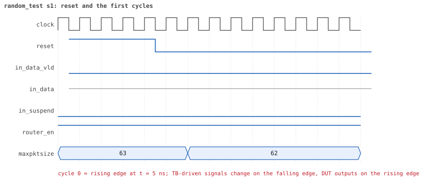
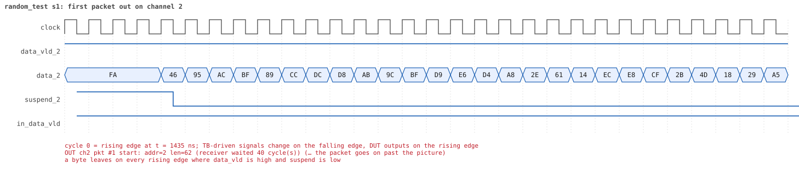
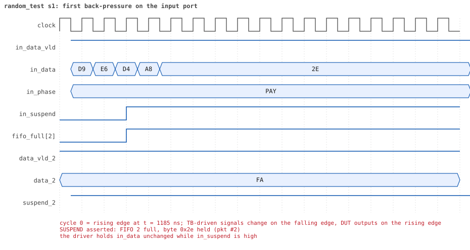
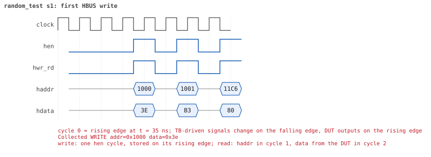
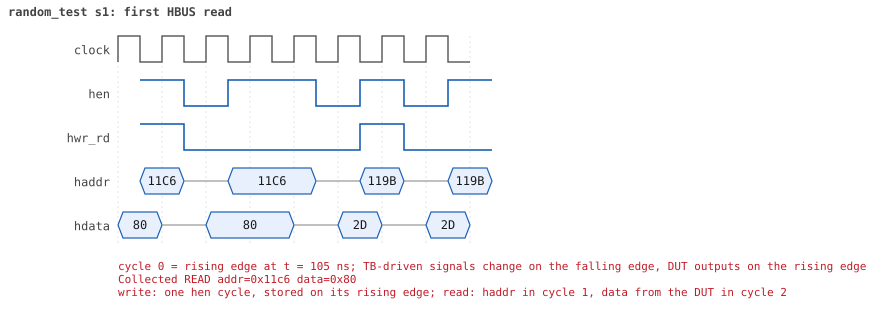

# random_test seed 1

**Result:** PASSED (0 UVM_ERROR, 0 UVM_WARNING, 0 UVM_FATAL) · bench `yapp_project_tb` · sim time 15us · wall 8.6 s · log [`random_test_s1.log`](random_test_s1.log)

Waves: `random_test_s1.fst` (GTKWave, Surfer or the VS Code wave viewer).
[Open the waves in Surfer](https://app.surfer-project.org/?load_url=https%3A%2F%2Fraw.githubusercontent.com%2Ftamirgabgab%2FQcom-Mentoring%2Fmain%2Fyapp_project%2Fregression%2Fyapp_project_tb%2Frandom_test_s1%2Frandom_test_s1.fst&startup_commands=run_command_file_from_url%20https%3A%2F%2Fraw.githubusercontent.com%2Ftamirgabgab%2FQcom-Mentoring%2Fmain%2Fyapp_project%2Ftb%2Fyapp_router.sucl) (web app, the signals already in groups: `yapp_project/tb/yapp_router.sucl`).

## Summary

- YAPP driver sent **22** packet(s) (2 with bad parity); the input monitor saw 22.
- Router: **7** forwarded, **15** dropped (7 oversized, 8 router disabled).
- Packets out: ch0 **2**, ch1 **2**, ch2 **3**.
- Scoreboard: 7 matched, 0 mismatched, 0 unexpected.
- Back-pressure: in_suspend asserted **7** time(s), longest hold 57 cycle(s).
- Error pulses: 1.
- HBUS: 30 write(s), 95 read(s).

## Stages

| time (ns) | stage |
|---|---|
| 0 | receivers: ch0 CHANNEL_RX_PROFILE_SLOW, ch1 CHANNEL_RX_PROFILE_STALLY, ch2 CHANNEL_RX_PROFILE_SLOW |
| 0 | random scenario: 22 packets in 6 bursts |
| 250 | burst 1/6: ctrl=0x3e (maxpktsize 62) en=0xb3 (router on, counter enables 1011001), 4 packet(s) |
| 3430 | burst 1/6 sent: addr0..3 1/0/3/0, bad parity 0, gap 0 1, length 32..63 |
| 3600 | burst 2/6: ctrl=0xc2 (maxpktsize 2) en=0x22 (router OFF, counter enables 0010001), 3 packet(s) |
| 4620 | burst 2/6 sent: addr0..3 0/1/2/0, bad parity 0, gap 0 2, length 8..58 |
| 5020 | burst 3/6: ctrl=0xed (maxpktsize 45) en=0x09 (router on, counter enables 0000100), 3 packet(s) |
| 6930 | burst 3/6 sent: addr0..3 0/2/1/0, bad parity 1, gap 0 2, length 23..44 |
| 7110 | burst 4/6: ctrl=0x3e (maxpktsize 62) en=0x11 (router on, counter enables 0001000), 3 packet(s) |
| 8880 | burst 4/6 sent: addr0..3 1/0/2/0, bad parity 0, gap 0 0, length 9..63 |
| 9280 | burst 5/6: ctrl=0x10 (maxpktsize 16) en=0xf3 (router on, counter enables 1111001), 4 packet(s) |
| 11390 | burst 5/6 sent: addr0..3 0/1/3/0, bad parity 0, gap 0 1, length 18..60 |
| 11540 | burst 6/6: ctrl=0xfe (maxpktsize 62) en=0xfc (router OFF, counter enables 1111110), 5 packet(s) |
| 12520 | burst 6/6 sent: addr0..3 1/2/2/0, bad parity 1, gap 0 1, length 1..31 |
| 12520 | final reads: every register and the stored packet, checked against the reference model |
| 14585 | done: 22 packets (7 forwarded, 15 dropped), 0 storm burst(s), 7 scoreboard matches, 95 HBUS reads checked, 1 error pulses for 1 bad packets |

## Pictures

**reset and the first cycles**

**first packet into the router**

**first packet out on channel 2**

**first back-pressure on the input port**

**first error pulse after a bad-parity packet**

**first HBUS write**

**first HBUS read**

## Timeline

512 events.

| time (ns) | who | event |
|---|---|---|
| 0 | yapp monitor | YAPP monitor running |
| 0 | **test** | STAGE: receivers: ch0 CHANNEL_RX_PROFILE_SLOW, ch1 CHANNEL_RX_PROFILE_STALLY, ch2 CHANNEL_RX_PROFILE_SLOW |
| 0 | **test** | STAGE: random scenario: 22 packets in 6 bursts |
| 0 | clk/rst driver | Starting clock (period 10) and holding reset for 5 cycles |
| 0 | **DUT** | RESET asserted |
| 50 | **DUT** | RESET released: router_en=1 maxpktsize=63 |
| 70 | hbus driver | Executed WRITE addr=0x1000 data=0x3e |
| 75 | **DUT** | CONFIG router_en=1 maxpktsize=62 |
| 75 | hbus monitor | Collected WRITE addr=0x1000 data=0x3e |
| 75 | reference | maxpktsize is now 62 |
| 90 | hbus driver | Executed WRITE addr=0x1001 data=0xb3 |
| 95 | hbus monitor | Collected WRITE addr=0x1001 data=0xb3 |
| 95 | reference | router_en is now 1 (en_reg 0xb3) |
| 110 | hbus driver | Executed WRITE addr=0x11c6 data=0x80 |
| 115 | hbus monitor | Collected WRITE addr=0x11c6 data=0x80 |
| 140 | hbus driver | Executed READ  addr=0x11c6 data=0x80 |
| 145 | hbus monitor | Collected READ  addr=0x11c6 data=0x80 |
| 160 | hbus driver | Executed WRITE addr=0x119b data=0x2d |
| 165 | hbus monitor | Collected WRITE addr=0x119b data=0x2d |
| 190 | hbus driver | Executed READ  addr=0x119b data=0x2d |
| 195 | hbus monitor | Collected READ  addr=0x119b data=0x2d |
| 220 | hbus driver | Executed READ  addr=0x1009 data=0x00 |
| 225 | hbus monitor | Collected READ  addr=0x1009 data=0x00 |
| 250 | hbus driver | Executed READ  addr=0x1001 data=0xb3 |
| 250 | **test** | STAGE: burst 1/6: ctrl=0x3e (maxpktsize 62) en=0xb3 (router on, counter enables 1011001), 4 packet(s) |
| 250 | yapp driver | TX pkt #1: addr=2 len=63 parity=good delay=0 |
| 255 | hbus monitor | Collected READ  addr=0x1001 data=0xb3 |
| 265 | **DUT** | IN  pkt #1 header: addr=2 len=63 -> DROP (oversized: len 63 > maxpktsize 62) |
| 905 | **DUT** | IN  pkt #1 complete: addr=2 len=63 parity=ok dropped, 65 bytes in 65 cycles (held 0) |
| 905 | yapp monitor | RX pkt #1 on the input: addr=2 len=63 parity=good gap=21 |
| 905 | reference | Packet dropped: length 63 > maxpktsize 62 (addr=2) |
| 905 | **DUT** | ROUTER DROPS PACKET addr=2 length=63 (length > maxpktsize) |
| 910 | yapp driver | TX pkt #1 accepted by the DUT |
| 910 | yapp driver | TX pkt #2: addr=2 len=62 parity=good delay=15 |
| 1065 | **DUT** | IN  pkt #2 header: addr=2 len=62 -> channel 2 |
| 1225 | **DUT** | SUSPEND asserted: FIFO 2 full, byte 0x2e held (pkt #2) |
| 1475 | **DUT** | OUT ch2 pkt #1 start: addr=2 len=62 (receiver waited 40 cycle(s)) |
| 1485 | **DUT** | SUSPEND released after 26 cycle(s) |
| 1955 | **DUT** | IN  pkt #2 complete: addr=2 len=62 parity=ok forwarded, 64 bytes in 90 cycles (held 26) |
| 1955 | yapp monitor | RX pkt #2 on the input: addr=2 len=62 parity=good gap=15 |
| 1955 | reference | Packet forwarded: addr=2 len=62 -> channel 2 |
| 1960 | yapp driver | TX pkt #2 accepted by the DUT |
| 1960 | yapp driver | TX pkt #3: addr=0 len=35 parity=good delay=3 |
| 1995 | **DUT** | IN  pkt #3 header: addr=0 len=35 -> channel 0 |
| 2100 | ch2 driver | ch2: packet consumed (response delay 40) |
| 2155 | **DUT** | SUSPEND asserted: FIFO 0 full, byte 0x5f held (pkt #3) |
| 2205 | **DUT** | OUT ch0 pkt #1 start: addr=0 len=35 (receiver waited 20 cycle(s)) |
| 2215 | **DUT** | SUSPEND released after 6 cycle(s) |
| 2415 | **DUT** | IN  pkt #3 complete: addr=0 len=35 parity=ok forwarded, 37 bytes in 43 cycles (held 6) |
| 2415 | yapp monitor | RX pkt #3 on the input: addr=0 len=35 parity=good gap=3 |
| 2415 | reference | Packet forwarded: addr=0 len=35 -> channel 0 |
| 2420 | yapp driver | TX pkt #3 accepted by the DUT |
| 2420 | yapp driver | TX pkt #4: addr=2 len=32 parity=good delay=16 |
| 2435 | **DUT** | OUT ch2 pkt #1 done: 64 bytes in 97 cycles |
| 2435 | ch2 monitor | ch2 RX pkt #1: addr=2 len=62 parity=good |
| 2435 | scoreboard | ch2 pkt matched: addr=2 len=62 (1 matched so far) |
| 2560 | ch0 driver | ch0: packet consumed (response delay 20) |
| 2585 | **DUT** | IN  pkt #4 header: addr=2 len=32 -> channel 2 |
| 2595 | **DUT** | OUT ch2 pkt #2 start: addr=2 len=32 (receiver waited 0 cycle(s)) |
| 2670 | ch2 driver | ch2: packet consumed (response delay 32) |
| 2825 | **DUT** | SUSPEND asserted: FIFO 2 full, byte 0x02 held (pkt #4) |
| 2935 | **DUT** | SUSPEND released after 11 cycle(s) |
| 2975 | **DUT** | OUT ch0 pkt #1 done: 37 bytes in 78 cycles |
| 2975 | ch0 monitor | ch0 RX pkt #1: addr=0 len=35 parity=good |
| 2975 | scoreboard | ch0 pkt matched: addr=0 len=35 (2 matched so far) |
| 2990 | ch2 driver | ch2: packet consumed (response delay 24) |
| 3005 | **DUT** | SUSPEND asserted: FIFO 2 full, byte 0x0c held (pkt #4) |
| 3280 | ch0 driver | ch0: packet consumed (response delay 40) |
| 3405 | **DUT** | SUSPEND released after 40 cycle(s) |
| 3425 | **DUT** | IN  pkt #4 complete: addr=2 len=32 parity=ok forwarded, 34 bytes in 85 cycles (held 51) |
| 3425 | yapp monitor | RX pkt #4 on the input: addr=2 len=32 parity=good gap=16 |
| 3425 | reference | Packet forwarded: addr=2 len=32 -> channel 2 |
| 3430 | yapp driver | TX pkt #4 accepted by the DUT |
| 3430 | **test** | STAGE: burst 1/6 sent: addr0..3 1/0/3/0, bad parity 0, gap 0 1, length 32..63 |
| 3450 | hbus driver | Executed WRITE addr=0x1000 data=0xc2 |
| 3455 | **DUT** | CONFIG router_en=1 maxpktsize=2 |
| 3455 | hbus monitor | Collected WRITE addr=0x1000 data=0xc2 |
| 3455 | reference | maxpktsize is now 2 |
| 3470 | hbus driver | Executed WRITE addr=0x1001 data=0x22 |
| 3475 | **DUT** | CONFIG router_en=0 maxpktsize=2 |
| 3475 | hbus monitor | Collected WRITE addr=0x1001 data=0x22 |
| 3475 | reference | router_en is now 0 (en_reg 0x22) |
| 3490 | hbus driver | Executed WRITE addr=0x11ab data=0xa1 |
| 3495 | hbus monitor | Collected WRITE addr=0x11ab data=0xa1 |
| 3520 | hbus driver | Executed READ  addr=0x11ab data=0xa1 |
| 3525 | hbus monitor | Collected READ  addr=0x11ab data=0xa1 |
| 3550 | hbus driver | Executed READ  addr=0x1000 data=0xc2 |
| 3555 | hbus monitor | Collected READ  addr=0x1000 data=0xc2 |
| 3570 | hbus driver | Executed WRITE addr=0x1117 data=0xf8 |
| 3575 | **DUT** | OUT ch2 pkt #2 done: 34 bytes in 99 cycles |
| 3575 | ch2 monitor | ch2 RX pkt #2: addr=2 len=32 parity=good |
| 3575 | scoreboard | ch2 pkt matched: addr=2 len=32 (3 matched so far) |
| 3575 | hbus monitor | Collected WRITE addr=0x1117 data=0xf8 |
| 3600 | hbus driver | Executed READ  addr=0x1117 data=0xf8 |
| 3600 | **test** | STAGE: burst 2/6: ctrl=0xc2 (maxpktsize 2) en=0x22 (router OFF, counter enables 0010001), 3 packet(s) |
| 3600 | yapp driver | TX pkt #5: addr=2 len=28 parity=good delay=0 |
| 3605 | hbus monitor | Collected READ  addr=0x1117 data=0xf8 |
| 3615 | **DUT** | IN  pkt #5 header: addr=2 len=28 -> DROP (router disabled) |
| 3905 | **DUT** | IN  pkt #5 complete: addr=2 len=28 parity=ok dropped, 30 bytes in 30 cycles (held 0) |
| 3905 | yapp monitor | RX pkt #5 on the input: addr=2 len=28 parity=good gap=18 |
| 3905 | reference | Packet dropped: router disabled (addr=2 len=28) |
| 3905 | **DUT** | ROUTER DROPS PACKET addr=2 length=28 (router disabled) |
| 3910 | yapp driver | TX pkt #5 accepted by the DUT |
| 3910 | yapp driver | TX pkt #6: addr=1 len=58 parity=good delay=0 |
| 3915 | **DUT** | IN  pkt #6 header: addr=1 len=58 -> DROP (router disabled) |
| 3960 | ch2 driver | ch2: packet consumed (response delay 39) |
| 4505 | **DUT** | IN  pkt #6 complete: addr=1 len=58 parity=ok dropped, 60 bytes in 60 cycles (held 0) |
| 4505 | yapp monitor | RX pkt #6 on the input: addr=1 len=58 parity=good gap=0 |
| 4505 | reference | Packet dropped: router disabled (addr=1 len=58) |
| 4505 | **DUT** | ROUTER DROPS PACKET addr=1 length=58 (router disabled) |
| 4510 | yapp driver | TX pkt #6 accepted by the DUT |
| 4510 | yapp driver | TX pkt #7: addr=2 len=8 parity=good delay=1 |
| 4525 | **DUT** | IN  pkt #7 header: addr=2 len=8 -> DROP (router disabled) |
| 4615 | **DUT** | IN  pkt #7 complete: addr=2 len=8 parity=ok dropped, 10 bytes in 10 cycles (held 0) |
| 4615 | yapp monitor | RX pkt #7 on the input: addr=2 len=8 parity=good gap=1 |
| 4615 | reference | Packet dropped: router disabled (addr=2 len=8) |
| 4615 | **DUT** | ROUTER DROPS PACKET addr=2 length=8 (router disabled) |
| 4620 | yapp driver | TX pkt #7 accepted by the DUT |
| 4620 | **test** | STAGE: burst 2/6 sent: addr0..3 0/1/2/0, bad parity 0, gap 0 2, length 8..58 |
| 4640 | hbus driver | Executed WRITE addr=0x1000 data=0xed |
| 4645 | **DUT** | CONFIG router_en=0 maxpktsize=45 |
| 4645 | hbus monitor | Collected WRITE addr=0x1000 data=0xed |
| 4645 | reference | maxpktsize is now 45 |
| 4660 | hbus driver | Executed WRITE addr=0x1001 data=0x09 |
| 4665 | **DUT** | CONFIG router_en=1 maxpktsize=45 |
| 4665 | hbus monitor | Collected WRITE addr=0x1001 data=0x09 |
| 4665 | reference | router_en is now 1 (en_reg 0x09) |
| 4680 | hbus driver | Executed WRITE addr=0x114a data=0xf1 |
| 4685 | hbus monitor | Collected WRITE addr=0x114a data=0xf1 |
| 4710 | hbus driver | Executed READ  addr=0x114a data=0xf1 |
| 4715 | hbus monitor | Collected READ  addr=0x114a data=0xf1 |
| 4730 | hbus driver | Executed WRITE addr=0x1111 data=0xe7 |
| 4735 | hbus monitor | Collected WRITE addr=0x1111 data=0xe7 |
| 4760 | hbus driver | Executed READ  addr=0x1111 data=0xe7 |
| 4765 | hbus monitor | Collected READ  addr=0x1111 data=0xe7 |
| 4780 | hbus driver | Executed WRITE addr=0x1196 data=0xdd |
| 4785 | hbus monitor | Collected WRITE addr=0x1196 data=0xdd |
| 4810 | hbus driver | Executed READ  addr=0x1196 data=0xdd |
| 4815 | hbus monitor | Collected READ  addr=0x1196 data=0xdd |
| 4840 | hbus driver | Executed READ  addr=0x1008 data=0x00 |
| 4845 | hbus monitor | Collected READ  addr=0x1008 data=0x00 |
| 4860 | hbus driver | Executed WRITE addr=0x116b data=0xce |
| 4865 | hbus monitor | Collected WRITE addr=0x116b data=0xce |
| 4890 | hbus driver | Executed READ  addr=0x116b data=0xce |
| 4895 | hbus monitor | Collected READ  addr=0x116b data=0xce |
| 4910 | hbus driver | Executed WRITE addr=0x1126 data=0xbd |
| 4915 | hbus monitor | Collected WRITE addr=0x1126 data=0xbd |
| 4940 | hbus driver | Executed READ  addr=0x1126 data=0xbd |
| 4945 | hbus monitor | Collected READ  addr=0x1126 data=0xbd |
| 4970 | hbus driver | Executed READ  addr=0x1006 data=0x00 |
| 4975 | hbus monitor | Collected READ  addr=0x1006 data=0x00 |
| 4990 | hbus driver | Executed WRITE addr=0x116b data=0x06 |
| 4995 | hbus monitor | Collected WRITE addr=0x116b data=0x06 |
| 5020 | hbus driver | Executed READ  addr=0x116b data=0x06 |
| 5020 | **test** | STAGE: burst 3/6: ctrl=0xed (maxpktsize 45) en=0x09 (router on, counter enables 0000100), 3 packet(s) |
| 5020 | yapp driver | TX pkt #8: addr=2 len=44 parity=good delay=1 |
| 5025 | hbus monitor | Collected READ  addr=0x116b data=0x06 |
| 5045 | **DUT** | IN  pkt #8 header: addr=2 len=44 -> channel 2 |
| 5205 | **DUT** | SUSPEND asserted: FIFO 2 full, byte 0xbb held (pkt #8) |
| 5385 | **DUT** | OUT ch2 pkt #3 start: addr=2 len=44 (receiver waited 33 cycle(s)) |
| 5395 | **DUT** | SUSPEND released after 19 cycle(s) |
| 5685 | **DUT** | IN  pkt #8 complete: addr=2 len=44 parity=ok forwarded, 46 bytes in 65 cycles (held 19) |
| 5685 | yapp monitor | RX pkt #8 on the input: addr=2 len=44 parity=good gap=42 |
| 5685 | reference | Packet forwarded: addr=2 len=44 -> channel 2 |
| 5690 | yapp driver | TX pkt #8 accepted by the DUT |
| 5690 | yapp driver | TX pkt #9: addr=1 len=29 parity=good delay=0 |
| 5695 | **DUT** | IN  pkt #9 header: addr=1 len=29 -> channel 1 |
| 5830 | ch2 driver | ch2: packet consumed (response delay 33) |
| 5855 | **DUT** | SUSPEND asserted: FIFO 1 full, byte 0x3c held (pkt #9) |
| 6245 | **DUT** | OUT ch2 pkt #3 done: 46 bytes in 87 cycles |
| 6245 | ch2 monitor | ch2 RX pkt #3: addr=2 len=44 parity=good |
| 6245 | scoreboard | ch2 pkt matched: addr=2 len=44 (4 matched so far) |
| 6415 | **DUT** | OUT ch1 pkt #1 start: addr=1 len=29 (receiver waited 71 cycle(s)) |
| 6425 | **DUT** | SUSPEND released after 57 cycle(s) |
| 6565 | **DUT** | IN  pkt #9 complete: addr=1 len=29 parity=ok forwarded, 31 bytes in 88 cycles (held 57) |
| 6565 | yapp monitor | RX pkt #9 on the input: addr=1 len=29 parity=good gap=0 |
| 6565 | reference | Packet forwarded: addr=1 len=29 -> channel 1 |
| 6570 | yapp driver | TX pkt #9 accepted by the DUT |
| 6570 | yapp driver | TX pkt #10: addr=1 len=23 parity=bad delay=0 |
| 6575 | **DUT** | IN  pkt #10 header: addr=1 len=23 -> channel 1 |
| 6660 | ch2 driver | ch2: packet consumed (response delay 40) |
| 6710 | ch1 driver | ch1: packet consumed (response delay 71) |
| 6725 | **DUT** | SUSPEND asserted: FIFO 1 full, byte 0x0a held (pkt #10) |
| 6825 | **DUT** | OUT ch1 pkt #1 done: 31 bytes in 42 cycles |
| 6825 | ch1 monitor | ch1 RX pkt #1: addr=1 len=29 parity=good |
| 6825 | scoreboard | ch1 pkt matched: addr=1 len=29 (5 matched so far) |
| 6835 | **DUT** | SUSPEND released after 11 cycle(s) |
| 6835 | **DUT** | OUT ch1 pkt #2 start: addr=1 len=23 (receiver waited 0 cycle(s)) |
| 6925 | **DUT** | IN  pkt #10 complete: addr=1 len=23 parity=BAD forwarded, 25 bytes in 36 cycles (held 11) |
| 6925 | yapp monitor | RX pkt #10 on the input: addr=1 len=23 parity=bad gap=0 |
| 6925 | reference | Packet forwarded: addr=1 len=23 -> channel 1 |
| 6930 | yapp driver | TX pkt #10 accepted by the DUT |
| 6930 | **test** | STAGE: burst 3/6 sent: addr0..3 0/2/1/0, bad parity 1, gap 0 2, length 23..44 |
| 6950 | hbus driver | Executed WRITE addr=0x1000 data=0x3e |
| 6955 | **DUT** | CONFIG router_en=1 maxpktsize=62 |
| 6955 | hbus monitor | Collected WRITE addr=0x1000 data=0x3e |
| 6955 | reference | maxpktsize is now 62 |
| 6970 | hbus driver | Executed WRITE addr=0x1001 data=0x11 |
| 6975 | hbus monitor | Collected WRITE addr=0x1001 data=0x11 |
| 6975 | reference | router_en is now 1 (en_reg 0x11) |
| 6990 | **DUT** | ERROR pulse, 6 cycle(s) after the bad-parity packet |
| 6990 | error checker | error pulse 6 cycles after the bad packet (0 still owed) |
| 7000 | hbus driver | Executed READ  addr=0x101f data=0x0a |
| 7005 | hbus monitor | Collected READ  addr=0x101f data=0x0a |
| 7030 | hbus driver | Executed READ  addr=0x100c data=0x00 |
| 7035 | hbus monitor | Collected READ  addr=0x100c data=0x00 |
| 7060 | hbus driver | Executed READ  addr=0x1084 data=0x00 |
| 7065 | hbus monitor | Collected READ  addr=0x1084 data=0x00 |
| 7075 | **DUT** | OUT ch1 pkt #2 done: 25 bytes in 25 cycles |
| 7075 | ch1 monitor | ch1 RX pkt #2: addr=1 len=23 parity=bad |
| 7075 | scoreboard | ch1 pkt matched: addr=1 len=23 (6 matched so far) |
| 7080 | hbus driver | Executed WRITE addr=0x1180 data=0x6b |
| 7085 | hbus monitor | Collected WRITE addr=0x1180 data=0x6b |
| 7110 | hbus driver | Executed READ  addr=0x1180 data=0x6b |
| 7110 | **test** | STAGE: burst 4/6: ctrl=0x3e (maxpktsize 62) en=0x11 (router on, counter enables 0001000), 3 packet(s) |
| 7110 | yapp driver | TX pkt #11: addr=0 len=9 parity=good delay=2 |
| 7115 | hbus monitor | Collected READ  addr=0x1180 data=0x6b |
| 7145 | **DUT** | IN  pkt #11 header: addr=0 len=9 -> channel 0 |
| 7245 | **DUT** | IN  pkt #11 complete: addr=0 len=9 parity=ok forwarded, 11 bytes in 11 cycles (held 0) |
| 7245 | yapp monitor | RX pkt #11 on the input: addr=0 len=9 parity=good gap=21 |
| 7245 | reference | Packet forwarded: addr=0 len=9 -> channel 0 |
| 7250 | yapp driver | TX pkt #11 accepted by the DUT |
| 7250 | yapp driver | TX pkt #12: addr=2 len=63 parity=good delay=15 |
| 7355 | **DUT** | OUT ch0 pkt #2 start: addr=0 len=9 (receiver waited 20 cycle(s)) |
| 7400 | ch1 driver | ch1: packet consumed (response delay 10) |
| 7405 | **DUT** | IN  pkt #12 header: addr=2 len=63 -> DROP (oversized: len 63 > maxpktsize 62) |
| 7450 | ch0 driver | ch0: packet consumed (response delay 20) |
| 7855 | **DUT** | OUT ch0 pkt #2 done: 11 bytes in 51 cycles |
| 7855 | ch0 monitor | ch0 RX pkt #2: addr=0 len=9 parity=good |
| 7855 | scoreboard | ch0 pkt matched: addr=0 len=9 (7 matched so far) |
| 8045 | **DUT** | IN  pkt #12 complete: addr=2 len=63 parity=ok dropped, 65 bytes in 65 cycles (held 0) |
| 8045 | yapp monitor | RX pkt #12 on the input: addr=2 len=63 parity=good gap=15 |
| 8045 | reference | Packet dropped: length 63 > maxpktsize 62 (addr=2) |
| 8045 | **DUT** | ROUTER DROPS PACKET addr=2 length=63 (length > maxpktsize) |
| 8050 | yapp driver | TX pkt #12 accepted by the DUT |
| 8050 | yapp driver | TX pkt #13: addr=2 len=63 parity=good delay=18 |
| 8235 | **DUT** | IN  pkt #13 header: addr=2 len=63 -> DROP (oversized: len 63 > maxpktsize 62) |
| 8320 | ch0 driver | ch0: packet consumed (response delay 39) |
| 8875 | **DUT** | IN  pkt #13 complete: addr=2 len=63 parity=ok dropped, 65 bytes in 65 cycles (held 0) |
| 8875 | yapp monitor | RX pkt #13 on the input: addr=2 len=63 parity=good gap=18 |
| 8875 | reference | Packet dropped: length 63 > maxpktsize 62 (addr=2) |
| 8875 | **DUT** | ROUTER DROPS PACKET addr=2 length=63 (length > maxpktsize) |
| 8880 | yapp driver | TX pkt #13 accepted by the DUT |
| 8880 | **test** | STAGE: burst 4/6 sent: addr0..3 1/0/2/0, bad parity 0, gap 0 0, length 9..63 |
| 8900 | hbus driver | Executed WRITE addr=0x1000 data=0x10 |
| 8905 | **DUT** | CONFIG router_en=1 maxpktsize=16 |
| 8905 | hbus monitor | Collected WRITE addr=0x1000 data=0x10 |
| 8905 | reference | maxpktsize is now 16 |
| 8920 | hbus driver | Executed WRITE addr=0x1001 data=0xf3 |
| 8925 | hbus monitor | Collected WRITE addr=0x1001 data=0xf3 |
| 8925 | reference | router_en is now 1 (en_reg 0xf3) |
| 8940 | hbus driver | Executed WRITE addr=0x116e data=0xb8 |
| 8945 | hbus monitor | Collected WRITE addr=0x116e data=0xb8 |
| 8970 | hbus driver | Executed READ  addr=0x116e data=0xb8 |
| 8975 | hbus monitor | Collected READ  addr=0x116e data=0xb8 |
| 8990 | hbus driver | Executed WRITE addr=0x1100 data=0x38 |
| 8995 | hbus monitor | Collected WRITE addr=0x1100 data=0x38 |
| 9020 | hbus driver | Executed READ  addr=0x1100 data=0x38 |
| 9025 | hbus monitor | Collected READ  addr=0x1100 data=0x38 |
| 9040 | hbus driver | Executed WRITE addr=0x11e2 data=0x17 |
| 9045 | hbus monitor | Collected WRITE addr=0x11e2 data=0x17 |
| 9070 | hbus driver | Executed READ  addr=0x11e2 data=0x17 |
| 9075 | hbus monitor | Collected READ  addr=0x11e2 data=0x17 |
| 9100 | hbus driver | Executed READ  addr=0x100d data=0x3f |
| 9105 | hbus monitor | Collected READ  addr=0x100d data=0x3f |
| 9120 | hbus driver | Executed WRITE addr=0x11a5 data=0x41 |
| 9125 | hbus monitor | Collected WRITE addr=0x11a5 data=0x41 |
| 9150 | hbus driver | Executed READ  addr=0x11a5 data=0x41 |
| 9155 | hbus monitor | Collected READ  addr=0x11a5 data=0x41 |
| 9180 | hbus driver | Executed READ  addr=0x100d data=0x3f |
| 9185 | hbus monitor | Collected READ  addr=0x100d data=0x3f |
| 9200 | hbus driver | Executed WRITE addr=0x1100 data=0x31 |
| 9205 | hbus monitor | Collected WRITE addr=0x1100 data=0x31 |
| 9230 | hbus driver | Executed READ  addr=0x1100 data=0x31 |
| 9235 | hbus monitor | Collected READ  addr=0x1100 data=0x31 |
| 9250 | hbus driver | Executed WRITE addr=0x11e8 data=0x91 |
| 9255 | hbus monitor | Collected WRITE addr=0x11e8 data=0x91 |
| 9280 | hbus driver | Executed READ  addr=0x11e8 data=0x91 |
| 9280 | **test** | STAGE: burst 5/6: ctrl=0x10 (maxpktsize 16) en=0xf3 (router on, counter enables 1111001), 4 packet(s) |
| 9280 | yapp driver | TX pkt #14: addr=2 len=60 parity=good delay=1 |
| 9285 | hbus monitor | Collected READ  addr=0x11e8 data=0x91 |
| 9305 | **DUT** | IN  pkt #14 header: addr=2 len=60 -> DROP (oversized: len 60 > maxpktsize 16) |
| 9915 | **DUT** | IN  pkt #14 complete: addr=2 len=60 parity=ok dropped, 62 bytes in 62 cycles (held 0) |
| 9915 | yapp monitor | RX pkt #14 on the input: addr=2 len=60 parity=good gap=42 |
| 9915 | reference | Packet dropped: length 60 > maxpktsize 16 (addr=2) |
| 9915 | **DUT** | ROUTER DROPS PACKET addr=2 length=60 (length > maxpktsize) |
| 9920 | yapp driver | TX pkt #14 accepted by the DUT |
| 9920 | yapp driver | TX pkt #15: addr=2 len=40 parity=good delay=20 |
| 10125 | **DUT** | IN  pkt #15 header: addr=2 len=40 -> DROP (oversized: len 40 > maxpktsize 16) |
| 10535 | **DUT** | IN  pkt #15 complete: addr=2 len=40 parity=ok dropped, 42 bytes in 42 cycles (held 0) |
| 10535 | yapp monitor | RX pkt #15 on the input: addr=2 len=40 parity=good gap=20 |
| 10535 | reference | Packet dropped: length 40 > maxpktsize 16 (addr=2) |
| 10535 | **DUT** | ROUTER DROPS PACKET addr=2 length=40 (length > maxpktsize) |
| 10540 | yapp driver | TX pkt #15 accepted by the DUT |
| 10540 | yapp driver | TX pkt #16: addr=1 len=18 parity=good delay=8 |
| 10625 | **DUT** | IN  pkt #16 header: addr=1 len=18 -> DROP (oversized: len 18 > maxpktsize 16) |
| 10815 | **DUT** | IN  pkt #16 complete: addr=1 len=18 parity=ok dropped, 20 bytes in 20 cycles (held 0) |
| 10815 | yapp monitor | RX pkt #16 on the input: addr=1 len=18 parity=good gap=8 |
| 10815 | reference | Packet dropped: length 18 > maxpktsize 16 (addr=1) |
| 10815 | **DUT** | ROUTER DROPS PACKET addr=1 length=18 (length > maxpktsize) |
| 10820 | yapp driver | TX pkt #16 accepted by the DUT |
| 10820 | yapp driver | TX pkt #17: addr=2 len=55 parity=good delay=0 |
| 10825 | **DUT** | IN  pkt #17 header: addr=2 len=55 -> DROP (oversized: len 55 > maxpktsize 16) |
| 11385 | **DUT** | IN  pkt #17 complete: addr=2 len=55 parity=ok dropped, 57 bytes in 57 cycles (held 0) |
| 11385 | yapp monitor | RX pkt #17 on the input: addr=2 len=55 parity=good gap=0 |
| 11385 | reference | Packet dropped: length 55 > maxpktsize 16 (addr=2) |
| 11385 | **DUT** | ROUTER DROPS PACKET addr=2 length=55 (length > maxpktsize) |
| 11390 | yapp driver | TX pkt #17 accepted by the DUT |
| 11390 | **test** | STAGE: burst 5/6 sent: addr0..3 0/1/3/0, bad parity 0, gap 0 1, length 18..60 |
| 11410 | hbus driver | Executed WRITE addr=0x1000 data=0xfe |
| 11415 | **DUT** | CONFIG router_en=1 maxpktsize=62 |
| 11415 | hbus monitor | Collected WRITE addr=0x1000 data=0xfe |
| 11415 | reference | maxpktsize is now 62 |
| 11430 | hbus driver | Executed WRITE addr=0x1001 data=0xfc |
| 11435 | **DUT** | CONFIG router_en=0 maxpktsize=62 |
| 11435 | hbus monitor | Collected WRITE addr=0x1001 data=0xfc |
| 11435 | reference | router_en is now 0 (en_reg 0xfc) |
| 11460 | hbus driver | Executed READ  addr=0x10e4 data=0x00 |
| 11465 | hbus monitor | Collected READ  addr=0x10e4 data=0x00 |
| 11480 | hbus driver | Executed WRITE addr=0x11c0 data=0x98 |
| 11485 | hbus monitor | Collected WRITE addr=0x11c0 data=0x98 |
| 11510 | hbus driver | Executed READ  addr=0x11c0 data=0x98 |
| 11515 | hbus monitor | Collected READ  addr=0x11c0 data=0x98 |
| 11540 | hbus driver | Executed READ  addr=0x1006 data=0x00 |
| 11540 | **test** | STAGE: burst 6/6: ctrl=0xfe (maxpktsize 62) en=0xfc (router OFF, counter enables 1111110), 5 packet(s) |
| 11540 | yapp driver | TX pkt #18: addr=1 len=25 parity=good delay=5 |
| 11545 | hbus monitor | Collected READ  addr=0x1006 data=0x00 |
| 11605 | **DUT** | IN  pkt #18 header: addr=1 len=25 -> DROP (router disabled) |
| 11865 | **DUT** | IN  pkt #18 complete: addr=1 len=25 parity=ok dropped, 27 bytes in 27 cycles (held 0) |
| 11865 | yapp monitor | RX pkt #18 on the input: addr=1 len=25 parity=good gap=21 |
| 11865 | reference | Packet dropped: router disabled (addr=1 len=25) |
| 11865 | **DUT** | ROUTER DROPS PACKET addr=1 length=25 (router disabled) |
| 11870 | yapp driver | TX pkt #18 accepted by the DUT |
| 11870 | yapp driver | TX pkt #19: addr=2 len=9 parity=good delay=0 |
| 11875 | **DUT** | IN  pkt #19 header: addr=2 len=9 -> DROP (router disabled) |
| 11975 | **DUT** | IN  pkt #19 complete: addr=2 len=9 parity=ok dropped, 11 bytes in 11 cycles (held 0) |
| 11975 | yapp monitor | RX pkt #19 on the input: addr=2 len=9 parity=good gap=0 |
| 11975 | reference | Packet dropped: router disabled (addr=2 len=9) |
| 11975 | **DUT** | ROUTER DROPS PACKET addr=2 length=9 (router disabled) |
| 11980 | yapp driver | TX pkt #19 accepted by the DUT |
| 11980 | yapp driver | TX pkt #20: addr=2 len=31 parity=good delay=2 |
| 12005 | **DUT** | IN  pkt #20 header: addr=2 len=31 -> DROP (router disabled) |
| 12325 | **DUT** | IN  pkt #20 complete: addr=2 len=31 parity=ok dropped, 33 bytes in 33 cycles (held 0) |
| 12325 | yapp monitor | RX pkt #20 on the input: addr=2 len=31 parity=good gap=2 |
| 12325 | reference | Packet dropped: router disabled (addr=2 len=31) |
| 12325 | **DUT** | ROUTER DROPS PACKET addr=2 length=31 (router disabled) |
| 12330 | yapp driver | TX pkt #20 accepted by the DUT |
| 12330 | yapp driver | TX pkt #21: addr=0 len=1 parity=bad delay=7 |
| 12405 | **DUT** | IN  pkt #21 header: addr=0 len=1 -> DROP (router disabled) |
| 12425 | **DUT** | IN  pkt #21 complete: addr=0 len=1 parity=BAD dropped, 3 bytes in 3 cycles (held 0) |
| 12425 | yapp monitor | RX pkt #21 on the input: addr=0 len=1 parity=bad gap=7 |
| 12425 | reference | Packet dropped: router disabled (addr=0 len=1) |
| 12425 | **DUT** | ROUTER DROPS PACKET addr=0 length=1 (router disabled) |
| 12430 | yapp driver | TX pkt #21 accepted by the DUT |
| 12430 | yapp driver | TX pkt #22: addr=1 len=4 parity=good delay=3 |
| 12465 | **DUT** | IN  pkt #22 header: addr=1 len=4 -> DROP (router disabled) |
| 12515 | **DUT** | IN  pkt #22 complete: addr=1 len=4 parity=ok dropped, 6 bytes in 6 cycles (held 0) |
| 12515 | yapp monitor | RX pkt #22 on the input: addr=1 len=4 parity=good gap=3 |
| 12515 | reference | Packet dropped: router disabled (addr=1 len=4) |
| 12515 | **DUT** | ROUTER DROPS PACKET addr=1 length=4 (router disabled) |
| 12520 | yapp driver | TX pkt #22 accepted by the DUT |
| 12520 | **test** | STAGE: burst 6/6 sent: addr0..3 1/2/2/0, bad parity 1, gap 0 1, length 1..31 |
| 12520 | **test** | STAGE: final reads: every register and the stored packet, checked against the reference model |
| 12550 | hbus driver | Executed READ  addr=0x1000 data=0xfe |
| 12555 | hbus monitor | Collected READ  addr=0x1000 data=0xfe |
| 12580 | hbus driver | Executed READ  addr=0x1001 data=0xfc |
| 12585 | hbus monitor | Collected READ  addr=0x1001 data=0xfc |
| 12610 | hbus driver | Executed READ  addr=0x1004 data=0x00 |
| 12615 | hbus monitor | Collected READ  addr=0x1004 data=0x00 |
| 12640 | hbus driver | Executed READ  addr=0x1005 data=0x00 |
| 12645 | hbus monitor | Collected READ  addr=0x1005 data=0x00 |
| 12670 | hbus driver | Executed READ  addr=0x1006 data=0x00 |
| 12675 | hbus monitor | Collected READ  addr=0x1006 data=0x00 |
| 12700 | hbus driver | Executed READ  addr=0x1009 data=0x02 |
| 12705 | hbus monitor | Collected READ  addr=0x1009 data=0x02 |
| 12730 | hbus driver | Executed READ  addr=0x100a data=0x01 |
| 12735 | hbus monitor | Collected READ  addr=0x100a data=0x01 |
| 12760 | hbus driver | Executed READ  addr=0x100b data=0x03 |
| 12765 | hbus monitor | Collected READ  addr=0x100b data=0x03 |
| 12790 | hbus driver | Executed READ  addr=0x100d data=0x37 |
| 12795 | hbus monitor | Collected READ  addr=0x100d data=0x37 |
| 12820 | hbus driver | Executed READ  addr=0x1010 data=0xde |
| 12825 | hbus monitor | Collected READ  addr=0x1010 data=0xde |
| 12850 | hbus driver | Executed READ  addr=0x1011 data=0xe3 |
| 12855 | hbus monitor | Collected READ  addr=0x1011 data=0xe3 |
| 12880 | hbus driver | Executed READ  addr=0x1012 data=0xf8 |
| 12885 | hbus monitor | Collected READ  addr=0x1012 data=0xf8 |
| 12910 | hbus driver | Executed READ  addr=0x1013 data=0xd6 |
| 12915 | hbus monitor | Collected READ  addr=0x1013 data=0xd6 |
| 12940 | hbus driver | Executed READ  addr=0x1014 data=0x30 |
| 12945 | hbus monitor | Collected READ  addr=0x1014 data=0x30 |
| 12970 | hbus driver | Executed READ  addr=0x1015 data=0xd9 |
| 12975 | hbus monitor | Collected READ  addr=0x1015 data=0xd9 |
| 13000 | hbus driver | Executed READ  addr=0x1016 data=0xe4 |
| 13005 | hbus monitor | Collected READ  addr=0x1016 data=0xe4 |
| 13030 | hbus driver | Executed READ  addr=0x1017 data=0xa0 |
| 13035 | hbus monitor | Collected READ  addr=0x1017 data=0xa0 |
| 13060 | hbus driver | Executed READ  addr=0x1018 data=0x73 |
| 13065 | hbus monitor | Collected READ  addr=0x1018 data=0x73 |
| 13090 | hbus driver | Executed READ  addr=0x1019 data=0xa6 |
| 13095 | hbus monitor | Collected READ  addr=0x1019 data=0xa6 |
| 13120 | hbus driver | Executed READ  addr=0x101a data=0x9b |
| 13125 | hbus monitor | Collected READ  addr=0x101a data=0x9b |
| 13150 | hbus driver | Executed READ  addr=0x101b data=0xfe |
| 13155 | hbus monitor | Collected READ  addr=0x101b data=0xfe |
| 13180 | hbus driver | Executed READ  addr=0x101c data=0xc5 |
| 13185 | hbus monitor | Collected READ  addr=0x101c data=0xc5 |
| 13210 | hbus driver | Executed READ  addr=0x101d data=0x28 |
| 13215 | hbus monitor | Collected READ  addr=0x101d data=0x28 |
| 13240 | hbus driver | Executed READ  addr=0x101e data=0x0c |
| 13245 | hbus monitor | Collected READ  addr=0x101e data=0x0c |
| 13270 | hbus driver | Executed READ  addr=0x101f data=0xbd |
| 13275 | hbus monitor | Collected READ  addr=0x101f data=0xbd |
| 13300 | hbus driver | Executed READ  addr=0x1020 data=0x97 |
| 13305 | hbus monitor | Collected READ  addr=0x1020 data=0x97 |
| 13330 | hbus driver | Executed READ  addr=0x1021 data=0x78 |
| 13335 | hbus monitor | Collected READ  addr=0x1021 data=0x78 |
| 13360 | hbus driver | Executed READ  addr=0x1022 data=0x5c |
| 13365 | hbus monitor | Collected READ  addr=0x1022 data=0x5c |
| 13390 | hbus driver | Executed READ  addr=0x1023 data=0x2f |
| 13395 | hbus monitor | Collected READ  addr=0x1023 data=0x2f |
| 13420 | hbus driver | Executed READ  addr=0x1024 data=0xa3 |
| 13425 | hbus monitor | Collected READ  addr=0x1024 data=0xa3 |
| 13450 | hbus driver | Executed READ  addr=0x1025 data=0x97 |
| 13455 | hbus monitor | Collected READ  addr=0x1025 data=0x97 |
| 13480 | hbus driver | Executed READ  addr=0x1026 data=0x77 |
| 13485 | hbus monitor | Collected READ  addr=0x1026 data=0x77 |
| 13510 | hbus driver | Executed READ  addr=0x1027 data=0x75 |
| 13515 | hbus monitor | Collected READ  addr=0x1027 data=0x75 |
| 13540 | hbus driver | Executed READ  addr=0x1028 data=0x03 |
| 13545 | hbus monitor | Collected READ  addr=0x1028 data=0x03 |
| 13570 | hbus driver | Executed READ  addr=0x1029 data=0x40 |
| 13575 | hbus monitor | Collected READ  addr=0x1029 data=0x40 |
| 13600 | hbus driver | Executed READ  addr=0x102a data=0xf5 |
| 13605 | hbus monitor | Collected READ  addr=0x102a data=0xf5 |
| 13630 | hbus driver | Executed READ  addr=0x102b data=0x14 |
| 13635 | hbus monitor | Collected READ  addr=0x102b data=0x14 |
| 13660 | hbus driver | Executed READ  addr=0x102c data=0xf5 |
| 13665 | hbus monitor | Collected READ  addr=0x102c data=0xf5 |
| 13690 | hbus driver | Executed READ  addr=0x102d data=0x2b |
| 13695 | hbus monitor | Collected READ  addr=0x102d data=0x2b |
| 13720 | hbus driver | Executed READ  addr=0x102e data=0x96 |
| 13725 | hbus monitor | Collected READ  addr=0x102e data=0x96 |
| 13750 | hbus driver | Executed READ  addr=0x102f data=0x7a |
| 13755 | hbus monitor | Collected READ  addr=0x102f data=0x7a |
| 13780 | hbus driver | Executed READ  addr=0x1030 data=0xd3 |
| 13785 | hbus monitor | Collected READ  addr=0x1030 data=0xd3 |
| 13810 | hbus driver | Executed READ  addr=0x1031 data=0xba |
| 13815 | hbus monitor | Collected READ  addr=0x1031 data=0xba |
| 13840 | hbus driver | Executed READ  addr=0x1032 data=0x9f |
| 13845 | hbus monitor | Collected READ  addr=0x1032 data=0x9f |
| 13870 | hbus driver | Executed READ  addr=0x1033 data=0xae |
| 13875 | hbus monitor | Collected READ  addr=0x1033 data=0xae |
| 13900 | hbus driver | Executed READ  addr=0x1034 data=0x49 |
| 13905 | hbus monitor | Collected READ  addr=0x1034 data=0x49 |
| 13930 | hbus driver | Executed READ  addr=0x1035 data=0xce |
| 13935 | hbus monitor | Collected READ  addr=0x1035 data=0xce |
| 13960 | hbus driver | Executed READ  addr=0x1036 data=0x36 |
| 13965 | hbus monitor | Collected READ  addr=0x1036 data=0x36 |
| 13990 | hbus driver | Executed READ  addr=0x1037 data=0xce |
| 13995 | hbus monitor | Collected READ  addr=0x1037 data=0xce |
| 14020 | hbus driver | Executed READ  addr=0x1038 data=0x39 |
| 14025 | hbus monitor | Collected READ  addr=0x1038 data=0x39 |
| 14050 | hbus driver | Executed READ  addr=0x1039 data=0xe0 |
| 14055 | hbus monitor | Collected READ  addr=0x1039 data=0xe0 |
| 14080 | hbus driver | Executed READ  addr=0x103a data=0x23 |
| 14085 | hbus monitor | Collected READ  addr=0x103a data=0x23 |
| 14110 | hbus driver | Executed READ  addr=0x103b data=0x25 |
| 14115 | hbus monitor | Collected READ  addr=0x103b data=0x25 |
| 14140 | hbus driver | Executed READ  addr=0x103c data=0x47 |
| 14145 | hbus monitor | Collected READ  addr=0x103c data=0x47 |
| 14170 | hbus driver | Executed READ  addr=0x103d data=0x8a |
| 14175 | hbus monitor | Collected READ  addr=0x103d data=0x8a |
| 14200 | hbus driver | Executed READ  addr=0x103e data=0xb0 |
| 14205 | hbus monitor | Collected READ  addr=0x103e data=0xb0 |
| 14230 | hbus driver | Executed READ  addr=0x103f data=0xef |
| 14235 | hbus monitor | Collected READ  addr=0x103f data=0xef |
| 14260 | hbus driver | Executed READ  addr=0x1040 data=0xdf |
| 14265 | hbus monitor | Collected READ  addr=0x1040 data=0xdf |
| 14290 | hbus driver | Executed READ  addr=0x1041 data=0x67 |
| 14295 | hbus monitor | Collected READ  addr=0x1041 data=0x67 |
| 14320 | hbus driver | Executed READ  addr=0x1042 data=0xa0 |
| 14325 | hbus monitor | Collected READ  addr=0x1042 data=0xa0 |
| 14350 | hbus driver | Executed READ  addr=0x1043 data=0xd2 |
| 14355 | hbus monitor | Collected READ  addr=0x1043 data=0xd2 |
| 14380 | hbus driver | Executed READ  addr=0x1044 data=0x34 |
| 14385 | hbus monitor | Collected READ  addr=0x1044 data=0x34 |
| 14410 | hbus driver | Executed READ  addr=0x1045 data=0xd8 |
| 14415 | hbus monitor | Collected READ  addr=0x1045 data=0xd8 |
| 14440 | hbus driver | Executed READ  addr=0x1046 data=0x97 |
| 14445 | hbus monitor | Collected READ  addr=0x1046 data=0x97 |
| 14470 | hbus driver | Executed READ  addr=0x1047 data=0x0d |
| 14475 | hbus monitor | Collected READ  addr=0x1047 data=0x0d |
| 14585 | **test** | STAGE: done: 22 packets (7 forwarded, 15 dropped), 0 storm burst(s), 7 scoreboard matches, 95 HBUS reads checked, 1 error pulses for 1 bad packets |
| 14785 | error checker | error pulse report: 1 bad packets, 1 pulses, 0 outside 1..10 cycles, at most 1 owed at once |
| 14785 | ch0 monitor | Channel 0 report: 2 packets collected |
| 14785 | ch1 monitor | Channel 1 report: 2 packets collected |
| 14785 | ch2 monitor | Channel 2 report: 3 packets collected |
| 14785 | hbus monitor | HBUS report: 30 writes, 95 reads |
| 14785 | coverage | Coverage of the router configuration: 60.9% · maxpktsize 0 / 1 / 2..61 / 62 / 63 : 0 / 0 / 7 / 7 / 0 packets · length < max / = max / max+1 / > max+1 : 6 / 1 / 3 / 4 · forwarded good / bad : 6 / 1 · dropped address 3 good / bad : 0 / 0 · dropped oversized good / bad : 7 / 0 · counter enables none / mixed / all : 0 / 14 / 0 |
| 14785 | coverage | HBUS address coverage: 125 accesses sampled, coverage 49.4% |
| 14785 | coverage | HBUS register bits coverage: 12 writes to ctrl_reg/en_reg, coverage 100.0% |
| 14785 | coverage | HBUS counter value coverage: 9 counter reads sampled, coverage 55.6% |
| 14785 | coverage | HBUS yapp_mem data coverage: 36 accesses sampled, coverage 29.4% |
| 14785 | reference | --- Reference model report --- · forwarded to scoreboard : 7 · dropped (router disabled) : 8 · dropped (oversized) : 7 · dropped (address 3) : 0 · counters parity/oversized/addr0..3 : 0 / 0 / 2 1 3 0 |
| 14785 | reference | HBUS reads checked against the model: 95 (0 mismatches, 0 of memory bytes never written) |
| 14785 | scoreboard | --- Scoreboard report --- · packets received : 7 · packets matched : 7 · packets mismatched: 0 · packets unexpected: 0 · packets to addr 3 : 0 · left in queue 0/1/2: 0 / 0 / 0 |
| 14785 | yapp driver | YAPP driver report: 22 packets sent |
| 14785 | coverage | YAPP gap coverage: 21 gaps sampled, coverage 100.0% |
| 14785 | yapp monitor | YAPP monitor report: 22 packets collected, 2 with bad parity |
| 14785 | yapp monitor | YAPP gaps: 5 back to back, 1 of 1 cycle, 1 of 2, 14 longer |
| 14785 | coverage | YAPP packet coverage: 22 packets sampled, coverage 53.3% |
