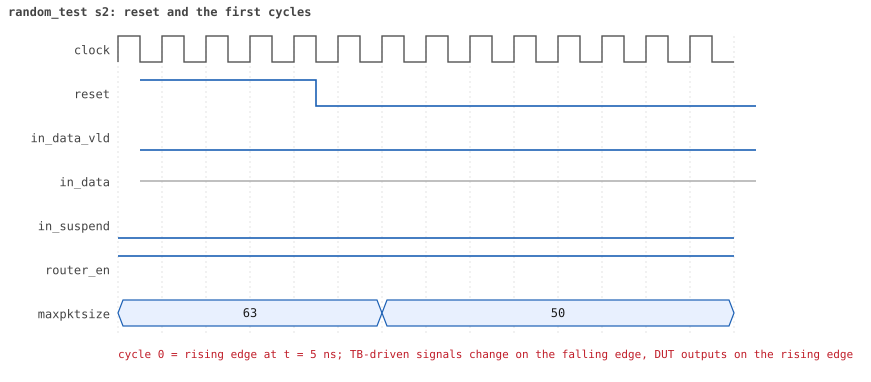
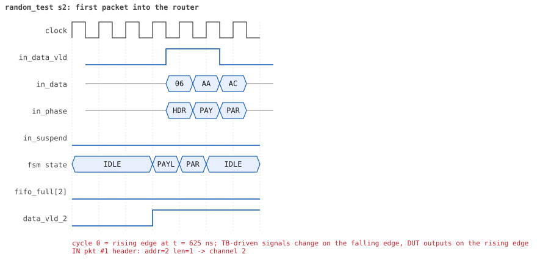
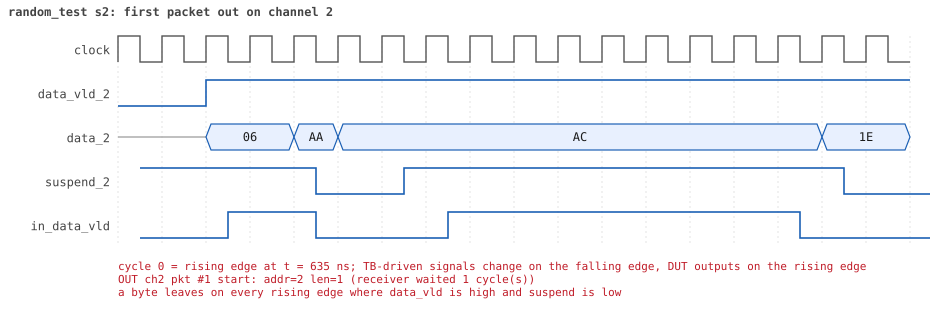
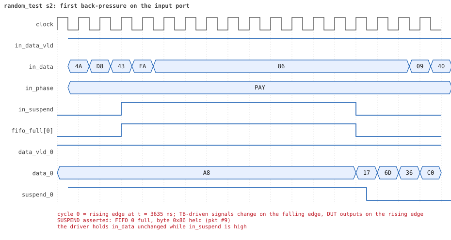
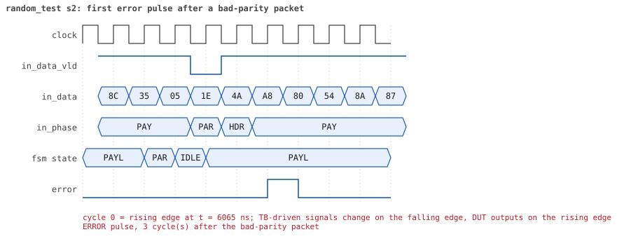
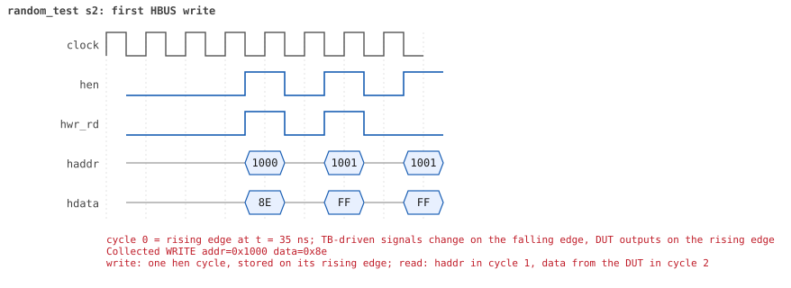
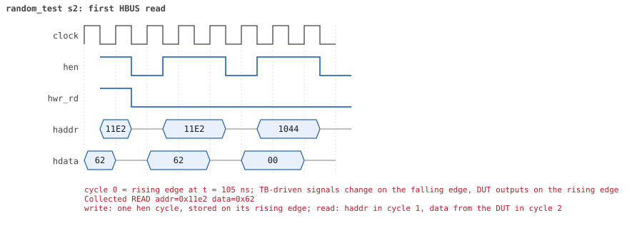

# random_test seed 2

**Result:** PASSED (0 UVM_ERROR, 0 UVM_WARNING, 0 UVM_FATAL) · bench `yapp_project_tb` · sim time 34us · wall 19.3 s · log [`random_test_s2.log`](random_test_s2.log)

Waves: `random_test_s2.fst` (GTKWave, Surfer or the VS Code wave viewer).
[Open the waves in Surfer](https://app.surfer-project.org/?load_url=https%3A%2F%2Fraw.githubusercontent.com%2Ftamirgabgab%2FQcom-Mentoring%2Fmain%2Fyapp_project%2Fregression%2Fyapp_project_tb%2Frandom_test_s2%2Frandom_test_s2.fst&startup_commands=run_command_file_from_url%20https%3A%2F%2Fraw.githubusercontent.com%2Ftamirgabgab%2FQcom-Mentoring%2Fmain%2Fyapp_project%2Ftb%2Fyapp_router.sucl) (web app, the signals already in groups: `yapp_project/tb/yapp_router.sucl`).

## Summary

- YAPP driver sent **74** packet(s) (7 with bad parity); the input monitor saw 74.
- Router: **46** forwarded, **28** dropped (27 oversized, 1 illegal address 3).
- Packets out: ch0 **15**, ch1 **8**, ch2 **23**.
- Scoreboard: 46 matched, 0 mismatched, 0 unexpected.
- Back-pressure: in_suspend asserted **8** time(s), longest hold 11 cycle(s).
- Error pulses: 7.
- HBUS: 17 write(s), 67 read(s).

## Stages

| time (ns) | stage |
|---|---|
| 0 | receivers: ch0 CHANNEL_RX_PROFILE_NORMAL, ch1 CHANNEL_RX_PROFILE_FAST, ch2 CHANNEL_RX_PROFILE_NORMAL |
| 0 | random scenario: 74 packets in 3 bursts |
| 450 | burst 1/3: ctrl=0xb2 (maxpktsize 50) en=0x95 (router on, counter enables 1001010), 24 packet(s) |
| 11420 | burst 1/3 sent: addr0..3 5/6/13/0, bad parity 2, gap 0 6, length 1..63 |
| 11720 | burst 2/3: ctrl=0xc1 (maxpktsize 1) en=0x2b (router on, counter enables 0010101), 26 packet(s) |
| 21060 | burst 2/3 sent: addr0..3 7/5/14/0, bad parity 1, gap 0 9, length 1..63 |
| 21210 | burst 3/3: ctrl=0xbf (maxpktsize 63) en=0x73 (router on, counter enables 0111001), 24 packet(s) |
| 32250 | burst 3/3 sent: addr0..3 7/3/13/1, bad parity 4, gap 0 8, length 1..63 |
| 32250 | final reads: every register and the stored packet, checked against the reference model |
| 33865 | done: 74 packets (46 forwarded, 28 dropped), 0 storm burst(s), 46 scoreboard matches, 66 HBUS reads checked, 7 error pulses for 7 bad packets |

## Pictures

**reset and the first cycles**

**first packet into the router**

**first packet out on channel 2**

**first back-pressure on the input port**

**first error pulse after a bad-parity packet**

**first HBUS write**

**first HBUS read**

## Timeline

971 events.

| time (ns) | who | event |
|---|---|---|
| 0 | yapp monitor | YAPP monitor running |
| 0 | **test** | STAGE: receivers: ch0 CHANNEL_RX_PROFILE_NORMAL, ch1 CHANNEL_RX_PROFILE_FAST, ch2 CHANNEL_RX_PROFILE_NORMAL |
| 0 | **test** | STAGE: random scenario: 74 packets in 3 bursts |
| 0 | clk/rst driver | Starting clock (period 10) and holding reset for 5 cycles |
| 0 | **DUT** | RESET asserted |
| 50 | **DUT** | RESET released: router_en=1 maxpktsize=63 |
| 70 | hbus driver | Executed WRITE addr=0x1000 data=0xb2 |
| 75 | **DUT** | CONFIG router_en=1 maxpktsize=50 |
| 75 | hbus monitor | Collected WRITE addr=0x1000 data=0xb2 |
| 75 | reference | maxpktsize is now 50 |
| 90 | hbus driver | Executed WRITE addr=0x1001 data=0x95 |
| 95 | hbus monitor | Collected WRITE addr=0x1001 data=0x95 |
| 95 | reference | router_en is now 1 (en_reg 0x95) |
| 110 | hbus driver | Executed WRITE addr=0x11e2 data=0x62 |
| 115 | hbus monitor | Collected WRITE addr=0x11e2 data=0x62 |
| 140 | hbus driver | Executed READ  addr=0x11e2 data=0x62 |
| 145 | hbus monitor | Collected READ  addr=0x11e2 data=0x62 |
| 170 | hbus driver | Executed READ  addr=0x1044 data=0x00 |
| 175 | hbus monitor | Collected READ  addr=0x1044 data=0x00 |
| 190 | hbus driver | Executed WRITE addr=0x1108 data=0x7e |
| 195 | hbus monitor | Collected WRITE addr=0x1108 data=0x7e |
| 220 | hbus driver | Executed READ  addr=0x1108 data=0x7e |
| 225 | hbus monitor | Collected READ  addr=0x1108 data=0x7e |
| 240 | hbus driver | Executed WRITE addr=0x1124 data=0xe9 |
| 245 | hbus monitor | Collected WRITE addr=0x1124 data=0xe9 |
| 270 | hbus driver | Executed READ  addr=0x1124 data=0xe9 |
| 275 | hbus monitor | Collected READ  addr=0x1124 data=0xe9 |
| 290 | hbus driver | Executed WRITE addr=0x1137 data=0x19 |
| 295 | hbus monitor | Collected WRITE addr=0x1137 data=0x19 |
| 320 | hbus driver | Executed READ  addr=0x1137 data=0x19 |
| 325 | hbus monitor | Collected READ  addr=0x1137 data=0x19 |
| 340 | hbus driver | Executed WRITE addr=0x11df data=0x94 |
| 345 | hbus monitor | Collected WRITE addr=0x11df data=0x94 |
| 370 | hbus driver | Executed READ  addr=0x11df data=0x94 |
| 375 | hbus monitor | Collected READ  addr=0x11df data=0x94 |
| 390 | hbus driver | Executed WRITE addr=0x1184 data=0x8d |
| 395 | hbus monitor | Collected WRITE addr=0x1184 data=0x8d |
| 420 | hbus driver | Executed READ  addr=0x1184 data=0x8d |
| 425 | hbus monitor | Collected READ  addr=0x1184 data=0x8d |
| 450 | hbus driver | Executed READ  addr=0x100d data=0x00 |
| 450 | **test** | STAGE: burst 1/3: ctrl=0xb2 (maxpktsize 50) en=0x95 (router on, counter enables 1001010), 24 packet(s) |
| 450 | yapp driver | TX pkt #1: addr=2 len=1 parity=good delay=19 |
| 455 | hbus monitor | Collected READ  addr=0x100d data=0x00 |
| 655 | **DUT** | IN  pkt #1 header: addr=2 len=1 -> channel 2 |
| 675 | **DUT** | IN  pkt #1 complete: addr=2 len=1 parity=ok forwarded, 3 bytes in 3 cycles (held 0) |
| 675 | **DUT** | OUT ch2 pkt #1 start: addr=2 len=1 (receiver waited 1 cycle(s)) |
| 675 | yapp monitor | RX pkt #1 on the input: addr=2 len=1 parity=good gap=60 |
| 675 | reference | Packet forwarded: addr=2 len=1 -> channel 2 |
| 680 | yapp driver | TX pkt #1 accepted by the DUT |
| 680 | yapp driver | TX pkt #2: addr=2 len=7 parity=good delay=2 |
| 690 | ch2 driver | ch2: packet consumed (response delay 1) |
| 705 | **DUT** | IN  pkt #2 header: addr=2 len=7 -> channel 2 |
| 785 | **DUT** | IN  pkt #2 complete: addr=2 len=7 parity=ok forwarded, 9 bytes in 9 cycles (held 0) |
| 785 | yapp monitor | RX pkt #2 on the input: addr=2 len=7 parity=good gap=2 |
| 785 | reference | Packet forwarded: addr=2 len=7 -> channel 2 |
| 790 | yapp driver | TX pkt #2 accepted by the DUT |
| 790 | yapp driver | TX pkt #3: addr=2 len=62 parity=good delay=3 |
| 795 | **DUT** | OUT ch2 pkt #1 done: 3 bytes in 13 cycles |
| 795 | ch2 monitor | ch2 RX pkt #1: addr=2 len=1 parity=good |
| 795 | scoreboard | ch2 pkt matched: addr=2 len=1 (1 matched so far) |
| 805 | **DUT** | OUT ch2 pkt #2 start: addr=2 len=7 (receiver waited 0 cycle(s)) |
| 825 | **DUT** | IN  pkt #3 header: addr=2 len=62 -> DROP (oversized: len 62 > maxpktsize 50) |
| 885 | **DUT** | OUT ch2 pkt #2 done: 9 bytes in 9 cycles |
| 885 | ch2 monitor | ch2 RX pkt #2: addr=2 len=7 parity=good |
| 885 | scoreboard | ch2 pkt matched: addr=2 len=7 (2 matched so far) |
| 1230 | ch2 driver | ch2: packet consumed (response delay 9) |
| 1455 | **DUT** | IN  pkt #3 complete: addr=2 len=62 parity=ok dropped, 64 bytes in 64 cycles (held 0) |
| 1455 | yapp monitor | RX pkt #3 on the input: addr=2 len=62 parity=good gap=3 |
| 1455 | reference | Packet dropped: length 62 > maxpktsize 50 (addr=2) |
| 1455 | **DUT** | ROUTER DROPS PACKET addr=2 length=62 (length > maxpktsize) |
| 1460 | yapp driver | TX pkt #3 accepted by the DUT |
| 1460 | yapp driver | TX pkt #4: addr=2 len=1 parity=good delay=20 |
| 1665 | **DUT** | IN  pkt #4 header: addr=2 len=1 -> channel 2 |
| 1685 | **DUT** | IN  pkt #4 complete: addr=2 len=1 parity=ok forwarded, 3 bytes in 3 cycles (held 0) |
| 1685 | yapp monitor | RX pkt #4 on the input: addr=2 len=1 parity=good gap=20 |
| 1685 | reference | Packet forwarded: addr=2 len=1 -> channel 2 |
| 1690 | yapp driver | TX pkt #4 accepted by the DUT |
| 1690 | yapp driver | TX pkt #5: addr=2 len=28 parity=good delay=1 |
| 1695 | **DUT** | OUT ch2 pkt #3 start: addr=2 len=1 (receiver waited 2 cycle(s)) |
| 1705 | **DUT** | IN  pkt #5 header: addr=2 len=28 -> channel 2 |
| 1710 | ch2 driver | ch2: packet consumed (response delay 2) |
| 1825 | **DUT** | OUT ch2 pkt #3 done: 3 bytes in 14 cycles |
| 1825 | ch2 monitor | ch2 RX pkt #3: addr=2 len=1 parity=good |
| 1825 | scoreboard | ch2 pkt matched: addr=2 len=1 (3 matched so far) |
| 1835 | **DUT** | OUT ch2 pkt #4 start: addr=2 len=28 (receiver waited 0 cycle(s)) |
| 1995 | **DUT** | IN  pkt #5 complete: addr=2 len=28 parity=ok forwarded, 30 bytes in 30 cycles (held 0) |
| 1995 | yapp monitor | RX pkt #5 on the input: addr=2 len=28 parity=good gap=1 |
| 1995 | reference | Packet forwarded: addr=2 len=28 -> channel 2 |
| 2000 | yapp driver | TX pkt #5 accepted by the DUT |
| 2000 | yapp driver | TX pkt #6: addr=1 len=49 parity=good delay=0 |
| 2005 | **DUT** | IN  pkt #6 header: addr=1 len=49 -> channel 1 |
| 2015 | **DUT** | OUT ch1 pkt #1 start: addr=1 len=49 (receiver waited 0 cycle(s)) |
| 2125 | **DUT** | OUT ch2 pkt #4 done: 30 bytes in 30 cycles |
| 2125 | ch2 monitor | ch2 RX pkt #4: addr=2 len=28 parity=good |
| 2125 | scoreboard | ch2 pkt matched: addr=2 len=28 (4 matched so far) |
| 2440 | ch2 driver | ch2: packet consumed (response delay 10) |
| 2505 | **DUT** | IN  pkt #6 complete: addr=1 len=49 parity=ok forwarded, 51 bytes in 51 cycles (held 0) |
| 2505 | yapp monitor | RX pkt #6 on the input: addr=1 len=49 parity=good gap=0 |
| 2505 | reference | Packet forwarded: addr=1 len=49 -> channel 1 |
| 2510 | ch1 driver | ch1: packet consumed (response delay 0) |
| 2510 | yapp driver | TX pkt #6 accepted by the DUT |
| 2510 | yapp driver | TX pkt #7: addr=1 len=39 parity=good delay=17 |
| 2525 | **DUT** | OUT ch1 pkt #1 done: 51 bytes in 52 cycles |
| 2525 | ch1 monitor | ch1 RX pkt #1: addr=1 len=49 parity=good |
| 2525 | scoreboard | ch1 pkt matched: addr=1 len=49 (5 matched so far) |
| 2685 | **DUT** | IN  pkt #7 header: addr=1 len=39 -> channel 1 |
| 2695 | **DUT** | OUT ch1 pkt #2 start: addr=1 len=39 (receiver waited 0 cycle(s)) |
| 3060 | ch1 driver | ch1: packet consumed (response delay 0) |
| 3085 | **DUT** | IN  pkt #7 complete: addr=1 len=39 parity=ok forwarded, 41 bytes in 41 cycles (held 0) |
| 3085 | yapp monitor | RX pkt #7 on the input: addr=1 len=39 parity=good gap=17 |
| 3085 | reference | Packet forwarded: addr=1 len=39 -> channel 1 |
| 3090 | yapp driver | TX pkt #7 accepted by the DUT |
| 3090 | yapp driver | TX pkt #8: addr=2 len=63 parity=good delay=17 |
| 3105 | **DUT** | OUT ch1 pkt #2 done: 41 bytes in 42 cycles |
| 3105 | ch1 monitor | ch1 RX pkt #2: addr=1 len=39 parity=good |
| 3105 | scoreboard | ch1 pkt matched: addr=1 len=39 (6 matched so far) |
| 3265 | **DUT** | IN  pkt #8 header: addr=2 len=63 -> DROP (oversized: len 63 > maxpktsize 50) |
| 3630 | ch1 driver | ch1: packet consumed (response delay 0) |
| 3905 | **DUT** | IN  pkt #8 complete: addr=2 len=63 parity=ok dropped, 65 bytes in 65 cycles (held 0) |
| 3905 | yapp monitor | RX pkt #8 on the input: addr=2 len=63 parity=good gap=17 |
| 3905 | reference | Packet dropped: length 63 > maxpktsize 50 (addr=2) |
| 3905 | **DUT** | ROUTER DROPS PACKET addr=2 length=63 (length > maxpktsize) |
| 3910 | yapp driver | TX pkt #8 accepted by the DUT |
| 3910 | yapp driver | TX pkt #9: addr=0 len=43 parity=good delay=3 |
| 3945 | **DUT** | IN  pkt #9 header: addr=0 len=43 -> channel 0 |
| 4045 | **DUT** | OUT ch0 pkt #1 start: addr=0 len=43 (receiver waited 9 cycle(s)) |
| 4385 | **DUT** | IN  pkt #9 complete: addr=0 len=43 parity=ok forwarded, 45 bytes in 45 cycles (held 0) |
| 4385 | yapp monitor | RX pkt #9 on the input: addr=0 len=43 parity=good gap=3 |
| 4385 | reference | Packet forwarded: addr=0 len=43 -> channel 0 |
| 4390 | yapp driver | TX pkt #9 accepted by the DUT |
| 4390 | yapp driver | TX pkt #10: addr=0 len=30 parity=good delay=20 |
| 4480 | ch0 driver | ch0: packet consumed (response delay 9) |
| 4555 | **DUT** | OUT ch0 pkt #1 done: 45 bytes in 52 cycles |
| 4555 | ch0 monitor | ch0 RX pkt #1: addr=0 len=43 parity=good |
| 4555 | scoreboard | ch0 pkt matched: addr=0 len=43 (7 matched so far) |
| 4595 | **DUT** | IN  pkt #10 header: addr=0 len=30 -> channel 0 |
| 4605 | **DUT** | OUT ch0 pkt #2 start: addr=0 len=30 (receiver waited 0 cycle(s)) |
| 4750 | ch0 driver | ch0: packet consumed (response delay 6) |
| 4905 | **DUT** | IN  pkt #10 complete: addr=0 len=30 parity=ok forwarded, 32 bytes in 32 cycles (held 0) |
| 4905 | yapp monitor | RX pkt #10 on the input: addr=0 len=30 parity=good gap=20 |
| 4905 | reference | Packet forwarded: addr=0 len=30 -> channel 0 |
| 4910 | yapp driver | TX pkt #10 accepted by the DUT |
| 4910 | yapp driver | TX pkt #11: addr=2 len=9 parity=good delay=2 |
| 4935 | **DUT** | IN  pkt #11 header: addr=2 len=9 -> channel 2 |
| 4985 | **DUT** | OUT ch0 pkt #2 done: 32 bytes in 39 cycles |
| 4985 | ch0 monitor | ch0 RX pkt #2: addr=0 len=30 parity=good |
| 4985 | scoreboard | ch0 pkt matched: addr=0 len=30 (8 matched so far) |
| 5035 | **DUT** | IN  pkt #11 complete: addr=2 len=9 parity=ok forwarded, 11 bytes in 11 cycles (held 0) |
| 5035 | **DUT** | OUT ch2 pkt #5 start: addr=2 len=9 (receiver waited 9 cycle(s)) |
| 5035 | yapp monitor | RX pkt #11 on the input: addr=2 len=9 parity=good gap=2 |
| 5035 | reference | Packet forwarded: addr=2 len=9 -> channel 2 |
| 5040 | yapp driver | TX pkt #11 accepted by the DUT |
| 5040 | yapp driver | TX pkt #12: addr=1 len=63 parity=good delay=0 |
| 5045 | **DUT** | IN  pkt #12 header: addr=1 len=63 -> DROP (oversized: len 63 > maxpktsize 50) |
| 5130 | ch2 driver | ch2: packet consumed (response delay 9) |
| 5180 | ch0 driver | ch0: packet consumed (response delay 6) |
| 5205 | **DUT** | OUT ch2 pkt #5 done: 11 bytes in 18 cycles |
| 5205 | ch2 monitor | ch2 RX pkt #5: addr=2 len=9 parity=good |
| 5205 | scoreboard | ch2 pkt matched: addr=2 len=9 (9 matched so far) |
| 5360 | ch2 driver | ch2: packet consumed (response delay 6) |
| 5685 | **DUT** | IN  pkt #12 complete: addr=1 len=63 parity=ok dropped, 65 bytes in 65 cycles (held 0) |
| 5685 | yapp monitor | RX pkt #12 on the input: addr=1 len=63 parity=good gap=0 |
| 5685 | reference | Packet dropped: length 63 > maxpktsize 50 (addr=1) |
| 5685 | **DUT** | ROUTER DROPS PACKET addr=1 length=63 (length > maxpktsize) |
| 5690 | yapp driver | TX pkt #12 accepted by the DUT |
| 5690 | yapp driver | TX pkt #13: addr=0 len=35 parity=bad delay=4 |
| 5735 | **DUT** | IN  pkt #13 header: addr=0 len=35 -> channel 0 |
| 5785 | **DUT** | OUT ch0 pkt #3 start: addr=0 len=35 (receiver waited 4 cycle(s)) |
| 6095 | **DUT** | IN  pkt #13 complete: addr=0 len=35 parity=BAD forwarded, 37 bytes in 37 cycles (held 0) |
| 6095 | yapp monitor | RX pkt #13 on the input: addr=0 len=35 parity=bad gap=4 |
| 6095 | reference | Packet forwarded: addr=0 len=35 -> channel 0 |
| 6100 | yapp driver | TX pkt #13 accepted by the DUT |
| 6100 | yapp driver | TX pkt #14: addr=2 len=18 parity=good delay=0 |
| 6105 | **DUT** | IN  pkt #14 header: addr=2 len=18 -> channel 2 |
| 6130 | **DUT** | ERROR pulse, 3 cycle(s) after the bad-parity packet |
| 6130 | error checker | error pulse 3 cycles after the bad packet (0 still owed) |
| 6140 | ch0 driver | ch0: packet consumed (response delay 4) |
| 6165 | **DUT** | OUT ch2 pkt #6 start: addr=2 len=18 (receiver waited 5 cycle(s)) |
| 6255 | **DUT** | OUT ch0 pkt #3 done: 37 bytes in 48 cycles |
| 6255 | ch0 monitor | ch0 RX pkt #3: addr=0 len=35 parity=bad |
| 6255 | scoreboard | ch0 pkt matched: addr=0 len=35 (10 matched so far) |
| 6295 | **DUT** | IN  pkt #14 complete: addr=2 len=18 parity=ok forwarded, 20 bytes in 20 cycles (held 0) |
| 6295 | yapp monitor | RX pkt #14 on the input: addr=2 len=18 parity=good gap=0 |
| 6295 | reference | Packet forwarded: addr=2 len=18 -> channel 2 |
| 6300 | yapp driver | TX pkt #14 accepted by the DUT |
| 6300 | yapp driver | TX pkt #15: addr=2 len=63 parity=good delay=0 |
| 6305 | **DUT** | IN  pkt #15 header: addr=2 len=63 -> DROP (oversized: len 63 > maxpktsize 50) |
| 6330 | ch0 driver | ch0: packet consumed (response delay 10) |
| 6350 | ch2 driver | ch2: packet consumed (response delay 5) |
| 6395 | **DUT** | OUT ch2 pkt #6 done: 20 bytes in 24 cycles |
| 6395 | ch2 monitor | ch2 RX pkt #6: addr=2 len=18 parity=good |
| 6395 | scoreboard | ch2 pkt matched: addr=2 len=18 (11 matched so far) |
| 6945 | **DUT** | IN  pkt #15 complete: addr=2 len=63 parity=ok dropped, 65 bytes in 65 cycles (held 0) |
| 6945 | yapp monitor | RX pkt #15 on the input: addr=2 len=63 parity=good gap=0 |
| 6945 | reference | Packet dropped: length 63 > maxpktsize 50 (addr=2) |
| 6945 | **DUT** | ROUTER DROPS PACKET addr=2 length=63 (length > maxpktsize) |
| 6950 | yapp driver | TX pkt #15 accepted by the DUT |
| 6950 | yapp driver | TX pkt #16: addr=2 len=1 parity=bad delay=2 |
| 6975 | **DUT** | IN  pkt #16 header: addr=2 len=1 -> channel 2 |
| 6985 | **DUT** | OUT ch2 pkt #7 start: addr=2 len=1 (receiver waited 0 cycle(s)) |
| 6995 | **DUT** | IN  pkt #16 complete: addr=2 len=1 parity=BAD forwarded, 3 bytes in 3 cycles (held 0) |
| 6995 | yapp monitor | RX pkt #16 on the input: addr=2 len=1 parity=bad gap=2 |
| 6995 | reference | Packet forwarded: addr=2 len=1 -> channel 2 |
| 7000 | yapp driver | TX pkt #16 accepted by the DUT |
| 7000 | yapp driver | TX pkt #17: addr=2 len=28 parity=good delay=2 |
| 7005 | **DUT** | OUT ch2 pkt #7 done: 3 bytes in 3 cycles |
| 7005 | ch2 monitor | ch2 RX pkt #7: addr=2 len=1 parity=bad |
| 7005 | scoreboard | ch2 pkt matched: addr=2 len=1 (12 matched so far) |
| 7010 | ch2 driver | ch2: packet consumed (response delay 3) |
| 7025 | **DUT** | IN  pkt #17 header: addr=2 len=28 -> channel 2 |
| 7070 | **DUT** | ERROR pulse, 7 cycle(s) after the bad-parity packet |
| 7070 | error checker | error pulse 7 cycles after the bad packet (0 still owed) |
| 7135 | **DUT** | OUT ch2 pkt #8 start: addr=2 len=28 (receiver waited 10 cycle(s)) |
| 7315 | **DUT** | IN  pkt #17 complete: addr=2 len=28 parity=ok forwarded, 30 bytes in 30 cycles (held 0) |
| 7315 | yapp monitor | RX pkt #17 on the input: addr=2 len=28 parity=good gap=2 |
| 7315 | reference | Packet forwarded: addr=2 len=28 -> channel 2 |
| 7320 | yapp driver | TX pkt #17 accepted by the DUT |
| 7320 | yapp driver | TX pkt #18: addr=0 len=36 parity=good delay=2 |
| 7345 | **DUT** | IN  pkt #18 header: addr=0 len=36 -> channel 0 |
| 7420 | ch2 driver | ch2: packet consumed (response delay 10) |
| 7425 | **DUT** | OUT ch0 pkt #4 start: addr=0 len=36 (receiver waited 7 cycle(s)) |
| 7535 | **DUT** | OUT ch2 pkt #8 done: 30 bytes in 41 cycles |
| 7535 | ch2 monitor | ch2 RX pkt #8: addr=2 len=28 parity=good |
| 7535 | scoreboard | ch2 pkt matched: addr=2 len=28 (13 matched so far) |
| 7550 | ch2 driver | ch2: packet consumed (response delay 10) |
| 7715 | **DUT** | IN  pkt #18 complete: addr=0 len=36 parity=ok forwarded, 38 bytes in 38 cycles (held 0) |
| 7715 | yapp monitor | RX pkt #18 on the input: addr=0 len=36 parity=good gap=2 |
| 7715 | reference | Packet forwarded: addr=0 len=36 -> channel 0 |
| 7720 | yapp driver | TX pkt #18 accepted by the DUT |
| 7720 | yapp driver | TX pkt #19: addr=1 len=51 parity=good delay=2 |
| 7745 | **DUT** | IN  pkt #19 header: addr=1 len=51 -> DROP (oversized: len 51 > maxpktsize 50) |
| 7790 | ch0 driver | ch0: packet consumed (response delay 7) |
| 7865 | **DUT** | OUT ch0 pkt #4 done: 38 bytes in 45 cycles |
| 7865 | ch0 monitor | ch0 RX pkt #4: addr=0 len=36 parity=good |
| 7865 | scoreboard | ch0 pkt matched: addr=0 len=36 (14 matched so far) |
| 7910 | ch0 driver | ch0: packet consumed (response delay 6) |
| 8265 | **DUT** | IN  pkt #19 complete: addr=1 len=51 parity=ok dropped, 53 bytes in 53 cycles (held 0) |
| 8265 | yapp monitor | RX pkt #19 on the input: addr=1 len=51 parity=good gap=2 |
| 8265 | reference | Packet dropped: length 51 > maxpktsize 50 (addr=1) |
| 8265 | **DUT** | ROUTER DROPS PACKET addr=1 length=51 (length > maxpktsize) |
| 8270 | yapp driver | TX pkt #19 accepted by the DUT |
| 8270 | yapp driver | TX pkt #20: addr=2 len=63 parity=good delay=0 |
| 8275 | **DUT** | IN  pkt #20 header: addr=2 len=63 -> DROP (oversized: len 63 > maxpktsize 50) |
| 8915 | **DUT** | IN  pkt #20 complete: addr=2 len=63 parity=ok dropped, 65 bytes in 65 cycles (held 0) |
| 8915 | yapp monitor | RX pkt #20 on the input: addr=2 len=63 parity=good gap=0 |
| 8915 | reference | Packet dropped: length 63 > maxpktsize 50 (addr=2) |
| 8915 | **DUT** | ROUTER DROPS PACKET addr=2 length=63 (length > maxpktsize) |
| 8920 | yapp driver | TX pkt #20 accepted by the DUT |
| 8920 | yapp driver | TX pkt #21: addr=1 len=50 parity=good delay=0 |
| 8925 | **DUT** | IN  pkt #21 header: addr=1 len=50 -> channel 1 |
| 8935 | **DUT** | OUT ch1 pkt #3 start: addr=1 len=50 (receiver waited 0 cycle(s)) |
| 9435 | **DUT** | IN  pkt #21 complete: addr=1 len=50 parity=ok forwarded, 52 bytes in 52 cycles (held 0) |
| 9435 | yapp monitor | RX pkt #21 on the input: addr=1 len=50 parity=good gap=0 |
| 9435 | reference | Packet forwarded: addr=1 len=50 -> channel 1 |
| 9440 | ch1 driver | ch1: packet consumed (response delay 0) |
| 9440 | yapp driver | TX pkt #21 accepted by the DUT |
| 9440 | yapp driver | TX pkt #22: addr=1 len=55 parity=good delay=19 |
| 9455 | **DUT** | OUT ch1 pkt #3 done: 52 bytes in 53 cycles |
| 9455 | ch1 monitor | ch1 RX pkt #3: addr=1 len=50 parity=good |
| 9455 | scoreboard | ch1 pkt matched: addr=1 len=50 (15 matched so far) |
| 9635 | **DUT** | IN  pkt #22 header: addr=1 len=55 -> DROP (oversized: len 55 > maxpktsize 50) |
| 9990 | ch1 driver | ch1: packet consumed (response delay 0) |
| 10195 | **DUT** | IN  pkt #22 complete: addr=1 len=55 parity=ok dropped, 57 bytes in 57 cycles (held 0) |
| 10195 | yapp monitor | RX pkt #22 on the input: addr=1 len=55 parity=good gap=19 |
| 10195 | reference | Packet dropped: length 55 > maxpktsize 50 (addr=1) |
| 10195 | **DUT** | ROUTER DROPS PACKET addr=1 length=55 (length > maxpktsize) |
| 10200 | yapp driver | TX pkt #22 accepted by the DUT |
| 10200 | yapp driver | TX pkt #23: addr=2 len=63 parity=good delay=20 |
| 10405 | **DUT** | IN  pkt #23 header: addr=2 len=63 -> DROP (oversized: len 63 > maxpktsize 50) |
| 11045 | **DUT** | IN  pkt #23 complete: addr=2 len=63 parity=ok dropped, 65 bytes in 65 cycles (held 0) |
| 11045 | yapp monitor | RX pkt #23 on the input: addr=2 len=63 parity=good gap=20 |
| 11045 | reference | Packet dropped: length 63 > maxpktsize 50 (addr=2) |
| 11045 | **DUT** | ROUTER DROPS PACKET addr=2 length=63 (length > maxpktsize) |
| 11050 | yapp driver | TX pkt #23 accepted by the DUT |
| 11050 | yapp driver | TX pkt #24: addr=0 len=21 parity=good delay=14 |
| 11195 | **DUT** | IN  pkt #24 header: addr=0 len=21 -> channel 0 |
| 11265 | **DUT** | OUT ch0 pkt #5 start: addr=0 len=21 (receiver waited 6 cycle(s)) |
| 11415 | **DUT** | IN  pkt #24 complete: addr=0 len=21 parity=ok forwarded, 23 bytes in 23 cycles (held 0) |
| 11415 | yapp monitor | RX pkt #24 on the input: addr=0 len=21 parity=good gap=14 |
| 11415 | reference | Packet forwarded: addr=0 len=21 -> channel 0 |
| 11420 | yapp driver | TX pkt #24 accepted by the DUT |
| 11420 | **test** | STAGE: burst 1/3 sent: addr0..3 5/6/13/0, bad parity 2, gap 0 6, length 1..63 |
| 11440 | hbus driver | Executed WRITE addr=0x1000 data=0xc1 |
| 11445 | **DUT** | CONFIG router_en=1 maxpktsize=1 |
| 11445 | hbus monitor | Collected WRITE addr=0x1000 data=0xc1 |
| 11445 | reference | maxpktsize is now 1 |
| 11460 | hbus driver | Executed WRITE addr=0x1001 data=0x2b |
| 11465 | hbus monitor | Collected WRITE addr=0x1001 data=0x2b |
| 11465 | reference | router_en is now 1 (en_reg 0x2b) |
| 11480 | ch0 driver | ch0: packet consumed (response delay 6) |
| 11480 | hbus driver | Executed WRITE addr=0x110b data=0x40 |
| 11485 | hbus monitor | Collected WRITE addr=0x110b data=0x40 |
| 11510 | hbus driver | Executed READ  addr=0x110b data=0x40 |
| 11515 | **DUT** | OUT ch0 pkt #5 done: 23 bytes in 26 cycles |
| 11515 | ch0 monitor | ch0 RX pkt #5: addr=0 len=21 parity=good |
| 11515 | scoreboard | ch0 pkt matched: addr=0 len=21 (16 matched so far) |
| 11515 | hbus monitor | Collected READ  addr=0x110b data=0x40 |
| 11530 | hbus driver | Executed WRITE addr=0x1122 data=0x18 |
| 11535 | hbus monitor | Collected WRITE addr=0x1122 data=0x18 |
| 11560 | hbus driver | Executed READ  addr=0x1122 data=0x18 |
| 11565 | hbus monitor | Collected READ  addr=0x1122 data=0x18 |
| 11590 | hbus driver | Executed READ  addr=0x10fc data=0x00 |
| 11595 | hbus monitor | Collected READ  addr=0x10fc data=0x00 |
| 11610 | hbus driver | Executed WRITE addr=0x1155 data=0x24 |
| 11615 | hbus monitor | Collected WRITE addr=0x1155 data=0x24 |
| 11640 | hbus driver | Executed READ  addr=0x1155 data=0x24 |
| 11645 | hbus monitor | Collected READ  addr=0x1155 data=0x24 |
| 11660 | hbus driver | Executed WRITE addr=0x111e data=0x4a |
| 11665 | hbus monitor | Collected WRITE addr=0x111e data=0x4a |
| 11690 | hbus driver | Executed READ  addr=0x111e data=0x4a |
| 11695 | hbus monitor | Collected READ  addr=0x111e data=0x4a |
| 11720 | hbus driver | Executed READ  addr=0x100d data=0x15 |
| 11720 | **test** | STAGE: burst 2/3: ctrl=0xc1 (maxpktsize 1) en=0x2b (router on, counter enables 0010101), 26 packet(s) |
| 11720 | yapp driver | TX pkt #25: addr=2 len=63 parity=good delay=12 |
| 11725 | hbus monitor | Collected READ  addr=0x100d data=0x15 |
| 11855 | **DUT** | IN  pkt #25 header: addr=2 len=63 -> DROP (oversized: len 63 > maxpktsize 1) |
| 12080 | ch0 driver | ch0: packet consumed (response delay 2) |
| 12495 | **DUT** | IN  pkt #25 complete: addr=2 len=63 parity=ok dropped, 65 bytes in 65 cycles (held 0) |
| 12495 | yapp monitor | RX pkt #25 on the input: addr=2 len=63 parity=good gap=43 |
| 12495 | reference | Packet dropped: length 63 > maxpktsize 1 (addr=2) |
| 12495 | **DUT** | ROUTER DROPS PACKET addr=2 length=63 (length > maxpktsize) |
| 12500 | yapp driver | TX pkt #25 accepted by the DUT |
| 12500 | yapp driver | TX pkt #26: addr=1 len=1 parity=good delay=0 |
| 12505 | **DUT** | IN  pkt #26 header: addr=1 len=1 -> channel 1 |
| 12515 | **DUT** | OUT ch1 pkt #4 start: addr=1 len=1 (receiver waited 0 cycle(s)) |
| 12525 | **DUT** | IN  pkt #26 complete: addr=1 len=1 parity=ok forwarded, 3 bytes in 3 cycles (held 0) |
| 12525 | yapp monitor | RX pkt #26 on the input: addr=1 len=1 parity=good gap=0 |
| 12525 | reference | Packet forwarded: addr=1 len=1 -> channel 1 |
| 12530 | ch1 driver | ch1: packet consumed (response delay 0) |
| 12530 | yapp driver | TX pkt #26 accepted by the DUT |
| 12530 | yapp driver | TX pkt #27: addr=1 len=48 parity=good delay=17 |
| 12545 | **DUT** | OUT ch1 pkt #4 done: 3 bytes in 4 cycles |
| 12545 | ch1 monitor | ch1 RX pkt #4: addr=1 len=1 parity=good |
| 12545 | scoreboard | ch1 pkt matched: addr=1 len=1 (17 matched so far) |
| 12705 | **DUT** | IN  pkt #27 header: addr=1 len=48 -> DROP (oversized: len 48 > maxpktsize 1) |
| 12920 | ch1 driver | ch1: packet consumed (response delay 0) |
| 13195 | **DUT** | IN  pkt #27 complete: addr=1 len=48 parity=ok dropped, 50 bytes in 50 cycles (held 0) |
| 13195 | yapp monitor | RX pkt #27 on the input: addr=1 len=48 parity=good gap=17 |
| 13195 | reference | Packet dropped: length 48 > maxpktsize 1 (addr=1) |
| 13195 | **DUT** | ROUTER DROPS PACKET addr=1 length=48 (length > maxpktsize) |
| 13200 | yapp driver | TX pkt #27 accepted by the DUT |
| 13200 | yapp driver | TX pkt #28: addr=0 len=1 parity=good delay=7 |
| 13275 | **DUT** | IN  pkt #28 header: addr=0 len=1 -> channel 0 |
| 13295 | **DUT** | IN  pkt #28 complete: addr=0 len=1 parity=ok forwarded, 3 bytes in 3 cycles (held 0) |
| 13295 | yapp monitor | RX pkt #28 on the input: addr=0 len=1 parity=good gap=7 |
| 13295 | reference | Packet forwarded: addr=0 len=1 -> channel 0 |
| 13300 | yapp driver | TX pkt #28 accepted by the DUT |
| 13300 | yapp driver | TX pkt #29: addr=2 len=16 parity=good delay=2 |
| 13325 | **DUT** | IN  pkt #29 header: addr=2 len=16 -> DROP (oversized: len 16 > maxpktsize 1) |
| 13325 | **DUT** | OUT ch0 pkt #6 start: addr=0 len=1 (receiver waited 4 cycle(s)) |
| 13340 | ch0 driver | ch0: packet consumed (response delay 4) |
| 13415 | **DUT** | OUT ch0 pkt #6 done: 3 bytes in 10 cycles |
| 13415 | ch0 monitor | ch0 RX pkt #6: addr=0 len=1 parity=good |
| 13415 | scoreboard | ch0 pkt matched: addr=0 len=1 (18 matched so far) |
| 13495 | **DUT** | IN  pkt #29 complete: addr=2 len=16 parity=ok dropped, 18 bytes in 18 cycles (held 0) |
| 13495 | yapp monitor | RX pkt #29 on the input: addr=2 len=16 parity=good gap=2 |
| 13495 | reference | Packet dropped: length 16 > maxpktsize 1 (addr=2) |
| 13495 | **DUT** | ROUTER DROPS PACKET addr=2 length=16 (length > maxpktsize) |
| 13500 | yapp driver | TX pkt #29 accepted by the DUT |
| 13500 | yapp driver | TX pkt #30: addr=2 len=52 parity=good delay=1 |
| 13515 | **DUT** | IN  pkt #30 header: addr=2 len=52 -> DROP (oversized: len 52 > maxpktsize 1) |
| 13810 | ch0 driver | ch0: packet consumed (response delay 6) |
| 14045 | **DUT** | IN  pkt #30 complete: addr=2 len=52 parity=ok dropped, 54 bytes in 54 cycles (held 0) |
| 14045 | yapp monitor | RX pkt #30 on the input: addr=2 len=52 parity=good gap=1 |
| 14045 | reference | Packet dropped: length 52 > maxpktsize 1 (addr=2) |
| 14045 | **DUT** | ROUTER DROPS PACKET addr=2 length=52 (length > maxpktsize) |
| 14050 | yapp driver | TX pkt #30 accepted by the DUT |
| 14050 | yapp driver | TX pkt #31: addr=2 len=7 parity=good delay=1 |
| 14065 | **DUT** | IN  pkt #31 header: addr=2 len=7 -> DROP (oversized: len 7 > maxpktsize 1) |
| 14145 | **DUT** | IN  pkt #31 complete: addr=2 len=7 parity=ok dropped, 9 bytes in 9 cycles (held 0) |
| 14145 | yapp monitor | RX pkt #31 on the input: addr=2 len=7 parity=good gap=1 |
| 14145 | reference | Packet dropped: length 7 > maxpktsize 1 (addr=2) |
| 14145 | **DUT** | ROUTER DROPS PACKET addr=2 length=7 (length > maxpktsize) |
| 14150 | yapp driver | TX pkt #31 accepted by the DUT |
| 14150 | yapp driver | TX pkt #32: addr=2 len=63 parity=good delay=1 |
| 14165 | **DUT** | IN  pkt #32 header: addr=2 len=63 -> DROP (oversized: len 63 > maxpktsize 1) |
| 14805 | **DUT** | IN  pkt #32 complete: addr=2 len=63 parity=ok dropped, 65 bytes in 65 cycles (held 0) |
| 14805 | yapp monitor | RX pkt #32 on the input: addr=2 len=63 parity=good gap=1 |
| 14805 | reference | Packet dropped: length 63 > maxpktsize 1 (addr=2) |
| 14805 | **DUT** | ROUTER DROPS PACKET addr=2 length=63 (length > maxpktsize) |
| 14810 | yapp driver | TX pkt #32 accepted by the DUT |
| 14810 | yapp driver | TX pkt #33: addr=2 len=63 parity=good delay=1 |
| 14825 | **DUT** | IN  pkt #33 header: addr=2 len=63 -> DROP (oversized: len 63 > maxpktsize 1) |
| 15465 | **DUT** | IN  pkt #33 complete: addr=2 len=63 parity=ok dropped, 65 bytes in 65 cycles (held 0) |
| 15465 | yapp monitor | RX pkt #33 on the input: addr=2 len=63 parity=good gap=1 |
| 15465 | reference | Packet dropped: length 63 > maxpktsize 1 (addr=2) |
| 15465 | **DUT** | ROUTER DROPS PACKET addr=2 length=63 (length > maxpktsize) |
| 15470 | yapp driver | TX pkt #33 accepted by the DUT |
| 15470 | yapp driver | TX pkt #34: addr=0 len=18 parity=good delay=0 |
| 15475 | **DUT** | IN  pkt #34 header: addr=0 len=18 -> DROP (oversized: len 18 > maxpktsize 1) |
| 15665 | **DUT** | IN  pkt #34 complete: addr=0 len=18 parity=ok dropped, 20 bytes in 20 cycles (held 0) |
| 15665 | yapp monitor | RX pkt #34 on the input: addr=0 len=18 parity=good gap=0 |
| 15665 | reference | Packet dropped: length 18 > maxpktsize 1 (addr=0) |
| 15665 | **DUT** | ROUTER DROPS PACKET addr=0 length=18 (length > maxpktsize) |
| 15670 | yapp driver | TX pkt #34 accepted by the DUT |
| 15670 | yapp driver | TX pkt #35: addr=2 len=56 parity=bad delay=1 |
| 15685 | **DUT** | IN  pkt #35 header: addr=2 len=56 -> DROP (oversized: len 56 > maxpktsize 1) |
| 16255 | **DUT** | IN  pkt #35 complete: addr=2 len=56 parity=BAD dropped, 58 bytes in 58 cycles (held 0) |
| 16255 | yapp monitor | RX pkt #35 on the input: addr=2 len=56 parity=bad gap=1 |
| 16255 | reference | Packet dropped: length 56 > maxpktsize 1 (addr=2) |
| 16255 | **DUT** | ROUTER DROPS PACKET addr=2 length=56 (length > maxpktsize) |
| 16260 | yapp driver | TX pkt #35 accepted by the DUT |
| 16260 | yapp driver | TX pkt #36: addr=1 len=45 parity=good delay=0 |
| 16265 | **DUT** | IN  pkt #36 header: addr=1 len=45 -> DROP (oversized: len 45 > maxpktsize 1) |
| 16310 | **DUT** | ERROR pulse, 5 cycle(s) after the bad-parity packet |
| 16310 | error checker | error pulse 5 cycles after the bad packet (0 still owed) |
| 16725 | **DUT** | IN  pkt #36 complete: addr=1 len=45 parity=ok dropped, 47 bytes in 47 cycles (held 0) |
| 16725 | yapp monitor | RX pkt #36 on the input: addr=1 len=45 parity=good gap=0 |
| 16725 | reference | Packet dropped: length 45 > maxpktsize 1 (addr=1) |
| 16725 | **DUT** | ROUTER DROPS PACKET addr=1 length=45 (length > maxpktsize) |
| 16730 | yapp driver | TX pkt #36 accepted by the DUT |
| 16730 | yapp driver | TX pkt #37: addr=2 len=63 parity=good delay=0 |
| 16735 | **DUT** | IN  pkt #37 header: addr=2 len=63 -> DROP (oversized: len 63 > maxpktsize 1) |
| 17375 | **DUT** | IN  pkt #37 complete: addr=2 len=63 parity=ok dropped, 65 bytes in 65 cycles (held 0) |
| 17375 | yapp monitor | RX pkt #37 on the input: addr=2 len=63 parity=good gap=0 |
| 17375 | reference | Packet dropped: length 63 > maxpktsize 1 (addr=2) |
| 17375 | **DUT** | ROUTER DROPS PACKET addr=2 length=63 (length > maxpktsize) |
| 17380 | yapp driver | TX pkt #37 accepted by the DUT |
| 17380 | yapp driver | TX pkt #38: addr=2 len=1 parity=good delay=1 |
| 17395 | **DUT** | IN  pkt #38 header: addr=2 len=1 -> channel 2 |
| 17415 | **DUT** | IN  pkt #38 complete: addr=2 len=1 parity=ok forwarded, 3 bytes in 3 cycles (held 0) |
| 17415 | yapp monitor | RX pkt #38 on the input: addr=2 len=1 parity=good gap=1 |
| 17415 | reference | Packet forwarded: addr=2 len=1 -> channel 2 |
| 17420 | yapp driver | TX pkt #38 accepted by the DUT |
| 17420 | yapp driver | TX pkt #39: addr=0 len=1 parity=good delay=6 |
| 17485 | **DUT** | IN  pkt #39 header: addr=0 len=1 -> channel 0 |
| 17505 | **DUT** | IN  pkt #39 complete: addr=0 len=1 parity=ok forwarded, 3 bytes in 3 cycles (held 0) |
| 17505 | **DUT** | OUT ch2 pkt #9 start: addr=2 len=1 (receiver waited 10 cycle(s)) |
| 17505 | yapp monitor | RX pkt #39 on the input: addr=0 len=1 parity=good gap=6 |
| 17505 | reference | Packet forwarded: addr=0 len=1 -> channel 0 |
| 17510 | yapp driver | TX pkt #39 accepted by the DUT |
| 17510 | yapp driver | TX pkt #40: addr=0 len=1 parity=good delay=17 |
| 17520 | ch2 driver | ch2: packet consumed (response delay 10) |
| 17535 | **DUT** | OUT ch2 pkt #9 done: 3 bytes in 4 cycles |
| 17535 | ch2 monitor | ch2 RX pkt #9: addr=2 len=1 parity=good |
| 17535 | scoreboard | ch2 pkt matched: addr=2 len=1 (19 matched so far) |
| 17595 | **DUT** | OUT ch0 pkt #7 start: addr=0 len=1 (receiver waited 10 cycle(s)) |
| 17610 | ch0 driver | ch0: packet consumed (response delay 10) |
| 17625 | **DUT** | OUT ch0 pkt #7 done: 3 bytes in 4 cycles |
| 17625 | ch0 monitor | ch0 RX pkt #7: addr=0 len=1 parity=good |
| 17625 | scoreboard | ch0 pkt matched: addr=0 len=1 (20 matched so far) |
| 17685 | **DUT** | IN  pkt #40 header: addr=0 len=1 -> channel 0 |
| 17695 | **DUT** | OUT ch0 pkt #8 start: addr=0 len=1 (receiver waited 0 cycle(s)) |
| 17705 | **DUT** | IN  pkt #40 complete: addr=0 len=1 parity=ok forwarded, 3 bytes in 3 cycles (held 0) |
| 17705 | yapp monitor | RX pkt #40 on the input: addr=0 len=1 parity=good gap=17 |
| 17705 | reference | Packet forwarded: addr=0 len=1 -> channel 0 |
| 17710 | yapp driver | TX pkt #40 accepted by the DUT |
| 17710 | yapp driver | TX pkt #41: addr=1 len=2 parity=good delay=0 |
| 17715 | **DUT** | IN  pkt #41 header: addr=1 len=2 -> DROP (oversized: len 2 > maxpktsize 1) |
| 17715 | **DUT** | OUT ch0 pkt #8 done: 3 bytes in 3 cycles |
| 17715 | ch0 monitor | ch0 RX pkt #8: addr=0 len=1 parity=good |
| 17715 | scoreboard | ch0 pkt matched: addr=0 len=1 (21 matched so far) |
| 17745 | **DUT** | IN  pkt #41 complete: addr=1 len=2 parity=ok dropped, 4 bytes in 4 cycles (held 0) |
| 17745 | yapp monitor | RX pkt #41 on the input: addr=1 len=2 parity=good gap=0 |
| 17745 | reference | Packet dropped: length 2 > maxpktsize 1 (addr=1) |
| 17745 | **DUT** | ROUTER DROPS PACKET addr=1 length=2 (length > maxpktsize) |
| 17750 | yapp driver | TX pkt #41 accepted by the DUT |
| 17750 | yapp driver | TX pkt #42: addr=1 len=1 parity=good delay=8 |
| 17835 | **DUT** | IN  pkt #42 header: addr=1 len=1 -> channel 1 |
| 17845 | **DUT** | OUT ch1 pkt #5 start: addr=1 len=1 (receiver waited 0 cycle(s)) |
| 17855 | **DUT** | IN  pkt #42 complete: addr=1 len=1 parity=ok forwarded, 3 bytes in 3 cycles (held 0) |
| 17855 | yapp monitor | RX pkt #42 on the input: addr=1 len=1 parity=good gap=8 |
| 17855 | reference | Packet forwarded: addr=1 len=1 -> channel 1 |
| 17860 | ch1 driver | ch1: packet consumed (response delay 0) |
| 17860 | yapp driver | TX pkt #42 accepted by the DUT |
| 17860 | yapp driver | TX pkt #43: addr=2 len=2 parity=good delay=20 |
| 17875 | **DUT** | OUT ch1 pkt #5 done: 3 bytes in 4 cycles |
| 17875 | ch1 monitor | ch1 RX pkt #5: addr=1 len=1 parity=good |
| 17875 | scoreboard | ch1 pkt matched: addr=1 len=1 (22 matched so far) |
| 18065 | **DUT** | IN  pkt #43 header: addr=2 len=2 -> DROP (oversized: len 2 > maxpktsize 1) |
| 18070 | ch2 driver | ch2: packet consumed (response delay 0) |
| 18095 | **DUT** | IN  pkt #43 complete: addr=2 len=2 parity=ok dropped, 4 bytes in 4 cycles (held 0) |
| 18095 | yapp monitor | RX pkt #43 on the input: addr=2 len=2 parity=good gap=20 |
| 18095 | reference | Packet dropped: length 2 > maxpktsize 1 (addr=2) |
| 18095 | **DUT** | ROUTER DROPS PACKET addr=2 length=2 (length > maxpktsize) |
| 18100 | yapp driver | TX pkt #43 accepted by the DUT |
| 18100 | yapp driver | TX pkt #44: addr=2 len=29 parity=good delay=11 |
| 18120 | ch0 driver | ch0: packet consumed (response delay 0) |
| 18215 | **DUT** | IN  pkt #44 header: addr=2 len=29 -> DROP (oversized: len 29 > maxpktsize 1) |
| 18330 | ch1 driver | ch1: packet consumed (response delay 0) |
| 18515 | **DUT** | IN  pkt #44 complete: addr=2 len=29 parity=ok dropped, 31 bytes in 31 cycles (held 0) |
| 18515 | yapp monitor | RX pkt #44 on the input: addr=2 len=29 parity=good gap=11 |
| 18515 | reference | Packet dropped: length 29 > maxpktsize 1 (addr=2) |
| 18515 | **DUT** | ROUTER DROPS PACKET addr=2 length=29 (length > maxpktsize) |
| 18520 | yapp driver | TX pkt #44 accepted by the DUT |
| 18520 | yapp driver | TX pkt #45: addr=0 len=63 parity=good delay=0 |
| 18525 | **DUT** | IN  pkt #45 header: addr=0 len=63 -> DROP (oversized: len 63 > maxpktsize 1) |
| 19165 | **DUT** | IN  pkt #45 complete: addr=0 len=63 parity=ok dropped, 65 bytes in 65 cycles (held 0) |
| 19165 | yapp monitor | RX pkt #45 on the input: addr=0 len=63 parity=good gap=0 |
| 19165 | reference | Packet dropped: length 63 > maxpktsize 1 (addr=0) |
| 19165 | **DUT** | ROUTER DROPS PACKET addr=0 length=63 (length > maxpktsize) |
| 19170 | yapp driver | TX pkt #45 accepted by the DUT |
| 19170 | yapp driver | TX pkt #46: addr=2 len=1 parity=good delay=0 |
| 19175 | **DUT** | IN  pkt #46 header: addr=2 len=1 -> channel 2 |
| 19195 | **DUT** | IN  pkt #46 complete: addr=2 len=1 parity=ok forwarded, 3 bytes in 3 cycles (held 0) |
| 19195 | yapp monitor | RX pkt #46 on the input: addr=2 len=1 parity=good gap=0 |
| 19195 | reference | Packet forwarded: addr=2 len=1 -> channel 2 |
| 19200 | yapp driver | TX pkt #46 accepted by the DUT |
| 19200 | yapp driver | TX pkt #47: addr=2 len=63 parity=good delay=0 |
| 19205 | **DUT** | IN  pkt #47 header: addr=2 len=63 -> DROP (oversized: len 63 > maxpktsize 1) |
| 19245 | **DUT** | OUT ch2 pkt #10 start: addr=2 len=1 (receiver waited 6 cycle(s)) |
| 19260 | ch2 driver | ch2: packet consumed (response delay 6) |
| 19285 | **DUT** | OUT ch2 pkt #10 done: 3 bytes in 5 cycles |
| 19285 | ch2 monitor | ch2 RX pkt #10: addr=2 len=1 parity=good |
| 19285 | scoreboard | ch2 pkt matched: addr=2 len=1 (23 matched so far) |
| 19580 | ch2 driver | ch2: packet consumed (response delay 1) |
| 19845 | **DUT** | IN  pkt #47 complete: addr=2 len=63 parity=ok dropped, 65 bytes in 65 cycles (held 0) |
| 19845 | yapp monitor | RX pkt #47 on the input: addr=2 len=63 parity=good gap=0 |
| 19845 | reference | Packet dropped: length 63 > maxpktsize 1 (addr=2) |
| 19845 | **DUT** | ROUTER DROPS PACKET addr=2 length=63 (length > maxpktsize) |
| 19850 | yapp driver | TX pkt #47 accepted by the DUT |
| 19850 | yapp driver | TX pkt #48: addr=0 len=36 parity=good delay=7 |
| 19925 | **DUT** | IN  pkt #48 header: addr=0 len=36 -> DROP (oversized: len 36 > maxpktsize 1) |
| 20295 | **DUT** | IN  pkt #48 complete: addr=0 len=36 parity=ok dropped, 38 bytes in 38 cycles (held 0) |
| 20295 | yapp monitor | RX pkt #48 on the input: addr=0 len=36 parity=good gap=7 |
| 20295 | reference | Packet dropped: length 36 > maxpktsize 1 (addr=0) |
| 20295 | **DUT** | ROUTER DROPS PACKET addr=0 length=36 (length > maxpktsize) |
| 20300 | yapp driver | TX pkt #48 accepted by the DUT |
| 20300 | yapp driver | TX pkt #49: addr=0 len=63 parity=good delay=1 |
| 20315 | **DUT** | IN  pkt #49 header: addr=0 len=63 -> DROP (oversized: len 63 > maxpktsize 1) |
| 20955 | **DUT** | IN  pkt #49 complete: addr=0 len=63 parity=ok dropped, 65 bytes in 65 cycles (held 0) |
| 20955 | yapp monitor | RX pkt #49 on the input: addr=0 len=63 parity=good gap=1 |
| 20955 | reference | Packet dropped: length 63 > maxpktsize 1 (addr=0) |
| 20955 | **DUT** | ROUTER DROPS PACKET addr=0 length=63 (length > maxpktsize) |
| 20960 | yapp driver | TX pkt #49 accepted by the DUT |
| 20960 | yapp driver | TX pkt #50: addr=2 len=8 parity=good delay=0 |
| 20965 | **DUT** | IN  pkt #50 header: addr=2 len=8 -> DROP (oversized: len 8 > maxpktsize 1) |
| 21055 | **DUT** | IN  pkt #50 complete: addr=2 len=8 parity=ok dropped, 10 bytes in 10 cycles (held 0) |
| 21055 | yapp monitor | RX pkt #50 on the input: addr=2 len=8 parity=good gap=0 |
| 21055 | reference | Packet dropped: length 8 > maxpktsize 1 (addr=2) |
| 21055 | **DUT** | ROUTER DROPS PACKET addr=2 length=8 (length > maxpktsize) |
| 21060 | yapp driver | TX pkt #50 accepted by the DUT |
| 21060 | **test** | STAGE: burst 2/3 sent: addr0..3 7/5/14/0, bad parity 1, gap 0 9, length 1..63 |
| 21080 | hbus driver | Executed WRITE addr=0x1000 data=0xbf |
| 21085 | **DUT** | CONFIG router_en=1 maxpktsize=63 |
| 21085 | hbus monitor | Collected WRITE addr=0x1000 data=0xbf |
| 21085 | reference | maxpktsize is now 63 |
| 21100 | hbus driver | Executed WRITE addr=0x1001 data=0x73 |
| 21105 | hbus monitor | Collected WRITE addr=0x1001 data=0x73 |
| 21105 | reference | router_en is now 1 (en_reg 0x73) |
| 21120 | hbus driver | Executed WRITE addr=0x114e data=0x2e |
| 21125 | hbus monitor | Collected WRITE addr=0x114e data=0x2e |
| 21150 | hbus driver | Executed READ  addr=0x114e data=0x2e |
| 21155 | hbus monitor | Collected READ  addr=0x114e data=0x2e |
| 21180 | hbus driver | Executed READ  addr=0x1022 data=0x50 |
| 21185 | hbus monitor | Collected READ  addr=0x1022 data=0x50 |
| 21210 | hbus driver | Executed READ  addr=0x10fa data=0x00 |
| 21210 | **test** | STAGE: burst 3/3: ctrl=0xbf (maxpktsize 63) en=0x73 (router on, counter enables 0111001), 24 packet(s) |
| 21210 | yapp driver | TX pkt #51: addr=1 len=26 parity=good delay=14 |
| 21215 | hbus monitor | Collected READ  addr=0x10fa data=0x00 |
| 21365 | **DUT** | IN  pkt #51 header: addr=1 len=26 -> channel 1 |
| 21375 | **DUT** | OUT ch1 pkt #6 start: addr=1 len=26 (receiver waited 0 cycle(s)) |
| 21635 | **DUT** | IN  pkt #51 complete: addr=1 len=26 parity=ok forwarded, 28 bytes in 28 cycles (held 0) |
| 21635 | yapp monitor | RX pkt #51 on the input: addr=1 len=26 parity=good gap=30 |
| 21635 | reference | Packet forwarded: addr=1 len=26 -> channel 1 |
| 21640 | ch1 driver | ch1: packet consumed (response delay 0) |
| 21640 | yapp driver | TX pkt #51 accepted by the DUT |
| 21640 | yapp driver | TX pkt #52: addr=0 len=48 parity=good delay=0 |
| 21645 | **DUT** | IN  pkt #52 header: addr=0 len=48 -> channel 0 |
| 21655 | **DUT** | OUT ch1 pkt #6 done: 28 bytes in 29 cycles |
| 21655 | ch1 monitor | ch1 RX pkt #6: addr=1 len=26 parity=good |
| 21655 | scoreboard | ch1 pkt matched: addr=1 len=26 (24 matched so far) |
| 21745 | **DUT** | OUT ch0 pkt #9 start: addr=0 len=48 (receiver waited 9 cycle(s)) |
| 22135 | **DUT** | IN  pkt #52 complete: addr=0 len=48 parity=ok forwarded, 50 bytes in 50 cycles (held 0) |
| 22135 | yapp monitor | RX pkt #52 on the input: addr=0 len=48 parity=good gap=0 |
| 22135 | reference | Packet forwarded: addr=0 len=48 -> channel 0 |
| 22140 | yapp driver | TX pkt #52 accepted by the DUT |
| 22140 | yapp driver | TX pkt #53: addr=0 len=40 parity=good delay=9 |
| 22230 | ch0 driver | ch0: packet consumed (response delay 9) |
| 22235 | **DUT** | IN  pkt #53 header: addr=0 len=40 -> channel 0 |
| 22260 | ch1 driver | ch1: packet consumed (response delay 0) |
| 22305 | **DUT** | OUT ch0 pkt #9 done: 50 bytes in 57 cycles |
| 22305 | ch0 monitor | ch0 RX pkt #9: addr=0 len=48 parity=good |
| 22305 | scoreboard | ch0 pkt matched: addr=0 len=48 (25 matched so far) |
| 22315 | **DUT** | OUT ch0 pkt #10 start: addr=0 len=40 (receiver waited 0 cycle(s)) |
| 22580 | ch0 driver | ch0: packet consumed (response delay 6) |
| 22645 | **DUT** | IN  pkt #53 complete: addr=0 len=40 parity=ok forwarded, 42 bytes in 42 cycles (held 0) |
| 22645 | yapp monitor | RX pkt #53 on the input: addr=0 len=40 parity=good gap=9 |
| 22645 | reference | Packet forwarded: addr=0 len=40 -> channel 0 |
| 22650 | yapp driver | TX pkt #53 accepted by the DUT |
| 22650 | yapp driver | TX pkt #54: addr=1 len=51 parity=good delay=0 |
| 22655 | **DUT** | IN  pkt #54 header: addr=1 len=51 -> channel 1 |
| 22665 | **DUT** | OUT ch1 pkt #7 start: addr=1 len=51 (receiver waited 0 cycle(s)) |
| 22795 | **DUT** | OUT ch0 pkt #10 done: 42 bytes in 49 cycles |
| 22795 | ch0 monitor | ch0 RX pkt #10: addr=0 len=40 parity=good |
| 22795 | scoreboard | ch0 pkt matched: addr=0 len=40 (26 matched so far) |
| 22890 | ch0 driver | ch0: packet consumed (response delay 6) |
| 23175 | **DUT** | IN  pkt #54 complete: addr=1 len=51 parity=ok forwarded, 53 bytes in 53 cycles (held 0) |
| 23175 | yapp monitor | RX pkt #54 on the input: addr=1 len=51 parity=good gap=0 |
| 23175 | reference | Packet forwarded: addr=1 len=51 -> channel 1 |
| 23180 | ch1 driver | ch1: packet consumed (response delay 0) |
| 23180 | yapp driver | TX pkt #54 accepted by the DUT |
| 23180 | yapp driver | TX pkt #55: addr=2 len=58 parity=good delay=2 |
| 23195 | **DUT** | OUT ch1 pkt #7 done: 53 bytes in 54 cycles |
| 23195 | ch1 monitor | ch1 RX pkt #7: addr=1 len=51 parity=good |
| 23195 | scoreboard | ch1 pkt matched: addr=1 len=51 (27 matched so far) |
| 23205 | **DUT** | IN  pkt #55 header: addr=2 len=58 -> channel 2 |
| 23315 | **DUT** | OUT ch2 pkt #11 start: addr=2 len=58 (receiver waited 10 cycle(s)) |
| 23590 | ch1 driver | ch1: packet consumed (response delay 0) |
| 23795 | **DUT** | IN  pkt #55 complete: addr=2 len=58 parity=ok forwarded, 60 bytes in 60 cycles (held 0) |
| 23795 | yapp monitor | RX pkt #55 on the input: addr=2 len=58 parity=good gap=2 |
| 23795 | reference | Packet forwarded: addr=2 len=58 -> channel 2 |
| 23800 | yapp driver | TX pkt #55 accepted by the DUT |
| 23800 | yapp driver | TX pkt #56: addr=2 len=63 parity=good delay=1 |
| 23815 | **DUT** | IN  pkt #56 header: addr=2 len=63 -> channel 2 |
| 23900 | ch2 driver | ch2: packet consumed (response delay 10) |
| 23965 | **DUT** | SUSPEND asserted: FIFO 2 full, byte 0xe2 held (pkt #56) |
| 23975 | **DUT** | OUT ch2 pkt #11 done: 60 bytes in 67 cycles |
| 23975 | ch2 monitor | ch2 RX pkt #11: addr=2 len=58 parity=good |
| 23975 | scoreboard | ch2 pkt matched: addr=2 len=58 (28 matched so far) |
| 23985 | **DUT** | SUSPEND released after 2 cycle(s) |
| 23985 | **DUT** | OUT ch2 pkt #12 start: addr=2 len=63 (receiver waited 0 cycle(s)) |
| 24270 | ch2 driver | ch2: packet consumed (response delay 6) |
| 24285 | **DUT** | SUSPEND asserted: FIFO 2 full, byte 0xf9 held (pkt #56) |
| 24375 | **DUT** | SUSPEND released after 9 cycle(s) |
| 24565 | **DUT** | IN  pkt #56 complete: addr=2 len=63 parity=ok forwarded, 65 bytes in 76 cycles (held 11) |
| 24565 | yapp monitor | RX pkt #56 on the input: addr=2 len=63 parity=good gap=1 |
| 24565 | reference | Packet forwarded: addr=2 len=63 -> channel 2 |
| 24570 | yapp driver | TX pkt #56 accepted by the DUT |
| 24570 | yapp driver | TX pkt #57: addr=2 len=52 parity=good delay=0 |
| 24575 | **DUT** | IN  pkt #57 header: addr=2 len=52 -> channel 2 |
| 24680 | ch2 driver | ch2: packet consumed (response delay 8) |
| 24695 | **DUT** | SUSPEND asserted: FIFO 2 full, byte 0x4b held (pkt #57) |
| 24735 | **DUT** | SUSPEND released after 4 cycle(s) |
| 24755 | **DUT** | OUT ch2 pkt #12 done: 65 bytes in 78 cycles |
| 24755 | ch2 monitor | ch2 RX pkt #12: addr=2 len=63 parity=good |
| 24755 | scoreboard | ch2 pkt matched: addr=2 len=63 (29 matched so far) |
| 24765 | **DUT** | OUT ch2 pkt #13 start: addr=2 len=52 (receiver waited 0 cycle(s)) |
| 24880 | ch2 driver | ch2: packet consumed (response delay 3) |
| 24895 | **DUT** | SUSPEND asserted: FIFO 2 full, byte 0xb8 held (pkt #57) |
| 24905 | **DUT** | SUSPEND released after 1 cycle(s) |
| 25080 | ch2 driver | ch2: packet consumed (response delay 0) |
| 25095 | **DUT** | SUSPEND asserted: FIFO 2 full, byte 0xee held (pkt #57) |
| 25125 | **DUT** | SUSPEND released after 3 cycle(s) |
| 25170 | ch2 driver | ch2: packet consumed (response delay 2) |
| 25185 | **DUT** | SUSPEND asserted: FIFO 2 full, byte 0x2d held (pkt #57) |
| 25225 | **DUT** | IN  pkt #57 complete: addr=2 len=52 parity=ok forwarded, 54 bytes in 66 cycles (held 12) |
| 25225 | **DUT** | SUSPEND released after 4 cycle(s) |
| 25225 | yapp monitor | RX pkt #57 on the input: addr=2 len=52 parity=good gap=0 |
| 25225 | reference | Packet forwarded: addr=2 len=52 -> channel 2 |
| 25230 | yapp driver | TX pkt #57 accepted by the DUT |
| 25230 | yapp driver | TX pkt #58: addr=2 len=62 parity=bad delay=20 |
| 25375 | **DUT** | OUT ch2 pkt #13 done: 54 bytes in 62 cycles |
| 25375 | ch2 monitor | ch2 RX pkt #13: addr=2 len=52 parity=good |
| 25375 | scoreboard | ch2 pkt matched: addr=2 len=52 (30 matched so far) |
| 25435 | **DUT** | IN  pkt #58 header: addr=2 len=62 -> channel 2 |
| 25445 | **DUT** | OUT ch2 pkt #14 start: addr=2 len=62 (receiver waited 0 cycle(s)) |
| 25540 | ch2 driver | ch2: packet consumed (response delay 3) |
| 25940 | ch2 driver | ch2: packet consumed (response delay 9) |
| 25995 | **DUT** | SUSPEND asserted: FIFO 2 full, byte 0x14 held (pkt #58) |
| 26045 | **DUT** | SUSPEND released after 5 cycle(s) |
| 26115 | **DUT** | IN  pkt #58 complete: addr=2 len=62 parity=BAD forwarded, 64 bytes in 69 cycles (held 5) |
| 26115 | yapp monitor | RX pkt #58 on the input: addr=2 len=62 parity=bad gap=20 |
| 26115 | reference | Packet forwarded: addr=2 len=62 -> channel 2 |
| 26120 | yapp driver | TX pkt #58 accepted by the DUT |
| 26120 | yapp driver | TX pkt #59: addr=2 len=44 parity=good delay=0 |
| 26125 | **DUT** | IN  pkt #59 header: addr=2 len=44 -> channel 2 |
| 26170 | **DUT** | ERROR pulse, 5 cycle(s) after the bad-parity packet |
| 26170 | error checker | error pulse 5 cycles after the bad packet (0 still owed) |
| 26265 | **DUT** | OUT ch2 pkt #14 done: 64 bytes in 83 cycles |
| 26265 | ch2 monitor | ch2 RX pkt #14: addr=2 len=62 parity=bad |
| 26265 | scoreboard | ch2 pkt matched: addr=2 len=62 (31 matched so far) |
| 26275 | **DUT** | OUT ch2 pkt #15 start: addr=2 len=44 (receiver waited 0 cycle(s)) |
| 26540 | ch2 driver | ch2: packet consumed (response delay 8) |
| 26555 | **DUT** | SUSPEND asserted: FIFO 2 full, byte 0x64 held (pkt #59) |
| 26665 | **DUT** | SUSPEND released after 11 cycle(s) |
| 26685 | **DUT** | IN  pkt #59 complete: addr=2 len=44 parity=ok forwarded, 46 bytes in 57 cycles (held 11) |
| 26685 | yapp monitor | RX pkt #59 on the input: addr=2 len=44 parity=good gap=0 |
| 26685 | reference | Packet forwarded: addr=2 len=44 -> channel 2 |
| 26690 | yapp driver | TX pkt #59 accepted by the DUT |
| 26690 | yapp driver | TX pkt #60: addr=0 len=57 parity=bad delay=1 |
| 26705 | **DUT** | IN  pkt #60 header: addr=0 len=57 -> channel 0 |
| 26785 | **DUT** | OUT ch0 pkt #11 start: addr=0 len=57 (receiver waited 7 cycle(s)) |
| 26835 | **DUT** | OUT ch2 pkt #15 done: 46 bytes in 57 cycles |
| 26835 | ch2 monitor | ch2 RX pkt #15: addr=2 len=44 parity=good |
| 26835 | scoreboard | ch2 pkt matched: addr=2 len=44 (32 matched so far) |
| 27210 | ch2 driver | ch2: packet consumed (response delay 10) |
| 27285 | **DUT** | IN  pkt #60 complete: addr=0 len=57 parity=BAD forwarded, 59 bytes in 59 cycles (held 0) |
| 27285 | yapp monitor | RX pkt #60 on the input: addr=0 len=57 parity=bad gap=1 |
| 27285 | reference | Packet forwarded: addr=0 len=57 -> channel 0 |
| 27290 | yapp driver | TX pkt #60 accepted by the DUT |
| 27290 | yapp driver | TX pkt #61: addr=2 len=63 parity=bad delay=0 |
| 27295 | **DUT** | IN  pkt #61 header: addr=2 len=63 -> channel 2 |
| 27330 | **DUT** | ERROR pulse, 4 cycle(s) after the bad-parity packet |
| 27330 | error checker | error pulse 4 cycles after the bad packet (0 still owed) |
| 27360 | ch0 driver | ch0: packet consumed (response delay 7) |
| 27385 | **DUT** | OUT ch2 pkt #16 start: addr=2 len=63 (receiver waited 8 cycle(s)) |
| 27435 | **DUT** | OUT ch0 pkt #11 done: 59 bytes in 66 cycles |
| 27435 | ch0 monitor | ch0 RX pkt #11: addr=0 len=57 parity=bad |
| 27435 | scoreboard | ch0 pkt matched: addr=0 len=57 (33 matched so far) |
| 27700 | ch0 driver | ch0: packet consumed (response delay 6) |
| 27935 | **DUT** | IN  pkt #61 complete: addr=2 len=63 parity=BAD forwarded, 65 bytes in 65 cycles (held 0) |
| 27935 | yapp monitor | RX pkt #61 on the input: addr=2 len=63 parity=bad gap=0 |
| 27935 | reference | Packet forwarded: addr=2 len=63 -> channel 2 |
| 27940 | yapp driver | TX pkt #61 accepted by the DUT |
| 27940 | yapp driver | TX pkt #62: addr=0 len=32 parity=good delay=0 |
| 27945 | **DUT** | IN  pkt #62 header: addr=0 len=32 -> channel 0 |
| 27975 | **DUT** | OUT ch0 pkt #12 start: addr=0 len=32 (receiver waited 2 cycle(s)) |
| 27990 | **DUT** | ERROR pulse, 5 cycle(s) after the bad-parity packet |
| 27990 | error checker | error pulse 5 cycles after the bad packet (0 still owed) |
| 28020 | ch2 driver | ch2: packet consumed (response delay 8) |
| 28125 | **DUT** | OUT ch2 pkt #16 done: 65 bytes in 75 cycles |
| 28125 | ch2 monitor | ch2 RX pkt #16: addr=2 len=63 parity=bad |
| 28125 | scoreboard | ch2 pkt matched: addr=2 len=63 (34 matched so far) |
| 28275 | **DUT** | IN  pkt #62 complete: addr=0 len=32 parity=ok forwarded, 34 bytes in 34 cycles (held 0) |
| 28275 | yapp monitor | RX pkt #62 on the input: addr=0 len=32 parity=good gap=0 |
| 28275 | reference | Packet forwarded: addr=0 len=32 -> channel 0 |
| 28280 | yapp driver | TX pkt #62 accepted by the DUT |
| 28280 | yapp driver | TX pkt #63: addr=2 len=25 parity=good delay=2 |
| 28290 | ch2 driver | ch2: packet consumed (response delay 9) |
| 28300 | ch0 driver | ch0: packet consumed (response delay 2) |
| 28305 | **DUT** | IN  pkt #63 header: addr=2 len=25 -> channel 2 |
| 28335 | **DUT** | OUT ch2 pkt #17 start: addr=2 len=25 (receiver waited 2 cycle(s)) |
| 28375 | **DUT** | OUT ch0 pkt #12 done: 34 bytes in 41 cycles |
| 28375 | ch0 monitor | ch0 RX pkt #12: addr=0 len=32 parity=good |
| 28375 | scoreboard | ch0 pkt matched: addr=0 len=32 (35 matched so far) |
| 28565 | **DUT** | IN  pkt #63 complete: addr=2 len=25 parity=ok forwarded, 27 bytes in 27 cycles (held 0) |
| 28565 | yapp monitor | RX pkt #63 on the input: addr=2 len=25 parity=good gap=2 |
| 28565 | reference | Packet forwarded: addr=2 len=25 -> channel 2 |
| 28570 | yapp driver | TX pkt #63 accepted by the DUT |
| 28570 | yapp driver | TX pkt #64: addr=1 len=5 parity=good delay=1 |
| 28585 | **DUT** | IN  pkt #64 header: addr=1 len=5 -> channel 1 |
| 28590 | ch2 driver | ch2: packet consumed (response delay 2) |
| 28595 | **DUT** | OUT ch1 pkt #8 start: addr=1 len=5 (receiver waited 0 cycle(s)) |
| 28645 | **DUT** | IN  pkt #64 complete: addr=1 len=5 parity=ok forwarded, 7 bytes in 7 cycles (held 0) |
| 28645 | yapp monitor | RX pkt #64 on the input: addr=1 len=5 parity=good gap=1 |
| 28645 | reference | Packet forwarded: addr=1 len=5 -> channel 1 |
| 28650 | ch1 driver | ch1: packet consumed (response delay 0) |
| 28650 | yapp driver | TX pkt #64 accepted by the DUT |
| 28650 | yapp driver | TX pkt #65: addr=2 len=12 parity=good delay=1 |
| 28665 | **DUT** | IN  pkt #65 header: addr=2 len=12 -> channel 2 |
| 28665 | **DUT** | OUT ch1 pkt #8 done: 7 bytes in 8 cycles |
| 28665 | ch1 monitor | ch1 RX pkt #8: addr=1 len=5 parity=good |
| 28665 | scoreboard | ch1 pkt matched: addr=1 len=5 (36 matched so far) |
| 28685 | **DUT** | OUT ch2 pkt #17 done: 27 bytes in 36 cycles |
| 28685 | ch2 monitor | ch2 RX pkt #17: addr=2 len=25 parity=good |
| 28685 | scoreboard | ch2 pkt matched: addr=2 len=25 (37 matched so far) |
| 28695 | **DUT** | OUT ch2 pkt #18 start: addr=2 len=12 (receiver waited 0 cycle(s)) |
| 28700 | ch2 driver | ch2: packet consumed (response delay 8) |
| 28780 | ch0 driver | ch0: packet consumed (response delay 6) |
| 28795 | **DUT** | IN  pkt #65 complete: addr=2 len=12 parity=ok forwarded, 14 bytes in 14 cycles (held 0) |
| 28795 | yapp monitor | RX pkt #65 on the input: addr=2 len=12 parity=good gap=1 |
| 28795 | reference | Packet forwarded: addr=2 len=12 -> channel 2 |
| 28800 | yapp driver | TX pkt #65 accepted by the DUT |
| 28800 | yapp driver | TX pkt #66: addr=2 len=1 parity=bad delay=8 |
| 28855 | **DUT** | OUT ch2 pkt #18 done: 14 bytes in 17 cycles |
| 28855 | ch2 monitor | ch2 RX pkt #18: addr=2 len=12 parity=good |
| 28855 | scoreboard | ch2 pkt matched: addr=2 len=12 (38 matched so far) |
| 28885 | **DUT** | IN  pkt #66 header: addr=2 len=1 -> channel 2 |
| 28895 | **DUT** | OUT ch2 pkt #19 start: addr=2 len=1 (receiver waited 0 cycle(s)) |
| 28905 | **DUT** | IN  pkt #66 complete: addr=2 len=1 parity=BAD forwarded, 3 bytes in 3 cycles (held 0) |
| 28905 | yapp monitor | RX pkt #66 on the input: addr=2 len=1 parity=bad gap=8 |
| 28905 | reference | Packet forwarded: addr=2 len=1 -> channel 2 |
| 28910 | yapp driver | TX pkt #66 accepted by the DUT |
| 28910 | yapp driver | TX pkt #67: addr=3 len=63 parity=good delay=0 |
| 28915 | **DUT** | IN  pkt #67 header: addr=3 len=63 -> DROP (illegal address 3) |
| 28915 | **DUT** | OUT ch2 pkt #19 done: 3 bytes in 3 cycles |
| 28915 | ch2 monitor | ch2 RX pkt #19: addr=2 len=1 parity=bad |
| 28915 | scoreboard | ch2 pkt matched: addr=2 len=1 (39 matched so far) |
| 28970 | **DUT** | ERROR pulse, 6 cycle(s) after the bad-parity packet |
| 28970 | error checker | error pulse 6 cycles after the bad packet (0 still owed) |
| 29180 | ch1 driver | ch1: packet consumed (response delay 0) |
| 29320 | ch2 driver | ch2: packet consumed (response delay 2) |
| 29555 | **DUT** | IN  pkt #67 complete: addr=3 len=63 parity=ok dropped, 65 bytes in 65 cycles (held 0) |
| 29555 | yapp monitor | RX pkt #67 on the input: addr=3 len=63 parity=good gap=0 |
| 29555 | reference | Packet dropped: illegal address 3 (len=63) |
| 29555 | **DUT** | ROUTER DROPS PACKET addr=3 length=63 (    illegal address) |
| 29560 | yapp driver | TX pkt #67 accepted by the DUT |
| 29560 | yapp driver | TX pkt #68: addr=2 len=9 parity=good delay=0 |
| 29565 | **DUT** | IN  pkt #68 header: addr=2 len=9 -> channel 2 |
| 29595 | **DUT** | OUT ch2 pkt #20 start: addr=2 len=9 (receiver waited 2 cycle(s)) |
| 29665 | **DUT** | IN  pkt #68 complete: addr=2 len=9 parity=ok forwarded, 11 bytes in 11 cycles (held 0) |
| 29665 | yapp monitor | RX pkt #68 on the input: addr=2 len=9 parity=good gap=0 |
| 29665 | reference | Packet forwarded: addr=2 len=9 -> channel 2 |
| 29670 | yapp driver | TX pkt #68 accepted by the DUT |
| 29670 | yapp driver | TX pkt #69: addr=0 len=15 parity=good delay=3 |
| 29690 | ch2 driver | ch2: packet consumed (response delay 2) |
| 29705 | **DUT** | IN  pkt #69 header: addr=0 len=15 -> channel 0 |
| 29705 | **DUT** | OUT ch2 pkt #20 done: 11 bytes in 12 cycles |
| 29705 | ch2 monitor | ch2 RX pkt #20: addr=2 len=9 parity=good |
| 29705 | scoreboard | ch2 pkt matched: addr=2 len=9 (40 matched so far) |
| 29815 | **DUT** | OUT ch0 pkt #13 start: addr=0 len=15 (receiver waited 10 cycle(s)) |
| 29865 | **DUT** | IN  pkt #69 complete: addr=0 len=15 parity=ok forwarded, 17 bytes in 17 cycles (held 0) |
| 29865 | yapp monitor | RX pkt #69 on the input: addr=0 len=15 parity=good gap=3 |
| 29865 | reference | Packet forwarded: addr=0 len=15 -> channel 0 |
| 29870 | yapp driver | TX pkt #69 accepted by the DUT |
| 29870 | yapp driver | TX pkt #70: addr=0 len=3 parity=good delay=20 |
| 29970 | ch0 driver | ch0: packet consumed (response delay 10) |
| 30000 | ch2 driver | ch2: packet consumed (response delay 0) |
| 30035 | **DUT** | OUT ch0 pkt #13 done: 17 bytes in 23 cycles |
| 30035 | ch0 monitor | ch0 RX pkt #13: addr=0 len=15 parity=good |
| 30035 | scoreboard | ch0 pkt matched: addr=0 len=15 (41 matched so far) |
| 30075 | **DUT** | IN  pkt #70 header: addr=0 len=3 -> channel 0 |
| 30085 | **DUT** | OUT ch0 pkt #14 start: addr=0 len=3 (receiver waited 0 cycle(s)) |
| 30115 | **DUT** | IN  pkt #70 complete: addr=0 len=3 parity=ok forwarded, 5 bytes in 5 cycles (held 0) |
| 30115 | yapp monitor | RX pkt #70 on the input: addr=0 len=3 parity=good gap=20 |
| 30115 | reference | Packet forwarded: addr=0 len=3 -> channel 0 |
| 30120 | yapp driver | TX pkt #70 accepted by the DUT |
| 30120 | yapp driver | TX pkt #71: addr=2 len=54 parity=good delay=9 |
| 30125 | **DUT** | OUT ch0 pkt #14 done: 5 bytes in 5 cycles |
| 30125 | ch0 monitor | ch0 RX pkt #14: addr=0 len=3 parity=good |
| 30125 | scoreboard | ch0 pkt matched: addr=0 len=3 (42 matched so far) |
| 30215 | **DUT** | IN  pkt #71 header: addr=2 len=54 -> channel 2 |
| 30305 | **DUT** | OUT ch2 pkt #21 start: addr=2 len=54 (receiver waited 8 cycle(s)) |
| 30430 | ch0 driver | ch0: packet consumed (response delay 5) |
| 30765 | **DUT** | IN  pkt #71 complete: addr=2 len=54 parity=ok forwarded, 56 bytes in 56 cycles (held 0) |
| 30765 | yapp monitor | RX pkt #71 on the input: addr=2 len=54 parity=good gap=9 |
| 30765 | reference | Packet forwarded: addr=2 len=54 -> channel 2 |
| 30770 | yapp driver | TX pkt #71 accepted by the DUT |
| 30770 | yapp driver | TX pkt #72: addr=2 len=61 parity=good delay=19 |
| 30850 | ch2 driver | ch2: packet consumed (response delay 8) |
| 30925 | **DUT** | OUT ch2 pkt #21 done: 56 bytes in 63 cycles |
| 30925 | ch2 monitor | ch2 RX pkt #21: addr=2 len=54 parity=good |
| 30925 | scoreboard | ch2 pkt matched: addr=2 len=54 (43 matched so far) |
| 30965 | **DUT** | IN  pkt #72 header: addr=2 len=61 -> channel 2 |
| 30975 | **DUT** | OUT ch2 pkt #22 start: addr=2 len=61 (receiver waited 0 cycle(s)) |
| 31090 | ch2 driver | ch2: packet consumed (response delay 6) |
| 31560 | ch2 driver | ch2: packet consumed (response delay 2) |
| 31585 | **DUT** | IN  pkt #72 complete: addr=2 len=61 parity=ok forwarded, 63 bytes in 63 cycles (held 0) |
| 31585 | yapp monitor | RX pkt #72 on the input: addr=2 len=61 parity=good gap=19 |
| 31585 | reference | Packet forwarded: addr=2 len=61 -> channel 2 |
| 31590 | yapp driver | TX pkt #72 accepted by the DUT |
| 31590 | yapp driver | TX pkt #73: addr=2 len=14 parity=good delay=2 |
| 31615 | **DUT** | IN  pkt #73 header: addr=2 len=14 -> channel 2 |
| 31635 | **DUT** | OUT ch2 pkt #22 done: 63 bytes in 67 cycles |
| 31635 | ch2 monitor | ch2 RX pkt #22: addr=2 len=61 parity=good |
| 31635 | scoreboard | ch2 pkt matched: addr=2 len=61 (44 matched so far) |
| 31645 | **DUT** | OUT ch2 pkt #23 start: addr=2 len=14 (receiver waited 0 cycle(s)) |
| 31760 | ch2 driver | ch2: packet consumed (response delay 0) |
| 31765 | **DUT** | IN  pkt #73 complete: addr=2 len=14 parity=ok forwarded, 16 bytes in 16 cycles (held 0) |
| 31765 | yapp monitor | RX pkt #73 on the input: addr=2 len=14 parity=good gap=2 |
| 31765 | reference | Packet forwarded: addr=2 len=14 -> channel 2 |
| 31770 | yapp driver | TX pkt #73 accepted by the DUT |
| 31770 | yapp driver | TX pkt #74: addr=0 len=40 parity=good delay=6 |
| 31810 | ch2 driver | ch2: packet consumed (response delay 3) |
| 31835 | **DUT** | IN  pkt #74 header: addr=0 len=40 -> channel 0 |
| 31865 | **DUT** | OUT ch2 pkt #23 done: 16 bytes in 23 cycles |
| 31865 | ch2 monitor | ch2 RX pkt #23: addr=2 len=14 parity=good |
| 31865 | scoreboard | ch2 pkt matched: addr=2 len=14 (45 matched so far) |
| 31925 | **DUT** | OUT ch0 pkt #15 start: addr=0 len=40 (receiver waited 8 cycle(s)) |
| 32180 | ch2 driver | ch2: packet consumed (response delay 2) |
| 32245 | **DUT** | IN  pkt #74 complete: addr=0 len=40 parity=ok forwarded, 42 bytes in 42 cycles (held 0) |
| 32245 | yapp monitor | RX pkt #74 on the input: addr=0 len=40 parity=good gap=6 |
| 32245 | reference | Packet forwarded: addr=0 len=40 -> channel 0 |
| 32250 | yapp driver | TX pkt #74 accepted by the DUT |
| 32250 | **test** | STAGE: burst 3/3 sent: addr0..3 7/3/13/1, bad parity 4, gap 0 8, length 1..63 |
| 32250 | **test** | STAGE: final reads: every register and the stored packet, checked against the reference model |
| 32280 | hbus driver | Executed READ  addr=0x1000 data=0xbf |
| 32285 | hbus monitor | Collected READ  addr=0x1000 data=0xbf |
| 32310 | hbus driver | Executed READ  addr=0x1001 data=0x73 |
| 32315 | hbus monitor | Collected READ  addr=0x1001 data=0x73 |
| 32330 | ch0 driver | ch0: packet consumed (response delay 8) |
| 32340 | hbus driver | Executed READ  addr=0x1004 data=0x05 |
| 32345 | hbus monitor | Collected READ  addr=0x1004 data=0x05 |
| 32355 | **DUT** | OUT ch0 pkt #15 done: 42 bytes in 44 cycles |
| 32355 | ch0 monitor | ch0 RX pkt #15: addr=0 len=40 parity=good |
| 32355 | scoreboard | ch0 pkt matched: addr=0 len=40 (46 matched so far) |
| 32370 | hbus driver | Executed READ  addr=0x1005 data=0x08 |
| 32375 | hbus monitor | Collected READ  addr=0x1005 data=0x08 |
| 32400 | hbus driver | Executed READ  addr=0x1006 data=0x00 |
| 32405 | hbus monitor | Collected READ  addr=0x1006 data=0x00 |
| 32430 | hbus driver | Executed READ  addr=0x1009 data=0x0c |
| 32435 | hbus monitor | Collected READ  addr=0x1009 data=0x0c |
| 32460 | hbus driver | Executed READ  addr=0x100a data=0x08 |
| 32465 | hbus monitor | Collected READ  addr=0x100a data=0x08 |
| 32490 | hbus driver | Executed READ  addr=0x100b data=0x0d |
| 32495 | hbus monitor | Collected READ  addr=0x100b data=0x0d |
| 32520 | hbus driver | Executed READ  addr=0x100d data=0x28 |
| 32525 | hbus monitor | Collected READ  addr=0x100d data=0x28 |
| 32550 | hbus driver | Executed READ  addr=0x1010 data=0xa0 |
| 32555 | hbus monitor | Collected READ  addr=0x1010 data=0xa0 |
| 32580 | hbus driver | Executed READ  addr=0x1011 data=0xad |
| 32585 | hbus monitor | Collected READ  addr=0x1011 data=0xad |
| 32610 | hbus driver | Executed READ  addr=0x1012 data=0x2b |
| 32615 | hbus monitor | Collected READ  addr=0x1012 data=0x2b |
| 32640 | hbus driver | Executed READ  addr=0x1013 data=0x86 |
| 32645 | hbus monitor | Collected READ  addr=0x1013 data=0x86 |
| 32670 | hbus driver | Executed READ  addr=0x1014 data=0x0b |
| 32675 | hbus monitor | Collected READ  addr=0x1014 data=0x0b |
| 32700 | hbus driver | Executed READ  addr=0x1015 data=0x19 |
| 32705 | hbus monitor | Collected READ  addr=0x1015 data=0x19 |
| 32710 | ch0 driver | ch0: packet consumed (response delay 1) |
| 32730 | hbus driver | Executed READ  addr=0x1016 data=0x80 |
| 32735 | hbus monitor | Collected READ  addr=0x1016 data=0x80 |
| 32760 | hbus driver | Executed READ  addr=0x1017 data=0x1b |
| 32765 | hbus monitor | Collected READ  addr=0x1017 data=0x1b |
| 32790 | hbus driver | Executed READ  addr=0x1018 data=0xc7 |
| 32795 | hbus monitor | Collected READ  addr=0x1018 data=0xc7 |
| 32820 | hbus driver | Executed READ  addr=0x1019 data=0x6c |
| 32825 | hbus monitor | Collected READ  addr=0x1019 data=0x6c |
| 32850 | hbus driver | Executed READ  addr=0x101a data=0x9f |
| 32855 | hbus monitor | Collected READ  addr=0x101a data=0x9f |
| 32880 | hbus driver | Executed READ  addr=0x101b data=0x87 |
| 32885 | hbus monitor | Collected READ  addr=0x101b data=0x87 |
| 32910 | hbus driver | Executed READ  addr=0x101c data=0xc1 |
| 32915 | hbus monitor | Collected READ  addr=0x101c data=0xc1 |
| 32940 | hbus driver | Executed READ  addr=0x101d data=0x4a |
| 32945 | hbus monitor | Collected READ  addr=0x101d data=0x4a |
| 32970 | hbus driver | Executed READ  addr=0x101e data=0xde |
| 32975 | hbus monitor | Collected READ  addr=0x101e data=0xde |
| 33000 | hbus driver | Executed READ  addr=0x101f data=0x62 |
| 33005 | hbus monitor | Collected READ  addr=0x101f data=0x62 |
| 33030 | hbus driver | Executed READ  addr=0x1020 data=0xc5 |
| 33035 | hbus monitor | Collected READ  addr=0x1020 data=0xc5 |
| 33060 | hbus driver | Executed READ  addr=0x1021 data=0x90 |
| 33065 | hbus monitor | Collected READ  addr=0x1021 data=0x90 |
| 33090 | hbus driver | Executed READ  addr=0x1022 data=0x44 |
| 33095 | hbus monitor | Collected READ  addr=0x1022 data=0x44 |
| 33120 | hbus driver | Executed READ  addr=0x1023 data=0x49 |
| 33125 | hbus monitor | Collected READ  addr=0x1023 data=0x49 |
| 33150 | hbus driver | Executed READ  addr=0x1024 data=0xb9 |
| 33155 | hbus monitor | Collected READ  addr=0x1024 data=0xb9 |
| 33180 | hbus driver | Executed READ  addr=0x1025 data=0x05 |
| 33185 | hbus monitor | Collected READ  addr=0x1025 data=0x05 |
| 33210 | hbus driver | Executed READ  addr=0x1026 data=0x6e |
| 33215 | hbus monitor | Collected READ  addr=0x1026 data=0x6e |
| 33240 | hbus driver | Executed READ  addr=0x1027 data=0x7d |
| 33245 | hbus monitor | Collected READ  addr=0x1027 data=0x7d |
| 33270 | hbus driver | Executed READ  addr=0x1028 data=0x30 |
| 33275 | hbus monitor | Collected READ  addr=0x1028 data=0x30 |
| 33300 | hbus driver | Executed READ  addr=0x1029 data=0x16 |
| 33305 | hbus monitor | Collected READ  addr=0x1029 data=0x16 |
| 33330 | hbus driver | Executed READ  addr=0x102a data=0x64 |
| 33335 | hbus monitor | Collected READ  addr=0x102a data=0x64 |
| 33360 | hbus driver | Executed READ  addr=0x102b data=0x02 |
| 33365 | hbus monitor | Collected READ  addr=0x102b data=0x02 |
| 33390 | hbus driver | Executed READ  addr=0x102c data=0x55 |
| 33395 | hbus monitor | Collected READ  addr=0x102c data=0x55 |
| 33420 | hbus driver | Executed READ  addr=0x102d data=0xcd |
| 33425 | hbus monitor | Collected READ  addr=0x102d data=0xcd |
| 33450 | hbus driver | Executed READ  addr=0x102e data=0x48 |
| 33455 | hbus monitor | Collected READ  addr=0x102e data=0x48 |
| 33480 | hbus driver | Executed READ  addr=0x102f data=0x63 |
| 33485 | hbus monitor | Collected READ  addr=0x102f data=0x63 |
| 33510 | hbus driver | Executed READ  addr=0x1030 data=0xcc |
| 33515 | hbus monitor | Collected READ  addr=0x1030 data=0xcc |
| 33540 | hbus driver | Executed READ  addr=0x1031 data=0xb1 |
| 33545 | hbus monitor | Collected READ  addr=0x1031 data=0xb1 |
| 33570 | hbus driver | Executed READ  addr=0x1032 data=0xfa |
| 33575 | hbus monitor | Collected READ  addr=0x1032 data=0xfa |
| 33600 | hbus driver | Executed READ  addr=0x1033 data=0xd2 |
| 33605 | hbus monitor | Collected READ  addr=0x1033 data=0xd2 |
| 33630 | hbus driver | Executed READ  addr=0x1034 data=0xa2 |
| 33635 | hbus monitor | Collected READ  addr=0x1034 data=0xa2 |
| 33660 | hbus driver | Executed READ  addr=0x1035 data=0xe9 |
| 33665 | hbus monitor | Collected READ  addr=0x1035 data=0xe9 |
| 33690 | hbus driver | Executed READ  addr=0x1036 data=0x76 |
| 33695 | hbus monitor | Collected READ  addr=0x1036 data=0x76 |
| 33720 | hbus driver | Executed READ  addr=0x1037 data=0xa3 |
| 33725 | hbus monitor | Collected READ  addr=0x1037 data=0xa3 |
| 33750 | hbus driver | Executed READ  addr=0x1038 data=0xec |
| 33755 | hbus monitor | Collected READ  addr=0x1038 data=0xec |
| 33865 | **test** | STAGE: done: 74 packets (46 forwarded, 28 dropped), 0 storm burst(s), 46 scoreboard matches, 66 HBUS reads checked, 7 error pulses for 7 bad packets |
| 34065 | error checker | error pulse report: 7 bad packets, 7 pulses, 0 outside 1..10 cycles, at most 1 owed at once |
| 34065 | ch0 monitor | Channel 0 report: 15 packets collected |
| 34065 | ch1 monitor | Channel 1 report: 8 packets collected |
| 34065 | ch2 monitor | Channel 2 report: 23 packets collected |
| 34065 | hbus monitor | HBUS report: 17 writes, 67 reads |
| 34065 | coverage | Coverage of the router configuration: 78.3% · maxpktsize 0 / 1 / 2..61 / 62 / 63 : 0 / 26 / 24 / 0 / 24 packets · length < max / = max / max+1 / > max+1 : 36 / 11 / 3 / 24 · forwarded good / bad : 40 / 6 · dropped address 3 good / bad : 1 / 0 · dropped oversized good / bad : 26 / 1 · counter enables none / mixed / all : 0 / 74 / 0 |
| 34065 | coverage | HBUS address coverage: 84 accesses sampled, coverage 40.3% |
| 34065 | coverage | HBUS register bits coverage: 6 writes to ctrl_reg/en_reg, coverage 95.5% |
| 34065 | coverage | HBUS counter value coverage: 6 counter reads sampled, coverage 51.9% |
| 34065 | coverage | HBUS yapp_mem data coverage: 22 accesses sampled, coverage 29.4% |
| 34065 | reference | --- Reference model report --- · forwarded to scoreboard : 46 · dropped (router disabled) : 0 · dropped (oversized) : 27 · dropped (address 3) : 1 · counters parity/oversized/addr0..3 : 5 / 8 / 12 8 13 0 |
| 34065 | reference | HBUS reads checked against the model: 66 (0 mismatches, 1 of memory bytes never written) |
| 34065 | scoreboard | --- Scoreboard report --- · packets received : 46 · packets matched : 46 · packets mismatched: 0 · packets unexpected: 0 · packets to addr 3 : 0 · left in queue 0/1/2: 0 / 0 / 0 |
| 34065 | yapp driver | YAPP driver report: 74 packets sent |
| 34065 | coverage | YAPP gap coverage: 73 gaps sampled, coverage 100.0% |
| 34065 | yapp monitor | YAPP monitor report: 74 packets collected, 7 with bad parity |
| 34065 | yapp monitor | YAPP gaps: 23 back to back, 12 of 1 cycle, 10 of 2, 28 longer |
| 34065 | coverage | YAPP packet coverage: 74 packets sampled, coverage 66.7% |
