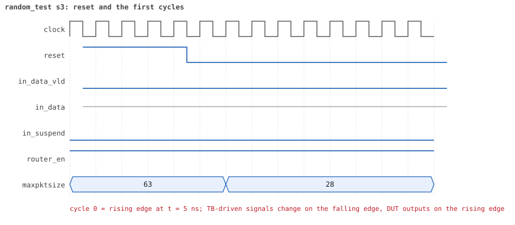
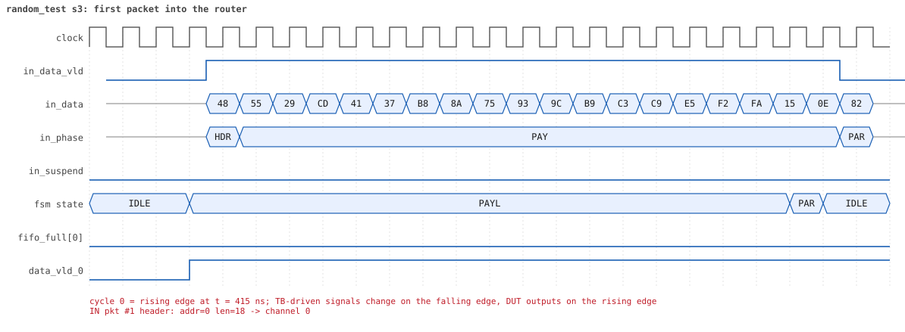
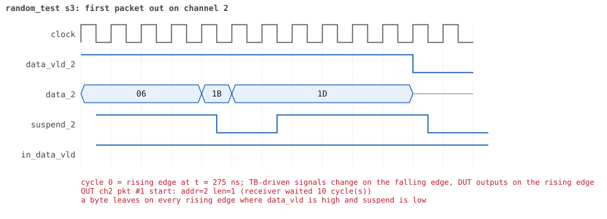
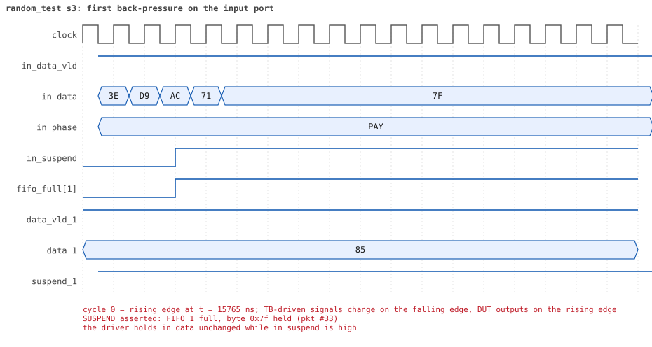
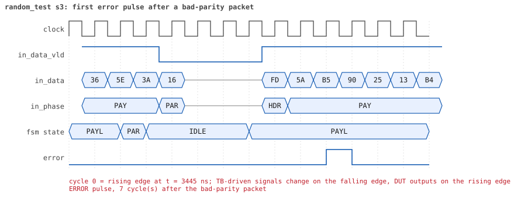
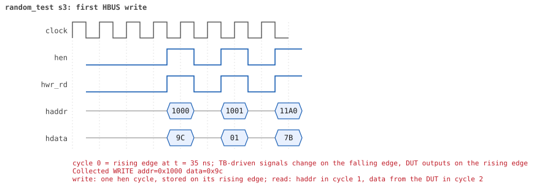
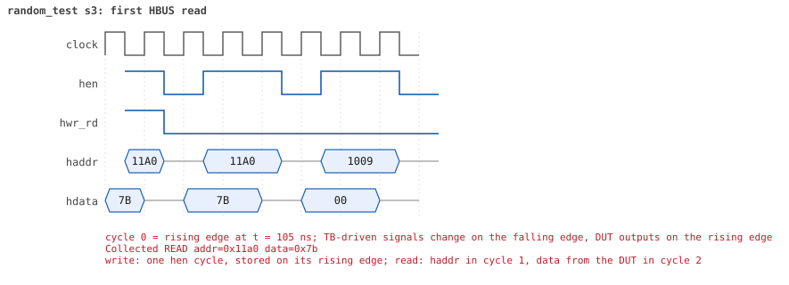

# random_test seed 3

**Result:** PASSED (0 UVM_ERROR, 0 UVM_WARNING, 0 UVM_FATAL) · bench `yapp_project_tb` · sim time 47us · wall 17.2 s · log [`random_test_s3.log`](random_test_s3.log)

Waves: `random_test_s3.fst` (GTKWave, Surfer or the VS Code wave viewer).
[Open the waves in Surfer](https://app.surfer-project.org/?load_url=https%3A%2F%2Fraw.githubusercontent.com%2Ftamirgabgab%2FQcom-Mentoring%2Fmain%2Fyapp_project%2Fregression%2Fyapp_project_tb%2Frandom_test_s3%2Frandom_test_s3.fst&startup_commands=run_command_file_from_url%20https%3A%2F%2Fraw.githubusercontent.com%2Ftamirgabgab%2FQcom-Mentoring%2Fmain%2Fyapp_project%2Ftb%2Fyapp_router.sucl) (web app, the signals already in groups: `yapp_project/tb/yapp_router.sucl`).

## Summary

- YAPP driver sent **89** packet(s) (8 with bad parity); the input monitor saw 89.
- Router: **53** forwarded, **36** dropped (33 oversized, 3 illegal address 3).
- Packets out: ch0 **14**, ch1 **13**, ch2 **26**.
- Scoreboard: 53 matched, 0 mismatched, 0 unexpected.
- Back-pressure: in_suspend asserted **8** time(s), longest hold 129 cycle(s).
- Error pulses: 8.
- HBUS: 14 write(s), 61 read(s).

## Stages

| time (ns) | stage |
|---|---|
| 0 | receivers: ch0 RX_STALLY, ch1 RX_STALLY, ch2 RX_FAST |
| 0 | random scenario: 89 packets in 3 bursts |
| 390 | burst 1/3: ctrl=0x9c (maxpktsize 28) en=0x01 (router on, counter enables 0000000), 30 packet(s) |
| 14060 | burst 1/3 sent: addr0..3 8/9/9/4, bad parity 3, gap 0 8, length 1..63 |
| 14210 | burst 2/3: ctrl=0xf0 (maxpktsize 48) en=0x01 (router on, counter enables 0000000), 29 packet(s) |
| 29280 | burst 2/3 sent: addr0..3 4/5/19/1, bad parity 1, gap 0 9, length 2..63 |
| 29610 | burst 3/3: ctrl=0x7e (maxpktsize 62) en=0x39 (router on, counter enables 0011100), 30 packet(s) |
| 45470 | burst 3/3 sent: addr0..3 10/6/13/1, bad parity 4, gap 0 8, length 6..63 |
| 45470 | final reads: every register and the stored packet, checked against the reference model |
| 46875 | done: 89 packets (53 forwarded, 36 dropped), 0 storm burst(s), 53 scoreboard matches, 60 HBUS reads checked, 8 error pulses for 8 bad packets |

## Pictures

**reset and the first cycles**

**first packet into the router**

**first packet out on channel 0**

**first back-pressure on the input port**

**first error pulse after a bad-parity packet**

**first HBUS write**

**first HBUS read**

## Timeline

1089 events.

| time (ns) | who | event |
|---|---|---|
| 0 | yapp monitor | YAPP monitor running |
| 0 | **test** | STAGE: receivers: ch0 RX_STALLY, ch1 RX_STALLY, ch2 RX_FAST |
| 0 | **test** | STAGE: random scenario: 89 packets in 3 bursts |
| 0 | clk/rst driver | Starting clock (period 10) and holding reset for 5 cycles |
| 0 | **DUT** | RESET asserted |
| 50 | **DUT** | RESET released: router_en=1 maxpktsize=63 |
| 70 | hbus driver | Executed WRITE addr=0x1000 data=0x9c |
| 75 | **DUT** | CONFIG router_en=1 maxpktsize=28 |
| 75 | hbus monitor | Collected WRITE addr=0x1000 data=0x9c |
| 75 | reference | maxpktsize is now 28 |
| 90 | hbus driver | Executed WRITE addr=0x1001 data=0x01 |
| 95 | hbus monitor | Collected WRITE addr=0x1001 data=0x01 |
| 95 | reference | router_en is now 1 (en_reg 0x01) |
| 110 | hbus driver | Executed WRITE addr=0x11a0 data=0x7b |
| 115 | hbus monitor | Collected WRITE addr=0x11a0 data=0x7b |
| 140 | hbus driver | Executed READ  addr=0x11a0 data=0x7b |
| 145 | hbus monitor | Collected READ  addr=0x11a0 data=0x7b |
| 170 | hbus driver | Executed READ  addr=0x1009 data=0x00 |
| 175 | hbus monitor | Collected READ  addr=0x1009 data=0x00 |
| 190 | hbus driver | Executed WRITE addr=0x1135 data=0xe1 |
| 195 | hbus monitor | Collected WRITE addr=0x1135 data=0xe1 |
| 220 | hbus driver | Executed READ  addr=0x1135 data=0xe1 |
| 225 | hbus monitor | Collected READ  addr=0x1135 data=0xe1 |
| 250 | hbus driver | Executed READ  addr=0x1024 data=0x00 |
| 255 | hbus monitor | Collected READ  addr=0x1024 data=0x00 |
| 280 | hbus driver | Executed READ  addr=0x100d data=0x00 |
| 285 | hbus monitor | Collected READ  addr=0x100d data=0x00 |
| 300 | hbus driver | Executed WRITE addr=0x1142 data=0x3e |
| 305 | hbus monitor | Collected WRITE addr=0x1142 data=0x3e |
| 330 | hbus driver | Executed READ  addr=0x1142 data=0x3e |
| 335 | hbus monitor | Collected READ  addr=0x1142 data=0x3e |
| 360 | hbus driver | Executed READ  addr=0x100c data=0x00 |
| 365 | hbus monitor | Collected READ  addr=0x100c data=0x00 |
| 390 | hbus driver | Executed READ  addr=0x100d data=0x00 |
| 390 | **test** | STAGE: burst 1/3: ctrl=0x9c (maxpktsize 28) en=0x01 (router on, counter enables 0000000), 30 packet(s) |
| 390 | yapp driver | TX pkt #1: addr=0 len=18 parity=good delay=4 |
| 395 | hbus monitor | Collected READ  addr=0x100d data=0x00 |
| 445 | **DUT** | IN  pkt #1 header: addr=0 len=18 -> channel 0 |
| 475 | **DUT** | OUT ch0 pkt #1 start: addr=0 len=18 (receiver waited 2 cycle(s)) |
| 635 | **DUT** | IN  pkt #1 complete: addr=0 len=18 parity=ok forwarded, 20 bytes in 20 cycles (held 0) |
| 635 | yapp monitor | RX pkt #1 on the input: addr=0 len=18 parity=good gap=39 |
| 635 | reference | Packet forwarded: addr=0 len=18 -> channel 0 |
| 640 | yapp driver | TX pkt #1 accepted by the DUT |
| 640 | yapp driver | TX pkt #2: addr=1 len=7 parity=good delay=10 |
| 660 | ch0 driver | ch0: packet consumed (response delay 2) |
| 745 | **DUT** | IN  pkt #2 header: addr=1 len=7 -> channel 1 |
| 775 | **DUT** | OUT ch0 pkt #1 done: 20 bytes in 31 cycles |
| 775 | ch0 monitor | ch0 RX pkt #1: addr=0 len=18 parity=good |
| 775 | scoreboard | ch0 pkt matched: addr=0 len=18 (1 matched so far) |
| 825 | **DUT** | IN  pkt #2 complete: addr=1 len=7 parity=ok forwarded, 9 bytes in 9 cycles (held 0) |
| 825 | **DUT** | OUT ch1 pkt #1 start: addr=1 len=7 (receiver waited 7 cycle(s)) |
| 825 | yapp monitor | RX pkt #2 on the input: addr=1 len=7 parity=good gap=10 |
| 825 | reference | Packet forwarded: addr=1 len=7 -> channel 1 |
| 830 | yapp driver | TX pkt #2 accepted by the DUT |
| 830 | yapp driver | TX pkt #3: addr=2 len=63 parity=good delay=0 |
| 835 | **DUT** | IN  pkt #3 header: addr=2 len=63 -> DROP (oversized: len 63 > maxpktsize 28) |
| 900 | ch1 driver | ch1: packet consumed (response delay 7) |
| 1015 | **DUT** | OUT ch1 pkt #1 done: 9 bytes in 20 cycles |
| 1015 | ch1 monitor | ch1 RX pkt #1: addr=1 len=7 parity=good |
| 1015 | scoreboard | ch1 pkt matched: addr=1 len=7 (2 matched so far) |
| 1100 | ch0 driver | ch0: packet consumed (response delay 10) |
| 1475 | **DUT** | IN  pkt #3 complete: addr=2 len=63 parity=ok dropped, 65 bytes in 65 cycles (held 0) |
| 1475 | yapp monitor | RX pkt #3 on the input: addr=2 len=63 parity=good gap=0 |
| 1475 | reference | Packet dropped: length 63 > maxpktsize 28 (addr=2) |
| 1475 | **DUT** | ROUTER DROPS PACKET addr=2 length=63 (length > maxpktsize) |
| 1480 | yapp driver | TX pkt #3 accepted by the DUT |
| 1480 | yapp driver | TX pkt #4: addr=2 len=63 parity=bad delay=3 |
| 1515 | **DUT** | IN  pkt #4 header: addr=2 len=63 -> DROP (oversized: len 63 > maxpktsize 28) |
| 1540 | ch1 driver | ch1: packet consumed (response delay 10) |
| 2155 | **DUT** | IN  pkt #4 complete: addr=2 len=63 parity=BAD dropped, 65 bytes in 65 cycles (held 0) |
| 2155 | yapp monitor | RX pkt #4 on the input: addr=2 len=63 parity=bad gap=3 |
| 2155 | reference | Packet dropped: length 63 > maxpktsize 28 (addr=2) |
| 2155 | **DUT** | ROUTER DROPS PACKET addr=2 length=63 (length > maxpktsize) |
| 2160 | yapp driver | TX pkt #4 accepted by the DUT |
| 2160 | yapp driver | TX pkt #5: addr=2 len=42 parity=good delay=11 |
| 2190 | **DUT** | ERROR pulse, 3 cycle(s) after the bad-parity packet |
| 2190 | error checker | error pulse 3 cycles after the bad packet (0 still owed) |
| 2275 | **DUT** | IN  pkt #5 header: addr=2 len=42 -> DROP (oversized: len 42 > maxpktsize 28) |
| 2705 | **DUT** | IN  pkt #5 complete: addr=2 len=42 parity=ok dropped, 44 bytes in 44 cycles (held 0) |
| 2705 | yapp monitor | RX pkt #5 on the input: addr=2 len=42 parity=good gap=11 |
| 2705 | reference | Packet dropped: length 42 > maxpktsize 28 (addr=2) |
| 2705 | **DUT** | ROUTER DROPS PACKET addr=2 length=42 (length > maxpktsize) |
| 2710 | yapp driver | TX pkt #5 accepted by the DUT |
| 2710 | yapp driver | TX pkt #6: addr=0 len=16 parity=good delay=2 |
| 2735 | **DUT** | IN  pkt #6 header: addr=0 len=16 -> channel 0 |
| 2835 | **DUT** | OUT ch0 pkt #2 start: addr=0 len=16 (receiver waited 9 cycle(s)) |
| 2905 | **DUT** | IN  pkt #6 complete: addr=0 len=16 parity=ok forwarded, 18 bytes in 18 cycles (held 0) |
| 2905 | yapp monitor | RX pkt #6 on the input: addr=0 len=16 parity=good gap=2 |
| 2905 | reference | Packet forwarded: addr=0 len=16 -> channel 0 |
| 2910 | yapp driver | TX pkt #6 accepted by the DUT |
| 2910 | yapp driver | TX pkt #7: addr=1 len=1 parity=good delay=0 |
| 2915 | **DUT** | IN  pkt #7 header: addr=1 len=1 -> channel 1 |
| 2935 | **DUT** | IN  pkt #7 complete: addr=1 len=1 parity=ok forwarded, 3 bytes in 3 cycles (held 0) |
| 2935 | yapp monitor | RX pkt #7 on the input: addr=1 len=1 parity=good gap=0 |
| 2935 | reference | Packet forwarded: addr=1 len=1 -> channel 1 |
| 2940 | yapp driver | TX pkt #7 accepted by the DUT |
| 2940 | yapp driver | TX pkt #8: addr=3 len=60 parity=good delay=1 |
| 2955 | **DUT** | IN  pkt #8 header: addr=3 len=60 -> DROP (oversized: len 60 > maxpktsize 28) |
| 3000 | ch0 driver | ch0: packet consumed (response delay 9) |
| 3015 | **DUT** | OUT ch1 pkt #2 start: addr=1 len=1 (receiver waited 9 cycle(s)) |
| 3030 | ch1 driver | ch1: packet consumed (response delay 9) |
| 3075 | **DUT** | OUT ch0 pkt #2 done: 18 bytes in 25 cycles |
| 3075 | ch0 monitor | ch0 RX pkt #2: addr=0 len=16 parity=good |
| 3075 | scoreboard | ch0 pkt matched: addr=0 len=16 (3 matched so far) |
| 3145 | **DUT** | OUT ch1 pkt #2 done: 3 bytes in 14 cycles |
| 3145 | ch1 monitor | ch1 RX pkt #2: addr=1 len=1 parity=good |
| 3145 | scoreboard | ch1 pkt matched: addr=1 len=1 (4 matched so far) |
| 3400 | ch1 driver | ch1: packet consumed (response delay 10) |
| 3565 | **DUT** | IN  pkt #8 complete: addr=3 len=60 parity=ok dropped, 62 bytes in 62 cycles (held 0) |
| 3565 | yapp monitor | RX pkt #8 on the input: addr=3 len=60 parity=good gap=1 |
| 3565 | reference | Packet dropped: illegal address 3 (len=60) |
| 3565 | **DUT** | ROUTER DROPS PACKET addr=3 length=60 (    illegal address) |
| 3570 | yapp driver | TX pkt #8 accepted by the DUT |
| 3570 | yapp driver | TX pkt #9: addr=1 len=48 parity=good delay=12 |
| 3695 | **DUT** | IN  pkt #9 header: addr=1 len=48 -> DROP (oversized: len 48 > maxpktsize 28) |
| 3710 | ch0 driver | ch0: packet consumed (response delay 6) |
| 4185 | **DUT** | IN  pkt #9 complete: addr=1 len=48 parity=ok dropped, 50 bytes in 50 cycles (held 0) |
| 4185 | yapp monitor | RX pkt #9 on the input: addr=1 len=48 parity=good gap=12 |
| 4185 | reference | Packet dropped: length 48 > maxpktsize 28 (addr=1) |
| 4185 | **DUT** | ROUTER DROPS PACKET addr=1 length=48 (length > maxpktsize) |
| 4190 | yapp driver | TX pkt #9 accepted by the DUT |
| 4190 | yapp driver | TX pkt #10: addr=1 len=39 parity=good delay=5 |
| 4245 | **DUT** | IN  pkt #10 header: addr=1 len=39 -> DROP (oversized: len 39 > maxpktsize 28) |
| 4645 | **DUT** | IN  pkt #10 complete: addr=1 len=39 parity=ok dropped, 41 bytes in 41 cycles (held 0) |
| 4645 | yapp monitor | RX pkt #10 on the input: addr=1 len=39 parity=good gap=5 |
| 4645 | reference | Packet dropped: length 39 > maxpktsize 28 (addr=1) |
| 4645 | **DUT** | ROUTER DROPS PACKET addr=1 length=39 (length > maxpktsize) |
| 4650 | yapp driver | TX pkt #10 accepted by the DUT |
| 4650 | yapp driver | TX pkt #11: addr=1 len=52 parity=good delay=20 |
| 4855 | **DUT** | IN  pkt #11 header: addr=1 len=52 -> DROP (oversized: len 52 > maxpktsize 28) |
| 5385 | **DUT** | IN  pkt #11 complete: addr=1 len=52 parity=ok dropped, 54 bytes in 54 cycles (held 0) |
| 5385 | yapp monitor | RX pkt #11 on the input: addr=1 len=52 parity=good gap=20 |
| 5385 | reference | Packet dropped: length 52 > maxpktsize 28 (addr=1) |
| 5385 | **DUT** | ROUTER DROPS PACKET addr=1 length=52 (length > maxpktsize) |
| 5390 | yapp driver | TX pkt #11 accepted by the DUT |
| 5390 | yapp driver | TX pkt #12: addr=2 len=36 parity=good delay=9 |
| 5485 | **DUT** | IN  pkt #12 header: addr=2 len=36 -> DROP (oversized: len 36 > maxpktsize 28) |
| 5855 | **DUT** | IN  pkt #12 complete: addr=2 len=36 parity=ok dropped, 38 bytes in 38 cycles (held 0) |
| 5855 | yapp monitor | RX pkt #12 on the input: addr=2 len=36 parity=good gap=9 |
| 5855 | reference | Packet dropped: length 36 > maxpktsize 28 (addr=2) |
| 5855 | **DUT** | ROUTER DROPS PACKET addr=2 length=36 (length > maxpktsize) |
| 5860 | yapp driver | TX pkt #12 accepted by the DUT |
| 5860 | yapp driver | TX pkt #13: addr=0 len=28 parity=good delay=3 |
| 5895 | **DUT** | IN  pkt #13 header: addr=0 len=28 -> channel 0 |
| 5915 | **DUT** | OUT ch0 pkt #3 start: addr=0 len=28 (receiver waited 1 cycle(s)) |
| 6185 | **DUT** | IN  pkt #13 complete: addr=0 len=28 parity=ok forwarded, 30 bytes in 30 cycles (held 0) |
| 6185 | yapp monitor | RX pkt #13 on the input: addr=0 len=28 parity=good gap=3 |
| 6185 | reference | Packet forwarded: addr=0 len=28 -> channel 0 |
| 6190 | yapp driver | TX pkt #13 accepted by the DUT |
| 6190 | yapp driver | TX pkt #14: addr=1 len=21 parity=good delay=0 |
| 6195 | **DUT** | IN  pkt #14 header: addr=1 len=21 -> channel 1 |
| 6200 | ch0 driver | ch0: packet consumed (response delay 1) |
| 6275 | **DUT** | OUT ch0 pkt #3 done: 30 bytes in 37 cycles |
| 6275 | ch0 monitor | ch0 RX pkt #3: addr=0 len=28 parity=good |
| 6275 | scoreboard | ch0 pkt matched: addr=0 len=28 (5 matched so far) |
| 6285 | **DUT** | OUT ch1 pkt #3 start: addr=1 len=21 (receiver waited 8 cycle(s)) |
| 6415 | **DUT** | IN  pkt #14 complete: addr=1 len=21 parity=ok forwarded, 23 bytes in 23 cycles (held 0) |
| 6415 | yapp monitor | RX pkt #14 on the input: addr=1 len=21 parity=good gap=0 |
| 6415 | reference | Packet forwarded: addr=1 len=21 -> channel 1 |
| 6420 | yapp driver | TX pkt #14 accepted by the DUT |
| 6420 | yapp driver | TX pkt #15: addr=2 len=63 parity=good delay=7 |
| 6495 | **DUT** | IN  pkt #15 header: addr=2 len=63 -> DROP (oversized: len 63 > maxpktsize 28) |
| 6500 | ch1 driver | ch1: packet consumed (response delay 8) |
| 6515 | **DUT** | OUT ch1 pkt #3 done: 23 bytes in 24 cycles |
| 6515 | ch1 monitor | ch1 RX pkt #3: addr=1 len=21 parity=good |
| 6515 | scoreboard | ch1 pkt matched: addr=1 len=21 (6 matched so far) |
| 6810 | ch0 driver | ch0: packet consumed (response delay 6) |
| 7130 | ch1 driver | ch1: packet consumed (response delay 0) |
| 7135 | **DUT** | IN  pkt #15 complete: addr=2 len=63 parity=ok dropped, 65 bytes in 65 cycles (held 0) |
| 7135 | yapp monitor | RX pkt #15 on the input: addr=2 len=63 parity=good gap=7 |
| 7135 | reference | Packet dropped: length 63 > maxpktsize 28 (addr=2) |
| 7135 | **DUT** | ROUTER DROPS PACKET addr=2 length=63 (length > maxpktsize) |
| 7140 | yapp driver | TX pkt #15 accepted by the DUT |
| 7140 | yapp driver | TX pkt #16: addr=0 len=31 parity=good delay=3 |
| 7175 | **DUT** | IN  pkt #16 header: addr=0 len=31 -> DROP (oversized: len 31 > maxpktsize 28) |
| 7495 | **DUT** | IN  pkt #16 complete: addr=0 len=31 parity=ok dropped, 33 bytes in 33 cycles (held 0) |
| 7495 | yapp monitor | RX pkt #16 on the input: addr=0 len=31 parity=good gap=3 |
| 7495 | reference | Packet dropped: length 31 > maxpktsize 28 (addr=0) |
| 7495 | **DUT** | ROUTER DROPS PACKET addr=0 length=31 (length > maxpktsize) |
| 7500 | yapp driver | TX pkt #16 accepted by the DUT |
| 7500 | yapp driver | TX pkt #17: addr=0 len=35 parity=bad delay=0 |
| 7505 | **DUT** | IN  pkt #17 header: addr=0 len=35 -> DROP (oversized: len 35 > maxpktsize 28) |
| 7865 | **DUT** | IN  pkt #17 complete: addr=0 len=35 parity=BAD dropped, 37 bytes in 37 cycles (held 0) |
| 7865 | yapp monitor | RX pkt #17 on the input: addr=0 len=35 parity=bad gap=0 |
| 7865 | reference | Packet dropped: length 35 > maxpktsize 28 (addr=0) |
| 7865 | **DUT** | ROUTER DROPS PACKET addr=0 length=35 (length > maxpktsize) |
| 7870 | yapp driver | TX pkt #17 accepted by the DUT |
| 7870 | yapp driver | TX pkt #18: addr=1 len=27 parity=good delay=20 |
| 7910 | **DUT** | ERROR pulse, 4 cycle(s) after the bad-parity packet |
| 7910 | error checker | error pulse 4 cycles after the bad packet (0 still owed) |
| 8075 | **DUT** | IN  pkt #18 header: addr=1 len=27 -> channel 1 |
| 8115 | **DUT** | OUT ch1 pkt #4 start: addr=1 len=27 (receiver waited 3 cycle(s)) |
| 8355 | **DUT** | IN  pkt #18 complete: addr=1 len=27 parity=ok forwarded, 29 bytes in 29 cycles (held 0) |
| 8355 | yapp monitor | RX pkt #18 on the input: addr=1 len=27 parity=good gap=20 |
| 8355 | reference | Packet forwarded: addr=1 len=27 -> channel 1 |
| 8360 | yapp driver | TX pkt #18 accepted by the DUT |
| 8360 | yapp driver | TX pkt #19: addr=0 len=9 parity=good delay=19 |
| 8390 | ch1 driver | ch1: packet consumed (response delay 3) |
| 8505 | **DUT** | OUT ch1 pkt #4 done: 29 bytes in 40 cycles |
| 8505 | ch1 monitor | ch1 RX pkt #4: addr=1 len=27 parity=good |
| 8505 | scoreboard | ch1 pkt matched: addr=1 len=27 (7 matched so far) |
| 8555 | **DUT** | IN  pkt #19 header: addr=0 len=9 -> channel 0 |
| 8655 | **DUT** | IN  pkt #19 complete: addr=0 len=9 parity=ok forwarded, 11 bytes in 11 cycles (held 0) |
| 8655 | yapp monitor | RX pkt #19 on the input: addr=0 len=9 parity=good gap=19 |
| 8655 | reference | Packet forwarded: addr=0 len=9 -> channel 0 |
| 8660 | yapp driver | TX pkt #19 accepted by the DUT |
| 8660 | yapp driver | TX pkt #20: addr=0 len=54 parity=good delay=0 |
| 8665 | **DUT** | IN  pkt #20 header: addr=0 len=54 -> DROP (oversized: len 54 > maxpktsize 28) |
| 8665 | **DUT** | OUT ch0 pkt #4 start: addr=0 len=9 (receiver waited 10 cycle(s)) |
| 8760 | ch0 driver | ch0: packet consumed (response delay 10) |
| 8795 | **DUT** | OUT ch0 pkt #4 done: 11 bytes in 14 cycles |
| 8795 | ch0 monitor | ch0 RX pkt #4: addr=0 len=9 parity=good |
| 8795 | scoreboard | ch0 pkt matched: addr=0 len=9 (8 matched so far) |
| 8850 | ch1 driver | ch1: packet consumed (response delay 10) |
| 8850 | ch0 driver | ch0: packet consumed (response delay 2) |
| 9215 | **DUT** | IN  pkt #20 complete: addr=0 len=54 parity=ok dropped, 56 bytes in 56 cycles (held 0) |
| 9215 | yapp monitor | RX pkt #20 on the input: addr=0 len=54 parity=good gap=0 |
| 9215 | reference | Packet dropped: length 54 > maxpktsize 28 (addr=0) |
| 9215 | **DUT** | ROUTER DROPS PACKET addr=0 length=54 (length > maxpktsize) |
| 9220 | yapp driver | TX pkt #20 accepted by the DUT |
| 9220 | yapp driver | TX pkt #21: addr=3 len=50 parity=good delay=12 |
| 9345 | **DUT** | IN  pkt #21 header: addr=3 len=50 -> DROP (oversized: len 50 > maxpktsize 28) |
| 9855 | **DUT** | IN  pkt #21 complete: addr=3 len=50 parity=ok dropped, 52 bytes in 52 cycles (held 0) |
| 9855 | yapp monitor | RX pkt #21 on the input: addr=3 len=50 parity=good gap=12 |
| 9855 | reference | Packet dropped: illegal address 3 (len=50) |
| 9855 | **DUT** | ROUTER DROPS PACKET addr=3 length=50 (    illegal address) |
| 9860 | yapp driver | TX pkt #21 accepted by the DUT |
| 9860 | yapp driver | TX pkt #22: addr=1 len=25 parity=good delay=7 |
| 9935 | **DUT** | IN  pkt #22 header: addr=1 len=25 -> channel 1 |
| 9995 | **DUT** | OUT ch1 pkt #5 start: addr=1 len=25 (receiver waited 5 cycle(s)) |
| 10195 | **DUT** | IN  pkt #22 complete: addr=1 len=25 parity=ok forwarded, 27 bytes in 27 cycles (held 0) |
| 10195 | yapp monitor | RX pkt #22 on the input: addr=1 len=25 parity=good gap=7 |
| 10195 | reference | Packet forwarded: addr=1 len=25 -> channel 1 |
| 10200 | yapp driver | TX pkt #22 accepted by the DUT |
| 10200 | yapp driver | TX pkt #23: addr=1 len=63 parity=good delay=0 |
| 10205 | **DUT** | IN  pkt #23 header: addr=1 len=63 -> DROP (oversized: len 63 > maxpktsize 28) |
| 10250 | ch1 driver | ch1: packet consumed (response delay 5) |
| 10345 | **DUT** | OUT ch1 pkt #5 done: 27 bytes in 36 cycles |
| 10345 | ch1 monitor | ch1 RX pkt #5: addr=1 len=25 parity=good |
| 10345 | scoreboard | ch1 pkt matched: addr=1 len=25 (9 matched so far) |
| 10720 | ch1 driver | ch1: packet consumed (response delay 8) |
| 10845 | **DUT** | IN  pkt #23 complete: addr=1 len=63 parity=ok dropped, 65 bytes in 65 cycles (held 0) |
| 10845 | yapp monitor | RX pkt #23 on the input: addr=1 len=63 parity=good gap=0 |
| 10845 | reference | Packet dropped: length 63 > maxpktsize 28 (addr=1) |
| 10845 | **DUT** | ROUTER DROPS PACKET addr=1 length=63 (length > maxpktsize) |
| 10850 | yapp driver | TX pkt #23 accepted by the DUT |
| 10850 | yapp driver | TX pkt #24: addr=2 len=3 parity=good delay=1 |
| 10865 | **DUT** | IN  pkt #24 header: addr=2 len=3 -> channel 2 |
| 10875 | **DUT** | OUT ch2 pkt #1 start: addr=2 len=3 (receiver waited 0 cycle(s)) |
| 10905 | **DUT** | IN  pkt #24 complete: addr=2 len=3 parity=ok forwarded, 5 bytes in 5 cycles (held 0) |
| 10905 | yapp monitor | RX pkt #24 on the input: addr=2 len=3 parity=good gap=1 |
| 10905 | reference | Packet forwarded: addr=2 len=3 -> channel 2 |
| 10910 | ch2 driver | ch2: packet consumed (response delay 0) |
| 10910 | yapp driver | TX pkt #24 accepted by the DUT |
| 10910 | yapp driver | TX pkt #25: addr=3 len=28 parity=good delay=0 |
| 10915 | **DUT** | IN  pkt #25 header: addr=3 len=28 -> DROP (illegal address 3) |
| 10925 | **DUT** | OUT ch2 pkt #1 done: 5 bytes in 6 cycles |
| 10925 | ch2 monitor | ch2 RX pkt #1: addr=2 len=3 parity=good |
| 10925 | scoreboard | ch2 pkt matched: addr=2 len=3 (10 matched so far) |
| 10970 | ch2 driver | ch2: packet consumed (response delay 0) |
| 11205 | **DUT** | IN  pkt #25 complete: addr=3 len=28 parity=ok dropped, 30 bytes in 30 cycles (held 0) |
| 11205 | yapp monitor | RX pkt #25 on the input: addr=3 len=28 parity=good gap=0 |
| 11205 | reference | Packet dropped: illegal address 3 (len=28) |
| 11205 | **DUT** | ROUTER DROPS PACKET addr=3 length=28 (    illegal address) |
| 11210 | yapp driver | TX pkt #25 accepted by the DUT |
| 11210 | yapp driver | TX pkt #26: addr=2 len=29 parity=good delay=0 |
| 11215 | **DUT** | IN  pkt #26 header: addr=2 len=29 -> DROP (oversized: len 29 > maxpktsize 28) |
| 11515 | **DUT** | IN  pkt #26 complete: addr=2 len=29 parity=ok dropped, 31 bytes in 31 cycles (held 0) |
| 11515 | yapp monitor | RX pkt #26 on the input: addr=2 len=29 parity=good gap=0 |
| 11515 | reference | Packet dropped: length 29 > maxpktsize 28 (addr=2) |
| 11515 | **DUT** | ROUTER DROPS PACKET addr=2 length=29 (length > maxpktsize) |
| 11520 | yapp driver | TX pkt #26 accepted by the DUT |
| 11520 | yapp driver | TX pkt #27: addr=3 len=57 parity=good delay=18 |
| 11705 | **DUT** | IN  pkt #27 header: addr=3 len=57 -> DROP (oversized: len 57 > maxpktsize 28) |
| 12285 | **DUT** | IN  pkt #27 complete: addr=3 len=57 parity=ok dropped, 59 bytes in 59 cycles (held 0) |
| 12285 | yapp monitor | RX pkt #27 on the input: addr=3 len=57 parity=good gap=18 |
| 12285 | reference | Packet dropped: illegal address 3 (len=57) |
| 12285 | **DUT** | ROUTER DROPS PACKET addr=3 length=57 (    illegal address) |
| 12290 | yapp driver | TX pkt #27 accepted by the DUT |
| 12290 | yapp driver | TX pkt #28: addr=2 len=63 parity=bad delay=16 |
| 12455 | **DUT** | IN  pkt #28 header: addr=2 len=63 -> DROP (oversized: len 63 > maxpktsize 28) |
| 13095 | **DUT** | IN  pkt #28 complete: addr=2 len=63 parity=BAD dropped, 65 bytes in 65 cycles (held 0) |
| 13095 | yapp monitor | RX pkt #28 on the input: addr=2 len=63 parity=bad gap=16 |
| 13095 | reference | Packet dropped: length 63 > maxpktsize 28 (addr=2) |
| 13095 | **DUT** | ROUTER DROPS PACKET addr=2 length=63 (length > maxpktsize) |
| 13100 | yapp driver | TX pkt #28 accepted by the DUT |
| 13100 | yapp driver | TX pkt #29: addr=2 len=24 parity=good delay=4 |
| 13145 | **DUT** | IN  pkt #29 header: addr=2 len=24 -> channel 2 |
| 13155 | **DUT** | OUT ch2 pkt #2 start: addr=2 len=24 (receiver waited 0 cycle(s)) |
| 13190 | **DUT** | ERROR pulse, 9 cycle(s) after the bad-parity packet |
| 13190 | error checker | error pulse 9 cycles after the bad packet (0 still owed) |
| 13395 | **DUT** | IN  pkt #29 complete: addr=2 len=24 parity=ok forwarded, 26 bytes in 26 cycles (held 0) |
| 13395 | yapp monitor | RX pkt #29 on the input: addr=2 len=24 parity=good gap=4 |
| 13395 | reference | Packet forwarded: addr=2 len=24 -> channel 2 |
| 13400 | ch2 driver | ch2: packet consumed (response delay 0) |
| 13400 | yapp driver | TX pkt #29 accepted by the DUT |
| 13400 | yapp driver | TX pkt #30: addr=0 len=63 parity=good delay=1 |
| 13415 | **DUT** | IN  pkt #30 header: addr=0 len=63 -> DROP (oversized: len 63 > maxpktsize 28) |
| 13415 | **DUT** | OUT ch2 pkt #2 done: 26 bytes in 27 cycles |
| 13415 | ch2 monitor | ch2 RX pkt #2: addr=2 len=24 parity=good |
| 13415 | scoreboard | ch2 pkt matched: addr=2 len=24 (11 matched so far) |
| 13480 | ch2 driver | ch2: packet consumed (response delay 0) |
| 14055 | **DUT** | IN  pkt #30 complete: addr=0 len=63 parity=ok dropped, 65 bytes in 65 cycles (held 0) |
| 14055 | yapp monitor | RX pkt #30 on the input: addr=0 len=63 parity=good gap=1 |
| 14055 | reference | Packet dropped: length 63 > maxpktsize 28 (addr=0) |
| 14055 | **DUT** | ROUTER DROPS PACKET addr=0 length=63 (length > maxpktsize) |
| 14060 | yapp driver | TX pkt #30 accepted by the DUT |
| 14060 | **test** | STAGE: burst 1/3 sent: addr0..3 8/9/9/4, bad parity 3, gap 0 8, length 1..63 |
| 14080 | hbus driver | Executed WRITE addr=0x1000 data=0xf0 |
| 14085 | **DUT** | CONFIG router_en=1 maxpktsize=48 |
| 14085 | hbus monitor | Collected WRITE addr=0x1000 data=0xf0 |
| 14085 | reference | maxpktsize is now 48 |
| 14100 | hbus driver | Executed WRITE addr=0x1001 data=0x01 |
| 14105 | hbus monitor | Collected WRITE addr=0x1001 data=0x01 |
| 14105 | reference | router_en is now 1 (en_reg 0x01) |
| 14130 | hbus driver | Executed READ  addr=0x1010 data=0xfc |
| 14135 | hbus monitor | Collected READ  addr=0x1010 data=0xfc |
| 14150 | hbus driver | Executed WRITE addr=0x115c data=0x01 |
| 14155 | hbus monitor | Collected WRITE addr=0x115c data=0x01 |
| 14180 | hbus driver | Executed READ  addr=0x115c data=0x01 |
| 14185 | hbus monitor | Collected READ  addr=0x115c data=0x01 |
| 14210 | hbus driver | Executed READ  addr=0x1004 data=0x00 |
| 14210 | **test** | STAGE: burst 2/3: ctrl=0xf0 (maxpktsize 48) en=0x01 (router on, counter enables 0000000), 29 packet(s) |
| 14210 | yapp driver | TX pkt #31: addr=2 len=56 parity=good delay=18 |
| 14215 | hbus monitor | Collected READ  addr=0x1004 data=0x00 |
| 14405 | **DUT** | IN  pkt #31 header: addr=2 len=56 -> DROP (oversized: len 56 > maxpktsize 48) |
| 14975 | **DUT** | IN  pkt #31 complete: addr=2 len=56 parity=ok dropped, 58 bytes in 58 cycles (held 0) |
| 14975 | yapp monitor | RX pkt #31 on the input: addr=2 len=56 parity=good gap=34 |
| 14975 | reference | Packet dropped: length 56 > maxpktsize 48 (addr=2) |
| 14975 | **DUT** | ROUTER DROPS PACKET addr=2 length=56 (length > maxpktsize) |
| 14980 | yapp driver | TX pkt #31 accepted by the DUT |
| 14980 | yapp driver | TX pkt #32: addr=2 len=63 parity=good delay=1 |
| 14995 | **DUT** | IN  pkt #32 header: addr=2 len=63 -> DROP (oversized: len 63 > maxpktsize 48) |
| 15635 | **DUT** | IN  pkt #32 complete: addr=2 len=63 parity=ok dropped, 65 bytes in 65 cycles (held 0) |
| 15635 | yapp monitor | RX pkt #32 on the input: addr=2 len=63 parity=good gap=1 |
| 15635 | reference | Packet dropped: length 63 > maxpktsize 48 (addr=2) |
| 15635 | **DUT** | ROUTER DROPS PACKET addr=2 length=63 (length > maxpktsize) |
| 15640 | yapp driver | TX pkt #32 accepted by the DUT |
| 15640 | yapp driver | TX pkt #33: addr=1 len=33 parity=good delay=0 |
| 15645 | **DUT** | IN  pkt #33 header: addr=1 len=33 -> channel 1 |
| 15805 | **DUT** | SUSPEND asserted: FIFO 1 full, byte 0x7f held (pkt #33) |
| 17085 | **DUT** | OUT ch1 pkt #6 start: addr=1 len=33 (receiver waited 143 cycle(s)) |
| 17095 | **DUT** | SUSPEND released after 129 cycle(s) |
| 17275 | **DUT** | IN  pkt #33 complete: addr=1 len=33 parity=ok forwarded, 35 bytes in 164 cycles (held 129) |
| 17275 | yapp monitor | RX pkt #33 on the input: addr=1 len=33 parity=good gap=0 |
| 17275 | reference | Packet forwarded: addr=1 len=33 -> channel 1 |
| 17280 | yapp driver | TX pkt #33 accepted by the DUT |
| 17280 | yapp driver | TX pkt #34: addr=2 len=48 parity=good delay=0 |
| 17285 | **DUT** | IN  pkt #34 header: addr=2 len=48 -> channel 2 |
| 17295 | **DUT** | OUT ch2 pkt #3 start: addr=2 len=48 (receiver waited 0 cycle(s)) |
| 17420 | ch1 driver | ch1: packet consumed (response delay 143) |
| 17445 | **DUT** | OUT ch1 pkt #6 done: 35 bytes in 37 cycles |
| 17445 | ch1 monitor | ch1 RX pkt #6: addr=1 len=33 parity=good |
| 17445 | scoreboard | ch1 pkt matched: addr=1 len=33 (12 matched so far) |
| 17775 | **DUT** | IN  pkt #34 complete: addr=2 len=48 parity=ok forwarded, 50 bytes in 50 cycles (held 0) |
| 17775 | yapp monitor | RX pkt #34 on the input: addr=2 len=48 parity=good gap=0 |
| 17775 | reference | Packet forwarded: addr=2 len=48 -> channel 2 |
| 17780 | ch2 driver | ch2: packet consumed (response delay 0) |
| 17780 | yapp driver | TX pkt #34 accepted by the DUT |
| 17780 | yapp driver | TX pkt #35: addr=2 len=16 parity=good delay=1 |
| 17795 | **DUT** | IN  pkt #35 header: addr=2 len=16 -> channel 2 |
| 17795 | **DUT** | OUT ch2 pkt #3 done: 50 bytes in 51 cycles |
| 17795 | ch2 monitor | ch2 RX pkt #3: addr=2 len=48 parity=good |
| 17795 | scoreboard | ch2 pkt matched: addr=2 len=48 (13 matched so far) |
| 17805 | **DUT** | OUT ch2 pkt #4 start: addr=2 len=16 (receiver waited 0 cycle(s)) |
| 17965 | **DUT** | IN  pkt #35 complete: addr=2 len=16 parity=ok forwarded, 18 bytes in 18 cycles (held 0) |
| 17965 | yapp monitor | RX pkt #35 on the input: addr=2 len=16 parity=good gap=1 |
| 17965 | reference | Packet forwarded: addr=2 len=16 -> channel 2 |
| 17970 | yapp driver | TX pkt #35 accepted by the DUT |
| 17970 | yapp driver | TX pkt #36: addr=2 len=45 parity=good delay=2 |
| 17975 | **DUT** | OUT ch2 pkt #4 done: 18 bytes in 18 cycles |
| 17975 | ch2 monitor | ch2 RX pkt #4: addr=2 len=16 parity=good |
| 17975 | scoreboard | ch2 pkt matched: addr=2 len=16 (14 matched so far) |
| 17990 | ch1 driver | ch1: packet consumed (response delay 1) |
| 17995 | **DUT** | IN  pkt #36 header: addr=2 len=45 -> channel 2 |
| 18005 | **DUT** | OUT ch2 pkt #5 start: addr=2 len=45 (receiver waited 0 cycle(s)) |
| 18140 | ch2 driver | ch2: packet consumed (response delay 0) |
| 18455 | **DUT** | IN  pkt #36 complete: addr=2 len=45 parity=ok forwarded, 47 bytes in 47 cycles (held 0) |
| 18455 | yapp monitor | RX pkt #36 on the input: addr=2 len=45 parity=good gap=2 |
| 18455 | reference | Packet forwarded: addr=2 len=45 -> channel 2 |
| 18460 | yapp driver | TX pkt #36 accepted by the DUT |
| 18460 | yapp driver | TX pkt #37: addr=2 len=63 parity=good delay=5 |
| 18475 | **DUT** | OUT ch2 pkt #5 done: 47 bytes in 48 cycles |
| 18475 | ch2 monitor | ch2 RX pkt #5: addr=2 len=45 parity=good |
| 18475 | scoreboard | ch2 pkt matched: addr=2 len=45 (15 matched so far) |
| 18500 | ch2 driver | ch2: packet consumed (response delay 0) |
| 18515 | **DUT** | IN  pkt #37 header: addr=2 len=63 -> DROP (oversized: len 63 > maxpktsize 48) |
| 19155 | **DUT** | IN  pkt #37 complete: addr=2 len=63 parity=ok dropped, 65 bytes in 65 cycles (held 0) |
| 19155 | yapp monitor | RX pkt #37 on the input: addr=2 len=63 parity=good gap=5 |
| 19155 | reference | Packet dropped: length 63 > maxpktsize 48 (addr=2) |
| 19155 | **DUT** | ROUTER DROPS PACKET addr=2 length=63 (length > maxpktsize) |
| 19160 | yapp driver | TX pkt #37 accepted by the DUT |
| 19160 | yapp driver | TX pkt #38: addr=2 len=49 parity=good delay=6 |
| 19225 | **DUT** | IN  pkt #38 header: addr=2 len=49 -> DROP (oversized: len 49 > maxpktsize 48) |
| 19725 | **DUT** | IN  pkt #38 complete: addr=2 len=49 parity=ok dropped, 51 bytes in 51 cycles (held 0) |
| 19725 | yapp monitor | RX pkt #38 on the input: addr=2 len=49 parity=good gap=6 |
| 19725 | reference | Packet dropped: length 49 > maxpktsize 48 (addr=2) |
| 19725 | **DUT** | ROUTER DROPS PACKET addr=2 length=49 (length > maxpktsize) |
| 19730 | yapp driver | TX pkt #38 accepted by the DUT |
| 19730 | yapp driver | TX pkt #39: addr=0 len=51 parity=good delay=0 |
| 19735 | **DUT** | IN  pkt #39 header: addr=0 len=51 -> DROP (oversized: len 51 > maxpktsize 48) |
| 20255 | **DUT** | IN  pkt #39 complete: addr=0 len=51 parity=ok dropped, 53 bytes in 53 cycles (held 0) |
| 20255 | yapp monitor | RX pkt #39 on the input: addr=0 len=51 parity=good gap=0 |
| 20255 | reference | Packet dropped: length 51 > maxpktsize 48 (addr=0) |
| 20255 | **DUT** | ROUTER DROPS PACKET addr=0 length=51 (length > maxpktsize) |
| 20260 | yapp driver | TX pkt #39 accepted by the DUT |
| 20260 | yapp driver | TX pkt #40: addr=1 len=2 parity=good delay=17 |
| 20435 | **DUT** | IN  pkt #40 header: addr=1 len=2 -> channel 1 |
| 20465 | **DUT** | IN  pkt #40 complete: addr=1 len=2 parity=ok forwarded, 4 bytes in 4 cycles (held 0) |
| 20465 | yapp monitor | RX pkt #40 on the input: addr=1 len=2 parity=good gap=17 |
| 20465 | reference | Packet forwarded: addr=1 len=2 -> channel 1 |
| 20470 | yapp driver | TX pkt #40 accepted by the DUT |
| 20470 | yapp driver | TX pkt #41: addr=2 len=54 parity=good delay=4 |
| 20515 | **DUT** | IN  pkt #41 header: addr=2 len=54 -> DROP (oversized: len 54 > maxpktsize 48) |
| 20535 | **DUT** | OUT ch1 pkt #7 start: addr=1 len=2 (receiver waited 9 cycle(s)) |
| 20560 | ch1 driver | ch1: packet consumed (response delay 9) |
| 20585 | **DUT** | OUT ch1 pkt #7 done: 4 bytes in 6 cycles |
| 20585 | ch1 monitor | ch1 RX pkt #7: addr=1 len=2 parity=good |
| 20585 | scoreboard | ch1 pkt matched: addr=1 len=2 (16 matched so far) |
| 20720 | ch1 driver | ch1: packet consumed (response delay 1) |
| 21065 | **DUT** | IN  pkt #41 complete: addr=2 len=54 parity=ok dropped, 56 bytes in 56 cycles (held 0) |
| 21065 | yapp monitor | RX pkt #41 on the input: addr=2 len=54 parity=good gap=4 |
| 21065 | reference | Packet dropped: length 54 > maxpktsize 48 (addr=2) |
| 21065 | **DUT** | ROUTER DROPS PACKET addr=2 length=54 (length > maxpktsize) |
| 21070 | yapp driver | TX pkt #41 accepted by the DUT |
| 21070 | yapp driver | TX pkt #42: addr=2 len=8 parity=good delay=3 |
| 21105 | **DUT** | IN  pkt #42 header: addr=2 len=8 -> channel 2 |
| 21115 | **DUT** | OUT ch2 pkt #6 start: addr=2 len=8 (receiver waited 0 cycle(s)) |
| 21195 | **DUT** | IN  pkt #42 complete: addr=2 len=8 parity=ok forwarded, 10 bytes in 10 cycles (held 0) |
| 21195 | yapp monitor | RX pkt #42 on the input: addr=2 len=8 parity=good gap=3 |
| 21195 | reference | Packet forwarded: addr=2 len=8 -> channel 2 |
| 21200 | ch2 driver | ch2: packet consumed (response delay 0) |
| 21200 | yapp driver | TX pkt #42 accepted by the DUT |
| 21200 | yapp driver | TX pkt #43: addr=2 len=36 parity=good delay=19 |
| 21215 | **DUT** | OUT ch2 pkt #6 done: 10 bytes in 11 cycles |
| 21215 | ch2 monitor | ch2 RX pkt #6: addr=2 len=8 parity=good |
| 21215 | scoreboard | ch2 pkt matched: addr=2 len=8 (17 matched so far) |
| 21395 | **DUT** | IN  pkt #43 header: addr=2 len=36 -> channel 2 |
| 21405 | **DUT** | OUT ch2 pkt #7 start: addr=2 len=36 (receiver waited 0 cycle(s)) |
| 21480 | ch2 driver | ch2: packet consumed (response delay 0) |
| 21765 | **DUT** | IN  pkt #43 complete: addr=2 len=36 parity=ok forwarded, 38 bytes in 38 cycles (held 0) |
| 21765 | yapp monitor | RX pkt #43 on the input: addr=2 len=36 parity=good gap=19 |
| 21765 | reference | Packet forwarded: addr=2 len=36 -> channel 2 |
| 21770 | yapp driver | TX pkt #43 accepted by the DUT |
| 21770 | yapp driver | TX pkt #44: addr=0 len=37 parity=good delay=0 |
| 21775 | **DUT** | IN  pkt #44 header: addr=0 len=37 -> channel 0 |
| 21785 | **DUT** | OUT ch2 pkt #7 done: 38 bytes in 39 cycles |
| 21785 | ch2 monitor | ch2 RX pkt #7: addr=2 len=36 parity=good |
| 21785 | scoreboard | ch2 pkt matched: addr=2 len=36 (18 matched so far) |
| 21935 | **DUT** | SUSPEND asserted: FIFO 0 full, byte 0x72 held (pkt #44) |
| 21940 | ch2 driver | ch2: packet consumed (response delay 0) |
| 22615 | **DUT** | OUT ch0 pkt #5 start: addr=0 len=37 (receiver waited 83 cycle(s)) |
| 22625 | **DUT** | SUSPEND released after 69 cycle(s) |
| 22845 | **DUT** | IN  pkt #44 complete: addr=0 len=37 parity=ok forwarded, 39 bytes in 108 cycles (held 69) |
| 22845 | yapp monitor | RX pkt #44 on the input: addr=0 len=37 parity=good gap=0 |
| 22845 | reference | Packet forwarded: addr=0 len=37 -> channel 0 |
| 22850 | yapp driver | TX pkt #44 accepted by the DUT |
| 22850 | yapp driver | TX pkt #45: addr=0 len=17 parity=good delay=1 |
| 22865 | **DUT** | IN  pkt #45 header: addr=0 len=17 -> channel 0 |
| 22990 | ch0 driver | ch0: packet consumed (response delay 83) |
| 23015 | **DUT** | SUSPEND asserted: FIFO 0 full, byte 0x73 held (pkt #45) |
| 23105 | **DUT** | OUT ch0 pkt #5 done: 39 bytes in 50 cycles |
| 23105 | ch0 monitor | ch0 RX pkt #5: addr=0 len=37 parity=good |
| 23105 | scoreboard | ch0 pkt matched: addr=0 len=37 (19 matched so far) |
| 23115 | **DUT** | SUSPEND released after 10 cycle(s) |
| 23115 | **DUT** | OUT ch0 pkt #6 start: addr=0 len=17 (receiver waited 0 cycle(s)) |
| 23145 | **DUT** | IN  pkt #45 complete: addr=0 len=17 parity=ok forwarded, 19 bytes in 29 cycles (held 10) |
| 23145 | yapp monitor | RX pkt #45 on the input: addr=0 len=17 parity=good gap=1 |
| 23145 | reference | Packet forwarded: addr=0 len=17 -> channel 0 |
| 23150 | yapp driver | TX pkt #45 accepted by the DUT |
| 23150 | yapp driver | TX pkt #46: addr=2 len=45 parity=good delay=3 |
| 23185 | **DUT** | IN  pkt #46 header: addr=2 len=45 -> channel 2 |
| 23195 | **DUT** | OUT ch2 pkt #8 start: addr=2 len=45 (receiver waited 0 cycle(s)) |
| 23295 | **DUT** | OUT ch0 pkt #6 done: 19 bytes in 19 cycles |
| 23295 | ch0 monitor | ch0 RX pkt #6: addr=0 len=17 parity=good |
| 23295 | scoreboard | ch0 pkt matched: addr=0 len=17 (20 matched so far) |
| 23645 | **DUT** | IN  pkt #46 complete: addr=2 len=45 parity=ok forwarded, 47 bytes in 47 cycles (held 0) |
| 23645 | yapp monitor | RX pkt #46 on the input: addr=2 len=45 parity=good gap=3 |
| 23645 | reference | Packet forwarded: addr=2 len=45 -> channel 2 |
| 23650 | ch2 driver | ch2: packet consumed (response delay 0) |
| 23650 | yapp driver | TX pkt #46 accepted by the DUT |
| 23650 | yapp driver | TX pkt #47: addr=2 len=7 parity=good delay=10 |
| 23665 | **DUT** | OUT ch2 pkt #8 done: 47 bytes in 48 cycles |
| 23665 | ch2 monitor | ch2 RX pkt #8: addr=2 len=45 parity=good |
| 23665 | scoreboard | ch2 pkt matched: addr=2 len=45 (21 matched so far) |
| 23670 | ch0 driver | ch0: packet consumed (response delay 10) |
| 23755 | **DUT** | IN  pkt #47 header: addr=2 len=7 -> channel 2 |
| 23765 | **DUT** | OUT ch2 pkt #9 start: addr=2 len=7 (receiver waited 0 cycle(s)) |
| 23835 | **DUT** | IN  pkt #47 complete: addr=2 len=7 parity=ok forwarded, 9 bytes in 9 cycles (held 0) |
| 23835 | yapp monitor | RX pkt #47 on the input: addr=2 len=7 parity=good gap=10 |
| 23835 | reference | Packet forwarded: addr=2 len=7 -> channel 2 |
| 23840 | yapp driver | TX pkt #47 accepted by the DUT |
| 23840 | yapp driver | TX pkt #48: addr=2 len=31 parity=good delay=0 |
| 23845 | **DUT** | IN  pkt #48 header: addr=2 len=31 -> channel 2 |
| 23845 | **DUT** | OUT ch2 pkt #9 done: 9 bytes in 9 cycles |
| 23845 | ch2 monitor | ch2 RX pkt #9: addr=2 len=7 parity=good |
| 23845 | scoreboard | ch2 pkt matched: addr=2 len=7 (22 matched so far) |
| 23855 | **DUT** | OUT ch2 pkt #10 start: addr=2 len=31 (receiver waited 0 cycle(s)) |
| 23880 | ch2 driver | ch2: packet consumed (response delay 0) |
| 24165 | **DUT** | IN  pkt #48 complete: addr=2 len=31 parity=ok forwarded, 33 bytes in 33 cycles (held 0) |
| 24165 | yapp monitor | RX pkt #48 on the input: addr=2 len=31 parity=good gap=0 |
| 24165 | reference | Packet forwarded: addr=2 len=31 -> channel 2 |
| 24170 | yapp driver | TX pkt #48 accepted by the DUT |
| 24170 | yapp driver | TX pkt #49: addr=1 len=63 parity=good delay=19 |
| 24185 | **DUT** | OUT ch2 pkt #10 done: 33 bytes in 34 cycles |
| 24185 | ch2 monitor | ch2 RX pkt #10: addr=2 len=31 parity=good |
| 24185 | scoreboard | ch2 pkt matched: addr=2 len=31 (23 matched so far) |
| 24365 | **DUT** | IN  pkt #49 header: addr=1 len=63 -> DROP (oversized: len 63 > maxpktsize 48) |
| 24400 | ch2 driver | ch2: packet consumed (response delay 0) |
| 25005 | **DUT** | IN  pkt #49 complete: addr=1 len=63 parity=ok dropped, 65 bytes in 65 cycles (held 0) |
| 25005 | yapp monitor | RX pkt #49 on the input: addr=1 len=63 parity=good gap=19 |
| 25005 | reference | Packet dropped: length 63 > maxpktsize 48 (addr=1) |
| 25005 | **DUT** | ROUTER DROPS PACKET addr=1 length=63 (length > maxpktsize) |
| 25010 | yapp driver | TX pkt #49 accepted by the DUT |
| 25010 | yapp driver | TX pkt #50: addr=0 len=54 parity=good delay=1 |
| 25025 | **DUT** | IN  pkt #50 header: addr=0 len=54 -> DROP (oversized: len 54 > maxpktsize 48) |
| 25575 | **DUT** | IN  pkt #50 complete: addr=0 len=54 parity=ok dropped, 56 bytes in 56 cycles (held 0) |
| 25575 | yapp monitor | RX pkt #50 on the input: addr=0 len=54 parity=good gap=1 |
| 25575 | reference | Packet dropped: length 54 > maxpktsize 48 (addr=0) |
| 25575 | **DUT** | ROUTER DROPS PACKET addr=0 length=54 (length > maxpktsize) |
| 25580 | yapp driver | TX pkt #50 accepted by the DUT |
| 25580 | yapp driver | TX pkt #51: addr=1 len=50 parity=good delay=0 |
| 25585 | **DUT** | IN  pkt #51 header: addr=1 len=50 -> DROP (oversized: len 50 > maxpktsize 48) |
| 26095 | **DUT** | IN  pkt #51 complete: addr=1 len=50 parity=ok dropped, 52 bytes in 52 cycles (held 0) |
| 26095 | yapp monitor | RX pkt #51 on the input: addr=1 len=50 parity=good gap=0 |
| 26095 | reference | Packet dropped: length 50 > maxpktsize 48 (addr=1) |
| 26095 | **DUT** | ROUTER DROPS PACKET addr=1 length=50 (length > maxpktsize) |
| 26100 | yapp driver | TX pkt #51 accepted by the DUT |
| 26100 | yapp driver | TX pkt #52: addr=3 len=31 parity=good delay=13 |
| 26235 | **DUT** | IN  pkt #52 header: addr=3 len=31 -> DROP (illegal address 3) |
| 26555 | **DUT** | IN  pkt #52 complete: addr=3 len=31 parity=ok dropped, 33 bytes in 33 cycles (held 0) |
| 26555 | yapp monitor | RX pkt #52 on the input: addr=3 len=31 parity=good gap=13 |
| 26555 | reference | Packet dropped: illegal address 3 (len=31) |
| 26555 | **DUT** | ROUTER DROPS PACKET addr=3 length=31 (    illegal address) |
| 26560 | yapp driver | TX pkt #52 accepted by the DUT |
| 26560 | yapp driver | TX pkt #53: addr=2 len=47 parity=good delay=0 |
| 26565 | **DUT** | IN  pkt #53 header: addr=2 len=47 -> channel 2 |
| 26575 | **DUT** | OUT ch2 pkt #11 start: addr=2 len=47 (receiver waited 0 cycle(s)) |
| 27045 | **DUT** | IN  pkt #53 complete: addr=2 len=47 parity=ok forwarded, 49 bytes in 49 cycles (held 0) |
| 27045 | yapp monitor | RX pkt #53 on the input: addr=2 len=47 parity=good gap=0 |
| 27045 | reference | Packet forwarded: addr=2 len=47 -> channel 2 |
| 27050 | ch2 driver | ch2: packet consumed (response delay 0) |
| 27050 | yapp driver | TX pkt #53 accepted by the DUT |
| 27050 | yapp driver | TX pkt #54: addr=2 len=36 parity=bad delay=12 |
| 27065 | **DUT** | OUT ch2 pkt #11 done: 49 bytes in 50 cycles |
| 27065 | ch2 monitor | ch2 RX pkt #11: addr=2 len=47 parity=good |
| 27065 | scoreboard | ch2 pkt matched: addr=2 len=47 (24 matched so far) |
| 27070 | ch2 driver | ch2: packet consumed (response delay 0) |
| 27175 | **DUT** | IN  pkt #54 header: addr=2 len=36 -> channel 2 |
| 27185 | **DUT** | OUT ch2 pkt #12 start: addr=2 len=36 (receiver waited 0 cycle(s)) |
| 27545 | **DUT** | IN  pkt #54 complete: addr=2 len=36 parity=BAD forwarded, 38 bytes in 38 cycles (held 0) |
| 27545 | yapp monitor | RX pkt #54 on the input: addr=2 len=36 parity=bad gap=12 |
| 27545 | reference | Packet forwarded: addr=2 len=36 -> channel 2 |
| 27550 | ch2 driver | ch2: packet consumed (response delay 0) |
| 27550 | yapp driver | TX pkt #54 accepted by the DUT |
| 27550 | yapp driver | TX pkt #55: addr=2 len=12 parity=good delay=2 |
| 27565 | **DUT** | OUT ch2 pkt #12 done: 38 bytes in 39 cycles |
| 27565 | ch2 monitor | ch2 RX pkt #12: addr=2 len=36 parity=bad |
| 27565 | scoreboard | ch2 pkt matched: addr=2 len=36 (25 matched so far) |
| 27575 | **DUT** | IN  pkt #55 header: addr=2 len=12 -> channel 2 |
| 27585 | **DUT** | OUT ch2 pkt #13 start: addr=2 len=12 (receiver waited 0 cycle(s)) |
| 27590 | **DUT** | ERROR pulse, 4 cycle(s) after the bad-parity packet |
| 27590 | error checker | error pulse 4 cycles after the bad packet (0 still owed) |
| 27705 | **DUT** | IN  pkt #55 complete: addr=2 len=12 parity=ok forwarded, 14 bytes in 14 cycles (held 0) |
| 27705 | yapp monitor | RX pkt #55 on the input: addr=2 len=12 parity=good gap=2 |
| 27705 | reference | Packet forwarded: addr=2 len=12 -> channel 2 |
| 27710 | yapp driver | TX pkt #55 accepted by the DUT |
| 27710 | yapp driver | TX pkt #56: addr=2 len=36 parity=good delay=15 |
| 27715 | **DUT** | OUT ch2 pkt #13 done: 14 bytes in 14 cycles |
| 27715 | ch2 monitor | ch2 RX pkt #13: addr=2 len=12 parity=good |
| 27715 | scoreboard | ch2 pkt matched: addr=2 len=12 (26 matched so far) |
| 27865 | **DUT** | IN  pkt #56 header: addr=2 len=36 -> channel 2 |
| 27875 | **DUT** | OUT ch2 pkt #14 start: addr=2 len=36 (receiver waited 0 cycle(s)) |
| 27920 | ch2 driver | ch2: packet consumed (response delay 0) |
| 28235 | **DUT** | IN  pkt #56 complete: addr=2 len=36 parity=ok forwarded, 38 bytes in 38 cycles (held 0) |
| 28235 | yapp monitor | RX pkt #56 on the input: addr=2 len=36 parity=good gap=15 |
| 28235 | reference | Packet forwarded: addr=2 len=36 -> channel 2 |
| 28240 | yapp driver | TX pkt #56 accepted by the DUT |
| 28240 | yapp driver | TX pkt #57: addr=2 len=17 parity=good delay=1 |
| 28255 | **DUT** | IN  pkt #57 header: addr=2 len=17 -> channel 2 |
| 28255 | **DUT** | OUT ch2 pkt #14 done: 38 bytes in 39 cycles |
| 28255 | ch2 monitor | ch2 RX pkt #14: addr=2 len=36 parity=good |
| 28255 | scoreboard | ch2 pkt matched: addr=2 len=36 (27 matched so far) |
| 28265 | **DUT** | OUT ch2 pkt #15 start: addr=2 len=17 (receiver waited 0 cycle(s)) |
| 28410 | ch2 driver | ch2: packet consumed (response delay 0) |
| 28435 | **DUT** | IN  pkt #57 complete: addr=2 len=17 parity=ok forwarded, 19 bytes in 19 cycles (held 0) |
| 28435 | yapp monitor | RX pkt #57 on the input: addr=2 len=17 parity=good gap=1 |
| 28435 | reference | Packet forwarded: addr=2 len=17 -> channel 2 |
| 28440 | yapp driver | TX pkt #57 accepted by the DUT |
| 28440 | yapp driver | TX pkt #58: addr=2 len=63 parity=good delay=0 |
| 28445 | **DUT** | IN  pkt #58 header: addr=2 len=63 -> DROP (oversized: len 63 > maxpktsize 48) |
| 28455 | **DUT** | OUT ch2 pkt #15 done: 19 bytes in 20 cycles |
| 28455 | ch2 monitor | ch2 RX pkt #15: addr=2 len=17 parity=good |
| 28455 | scoreboard | ch2 pkt matched: addr=2 len=17 (28 matched so far) |
| 28620 | ch2 driver | ch2: packet consumed (response delay 0) |
| 29085 | **DUT** | IN  pkt #58 complete: addr=2 len=63 parity=ok dropped, 65 bytes in 65 cycles (held 0) |
| 29085 | yapp monitor | RX pkt #58 on the input: addr=2 len=63 parity=good gap=0 |
| 29085 | reference | Packet dropped: length 63 > maxpktsize 48 (addr=2) |
| 29085 | **DUT** | ROUTER DROPS PACKET addr=2 length=63 (length > maxpktsize) |
| 29090 | yapp driver | TX pkt #58 accepted by the DUT |
| 29090 | yapp driver | TX pkt #59: addr=1 len=17 parity=good delay=0 |
| 29095 | **DUT** | IN  pkt #59 header: addr=1 len=17 -> channel 1 |
| 29115 | **DUT** | OUT ch1 pkt #8 start: addr=1 len=17 (receiver waited 1 cycle(s)) |
| 29275 | **DUT** | IN  pkt #59 complete: addr=1 len=17 parity=ok forwarded, 19 bytes in 19 cycles (held 0) |
| 29275 | yapp monitor | RX pkt #59 on the input: addr=1 len=17 parity=good gap=0 |
| 29275 | reference | Packet forwarded: addr=1 len=17 -> channel 1 |
| 29280 | yapp driver | TX pkt #59 accepted by the DUT |
| 29280 | **test** | STAGE: burst 2/3 sent: addr0..3 4/5/19/1, bad parity 1, gap 0 9, length 2..63 |
| 29290 | ch1 driver | ch1: packet consumed (response delay 1) |
| 29300 | hbus driver | Executed WRITE addr=0x1000 data=0x7e |
| 29305 | **DUT** | CONFIG router_en=1 maxpktsize=62 |
| 29305 | hbus monitor | Collected WRITE addr=0x1000 data=0x7e |
| 29305 | reference | maxpktsize is now 62 |
| 29320 | hbus driver | Executed WRITE addr=0x1001 data=0x39 |
| 29325 | hbus monitor | Collected WRITE addr=0x1001 data=0x39 |
| 29325 | reference | router_en is now 1 (en_reg 0x39) |
| 29350 | hbus driver | Executed READ  addr=0x100d data=0x11 |
| 29355 | hbus monitor | Collected READ  addr=0x100d data=0x11 |
| 29365 | **DUT** | OUT ch1 pkt #8 done: 19 bytes in 26 cycles |
| 29365 | ch1 monitor | ch1 RX pkt #8: addr=1 len=17 parity=good |
| 29365 | scoreboard | ch1 pkt matched: addr=1 len=17 (29 matched so far) |
| 29370 | hbus driver | Executed WRITE addr=0x115f data=0x1f |
| 29375 | hbus monitor | Collected WRITE addr=0x115f data=0x1f |
| 29400 | hbus driver | Executed READ  addr=0x115f data=0x1f |
| 29405 | hbus monitor | Collected READ  addr=0x115f data=0x1f |
| 29430 | hbus driver | Executed READ  addr=0x100d data=0x11 |
| 29435 | hbus monitor | Collected READ  addr=0x100d data=0x11 |
| 29460 | hbus driver | Executed READ  addr=0x100d data=0x11 |
| 29465 | hbus monitor | Collected READ  addr=0x100d data=0x11 |
| 29480 | hbus driver | Executed WRITE addr=0x1184 data=0x41 |
| 29485 | hbus monitor | Collected WRITE addr=0x1184 data=0x41 |
| 29510 | hbus driver | Executed READ  addr=0x1184 data=0x41 |
| 29515 | hbus monitor | Collected READ  addr=0x1184 data=0x41 |
| 29530 | hbus driver | Executed WRITE addr=0x1122 data=0x1a |
| 29535 | hbus monitor | Collected WRITE addr=0x1122 data=0x1a |
| 29560 | hbus driver | Executed READ  addr=0x1122 data=0x1a |
| 29565 | hbus monitor | Collected READ  addr=0x1122 data=0x1a |
| 29580 | hbus driver | Executed WRITE addr=0x11fc data=0x73 |
| 29585 | hbus monitor | Collected WRITE addr=0x11fc data=0x73 |
| 29610 | hbus driver | Executed READ  addr=0x11fc data=0x73 |
| 29610 | **test** | STAGE: burst 3/3: ctrl=0x7e (maxpktsize 62) en=0x39 (router on, counter enables 0011100), 30 packet(s) |
| 29610 | yapp driver | TX pkt #60: addr=2 len=62 parity=good delay=5 |
| 29615 | hbus monitor | Collected READ  addr=0x11fc data=0x73 |
| 29675 | **DUT** | IN  pkt #60 header: addr=2 len=62 -> channel 2 |
| 29685 | **DUT** | OUT ch2 pkt #16 start: addr=2 len=62 (receiver waited 0 cycle(s)) |
| 29950 | ch1 driver | ch1: packet consumed (response delay 6) |
| 30305 | **DUT** | IN  pkt #60 complete: addr=2 len=62 parity=ok forwarded, 64 bytes in 64 cycles (held 0) |
| 30305 | yapp monitor | RX pkt #60 on the input: addr=2 len=62 parity=good gap=39 |
| 30305 | reference | Packet forwarded: addr=2 len=62 -> channel 2 |
| 30310 | ch2 driver | ch2: packet consumed (response delay 0) |
| 30310 | yapp driver | TX pkt #60 accepted by the DUT |
| 30310 | yapp driver | TX pkt #61: addr=0 len=16 parity=good delay=0 |
| 30315 | **DUT** | IN  pkt #61 header: addr=0 len=16 -> channel 0 |
| 30325 | **DUT** | OUT ch2 pkt #16 done: 64 bytes in 65 cycles |
| 30325 | ch2 monitor | ch2 RX pkt #16: addr=2 len=62 parity=good |
| 30325 | scoreboard | ch2 pkt matched: addr=2 len=62 (30 matched so far) |
| 30475 | **DUT** | SUSPEND asserted: FIFO 0 full, byte 0x95 held (pkt #61) |
| 30830 | ch2 driver | ch2: packet consumed (response delay 0) |
| 30965 | **DUT** | OUT ch0 pkt #7 start: addr=0 len=16 (receiver waited 64 cycle(s)) |
| 30975 | **DUT** | SUSPEND released after 50 cycle(s) |
| 30985 | **DUT** | IN  pkt #61 complete: addr=0 len=16 parity=ok forwarded, 18 bytes in 68 cycles (held 50) |
| 30985 | yapp monitor | RX pkt #61 on the input: addr=0 len=16 parity=good gap=0 |
| 30985 | reference | Packet forwarded: addr=0 len=16 -> channel 0 |
| 30990 | yapp driver | TX pkt #61 accepted by the DUT |
| 30990 | yapp driver | TX pkt #62: addr=2 len=42 parity=good delay=20 |
| 31130 | ch0 driver | ch0: packet consumed (response delay 64) |
| 31195 | **DUT** | IN  pkt #62 header: addr=2 len=42 -> channel 2 |
| 31205 | **DUT** | OUT ch2 pkt #17 start: addr=2 len=42 (receiver waited 0 cycle(s)) |
| 31225 | **DUT** | OUT ch0 pkt #7 done: 18 bytes in 27 cycles |
| 31225 | ch0 monitor | ch0 RX pkt #7: addr=0 len=16 parity=good |
| 31225 | scoreboard | ch0 pkt matched: addr=0 len=16 (31 matched so far) |
| 31300 | ch0 driver | ch0: packet consumed (response delay 8) |
| 31625 | **DUT** | IN  pkt #62 complete: addr=2 len=42 parity=ok forwarded, 44 bytes in 44 cycles (held 0) |
| 31625 | yapp monitor | RX pkt #62 on the input: addr=2 len=42 parity=good gap=20 |
| 31625 | reference | Packet forwarded: addr=2 len=42 -> channel 2 |
| 31630 | ch2 driver | ch2: packet consumed (response delay 0) |
| 31630 | yapp driver | TX pkt #62 accepted by the DUT |
| 31630 | yapp driver | TX pkt #63: addr=0 len=39 parity=good delay=0 |
| 31635 | **DUT** | IN  pkt #63 header: addr=0 len=39 -> channel 0 |
| 31645 | **DUT** | OUT ch2 pkt #17 done: 44 bytes in 45 cycles |
| 31645 | ch2 monitor | ch2 RX pkt #17: addr=2 len=42 parity=good |
| 31645 | scoreboard | ch2 pkt matched: addr=2 len=42 (32 matched so far) |
| 31795 | **DUT** | SUSPEND asserted: FIFO 0 full, byte 0xfd held (pkt #63) |
| 32060 | ch2 driver | ch2: packet consumed (response delay 0) |
| 32185 | **DUT** | OUT ch0 pkt #8 start: addr=0 len=39 (receiver waited 54 cycle(s)) |
| 32195 | **DUT** | SUSPEND released after 40 cycle(s) |
| 32435 | **DUT** | IN  pkt #63 complete: addr=0 len=39 parity=ok forwarded, 41 bytes in 81 cycles (held 40) |
| 32435 | yapp monitor | RX pkt #63 on the input: addr=0 len=39 parity=good gap=0 |
| 32435 | reference | Packet forwarded: addr=0 len=39 -> channel 0 |
| 32440 | yapp driver | TX pkt #63 accepted by the DUT |
| 32440 | yapp driver | TX pkt #64: addr=1 len=47 parity=bad delay=0 |
| 32445 | **DUT** | IN  pkt #64 header: addr=1 len=47 -> channel 1 |
| 32495 | **DUT** | OUT ch1 pkt #9 start: addr=1 len=47 (receiver waited 4 cycle(s)) |
| 32580 | ch0 driver | ch0: packet consumed (response delay 54) |
| 32695 | **DUT** | OUT ch0 pkt #8 done: 41 bytes in 52 cycles |
| 32695 | ch0 monitor | ch0 RX pkt #8: addr=0 len=39 parity=good |
| 32695 | scoreboard | ch0 pkt matched: addr=0 len=39 (33 matched so far) |
| 32925 | **DUT** | IN  pkt #64 complete: addr=1 len=47 parity=BAD forwarded, 49 bytes in 49 cycles (held 0) |
| 32925 | yapp monitor | RX pkt #64 on the input: addr=1 len=47 parity=bad gap=0 |
| 32925 | reference | Packet forwarded: addr=1 len=47 -> channel 1 |
| 32930 | yapp driver | TX pkt #64 accepted by the DUT |
| 32930 | yapp driver | TX pkt #65: addr=0 len=21 parity=good delay=10 |
| 32970 | ch1 driver | ch1: packet consumed (response delay 4) |
| 32985 | **DUT** | OUT ch1 pkt #9 done: 49 bytes in 50 cycles |
| 32985 | ch1 monitor | ch1 RX pkt #9: addr=1 len=47 parity=bad |
| 32985 | scoreboard | ch1 pkt matched: addr=1 len=47 (34 matched so far) |
| 33010 | **DUT** | ERROR pulse, 8 cycle(s) after the bad-parity packet |
| 33010 | error checker | error pulse 8 cycles after the bad packet (0 still owed) |
| 33020 | ch0 driver | ch0: packet consumed (response delay 10) |
| 33035 | **DUT** | IN  pkt #65 header: addr=0 len=21 -> channel 0 |
| 33145 | **DUT** | OUT ch0 pkt #9 start: addr=0 len=21 (receiver waited 10 cycle(s)) |
| 33255 | **DUT** | IN  pkt #65 complete: addr=0 len=21 parity=ok forwarded, 23 bytes in 23 cycles (held 0) |
| 33255 | yapp monitor | RX pkt #65 on the input: addr=0 len=21 parity=good gap=10 |
| 33255 | reference | Packet forwarded: addr=0 len=21 -> channel 0 |
| 33260 | yapp driver | TX pkt #65 accepted by the DUT |
| 33260 | yapp driver | TX pkt #66: addr=0 len=63 parity=good delay=0 |
| 33265 | **DUT** | IN  pkt #66 header: addr=0 len=63 -> DROP (oversized: len 63 > maxpktsize 62) |
| 33360 | ch0 driver | ch0: packet consumed (response delay 10) |
| 33490 | ch1 driver | ch1: packet consumed (response delay 0) |
| 33875 | **DUT** | OUT ch0 pkt #9 done: 23 bytes in 74 cycles |
| 33875 | ch0 monitor | ch0 RX pkt #9: addr=0 len=21 parity=good |
| 33875 | scoreboard | ch0 pkt matched: addr=0 len=21 (35 matched so far) |
| 33905 | **DUT** | IN  pkt #66 complete: addr=0 len=63 parity=ok dropped, 65 bytes in 65 cycles (held 0) |
| 33905 | yapp monitor | RX pkt #66 on the input: addr=0 len=63 parity=good gap=0 |
| 33905 | reference | Packet dropped: length 63 > maxpktsize 62 (addr=0) |
| 33905 | **DUT** | ROUTER DROPS PACKET addr=0 length=63 (length > maxpktsize) |
| 33910 | yapp driver | TX pkt #66 accepted by the DUT |
| 33910 | yapp driver | TX pkt #67: addr=2 len=63 parity=good delay=1 |
| 33925 | **DUT** | IN  pkt #67 header: addr=2 len=63 -> DROP (oversized: len 63 > maxpktsize 62) |
| 34510 | ch0 driver | ch0: packet consumed (response delay 50) |
| 34565 | **DUT** | IN  pkt #67 complete: addr=2 len=63 parity=ok dropped, 65 bytes in 65 cycles (held 0) |
| 34565 | yapp monitor | RX pkt #67 on the input: addr=2 len=63 parity=good gap=1 |
| 34565 | reference | Packet dropped: length 63 > maxpktsize 62 (addr=2) |
| 34565 | **DUT** | ROUTER DROPS PACKET addr=2 length=63 (length > maxpktsize) |
| 34570 | yapp driver | TX pkt #67 accepted by the DUT |
| 34570 | yapp driver | TX pkt #68: addr=1 len=63 parity=bad delay=1 |
| 34585 | **DUT** | IN  pkt #68 header: addr=1 len=63 -> DROP (oversized: len 63 > maxpktsize 62) |
| 35225 | **DUT** | IN  pkt #68 complete: addr=1 len=63 parity=BAD dropped, 65 bytes in 65 cycles (held 0) |
| 35225 | yapp monitor | RX pkt #68 on the input: addr=1 len=63 parity=bad gap=1 |
| 35225 | reference | Packet dropped: length 63 > maxpktsize 62 (addr=1) |
| 35225 | **DUT** | ROUTER DROPS PACKET addr=1 length=63 (length > maxpktsize) |
| 35230 | yapp driver | TX pkt #68 accepted by the DUT |
| 35230 | yapp driver | TX pkt #69: addr=2 len=57 parity=good delay=20 |
| 35270 | **DUT** | ERROR pulse, 4 cycle(s) after the bad-parity packet |
| 35270 | error checker | error pulse 4 cycles after the bad packet (0 still owed) |
| 35435 | **DUT** | IN  pkt #69 header: addr=2 len=57 -> channel 2 |
| 35445 | **DUT** | OUT ch2 pkt #18 start: addr=2 len=57 (receiver waited 0 cycle(s)) |
| 36015 | **DUT** | IN  pkt #69 complete: addr=2 len=57 parity=ok forwarded, 59 bytes in 59 cycles (held 0) |
| 36015 | yapp monitor | RX pkt #69 on the input: addr=2 len=57 parity=good gap=20 |
| 36015 | reference | Packet forwarded: addr=2 len=57 -> channel 2 |
| 36020 | ch2 driver | ch2: packet consumed (response delay 0) |
| 36020 | yapp driver | TX pkt #69 accepted by the DUT |
| 36020 | yapp driver | TX pkt #70: addr=0 len=19 parity=good delay=20 |
| 36035 | **DUT** | OUT ch2 pkt #18 done: 59 bytes in 60 cycles |
| 36035 | ch2 monitor | ch2 RX pkt #18: addr=2 len=57 parity=good |
| 36035 | scoreboard | ch2 pkt matched: addr=2 len=57 (36 matched so far) |
| 36120 | ch2 driver | ch2: packet consumed (response delay 0) |
| 36225 | **DUT** | IN  pkt #70 header: addr=0 len=19 -> channel 0 |
| 36275 | **DUT** | OUT ch0 pkt #10 start: addr=0 len=19 (receiver waited 4 cycle(s)) |
| 36425 | **DUT** | IN  pkt #70 complete: addr=0 len=19 parity=ok forwarded, 21 bytes in 21 cycles (held 0) |
| 36425 | yapp monitor | RX pkt #70 on the input: addr=0 len=19 parity=good gap=20 |
| 36425 | reference | Packet forwarded: addr=0 len=19 -> channel 0 |
| 36430 | yapp driver | TX pkt #70 accepted by the DUT |
| 36430 | yapp driver | TX pkt #71: addr=1 len=60 parity=good delay=8 |
| 36470 | ch0 driver | ch0: packet consumed (response delay 4) |
| 36505 | **DUT** | OUT ch0 pkt #10 done: 21 bytes in 24 cycles |
| 36505 | ch0 monitor | ch0 RX pkt #10: addr=0 len=19 parity=good |
| 36505 | scoreboard | ch0 pkt matched: addr=0 len=19 (37 matched so far) |
| 36515 | **DUT** | IN  pkt #71 header: addr=1 len=60 -> channel 1 |
| 36625 | **DUT** | OUT ch1 pkt #10 start: addr=1 len=60 (receiver waited 10 cycle(s)) |
| 36810 | ch0 driver | ch0: packet consumed (response delay 2) |
| 37125 | **DUT** | IN  pkt #71 complete: addr=1 len=60 parity=ok forwarded, 62 bytes in 62 cycles (held 0) |
| 37125 | yapp monitor | RX pkt #71 on the input: addr=1 len=60 parity=good gap=8 |
| 37125 | reference | Packet forwarded: addr=1 len=60 -> channel 1 |
| 37130 | yapp driver | TX pkt #71 accepted by the DUT |
| 37130 | yapp driver | TX pkt #72: addr=0 len=19 parity=good delay=3 |
| 37165 | **DUT** | IN  pkt #72 header: addr=0 len=19 -> channel 0 |
| 37225 | **DUT** | OUT ch0 pkt #11 start: addr=0 len=19 (receiver waited 5 cycle(s)) |
| 37230 | ch1 driver | ch1: packet consumed (response delay 10) |
| 37315 | **DUT** | OUT ch1 pkt #10 done: 62 bytes in 70 cycles |
| 37315 | ch1 monitor | ch1 RX pkt #10: addr=1 len=60 parity=good |
| 37315 | scoreboard | ch1 pkt matched: addr=1 len=60 (38 matched so far) |
| 37330 | ch1 driver | ch1: packet consumed (response delay 7) |
| 37365 | **DUT** | IN  pkt #72 complete: addr=0 len=19 parity=ok forwarded, 21 bytes in 21 cycles (held 0) |
| 37365 | yapp monitor | RX pkt #72 on the input: addr=0 len=19 parity=good gap=3 |
| 37365 | reference | Packet forwarded: addr=0 len=19 -> channel 0 |
| 37370 | yapp driver | TX pkt #72 accepted by the DUT |
| 37370 | yapp driver | TX pkt #73: addr=1 len=37 parity=good delay=20 |
| 37420 | ch0 driver | ch0: packet consumed (response delay 5) |
| 37535 | **DUT** | OUT ch0 pkt #11 done: 21 bytes in 32 cycles |
| 37535 | ch0 monitor | ch0 RX pkt #11: addr=0 len=19 parity=good |
| 37535 | scoreboard | ch0 pkt matched: addr=0 len=19 (39 matched so far) |
| 37575 | **DUT** | IN  pkt #73 header: addr=1 len=37 -> channel 1 |
| 37735 | **DUT** | SUSPEND asserted: FIFO 1 full, byte 0x51 held (pkt #73) |
| 37810 | ch0 driver | ch0: packet consumed (response delay 10) |
| 38085 | **DUT** | OUT ch1 pkt #11 start: addr=1 len=37 (receiver waited 50 cycle(s)) |
| 38095 | **DUT** | SUSPEND released after 36 cycle(s) |
| 38315 | **DUT** | IN  pkt #73 complete: addr=1 len=37 parity=ok forwarded, 39 bytes in 75 cycles (held 36) |
| 38315 | yapp monitor | RX pkt #73 on the input: addr=1 len=37 parity=good gap=20 |
| 38315 | reference | Packet forwarded: addr=1 len=37 -> channel 1 |
| 38320 | yapp driver | TX pkt #73 accepted by the DUT |
| 38320 | yapp driver | TX pkt #74: addr=2 len=16 parity=good delay=17 |
| 38460 | ch1 driver | ch1: packet consumed (response delay 50) |
| 38495 | **DUT** | IN  pkt #74 header: addr=2 len=16 -> channel 2 |
| 38505 | **DUT** | OUT ch2 pkt #19 start: addr=2 len=16 (receiver waited 0 cycle(s)) |
| 38665 | **DUT** | IN  pkt #74 complete: addr=2 len=16 parity=ok forwarded, 18 bytes in 18 cycles (held 0) |
| 38665 | yapp monitor | RX pkt #74 on the input: addr=2 len=16 parity=good gap=17 |
| 38665 | reference | Packet forwarded: addr=2 len=16 -> channel 2 |
| 38670 | ch2 driver | ch2: packet consumed (response delay 0) |
| 38670 | yapp driver | TX pkt #74 accepted by the DUT |
| 38670 | yapp driver | TX pkt #75: addr=2 len=12 parity=good delay=12 |
| 38685 | **DUT** | OUT ch2 pkt #19 done: 18 bytes in 19 cycles |
| 38685 | ch2 monitor | ch2 RX pkt #19: addr=2 len=16 parity=good |
| 38685 | scoreboard | ch2 pkt matched: addr=2 len=16 (40 matched so far) |
| 38795 | **DUT** | IN  pkt #75 header: addr=2 len=12 -> channel 2 |
| 38805 | **DUT** | OUT ch2 pkt #20 start: addr=2 len=12 (receiver waited 0 cycle(s)) |
| 38925 | **DUT** | IN  pkt #75 complete: addr=2 len=12 parity=ok forwarded, 14 bytes in 14 cycles (held 0) |
| 38925 | yapp monitor | RX pkt #75 on the input: addr=2 len=12 parity=good gap=12 |
| 38925 | reference | Packet forwarded: addr=2 len=12 -> channel 2 |
| 38930 | yapp driver | TX pkt #75 accepted by the DUT |
| 38930 | yapp driver | TX pkt #76: addr=0 len=62 parity=good delay=0 |
| 38935 | **DUT** | IN  pkt #76 header: addr=0 len=62 -> channel 0 |
| 38935 | **DUT** | OUT ch2 pkt #20 done: 14 bytes in 14 cycles |
| 38935 | ch2 monitor | ch2 RX pkt #20: addr=2 len=12 parity=good |
| 38935 | scoreboard | ch2 pkt matched: addr=2 len=12 (41 matched so far) |
| 39005 | **DUT** | OUT ch0 pkt #12 start: addr=0 len=62 (receiver waited 6 cycle(s)) |
| 39140 | ch2 driver | ch2: packet consumed (response delay 0) |
| 39235 | **DUT** | OUT ch1 pkt #11 done: 39 bytes in 116 cycles |
| 39235 | ch1 monitor | ch1 RX pkt #11: addr=1 len=37 parity=good |
| 39235 | scoreboard | ch1 pkt matched: addr=1 len=37 (42 matched so far) |
| 39280 | ch1 driver | ch1: packet consumed (response delay 76) |
| 39565 | **DUT** | IN  pkt #76 complete: addr=0 len=62 parity=ok forwarded, 64 bytes in 64 cycles (held 0) |
| 39565 | yapp monitor | RX pkt #76 on the input: addr=0 len=62 parity=good gap=0 |
| 39565 | reference | Packet forwarded: addr=0 len=62 -> channel 0 |
| 39570 | yapp driver | TX pkt #76 accepted by the DUT |
| 39570 | yapp driver | TX pkt #77: addr=0 len=6 parity=bad delay=17 |
| 39630 | ch0 driver | ch0: packet consumed (response delay 6) |
| 39685 | **DUT** | OUT ch0 pkt #12 done: 64 bytes in 69 cycles |
| 39685 | ch0 monitor | ch0 RX pkt #12: addr=0 len=62 parity=good |
| 39685 | scoreboard | ch0 pkt matched: addr=0 len=62 (43 matched so far) |
| 39745 | **DUT** | IN  pkt #77 header: addr=0 len=6 -> channel 0 |
| 39755 | **DUT** | OUT ch0 pkt #13 start: addr=0 len=6 (receiver waited 0 cycle(s)) |
| 39815 | **DUT** | IN  pkt #77 complete: addr=0 len=6 parity=BAD forwarded, 8 bytes in 8 cycles (held 0) |
| 39815 | yapp monitor | RX pkt #77 on the input: addr=0 len=6 parity=bad gap=17 |
| 39815 | reference | Packet forwarded: addr=0 len=6 -> channel 0 |
| 39820 | yapp driver | TX pkt #77 accepted by the DUT |
| 39820 | yapp driver | TX pkt #78: addr=2 len=55 parity=good delay=7 |
| 39825 | **DUT** | OUT ch0 pkt #13 done: 8 bytes in 8 cycles |
| 39825 | ch0 monitor | ch0 RX pkt #13: addr=0 len=6 parity=bad |
| 39825 | scoreboard | ch0 pkt matched: addr=0 len=6 (44 matched so far) |
| 39895 | **DUT** | IN  pkt #78 header: addr=2 len=55 -> channel 2 |
| 39905 | **DUT** | OUT ch2 pkt #21 start: addr=2 len=55 (receiver waited 0 cycle(s)) |
| 39910 | **DUT** | ERROR pulse, 9 cycle(s) after the bad-parity packet |
| 39910 | error checker | error pulse 9 cycles after the bad packet (0 still owed) |
| 40300 | ch0 driver | ch0: packet consumed (response delay 4) |
| 40455 | **DUT** | IN  pkt #78 complete: addr=2 len=55 parity=ok forwarded, 57 bytes in 57 cycles (held 0) |
| 40455 | yapp monitor | RX pkt #78 on the input: addr=2 len=55 parity=good gap=7 |
| 40455 | reference | Packet forwarded: addr=2 len=55 -> channel 2 |
| 40460 | ch2 driver | ch2: packet consumed (response delay 0) |
| 40460 | yapp driver | TX pkt #78 accepted by the DUT |
| 40460 | yapp driver | TX pkt #79: addr=2 len=14 parity=good delay=0 |
| 40465 | **DUT** | IN  pkt #79 header: addr=2 len=14 -> channel 2 |
| 40475 | **DUT** | OUT ch2 pkt #21 done: 57 bytes in 58 cycles |
| 40475 | ch2 monitor | ch2 RX pkt #21: addr=2 len=55 parity=good |
| 40475 | scoreboard | ch2 pkt matched: addr=2 len=55 (45 matched so far) |
| 40485 | **DUT** | OUT ch2 pkt #22 start: addr=2 len=14 (receiver waited 0 cycle(s)) |
| 40615 | **DUT** | IN  pkt #79 complete: addr=2 len=14 parity=ok forwarded, 16 bytes in 16 cycles (held 0) |
| 40615 | yapp monitor | RX pkt #79 on the input: addr=2 len=14 parity=good gap=0 |
| 40615 | reference | Packet forwarded: addr=2 len=14 -> channel 2 |
| 40620 | yapp driver | TX pkt #79 accepted by the DUT |
| 40620 | yapp driver | TX pkt #80: addr=0 len=39 parity=bad delay=1 |
| 40635 | **DUT** | IN  pkt #80 header: addr=0 len=39 -> channel 0 |
| 40635 | **DUT** | OUT ch2 pkt #22 done: 16 bytes in 16 cycles |
| 40635 | ch2 monitor | ch2 RX pkt #22: addr=2 len=14 parity=good |
| 40635 | scoreboard | ch2 pkt matched: addr=2 len=14 (46 matched so far) |
| 40735 | **DUT** | OUT ch0 pkt #14 start: addr=0 len=39 (receiver waited 9 cycle(s)) |
| 40840 | ch2 driver | ch2: packet consumed (response delay 0) |
| 41035 | **DUT** | IN  pkt #80 complete: addr=0 len=39 parity=BAD forwarded, 41 bytes in 41 cycles (held 0) |
| 41035 | yapp monitor | RX pkt #80 on the input: addr=0 len=39 parity=bad gap=1 |
| 41035 | reference | Packet forwarded: addr=0 len=39 -> channel 0 |
| 41040 | yapp driver | TX pkt #80 accepted by the DUT |
| 41040 | yapp driver | TX pkt #81: addr=2 len=61 parity=good delay=1 |
| 41055 | **DUT** | IN  pkt #81 header: addr=2 len=61 -> channel 2 |
| 41065 | **DUT** | OUT ch2 pkt #23 start: addr=2 len=61 (receiver waited 0 cycle(s)) |
| 41070 | **DUT** | ERROR pulse, 3 cycle(s) after the bad-parity packet |
| 41070 | error checker | error pulse 3 cycles after the bad packet (0 still owed) |
| 41130 | ch0 driver | ch0: packet consumed (response delay 9) |
| 41205 | **DUT** | OUT ch0 pkt #14 done: 41 bytes in 48 cycles |
| 41205 | ch0 monitor | ch0 RX pkt #14: addr=0 len=39 parity=bad |
| 41205 | scoreboard | ch0 pkt matched: addr=0 len=39 (47 matched so far) |
| 41675 | **DUT** | IN  pkt #81 complete: addr=2 len=61 parity=ok forwarded, 63 bytes in 63 cycles (held 0) |
| 41675 | yapp monitor | RX pkt #81 on the input: addr=2 len=61 parity=good gap=1 |
| 41675 | reference | Packet forwarded: addr=2 len=61 -> channel 2 |
| 41680 | ch2 driver | ch2: packet consumed (response delay 0) |
| 41680 | yapp driver | TX pkt #81 accepted by the DUT |
| 41680 | yapp driver | TX pkt #82: addr=2 len=10 parity=good delay=5 |
| 41695 | **DUT** | OUT ch2 pkt #23 done: 63 bytes in 64 cycles |
| 41695 | ch2 monitor | ch2 RX pkt #23: addr=2 len=61 parity=good |
| 41695 | scoreboard | ch2 pkt matched: addr=2 len=61 (48 matched so far) |
| 41720 | ch0 driver | ch0: packet consumed (response delay 6) |
| 41735 | **DUT** | IN  pkt #82 header: addr=2 len=10 -> channel 2 |
| 41745 | **DUT** | OUT ch2 pkt #24 start: addr=2 len=10 (receiver waited 0 cycle(s)) |
| 41845 | **DUT** | IN  pkt #82 complete: addr=2 len=10 parity=ok forwarded, 12 bytes in 12 cycles (held 0) |
| 41845 | yapp monitor | RX pkt #82 on the input: addr=2 len=10 parity=good gap=5 |
| 41845 | reference | Packet forwarded: addr=2 len=10 -> channel 2 |
| 41850 | yapp driver | TX pkt #82 accepted by the DUT |
| 41850 | yapp driver | TX pkt #83: addr=2 len=63 parity=good delay=4 |
| 41855 | **DUT** | OUT ch2 pkt #24 done: 12 bytes in 12 cycles |
| 41855 | ch2 monitor | ch2 RX pkt #24: addr=2 len=10 parity=good |
| 41855 | scoreboard | ch2 pkt matched: addr=2 len=10 (49 matched so far) |
| 41895 | **DUT** | IN  pkt #83 header: addr=2 len=63 -> DROP (oversized: len 63 > maxpktsize 62) |
| 42270 | ch2 driver | ch2: packet consumed (response delay 0) |
| 42535 | **DUT** | IN  pkt #83 complete: addr=2 len=63 parity=ok dropped, 65 bytes in 65 cycles (held 0) |
| 42535 | yapp monitor | RX pkt #83 on the input: addr=2 len=63 parity=good gap=4 |
| 42535 | reference | Packet dropped: length 63 > maxpktsize 62 (addr=2) |
| 42535 | **DUT** | ROUTER DROPS PACKET addr=2 length=63 (length > maxpktsize) |
| 42540 | yapp driver | TX pkt #83 accepted by the DUT |
| 42540 | yapp driver | TX pkt #84: addr=3 len=21 parity=good delay=16 |
| 42705 | **DUT** | IN  pkt #84 header: addr=3 len=21 -> DROP (illegal address 3) |
| 42925 | **DUT** | IN  pkt #84 complete: addr=3 len=21 parity=ok dropped, 23 bytes in 23 cycles (held 0) |
| 42925 | yapp monitor | RX pkt #84 on the input: addr=3 len=21 parity=good gap=16 |
| 42925 | reference | Packet dropped: illegal address 3 (len=21) |
| 42925 | **DUT** | ROUTER DROPS PACKET addr=3 length=21 (    illegal address) |
| 42930 | yapp driver | TX pkt #84 accepted by the DUT |
| 42930 | yapp driver | TX pkt #85: addr=0 len=63 parity=good delay=1 |
| 42945 | **DUT** | IN  pkt #85 header: addr=0 len=63 -> DROP (oversized: len 63 > maxpktsize 62) |
| 43585 | **DUT** | IN  pkt #85 complete: addr=0 len=63 parity=ok dropped, 65 bytes in 65 cycles (held 0) |
| 43585 | yapp monitor | RX pkt #85 on the input: addr=0 len=63 parity=good gap=1 |
| 43585 | reference | Packet dropped: length 63 > maxpktsize 62 (addr=0) |
| 43585 | **DUT** | ROUTER DROPS PACKET addr=0 length=63 (length > maxpktsize) |
| 43590 | yapp driver | TX pkt #85 accepted by the DUT |
| 43590 | yapp driver | TX pkt #86: addr=2 len=27 parity=good delay=4 |
| 43635 | **DUT** | IN  pkt #86 header: addr=2 len=27 -> channel 2 |
| 43645 | **DUT** | OUT ch2 pkt #25 start: addr=2 len=27 (receiver waited 0 cycle(s)) |
| 43915 | **DUT** | IN  pkt #86 complete: addr=2 len=27 parity=ok forwarded, 29 bytes in 29 cycles (held 0) |
| 43915 | yapp monitor | RX pkt #86 on the input: addr=2 len=27 parity=good gap=4 |
| 43915 | reference | Packet forwarded: addr=2 len=27 -> channel 2 |
| 43920 | ch2 driver | ch2: packet consumed (response delay 0) |
| 43920 | yapp driver | TX pkt #86 accepted by the DUT |
| 43920 | yapp driver | TX pkt #87: addr=2 len=53 parity=good delay=0 |
| 43925 | **DUT** | IN  pkt #87 header: addr=2 len=53 -> channel 2 |
| 43935 | **DUT** | OUT ch2 pkt #25 done: 29 bytes in 30 cycles |
| 43935 | ch2 monitor | ch2 RX pkt #25: addr=2 len=27 parity=good |
| 43935 | scoreboard | ch2 pkt matched: addr=2 len=27 (50 matched so far) |
| 43945 | **DUT** | OUT ch2 pkt #26 start: addr=2 len=53 (receiver waited 0 cycle(s)) |
| 44360 | ch2 driver | ch2: packet consumed (response delay 0) |
| 44450 | ch2 driver | ch2: packet consumed (response delay 0) |
| 44465 | **DUT** | IN  pkt #87 complete: addr=2 len=53 parity=ok forwarded, 55 bytes in 55 cycles (held 0) |
| 44465 | yapp monitor | RX pkt #87 on the input: addr=2 len=53 parity=good gap=0 |
| 44465 | reference | Packet forwarded: addr=2 len=53 -> channel 2 |
| 44470 | yapp driver | TX pkt #87 accepted by the DUT |
| 44470 | yapp driver | TX pkt #88: addr=1 len=48 parity=good delay=3 |
| 44505 | **DUT** | IN  pkt #88 header: addr=1 len=48 -> channel 1 |
| 44505 | **DUT** | OUT ch2 pkt #26 done: 55 bytes in 57 cycles |
| 44505 | ch2 monitor | ch2 RX pkt #26: addr=2 len=53 parity=good |
| 44505 | scoreboard | ch2 pkt matched: addr=2 len=53 (51 matched so far) |
| 44615 | **DUT** | OUT ch1 pkt #12 start: addr=1 len=48 (receiver waited 10 cycle(s)) |
| 44940 | ch2 driver | ch2: packet consumed (response delay 0) |
| 44995 | **DUT** | IN  pkt #88 complete: addr=1 len=48 parity=ok forwarded, 50 bytes in 50 cycles (held 0) |
| 44995 | yapp monitor | RX pkt #88 on the input: addr=1 len=48 parity=good gap=3 |
| 44995 | reference | Packet forwarded: addr=1 len=48 -> channel 1 |
| 45000 | yapp driver | TX pkt #88 accepted by the DUT |
| 45000 | yapp driver | TX pkt #89: addr=1 len=33 parity=good delay=0 |
| 45005 | **DUT** | IN  pkt #89 header: addr=1 len=33 -> channel 1 |
| 45100 | ch1 driver | ch1: packet consumed (response delay 10) |
| 45155 | **DUT** | SUSPEND asserted: FIFO 1 full, byte 0xeb held (pkt #89) |
| 45215 | **DUT** | OUT ch1 pkt #12 done: 50 bytes in 61 cycles |
| 45215 | ch1 monitor | ch1 RX pkt #12: addr=1 len=48 parity=good |
| 45215 | scoreboard | ch1 pkt matched: addr=1 len=48 (52 matched so far) |
| 45225 | **DUT** | SUSPEND released after 7 cycle(s) |
| 45225 | **DUT** | OUT ch1 pkt #13 start: addr=1 len=33 (receiver waited 0 cycle(s)) |
| 45310 | ch1 driver | ch1: packet consumed (response delay 10) |
| 45325 | **DUT** | SUSPEND asserted: FIFO 1 full, byte 0xd2 held (pkt #89) |
| 45375 | **DUT** | SUSPEND released after 5 cycle(s) |
| 45465 | **DUT** | IN  pkt #89 complete: addr=1 len=33 parity=ok forwarded, 35 bytes in 47 cycles (held 12) |
| 45465 | yapp monitor | RX pkt #89 on the input: addr=1 len=33 parity=good gap=0 |
| 45465 | reference | Packet forwarded: addr=1 len=33 -> channel 1 |
| 45470 | yapp driver | TX pkt #89 accepted by the DUT |
| 45470 | **test** | STAGE: burst 3/3 sent: addr0..3 10/6/13/1, bad parity 4, gap 0 8, length 6..63 |
| 45470 | **test** | STAGE: final reads: every register and the stored packet, checked against the reference model |
| 45500 | hbus driver | Executed READ  addr=0x1000 data=0x7e |
| 45505 | hbus monitor | Collected READ  addr=0x1000 data=0x7e |
| 45530 | hbus driver | Executed READ  addr=0x1001 data=0x39 |
| 45535 | hbus monitor | Collected READ  addr=0x1001 data=0x39 |
| 45560 | hbus driver | Executed READ  addr=0x1004 data=0x00 |
| 45565 | hbus monitor | Collected READ  addr=0x1004 data=0x00 |
| 45590 | hbus driver | Executed READ  addr=0x1005 data=0x00 |
| 45595 | hbus monitor | Collected READ  addr=0x1005 data=0x00 |
| 45615 | **DUT** | OUT ch1 pkt #13 done: 35 bytes in 40 cycles |
| 45615 | ch1 monitor | ch1 RX pkt #13: addr=1 len=33 parity=good |
| 45615 | scoreboard | ch1 pkt matched: addr=1 len=33 (53 matched so far) |
| 45620 | hbus driver | Executed READ  addr=0x1006 data=0x00 |
| 45625 | hbus monitor | Collected READ  addr=0x1006 data=0x00 |
| 45650 | hbus driver | Executed READ  addr=0x1009 data=0x0a |
| 45655 | hbus monitor | Collected READ  addr=0x1009 data=0x0a |
| 45680 | hbus driver | Executed READ  addr=0x100a data=0x06 |
| 45685 | hbus monitor | Collected READ  addr=0x100a data=0x06 |
| 45710 | hbus driver | Executed READ  addr=0x100b data=0x00 |
| 45715 | hbus monitor | Collected READ  addr=0x100b data=0x00 |
| 45740 | hbus driver | Executed READ  addr=0x100d data=0x21 |
| 45745 | hbus monitor | Collected READ  addr=0x100d data=0x21 |
| 45770 | hbus driver | Executed READ  addr=0x1010 data=0x85 |
| 45775 | hbus monitor | Collected READ  addr=0x1010 data=0x85 |
| 45800 | hbus driver | Executed READ  addr=0x1011 data=0xbc |
| 45805 | hbus monitor | Collected READ  addr=0x1011 data=0xbc |
| 45830 | hbus driver | Executed READ  addr=0x1012 data=0x23 |
| 45835 | hbus monitor | Collected READ  addr=0x1012 data=0x23 |
| 45860 | hbus driver | Executed READ  addr=0x1013 data=0x83 |
| 45865 | hbus monitor | Collected READ  addr=0x1013 data=0x83 |
| 45890 | hbus driver | Executed READ  addr=0x1014 data=0x9b |
| 45895 | hbus monitor | Collected READ  addr=0x1014 data=0x9b |
| 45910 | ch1 driver | ch1: packet consumed (response delay 4) |
| 45920 | hbus driver | Executed READ  addr=0x1015 data=0xd4 |
| 45925 | hbus monitor | Collected READ  addr=0x1015 data=0xd4 |
| 45950 | hbus driver | Executed READ  addr=0x1016 data=0xba |
| 45955 | hbus monitor | Collected READ  addr=0x1016 data=0xba |
| 45980 | hbus driver | Executed READ  addr=0x1017 data=0x7c |
| 45985 | hbus monitor | Collected READ  addr=0x1017 data=0x7c |
| 46010 | hbus driver | Executed READ  addr=0x1018 data=0x79 |
| 46015 | hbus monitor | Collected READ  addr=0x1018 data=0x79 |
| 46040 | hbus driver | Executed READ  addr=0x1019 data=0xd9 |
| 46045 | hbus monitor | Collected READ  addr=0x1019 data=0xd9 |
| 46070 | hbus driver | Executed READ  addr=0x101a data=0xdf |
| 46075 | hbus monitor | Collected READ  addr=0x101a data=0xdf |
| 46100 | hbus driver | Executed READ  addr=0x101b data=0x7f |
| 46105 | hbus monitor | Collected READ  addr=0x101b data=0x7f |
| 46130 | hbus driver | Executed READ  addr=0x101c data=0xf6 |
| 46135 | hbus monitor | Collected READ  addr=0x101c data=0xf6 |
| 46160 | hbus driver | Executed READ  addr=0x101d data=0xd6 |
| 46165 | hbus monitor | Collected READ  addr=0x101d data=0xd6 |
| 46190 | hbus driver | Executed READ  addr=0x101e data=0xae |
| 46195 | hbus monitor | Collected READ  addr=0x101e data=0xae |
| 46220 | hbus driver | Executed READ  addr=0x101f data=0xeb |
| 46225 | hbus monitor | Collected READ  addr=0x101f data=0xeb |
| 46250 | hbus driver | Executed READ  addr=0x1020 data=0x84 |
| 46255 | hbus monitor | Collected READ  addr=0x1020 data=0x84 |
| 46280 | hbus driver | Executed READ  addr=0x1021 data=0xe4 |
| 46285 | hbus monitor | Collected READ  addr=0x1021 data=0xe4 |
| 46310 | hbus driver | Executed READ  addr=0x1022 data=0xdc |
| 46315 | hbus monitor | Collected READ  addr=0x1022 data=0xdc |
| 46340 | hbus driver | Executed READ  addr=0x1023 data=0x6a |
| 46345 | hbus monitor | Collected READ  addr=0x1023 data=0x6a |
| 46370 | hbus driver | Executed READ  addr=0x1024 data=0xa5 |
| 46375 | hbus monitor | Collected READ  addr=0x1024 data=0xa5 |
| 46400 | hbus driver | Executed READ  addr=0x1025 data=0xe0 |
| 46405 | hbus monitor | Collected READ  addr=0x1025 data=0xe0 |
| 46430 | hbus driver | Executed READ  addr=0x1026 data=0x9e |
| 46435 | hbus monitor | Collected READ  addr=0x1026 data=0x9e |
| 46460 | hbus driver | Executed READ  addr=0x1027 data=0xa5 |
| 46465 | hbus monitor | Collected READ  addr=0x1027 data=0xa5 |
| 46490 | hbus driver | Executed READ  addr=0x1028 data=0x78 |
| 46495 | hbus monitor | Collected READ  addr=0x1028 data=0x78 |
| 46520 | hbus driver | Executed READ  addr=0x1029 data=0xd2 |
| 46525 | hbus monitor | Collected READ  addr=0x1029 data=0xd2 |
| 46550 | hbus driver | Executed READ  addr=0x102a data=0xd2 |
| 46555 | hbus monitor | Collected READ  addr=0x102a data=0xd2 |
| 46580 | hbus driver | Executed READ  addr=0x102b data=0x80 |
| 46585 | hbus monitor | Collected READ  addr=0x102b data=0x80 |
| 46610 | hbus driver | Executed READ  addr=0x102c data=0xfc |
| 46615 | hbus monitor | Collected READ  addr=0x102c data=0xfc |
| 46640 | hbus driver | Executed READ  addr=0x102d data=0x04 |
| 46645 | hbus monitor | Collected READ  addr=0x102d data=0x04 |
| 46670 | hbus driver | Executed READ  addr=0x102e data=0xcd |
| 46675 | hbus monitor | Collected READ  addr=0x102e data=0xcd |
| 46700 | hbus driver | Executed READ  addr=0x102f data=0x28 |
| 46705 | hbus monitor | Collected READ  addr=0x102f data=0x28 |
| 46730 | hbus driver | Executed READ  addr=0x1030 data=0x3f |
| 46735 | hbus monitor | Collected READ  addr=0x1030 data=0x3f |
| 46760 | hbus driver | Executed READ  addr=0x1031 data=0xba |
| 46765 | hbus monitor | Collected READ  addr=0x1031 data=0xba |
| 46875 | **test** | STAGE: done: 89 packets (53 forwarded, 36 dropped), 0 storm burst(s), 53 scoreboard matches, 60 HBUS reads checked, 8 error pulses for 8 bad packets |
| 47075 | error checker | error pulse report: 8 bad packets, 8 pulses, 0 outside 1..10 cycles, at most 1 owed at once |
| 47075 | ch0 monitor | Channel 0 report: 14 packets collected |
| 47075 | ch1 monitor | Channel 1 report: 13 packets collected |
| 47075 | ch2 monitor | Channel 2 report: 26 packets collected |
| 47075 | hbus monitor | HBUS report: 14 writes, 61 reads |
| 47075 | coverage | Coverage of the router configuration: 78.3% · maxpktsize 0 / 1 / 2..61 / 62 / 63 : 0 / 0 / 59 / 30 / 0 packets · length < max / = max / max+1 / > max+1 : 51 / 5 / 7 / 26 · forwarded good / bad : 49 / 4 · dropped address 3 good / bad : 6 / 0 · dropped oversized good / bad : 26 / 4 · counter enables none / mixed / all : 59 / 30 / 0 |
| 47075 | coverage | HBUS address coverage: 75 accesses sampled, coverage 40.3% |
| 47075 | coverage | HBUS register bits coverage: 6 writes to ctrl_reg/en_reg, coverage 84.1% |
| 47075 | coverage | HBUS counter value coverage: 8 counter reads sampled, coverage 55.6% |
| 47075 | coverage | HBUS yapp_mem data coverage: 16 accesses sampled, coverage 29.4% |
| 47075 | reference | --- Reference model report --- · forwarded to scoreboard : 53 · dropped (router disabled) : 0 · dropped (oversized) : 30 · dropped (address 3) : 6 · counters parity/oversized/addr0..3 : 0 / 0 / 10 6 0 0 |
| 47075 | reference | HBUS reads checked against the model: 60 (0 mismatches, 1 of memory bytes never written) |
| 47075 | scoreboard | --- Scoreboard report --- · packets received : 53 · packets matched : 53 · packets mismatched: 0 · packets unexpected: 0 · packets to addr 3 : 0 · left in queue 0/1/2: 0 / 0 / 0 |
| 47075 | yapp driver | YAPP driver report: 89 packets sent |
| 47075 | coverage | YAPP gap coverage: 88 gaps sampled, coverage 100.0% |
| 47075 | yapp monitor | YAPP monitor report: 89 packets collected, 8 with bad parity |
| 47075 | yapp monitor | YAPP gaps: 25 back to back, 13 of 1 cycle, 3 of 2, 47 longer |
| 47075 | coverage | YAPP packet coverage: 89 packets sampled, coverage 70.0% |
