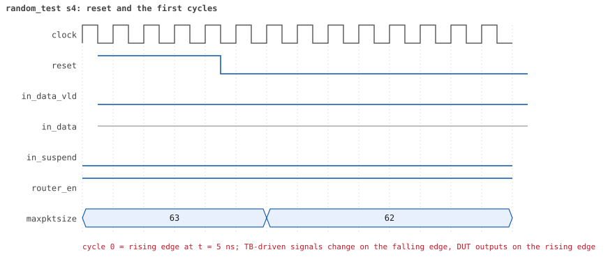
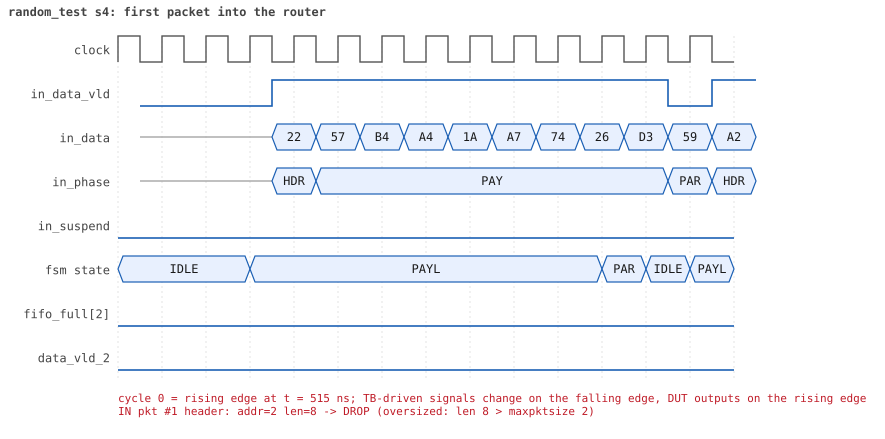
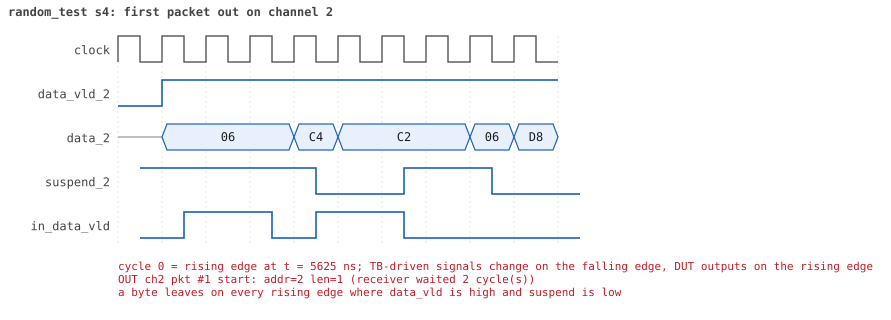
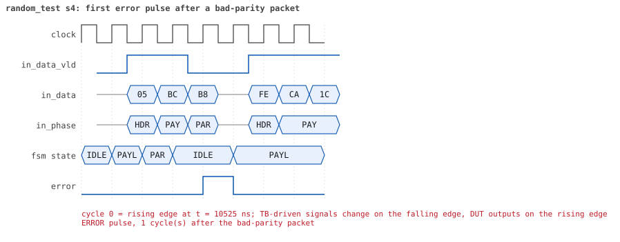
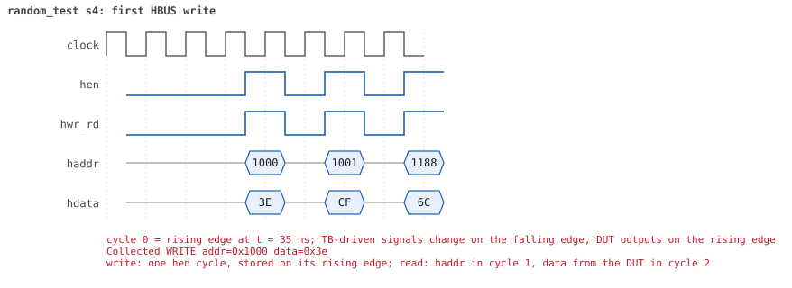
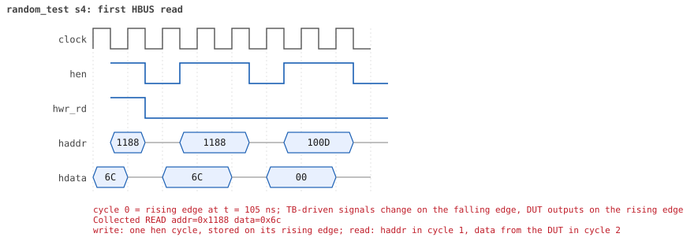

# random_test  seed 4

**Result:** PASSED (0 UVM_ERROR, 0 UVM_WARNING, 0 UVM_FATAL) · bench `yapp_project_tb` · sim time 36us · log `random_test_s4.log`

Waves: `random_test_s4.fst` (GTKWave, Surfer or the VS Code wave viewer); signal trace: `signals.csv`.
[Open the waves in Surfer](https://app.surfer-project.org/?load_url=https%3A%2F%2Fraw.githubusercontent.com%2Ftamirgabgab%2FQcom-Mentoring%2Fmain%2Fyapp_project%2Fregression%2Fyapp_project_tb%2Frandom_test_s4%2Frandom_test_s4.fst&startup_commands=run_command_file_from_url%20https%3A%2F%2Fraw.githubusercontent.com%2Ftamirgabgab%2FQcom-Mentoring%2Fmain%2Fyapp_project%2Ftb%2Fyapp_router.sucl) (web app, the signals already in groups: `yapp_project/tb/yapp_router.sucl`).

## Summary

- YAPP driver sent **81** packet(s) (7 with bad parity); the input monitor saw 81.
- Router: **7** forwarded, **74** dropped (32 oversized, 1 illegal address 3, 41 router disabled).
- Packets out: ch0 **1**, ch1 **2**, ch2 **4**.
- Scoreboard: 7 matched, 0 mismatched, 0 unexpected.
- Back-pressure: in_suspend asserted **0** time(s).
- Error pulses: 2.
- HBUS: 9 write(s), 76 read(s).

## Stages

| time (ns) | stage |
|---|---|
| 0 | receivers: ch0 RX_SLOW, ch1 RX_STALLY, ch2 RX_NORMAL |
| 0 | random scenario: 81 packets in 2 bursts |
| 360 | burst 1/2: ctrl=0x02 (maxpktsize 2) en=0xbd (router on, counter enables 1011110), 40 packet(s) |
| 16370 | burst 1/2 sent: addr0..3 9/8/21/2, bad parity 2, gap 0 9, length 1..63 |
| 16600 | burst 2/2: ctrl=0x7f (maxpktsize 63) en=0x00 (router OFF, counter enables 0000000), 41 packet(s) |
| 33370 | burst 2/2 sent: addr0..3 8/14/18/1, bad parity 5, gap 0 14, length 1..63 |
| 33370 | final reads: every register and the stored packet, checked against the reference model |
| 35405 | done: 81 packets (7 forwarded, 74 dropped), 0 storm burst(s), 7 scoreboard matches, 75 HBUS reads checked, 2 error pulses for 2 bad packets |

## Pictures

**reset and the first cycles**

**first packet into the router**

**first packet out on channel 2**

**first error pulse after a bad-parity packet**

**first HBUS write**

**first HBUS read**

## Timeline

809 events (the same list is in `timeline.csv`).

| time (ns) | who | event |
|---|---|---|
| 0 | yapp monitor | YAPP monitor running |
| 0 | **test** | STAGE: receivers: ch0 RX_SLOW, ch1 RX_STALLY, ch2 RX_NORMAL |
| 0 | **test** | STAGE: random scenario: 81 packets in 2 bursts |
| 0 | clk/rst driver | Starting clock (period 10) and holding reset for 5 cycles |
| 0 | **DUT** | RESET asserted |
| 50 | **DUT** | RESET released: router_en=1 maxpktsize=63 |
| 70 | hbus driver | Executed WRITE addr=0x1000 data=0x02 |
| 75 | **DUT** | CONFIG router_en=1 maxpktsize=2 |
| 75 | hbus monitor | Collected WRITE addr=0x1000 data=0x02 |
| 75 | reference | maxpktsize is now 2 |
| 90 | hbus driver | Executed WRITE addr=0x1001 data=0xbd |
| 95 | hbus monitor | Collected WRITE addr=0x1001 data=0xbd |
| 95 | reference | router_en is now 1 (en_reg 0xbd) |
| 120 | hbus driver | Executed READ  addr=0x1003 data=0x00 |
| 125 | hbus monitor | Collected READ  addr=0x1003 data=0x00 |
| 150 | hbus driver | Executed READ  addr=0x1026 data=0x00 |
| 155 | hbus monitor | Collected READ  addr=0x1026 data=0x00 |
| 170 | hbus driver | Executed WRITE addr=0x1159 data=0xc3 |
| 175 | hbus monitor | Collected WRITE addr=0x1159 data=0xc3 |
| 200 | hbus driver | Executed READ  addr=0x1159 data=0xc3 |
| 205 | hbus monitor | Collected READ  addr=0x1159 data=0xc3 |
| 230 | hbus driver | Executed READ  addr=0x100d data=0x00 |
| 235 | hbus monitor | Collected READ  addr=0x100d data=0x00 |
| 250 | hbus driver | Executed WRITE addr=0x1190 data=0xc5 |
| 255 | hbus monitor | Collected WRITE addr=0x1190 data=0xc5 |
| 280 | hbus driver | Executed READ  addr=0x1190 data=0xc5 |
| 285 | hbus monitor | Collected READ  addr=0x1190 data=0xc5 |
| 310 | hbus driver | Executed READ  addr=0x1009 data=0x00 |
| 315 | hbus monitor | Collected READ  addr=0x1009 data=0x00 |
| 330 | hbus driver | Executed WRITE addr=0x1173 data=0x39 |
| 335 | hbus monitor | Collected WRITE addr=0x1173 data=0x39 |
| 360 | hbus driver | Executed READ  addr=0x1173 data=0x39 |
| 360 | **test** | STAGE: burst 1/2: ctrl=0x02 (maxpktsize 2) en=0xbd (router on, counter enables 1011110), 40 packet(s) |
| 360 | yapp driver | TX pkt #1: addr=2 len=8 parity=good delay=17 |
| 365 | hbus monitor | Collected READ  addr=0x1173 data=0x39 |
| 545 | **DUT** | IN  pkt #1 header: addr=2 len=8 -> DROP (oversized: len 8 > maxpktsize 2) |
| 635 | **DUT** | IN  pkt #1 complete: addr=2 len=8 parity=ok dropped, 10 bytes in 10 cycles (held 0) |
| 635 | yapp monitor | RX pkt #1 on the input: addr=2 len=8 parity=good gap=49 |
| 635 | reference | Packet dropped: length 8 > maxpktsize 2 (addr=2) |
| 635 | **DUT** | ROUTER DROPS PACKET addr=2 length=8 (length > maxpktsize) |
| 640 | yapp driver | TX pkt #1 accepted by the DUT |
| 640 | yapp driver | TX pkt #2: addr=2 len=40 parity=good delay=0 |
| 645 | **DUT** | IN  pkt #2 header: addr=2 len=40 -> DROP (oversized: len 40 > maxpktsize 2) |
| 1055 | **DUT** | IN  pkt #2 complete: addr=2 len=40 parity=ok dropped, 42 bytes in 42 cycles (held 0) |
| 1055 | yapp monitor | RX pkt #2 on the input: addr=2 len=40 parity=good gap=0 |
| 1055 | reference | Packet dropped: length 40 > maxpktsize 2 (addr=2) |
| 1055 | **DUT** | ROUTER DROPS PACKET addr=2 length=40 (length > maxpktsize) |
| 1060 | yapp driver | TX pkt #2 accepted by the DUT |
| 1060 | yapp driver | TX pkt #3: addr=2 len=15 parity=good delay=2 |
| 1085 | **DUT** | IN  pkt #3 header: addr=2 len=15 -> DROP (oversized: len 15 > maxpktsize 2) |
| 1245 | **DUT** | IN  pkt #3 complete: addr=2 len=15 parity=ok dropped, 17 bytes in 17 cycles (held 0) |
| 1245 | yapp monitor | RX pkt #3 on the input: addr=2 len=15 parity=good gap=2 |
| 1245 | reference | Packet dropped: length 15 > maxpktsize 2 (addr=2) |
| 1245 | **DUT** | ROUTER DROPS PACKET addr=2 length=15 (length > maxpktsize) |
| 1250 | yapp driver | TX pkt #3 accepted by the DUT |
| 1250 | yapp driver | TX pkt #4: addr=2 len=13 parity=good delay=5 |
| 1305 | **DUT** | IN  pkt #4 header: addr=2 len=13 -> DROP (oversized: len 13 > maxpktsize 2) |
| 1445 | **DUT** | IN  pkt #4 complete: addr=2 len=13 parity=ok dropped, 15 bytes in 15 cycles (held 0) |
| 1445 | yapp monitor | RX pkt #4 on the input: addr=2 len=13 parity=good gap=5 |
| 1445 | reference | Packet dropped: length 13 > maxpktsize 2 (addr=2) |
| 1445 | **DUT** | ROUTER DROPS PACKET addr=2 length=13 (length > maxpktsize) |
| 1450 | yapp driver | TX pkt #4 accepted by the DUT |
| 1450 | yapp driver | TX pkt #5: addr=2 len=11 parity=good delay=16 |
| 1615 | **DUT** | IN  pkt #5 header: addr=2 len=11 -> DROP (oversized: len 11 > maxpktsize 2) |
| 1735 | **DUT** | IN  pkt #5 complete: addr=2 len=11 parity=ok dropped, 13 bytes in 13 cycles (held 0) |
| 1735 | yapp monitor | RX pkt #5 on the input: addr=2 len=11 parity=good gap=16 |
| 1735 | reference | Packet dropped: length 11 > maxpktsize 2 (addr=2) |
| 1735 | **DUT** | ROUTER DROPS PACKET addr=2 length=11 (length > maxpktsize) |
| 1740 | yapp driver | TX pkt #5 accepted by the DUT |
| 1740 | yapp driver | TX pkt #6: addr=2 len=63 parity=good delay=10 |
| 1845 | **DUT** | IN  pkt #6 header: addr=2 len=63 -> DROP (oversized: len 63 > maxpktsize 2) |
| 2485 | **DUT** | IN  pkt #6 complete: addr=2 len=63 parity=ok dropped, 65 bytes in 65 cycles (held 0) |
| 2485 | yapp monitor | RX pkt #6 on the input: addr=2 len=63 parity=good gap=10 |
| 2485 | reference | Packet dropped: length 63 > maxpktsize 2 (addr=2) |
| 2485 | **DUT** | ROUTER DROPS PACKET addr=2 length=63 (length > maxpktsize) |
| 2490 | yapp driver | TX pkt #6 accepted by the DUT |
| 2490 | yapp driver | TX pkt #7: addr=0 len=56 parity=good delay=0 |
| 2495 | **DUT** | IN  pkt #7 header: addr=0 len=56 -> DROP (oversized: len 56 > maxpktsize 2) |
| 3065 | **DUT** | IN  pkt #7 complete: addr=0 len=56 parity=ok dropped, 58 bytes in 58 cycles (held 0) |
| 3065 | yapp monitor | RX pkt #7 on the input: addr=0 len=56 parity=good gap=0 |
| 3065 | reference | Packet dropped: length 56 > maxpktsize 2 (addr=0) |
| 3065 | **DUT** | ROUTER DROPS PACKET addr=0 length=56 (length > maxpktsize) |
| 3070 | yapp driver | TX pkt #7 accepted by the DUT |
| 3070 | yapp driver | TX pkt #8: addr=0 len=13 parity=good delay=1 |
| 3085 | **DUT** | IN  pkt #8 header: addr=0 len=13 -> DROP (oversized: len 13 > maxpktsize 2) |
| 3225 | **DUT** | IN  pkt #8 complete: addr=0 len=13 parity=ok dropped, 15 bytes in 15 cycles (held 0) |
| 3225 | yapp monitor | RX pkt #8 on the input: addr=0 len=13 parity=good gap=1 |
| 3225 | reference | Packet dropped: length 13 > maxpktsize 2 (addr=0) |
| 3225 | **DUT** | ROUTER DROPS PACKET addr=0 length=13 (length > maxpktsize) |
| 3230 | yapp driver | TX pkt #8 accepted by the DUT |
| 3230 | yapp driver | TX pkt #9: addr=2 len=63 parity=good delay=20 |
| 3435 | **DUT** | IN  pkt #9 header: addr=2 len=63 -> DROP (oversized: len 63 > maxpktsize 2) |
| 4075 | **DUT** | IN  pkt #9 complete: addr=2 len=63 parity=ok dropped, 65 bytes in 65 cycles (held 0) |
| 4075 | yapp monitor | RX pkt #9 on the input: addr=2 len=63 parity=good gap=20 |
| 4075 | reference | Packet dropped: length 63 > maxpktsize 2 (addr=2) |
| 4075 | **DUT** | ROUTER DROPS PACKET addr=2 length=63 (length > maxpktsize) |
| 4080 | yapp driver | TX pkt #9 accepted by the DUT |
| 4080 | yapp driver | TX pkt #10: addr=2 len=63 parity=good delay=1 |
| 4095 | **DUT** | IN  pkt #10 header: addr=2 len=63 -> DROP (oversized: len 63 > maxpktsize 2) |
| 4735 | **DUT** | IN  pkt #10 complete: addr=2 len=63 parity=ok dropped, 65 bytes in 65 cycles (held 0) |
| 4735 | yapp monitor | RX pkt #10 on the input: addr=2 len=63 parity=good gap=1 |
| 4735 | reference | Packet dropped: length 63 > maxpktsize 2 (addr=2) |
| 4735 | **DUT** | ROUTER DROPS PACKET addr=2 length=63 (length > maxpktsize) |
| 4740 | yapp driver | TX pkt #10 accepted by the DUT |
| 4740 | yapp driver | TX pkt #11: addr=2 len=63 parity=good delay=17 |
| 4915 | **DUT** | IN  pkt #11 header: addr=2 len=63 -> DROP (oversized: len 63 > maxpktsize 2) |
| 5555 | **DUT** | IN  pkt #11 complete: addr=2 len=63 parity=ok dropped, 65 bytes in 65 cycles (held 0) |
| 5555 | yapp monitor | RX pkt #11 on the input: addr=2 len=63 parity=good gap=17 |
| 5555 | reference | Packet dropped: length 63 > maxpktsize 2 (addr=2) |
| 5555 | **DUT** | ROUTER DROPS PACKET addr=2 length=63 (length > maxpktsize) |
| 5560 | yapp driver | TX pkt #11 accepted by the DUT |
| 5560 | yapp driver | TX pkt #12: addr=2 len=1 parity=good delay=7 |
| 5635 | **DUT** | IN  pkt #12 header: addr=2 len=1 -> channel 2 |
| 5655 | **DUT** | IN  pkt #12 complete: addr=2 len=1 parity=ok forwarded, 3 bytes in 3 cycles (held 0) |
| 5655 | yapp monitor | RX pkt #12 on the input: addr=2 len=1 parity=good gap=7 |
| 5655 | reference | Packet forwarded: addr=2 len=1 -> channel 2 |
| 5660 | yapp driver | TX pkt #12 accepted by the DUT |
| 5660 | yapp driver | TX pkt #13: addr=2 len=1 parity=good delay=0 |
| 5665 | **DUT** | IN  pkt #13 header: addr=2 len=1 -> channel 2 |
| 5665 | **DUT** | OUT ch2 pkt #1 start: addr=2 len=1 (receiver waited 2 cycle(s)) |
| 5680 | ch2 driver | ch2: packet consumed (response delay 2) |
| 5685 | **DUT** | IN  pkt #13 complete: addr=2 len=1 parity=ok forwarded, 3 bytes in 3 cycles (held 0) |
| 5685 | yapp monitor | RX pkt #13 on the input: addr=2 len=1 parity=good gap=0 |
| 5685 | reference | Packet forwarded: addr=2 len=1 -> channel 2 |
| 5690 | yapp driver | TX pkt #13 accepted by the DUT |
| 5690 | yapp driver | TX pkt #14: addr=1 len=63 parity=good delay=9 |
| 5705 | **DUT** | OUT ch2 pkt #1 done: 3 bytes in 5 cycles |
| 5705 | ch2 monitor | ch2 RX pkt #1: addr=2 len=1 parity=good |
| 5705 | scoreboard | ch2 pkt matched: addr=2 len=1 (1 matched so far) |
| 5715 | **DUT** | OUT ch2 pkt #2 start: addr=2 len=1 (receiver waited 0 cycle(s)) |
| 5735 | **DUT** | OUT ch2 pkt #2 done: 3 bytes in 3 cycles |
| 5735 | ch2 monitor | ch2 RX pkt #2: addr=2 len=1 parity=good |
| 5735 | scoreboard | ch2 pkt matched: addr=2 len=1 (2 matched so far) |
| 5785 | **DUT** | IN  pkt #14 header: addr=1 len=63 -> DROP (oversized: len 63 > maxpktsize 2) |
| 6190 | ch2 driver | ch2: packet consumed (response delay 1) |
| 6425 | **DUT** | IN  pkt #14 complete: addr=1 len=63 parity=ok dropped, 65 bytes in 65 cycles (held 0) |
| 6425 | yapp monitor | RX pkt #14 on the input: addr=1 len=63 parity=good gap=9 |
| 6425 | reference | Packet dropped: length 63 > maxpktsize 2 (addr=1) |
| 6425 | **DUT** | ROUTER DROPS PACKET addr=1 length=63 (length > maxpktsize) |
| 6430 | yapp driver | TX pkt #14 accepted by the DUT |
| 6430 | yapp driver | TX pkt #15: addr=1 len=63 parity=good delay=0 |
| 6435 | **DUT** | IN  pkt #15 header: addr=1 len=63 -> DROP (oversized: len 63 > maxpktsize 2) |
| 7075 | **DUT** | IN  pkt #15 complete: addr=1 len=63 parity=ok dropped, 65 bytes in 65 cycles (held 0) |
| 7075 | yapp monitor | RX pkt #15 on the input: addr=1 len=63 parity=good gap=0 |
| 7075 | reference | Packet dropped: length 63 > maxpktsize 2 (addr=1) |
| 7075 | **DUT** | ROUTER DROPS PACKET addr=1 length=63 (length > maxpktsize) |
| 7080 | yapp driver | TX pkt #15 accepted by the DUT |
| 7080 | yapp driver | TX pkt #16: addr=0 len=62 parity=good delay=7 |
| 7155 | **DUT** | IN  pkt #16 header: addr=0 len=62 -> DROP (oversized: len 62 > maxpktsize 2) |
| 7785 | **DUT** | IN  pkt #16 complete: addr=0 len=62 parity=ok dropped, 64 bytes in 64 cycles (held 0) |
| 7785 | yapp monitor | RX pkt #16 on the input: addr=0 len=62 parity=good gap=7 |
| 7785 | reference | Packet dropped: length 62 > maxpktsize 2 (addr=0) |
| 7785 | **DUT** | ROUTER DROPS PACKET addr=0 length=62 (length > maxpktsize) |
| 7790 | yapp driver | TX pkt #16 accepted by the DUT |
| 7790 | yapp driver | TX pkt #17: addr=0 len=7 parity=good delay=4 |
| 7835 | **DUT** | IN  pkt #17 header: addr=0 len=7 -> DROP (oversized: len 7 > maxpktsize 2) |
| 7915 | **DUT** | IN  pkt #17 complete: addr=0 len=7 parity=ok dropped, 9 bytes in 9 cycles (held 0) |
| 7915 | yapp monitor | RX pkt #17 on the input: addr=0 len=7 parity=good gap=4 |
| 7915 | reference | Packet dropped: length 7 > maxpktsize 2 (addr=0) |
| 7915 | **DUT** | ROUTER DROPS PACKET addr=0 length=7 (length > maxpktsize) |
| 7920 | yapp driver | TX pkt #17 accepted by the DUT |
| 7920 | yapp driver | TX pkt #18: addr=2 len=63 parity=good delay=15 |
| 8075 | **DUT** | IN  pkt #18 header: addr=2 len=63 -> DROP (oversized: len 63 > maxpktsize 2) |
| 8715 | **DUT** | IN  pkt #18 complete: addr=2 len=63 parity=ok dropped, 65 bytes in 65 cycles (held 0) |
| 8715 | yapp monitor | RX pkt #18 on the input: addr=2 len=63 parity=good gap=15 |
| 8715 | reference | Packet dropped: length 63 > maxpktsize 2 (addr=2) |
| 8715 | **DUT** | ROUTER DROPS PACKET addr=2 length=63 (length > maxpktsize) |
| 8720 | yapp driver | TX pkt #18 accepted by the DUT |
| 8720 | yapp driver | TX pkt #19: addr=2 len=63 parity=good delay=2 |
| 8745 | **DUT** | IN  pkt #19 header: addr=2 len=63 -> DROP (oversized: len 63 > maxpktsize 2) |
| 9385 | **DUT** | IN  pkt #19 complete: addr=2 len=63 parity=ok dropped, 65 bytes in 65 cycles (held 0) |
| 9385 | yapp monitor | RX pkt #19 on the input: addr=2 len=63 parity=good gap=2 |
| 9385 | reference | Packet dropped: length 63 > maxpktsize 2 (addr=2) |
| 9385 | **DUT** | ROUTER DROPS PACKET addr=2 length=63 (length > maxpktsize) |
| 9390 | yapp driver | TX pkt #19 accepted by the DUT |
| 9390 | yapp driver | TX pkt #20: addr=0 len=28 parity=good delay=0 |
| 9395 | **DUT** | IN  pkt #20 header: addr=0 len=28 -> DROP (oversized: len 28 > maxpktsize 2) |
| 9685 | **DUT** | IN  pkt #20 complete: addr=0 len=28 parity=ok dropped, 30 bytes in 30 cycles (held 0) |
| 9685 | yapp monitor | RX pkt #20 on the input: addr=0 len=28 parity=good gap=0 |
| 9685 | reference | Packet dropped: length 28 > maxpktsize 2 (addr=0) |
| 9685 | **DUT** | ROUTER DROPS PACKET addr=0 length=28 (length > maxpktsize) |
| 9690 | yapp driver | TX pkt #20 accepted by the DUT |
| 9690 | yapp driver | TX pkt #21: addr=2 len=48 parity=good delay=18 |
| 9875 | **DUT** | IN  pkt #21 header: addr=2 len=48 -> DROP (oversized: len 48 > maxpktsize 2) |
| 10365 | **DUT** | IN  pkt #21 complete: addr=2 len=48 parity=ok dropped, 50 bytes in 50 cycles (held 0) |
| 10365 | yapp monitor | RX pkt #21 on the input: addr=2 len=48 parity=good gap=18 |
| 10365 | reference | Packet dropped: length 48 > maxpktsize 2 (addr=2) |
| 10365 | **DUT** | ROUTER DROPS PACKET addr=2 length=48 (length > maxpktsize) |
| 10370 | yapp driver | TX pkt #21 accepted by the DUT |
| 10370 | yapp driver | TX pkt #22: addr=1 len=1 parity=bad delay=16 |
| 10535 | **DUT** | IN  pkt #22 header: addr=1 len=1 -> channel 1 |
| 10555 | **DUT** | IN  pkt #22 complete: addr=1 len=1 parity=BAD forwarded, 3 bytes in 3 cycles (held 0) |
| 10555 | yapp monitor | RX pkt #22 on the input: addr=1 len=1 parity=bad gap=16 |
| 10555 | reference | Packet forwarded: addr=1 len=1 -> channel 1 |
| 10560 | yapp driver | TX pkt #22 accepted by the DUT |
| 10560 | yapp driver | TX pkt #23: addr=2 len=63 parity=good delay=1 |
| 10570 | **DUT** | ERROR pulse, 1 cycle(s) after the bad-parity packet |
| 10570 | error checker | error pulse 1 cycles after the bad packet (0 still owed) |
| 10575 | **DUT** | IN  pkt #23 header: addr=2 len=63 -> DROP (oversized: len 63 > maxpktsize 2) |
| 10635 | **DUT** | OUT ch1 pkt #1 start: addr=1 len=1 (receiver waited 9 cycle(s)) |
| 10650 | ch1 driver | ch1: packet consumed (response delay 9) |
| 10665 | **DUT** | OUT ch1 pkt #1 done: 3 bytes in 4 cycles |
| 10665 | ch1 monitor | ch1 RX pkt #1: addr=1 len=1 parity=bad |
| 10665 | scoreboard | ch1 pkt matched: addr=1 len=1 (3 matched so far) |
| 11130 | ch1 driver | ch1: packet consumed (response delay 0) |
| 11215 | **DUT** | IN  pkt #23 complete: addr=2 len=63 parity=ok dropped, 65 bytes in 65 cycles (held 0) |
| 11215 | yapp monitor | RX pkt #23 on the input: addr=2 len=63 parity=good gap=1 |
| 11215 | reference | Packet dropped: length 63 > maxpktsize 2 (addr=2) |
| 11215 | **DUT** | ROUTER DROPS PACKET addr=2 length=63 (length > maxpktsize) |
| 11220 | yapp driver | TX pkt #23 accepted by the DUT |
| 11220 | yapp driver | TX pkt #24: addr=1 len=37 parity=bad delay=17 |
| 11395 | **DUT** | IN  pkt #24 header: addr=1 len=37 -> DROP (oversized: len 37 > maxpktsize 2) |
| 11775 | **DUT** | IN  pkt #24 complete: addr=1 len=37 parity=BAD dropped, 39 bytes in 39 cycles (held 0) |
| 11775 | yapp monitor | RX pkt #24 on the input: addr=1 len=37 parity=bad gap=17 |
| 11775 | reference | Packet dropped: length 37 > maxpktsize 2 (addr=1) |
| 11775 | **DUT** | ROUTER DROPS PACKET addr=1 length=37 (length > maxpktsize) |
| 11780 | yapp driver | TX pkt #24 accepted by the DUT |
| 11780 | yapp driver | TX pkt #25: addr=2 len=5 parity=good delay=0 |
| 11785 | **DUT** | IN  pkt #25 header: addr=2 len=5 -> DROP (oversized: len 5 > maxpktsize 2) |
| 11830 | **DUT** | ERROR pulse, 5 cycle(s) after the bad-parity packet |
| 11830 | error checker | error pulse 5 cycles after the bad packet (0 still owed) |
| 11845 | **DUT** | IN  pkt #25 complete: addr=2 len=5 parity=ok dropped, 7 bytes in 7 cycles (held 0) |
| 11845 | yapp monitor | RX pkt #25 on the input: addr=2 len=5 parity=good gap=0 |
| 11845 | reference | Packet dropped: length 5 > maxpktsize 2 (addr=2) |
| 11845 | **DUT** | ROUTER DROPS PACKET addr=2 length=5 (length > maxpktsize) |
| 11850 | yapp driver | TX pkt #25 accepted by the DUT |
| 11850 | yapp driver | TX pkt #26: addr=3 len=3 parity=good delay=1 |
| 11865 | **DUT** | IN  pkt #26 header: addr=3 len=3 -> DROP (oversized: len 3 > maxpktsize 2) |
| 11905 | **DUT** | IN  pkt #26 complete: addr=3 len=3 parity=ok dropped, 5 bytes in 5 cycles (held 0) |
| 11905 | yapp monitor | RX pkt #26 on the input: addr=3 len=3 parity=good gap=1 |
| 11905 | reference | Packet dropped: illegal address 3 (len=3) |
| 11905 | **DUT** | ROUTER DROPS PACKET addr=3 length=3 (    illegal address) |
| 11910 | yapp driver | TX pkt #26 accepted by the DUT |
| 11910 | yapp driver | TX pkt #27: addr=0 len=23 parity=good delay=0 |
| 11915 | **DUT** | IN  pkt #27 header: addr=0 len=23 -> DROP (oversized: len 23 > maxpktsize 2) |
| 12155 | **DUT** | IN  pkt #27 complete: addr=0 len=23 parity=ok dropped, 25 bytes in 25 cycles (held 0) |
| 12155 | yapp monitor | RX pkt #27 on the input: addr=0 len=23 parity=good gap=0 |
| 12155 | reference | Packet dropped: length 23 > maxpktsize 2 (addr=0) |
| 12155 | **DUT** | ROUTER DROPS PACKET addr=0 length=23 (length > maxpktsize) |
| 12160 | yapp driver | TX pkt #27 accepted by the DUT |
| 12160 | yapp driver | TX pkt #28: addr=3 len=1 parity=good delay=1 |
| 12175 | **DUT** | IN  pkt #28 header: addr=3 len=1 -> DROP (illegal address 3) |
| 12195 | **DUT** | IN  pkt #28 complete: addr=3 len=1 parity=ok dropped, 3 bytes in 3 cycles (held 0) |
| 12195 | yapp monitor | RX pkt #28 on the input: addr=3 len=1 parity=good gap=1 |
| 12195 | reference | Packet dropped: illegal address 3 (len=1) |
| 12195 | **DUT** | ROUTER DROPS PACKET addr=3 length=1 (    illegal address) |
| 12200 | yapp driver | TX pkt #28 accepted by the DUT |
| 12200 | yapp driver | TX pkt #29: addr=2 len=53 parity=good delay=6 |
| 12265 | **DUT** | IN  pkt #29 header: addr=2 len=53 -> DROP (oversized: len 53 > maxpktsize 2) |
| 12805 | **DUT** | IN  pkt #29 complete: addr=2 len=53 parity=ok dropped, 55 bytes in 55 cycles (held 0) |
| 12805 | yapp monitor | RX pkt #29 on the input: addr=2 len=53 parity=good gap=6 |
| 12805 | reference | Packet dropped: length 53 > maxpktsize 2 (addr=2) |
| 12805 | **DUT** | ROUTER DROPS PACKET addr=2 length=53 (length > maxpktsize) |
| 12810 | yapp driver | TX pkt #29 accepted by the DUT |
| 12810 | yapp driver | TX pkt #30: addr=0 len=32 parity=good delay=7 |
| 12885 | **DUT** | IN  pkt #30 header: addr=0 len=32 -> DROP (oversized: len 32 > maxpktsize 2) |
| 13215 | **DUT** | IN  pkt #30 complete: addr=0 len=32 parity=ok dropped, 34 bytes in 34 cycles (held 0) |
| 13215 | yapp monitor | RX pkt #30 on the input: addr=0 len=32 parity=good gap=7 |
| 13215 | reference | Packet dropped: length 32 > maxpktsize 2 (addr=0) |
| 13215 | **DUT** | ROUTER DROPS PACKET addr=0 length=32 (length > maxpktsize) |
| 13220 | yapp driver | TX pkt #30 accepted by the DUT |
| 13220 | yapp driver | TX pkt #31: addr=0 len=63 parity=good delay=0 |
| 13225 | **DUT** | IN  pkt #31 header: addr=0 len=63 -> DROP (oversized: len 63 > maxpktsize 2) |
| 13865 | **DUT** | IN  pkt #31 complete: addr=0 len=63 parity=ok dropped, 65 bytes in 65 cycles (held 0) |
| 13865 | yapp monitor | RX pkt #31 on the input: addr=0 len=63 parity=good gap=0 |
| 13865 | reference | Packet dropped: length 63 > maxpktsize 2 (addr=0) |
| 13865 | **DUT** | ROUTER DROPS PACKET addr=0 length=63 (length > maxpktsize) |
| 13870 | yapp driver | TX pkt #31 accepted by the DUT |
| 13870 | yapp driver | TX pkt #32: addr=1 len=63 parity=good delay=0 |
| 13875 | **DUT** | IN  pkt #32 header: addr=1 len=63 -> DROP (oversized: len 63 > maxpktsize 2) |
| 14515 | **DUT** | IN  pkt #32 complete: addr=1 len=63 parity=ok dropped, 65 bytes in 65 cycles (held 0) |
| 14515 | yapp monitor | RX pkt #32 on the input: addr=1 len=63 parity=good gap=0 |
| 14515 | reference | Packet dropped: length 63 > maxpktsize 2 (addr=1) |
| 14515 | **DUT** | ROUTER DROPS PACKET addr=1 length=63 (length > maxpktsize) |
| 14520 | yapp driver | TX pkt #32 accepted by the DUT |
| 14520 | yapp driver | TX pkt #33: addr=1 len=39 parity=good delay=2 |
| 14545 | **DUT** | IN  pkt #33 header: addr=1 len=39 -> DROP (oversized: len 39 > maxpktsize 2) |
| 14945 | **DUT** | IN  pkt #33 complete: addr=1 len=39 parity=ok dropped, 41 bytes in 41 cycles (held 0) |
| 14945 | yapp monitor | RX pkt #33 on the input: addr=1 len=39 parity=good gap=2 |
| 14945 | reference | Packet dropped: length 39 > maxpktsize 2 (addr=1) |
| 14945 | **DUT** | ROUTER DROPS PACKET addr=1 length=39 (length > maxpktsize) |
| 14950 | yapp driver | TX pkt #33 accepted by the DUT |
| 14950 | yapp driver | TX pkt #34: addr=1 len=4 parity=good delay=8 |
| 15035 | **DUT** | IN  pkt #34 header: addr=1 len=4 -> DROP (oversized: len 4 > maxpktsize 2) |
| 15085 | **DUT** | IN  pkt #34 complete: addr=1 len=4 parity=ok dropped, 6 bytes in 6 cycles (held 0) |
| 15085 | yapp monitor | RX pkt #34 on the input: addr=1 len=4 parity=good gap=8 |
| 15085 | reference | Packet dropped: length 4 > maxpktsize 2 (addr=1) |
| 15085 | **DUT** | ROUTER DROPS PACKET addr=1 length=4 (length > maxpktsize) |
| 15090 | yapp driver | TX pkt #34 accepted by the DUT |
| 15090 | yapp driver | TX pkt #35: addr=1 len=1 parity=good delay=1 |
| 15105 | **DUT** | IN  pkt #35 header: addr=1 len=1 -> channel 1 |
| 15115 | **DUT** | OUT ch1 pkt #2 start: addr=1 len=1 (receiver waited 0 cycle(s)) |
| 15125 | **DUT** | IN  pkt #35 complete: addr=1 len=1 parity=ok forwarded, 3 bytes in 3 cycles (held 0) |
| 15125 | yapp monitor | RX pkt #35 on the input: addr=1 len=1 parity=good gap=1 |
| 15125 | reference | Packet forwarded: addr=1 len=1 -> channel 1 |
| 15130 | ch1 driver | ch1: packet consumed (response delay 0) |
| 15130 | yapp driver | TX pkt #35 accepted by the DUT |
| 15130 | yapp driver | TX pkt #36: addr=2 len=23 parity=good delay=2 |
| 15155 | **DUT** | IN  pkt #36 header: addr=2 len=23 -> DROP (oversized: len 23 > maxpktsize 2) |
| 15245 | **DUT** | OUT ch1 pkt #2 done: 3 bytes in 14 cycles |
| 15245 | ch1 monitor | ch1 RX pkt #2: addr=1 len=1 parity=good |
| 15245 | scoreboard | ch1 pkt matched: addr=1 len=1 (4 matched so far) |
| 15250 | ch1 driver | ch1: packet consumed (response delay 10) |
| 15395 | **DUT** | IN  pkt #36 complete: addr=2 len=23 parity=ok dropped, 25 bytes in 25 cycles (held 0) |
| 15395 | yapp monitor | RX pkt #36 on the input: addr=2 len=23 parity=good gap=2 |
| 15395 | reference | Packet dropped: length 23 > maxpktsize 2 (addr=2) |
| 15395 | **DUT** | ROUTER DROPS PACKET addr=2 length=23 (length > maxpktsize) |
| 15400 | yapp driver | TX pkt #36 accepted by the DUT |
| 15400 | yapp driver | TX pkt #37: addr=2 len=2 parity=good delay=20 |
| 15605 | **DUT** | IN  pkt #37 header: addr=2 len=2 -> channel 2 |
| 15635 | **DUT** | IN  pkt #37 complete: addr=2 len=2 parity=ok forwarded, 4 bytes in 4 cycles (held 0) |
| 15635 | yapp monitor | RX pkt #37 on the input: addr=2 len=2 parity=good gap=20 |
| 15635 | reference | Packet forwarded: addr=2 len=2 -> channel 2 |
| 15640 | yapp driver | TX pkt #37 accepted by the DUT |
| 15640 | yapp driver | TX pkt #38: addr=0 len=2 parity=good delay=3 |
| 15675 | **DUT** | IN  pkt #38 header: addr=0 len=2 -> channel 0 |
| 15705 | **DUT** | IN  pkt #38 complete: addr=0 len=2 parity=ok forwarded, 4 bytes in 4 cycles (held 0) |
| 15705 | **DUT** | OUT ch2 pkt #3 start: addr=2 len=2 (receiver waited 9 cycle(s)) |
| 15705 | yapp monitor | RX pkt #38 on the input: addr=0 len=2 parity=good gap=3 |
| 15705 | reference | Packet forwarded: addr=0 len=2 -> channel 0 |
| 15710 | yapp driver | TX pkt #38 accepted by the DUT |
| 15710 | yapp driver | TX pkt #39: addr=2 len=1 parity=good delay=1 |
| 15725 | **DUT** | IN  pkt #39 header: addr=2 len=1 -> channel 2 |
| 15730 | ch2 driver | ch2: packet consumed (response delay 9) |
| 15745 | **DUT** | IN  pkt #39 complete: addr=2 len=1 parity=ok forwarded, 3 bytes in 3 cycles (held 0) |
| 15745 | yapp monitor | RX pkt #39 on the input: addr=2 len=1 parity=good gap=1 |
| 15745 | reference | Packet forwarded: addr=2 len=1 -> channel 2 |
| 15750 | yapp driver | TX pkt #39 accepted by the DUT |
| 15750 | yapp driver | TX pkt #40: addr=2 len=54 parity=good delay=6 |
| 15815 | **DUT** | IN  pkt #40 header: addr=2 len=54 -> DROP (oversized: len 54 > maxpktsize 2) |
| 15845 | **DUT** | OUT ch2 pkt #3 done: 4 bytes in 15 cycles |
| 15845 | ch2 monitor | ch2 RX pkt #3: addr=2 len=2 parity=good |
| 15845 | scoreboard | ch2 pkt matched: addr=2 len=2 (5 matched so far) |
| 15855 | **DUT** | OUT ch2 pkt #4 start: addr=2 len=1 (receiver waited 0 cycle(s)) |
| 15875 | **DUT** | OUT ch2 pkt #4 done: 3 bytes in 3 cycles |
| 15875 | ch2 monitor | ch2 RX pkt #4: addr=2 len=1 parity=good |
| 15875 | scoreboard | ch2 pkt matched: addr=2 len=1 (6 matched so far) |
| 15955 | **DUT** | OUT ch0 pkt #1 start: addr=0 len=2 (receiver waited 27 cycle(s)) |
| 15980 | ch0 driver | ch0: packet consumed (response delay 27) |
| 16285 | **DUT** | OUT ch0 pkt #1 done: 4 bytes in 34 cycles |
| 16285 | ch0 monitor | ch0 RX pkt #1: addr=0 len=2 parity=good |
| 16285 | scoreboard | ch0 pkt matched: addr=0 len=2 (7 matched so far) |
| 16365 | **DUT** | IN  pkt #40 complete: addr=2 len=54 parity=ok dropped, 56 bytes in 56 cycles (held 0) |
| 16365 | yapp monitor | RX pkt #40 on the input: addr=2 len=54 parity=good gap=6 |
| 16365 | reference | Packet dropped: length 54 > maxpktsize 2 (addr=2) |
| 16365 | **DUT** | ROUTER DROPS PACKET addr=2 length=54 (length > maxpktsize) |
| 16370 | yapp driver | TX pkt #40 accepted by the DUT |
| 16370 | **test** | STAGE: burst 1/2 sent: addr0..3 9/8/21/2, bad parity 2, gap 0 9, length 1..63 |
| 16390 | hbus driver | Executed WRITE addr=0x1000 data=0x7f |
| 16395 | **DUT** | CONFIG router_en=1 maxpktsize=63 |
| 16395 | hbus monitor | Collected WRITE addr=0x1000 data=0x7f |
| 16395 | reference | maxpktsize is now 63 |
| 16410 | hbus driver | Executed WRITE addr=0x1001 data=0x00 |
| 16415 | **DUT** | CONFIG router_en=0 maxpktsize=63 |
| 16415 | hbus monitor | Collected WRITE addr=0x1001 data=0x00 |
| 16415 | reference | router_en is now 0 (en_reg 0x00) |
| 16440 | hbus driver | Executed READ  addr=0x1038 data=0x75 |
| 16445 | hbus monitor | Collected READ  addr=0x1038 data=0x75 |
| 16470 | hbus driver | Executed READ  addr=0x109c data=0x00 |
| 16475 | hbus monitor | Collected READ  addr=0x109c data=0x00 |
| 16480 | ch2 driver | ch2: packet consumed (response delay 10) |
| 16490 | hbus driver | Executed WRITE addr=0x110b data=0xdc |
| 16495 | hbus monitor | Collected WRITE addr=0x110b data=0xdc |
| 16520 | hbus driver | Executed READ  addr=0x110b data=0xdc |
| 16525 | hbus monitor | Collected READ  addr=0x110b data=0xdc |
| 16550 | hbus driver | Executed READ  addr=0x1001 data=0x00 |
| 16555 | hbus monitor | Collected READ  addr=0x1001 data=0x00 |
| 16570 | hbus driver | Executed WRITE addr=0x11c4 data=0x84 |
| 16575 | hbus monitor | Collected WRITE addr=0x11c4 data=0x84 |
| 16600 | hbus driver | Executed READ  addr=0x11c4 data=0x84 |
| 16600 | **test** | STAGE: burst 2/2: ctrl=0x7f (maxpktsize 63) en=0x00 (router OFF, counter enables 0000000), 41 packet(s) |
| 16600 | yapp driver | TX pkt #41: addr=1 len=63 parity=good delay=20 |
| 16605 | hbus monitor | Collected READ  addr=0x11c4 data=0x84 |
| 16690 | ch0 driver | ch0: packet consumed (response delay 29) |
| 16815 | **DUT** | IN  pkt #41 header: addr=1 len=63 -> DROP (router disabled) |
| 17455 | **DUT** | IN  pkt #41 complete: addr=1 len=63 parity=ok dropped, 65 bytes in 65 cycles (held 0) |
| 17455 | yapp monitor | RX pkt #41 on the input: addr=1 len=63 parity=good gap=44 |
| 17455 | reference | Packet dropped: router disabled (addr=1 len=63) |
| 17455 | **DUT** | ROUTER DROPS PACKET addr=1 length=63 (router disabled) |
| 17460 | yapp driver | TX pkt #41 accepted by the DUT |
| 17460 | yapp driver | TX pkt #42: addr=1 len=56 parity=good delay=7 |
| 17535 | **DUT** | IN  pkt #42 header: addr=1 len=56 -> DROP (router disabled) |
| 18105 | **DUT** | IN  pkt #42 complete: addr=1 len=56 parity=ok dropped, 58 bytes in 58 cycles (held 0) |
| 18105 | yapp monitor | RX pkt #42 on the input: addr=1 len=56 parity=good gap=7 |
| 18105 | reference | Packet dropped: router disabled (addr=1 len=56) |
| 18105 | **DUT** | ROUTER DROPS PACKET addr=1 length=56 (router disabled) |
| 18110 | yapp driver | TX pkt #42 accepted by the DUT |
| 18110 | yapp driver | TX pkt #43: addr=1 len=58 parity=good delay=1 |
| 18125 | **DUT** | IN  pkt #43 header: addr=1 len=58 -> DROP (router disabled) |
| 18715 | **DUT** | IN  pkt #43 complete: addr=1 len=58 parity=ok dropped, 60 bytes in 60 cycles (held 0) |
| 18715 | yapp monitor | RX pkt #43 on the input: addr=1 len=58 parity=good gap=1 |
| 18715 | reference | Packet dropped: router disabled (addr=1 len=58) |
| 18715 | **DUT** | ROUTER DROPS PACKET addr=1 length=58 (router disabled) |
| 18720 | yapp driver | TX pkt #43 accepted by the DUT |
| 18720 | yapp driver | TX pkt #44: addr=2 len=7 parity=good delay=0 |
| 18725 | **DUT** | IN  pkt #44 header: addr=2 len=7 -> DROP (router disabled) |
| 18805 | **DUT** | IN  pkt #44 complete: addr=2 len=7 parity=ok dropped, 9 bytes in 9 cycles (held 0) |
| 18805 | yapp monitor | RX pkt #44 on the input: addr=2 len=7 parity=good gap=0 |
| 18805 | reference | Packet dropped: router disabled (addr=2 len=7) |
| 18805 | **DUT** | ROUTER DROPS PACKET addr=2 length=7 (router disabled) |
| 18810 | yapp driver | TX pkt #44 accepted by the DUT |
| 18810 | yapp driver | TX pkt #45: addr=0 len=39 parity=good delay=0 |
| 18815 | **DUT** | IN  pkt #45 header: addr=0 len=39 -> DROP (router disabled) |
| 19215 | **DUT** | IN  pkt #45 complete: addr=0 len=39 parity=ok dropped, 41 bytes in 41 cycles (held 0) |
| 19215 | yapp monitor | RX pkt #45 on the input: addr=0 len=39 parity=good gap=0 |
| 19215 | reference | Packet dropped: router disabled (addr=0 len=39) |
| 19215 | **DUT** | ROUTER DROPS PACKET addr=0 length=39 (router disabled) |
| 19220 | yapp driver | TX pkt #45 accepted by the DUT |
| 19220 | yapp driver | TX pkt #46: addr=2 len=14 parity=good delay=0 |
| 19225 | **DUT** | IN  pkt #46 header: addr=2 len=14 -> DROP (router disabled) |
| 19375 | **DUT** | IN  pkt #46 complete: addr=2 len=14 parity=ok dropped, 16 bytes in 16 cycles (held 0) |
| 19375 | yapp monitor | RX pkt #46 on the input: addr=2 len=14 parity=good gap=0 |
| 19375 | reference | Packet dropped: router disabled (addr=2 len=14) |
| 19375 | **DUT** | ROUTER DROPS PACKET addr=2 length=14 (router disabled) |
| 19380 | yapp driver | TX pkt #46 accepted by the DUT |
| 19380 | yapp driver | TX pkt #47: addr=2 len=52 parity=good delay=20 |
| 19585 | **DUT** | IN  pkt #47 header: addr=2 len=52 -> DROP (router disabled) |
| 20115 | **DUT** | IN  pkt #47 complete: addr=2 len=52 parity=ok dropped, 54 bytes in 54 cycles (held 0) |
| 20115 | yapp monitor | RX pkt #47 on the input: addr=2 len=52 parity=good gap=20 |
| 20115 | reference | Packet dropped: router disabled (addr=2 len=52) |
| 20115 | **DUT** | ROUTER DROPS PACKET addr=2 length=52 (router disabled) |
| 20120 | yapp driver | TX pkt #47 accepted by the DUT |
| 20120 | yapp driver | TX pkt #48: addr=0 len=10 parity=good delay=0 |
| 20125 | **DUT** | IN  pkt #48 header: addr=0 len=10 -> DROP (router disabled) |
| 20235 | **DUT** | IN  pkt #48 complete: addr=0 len=10 parity=ok dropped, 12 bytes in 12 cycles (held 0) |
| 20235 | yapp monitor | RX pkt #48 on the input: addr=0 len=10 parity=good gap=0 |
| 20235 | reference | Packet dropped: router disabled (addr=0 len=10) |
| 20235 | **DUT** | ROUTER DROPS PACKET addr=0 length=10 (router disabled) |
| 20240 | yapp driver | TX pkt #48 accepted by the DUT |
| 20240 | yapp driver | TX pkt #49: addr=2 len=9 parity=good delay=4 |
| 20285 | **DUT** | IN  pkt #49 header: addr=2 len=9 -> DROP (router disabled) |
| 20385 | **DUT** | IN  pkt #49 complete: addr=2 len=9 parity=ok dropped, 11 bytes in 11 cycles (held 0) |
| 20385 | yapp monitor | RX pkt #49 on the input: addr=2 len=9 parity=good gap=4 |
| 20385 | reference | Packet dropped: router disabled (addr=2 len=9) |
| 20385 | **DUT** | ROUTER DROPS PACKET addr=2 length=9 (router disabled) |
| 20390 | yapp driver | TX pkt #49 accepted by the DUT |
| 20390 | yapp driver | TX pkt #50: addr=1 len=29 parity=good delay=0 |
| 20395 | **DUT** | IN  pkt #50 header: addr=1 len=29 -> DROP (router disabled) |
| 20695 | **DUT** | IN  pkt #50 complete: addr=1 len=29 parity=ok dropped, 31 bytes in 31 cycles (held 0) |
| 20695 | yapp monitor | RX pkt #50 on the input: addr=1 len=29 parity=good gap=0 |
| 20695 | reference | Packet dropped: router disabled (addr=1 len=29) |
| 20695 | **DUT** | ROUTER DROPS PACKET addr=1 length=29 (router disabled) |
| 20700 | yapp driver | TX pkt #50 accepted by the DUT |
| 20700 | yapp driver | TX pkt #51: addr=2 len=63 parity=good delay=2 |
| 20725 | **DUT** | IN  pkt #51 header: addr=2 len=63 -> DROP (router disabled) |
| 21365 | **DUT** | IN  pkt #51 complete: addr=2 len=63 parity=ok dropped, 65 bytes in 65 cycles (held 0) |
| 21365 | yapp monitor | RX pkt #51 on the input: addr=2 len=63 parity=good gap=2 |
| 21365 | reference | Packet dropped: router disabled (addr=2 len=63) |
| 21365 | **DUT** | ROUTER DROPS PACKET addr=2 length=63 (router disabled) |
| 21370 | yapp driver | TX pkt #51 accepted by the DUT |
| 21370 | yapp driver | TX pkt #52: addr=1 len=34 parity=good delay=0 |
| 21375 | **DUT** | IN  pkt #52 header: addr=1 len=34 -> DROP (router disabled) |
| 21725 | **DUT** | IN  pkt #52 complete: addr=1 len=34 parity=ok dropped, 36 bytes in 36 cycles (held 0) |
| 21725 | yapp monitor | RX pkt #52 on the input: addr=1 len=34 parity=good gap=0 |
| 21725 | reference | Packet dropped: router disabled (addr=1 len=34) |
| 21725 | **DUT** | ROUTER DROPS PACKET addr=1 length=34 (router disabled) |
| 21730 | yapp driver | TX pkt #52 accepted by the DUT |
| 21730 | yapp driver | TX pkt #53: addr=2 len=1 parity=good delay=1 |
| 21745 | **DUT** | IN  pkt #53 header: addr=2 len=1 -> DROP (router disabled) |
| 21765 | **DUT** | IN  pkt #53 complete: addr=2 len=1 parity=ok dropped, 3 bytes in 3 cycles (held 0) |
| 21765 | yapp monitor | RX pkt #53 on the input: addr=2 len=1 parity=good gap=1 |
| 21765 | reference | Packet dropped: router disabled (addr=2 len=1) |
| 21765 | **DUT** | ROUTER DROPS PACKET addr=2 length=1 (router disabled) |
| 21770 | yapp driver | TX pkt #53 accepted by the DUT |
| 21770 | yapp driver | TX pkt #54: addr=1 len=1 parity=good delay=6 |
| 21835 | **DUT** | IN  pkt #54 header: addr=1 len=1 -> DROP (router disabled) |
| 21855 | **DUT** | IN  pkt #54 complete: addr=1 len=1 parity=ok dropped, 3 bytes in 3 cycles (held 0) |
| 21855 | yapp monitor | RX pkt #54 on the input: addr=1 len=1 parity=good gap=6 |
| 21855 | reference | Packet dropped: router disabled (addr=1 len=1) |
| 21855 | **DUT** | ROUTER DROPS PACKET addr=1 length=1 (router disabled) |
| 21860 | yapp driver | TX pkt #54 accepted by the DUT |
| 21860 | yapp driver | TX pkt #55: addr=1 len=26 parity=good delay=19 |
| 22055 | **DUT** | IN  pkt #55 header: addr=1 len=26 -> DROP (router disabled) |
| 22325 | **DUT** | IN  pkt #55 complete: addr=1 len=26 parity=ok dropped, 28 bytes in 28 cycles (held 0) |
| 22325 | yapp monitor | RX pkt #55 on the input: addr=1 len=26 parity=good gap=19 |
| 22325 | reference | Packet dropped: router disabled (addr=1 len=26) |
| 22325 | **DUT** | ROUTER DROPS PACKET addr=1 length=26 (router disabled) |
| 22330 | yapp driver | TX pkt #55 accepted by the DUT |
| 22330 | yapp driver | TX pkt #56: addr=2 len=21 parity=bad delay=11 |
| 22445 | **DUT** | IN  pkt #56 header: addr=2 len=21 -> DROP (router disabled) |
| 22665 | **DUT** | IN  pkt #56 complete: addr=2 len=21 parity=BAD dropped, 23 bytes in 23 cycles (held 0) |
| 22665 | yapp monitor | RX pkt #56 on the input: addr=2 len=21 parity=bad gap=11 |
| 22665 | reference | Packet dropped: router disabled (addr=2 len=21) |
| 22665 | **DUT** | ROUTER DROPS PACKET addr=2 length=21 (router disabled) |
| 22670 | yapp driver | TX pkt #56 accepted by the DUT |
| 22670 | yapp driver | TX pkt #57: addr=0 len=7 parity=bad delay=0 |
| 22675 | **DUT** | IN  pkt #57 header: addr=0 len=7 -> DROP (router disabled) |
| 22755 | **DUT** | IN  pkt #57 complete: addr=0 len=7 parity=BAD dropped, 9 bytes in 9 cycles (held 0) |
| 22755 | yapp monitor | RX pkt #57 on the input: addr=0 len=7 parity=bad gap=0 |
| 22755 | reference | Packet dropped: router disabled (addr=0 len=7) |
| 22755 | **DUT** | ROUTER DROPS PACKET addr=0 length=7 (router disabled) |
| 22760 | yapp driver | TX pkt #57 accepted by the DUT |
| 22760 | yapp driver | TX pkt #58: addr=0 len=62 parity=good delay=17 |
| 22935 | **DUT** | IN  pkt #58 header: addr=0 len=62 -> DROP (router disabled) |
| 23565 | **DUT** | IN  pkt #58 complete: addr=0 len=62 parity=ok dropped, 64 bytes in 64 cycles (held 0) |
| 23565 | yapp monitor | RX pkt #58 on the input: addr=0 len=62 parity=good gap=17 |
| 23565 | reference | Packet dropped: router disabled (addr=0 len=62) |
| 23565 | **DUT** | ROUTER DROPS PACKET addr=0 length=62 (router disabled) |
| 23570 | yapp driver | TX pkt #58 accepted by the DUT |
| 23570 | yapp driver | TX pkt #59: addr=2 len=62 parity=bad delay=20 |
| 23775 | **DUT** | IN  pkt #59 header: addr=2 len=62 -> DROP (router disabled) |
| 24405 | **DUT** | IN  pkt #59 complete: addr=2 len=62 parity=BAD dropped, 64 bytes in 64 cycles (held 0) |
| 24405 | yapp monitor | RX pkt #59 on the input: addr=2 len=62 parity=bad gap=20 |
| 24405 | reference | Packet dropped: router disabled (addr=2 len=62) |
| 24405 | **DUT** | ROUTER DROPS PACKET addr=2 length=62 (router disabled) |
| 24410 | yapp driver | TX pkt #59 accepted by the DUT |
| 24410 | yapp driver | TX pkt #60: addr=2 len=5 parity=good delay=3 |
| 24445 | **DUT** | IN  pkt #60 header: addr=2 len=5 -> DROP (router disabled) |
| 24505 | **DUT** | IN  pkt #60 complete: addr=2 len=5 parity=ok dropped, 7 bytes in 7 cycles (held 0) |
| 24505 | yapp monitor | RX pkt #60 on the input: addr=2 len=5 parity=good gap=3 |
| 24505 | reference | Packet dropped: router disabled (addr=2 len=5) |
| 24505 | **DUT** | ROUTER DROPS PACKET addr=2 length=5 (router disabled) |
| 24510 | yapp driver | TX pkt #60 accepted by the DUT |
| 24510 | yapp driver | TX pkt #61: addr=0 len=5 parity=good delay=11 |
| 24625 | **DUT** | IN  pkt #61 header: addr=0 len=5 -> DROP (router disabled) |
| 24685 | **DUT** | IN  pkt #61 complete: addr=0 len=5 parity=ok dropped, 7 bytes in 7 cycles (held 0) |
| 24685 | yapp monitor | RX pkt #61 on the input: addr=0 len=5 parity=good gap=11 |
| 24685 | reference | Packet dropped: router disabled (addr=0 len=5) |
| 24685 | **DUT** | ROUTER DROPS PACKET addr=0 length=5 (router disabled) |
| 24690 | yapp driver | TX pkt #61 accepted by the DUT |
| 24690 | yapp driver | TX pkt #62: addr=1 len=26 parity=good delay=4 |
| 24735 | **DUT** | IN  pkt #62 header: addr=1 len=26 -> DROP (router disabled) |
| 25005 | **DUT** | IN  pkt #62 complete: addr=1 len=26 parity=ok dropped, 28 bytes in 28 cycles (held 0) |
| 25005 | yapp monitor | RX pkt #62 on the input: addr=1 len=26 parity=good gap=4 |
| 25005 | reference | Packet dropped: router disabled (addr=1 len=26) |
| 25005 | **DUT** | ROUTER DROPS PACKET addr=1 length=26 (router disabled) |
| 25010 | yapp driver | TX pkt #62 accepted by the DUT |
| 25010 | yapp driver | TX pkt #63: addr=2 len=63 parity=good delay=20 |
| 25215 | **DUT** | IN  pkt #63 header: addr=2 len=63 -> DROP (router disabled) |
| 25855 | **DUT** | IN  pkt #63 complete: addr=2 len=63 parity=ok dropped, 65 bytes in 65 cycles (held 0) |
| 25855 | yapp monitor | RX pkt #63 on the input: addr=2 len=63 parity=good gap=20 |
| 25855 | reference | Packet dropped: router disabled (addr=2 len=63) |
| 25855 | **DUT** | ROUTER DROPS PACKET addr=2 length=63 (router disabled) |
| 25860 | yapp driver | TX pkt #63 accepted by the DUT |
| 25860 | yapp driver | TX pkt #64: addr=1 len=26 parity=good delay=20 |
| 26065 | **DUT** | IN  pkt #64 header: addr=1 len=26 -> DROP (router disabled) |
| 26335 | **DUT** | IN  pkt #64 complete: addr=1 len=26 parity=ok dropped, 28 bytes in 28 cycles (held 0) |
| 26335 | yapp monitor | RX pkt #64 on the input: addr=1 len=26 parity=good gap=20 |
| 26335 | reference | Packet dropped: router disabled (addr=1 len=26) |
| 26335 | **DUT** | ROUTER DROPS PACKET addr=1 length=26 (router disabled) |
| 26340 | yapp driver | TX pkt #64 accepted by the DUT |
| 26340 | yapp driver | TX pkt #65: addr=0 len=12 parity=good delay=13 |
| 26475 | **DUT** | IN  pkt #65 header: addr=0 len=12 -> DROP (router disabled) |
| 26605 | **DUT** | IN  pkt #65 complete: addr=0 len=12 parity=ok dropped, 14 bytes in 14 cycles (held 0) |
| 26605 | yapp monitor | RX pkt #65 on the input: addr=0 len=12 parity=good gap=13 |
| 26605 | reference | Packet dropped: router disabled (addr=0 len=12) |
| 26605 | **DUT** | ROUTER DROPS PACKET addr=0 length=12 (router disabled) |
| 26610 | yapp driver | TX pkt #65 accepted by the DUT |
| 26610 | yapp driver | TX pkt #66: addr=2 len=53 parity=good delay=0 |
| 26615 | **DUT** | IN  pkt #66 header: addr=2 len=53 -> DROP (router disabled) |
| 27155 | **DUT** | IN  pkt #66 complete: addr=2 len=53 parity=ok dropped, 55 bytes in 55 cycles (held 0) |
| 27155 | yapp monitor | RX pkt #66 on the input: addr=2 len=53 parity=good gap=0 |
| 27155 | reference | Packet dropped: router disabled (addr=2 len=53) |
| 27155 | **DUT** | ROUTER DROPS PACKET addr=2 length=53 (router disabled) |
| 27160 | yapp driver | TX pkt #66 accepted by the DUT |
| 27160 | yapp driver | TX pkt #67: addr=2 len=63 parity=good delay=0 |
| 27165 | **DUT** | IN  pkt #67 header: addr=2 len=63 -> DROP (router disabled) |
| 27805 | **DUT** | IN  pkt #67 complete: addr=2 len=63 parity=ok dropped, 65 bytes in 65 cycles (held 0) |
| 27805 | yapp monitor | RX pkt #67 on the input: addr=2 len=63 parity=good gap=0 |
| 27805 | reference | Packet dropped: router disabled (addr=2 len=63) |
| 27805 | **DUT** | ROUTER DROPS PACKET addr=2 length=63 (router disabled) |
| 27810 | yapp driver | TX pkt #67 accepted by the DUT |
| 27810 | yapp driver | TX pkt #68: addr=2 len=14 parity=good delay=6 |
| 27875 | **DUT** | IN  pkt #68 header: addr=2 len=14 -> DROP (router disabled) |
| 28025 | **DUT** | IN  pkt #68 complete: addr=2 len=14 parity=ok dropped, 16 bytes in 16 cycles (held 0) |
| 28025 | yapp monitor | RX pkt #68 on the input: addr=2 len=14 parity=good gap=6 |
| 28025 | reference | Packet dropped: router disabled (addr=2 len=14) |
| 28025 | **DUT** | ROUTER DROPS PACKET addr=2 length=14 (router disabled) |
| 28030 | yapp driver | TX pkt #68 accepted by the DUT |
| 28030 | yapp driver | TX pkt #69: addr=2 len=63 parity=good delay=5 |
| 28085 | **DUT** | IN  pkt #69 header: addr=2 len=63 -> DROP (router disabled) |
| 28725 | **DUT** | IN  pkt #69 complete: addr=2 len=63 parity=ok dropped, 65 bytes in 65 cycles (held 0) |
| 28725 | yapp monitor | RX pkt #69 on the input: addr=2 len=63 parity=good gap=5 |
| 28725 | reference | Packet dropped: router disabled (addr=2 len=63) |
| 28725 | **DUT** | ROUTER DROPS PACKET addr=2 length=63 (router disabled) |
| 28730 | yapp driver | TX pkt #69 accepted by the DUT |
| 28730 | yapp driver | TX pkt #70: addr=1 len=52 parity=good delay=5 |
| 28785 | **DUT** | IN  pkt #70 header: addr=1 len=52 -> DROP (router disabled) |
| 29315 | **DUT** | IN  pkt #70 complete: addr=1 len=52 parity=ok dropped, 54 bytes in 54 cycles (held 0) |
| 29315 | yapp monitor | RX pkt #70 on the input: addr=1 len=52 parity=good gap=5 |
| 29315 | reference | Packet dropped: router disabled (addr=1 len=52) |
| 29315 | **DUT** | ROUTER DROPS PACKET addr=1 length=52 (router disabled) |
| 29320 | yapp driver | TX pkt #70 accepted by the DUT |
| 29320 | yapp driver | TX pkt #71: addr=0 len=56 parity=good delay=2 |
| 29345 | **DUT** | IN  pkt #71 header: addr=0 len=56 -> DROP (router disabled) |
| 29915 | **DUT** | IN  pkt #71 complete: addr=0 len=56 parity=ok dropped, 58 bytes in 58 cycles (held 0) |
| 29915 | yapp monitor | RX pkt #71 on the input: addr=0 len=56 parity=good gap=2 |
| 29915 | reference | Packet dropped: router disabled (addr=0 len=56) |
| 29915 | **DUT** | ROUTER DROPS PACKET addr=0 length=56 (router disabled) |
| 29920 | yapp driver | TX pkt #71 accepted by the DUT |
| 29920 | yapp driver | TX pkt #72: addr=1 len=12 parity=good delay=17 |
| 30095 | **DUT** | IN  pkt #72 header: addr=1 len=12 -> DROP (router disabled) |
| 30225 | **DUT** | IN  pkt #72 complete: addr=1 len=12 parity=ok dropped, 14 bytes in 14 cycles (held 0) |
| 30225 | yapp monitor | RX pkt #72 on the input: addr=1 len=12 parity=good gap=17 |
| 30225 | reference | Packet dropped: router disabled (addr=1 len=12) |
| 30225 | **DUT** | ROUTER DROPS PACKET addr=1 length=12 (router disabled) |
| 30230 | yapp driver | TX pkt #72 accepted by the DUT |
| 30230 | yapp driver | TX pkt #73: addr=2 len=63 parity=good delay=5 |
| 30285 | **DUT** | IN  pkt #73 header: addr=2 len=63 -> DROP (router disabled) |
| 30925 | **DUT** | IN  pkt #73 complete: addr=2 len=63 parity=ok dropped, 65 bytes in 65 cycles (held 0) |
| 30925 | yapp monitor | RX pkt #73 on the input: addr=2 len=63 parity=good gap=5 |
| 30925 | reference | Packet dropped: router disabled (addr=2 len=63) |
| 30925 | **DUT** | ROUTER DROPS PACKET addr=2 length=63 (router disabled) |
| 30930 | yapp driver | TX pkt #73 accepted by the DUT |
| 30930 | yapp driver | TX pkt #74: addr=1 len=3 parity=bad delay=0 |
| 30935 | **DUT** | IN  pkt #74 header: addr=1 len=3 -> DROP (router disabled) |
| 30975 | **DUT** | IN  pkt #74 complete: addr=1 len=3 parity=BAD dropped, 5 bytes in 5 cycles (held 0) |
| 30975 | yapp monitor | RX pkt #74 on the input: addr=1 len=3 parity=bad gap=0 |
| 30975 | reference | Packet dropped: router disabled (addr=1 len=3) |
| 30975 | **DUT** | ROUTER DROPS PACKET addr=1 length=3 (router disabled) |
| 30980 | yapp driver | TX pkt #74 accepted by the DUT |
| 30980 | yapp driver | TX pkt #75: addr=3 len=1 parity=good delay=7 |
| 31055 | **DUT** | IN  pkt #75 header: addr=3 len=1 -> DROP (router disabled) |
| 31075 | **DUT** | IN  pkt #75 complete: addr=3 len=1 parity=ok dropped, 3 bytes in 3 cycles (held 0) |
| 31075 | yapp monitor | RX pkt #75 on the input: addr=3 len=1 parity=good gap=7 |
| 31075 | reference | Packet dropped: router disabled (addr=3 len=1) |
| 31075 | **DUT** | ROUTER DROPS PACKET addr=3 length=1 (router disabled) |
| 31080 | yapp driver | TX pkt #75 accepted by the DUT |
| 31080 | yapp driver | TX pkt #76: addr=2 len=63 parity=good delay=0 |
| 31085 | **DUT** | IN  pkt #76 header: addr=2 len=63 -> DROP (router disabled) |
| 31725 | **DUT** | IN  pkt #76 complete: addr=2 len=63 parity=ok dropped, 65 bytes in 65 cycles (held 0) |
| 31725 | yapp monitor | RX pkt #76 on the input: addr=2 len=63 parity=good gap=0 |
| 31725 | reference | Packet dropped: router disabled (addr=2 len=63) |
| 31725 | **DUT** | ROUTER DROPS PACKET addr=2 length=63 (router disabled) |
| 31730 | yapp driver | TX pkt #76 accepted by the DUT |
| 31730 | yapp driver | TX pkt #77: addr=2 len=22 parity=good delay=0 |
| 31735 | **DUT** | IN  pkt #77 header: addr=2 len=22 -> DROP (router disabled) |
| 31965 | **DUT** | IN  pkt #77 complete: addr=2 len=22 parity=ok dropped, 24 bytes in 24 cycles (held 0) |
| 31965 | yapp monitor | RX pkt #77 on the input: addr=2 len=22 parity=good gap=0 |
| 31965 | reference | Packet dropped: router disabled (addr=2 len=22) |
| 31965 | **DUT** | ROUTER DROPS PACKET addr=2 length=22 (router disabled) |
| 31970 | yapp driver | TX pkt #77 accepted by the DUT |
| 31970 | yapp driver | TX pkt #78: addr=2 len=1 parity=bad delay=0 |
| 31975 | **DUT** | IN  pkt #78 header: addr=2 len=1 -> DROP (router disabled) |
| 31995 | **DUT** | IN  pkt #78 complete: addr=2 len=1 parity=BAD dropped, 3 bytes in 3 cycles (held 0) |
| 31995 | yapp monitor | RX pkt #78 on the input: addr=2 len=1 parity=bad gap=0 |
| 31995 | reference | Packet dropped: router disabled (addr=2 len=1) |
| 31995 | **DUT** | ROUTER DROPS PACKET addr=2 length=1 (router disabled) |
| 32000 | yapp driver | TX pkt #78 accepted by the DUT |
| 32000 | yapp driver | TX pkt #79: addr=1 len=42 parity=good delay=18 |
| 32185 | **DUT** | IN  pkt #79 header: addr=1 len=42 -> DROP (router disabled) |
| 32615 | **DUT** | IN  pkt #79 complete: addr=1 len=42 parity=ok dropped, 44 bytes in 44 cycles (held 0) |
| 32615 | yapp monitor | RX pkt #79 on the input: addr=1 len=42 parity=good gap=18 |
| 32615 | reference | Packet dropped: router disabled (addr=1 len=42) |
| 32615 | **DUT** | ROUTER DROPS PACKET addr=1 length=42 (router disabled) |
| 32620 | yapp driver | TX pkt #79 accepted by the DUT |
| 32620 | yapp driver | TX pkt #80: addr=1 len=37 parity=good delay=1 |
| 32635 | **DUT** | IN  pkt #80 header: addr=1 len=37 -> DROP (router disabled) |
| 33015 | **DUT** | IN  pkt #80 complete: addr=1 len=37 parity=ok dropped, 39 bytes in 39 cycles (held 0) |
| 33015 | yapp monitor | RX pkt #80 on the input: addr=1 len=37 parity=good gap=1 |
| 33015 | reference | Packet dropped: router disabled (addr=1 len=37) |
| 33015 | **DUT** | ROUTER DROPS PACKET addr=1 length=37 (router disabled) |
| 33020 | yapp driver | TX pkt #80 accepted by the DUT |
| 33020 | yapp driver | TX pkt #81: addr=0 len=33 parity=good delay=0 |
| 33025 | **DUT** | IN  pkt #81 header: addr=0 len=33 -> DROP (router disabled) |
| 33365 | **DUT** | IN  pkt #81 complete: addr=0 len=33 parity=ok dropped, 35 bytes in 35 cycles (held 0) |
| 33365 | yapp monitor | RX pkt #81 on the input: addr=0 len=33 parity=good gap=0 |
| 33365 | reference | Packet dropped: router disabled (addr=0 len=33) |
| 33365 | **DUT** | ROUTER DROPS PACKET addr=0 length=33 (router disabled) |
| 33370 | yapp driver | TX pkt #81 accepted by the DUT |
| 33370 | **test** | STAGE: burst 2/2 sent: addr0..3 8/14/18/1, bad parity 5, gap 0 14, length 1..63 |
| 33370 | **test** | STAGE: final reads: every register and the stored packet, checked against the reference model |
| 33400 | hbus driver | Executed READ  addr=0x1000 data=0x7f |
| 33405 | hbus monitor | Collected READ  addr=0x1000 data=0x7f |
| 33430 | hbus driver | Executed READ  addr=0x1001 data=0x00 |
| 33435 | hbus monitor | Collected READ  addr=0x1001 data=0x00 |
| 33460 | hbus driver | Executed READ  addr=0x1004 data=0x00 |
| 33465 | hbus monitor | Collected READ  addr=0x1004 data=0x00 |
| 33490 | hbus driver | Executed READ  addr=0x1005 data=0x20 |
| 33495 | hbus monitor | Collected READ  addr=0x1005 data=0x20 |
| 33520 | hbus driver | Executed READ  addr=0x1006 data=0x02 |
| 33525 | hbus monitor | Collected READ  addr=0x1006 data=0x02 |
| 33550 | hbus driver | Executed READ  addr=0x1009 data=0x09 |
| 33555 | hbus monitor | Collected READ  addr=0x1009 data=0x09 |
| 33580 | hbus driver | Executed READ  addr=0x100a data=0x08 |
| 33585 | hbus monitor | Collected READ  addr=0x100a data=0x08 |
| 33610 | hbus driver | Executed READ  addr=0x100b data=0x00 |
| 33615 | hbus monitor | Collected READ  addr=0x100b data=0x00 |
| 33640 | hbus driver | Executed READ  addr=0x100d data=0x36 |
| 33645 | hbus monitor | Collected READ  addr=0x100d data=0x36 |
| 33670 | hbus driver | Executed READ  addr=0x1010 data=0xda |
| 33675 | hbus monitor | Collected READ  addr=0x1010 data=0xda |
| 33700 | hbus driver | Executed READ  addr=0x1011 data=0x2a |
| 33705 | hbus monitor | Collected READ  addr=0x1011 data=0x2a |
| 33730 | hbus driver | Executed READ  addr=0x1012 data=0x73 |
| 33735 | hbus monitor | Collected READ  addr=0x1012 data=0x73 |
| 33760 | hbus driver | Executed READ  addr=0x1013 data=0xcc |
| 33765 | hbus monitor | Collected READ  addr=0x1013 data=0xcc |
| 33790 | hbus driver | Executed READ  addr=0x1014 data=0x27 |
| 33795 | hbus monitor | Collected READ  addr=0x1014 data=0x27 |
| 33820 | hbus driver | Executed READ  addr=0x1015 data=0x7f |
| 33825 | hbus monitor | Collected READ  addr=0x1015 data=0x7f |
| 33850 | hbus driver | Executed READ  addr=0x1016 data=0x4c |
| 33855 | hbus monitor | Collected READ  addr=0x1016 data=0x4c |
| 33880 | hbus driver | Executed READ  addr=0x1017 data=0xc6 |
| 33885 | hbus monitor | Collected READ  addr=0x1017 data=0xc6 |
| 33910 | hbus driver | Executed READ  addr=0x1018 data=0x52 |
| 33915 | hbus monitor | Collected READ  addr=0x1018 data=0x52 |
| 33940 | hbus driver | Executed READ  addr=0x1019 data=0xd1 |
| 33945 | hbus monitor | Collected READ  addr=0x1019 data=0xd1 |
| 33970 | hbus driver | Executed READ  addr=0x101a data=0x50 |
| 33975 | hbus monitor | Collected READ  addr=0x101a data=0x50 |
| 34000 | hbus driver | Executed READ  addr=0x101b data=0x4e |
| 34005 | hbus monitor | Collected READ  addr=0x101b data=0x4e |
| 34030 | hbus driver | Executed READ  addr=0x101c data=0x45 |
| 34035 | hbus monitor | Collected READ  addr=0x101c data=0x45 |
| 34060 | hbus driver | Executed READ  addr=0x101d data=0xad |
| 34065 | hbus monitor | Collected READ  addr=0x101d data=0xad |
| 34090 | hbus driver | Executed READ  addr=0x101e data=0xc2 |
| 34095 | hbus monitor | Collected READ  addr=0x101e data=0xc2 |
| 34120 | hbus driver | Executed READ  addr=0x101f data=0x3a |
| 34125 | hbus monitor | Collected READ  addr=0x101f data=0x3a |
| 34150 | hbus driver | Executed READ  addr=0x1020 data=0xc2 |
| 34155 | hbus monitor | Collected READ  addr=0x1020 data=0xc2 |
| 34180 | hbus driver | Executed READ  addr=0x1021 data=0xf8 |
| 34185 | hbus monitor | Collected READ  addr=0x1021 data=0xf8 |
| 34210 | hbus driver | Executed READ  addr=0x1022 data=0xc2 |
| 34215 | hbus monitor | Collected READ  addr=0x1022 data=0xc2 |
| 34240 | hbus driver | Executed READ  addr=0x1023 data=0x47 |
| 34245 | hbus monitor | Collected READ  addr=0x1023 data=0x47 |
| 34270 | hbus driver | Executed READ  addr=0x1024 data=0x38 |
| 34275 | hbus monitor | Collected READ  addr=0x1024 data=0x38 |
| 34300 | hbus driver | Executed READ  addr=0x1025 data=0xfb |
| 34305 | hbus monitor | Collected READ  addr=0x1025 data=0xfb |
| 34330 | hbus driver | Executed READ  addr=0x1026 data=0x54 |
| 34335 | hbus monitor | Collected READ  addr=0x1026 data=0x54 |
| 34360 | hbus driver | Executed READ  addr=0x1027 data=0x4d |
| 34365 | hbus monitor | Collected READ  addr=0x1027 data=0x4d |
| 34390 | hbus driver | Executed READ  addr=0x1028 data=0xcd |
| 34395 | hbus monitor | Collected READ  addr=0x1028 data=0xcd |
| 34420 | hbus driver | Executed READ  addr=0x1029 data=0xe4 |
| 34425 | hbus monitor | Collected READ  addr=0x1029 data=0xe4 |
| 34450 | hbus driver | Executed READ  addr=0x102a data=0x2c |
| 34455 | hbus monitor | Collected READ  addr=0x102a data=0x2c |
| 34480 | hbus driver | Executed READ  addr=0x102b data=0x3b |
| 34485 | hbus monitor | Collected READ  addr=0x102b data=0x3b |
| 34510 | hbus driver | Executed READ  addr=0x102c data=0x45 |
| 34515 | hbus monitor | Collected READ  addr=0x102c data=0x45 |
| 34540 | hbus driver | Executed READ  addr=0x102d data=0x4e |
| 34545 | hbus monitor | Collected READ  addr=0x102d data=0x4e |
| 34570 | hbus driver | Executed READ  addr=0x102e data=0xbc |
| 34575 | hbus monitor | Collected READ  addr=0x102e data=0xbc |
| 34600 | hbus driver | Executed READ  addr=0x102f data=0x26 |
| 34605 | hbus monitor | Collected READ  addr=0x102f data=0x26 |
| 34630 | hbus driver | Executed READ  addr=0x1030 data=0x23 |
| 34635 | hbus monitor | Collected READ  addr=0x1030 data=0x23 |
| 34660 | hbus driver | Executed READ  addr=0x1031 data=0x32 |
| 34665 | hbus monitor | Collected READ  addr=0x1031 data=0x32 |
| 34690 | hbus driver | Executed READ  addr=0x1032 data=0x02 |
| 34695 | hbus monitor | Collected READ  addr=0x1032 data=0x02 |
| 34720 | hbus driver | Executed READ  addr=0x1033 data=0x23 |
| 34725 | hbus monitor | Collected READ  addr=0x1033 data=0x23 |
| 34750 | hbus driver | Executed READ  addr=0x1034 data=0x37 |
| 34755 | hbus monitor | Collected READ  addr=0x1034 data=0x37 |
| 34780 | hbus driver | Executed READ  addr=0x1035 data=0xa6 |
| 34785 | hbus monitor | Collected READ  addr=0x1035 data=0xa6 |
| 34810 | hbus driver | Executed READ  addr=0x1036 data=0x0f |
| 34815 | hbus monitor | Collected READ  addr=0x1036 data=0x0f |
| 34840 | hbus driver | Executed READ  addr=0x1037 data=0x39 |
| 34845 | hbus monitor | Collected READ  addr=0x1037 data=0x39 |
| 34870 | hbus driver | Executed READ  addr=0x1038 data=0x75 |
| 34875 | hbus monitor | Collected READ  addr=0x1038 data=0x75 |
| 34900 | hbus driver | Executed READ  addr=0x1039 data=0x4e |
| 34905 | hbus monitor | Collected READ  addr=0x1039 data=0x4e |
| 34930 | hbus driver | Executed READ  addr=0x103a data=0x93 |
| 34935 | hbus monitor | Collected READ  addr=0x103a data=0x93 |
| 34960 | hbus driver | Executed READ  addr=0x103b data=0xcb |
| 34965 | hbus monitor | Collected READ  addr=0x103b data=0xcb |
| 34990 | hbus driver | Executed READ  addr=0x103c data=0xad |
| 34995 | hbus monitor | Collected READ  addr=0x103c data=0xad |
| 35020 | hbus driver | Executed READ  addr=0x103d data=0x35 |
| 35025 | hbus monitor | Collected READ  addr=0x103d data=0x35 |
| 35050 | hbus driver | Executed READ  addr=0x103e data=0xa2 |
| 35055 | hbus monitor | Collected READ  addr=0x103e data=0xa2 |
| 35080 | hbus driver | Executed READ  addr=0x103f data=0xc7 |
| 35085 | hbus monitor | Collected READ  addr=0x103f data=0xc7 |
| 35110 | hbus driver | Executed READ  addr=0x1040 data=0x40 |
| 35115 | hbus monitor | Collected READ  addr=0x1040 data=0x40 |
| 35140 | hbus driver | Executed READ  addr=0x1041 data=0x5e |
| 35145 | hbus monitor | Collected READ  addr=0x1041 data=0x5e |
| 35170 | hbus driver | Executed READ  addr=0x1042 data=0xa6 |
| 35175 | hbus monitor | Collected READ  addr=0x1042 data=0xa6 |
| 35200 | hbus driver | Executed READ  addr=0x1043 data=0x35 |
| 35205 | hbus monitor | Collected READ  addr=0x1043 data=0x35 |
| 35230 | hbus driver | Executed READ  addr=0x1044 data=0x1c |
| 35235 | hbus monitor | Collected READ  addr=0x1044 data=0x1c |
| 35260 | hbus driver | Executed READ  addr=0x1045 data=0x11 |
| 35265 | hbus monitor | Collected READ  addr=0x1045 data=0x11 |
| 35290 | hbus driver | Executed READ  addr=0x1046 data=0xf2 |
| 35295 | hbus monitor | Collected READ  addr=0x1046 data=0xf2 |
| 35405 | **test** | STAGE: done: 81 packets (7 forwarded, 74 dropped), 0 storm burst(s), 7 scoreboard matches, 75 HBUS reads checked, 2 error pulses for 2 bad packets |
| 35605 | error checker | error pulse report: 2 bad packets, 2 pulses, 0 outside 1..10 cycles, at most 1 owed at once |
| 35605 | ch0 monitor | Channel 0 report: 1 packets collected |
| 35605 | ch1 monitor | Channel 1 report: 2 packets collected |
| 35605 | ch2 monitor | Channel 2 report: 4 packets collected |
| 35605 | hbus monitor | HBUS report: 9 writes, 76 reads |
| 35605 | coverage | Coverage of the router configuration: 69.6% |
| 35605 | coverage | HBUS address coverage: 85 accesses sampled, coverage 42.9% |
| 35605 | coverage | HBUS register bits coverage: 4 writes to ctrl_reg/en_reg, coverage 90.9% |
| 35605 | coverage | HBUS counter value coverage: 7 counter reads sampled, coverage 55.6% |
| 35605 | coverage | HBUS yapp_mem data coverage: 10 accesses sampled, coverage 29.4% |
| 35605 | reference |  |
| 35605 | reference | HBUS reads checked against the model: 75 (0 mismatches, 1 of memory bytes never written) |
| 35605 | scoreboard |  |
| 35605 | yapp driver | YAPP driver report: 81 packets sent |
| 35605 | coverage | YAPP gap coverage: 80 gaps sampled, coverage 100.0% |
| 35605 | yapp monitor | YAPP monitor report: 81 packets collected, 7 with bad parity |
| 35605 | yapp monitor | YAPP gaps: 23 back to back, 10 of 1 cycle, 6 of 2, 41 longer |
| 35605 | coverage | YAPP packet coverage: 81 packets sampled, coverage 73.3% |
