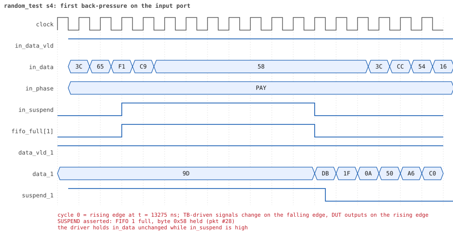

# random_test seed 4

**Result:** PASSED (0 UVM_ERROR, 0 UVM_WARNING, 0 UVM_FATAL) · bench `yapp_project_tb` · sim time 32us · wall 17.8 s · log [`random_test_s4.log`](random_test_s4.log)

Waves: `random_test_s4.fst` (GTKWave, Surfer or the VS Code wave viewer).
[Open the waves in Surfer](https://app.surfer-project.org/?load_url=https%3A%2F%2Fraw.githubusercontent.com%2Ftamirgabgab%2FQcom-Mentoring%2Fmain%2Fyapp_project%2Fregression%2Fyapp_project_tb%2Frandom_test_s4%2Frandom_test_s4.fst&startup_commands=run_command_file_from_url%20https%3A%2F%2Fraw.githubusercontent.com%2Ftamirgabgab%2FQcom-Mentoring%2Fmain%2Fyapp_project%2Ftb%2Fyapp_router.sucl) (web app, the signals already in groups: `yapp_project/tb/yapp_router.sucl`).

## Summary

- YAPP driver sent **61** packet(s) (9 with bad parity); the input monitor saw 61.
- Router: **33** forwarded, **28** dropped (27 oversized, 1 illegal address 3).
- Packets out: ch0 **9**, ch1 **3**, ch2 **21**.
- Scoreboard: 33 matched, 0 mismatched, 0 unexpected.
- Back-pressure: in_suspend asserted **3** time(s), longest hold 26 cycle(s).
- Error pulses: 9.
- HBUS: 33 write(s), 98 read(s).

## Stages

| time (ns) | stage |
|---|---|
| 0 | receivers: ch0 CHANNEL_RX_PROFILE_NORMAL, ch1 CHANNEL_RX_PROFILE_SLOW, ch2 CHANNEL_RX_PROFILE_FAST |
| 0 | random scenario: 61 packets in 6 bursts |
| 260 | burst 1/6: ctrl=0x3e (maxpktsize 62) en=0xcf (router on, counter enables 1100111), 10 packet(s) |
| 6140 | burst 1/6 sent: addr0..3 3/0/7/0, bad parity 2, gap 0 4, length 14..63 |
| 6470 | burst 2/6: ctrl=0xc3 (maxpktsize 3) en=0x01 (router on, counter enables 0000000), 10 packet(s) |
| 10220 | burst 2/6 sent: addr0..3 2/4/4/0, bad parity 1, gap 0 4, length 1..63 |
| 10660 | burst 3/6: ctrl=0xe8 (maxpktsize 40) en=0x73 (router on, counter enables 0111001), 10 packet(s) |
| 14600 | burst 3/6 sent: addr0..3 1/1/8/0, bad parity 1, gap 0 3, length 1..63 |
| 14900 | burst 4/6: ctrl=0xfe (maxpktsize 62) en=0xe5 (router on, counter enables 1110010), 10 packet(s) |
| 20420 | burst 4/6 sent: addr0..3 4/1/4/1, bad parity 1, gap 0 3, length 3..63 |
| 20590 | burst 5/6: ctrl=0xbe (maxpktsize 62) en=0xff (router on, counter enables 1111111), 10 packet(s) |
| 25780 | burst 5/6 sent: addr0..3 2/2/6/0, bad parity 3, gap 0 3, length 6..63 |
| 25950 | burst 6/6: ctrl=0x89 (maxpktsize 9) en=0xff (router on, counter enables 1111111), 11 packet(s) |
| 29250 | burst 6/6 sent: addr0..3 3/0/7/1, bad parity 1, gap 0 2, length 6..59 |
| 29250 | final reads: every register and the stored packet, checked against the reference model |
| 31345 | done: 61 packets (33 forwarded, 28 dropped), 0 storm burst(s), 33 scoreboard matches, 98 HBUS reads checked, 9 error pulses for 9 bad packets |

## Pictures

**reset and the first cycles**

**first packet into the router**

**first packet out on channel 0**

**first back-pressure on the input port**

**first error pulse after a bad-parity packet**

**first HBUS write**

**first HBUS read**

## Timeline

923 events.

| time (ns) | who | event |
|---|---|---|
| 0 | yapp monitor | YAPP monitor running |
| 0 | **test** | STAGE: receivers: ch0 CHANNEL_RX_PROFILE_NORMAL, ch1 CHANNEL_RX_PROFILE_SLOW, ch2 CHANNEL_RX_PROFILE_FAST |
| 0 | **test** | STAGE: random scenario: 61 packets in 6 bursts |
| 0 | clk/rst driver | Starting clock (period 10) and holding reset for 5 cycles |
| 0 | **DUT** | RESET asserted |
| 50 | **DUT** | RESET released: router_en=1 maxpktsize=63 |
| 70 | hbus driver | Executed WRITE addr=0x1000 data=0x3e |
| 75 | **DUT** | CONFIG router_en=1 maxpktsize=62 |
| 75 | hbus monitor | Collected WRITE addr=0x1000 data=0x3e |
| 75 | reference | maxpktsize is now 62 |
| 90 | hbus driver | Executed WRITE addr=0x1001 data=0xcf |
| 95 | hbus monitor | Collected WRITE addr=0x1001 data=0xcf |
| 95 | reference | router_en is now 1 (en_reg 0xcf) |
| 110 | hbus driver | Executed WRITE addr=0x1188 data=0x6c |
| 115 | hbus monitor | Collected WRITE addr=0x1188 data=0x6c |
| 140 | hbus driver | Executed READ  addr=0x1188 data=0x6c |
| 145 | hbus monitor | Collected READ  addr=0x1188 data=0x6c |
| 170 | hbus driver | Executed READ  addr=0x100d data=0x00 |
| 175 | hbus monitor | Collected READ  addr=0x100d data=0x00 |
| 200 | hbus driver | Executed READ  addr=0x100d data=0x00 |
| 205 | hbus monitor | Collected READ  addr=0x100d data=0x00 |
| 230 | hbus driver | Executed READ  addr=0x100b data=0x00 |
| 235 | hbus monitor | Collected READ  addr=0x100b data=0x00 |
| 260 | hbus driver | Executed READ  addr=0x1000 data=0x3e |
| 260 | **test** | STAGE: burst 1/6: ctrl=0x3e (maxpktsize 62) en=0xcf (router on, counter enables 1100111), 10 packet(s) |
| 260 | yapp driver | TX pkt #1: addr=0 len=14 parity=good delay=20 |
| 265 | hbus monitor | Collected READ  addr=0x1000 data=0x3e |
| 475 | **DUT** | IN  pkt #1 header: addr=0 len=14 -> channel 0 |
| 585 | **DUT** | OUT ch0 pkt #1 start: addr=0 len=14 (receiver waited 10 cycle(s)) |
| 625 | **DUT** | IN  pkt #1 complete: addr=0 len=14 parity=ok forwarded, 16 bytes in 16 cycles (held 0) |
| 625 | yapp monitor | RX pkt #1 on the input: addr=0 len=14 parity=good gap=42 |
| 625 | reference | Packet forwarded: addr=0 len=14 -> channel 0 |
| 630 | yapp driver | TX pkt #1 accepted by the DUT |
| 630 | yapp driver | TX pkt #2: addr=2 len=63 parity=good delay=4 |
| 675 | **DUT** | IN  pkt #2 header: addr=2 len=63 -> DROP (oversized: len 63 > maxpktsize 62) |
| 730 | ch0 driver | ch0: packet consumed (response delay 10) |
| 775 | **DUT** | OUT ch0 pkt #1 done: 16 bytes in 20 cycles |
| 775 | ch0 monitor | ch0 RX pkt #1: addr=0 len=14 parity=good |
| 775 | scoreboard | ch0 pkt matched: addr=0 len=14 (1 matched so far) |
| 850 | ch0 driver | ch0: packet consumed (response delay 3) |
| 1315 | **DUT** | IN  pkt #2 complete: addr=2 len=63 parity=ok dropped, 65 bytes in 65 cycles (held 0) |
| 1315 | yapp monitor | RX pkt #2 on the input: addr=2 len=63 parity=good gap=4 |
| 1315 | reference | Packet dropped: length 63 > maxpktsize 62 (addr=2) |
| 1315 | **DUT** | ROUTER DROPS PACKET addr=2 length=63 (length > maxpktsize) |
| 1320 | yapp driver | TX pkt #2 accepted by the DUT |
| 1320 | yapp driver | TX pkt #3: addr=2 len=63 parity=bad delay=0 |
| 1325 | **DUT** | IN  pkt #3 header: addr=2 len=63 -> DROP (oversized: len 63 > maxpktsize 62) |
| 1965 | **DUT** | IN  pkt #3 complete: addr=2 len=63 parity=BAD dropped, 65 bytes in 65 cycles (held 0) |
| 1965 | yapp monitor | RX pkt #3 on the input: addr=2 len=63 parity=bad gap=0 |
| 1965 | reference | Packet dropped: length 63 > maxpktsize 62 (addr=2) |
| 1965 | **DUT** | ROUTER DROPS PACKET addr=2 length=63 (length > maxpktsize) |
| 1970 | yapp driver | TX pkt #3 accepted by the DUT |
| 1970 | yapp driver | TX pkt #4: addr=0 len=62 parity=good delay=0 |
| 1975 | **DUT** | IN  pkt #4 header: addr=0 len=62 -> channel 0 |
| 2005 | **DUT** | OUT ch0 pkt #2 start: addr=0 len=62 (receiver waited 2 cycle(s)) |
| 2030 | **DUT** | ERROR pulse, 6 cycle(s) after the bad-parity packet |
| 2030 | error checker | error pulse 6 cycles after the bad packet (0 still owed) |
| 2605 | **DUT** | IN  pkt #4 complete: addr=0 len=62 parity=ok forwarded, 64 bytes in 64 cycles (held 0) |
| 2605 | yapp monitor | RX pkt #4 on the input: addr=0 len=62 parity=good gap=0 |
| 2605 | reference | Packet forwarded: addr=0 len=62 -> channel 0 |
| 2610 | yapp driver | TX pkt #4 accepted by the DUT |
| 2610 | yapp driver | TX pkt #5: addr=0 len=63 parity=good delay=18 |
| 2630 | ch0 driver | ch0: packet consumed (response delay 2) |
| 2735 | **DUT** | OUT ch0 pkt #2 done: 64 bytes in 74 cycles |
| 2735 | ch0 monitor | ch0 RX pkt #2: addr=0 len=62 parity=good |
| 2735 | scoreboard | ch0 pkt matched: addr=0 len=62 (2 matched so far) |
| 2795 | **DUT** | IN  pkt #5 header: addr=0 len=63 -> DROP (oversized: len 63 > maxpktsize 62) |
| 3230 | ch0 driver | ch0: packet consumed (response delay 9) |
| 3435 | **DUT** | IN  pkt #5 complete: addr=0 len=63 parity=ok dropped, 65 bytes in 65 cycles (held 0) |
| 3435 | yapp monitor | RX pkt #5 on the input: addr=0 len=63 parity=good gap=18 |
| 3435 | reference | Packet dropped: length 63 > maxpktsize 62 (addr=0) |
| 3435 | **DUT** | ROUTER DROPS PACKET addr=0 length=63 (length > maxpktsize) |
| 3440 | yapp driver | TX pkt #5 accepted by the DUT |
| 3440 | yapp driver | TX pkt #6: addr=2 len=45 parity=good delay=20 |
| 3645 | **DUT** | IN  pkt #6 header: addr=2 len=45 -> channel 2 |
| 3655 | **DUT** | OUT ch2 pkt #1 start: addr=2 len=45 (receiver waited 0 cycle(s)) |
| 4105 | **DUT** | IN  pkt #6 complete: addr=2 len=45 parity=ok forwarded, 47 bytes in 47 cycles (held 0) |
| 4105 | yapp monitor | RX pkt #6 on the input: addr=2 len=45 parity=good gap=20 |
| 4105 | reference | Packet forwarded: addr=2 len=45 -> channel 2 |
| 4110 | ch2 driver | ch2: packet consumed (response delay 0) |
| 4110 | yapp driver | TX pkt #6 accepted by the DUT |
| 4110 | yapp driver | TX pkt #7: addr=2 len=63 parity=good delay=0 |
| 4115 | **DUT** | IN  pkt #7 header: addr=2 len=63 -> DROP (oversized: len 63 > maxpktsize 62) |
| 4125 | **DUT** | OUT ch2 pkt #1 done: 47 bytes in 48 cycles |
| 4125 | ch2 monitor | ch2 RX pkt #1: addr=2 len=45 parity=good |
| 4125 | scoreboard | ch2 pkt matched: addr=2 len=45 (3 matched so far) |
| 4490 | ch2 driver | ch2: packet consumed (response delay 0) |
| 4755 | **DUT** | IN  pkt #7 complete: addr=2 len=63 parity=ok dropped, 65 bytes in 65 cycles (held 0) |
| 4755 | yapp monitor | RX pkt #7 on the input: addr=2 len=63 parity=good gap=0 |
| 4755 | reference | Packet dropped: length 63 > maxpktsize 62 (addr=2) |
| 4755 | **DUT** | ROUTER DROPS PACKET addr=2 length=63 (length > maxpktsize) |
| 4760 | yapp driver | TX pkt #7 accepted by the DUT |
| 4760 | yapp driver | TX pkt #8: addr=2 len=38 parity=good delay=1 |
| 4775 | **DUT** | IN  pkt #8 header: addr=2 len=38 -> channel 2 |
| 4785 | **DUT** | OUT ch2 pkt #2 start: addr=2 len=38 (receiver waited 0 cycle(s)) |
| 5165 | **DUT** | IN  pkt #8 complete: addr=2 len=38 parity=ok forwarded, 40 bytes in 40 cycles (held 0) |
| 5165 | yapp monitor | RX pkt #8 on the input: addr=2 len=38 parity=good gap=1 |
| 5165 | reference | Packet forwarded: addr=2 len=38 -> channel 2 |
| 5170 | ch2 driver | ch2: packet consumed (response delay 0) |
| 5170 | yapp driver | TX pkt #8 accepted by the DUT |
| 5170 | yapp driver | TX pkt #9: addr=2 len=57 parity=good delay=6 |
| 5185 | **DUT** | OUT ch2 pkt #2 done: 40 bytes in 41 cycles |
| 5185 | ch2 monitor | ch2 RX pkt #2: addr=2 len=38 parity=good |
| 5185 | scoreboard | ch2 pkt matched: addr=2 len=38 (4 matched so far) |
| 5235 | **DUT** | IN  pkt #9 header: addr=2 len=57 -> channel 2 |
| 5245 | **DUT** | OUT ch2 pkt #3 start: addr=2 len=57 (receiver waited 0 cycle(s)) |
| 5620 | ch2 driver | ch2: packet consumed (response delay 0) |
| 5815 | **DUT** | IN  pkt #9 complete: addr=2 len=57 parity=ok forwarded, 59 bytes in 59 cycles (held 0) |
| 5815 | yapp monitor | RX pkt #9 on the input: addr=2 len=57 parity=good gap=6 |
| 5815 | reference | Packet forwarded: addr=2 len=57 -> channel 2 |
| 5820 | yapp driver | TX pkt #9 accepted by the DUT |
| 5820 | yapp driver | TX pkt #10: addr=2 len=30 parity=bad delay=0 |
| 5825 | **DUT** | IN  pkt #10 header: addr=2 len=30 -> channel 2 |
| 5835 | **DUT** | OUT ch2 pkt #3 done: 59 bytes in 60 cycles |
| 5835 | ch2 monitor | ch2 RX pkt #3: addr=2 len=57 parity=good |
| 5835 | scoreboard | ch2 pkt matched: addr=2 len=57 (5 matched so far) |
| 5845 | **DUT** | OUT ch2 pkt #4 start: addr=2 len=30 (receiver waited 0 cycle(s)) |
| 6120 | ch2 driver | ch2: packet consumed (response delay 0) |
| 6135 | **DUT** | IN  pkt #10 complete: addr=2 len=30 parity=BAD forwarded, 32 bytes in 32 cycles (held 0) |
| 6135 | yapp monitor | RX pkt #10 on the input: addr=2 len=30 parity=bad gap=0 |
| 6135 | reference | Packet forwarded: addr=2 len=30 -> channel 2 |
| 6140 | yapp driver | TX pkt #10 accepted by the DUT |
| 6140 | **test** | STAGE: burst 1/6 sent: addr0..3 3/0/7/0, bad parity 2, gap 0 4, length 14..63 |
| 6150 | **DUT** | ERROR pulse, 1 cycle(s) after the bad-parity packet |
| 6150 | error checker | error pulse 1 cycles after the bad packet (0 still owed) |
| 6160 | hbus driver | Executed WRITE addr=0x1000 data=0xc3 |
| 6165 | **DUT** | OUT ch2 pkt #4 done: 32 bytes in 33 cycles |
| 6165 | **DUT** | CONFIG router_en=1 maxpktsize=3 |
| 6165 | ch2 monitor | ch2 RX pkt #4: addr=2 len=30 parity=bad |
| 6165 | scoreboard | ch2 pkt matched: addr=2 len=30 (6 matched so far) |
| 6165 | hbus monitor | Collected WRITE addr=0x1000 data=0xc3 |
| 6165 | reference | maxpktsize is now 3 |
| 6180 | ch2 driver | ch2: packet consumed (response delay 0) |
| 6180 | hbus driver | Executed WRITE addr=0x1001 data=0x01 |
| 6185 | hbus monitor | Collected WRITE addr=0x1001 data=0x01 |
| 6185 | reference | router_en is now 1 (en_reg 0x01) |
| 6210 | hbus driver | Executed READ  addr=0x100d data=0x1e |
| 6215 | hbus monitor | Collected READ  addr=0x100d data=0x1e |
| 6240 | hbus driver | Executed READ  addr=0x100d data=0x1e |
| 6245 | hbus monitor | Collected READ  addr=0x100d data=0x1e |
| 6260 | hbus driver | Executed WRITE addr=0x1188 data=0x48 |
| 6265 | hbus monitor | Collected WRITE addr=0x1188 data=0x48 |
| 6290 | hbus driver | Executed READ  addr=0x1188 data=0x48 |
| 6295 | hbus monitor | Collected READ  addr=0x1188 data=0x48 |
| 6310 | hbus driver | Executed WRITE addr=0x1143 data=0x8b |
| 6315 | hbus monitor | Collected WRITE addr=0x1143 data=0x8b |
| 6340 | hbus driver | Executed READ  addr=0x1143 data=0x8b |
| 6345 | hbus monitor | Collected READ  addr=0x1143 data=0x8b |
| 6370 | hbus driver | Executed READ  addr=0x100d data=0x1e |
| 6375 | hbus monitor | Collected READ  addr=0x100d data=0x1e |
| 6390 | hbus driver | Executed WRITE addr=0x1152 data=0xf5 |
| 6395 | hbus monitor | Collected WRITE addr=0x1152 data=0xf5 |
| 6420 | hbus driver | Executed READ  addr=0x1152 data=0xf5 |
| 6425 | hbus monitor | Collected READ  addr=0x1152 data=0xf5 |
| 6440 | hbus driver | Executed WRITE addr=0x112f data=0x4b |
| 6445 | hbus monitor | Collected WRITE addr=0x112f data=0x4b |
| 6470 | hbus driver | Executed READ  addr=0x112f data=0x4b |
| 6470 | **test** | STAGE: burst 2/6: ctrl=0xc3 (maxpktsize 3) en=0x01 (router on, counter enables 0000000), 10 packet(s) |
| 6470 | yapp driver | TX pkt #11: addr=0 len=28 parity=good delay=1 |
| 6475 | hbus monitor | Collected READ  addr=0x112f data=0x4b |
| 6495 | **DUT** | IN  pkt #11 header: addr=0 len=28 -> DROP (oversized: len 28 > maxpktsize 3) |
| 6785 | **DUT** | IN  pkt #11 complete: addr=0 len=28 parity=ok dropped, 30 bytes in 30 cycles (held 0) |
| 6785 | yapp monitor | RX pkt #11 on the input: addr=0 len=28 parity=good gap=35 |
| 6785 | reference | Packet dropped: length 28 > maxpktsize 3 (addr=0) |
| 6785 | **DUT** | ROUTER DROPS PACKET addr=0 length=28 (length > maxpktsize) |
| 6790 | yapp driver | TX pkt #11 accepted by the DUT |
| 6790 | yapp driver | TX pkt #12: addr=1 len=54 parity=good delay=0 |
| 6795 | **DUT** | IN  pkt #12 header: addr=1 len=54 -> DROP (oversized: len 54 > maxpktsize 3) |
| 7345 | **DUT** | IN  pkt #12 complete: addr=1 len=54 parity=ok dropped, 56 bytes in 56 cycles (held 0) |
| 7345 | yapp monitor | RX pkt #12 on the input: addr=1 len=54 parity=good gap=0 |
| 7345 | reference | Packet dropped: length 54 > maxpktsize 3 (addr=1) |
| 7345 | **DUT** | ROUTER DROPS PACKET addr=1 length=54 (length > maxpktsize) |
| 7350 | yapp driver | TX pkt #12 accepted by the DUT |
| 7350 | yapp driver | TX pkt #13: addr=2 len=10 parity=good delay=20 |
| 7555 | **DUT** | IN  pkt #13 header: addr=2 len=10 -> DROP (oversized: len 10 > maxpktsize 3) |
| 7665 | **DUT** | IN  pkt #13 complete: addr=2 len=10 parity=ok dropped, 12 bytes in 12 cycles (held 0) |
| 7665 | yapp monitor | RX pkt #13 on the input: addr=2 len=10 parity=good gap=20 |
| 7665 | reference | Packet dropped: length 10 > maxpktsize 3 (addr=2) |
| 7665 | **DUT** | ROUTER DROPS PACKET addr=2 length=10 (length > maxpktsize) |
| 7670 | yapp driver | TX pkt #13 accepted by the DUT |
| 7670 | yapp driver | TX pkt #14: addr=2 len=3 parity=good delay=2 |
| 7695 | **DUT** | IN  pkt #14 header: addr=2 len=3 -> channel 2 |
| 7705 | **DUT** | OUT ch2 pkt #5 start: addr=2 len=3 (receiver waited 0 cycle(s)) |
| 7735 | **DUT** | IN  pkt #14 complete: addr=2 len=3 parity=ok forwarded, 5 bytes in 5 cycles (held 0) |
| 7735 | yapp monitor | RX pkt #14 on the input: addr=2 len=3 parity=good gap=2 |
| 7735 | reference | Packet forwarded: addr=2 len=3 -> channel 2 |
| 7740 | ch2 driver | ch2: packet consumed (response delay 0) |
| 7740 | yapp driver | TX pkt #14 accepted by the DUT |
| 7740 | yapp driver | TX pkt #15: addr=2 len=63 parity=good delay=0 |
| 7745 | **DUT** | IN  pkt #15 header: addr=2 len=63 -> DROP (oversized: len 63 > maxpktsize 3) |
| 7755 | **DUT** | OUT ch2 pkt #5 done: 5 bytes in 6 cycles |
| 7755 | ch2 monitor | ch2 RX pkt #5: addr=2 len=3 parity=good |
| 7755 | scoreboard | ch2 pkt matched: addr=2 len=3 (7 matched so far) |
| 8110 | ch2 driver | ch2: packet consumed (response delay 0) |
| 8385 | **DUT** | IN  pkt #15 complete: addr=2 len=63 parity=ok dropped, 65 bytes in 65 cycles (held 0) |
| 8385 | yapp monitor | RX pkt #15 on the input: addr=2 len=63 parity=good gap=0 |
| 8385 | reference | Packet dropped: length 63 > maxpktsize 3 (addr=2) |
| 8385 | **DUT** | ROUTER DROPS PACKET addr=2 length=63 (length > maxpktsize) |
| 8390 | yapp driver | TX pkt #15 accepted by the DUT |
| 8390 | yapp driver | TX pkt #16: addr=1 len=42 parity=bad delay=0 |
| 8395 | **DUT** | IN  pkt #16 header: addr=1 len=42 -> DROP (oversized: len 42 > maxpktsize 3) |
| 8825 | **DUT** | IN  pkt #16 complete: addr=1 len=42 parity=BAD dropped, 44 bytes in 44 cycles (held 0) |
| 8825 | yapp monitor | RX pkt #16 on the input: addr=1 len=42 parity=bad gap=0 |
| 8825 | reference | Packet dropped: length 42 > maxpktsize 3 (addr=1) |
| 8825 | **DUT** | ROUTER DROPS PACKET addr=1 length=42 (length > maxpktsize) |
| 8830 | yapp driver | TX pkt #16 accepted by the DUT |
| 8830 | yapp driver | TX pkt #17: addr=2 len=4 parity=good delay=0 |
| 8835 | **DUT** | IN  pkt #17 header: addr=2 len=4 -> DROP (oversized: len 4 > maxpktsize 3) |
| 8870 | **DUT** | ERROR pulse, 4 cycle(s) after the bad-parity packet |
| 8870 | error checker | error pulse 4 cycles after the bad packet (0 still owed) |
| 8885 | **DUT** | IN  pkt #17 complete: addr=2 len=4 parity=ok dropped, 6 bytes in 6 cycles (held 0) |
| 8885 | yapp monitor | RX pkt #17 on the input: addr=2 len=4 parity=good gap=0 |
| 8885 | reference | Packet dropped: length 4 > maxpktsize 3 (addr=2) |
| 8885 | **DUT** | ROUTER DROPS PACKET addr=2 length=4 (length > maxpktsize) |
| 8890 | yapp driver | TX pkt #17 accepted by the DUT |
| 8890 | yapp driver | TX pkt #18: addr=1 len=63 parity=good delay=20 |
| 9095 | **DUT** | IN  pkt #18 header: addr=1 len=63 -> DROP (oversized: len 63 > maxpktsize 3) |
| 9735 | **DUT** | IN  pkt #18 complete: addr=1 len=63 parity=ok dropped, 65 bytes in 65 cycles (held 0) |
| 9735 | yapp monitor | RX pkt #18 on the input: addr=1 len=63 parity=good gap=20 |
| 9735 | reference | Packet dropped: length 63 > maxpktsize 3 (addr=1) |
| 9735 | **DUT** | ROUTER DROPS PACKET addr=1 length=63 (length > maxpktsize) |
| 9740 | yapp driver | TX pkt #18 accepted by the DUT |
| 9740 | yapp driver | TX pkt #19: addr=0 len=1 parity=good delay=15 |
| 9895 | **DUT** | IN  pkt #19 header: addr=0 len=1 -> channel 0 |
| 9915 | **DUT** | IN  pkt #19 complete: addr=0 len=1 parity=ok forwarded, 3 bytes in 3 cycles (held 0) |
| 9915 | **DUT** | OUT ch0 pkt #3 start: addr=0 len=1 (receiver waited 1 cycle(s)) |
| 9915 | yapp monitor | RX pkt #19 on the input: addr=0 len=1 parity=good gap=15 |
| 9915 | reference | Packet forwarded: addr=0 len=1 -> channel 0 |
| 9920 | yapp driver | TX pkt #19 accepted by the DUT |
| 9920 | yapp driver | TX pkt #20: addr=1 len=25 parity=good delay=3 |
| 9930 | ch0 driver | ch0: packet consumed (response delay 1) |
| 9955 | **DUT** | IN  pkt #20 header: addr=1 len=25 -> DROP (oversized: len 25 > maxpktsize 3) |
| 10045 | **DUT** | OUT ch0 pkt #3 done: 3 bytes in 14 cycles |
| 10045 | ch0 monitor | ch0 RX pkt #3: addr=0 len=1 parity=good |
| 10045 | scoreboard | ch0 pkt matched: addr=0 len=1 (8 matched so far) |
| 10215 | **DUT** | IN  pkt #20 complete: addr=1 len=25 parity=ok dropped, 27 bytes in 27 cycles (held 0) |
| 10215 | yapp monitor | RX pkt #20 on the input: addr=1 len=25 parity=good gap=3 |
| 10215 | reference | Packet dropped: length 25 > maxpktsize 3 (addr=1) |
| 10215 | **DUT** | ROUTER DROPS PACKET addr=1 length=25 (length > maxpktsize) |
| 10220 | yapp driver | TX pkt #20 accepted by the DUT |
| 10220 | **test** | STAGE: burst 2/6 sent: addr0..3 2/4/4/0, bad parity 1, gap 0 4, length 1..63 |
| 10240 | hbus driver | Executed WRITE addr=0x1000 data=0xe8 |
| 10245 | **DUT** | CONFIG router_en=1 maxpktsize=40 |
| 10245 | hbus monitor | Collected WRITE addr=0x1000 data=0xe8 |
| 10245 | reference | maxpktsize is now 40 |
| 10260 | hbus driver | Executed WRITE addr=0x1001 data=0x73 |
| 10265 | hbus monitor | Collected WRITE addr=0x1001 data=0x73 |
| 10265 | reference | router_en is now 1 (en_reg 0x73) |
| 10280 | hbus driver | Executed WRITE addr=0x11d2 data=0x85 |
| 10285 | hbus monitor | Collected WRITE addr=0x11d2 data=0x85 |
| 10310 | hbus driver | Executed READ  addr=0x11d2 data=0x85 |
| 10315 | hbus monitor | Collected READ  addr=0x11d2 data=0x85 |
| 10330 | hbus driver | Executed WRITE addr=0x1186 data=0x06 |
| 10335 | hbus monitor | Collected WRITE addr=0x1186 data=0x06 |
| 10360 | hbus driver | Executed READ  addr=0x1186 data=0x06 |
| 10365 | hbus monitor | Collected READ  addr=0x1186 data=0x06 |
| 10380 | hbus driver | Executed WRITE addr=0x11f9 data=0x41 |
| 10385 | hbus monitor | Collected WRITE addr=0x11f9 data=0x41 |
| 10410 | hbus driver | Executed READ  addr=0x11f9 data=0x41 |
| 10415 | hbus monitor | Collected READ  addr=0x11f9 data=0x41 |
| 10430 | hbus driver | Executed WRITE addr=0x111b data=0x34 |
| 10435 | hbus monitor | Collected WRITE addr=0x111b data=0x34 |
| 10460 | hbus driver | Executed READ  addr=0x111b data=0x34 |
| 10465 | hbus monitor | Collected READ  addr=0x111b data=0x34 |
| 10480 | hbus driver | Executed WRITE addr=0x11bf data=0x6d |
| 10485 | hbus monitor | Collected WRITE addr=0x11bf data=0x6d |
| 10510 | hbus driver | Executed READ  addr=0x11bf data=0x6d |
| 10515 | hbus monitor | Collected READ  addr=0x11bf data=0x6d |
| 10530 | hbus driver | Executed WRITE addr=0x1106 data=0x48 |
| 10535 | hbus monitor | Collected WRITE addr=0x1106 data=0x48 |
| 10560 | hbus driver | Executed READ  addr=0x1106 data=0x48 |
| 10565 | hbus monitor | Collected READ  addr=0x1106 data=0x48 |
| 10580 | hbus driver | Executed WRITE addr=0x1199 data=0x9f |
| 10585 | hbus monitor | Collected WRITE addr=0x1199 data=0x9f |
| 10610 | hbus driver | Executed READ  addr=0x1199 data=0x9f |
| 10615 | hbus monitor | Collected READ  addr=0x1199 data=0x9f |
| 10630 | hbus driver | Executed WRITE addr=0x111a data=0xbe |
| 10635 | hbus monitor | Collected WRITE addr=0x111a data=0xbe |
| 10660 | ch0 driver | ch0: packet consumed (response delay 10) |
| 10660 | hbus driver | Executed READ  addr=0x111a data=0xbe |
| 10660 | **test** | STAGE: burst 3/6: ctrl=0xe8 (maxpktsize 40) en=0x73 (router on, counter enables 0111001), 10 packet(s) |
| 10660 | yapp driver | TX pkt #21: addr=2 len=1 parity=good delay=4 |
| 10665 | hbus monitor | Collected READ  addr=0x111a data=0xbe |
| 10715 | **DUT** | IN  pkt #21 header: addr=2 len=1 -> channel 2 |
| 10725 | **DUT** | OUT ch2 pkt #6 start: addr=2 len=1 (receiver waited 0 cycle(s)) |
| 10735 | **DUT** | IN  pkt #21 complete: addr=2 len=1 parity=ok forwarded, 3 bytes in 3 cycles (held 0) |
| 10735 | yapp monitor | RX pkt #21 on the input: addr=2 len=1 parity=good gap=49 |
| 10735 | reference | Packet forwarded: addr=2 len=1 -> channel 2 |
| 10740 | ch2 driver | ch2: packet consumed (response delay 0) |
| 10740 | yapp driver | TX pkt #21 accepted by the DUT |
| 10740 | yapp driver | TX pkt #22: addr=2 len=35 parity=good delay=3 |
| 10755 | **DUT** | OUT ch2 pkt #6 done: 3 bytes in 4 cycles |
| 10755 | ch2 monitor | ch2 RX pkt #6: addr=2 len=1 parity=good |
| 10755 | scoreboard | ch2 pkt matched: addr=2 len=1 (9 matched so far) |
| 10775 | **DUT** | IN  pkt #22 header: addr=2 len=35 -> channel 2 |
| 10785 | **DUT** | OUT ch2 pkt #7 start: addr=2 len=35 (receiver waited 0 cycle(s)) |
| 11120 | ch2 driver | ch2: packet consumed (response delay 0) |
| 11135 | **DUT** | IN  pkt #22 complete: addr=2 len=35 parity=ok forwarded, 37 bytes in 37 cycles (held 0) |
| 11135 | yapp monitor | RX pkt #22 on the input: addr=2 len=35 parity=good gap=3 |
| 11135 | reference | Packet forwarded: addr=2 len=35 -> channel 2 |
| 11140 | yapp driver | TX pkt #22 accepted by the DUT |
| 11140 | yapp driver | TX pkt #23: addr=2 len=28 parity=bad delay=0 |
| 11145 | **DUT** | IN  pkt #23 header: addr=2 len=28 -> channel 2 |
| 11155 | **DUT** | OUT ch2 pkt #7 done: 37 bytes in 38 cycles |
| 11155 | ch2 monitor | ch2 RX pkt #7: addr=2 len=35 parity=good |
| 11155 | scoreboard | ch2 pkt matched: addr=2 len=35 (10 matched so far) |
| 11165 | **DUT** | OUT ch2 pkt #8 start: addr=2 len=28 (receiver waited 0 cycle(s)) |
| 11435 | **DUT** | IN  pkt #23 complete: addr=2 len=28 parity=BAD forwarded, 30 bytes in 30 cycles (held 0) |
| 11435 | yapp monitor | RX pkt #23 on the input: addr=2 len=28 parity=bad gap=0 |
| 11435 | reference | Packet forwarded: addr=2 len=28 -> channel 2 |
| 11440 | yapp driver | TX pkt #23 accepted by the DUT |
| 11440 | yapp driver | TX pkt #24: addr=2 len=41 parity=good delay=0 |
| 11445 | **DUT** | IN  pkt #24 header: addr=2 len=41 -> DROP (oversized: len 41 > maxpktsize 40) |
| 11455 | **DUT** | OUT ch2 pkt #8 done: 30 bytes in 30 cycles |
| 11455 | ch2 monitor | ch2 RX pkt #8: addr=2 len=28 parity=bad |
| 11455 | scoreboard | ch2 pkt matched: addr=2 len=28 (11 matched so far) |
| 11470 | **DUT** | ERROR pulse, 3 cycle(s) after the bad-parity packet |
| 11470 | error checker | error pulse 3 cycles after the bad packet (0 still owed) |
| 11680 | ch2 driver | ch2: packet consumed (response delay 0) |
| 11865 | **DUT** | IN  pkt #24 complete: addr=2 len=41 parity=ok dropped, 43 bytes in 43 cycles (held 0) |
| 11865 | yapp monitor | RX pkt #24 on the input: addr=2 len=41 parity=good gap=0 |
| 11865 | reference | Packet dropped: length 41 > maxpktsize 40 (addr=2) |
| 11865 | **DUT** | ROUTER DROPS PACKET addr=2 length=41 (length > maxpktsize) |
| 11870 | yapp driver | TX pkt #24 accepted by the DUT |
| 11870 | yapp driver | TX pkt #25: addr=2 len=39 parity=good delay=1 |
| 11885 | **DUT** | IN  pkt #25 header: addr=2 len=39 -> channel 2 |
| 11895 | **DUT** | OUT ch2 pkt #9 start: addr=2 len=39 (receiver waited 0 cycle(s)) |
| 12285 | **DUT** | IN  pkt #25 complete: addr=2 len=39 parity=ok forwarded, 41 bytes in 41 cycles (held 0) |
| 12285 | yapp monitor | RX pkt #25 on the input: addr=2 len=39 parity=good gap=1 |
| 12285 | reference | Packet forwarded: addr=2 len=39 -> channel 2 |
| 12290 | ch2 driver | ch2: packet consumed (response delay 0) |
| 12290 | yapp driver | TX pkt #25 accepted by the DUT |
| 12290 | yapp driver | TX pkt #26: addr=2 len=14 parity=good delay=3 |
| 12305 | **DUT** | OUT ch2 pkt #9 done: 41 bytes in 42 cycles |
| 12305 | ch2 monitor | ch2 RX pkt #9: addr=2 len=39 parity=good |
| 12305 | scoreboard | ch2 pkt matched: addr=2 len=39 (12 matched so far) |
| 12325 | **DUT** | IN  pkt #26 header: addr=2 len=14 -> channel 2 |
| 12335 | **DUT** | OUT ch2 pkt #10 start: addr=2 len=14 (receiver waited 0 cycle(s)) |
| 12475 | **DUT** | IN  pkt #26 complete: addr=2 len=14 parity=ok forwarded, 16 bytes in 16 cycles (held 0) |
| 12475 | yapp monitor | RX pkt #26 on the input: addr=2 len=14 parity=good gap=3 |
| 12475 | reference | Packet forwarded: addr=2 len=14 -> channel 2 |
| 12480 | yapp driver | TX pkt #26 accepted by the DUT |
| 12480 | yapp driver | TX pkt #27: addr=2 len=44 parity=good delay=1 |
| 12485 | **DUT** | OUT ch2 pkt #10 done: 16 bytes in 16 cycles |
| 12485 | ch2 monitor | ch2 RX pkt #10: addr=2 len=14 parity=good |
| 12485 | scoreboard | ch2 pkt matched: addr=2 len=14 (13 matched so far) |
| 12495 | **DUT** | IN  pkt #27 header: addr=2 len=44 -> DROP (oversized: len 44 > maxpktsize 40) |
| 12720 | ch2 driver | ch2: packet consumed (response delay 0) |
| 12945 | **DUT** | IN  pkt #27 complete: addr=2 len=44 parity=ok dropped, 46 bytes in 46 cycles (held 0) |
| 12945 | yapp monitor | RX pkt #27 on the input: addr=2 len=44 parity=good gap=1 |
| 12945 | reference | Packet dropped: length 44 > maxpktsize 40 (addr=2) |
| 12945 | **DUT** | ROUTER DROPS PACKET addr=2 length=44 (length > maxpktsize) |
| 12950 | yapp driver | TX pkt #27 accepted by the DUT |
| 12950 | yapp driver | TX pkt #28: addr=1 len=39 parity=good delay=20 |
| 13155 | **DUT** | IN  pkt #28 header: addr=1 len=39 -> channel 1 |
| 13315 | **DUT** | SUSPEND asserted: FIFO 1 full, byte 0x58 held (pkt #28) |
| 13395 | **DUT** | OUT ch1 pkt #1 start: addr=1 len=39 (receiver waited 23 cycle(s)) |
| 13405 | **DUT** | SUSPEND released after 9 cycle(s) |
| 13645 | **DUT** | IN  pkt #28 complete: addr=1 len=39 parity=ok forwarded, 41 bytes in 50 cycles (held 9) |
| 13645 | yapp monitor | RX pkt #28 on the input: addr=1 len=39 parity=good gap=20 |
| 13645 | reference | Packet forwarded: addr=1 len=39 -> channel 1 |
| 13650 | yapp driver | TX pkt #28 accepted by the DUT |
| 13650 | yapp driver | TX pkt #29: addr=0 len=63 parity=good delay=1 |
| 13665 | **DUT** | IN  pkt #29 header: addr=0 len=63 -> DROP (oversized: len 63 > maxpktsize 40) |
| 13790 | ch1 driver | ch1: packet consumed (response delay 23) |
| 14195 | **DUT** | OUT ch1 pkt #1 done: 41 bytes in 81 cycles |
| 14195 | ch1 monitor | ch1 RX pkt #1: addr=1 len=39 parity=good |
| 14195 | scoreboard | ch1 pkt matched: addr=1 len=39 (14 matched so far) |
| 14305 | **DUT** | IN  pkt #29 complete: addr=0 len=63 parity=ok dropped, 65 bytes in 65 cycles (held 0) |
| 14305 | yapp monitor | RX pkt #29 on the input: addr=0 len=63 parity=good gap=1 |
| 14305 | reference | Packet dropped: length 63 > maxpktsize 40 (addr=0) |
| 14305 | **DUT** | ROUTER DROPS PACKET addr=0 length=63 (length > maxpktsize) |
| 14310 | yapp driver | TX pkt #29 accepted by the DUT |
| 14310 | yapp driver | TX pkt #30: addr=2 len=27 parity=good delay=0 |
| 14315 | **DUT** | IN  pkt #30 header: addr=2 len=27 -> channel 2 |
| 14320 | ch1 driver | ch1: packet consumed (response delay 39) |
| 14325 | **DUT** | OUT ch2 pkt #11 start: addr=2 len=27 (receiver waited 0 cycle(s)) |
| 14595 | **DUT** | IN  pkt #30 complete: addr=2 len=27 parity=ok forwarded, 29 bytes in 29 cycles (held 0) |
| 14595 | yapp monitor | RX pkt #30 on the input: addr=2 len=27 parity=good gap=0 |
| 14595 | reference | Packet forwarded: addr=2 len=27 -> channel 2 |
| 14600 | ch2 driver | ch2: packet consumed (response delay 0) |
| 14600 | yapp driver | TX pkt #30 accepted by the DUT |
| 14600 | **test** | STAGE: burst 3/6 sent: addr0..3 1/1/8/0, bad parity 1, gap 0 3, length 1..63 |
| 14615 | **DUT** | OUT ch2 pkt #11 done: 29 bytes in 30 cycles |
| 14615 | ch2 monitor | ch2 RX pkt #11: addr=2 len=27 parity=good |
| 14615 | scoreboard | ch2 pkt matched: addr=2 len=27 (15 matched so far) |
| 14620 | hbus driver | Executed WRITE addr=0x1000 data=0xfe |
| 14625 | **DUT** | CONFIG router_en=1 maxpktsize=62 |
| 14625 | hbus monitor | Collected WRITE addr=0x1000 data=0xfe |
| 14625 | reference | maxpktsize is now 62 |
| 14640 | hbus driver | Executed WRITE addr=0x1001 data=0xe5 |
| 14645 | hbus monitor | Collected WRITE addr=0x1001 data=0xe5 |
| 14645 | reference | router_en is now 1 (en_reg 0xe5) |
| 14670 | hbus driver | Executed READ  addr=0x1001 data=0xe5 |
| 14675 | hbus monitor | Collected READ  addr=0x1001 data=0xe5 |
| 14690 | hbus driver | Executed WRITE addr=0x11cf data=0xeb |
| 14695 | hbus monitor | Collected WRITE addr=0x11cf data=0xeb |
| 14720 | hbus driver | Executed READ  addr=0x11cf data=0xeb |
| 14725 | hbus monitor | Collected READ  addr=0x11cf data=0xeb |
| 14740 | hbus driver | Executed WRITE addr=0x1176 data=0xa6 |
| 14745 | hbus monitor | Collected WRITE addr=0x1176 data=0xa6 |
| 14770 | hbus driver | Executed READ  addr=0x1176 data=0xa6 |
| 14775 | hbus monitor | Collected READ  addr=0x1176 data=0xa6 |
| 14790 | hbus driver | Executed WRITE addr=0x112c data=0x20 |
| 14795 | hbus monitor | Collected WRITE addr=0x112c data=0x20 |
| 14820 | hbus driver | Executed READ  addr=0x112c data=0x20 |
| 14825 | hbus monitor | Collected READ  addr=0x112c data=0x20 |
| 14840 | hbus driver | Executed WRITE addr=0x1143 data=0xe8 |
| 14845 | hbus monitor | Collected WRITE addr=0x1143 data=0xe8 |
| 14870 | hbus driver | Executed READ  addr=0x1143 data=0xe8 |
| 14875 | hbus monitor | Collected READ  addr=0x1143 data=0xe8 |
| 14900 | hbus driver | Executed READ  addr=0x101b data=0x3e |
| 14900 | **test** | STAGE: burst 4/6: ctrl=0xfe (maxpktsize 62) en=0xe5 (router on, counter enables 1110010), 10 packet(s) |
| 14900 | yapp driver | TX pkt #31: addr=2 len=49 parity=good delay=0 |
| 14905 | hbus monitor | Collected READ  addr=0x101b data=0x3e |
| 14915 | **DUT** | IN  pkt #31 header: addr=2 len=49 -> channel 2 |
| 14925 | **DUT** | OUT ch2 pkt #12 start: addr=2 len=49 (receiver waited 0 cycle(s)) |
| 15150 | ch2 driver | ch2: packet consumed (response delay 0) |
| 15390 | ch2 driver | ch2: packet consumed (response delay 0) |
| 15415 | **DUT** | IN  pkt #31 complete: addr=2 len=49 parity=ok forwarded, 51 bytes in 51 cycles (held 0) |
| 15415 | yapp monitor | RX pkt #31 on the input: addr=2 len=49 parity=good gap=31 |
| 15415 | reference | Packet forwarded: addr=2 len=49 -> channel 2 |
| 15420 | yapp driver | TX pkt #31 accepted by the DUT |
| 15420 | yapp driver | TX pkt #32: addr=2 len=63 parity=good delay=0 |
| 15425 | **DUT** | IN  pkt #32 header: addr=2 len=63 -> DROP (oversized: len 63 > maxpktsize 62) |
| 15445 | **DUT** | OUT ch2 pkt #12 done: 51 bytes in 53 cycles |
| 15445 | ch2 monitor | ch2 RX pkt #12: addr=2 len=49 parity=good |
| 15445 | scoreboard | ch2 pkt matched: addr=2 len=49 (16 matched so far) |
| 15650 | ch2 driver | ch2: packet consumed (response delay 0) |
| 16065 | **DUT** | IN  pkt #32 complete: addr=2 len=63 parity=ok dropped, 65 bytes in 65 cycles (held 0) |
| 16065 | yapp monitor | RX pkt #32 on the input: addr=2 len=63 parity=good gap=0 |
| 16065 | reference | Packet dropped: length 63 > maxpktsize 62 (addr=2) |
| 16065 | **DUT** | ROUTER DROPS PACKET addr=2 length=63 (length > maxpktsize) |
| 16070 | yapp driver | TX pkt #32 accepted by the DUT |
| 16070 | yapp driver | TX pkt #33: addr=3 len=27 parity=bad delay=1 |
| 16085 | **DUT** | IN  pkt #33 header: addr=3 len=27 -> DROP (illegal address 3) |
| 16365 | **DUT** | IN  pkt #33 complete: addr=3 len=27 parity=BAD dropped, 29 bytes in 29 cycles (held 0) |
| 16365 | yapp monitor | RX pkt #33 on the input: addr=3 len=27 parity=bad gap=1 |
| 16365 | reference | Packet dropped: illegal address 3 (len=27) |
| 16365 | **DUT** | ROUTER DROPS PACKET addr=3 length=27 (    illegal address) |
| 16370 | yapp driver | TX pkt #33 accepted by the DUT |
| 16370 | yapp driver | TX pkt #34: addr=2 len=61 parity=good delay=1 |
| 16385 | **DUT** | IN  pkt #34 header: addr=2 len=61 -> channel 2 |
| 16395 | **DUT** | OUT ch2 pkt #13 start: addr=2 len=61 (receiver waited 0 cycle(s)) |
| 16430 | **DUT** | ERROR pulse, 6 cycle(s) after the bad-parity packet |
| 16430 | error checker | error pulse 6 cycles after the bad packet (0 still owed) |
| 17005 | **DUT** | IN  pkt #34 complete: addr=2 len=61 parity=ok forwarded, 63 bytes in 63 cycles (held 0) |
| 17005 | yapp monitor | RX pkt #34 on the input: addr=2 len=61 parity=good gap=1 |
| 17005 | reference | Packet forwarded: addr=2 len=61 -> channel 2 |
| 17010 | ch2 driver | ch2: packet consumed (response delay 0) |
| 17010 | yapp driver | TX pkt #34 accepted by the DUT |
| 17010 | yapp driver | TX pkt #35: addr=0 len=63 parity=good delay=1 |
| 17025 | **DUT** | IN  pkt #35 header: addr=0 len=63 -> DROP (oversized: len 63 > maxpktsize 62) |
| 17025 | **DUT** | OUT ch2 pkt #13 done: 63 bytes in 64 cycles |
| 17025 | ch2 monitor | ch2 RX pkt #13: addr=2 len=61 parity=good |
| 17025 | scoreboard | ch2 pkt matched: addr=2 len=61 (17 matched so far) |
| 17060 | ch2 driver | ch2: packet consumed (response delay 0) |
| 17665 | **DUT** | IN  pkt #35 complete: addr=0 len=63 parity=ok dropped, 65 bytes in 65 cycles (held 0) |
| 17665 | yapp monitor | RX pkt #35 on the input: addr=0 len=63 parity=good gap=1 |
| 17665 | reference | Packet dropped: length 63 > maxpktsize 62 (addr=0) |
| 17665 | **DUT** | ROUTER DROPS PACKET addr=0 length=63 (length > maxpktsize) |
| 17670 | yapp driver | TX pkt #35 accepted by the DUT |
| 17670 | yapp driver | TX pkt #36: addr=2 len=63 parity=good delay=1 |
| 17685 | **DUT** | IN  pkt #36 header: addr=2 len=63 -> DROP (oversized: len 63 > maxpktsize 62) |
| 18325 | **DUT** | IN  pkt #36 complete: addr=2 len=63 parity=ok dropped, 65 bytes in 65 cycles (held 0) |
| 18325 | yapp monitor | RX pkt #36 on the input: addr=2 len=63 parity=good gap=1 |
| 18325 | reference | Packet dropped: length 63 > maxpktsize 62 (addr=2) |
| 18325 | **DUT** | ROUTER DROPS PACKET addr=2 length=63 (length > maxpktsize) |
| 18330 | yapp driver | TX pkt #36 accepted by the DUT |
| 18330 | yapp driver | TX pkt #37: addr=0 len=45 parity=good delay=2 |
| 18355 | **DUT** | IN  pkt #37 header: addr=0 len=45 -> channel 0 |
| 18465 | **DUT** | OUT ch0 pkt #4 start: addr=0 len=45 (receiver waited 10 cycle(s)) |
| 18815 | **DUT** | IN  pkt #37 complete: addr=0 len=45 parity=ok forwarded, 47 bytes in 47 cycles (held 0) |
| 18815 | yapp monitor | RX pkt #37 on the input: addr=0 len=45 parity=good gap=2 |
| 18815 | reference | Packet forwarded: addr=0 len=45 -> channel 0 |
| 18820 | yapp driver | TX pkt #37 accepted by the DUT |
| 18820 | yapp driver | TX pkt #38: addr=0 len=3 parity=good delay=12 |
| 18920 | ch0 driver | ch0: packet consumed (response delay 10) |
| 18945 | **DUT** | IN  pkt #38 header: addr=0 len=3 -> channel 0 |
| 18975 | **DUT** | OUT ch0 pkt #4 done: 47 bytes in 52 cycles |
| 18975 | ch0 monitor | ch0 RX pkt #4: addr=0 len=45 parity=good |
| 18975 | scoreboard | ch0 pkt matched: addr=0 len=45 (18 matched so far) |
| 18985 | **DUT** | IN  pkt #38 complete: addr=0 len=3 parity=ok forwarded, 5 bytes in 5 cycles (held 0) |
| 18985 | **DUT** | OUT ch0 pkt #5 start: addr=0 len=3 (receiver waited 0 cycle(s)) |
| 18985 | yapp monitor | RX pkt #38 on the input: addr=0 len=3 parity=good gap=12 |
| 18985 | reference | Packet forwarded: addr=0 len=3 -> channel 0 |
| 18990 | yapp driver | TX pkt #38 accepted by the DUT |
| 18990 | yapp driver | TX pkt #39: addr=1 len=40 parity=good delay=0 |
| 18995 | **DUT** | IN  pkt #39 header: addr=1 len=40 -> channel 1 |
| 19000 | ch0 driver | ch0: packet consumed (response delay 4) |
| 19135 | **DUT** | OUT ch0 pkt #5 done: 5 bytes in 16 cycles |
| 19135 | ch0 monitor | ch0 RX pkt #5: addr=0 len=3 parity=good |
| 19135 | scoreboard | ch0 pkt matched: addr=0 len=3 (19 matched so far) |
| 19155 | **DUT** | SUSPEND asserted: FIFO 1 full, byte 0x11 held (pkt #39) |
| 19405 | **DUT** | OUT ch1 pkt #2 start: addr=1 len=40 (receiver waited 40 cycle(s)) |
| 19415 | **DUT** | SUSPEND released after 26 cycle(s) |
| 19610 | ch0 driver | ch0: packet consumed (response delay 10) |
| 19665 | **DUT** | IN  pkt #39 complete: addr=1 len=40 parity=ok forwarded, 42 bytes in 68 cycles (held 26) |
| 19665 | yapp monitor | RX pkt #39 on the input: addr=1 len=40 parity=good gap=0 |
| 19665 | reference | Packet forwarded: addr=1 len=40 -> channel 1 |
| 19670 | yapp driver | TX pkt #39 accepted by the DUT |
| 19670 | yapp driver | TX pkt #40: addr=0 len=62 parity=good delay=11 |
| 19785 | **DUT** | IN  pkt #40 header: addr=0 len=62 -> channel 0 |
| 19810 | ch1 driver | ch1: packet consumed (response delay 40) |
| 19875 | **DUT** | OUT ch0 pkt #6 start: addr=0 len=62 (receiver waited 8 cycle(s)) |
| 20135 | **DUT** | OUT ch1 pkt #2 done: 42 bytes in 74 cycles |
| 20135 | ch1 monitor | ch1 RX pkt #2: addr=1 len=40 parity=good |
| 20135 | scoreboard | ch1 pkt matched: addr=1 len=40 (20 matched so far) |
| 20415 | **DUT** | IN  pkt #40 complete: addr=0 len=62 parity=ok forwarded, 64 bytes in 64 cycles (held 0) |
| 20415 | yapp monitor | RX pkt #40 on the input: addr=0 len=62 parity=good gap=11 |
| 20415 | reference | Packet forwarded: addr=0 len=62 -> channel 0 |
| 20420 | yapp driver | TX pkt #40 accepted by the DUT |
| 20420 | **test** | STAGE: burst 4/6 sent: addr0..3 4/1/4/1, bad parity 1, gap 0 3, length 3..63 |
| 20430 | ch1 driver | ch1: packet consumed (response delay 31) |
| 20440 | hbus driver | Executed WRITE addr=0x1000 data=0xbe |
| 20445 | hbus monitor | Collected WRITE addr=0x1000 data=0xbe |
| 20445 | reference | maxpktsize is now 62 |
| 20460 | hbus driver | Executed WRITE addr=0x1001 data=0xff |
| 20465 | hbus monitor | Collected WRITE addr=0x1001 data=0xff |
| 20465 | reference | router_en is now 1 (en_reg 0xff) |
| 20490 | hbus driver | Executed READ  addr=0x1026 data=0x42 |
| 20495 | hbus monitor | Collected READ  addr=0x1026 data=0x42 |
| 20500 | ch0 driver | ch0: packet consumed (response delay 8) |
| 20510 | hbus driver | Executed WRITE addr=0x114f data=0xab |
| 20515 | **DUT** | OUT ch0 pkt #6 done: 64 bytes in 65 cycles |
| 20515 | ch0 monitor | ch0 RX pkt #6: addr=0 len=62 parity=good |
| 20515 | scoreboard | ch0 pkt matched: addr=0 len=62 (21 matched so far) |
| 20515 | hbus monitor | Collected WRITE addr=0x114f data=0xab |
| 20540 | hbus driver | Executed READ  addr=0x114f data=0xab |
| 20545 | hbus monitor | Collected READ  addr=0x114f data=0xab |
| 20560 | hbus driver | Executed WRITE addr=0x1190 data=0x8f |
| 20565 | hbus monitor | Collected WRITE addr=0x1190 data=0x8f |
| 20590 | hbus driver | Executed READ  addr=0x1190 data=0x8f |
| 20590 | **test** | STAGE: burst 5/6: ctrl=0xbe (maxpktsize 62) en=0xff (router on, counter enables 1111111), 10 packet(s) |
| 20590 | yapp driver | TX pkt #41: addr=2 len=6 parity=bad delay=1 |
| 20595 | hbus monitor | Collected READ  addr=0x1190 data=0x8f |
| 20615 | **DUT** | IN  pkt #41 header: addr=2 len=6 -> channel 2 |
| 20625 | **DUT** | OUT ch2 pkt #14 start: addr=2 len=6 (receiver waited 0 cycle(s)) |
| 20660 | ch0 driver | ch0: packet consumed (response delay 0) |
| 20685 | **DUT** | IN  pkt #41 complete: addr=2 len=6 parity=BAD forwarded, 8 bytes in 8 cycles (held 0) |
| 20685 | yapp monitor | RX pkt #41 on the input: addr=2 len=6 parity=bad gap=19 |
| 20685 | reference | Packet forwarded: addr=2 len=6 -> channel 2 |
| 20690 | ch2 driver | ch2: packet consumed (response delay 0) |
| 20690 | yapp driver | TX pkt #41 accepted by the DUT |
| 20690 | yapp driver | TX pkt #42: addr=2 len=14 parity=good delay=19 |
| 20705 | **DUT** | OUT ch2 pkt #14 done: 8 bytes in 9 cycles |
| 20705 | ch2 monitor | ch2 RX pkt #14: addr=2 len=6 parity=bad |
| 20705 | scoreboard | ch2 pkt matched: addr=2 len=6 (22 matched so far) |
| 20750 | **DUT** | ERROR pulse, 6 cycle(s) after the bad-parity packet |
| 20750 | error checker | error pulse 6 cycles after the bad packet (0 still owed) |
| 20770 | ch2 driver | ch2: packet consumed (response delay 0) |
| 20885 | **DUT** | IN  pkt #42 header: addr=2 len=14 -> channel 2 |
| 20895 | **DUT** | OUT ch2 pkt #15 start: addr=2 len=14 (receiver waited 0 cycle(s)) |
| 21035 | **DUT** | IN  pkt #42 complete: addr=2 len=14 parity=ok forwarded, 16 bytes in 16 cycles (held 0) |
| 21035 | yapp monitor | RX pkt #42 on the input: addr=2 len=14 parity=good gap=19 |
| 21035 | reference | Packet forwarded: addr=2 len=14 -> channel 2 |
| 21040 | ch2 driver | ch2: packet consumed (response delay 0) |
| 21040 | yapp driver | TX pkt #42 accepted by the DUT |
| 21040 | yapp driver | TX pkt #43: addr=0 len=61 parity=good delay=3 |
| 21055 | **DUT** | OUT ch2 pkt #15 done: 16 bytes in 17 cycles |
| 21055 | ch2 monitor | ch2 RX pkt #15: addr=2 len=14 parity=good |
| 21055 | scoreboard | ch2 pkt matched: addr=2 len=14 (23 matched so far) |
| 21075 | **DUT** | IN  pkt #43 header: addr=0 len=61 -> channel 0 |
| 21175 | **DUT** | OUT ch0 pkt #7 start: addr=0 len=61 (receiver waited 9 cycle(s)) |
| 21490 | ch2 driver | ch2: packet consumed (response delay 0) |
| 21695 | **DUT** | IN  pkt #43 complete: addr=0 len=61 parity=ok forwarded, 63 bytes in 63 cycles (held 0) |
| 21695 | yapp monitor | RX pkt #43 on the input: addr=0 len=61 parity=good gap=3 |
| 21695 | reference | Packet forwarded: addr=0 len=61 -> channel 0 |
| 21700 | yapp driver | TX pkt #43 accepted by the DUT |
| 21700 | yapp driver | TX pkt #44: addr=2 len=24 parity=bad delay=17 |
| 21790 | ch0 driver | ch0: packet consumed (response delay 9) |
| 21875 | **DUT** | IN  pkt #44 header: addr=2 len=24 -> channel 2 |
| 21885 | **DUT** | OUT ch2 pkt #16 start: addr=2 len=24 (receiver waited 0 cycle(s)) |
| 21905 | **DUT** | OUT ch0 pkt #7 done: 63 bytes in 74 cycles |
| 21905 | ch0 monitor | ch0 RX pkt #7: addr=0 len=61 parity=good |
| 21905 | scoreboard | ch0 pkt matched: addr=0 len=61 (24 matched so far) |
| 22050 | ch0 driver | ch0: packet consumed (response delay 10) |
| 22125 | **DUT** | IN  pkt #44 complete: addr=2 len=24 parity=BAD forwarded, 26 bytes in 26 cycles (held 0) |
| 22125 | yapp monitor | RX pkt #44 on the input: addr=2 len=24 parity=bad gap=17 |
| 22125 | reference | Packet forwarded: addr=2 len=24 -> channel 2 |
| 22130 | ch2 driver | ch2: packet consumed (response delay 0) |
| 22130 | yapp driver | TX pkt #44 accepted by the DUT |
| 22130 | yapp driver | TX pkt #45: addr=1 len=63 parity=good delay=15 |
| 22145 | **DUT** | OUT ch2 pkt #16 done: 26 bytes in 27 cycles |
| 22145 | ch2 monitor | ch2 RX pkt #16: addr=2 len=24 parity=bad |
| 22145 | scoreboard | ch2 pkt matched: addr=2 len=24 (25 matched so far) |
| 22190 | **DUT** | ERROR pulse, 6 cycle(s) after the bad-parity packet |
| 22190 | error checker | error pulse 6 cycles after the bad packet (0 still owed) |
| 22285 | **DUT** | IN  pkt #45 header: addr=1 len=63 -> DROP (oversized: len 63 > maxpktsize 62) |
| 22490 | ch2 driver | ch2: packet consumed (response delay 0) |
| 22925 | **DUT** | IN  pkt #45 complete: addr=1 len=63 parity=ok dropped, 65 bytes in 65 cycles (held 0) |
| 22925 | yapp monitor | RX pkt #45 on the input: addr=1 len=63 parity=good gap=15 |
| 22925 | reference | Packet dropped: length 63 > maxpktsize 62 (addr=1) |
| 22925 | **DUT** | ROUTER DROPS PACKET addr=1 length=63 (length > maxpktsize) |
| 22930 | yapp driver | TX pkt #45 accepted by the DUT |
| 22930 | yapp driver | TX pkt #46: addr=2 len=40 parity=good delay=5 |
| 22985 | **DUT** | IN  pkt #46 header: addr=2 len=40 -> channel 2 |
| 22995 | **DUT** | OUT ch2 pkt #17 start: addr=2 len=40 (receiver waited 0 cycle(s)) |
| 23395 | **DUT** | IN  pkt #46 complete: addr=2 len=40 parity=ok forwarded, 42 bytes in 42 cycles (held 0) |
| 23395 | yapp monitor | RX pkt #46 on the input: addr=2 len=40 parity=good gap=5 |
| 23395 | reference | Packet forwarded: addr=2 len=40 -> channel 2 |
| 23400 | ch2 driver | ch2: packet consumed (response delay 0) |
| 23400 | yapp driver | TX pkt #46 accepted by the DUT |
| 23400 | yapp driver | TX pkt #47: addr=2 len=63 parity=good delay=1 |
| 23415 | **DUT** | IN  pkt #47 header: addr=2 len=63 -> DROP (oversized: len 63 > maxpktsize 62) |
| 23415 | **DUT** | OUT ch2 pkt #17 done: 42 bytes in 43 cycles |
| 23415 | ch2 monitor | ch2 RX pkt #17: addr=2 len=40 parity=good |
| 23415 | scoreboard | ch2 pkt matched: addr=2 len=40 (26 matched so far) |
| 23940 | ch2 driver | ch2: packet consumed (response delay 0) |
| 24055 | **DUT** | IN  pkt #47 complete: addr=2 len=63 parity=ok dropped, 65 bytes in 65 cycles (held 0) |
| 24055 | yapp monitor | RX pkt #47 on the input: addr=2 len=63 parity=good gap=1 |
| 24055 | reference | Packet dropped: length 63 > maxpktsize 62 (addr=2) |
| 24055 | **DUT** | ROUTER DROPS PACKET addr=2 length=63 (length > maxpktsize) |
| 24060 | yapp driver | TX pkt #47 accepted by the DUT |
| 24060 | yapp driver | TX pkt #48: addr=2 len=48 parity=bad delay=0 |
| 24065 | **DUT** | IN  pkt #48 header: addr=2 len=48 -> channel 2 |
| 24075 | **DUT** | OUT ch2 pkt #18 start: addr=2 len=48 (receiver waited 0 cycle(s)) |
| 24555 | **DUT** | IN  pkt #48 complete: addr=2 len=48 parity=BAD forwarded, 50 bytes in 50 cycles (held 0) |
| 24555 | yapp monitor | RX pkt #48 on the input: addr=2 len=48 parity=bad gap=0 |
| 24555 | reference | Packet forwarded: addr=2 len=48 -> channel 2 |
| 24560 | ch2 driver | ch2: packet consumed (response delay 0) |
| 24560 | yapp driver | TX pkt #48 accepted by the DUT |
| 24560 | yapp driver | TX pkt #49: addr=1 len=62 parity=good delay=0 |
| 24565 | **DUT** | IN  pkt #49 header: addr=1 len=62 -> channel 1 |
| 24575 | **DUT** | OUT ch2 pkt #18 done: 50 bytes in 51 cycles |
| 24575 | ch2 monitor | ch2 RX pkt #18: addr=2 len=48 parity=bad |
| 24575 | scoreboard | ch2 pkt matched: addr=2 len=48 (27 matched so far) |
| 24590 | **DUT** | ERROR pulse, 3 cycle(s) after the bad-parity packet |
| 24590 | error checker | error pulse 3 cycles after the bad packet (0 still owed) |
| 24725 | **DUT** | SUSPEND asserted: FIFO 1 full, byte 0x77 held (pkt #49) |
| 24975 | **DUT** | OUT ch1 pkt #3 start: addr=1 len=62 (receiver waited 40 cycle(s)) |
| 24985 | **DUT** | SUSPEND released after 26 cycle(s) |
| 25020 | ch2 driver | ch2: packet consumed (response delay 0) |
| 25455 | **DUT** | IN  pkt #49 complete: addr=1 len=62 parity=ok forwarded, 64 bytes in 90 cycles (held 26) |
| 25455 | yapp monitor | RX pkt #49 on the input: addr=1 len=62 parity=good gap=0 |
| 25455 | reference | Packet forwarded: addr=1 len=62 -> channel 1 |
| 25460 | yapp driver | TX pkt #49 accepted by the DUT |
| 25460 | yapp driver | TX pkt #50: addr=0 len=30 parity=good delay=0 |
| 25465 | **DUT** | IN  pkt #50 header: addr=0 len=30 -> channel 0 |
| 25565 | **DUT** | OUT ch0 pkt #8 start: addr=0 len=30 (receiver waited 9 cycle(s)) |
| 25600 | ch1 driver | ch1: packet consumed (response delay 40) |
| 25775 | **DUT** | IN  pkt #50 complete: addr=0 len=30 parity=ok forwarded, 32 bytes in 32 cycles (held 0) |
| 25775 | yapp monitor | RX pkt #50 on the input: addr=0 len=30 parity=good gap=0 |
| 25775 | reference | Packet forwarded: addr=0 len=30 -> channel 0 |
| 25780 | yapp driver | TX pkt #50 accepted by the DUT |
| 25780 | **test** | STAGE: burst 5/6 sent: addr0..3 2/2/6/0, bad parity 3, gap 0 3, length 6..63 |
| 25800 | hbus driver | Executed WRITE addr=0x1000 data=0x89 |
| 25805 | **DUT** | CONFIG router_en=1 maxpktsize=9 |
| 25805 | hbus monitor | Collected WRITE addr=0x1000 data=0x89 |
| 25805 | reference | maxpktsize is now 9 |
| 25820 | hbus driver | Executed WRITE addr=0x1001 data=0xff |
| 25825 | hbus monitor | Collected WRITE addr=0x1001 data=0xff |
| 25825 | reference | router_en is now 1 (en_reg 0xff) |
| 25840 | hbus driver | Executed WRITE addr=0x114c data=0xd3 |
| 25845 | hbus monitor | Collected WRITE addr=0x114c data=0xd3 |
| 25870 | ch0 driver | ch0: packet consumed (response delay 9) |
| 25870 | hbus driver | Executed READ  addr=0x114c data=0xd3 |
| 25875 | hbus monitor | Collected READ  addr=0x114c data=0xd3 |
| 25900 | hbus driver | Executed READ  addr=0x1008 data=0x00 |
| 25905 | hbus monitor | Collected READ  addr=0x1008 data=0x00 |
| 25920 | hbus driver | Executed WRITE addr=0x1134 data=0xd8 |
| 25925 | hbus monitor | Collected WRITE addr=0x1134 data=0xd8 |
| 25950 | hbus driver | Executed READ  addr=0x1134 data=0xd8 |
| 25950 | **test** | STAGE: burst 6/6: ctrl=0x89 (maxpktsize 9) en=0xff (router on, counter enables 1111111), 11 packet(s) |
| 25950 | yapp driver | TX pkt #51: addr=2 len=10 parity=good delay=18 |
| 25955 | hbus monitor | Collected READ  addr=0x1134 data=0xd8 |
| 25975 | **DUT** | OUT ch0 pkt #8 done: 32 bytes in 42 cycles |
| 25975 | ch0 monitor | ch0 RX pkt #8: addr=0 len=30 parity=good |
| 25975 | scoreboard | ch0 pkt matched: addr=0 len=30 (28 matched so far) |
| 26005 | **DUT** | OUT ch1 pkt #3 done: 64 bytes in 104 cycles |
| 26005 | ch1 monitor | ch1 RX pkt #3: addr=1 len=62 parity=good |
| 26005 | scoreboard | ch1 pkt matched: addr=1 len=62 (29 matched so far) |
| 26030 | ch0 driver | ch0: packet consumed (response delay 9) |
| 26145 | **DUT** | IN  pkt #51 header: addr=2 len=10 -> DROP (oversized: len 10 > maxpktsize 9) |
| 26255 | **DUT** | IN  pkt #51 complete: addr=2 len=10 parity=ok dropped, 12 bytes in 12 cycles (held 0) |
| 26255 | yapp monitor | RX pkt #51 on the input: addr=2 len=10 parity=good gap=36 |
| 26255 | reference | Packet dropped: length 10 > maxpktsize 9 (addr=2) |
| 26255 | **DUT** | ROUTER DROPS PACKET addr=2 length=10 (length > maxpktsize) |
| 26260 | yapp driver | TX pkt #51 accepted by the DUT |
| 26260 | yapp driver | TX pkt #52: addr=0 len=8 parity=good delay=10 |
| 26365 | **DUT** | IN  pkt #52 header: addr=0 len=8 -> channel 0 |
| 26455 | **DUT** | IN  pkt #52 complete: addr=0 len=8 parity=ok forwarded, 10 bytes in 10 cycles (held 0) |
| 26455 | yapp monitor | RX pkt #52 on the input: addr=0 len=8 parity=good gap=10 |
| 26455 | reference | Packet forwarded: addr=0 len=8 -> channel 0 |
| 26460 | yapp driver | TX pkt #52 accepted by the DUT |
| 26460 | yapp driver | TX pkt #53: addr=2 len=6 parity=good delay=16 |
| 26475 | **DUT** | OUT ch0 pkt #9 start: addr=0 len=8 (receiver waited 10 cycle(s)) |
| 26520 | ch1 driver | ch1: packet consumed (response delay 39) |
| 26560 | ch0 driver | ch0: packet consumed (response delay 10) |
| 26625 | **DUT** | IN  pkt #53 header: addr=2 len=6 -> channel 2 |
| 26635 | **DUT** | OUT ch0 pkt #9 done: 10 bytes in 17 cycles |
| 26635 | **DUT** | OUT ch2 pkt #19 start: addr=2 len=6 (receiver waited 0 cycle(s)) |
| 26635 | ch0 monitor | ch0 RX pkt #9: addr=0 len=8 parity=good |
| 26635 | scoreboard | ch0 pkt matched: addr=0 len=8 (30 matched so far) |
| 26695 | **DUT** | IN  pkt #53 complete: addr=2 len=6 parity=ok forwarded, 8 bytes in 8 cycles (held 0) |
| 26695 | yapp monitor | RX pkt #53 on the input: addr=2 len=6 parity=good gap=16 |
| 26695 | reference | Packet forwarded: addr=2 len=6 -> channel 2 |
| 26700 | ch2 driver | ch2: packet consumed (response delay 0) |
| 26700 | yapp driver | TX pkt #53 accepted by the DUT |
| 26700 | yapp driver | TX pkt #54: addr=2 len=8 parity=good delay=17 |
| 26715 | **DUT** | OUT ch2 pkt #19 done: 8 bytes in 9 cycles |
| 26715 | ch2 monitor | ch2 RX pkt #19: addr=2 len=6 parity=good |
| 26715 | scoreboard | ch2 pkt matched: addr=2 len=6 (31 matched so far) |
| 26875 | **DUT** | IN  pkt #54 header: addr=2 len=8 -> channel 2 |
| 26885 | **DUT** | OUT ch2 pkt #20 start: addr=2 len=8 (receiver waited 0 cycle(s)) |
| 26965 | **DUT** | IN  pkt #54 complete: addr=2 len=8 parity=ok forwarded, 10 bytes in 10 cycles (held 0) |
| 26965 | yapp monitor | RX pkt #54 on the input: addr=2 len=8 parity=good gap=17 |
| 26965 | reference | Packet forwarded: addr=2 len=8 -> channel 2 |
| 26970 | yapp driver | TX pkt #54 accepted by the DUT |
| 26970 | yapp driver | TX pkt #55: addr=2 len=33 parity=good delay=2 |
| 26975 | **DUT** | OUT ch2 pkt #20 done: 10 bytes in 10 cycles |
| 26975 | ch2 monitor | ch2 RX pkt #20: addr=2 len=8 parity=good |
| 26975 | scoreboard | ch2 pkt matched: addr=2 len=8 (32 matched so far) |
| 26995 | **DUT** | IN  pkt #55 header: addr=2 len=33 -> DROP (oversized: len 33 > maxpktsize 9) |
| 27200 | ch0 driver | ch0: packet consumed (response delay 6) |
| 27230 | ch2 driver | ch2: packet consumed (response delay 0) |
| 27335 | **DUT** | IN  pkt #55 complete: addr=2 len=33 parity=ok dropped, 35 bytes in 35 cycles (held 0) |
| 27335 | yapp monitor | RX pkt #55 on the input: addr=2 len=33 parity=good gap=2 |
| 27335 | reference | Packet dropped: length 33 > maxpktsize 9 (addr=2) |
| 27335 | **DUT** | ROUTER DROPS PACKET addr=2 length=33 (length > maxpktsize) |
| 27340 | yapp driver | TX pkt #55 accepted by the DUT |
| 27340 | yapp driver | TX pkt #56: addr=2 len=59 parity=good delay=1 |
| 27355 | **DUT** | IN  pkt #56 header: addr=2 len=59 -> DROP (oversized: len 59 > maxpktsize 9) |
| 27955 | **DUT** | IN  pkt #56 complete: addr=2 len=59 parity=ok dropped, 61 bytes in 61 cycles (held 0) |
| 27955 | yapp monitor | RX pkt #56 on the input: addr=2 len=59 parity=good gap=1 |
| 27955 | reference | Packet dropped: length 59 > maxpktsize 9 (addr=2) |
| 27955 | **DUT** | ROUTER DROPS PACKET addr=2 length=59 (length > maxpktsize) |
| 27960 | yapp driver | TX pkt #56 accepted by the DUT |
| 27960 | yapp driver | TX pkt #57: addr=3 len=10 parity=good delay=0 |
| 27965 | **DUT** | IN  pkt #57 header: addr=3 len=10 -> DROP (oversized: len 10 > maxpktsize 9) |
| 28075 | **DUT** | IN  pkt #57 complete: addr=3 len=10 parity=ok dropped, 12 bytes in 12 cycles (held 0) |
| 28075 | yapp monitor | RX pkt #57 on the input: addr=3 len=10 parity=good gap=0 |
| 28075 | reference | Packet dropped: illegal address 3 (len=10) |
| 28075 | **DUT** | ROUTER DROPS PACKET addr=3 length=10 (    illegal address) |
| 28080 | yapp driver | TX pkt #57 accepted by the DUT |
| 28080 | yapp driver | TX pkt #58: addr=2 len=8 parity=good delay=6 |
| 28145 | **DUT** | IN  pkt #58 header: addr=2 len=8 -> channel 2 |
| 28155 | **DUT** | OUT ch2 pkt #21 start: addr=2 len=8 (receiver waited 0 cycle(s)) |
| 28235 | **DUT** | IN  pkt #58 complete: addr=2 len=8 parity=ok forwarded, 10 bytes in 10 cycles (held 0) |
| 28235 | yapp monitor | RX pkt #58 on the input: addr=2 len=8 parity=good gap=6 |
| 28235 | reference | Packet forwarded: addr=2 len=8 -> channel 2 |
| 28240 | ch2 driver | ch2: packet consumed (response delay 0) |
| 28240 | yapp driver | TX pkt #58 accepted by the DUT |
| 28240 | yapp driver | TX pkt #59: addr=0 len=10 parity=good delay=7 |
| 28255 | **DUT** | OUT ch2 pkt #21 done: 10 bytes in 11 cycles |
| 28255 | ch2 monitor | ch2 RX pkt #21: addr=2 len=8 parity=good |
| 28255 | scoreboard | ch2 pkt matched: addr=2 len=8 (33 matched so far) |
| 28315 | **DUT** | IN  pkt #59 header: addr=0 len=10 -> DROP (oversized: len 10 > maxpktsize 9) |
| 28425 | **DUT** | IN  pkt #59 complete: addr=0 len=10 parity=ok dropped, 12 bytes in 12 cycles (held 0) |
| 28425 | yapp monitor | RX pkt #59 on the input: addr=0 len=10 parity=good gap=7 |
| 28425 | reference | Packet dropped: length 10 > maxpktsize 9 (addr=0) |
| 28425 | **DUT** | ROUTER DROPS PACKET addr=0 length=10 (length > maxpktsize) |
| 28430 | yapp driver | TX pkt #59 accepted by the DUT |
| 28430 | yapp driver | TX pkt #60: addr=2 len=19 parity=good delay=0 |
| 28435 | **DUT** | IN  pkt #60 header: addr=2 len=19 -> DROP (oversized: len 19 > maxpktsize 9) |
| 28635 | **DUT** | IN  pkt #60 complete: addr=2 len=19 parity=ok dropped, 21 bytes in 21 cycles (held 0) |
| 28635 | yapp monitor | RX pkt #60 on the input: addr=2 len=19 parity=good gap=0 |
| 28635 | reference | Packet dropped: length 19 > maxpktsize 9 (addr=2) |
| 28635 | **DUT** | ROUTER DROPS PACKET addr=2 length=19 (length > maxpktsize) |
| 28640 | yapp driver | TX pkt #60 accepted by the DUT |
| 28640 | yapp driver | TX pkt #61: addr=0 len=56 parity=bad delay=3 |
| 28675 | **DUT** | IN  pkt #61 header: addr=0 len=56 -> DROP (oversized: len 56 > maxpktsize 9) |
| 28710 | ch2 driver | ch2: packet consumed (response delay 0) |
| 29245 | **DUT** | IN  pkt #61 complete: addr=0 len=56 parity=BAD dropped, 58 bytes in 58 cycles (held 0) |
| 29245 | yapp monitor | RX pkt #61 on the input: addr=0 len=56 parity=bad gap=3 |
| 29245 | reference | Packet dropped: length 56 > maxpktsize 9 (addr=0) |
| 29245 | **DUT** | ROUTER DROPS PACKET addr=0 length=56 (length > maxpktsize) |
| 29250 | yapp driver | TX pkt #61 accepted by the DUT |
| 29250 | **test** | STAGE: burst 6/6 sent: addr0..3 3/0/7/1, bad parity 1, gap 0 2, length 6..59 |
| 29250 | **test** | STAGE: final reads: every register and the stored packet, checked against the reference model |
| 29280 | hbus driver | Executed READ  addr=0x1000 data=0x89 |
| 29285 | hbus monitor | Collected READ  addr=0x1000 data=0x89 |
| 29310 | hbus driver | Executed READ  addr=0x1001 data=0xff |
| 29315 | hbus monitor | Collected READ  addr=0x1001 data=0xff |
| 29330 | **DUT** | ERROR pulse, 8 cycle(s) after the bad-parity packet |
| 29330 | error checker | error pulse 8 cycles after the bad packet (0 still owed) |
| 29340 | hbus driver | Executed READ  addr=0x1004 data=0x07 |
| 29345 | hbus monitor | Collected READ  addr=0x1004 data=0x07 |
| 29370 | hbus driver | Executed READ  addr=0x1005 data=0x10 |
| 29375 | hbus monitor | Collected READ  addr=0x1005 data=0x10 |
| 29400 | hbus driver | Executed READ  addr=0x1006 data=0x02 |
| 29405 | hbus monitor | Collected READ  addr=0x1006 data=0x02 |
| 29430 | hbus driver | Executed READ  addr=0x1009 data=0x06 |
| 29435 | hbus monitor | Collected READ  addr=0x1009 data=0x06 |
| 29460 | hbus driver | Executed READ  addr=0x100a data=0x04 |
| 29465 | hbus monitor | Collected READ  addr=0x100a data=0x04 |
| 29490 | hbus driver | Executed READ  addr=0x100b data=0x20 |
| 29495 | hbus monitor | Collected READ  addr=0x100b data=0x20 |
| 29520 | hbus driver | Executed READ  addr=0x100d data=0x38 |
| 29525 | hbus monitor | Collected READ  addr=0x100d data=0x38 |
| 29550 | hbus driver | Executed READ  addr=0x1010 data=0xe0 |
| 29555 | hbus monitor | Collected READ  addr=0x1010 data=0xe0 |
| 29580 | hbus driver | Executed READ  addr=0x1011 data=0xf7 |
| 29585 | hbus monitor | Collected READ  addr=0x1011 data=0xf7 |
| 29610 | hbus driver | Executed READ  addr=0x1012 data=0xfb |
| 29615 | hbus monitor | Collected READ  addr=0x1012 data=0xfb |
| 29640 | hbus driver | Executed READ  addr=0x1013 data=0xdf |
| 29645 | hbus monitor | Collected READ  addr=0x1013 data=0xdf |
| 29670 | hbus driver | Executed READ  addr=0x1014 data=0x9a |
| 29675 | hbus monitor | Collected READ  addr=0x1014 data=0x9a |
| 29700 | hbus driver | Executed READ  addr=0x1015 data=0x79 |
| 29705 | hbus monitor | Collected READ  addr=0x1015 data=0x79 |
| 29730 | hbus driver | Executed READ  addr=0x1016 data=0x0c |
| 29735 | hbus monitor | Collected READ  addr=0x1016 data=0x0c |
| 29760 | hbus driver | Executed READ  addr=0x1017 data=0xc3 |
| 29765 | hbus monitor | Collected READ  addr=0x1017 data=0xc3 |
| 29790 | hbus driver | Executed READ  addr=0x1018 data=0x80 |
| 29795 | hbus monitor | Collected READ  addr=0x1018 data=0x80 |
| 29820 | hbus driver | Executed READ  addr=0x1019 data=0xf9 |
| 29825 | hbus monitor | Collected READ  addr=0x1019 data=0xf9 |
| 29850 | hbus driver | Executed READ  addr=0x101a data=0x7a |
| 29855 | hbus monitor | Collected READ  addr=0x101a data=0x7a |
| 29880 | hbus driver | Executed READ  addr=0x101b data=0xe1 |
| 29885 | hbus monitor | Collected READ  addr=0x101b data=0xe1 |
| 29910 | hbus driver | Executed READ  addr=0x101c data=0x3e |
| 29915 | hbus monitor | Collected READ  addr=0x101c data=0x3e |
| 29940 | hbus driver | Executed READ  addr=0x101d data=0x01 |
| 29945 | hbus monitor | Collected READ  addr=0x101d data=0x01 |
| 29970 | hbus driver | Executed READ  addr=0x101e data=0x34 |
| 29975 | hbus monitor | Collected READ  addr=0x101e data=0x34 |
| 30000 | hbus driver | Executed READ  addr=0x101f data=0xc3 |
| 30005 | hbus monitor | Collected READ  addr=0x101f data=0xc3 |
| 30030 | hbus driver | Executed READ  addr=0x1020 data=0x62 |
| 30035 | hbus monitor | Collected READ  addr=0x1020 data=0x62 |
| 30060 | hbus driver | Executed READ  addr=0x1021 data=0xf8 |
| 30065 | hbus monitor | Collected READ  addr=0x1021 data=0xf8 |
| 30090 | hbus driver | Executed READ  addr=0x1022 data=0x90 |
| 30095 | hbus monitor | Collected READ  addr=0x1022 data=0x90 |
| 30120 | hbus driver | Executed READ  addr=0x1023 data=0x77 |
| 30125 | hbus monitor | Collected READ  addr=0x1023 data=0x77 |
| 30150 | hbus driver | Executed READ  addr=0x1024 data=0x7c |
| 30155 | hbus monitor | Collected READ  addr=0x1024 data=0x7c |
| 30180 | hbus driver | Executed READ  addr=0x1025 data=0x6d |
| 30185 | hbus monitor | Collected READ  addr=0x1025 data=0x6d |
| 30210 | hbus driver | Executed READ  addr=0x1026 data=0x1b |
| 30215 | hbus monitor | Collected READ  addr=0x1026 data=0x1b |
| 30240 | hbus driver | Executed READ  addr=0x1027 data=0xf0 |
| 30245 | hbus monitor | Collected READ  addr=0x1027 data=0xf0 |
| 30270 | hbus driver | Executed READ  addr=0x1028 data=0xe0 |
| 30275 | hbus monitor | Collected READ  addr=0x1028 data=0xe0 |
| 30300 | hbus driver | Executed READ  addr=0x1029 data=0x1b |
| 30305 | hbus monitor | Collected READ  addr=0x1029 data=0x1b |
| 30330 | hbus driver | Executed READ  addr=0x102a data=0xa5 |
| 30335 | hbus monitor | Collected READ  addr=0x102a data=0xa5 |
| 30360 | hbus driver | Executed READ  addr=0x102b data=0x91 |
| 30365 | hbus monitor | Collected READ  addr=0x102b data=0x91 |
| 30390 | hbus driver | Executed READ  addr=0x102c data=0x11 |
| 30395 | hbus monitor | Collected READ  addr=0x102c data=0x11 |
| 30420 | hbus driver | Executed READ  addr=0x102d data=0xdd |
| 30425 | hbus monitor | Collected READ  addr=0x102d data=0xdd |
| 30450 | hbus driver | Executed READ  addr=0x102e data=0x8f |
| 30455 | hbus monitor | Collected READ  addr=0x102e data=0x8f |
| 30480 | hbus driver | Executed READ  addr=0x102f data=0x94 |
| 30485 | hbus monitor | Collected READ  addr=0x102f data=0x94 |
| 30510 | hbus driver | Executed READ  addr=0x1030 data=0x4b |
| 30515 | hbus monitor | Collected READ  addr=0x1030 data=0x4b |
| 30540 | hbus driver | Executed READ  addr=0x1031 data=0x05 |
| 30545 | hbus monitor | Collected READ  addr=0x1031 data=0x05 |
| 30570 | hbus driver | Executed READ  addr=0x1032 data=0xc1 |
| 30575 | hbus monitor | Collected READ  addr=0x1032 data=0xc1 |
| 30600 | hbus driver | Executed READ  addr=0x1033 data=0x56 |
| 30605 | hbus monitor | Collected READ  addr=0x1033 data=0x56 |
| 30630 | hbus driver | Executed READ  addr=0x1034 data=0xc3 |
| 30635 | hbus monitor | Collected READ  addr=0x1034 data=0xc3 |
| 30660 | hbus driver | Executed READ  addr=0x1035 data=0x0e |
| 30665 | hbus monitor | Collected READ  addr=0x1035 data=0x0e |
| 30690 | hbus driver | Executed READ  addr=0x1036 data=0x6d |
| 30695 | hbus monitor | Collected READ  addr=0x1036 data=0x6d |
| 30720 | hbus driver | Executed READ  addr=0x1037 data=0x76 |
| 30725 | hbus monitor | Collected READ  addr=0x1037 data=0x76 |
| 30750 | hbus driver | Executed READ  addr=0x1038 data=0xc4 |
| 30755 | hbus monitor | Collected READ  addr=0x1038 data=0xc4 |
| 30780 | hbus driver | Executed READ  addr=0x1039 data=0xa7 |
| 30785 | hbus monitor | Collected READ  addr=0x1039 data=0xa7 |
| 30810 | hbus driver | Executed READ  addr=0x103a data=0x6b |
| 30815 | hbus monitor | Collected READ  addr=0x103a data=0x6b |
| 30840 | hbus driver | Executed READ  addr=0x103b data=0x91 |
| 30845 | hbus monitor | Collected READ  addr=0x103b data=0x91 |
| 30870 | hbus driver | Executed READ  addr=0x103c data=0xb5 |
| 30875 | hbus monitor | Collected READ  addr=0x103c data=0xb5 |
| 30900 | hbus driver | Executed READ  addr=0x103d data=0x68 |
| 30905 | hbus monitor | Collected READ  addr=0x103d data=0x68 |
| 30930 | hbus driver | Executed READ  addr=0x103e data=0xf9 |
| 30935 | hbus monitor | Collected READ  addr=0x103e data=0xf9 |
| 30960 | hbus driver | Executed READ  addr=0x103f data=0x6e |
| 30965 | hbus monitor | Collected READ  addr=0x103f data=0x6e |
| 30990 | hbus driver | Executed READ  addr=0x1040 data=0x55 |
| 30995 | hbus monitor | Collected READ  addr=0x1040 data=0x55 |
| 31020 | hbus driver | Executed READ  addr=0x1041 data=0x6e |
| 31025 | hbus monitor | Collected READ  addr=0x1041 data=0x6e |
| 31050 | hbus driver | Executed READ  addr=0x1042 data=0x36 |
| 31055 | hbus monitor | Collected READ  addr=0x1042 data=0x36 |
| 31080 | hbus driver | Executed READ  addr=0x1043 data=0xba |
| 31085 | hbus monitor | Collected READ  addr=0x1043 data=0xba |
| 31110 | hbus driver | Executed READ  addr=0x1044 data=0x68 |
| 31115 | hbus monitor | Collected READ  addr=0x1044 data=0x68 |
| 31140 | hbus driver | Executed READ  addr=0x1045 data=0xd4 |
| 31145 | hbus monitor | Collected READ  addr=0x1045 data=0xd4 |
| 31170 | hbus driver | Executed READ  addr=0x1046 data=0xf2 |
| 31175 | hbus monitor | Collected READ  addr=0x1046 data=0xf2 |
| 31200 | hbus driver | Executed READ  addr=0x1047 data=0x87 |
| 31205 | hbus monitor | Collected READ  addr=0x1047 data=0x87 |
| 31230 | hbus driver | Executed READ  addr=0x1048 data=0x82 |
| 31235 | hbus monitor | Collected READ  addr=0x1048 data=0x82 |
| 31345 | **test** | STAGE: done: 61 packets (33 forwarded, 28 dropped), 0 storm burst(s), 33 scoreboard matches, 98 HBUS reads checked, 9 error pulses for 9 bad packets |
| 31545 | error checker | error pulse report: 9 bad packets, 9 pulses, 0 outside 1..10 cycles, at most 1 owed at once |
| 31545 | ch0 monitor | Channel 0 report: 9 packets collected |
| 31545 | ch1 monitor | Channel 1 report: 3 packets collected |
| 31545 | ch2 monitor | Channel 2 report: 21 packets collected |
| 31545 | hbus monitor | HBUS report: 33 writes, 98 reads |
| 31545 | coverage | Coverage of the router configuration: 87.0% · maxpktsize 0 / 1 / 2..61 / 62 / 63 : 0 / 0 / 31 / 30 / 0 packets · length < max / = max / max+1 / > max+1 : 30 / 4 / 14 / 13 · forwarded good / bad : 28 / 5 · dropped address 3 good / bad : 1 / 1 · dropped oversized good / bad : 23 / 3 · counter enables none / mixed / all : 10 / 30 / 21 |
| 31545 | coverage | HBUS address coverage: 131 accesses sampled, coverage 40.3% |
| 31545 | coverage | HBUS register bits coverage: 12 writes to ctrl_reg/en_reg, coverage 97.7% |
| 31545 | coverage | HBUS counter value coverage: 7 counter reads sampled, coverage 55.6% |
| 31545 | coverage | HBUS yapp_mem data coverage: 42 accesses sampled, coverage 29.4% |
| 31545 | reference | --- Reference model report --- · forwarded to scoreboard : 33 · dropped (router disabled) : 0 · dropped (oversized) : 26 · dropped (address 3) : 2 · counters parity/oversized/addr0..3 : 7 / 16 / 6 4 32 2 |
| 31545 | reference | HBUS reads checked against the model: 98 (0 mismatches, 0 of memory bytes never written) |
| 31545 | scoreboard | --- Scoreboard report --- · packets received : 33 · packets matched : 33 · packets mismatched: 0 · packets unexpected: 0 · packets to addr 3 : 0 · left in queue 0/1/2: 0 / 0 / 0 |
| 31545 | yapp driver | YAPP driver report: 61 packets sent |
| 31545 | coverage | YAPP gap coverage: 60 gaps sampled, coverage 100.0% |
| 31545 | yapp monitor | YAPP monitor report: 61 packets collected, 9 with bad parity |
| 31545 | yapp monitor | YAPP gaps: 18 back to back, 10 of 1 cycle, 3 of 2, 29 longer |
| 31545 | coverage | YAPP packet coverage: 61 packets sampled, coverage 70.0% |
