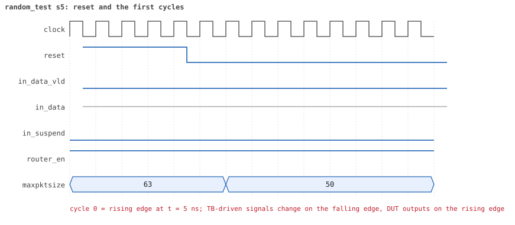
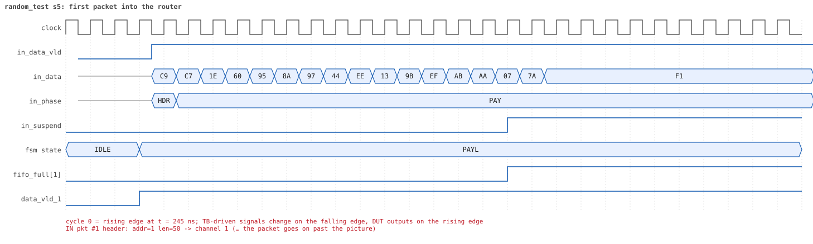
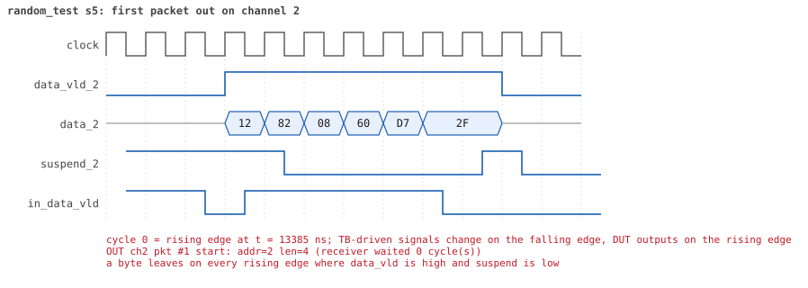
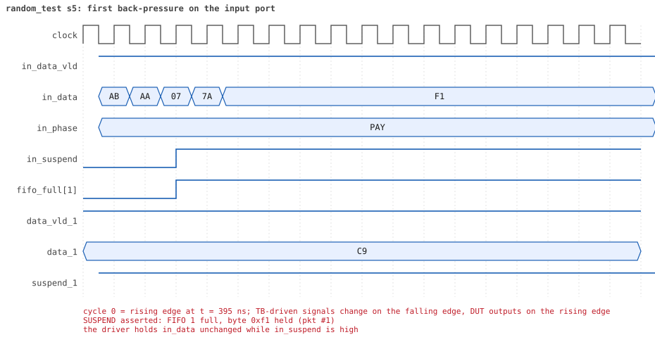
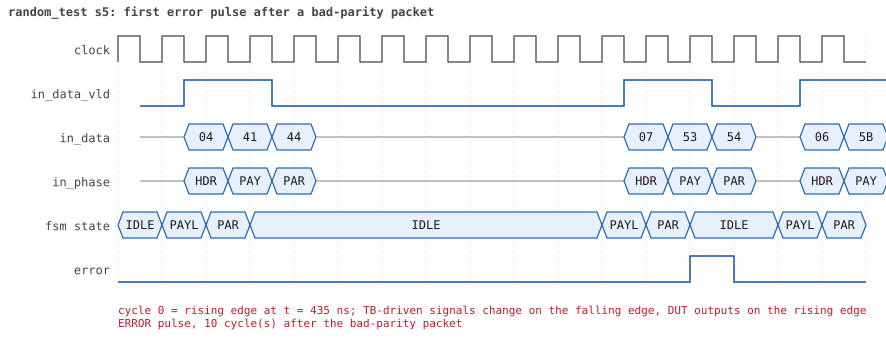
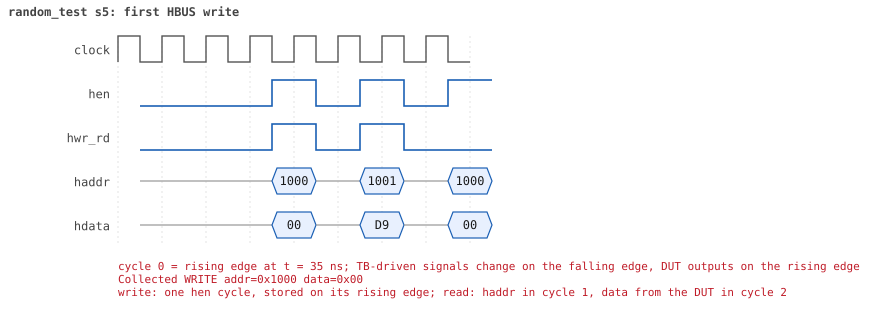
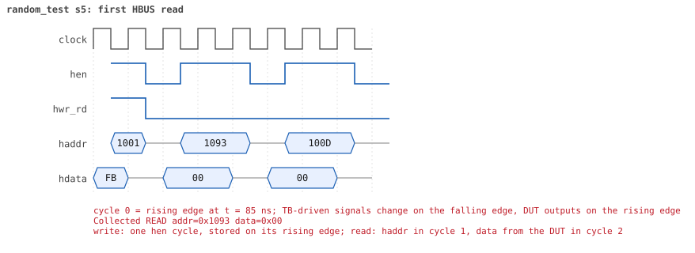

# random_test seed 5

**Result:** PASSED (0 UVM_ERROR, 0 UVM_WARNING, 0 UVM_FATAL) · bench `yapp_project_tb` · sim time 16us · wall 7.2 s · log [`random_test_s5.log`](random_test_s5.log)

Waves: `random_test_s5.fst` (GTKWave, Surfer or the VS Code wave viewer).
[Open the waves in Surfer](https://app.surfer-project.org/?load_url=https%3A%2F%2Fraw.githubusercontent.com%2Ftamirgabgab%2FQcom-Mentoring%2Fmain%2Fyapp_project%2Fregression%2Fyapp_project_tb%2Frandom_test_s5%2Frandom_test_s5.fst&startup_commands=run_command_file_from_url%20https%3A%2F%2Fraw.githubusercontent.com%2Ftamirgabgab%2FQcom-Mentoring%2Fmain%2Fyapp_project%2Ftb%2Fyapp_router.sucl) (web app, the signals already in groups: `yapp_project/tb/yapp_router.sucl`).

## Summary

- YAPP driver sent **36** packet(s) (4 with bad parity); the input monitor saw 36.
- Router: **21** forwarded, **15** dropped (15 oversized).
- Packets out: ch0 **9**, ch1 **6**, ch2 **6**.
- Scoreboard: 21 matched, 0 mismatched, 0 unexpected.
- Back-pressure: in_suspend asserted **5** time(s), longest hold 33 cycle(s).
- Error pulses: 4.
- HBUS: 6 write(s), 27 read(s).

## Stages

| time (ns) | stage |
|---|---|
| 0 | receivers: ch0 RX_FAST, ch1 RX_SLOW, ch2 RX_NORMAL |
| 0 | random scenario: 36 packets in 2 bursts |
| 230 | burst 1/2: ctrl=0xf2 (maxpktsize 50) en=0xfb (router on, counter enables 1111101), 18 packet(s) |
| 7200 | burst 1/2 sent: addr0..3 9/4/5/0, bad parity 0, gap 0 1, length 1..54 |
| 7380 | burst 2/2: ctrl=0xc9 (maxpktsize 9) en=0xb3 (router on, counter enables 1011001), 18 packet(s) |
| 15220 | burst 2/2 sent: addr0..3 4/5/9/0, bad parity 4, gap 0 8, length 1..63 |
| 15220 | final reads: every register and the stored packet, checked against the reference model |
| 15905 | done: 36 packets (21 forwarded, 15 dropped), 0 storm burst(s), 21 scoreboard matches, 27 HBUS reads checked, 4 error pulses for 4 bad packets |

## Pictures

**reset and the first cycles**

**first packet into the router**

**first packet out on channel 1**

**first back-pressure on the input port**

**first error pulse after a bad-parity packet**

**first HBUS write**

**first HBUS read**

## Timeline

463 events.

| time (ns) | who | event |
|---|---|---|
| 0 | yapp monitor | YAPP monitor running |
| 0 | **test** | STAGE: receivers: ch0 RX_FAST, ch1 RX_SLOW, ch2 RX_NORMAL |
| 0 | **test** | STAGE: random scenario: 36 packets in 2 bursts |
| 0 | clk/rst driver | Starting clock (period 10) and holding reset for 5 cycles |
| 0 | **DUT** | RESET asserted |
| 50 | **DUT** | RESET released: router_en=1 maxpktsize=63 |
| 70 | hbus driver | Executed WRITE addr=0x1000 data=0xf2 |
| 75 | **DUT** | CONFIG router_en=1 maxpktsize=50 |
| 75 | hbus monitor | Collected WRITE addr=0x1000 data=0xf2 |
| 75 | reference | maxpktsize is now 50 |
| 90 | hbus driver | Executed WRITE addr=0x1001 data=0xfb |
| 95 | hbus monitor | Collected WRITE addr=0x1001 data=0xfb |
| 95 | reference | router_en is now 1 (en_reg 0xfb) |
| 120 | hbus driver | Executed READ  addr=0x1093 data=0x00 |
| 125 | hbus monitor | Collected READ  addr=0x1093 data=0x00 |
| 150 | hbus driver | Executed READ  addr=0x100d data=0x00 |
| 155 | hbus monitor | Collected READ  addr=0x100d data=0x00 |
| 170 | hbus driver | Executed WRITE addr=0x11ef data=0xe8 |
| 175 | hbus monitor | Collected WRITE addr=0x11ef data=0xe8 |
| 200 | hbus driver | Executed READ  addr=0x11ef data=0xe8 |
| 205 | hbus monitor | Collected READ  addr=0x11ef data=0xe8 |
| 230 | hbus driver | Executed READ  addr=0x1003 data=0x00 |
| 230 | **test** | STAGE: burst 1/2: ctrl=0xf2 (maxpktsize 50) en=0xfb (router on, counter enables 1111101), 18 packet(s) |
| 230 | yapp driver | TX pkt #1: addr=1 len=50 parity=good delay=3 |
| 235 | hbus monitor | Collected READ  addr=0x1003 data=0x00 |
| 275 | **DUT** | IN  pkt #1 header: addr=1 len=50 -> channel 1 |
| 435 | **DUT** | SUSPEND asserted: FIFO 1 full, byte 0xf1 held (pkt #1) |
| 685 | **DUT** | OUT ch1 pkt #1 start: addr=1 len=50 (receiver waited 40 cycle(s)) |
| 695 | **DUT** | SUSPEND released after 26 cycle(s) |
| 1045 | **DUT** | IN  pkt #1 complete: addr=1 len=50 parity=ok forwarded, 52 bytes in 78 cycles (held 26) |
| 1045 | yapp monitor | RX pkt #1 on the input: addr=1 len=50 parity=good gap=22 |
| 1045 | reference | Packet forwarded: addr=1 len=50 -> channel 1 |
| 1050 | yapp driver | TX pkt #1 accepted by the DUT |
| 1050 | yapp driver | TX pkt #2: addr=0 len=3 parity=good delay=0 |
| 1055 | **DUT** | IN  pkt #2 header: addr=0 len=3 -> channel 0 |
| 1065 | **DUT** | OUT ch0 pkt #1 start: addr=0 len=3 (receiver waited 0 cycle(s)) |
| 1095 | **DUT** | IN  pkt #2 complete: addr=0 len=3 parity=ok forwarded, 5 bytes in 5 cycles (held 0) |
| 1095 | yapp monitor | RX pkt #2 on the input: addr=0 len=3 parity=good gap=0 |
| 1095 | reference | Packet forwarded: addr=0 len=3 -> channel 0 |
| 1100 | ch0 driver | ch0: packet consumed (response delay 0) |
| 1100 | yapp driver | TX pkt #2 accepted by the DUT |
| 1100 | yapp driver | TX pkt #3: addr=1 len=3 parity=good delay=3 |
| 1115 | **DUT** | OUT ch0 pkt #1 done: 5 bytes in 6 cycles |
| 1115 | ch0 monitor | ch0 RX pkt #1: addr=0 len=3 parity=good |
| 1115 | scoreboard | ch0 pkt matched: addr=0 len=3 (1 matched so far) |
| 1135 | **DUT** | IN  pkt #3 header: addr=1 len=3 -> channel 1 |
| 1175 | **DUT** | IN  pkt #3 complete: addr=1 len=3 parity=ok forwarded, 5 bytes in 5 cycles (held 0) |
| 1175 | yapp monitor | RX pkt #3 on the input: addr=1 len=3 parity=good gap=3 |
| 1175 | reference | Packet forwarded: addr=1 len=3 -> channel 1 |
| 1180 | yapp driver | TX pkt #3 accepted by the DUT |
| 1180 | yapp driver | TX pkt #4: addr=0 len=1 parity=good delay=4 |
| 1190 | ch1 driver | ch1: packet consumed (response delay 40) |
| 1225 | **DUT** | IN  pkt #4 header: addr=0 len=1 -> channel 0 |
| 1235 | **DUT** | OUT ch0 pkt #2 start: addr=0 len=1 (receiver waited 0 cycle(s)) |
| 1245 | **DUT** | IN  pkt #4 complete: addr=0 len=1 parity=ok forwarded, 3 bytes in 3 cycles (held 0) |
| 1245 | yapp monitor | RX pkt #4 on the input: addr=0 len=1 parity=good gap=4 |
| 1245 | reference | Packet forwarded: addr=0 len=1 -> channel 0 |
| 1250 | yapp driver | TX pkt #4 accepted by the DUT |
| 1250 | yapp driver | TX pkt #5: addr=0 len=26 parity=good delay=6 |
| 1255 | **DUT** | OUT ch0 pkt #2 done: 3 bytes in 3 cycles |
| 1255 | ch0 monitor | ch0 RX pkt #2: addr=0 len=1 parity=good |
| 1255 | scoreboard | ch0 pkt matched: addr=0 len=1 (2 matched so far) |
| 1315 | **DUT** | IN  pkt #5 header: addr=0 len=26 -> channel 0 |
| 1325 | **DUT** | OUT ch0 pkt #3 start: addr=0 len=26 (receiver waited 0 cycle(s)) |
| 1465 | **DUT** | OUT ch1 pkt #1 done: 52 bytes in 79 cycles |
| 1465 | ch1 monitor | ch1 RX pkt #1: addr=1 len=50 parity=good |
| 1465 | scoreboard | ch1 pkt matched: addr=1 len=50 (3 matched so far) |
| 1475 | **DUT** | OUT ch1 pkt #2 start: addr=1 len=3 (receiver waited 0 cycle(s)) |
| 1515 | **DUT** | OUT ch1 pkt #2 done: 5 bytes in 5 cycles |
| 1515 | ch1 monitor | ch1 RX pkt #2: addr=1 len=3 parity=good |
| 1515 | scoreboard | ch1 pkt matched: addr=1 len=3 (4 matched so far) |
| 1585 | **DUT** | IN  pkt #5 complete: addr=0 len=26 parity=ok forwarded, 28 bytes in 28 cycles (held 0) |
| 1585 | yapp monitor | RX pkt #5 on the input: addr=0 len=26 parity=good gap=6 |
| 1585 | reference | Packet forwarded: addr=0 len=26 -> channel 0 |
| 1590 | yapp driver | TX pkt #5 accepted by the DUT |
| 1590 | yapp driver | TX pkt #6: addr=0 len=10 parity=good delay=3 |
| 1595 | **DUT** | OUT ch0 pkt #3 done: 28 bytes in 28 cycles |
| 1595 | ch0 monitor | ch0 RX pkt #3: addr=0 len=26 parity=good |
| 1595 | scoreboard | ch0 pkt matched: addr=0 len=26 (5 matched so far) |
| 1625 | **DUT** | IN  pkt #6 header: addr=0 len=10 -> channel 0 |
| 1630 | ch1 driver | ch1: packet consumed (response delay 26) |
| 1635 | **DUT** | OUT ch0 pkt #4 start: addr=0 len=10 (receiver waited 0 cycle(s)) |
| 1700 | ch0 driver | ch0: packet consumed (response delay 0) |
| 1735 | **DUT** | IN  pkt #6 complete: addr=0 len=10 parity=ok forwarded, 12 bytes in 12 cycles (held 0) |
| 1735 | yapp monitor | RX pkt #6 on the input: addr=0 len=10 parity=good gap=3 |
| 1735 | reference | Packet forwarded: addr=0 len=10 -> channel 0 |
| 1740 | yapp driver | TX pkt #6 accepted by the DUT |
| 1740 | yapp driver | TX pkt #7: addr=0 len=2 parity=good delay=16 |
| 1755 | **DUT** | OUT ch0 pkt #4 done: 12 bytes in 13 cycles |
| 1755 | ch0 monitor | ch0 RX pkt #4: addr=0 len=10 parity=good |
| 1755 | scoreboard | ch0 pkt matched: addr=0 len=10 (6 matched so far) |
| 1905 | **DUT** | IN  pkt #7 header: addr=0 len=2 -> channel 0 |
| 1915 | **DUT** | OUT ch0 pkt #5 start: addr=0 len=2 (receiver waited 0 cycle(s)) |
| 1935 | **DUT** | IN  pkt #7 complete: addr=0 len=2 parity=ok forwarded, 4 bytes in 4 cycles (held 0) |
| 1935 | yapp monitor | RX pkt #7 on the input: addr=0 len=2 parity=good gap=16 |
| 1935 | reference | Packet forwarded: addr=0 len=2 -> channel 0 |
| 1940 | yapp driver | TX pkt #7 accepted by the DUT |
| 1940 | yapp driver | TX pkt #8: addr=0 len=42 parity=good delay=9 |
| 1945 | **DUT** | OUT ch0 pkt #5 done: 4 bytes in 4 cycles |
| 1945 | ch0 monitor | ch0 RX pkt #5: addr=0 len=2 parity=good |
| 1945 | scoreboard | ch0 pkt matched: addr=0 len=2 (7 matched so far) |
| 2035 | **DUT** | IN  pkt #8 header: addr=0 len=42 -> channel 0 |
| 2045 | **DUT** | OUT ch0 pkt #6 start: addr=0 len=42 (receiver waited 0 cycle(s)) |
| 2330 | ch0 driver | ch0: packet consumed (response delay 0) |
| 2465 | **DUT** | IN  pkt #8 complete: addr=0 len=42 parity=ok forwarded, 44 bytes in 44 cycles (held 0) |
| 2465 | yapp monitor | RX pkt #8 on the input: addr=0 len=42 parity=good gap=9 |
| 2465 | reference | Packet forwarded: addr=0 len=42 -> channel 0 |
| 2470 | yapp driver | TX pkt #8 accepted by the DUT |
| 2470 | yapp driver | TX pkt #9: addr=2 len=1 parity=good delay=19 |
| 2485 | **DUT** | OUT ch0 pkt #6 done: 44 bytes in 45 cycles |
| 2485 | ch0 monitor | ch0 RX pkt #6: addr=0 len=42 parity=good |
| 2485 | scoreboard | ch0 pkt matched: addr=0 len=42 (8 matched so far) |
| 2665 | **DUT** | IN  pkt #9 header: addr=2 len=1 -> channel 2 |
| 2685 | **DUT** | IN  pkt #9 complete: addr=2 len=1 parity=ok forwarded, 3 bytes in 3 cycles (held 0) |
| 2685 | yapp monitor | RX pkt #9 on the input: addr=2 len=1 parity=good gap=19 |
| 2685 | reference | Packet forwarded: addr=2 len=1 -> channel 2 |
| 2690 | yapp driver | TX pkt #9 accepted by the DUT |
| 2690 | yapp driver | TX pkt #10: addr=2 len=32 parity=good delay=3 |
| 2725 | **DUT** | IN  pkt #10 header: addr=2 len=32 -> channel 2 |
| 2765 | **DUT** | OUT ch2 pkt #1 start: addr=2 len=1 (receiver waited 9 cycle(s)) |
| 2780 | ch2 driver | ch2: packet consumed (response delay 9) |
| 2780 | ch0 driver | ch0: packet consumed (response delay 0) |
| 2805 | **DUT** | OUT ch2 pkt #1 done: 3 bytes in 5 cycles |
| 2805 | ch2 monitor | ch2 RX pkt #1: addr=2 len=1 parity=good |
| 2805 | scoreboard | ch2 pkt matched: addr=2 len=1 (9 matched so far) |
| 2815 | **DUT** | OUT ch2 pkt #2 start: addr=2 len=32 (receiver waited 0 cycle(s)) |
| 2880 | ch2 driver | ch2: packet consumed (response delay 1) |
| 2955 | **DUT** | SUSPEND asserted: FIFO 2 full, byte 0xc5 held (pkt #10) |
| 3005 | **DUT** | SUSPEND released after 5 cycle(s) |
| 3105 | **DUT** | IN  pkt #10 complete: addr=2 len=32 parity=ok forwarded, 34 bytes in 39 cycles (held 5) |
| 3105 | yapp monitor | RX pkt #10 on the input: addr=2 len=32 parity=good gap=3 |
| 3105 | reference | Packet forwarded: addr=2 len=32 -> channel 2 |
| 3110 | yapp driver | TX pkt #10 accepted by the DUT |
| 3110 | yapp driver | TX pkt #11: addr=0 len=31 parity=good delay=3 |
| 3145 | **DUT** | IN  pkt #11 header: addr=0 len=31 -> channel 0 |
| 3155 | **DUT** | OUT ch0 pkt #7 start: addr=0 len=31 (receiver waited 0 cycle(s)) |
| 3255 | **DUT** | OUT ch2 pkt #2 done: 34 bytes in 45 cycles |
| 3255 | ch2 monitor | ch2 RX pkt #2: addr=2 len=32 parity=good |
| 3255 | scoreboard | ch2 pkt matched: addr=2 len=32 (10 matched so far) |
| 3465 | **DUT** | IN  pkt #11 complete: addr=0 len=31 parity=ok forwarded, 33 bytes in 33 cycles (held 0) |
| 3465 | yapp monitor | RX pkt #11 on the input: addr=0 len=31 parity=good gap=3 |
| 3465 | reference | Packet forwarded: addr=0 len=31 -> channel 0 |
| 3470 | ch0 driver | ch0: packet consumed (response delay 0) |
| 3470 | yapp driver | TX pkt #11 accepted by the DUT |
| 3470 | yapp driver | TX pkt #12: addr=2 len=24 parity=good delay=2 |
| 3485 | **DUT** | OUT ch0 pkt #7 done: 33 bytes in 34 cycles |
| 3485 | ch0 monitor | ch0 RX pkt #7: addr=0 len=31 parity=good |
| 3485 | scoreboard | ch0 pkt matched: addr=0 len=31 (11 matched so far) |
| 3495 | **DUT** | IN  pkt #12 header: addr=2 len=24 -> channel 2 |
| 3505 | **DUT** | OUT ch2 pkt #3 start: addr=2 len=24 (receiver waited 0 cycle(s)) |
| 3600 | ch2 driver | ch2: packet consumed (response delay 10) |
| 3745 | **DUT** | IN  pkt #12 complete: addr=2 len=24 parity=ok forwarded, 26 bytes in 26 cycles (held 0) |
| 3745 | yapp monitor | RX pkt #12 on the input: addr=2 len=24 parity=good gap=2 |
| 3745 | reference | Packet forwarded: addr=2 len=24 -> channel 2 |
| 3750 | yapp driver | TX pkt #12 accepted by the DUT |
| 3750 | yapp driver | TX pkt #13: addr=2 len=45 parity=good delay=18 |
| 3760 | ch0 driver | ch0: packet consumed (response delay 0) |
| 3800 | ch2 driver | ch2: packet consumed (response delay 9) |
| 3925 | **DUT** | OUT ch2 pkt #3 done: 26 bytes in 43 cycles |
| 3925 | ch2 monitor | ch2 RX pkt #3: addr=2 len=24 parity=good |
| 3925 | scoreboard | ch2 pkt matched: addr=2 len=24 (12 matched so far) |
| 3930 | ch2 driver | ch2: packet consumed (response delay 6) |
| 3935 | **DUT** | IN  pkt #13 header: addr=2 len=45 -> channel 2 |
| 3995 | **DUT** | OUT ch2 pkt #4 start: addr=2 len=45 (receiver waited 5 cycle(s)) |
| 4395 | **DUT** | IN  pkt #13 complete: addr=2 len=45 parity=ok forwarded, 47 bytes in 47 cycles (held 0) |
| 4395 | yapp monitor | RX pkt #13 on the input: addr=2 len=45 parity=good gap=18 |
| 4395 | reference | Packet forwarded: addr=2 len=45 -> channel 2 |
| 4400 | yapp driver | TX pkt #13 accepted by the DUT |
| 4400 | yapp driver | TX pkt #14: addr=0 len=48 parity=good delay=3 |
| 4435 | **DUT** | IN  pkt #14 header: addr=0 len=48 -> channel 0 |
| 4445 | **DUT** | OUT ch0 pkt #8 start: addr=0 len=48 (receiver waited 0 cycle(s)) |
| 4450 | ch2 driver | ch2: packet consumed (response delay 5) |
| 4465 | **DUT** | OUT ch2 pkt #4 done: 47 bytes in 48 cycles |
| 4465 | ch2 monitor | ch2 RX pkt #4: addr=2 len=45 parity=good |
| 4465 | scoreboard | ch2 pkt matched: addr=2 len=45 (13 matched so far) |
| 4520 | ch2 driver | ch2: packet consumed (response delay 0) |
| 4925 | **DUT** | IN  pkt #14 complete: addr=0 len=48 parity=ok forwarded, 50 bytes in 50 cycles (held 0) |
| 4925 | yapp monitor | RX pkt #14 on the input: addr=0 len=48 parity=good gap=3 |
| 4925 | reference | Packet forwarded: addr=0 len=48 -> channel 0 |
| 4930 | ch0 driver | ch0: packet consumed (response delay 0) |
| 4930 | yapp driver | TX pkt #14 accepted by the DUT |
| 4930 | yapp driver | TX pkt #15: addr=0 len=1 parity=good delay=19 |
| 4945 | **DUT** | OUT ch0 pkt #8 done: 50 bytes in 51 cycles |
| 4945 | ch0 monitor | ch0 RX pkt #8: addr=0 len=48 parity=good |
| 4945 | scoreboard | ch0 pkt matched: addr=0 len=48 (14 matched so far) |
| 5125 | **DUT** | IN  pkt #15 header: addr=0 len=1 -> channel 0 |
| 5135 | **DUT** | OUT ch0 pkt #9 start: addr=0 len=1 (receiver waited 0 cycle(s)) |
| 5145 | **DUT** | IN  pkt #15 complete: addr=0 len=1 parity=ok forwarded, 3 bytes in 3 cycles (held 0) |
| 5145 | yapp monitor | RX pkt #15 on the input: addr=0 len=1 parity=good gap=19 |
| 5145 | reference | Packet forwarded: addr=0 len=1 -> channel 0 |
| 5150 | yapp driver | TX pkt #15 accepted by the DUT |
| 5150 | yapp driver | TX pkt #16: addr=2 len=54 parity=good delay=6 |
| 5155 | **DUT** | OUT ch0 pkt #9 done: 3 bytes in 3 cycles |
| 5155 | ch0 monitor | ch0 RX pkt #9: addr=0 len=1 parity=good |
| 5155 | scoreboard | ch0 pkt matched: addr=0 len=1 (15 matched so far) |
| 5215 | **DUT** | IN  pkt #16 header: addr=2 len=54 -> DROP (oversized: len 54 > maxpktsize 50) |
| 5270 | ch0 driver | ch0: packet consumed (response delay 0) |
| 5765 | **DUT** | IN  pkt #16 complete: addr=2 len=54 parity=ok dropped, 56 bytes in 56 cycles (held 0) |
| 5765 | yapp monitor | RX pkt #16 on the input: addr=2 len=54 parity=good gap=6 |
| 5765 | reference | Packet dropped: length 54 > maxpktsize 50 (addr=2) |
| 5765 | **DUT** | ROUTER DROPS PACKET addr=2 length=54 (length > maxpktsize) |
| 5770 | yapp driver | TX pkt #16 accepted by the DUT |
| 5770 | yapp driver | TX pkt #17: addr=1 len=1 parity=good delay=13 |
| 5905 | **DUT** | IN  pkt #17 header: addr=1 len=1 -> channel 1 |
| 5925 | **DUT** | IN  pkt #17 complete: addr=1 len=1 parity=ok forwarded, 3 bytes in 3 cycles (held 0) |
| 5925 | yapp monitor | RX pkt #17 on the input: addr=1 len=1 parity=good gap=13 |
| 5925 | reference | Packet forwarded: addr=1 len=1 -> channel 1 |
| 5930 | yapp driver | TX pkt #17 accepted by the DUT |
| 5930 | yapp driver | TX pkt #18: addr=1 len=45 parity=good delay=2 |
| 5955 | **DUT** | IN  pkt #18 header: addr=1 len=45 -> channel 1 |
| 6085 | **DUT** | SUSPEND asserted: FIFO 1 full, byte 0x4c held (pkt #18) |
| 6315 | **DUT** | OUT ch1 pkt #3 start: addr=1 len=1 (receiver waited 40 cycle(s)) |
| 6325 | **DUT** | SUSPEND released after 24 cycle(s) |
| 6330 | ch1 driver | ch1: packet consumed (response delay 40) |
| 6345 | **DUT** | SUSPEND asserted: FIFO 1 full, byte 0xb5 held (pkt #18) |
| 6665 | **DUT** | OUT ch1 pkt #3 done: 3 bytes in 36 cycles |
| 6665 | ch1 monitor | ch1 RX pkt #3: addr=1 len=1 parity=good |
| 6665 | scoreboard | ch1 pkt matched: addr=1 len=1 (16 matched so far) |
| 6675 | **DUT** | SUSPEND released after 33 cycle(s) |
| 6675 | **DUT** | OUT ch1 pkt #4 start: addr=1 len=45 (receiver waited 0 cycle(s)) |
| 6940 | ch1 driver | ch1: packet consumed (response delay 32) |
| 6955 | **DUT** | SUSPEND asserted: FIFO 1 full, byte 0x17 held (pkt #18) |
| 7165 | **DUT** | SUSPEND released after 21 cycle(s) |
| 7195 | **DUT** | IN  pkt #18 complete: addr=1 len=45 parity=ok forwarded, 47 bytes in 125 cycles (held 78) |
| 7195 | yapp monitor | RX pkt #18 on the input: addr=1 len=45 parity=good gap=2 |
| 7195 | reference | Packet forwarded: addr=1 len=45 -> channel 1 |
| 7200 | yapp driver | TX pkt #18 accepted by the DUT |
| 7200 | **test** | STAGE: burst 1/2 sent: addr0..3 9/4/5/0, bad parity 0, gap 0 1, length 1..54 |
| 7220 | hbus driver | Executed WRITE addr=0x1000 data=0xc9 |
| 7225 | **DUT** | CONFIG router_en=1 maxpktsize=9 |
| 7225 | hbus monitor | Collected WRITE addr=0x1000 data=0xc9 |
| 7225 | reference | maxpktsize is now 9 |
| 7240 | hbus driver | Executed WRITE addr=0x1001 data=0xb3 |
| 7245 | hbus monitor | Collected WRITE addr=0x1001 data=0xb3 |
| 7245 | reference | router_en is now 1 (en_reg 0xb3) |
| 7270 | hbus driver | Executed READ  addr=0x1008 data=0x00 |
| 7275 | hbus monitor | Collected READ  addr=0x1008 data=0x00 |
| 7280 | ch1 driver | ch1: packet consumed (response delay 20) |
| 7300 | hbus driver | Executed READ  addr=0x100d data=0x2d |
| 7305 | hbus monitor | Collected READ  addr=0x100d data=0x2d |
| 7320 | hbus driver | Executed WRITE addr=0x114c data=0x10 |
| 7325 | hbus monitor | Collected WRITE addr=0x114c data=0x10 |
| 7350 | hbus driver | Executed READ  addr=0x114c data=0x10 |
| 7355 | hbus monitor | Collected READ  addr=0x114c data=0x10 |
| 7380 | hbus driver | Executed READ  addr=0x100a data=0x04 |
| 7380 | **test** | STAGE: burst 2/2: ctrl=0xc9 (maxpktsize 9) en=0xb3 (router on, counter enables 1011001), 18 packet(s) |
| 7380 | yapp driver | TX pkt #19: addr=2 len=63 parity=good delay=0 |
| 7385 | hbus monitor | Collected READ  addr=0x100a data=0x04 |
| 7395 | **DUT** | IN  pkt #19 header: addr=2 len=63 -> DROP (oversized: len 63 > maxpktsize 9) |
| 7725 | **DUT** | OUT ch1 pkt #4 done: 47 bytes in 106 cycles |
| 7725 | ch1 monitor | ch1 RX pkt #4: addr=1 len=45 parity=good |
| 7725 | scoreboard | ch1 pkt matched: addr=1 len=45 (17 matched so far) |
| 8035 | **DUT** | IN  pkt #19 complete: addr=2 len=63 parity=ok dropped, 65 bytes in 65 cycles (held 0) |
| 8035 | yapp monitor | RX pkt #19 on the input: addr=2 len=63 parity=good gap=19 |
| 8035 | reference | Packet dropped: length 63 > maxpktsize 9 (addr=2) |
| 8035 | **DUT** | ROUTER DROPS PACKET addr=2 length=63 (length > maxpktsize) |
| 8040 | ch1 driver | ch1: packet consumed (response delay 37) |
| 8040 | yapp driver | TX pkt #19 accepted by the DUT |
| 8040 | yapp driver | TX pkt #20: addr=2 len=1 parity=good delay=15 |
| 8195 | **DUT** | IN  pkt #20 header: addr=2 len=1 -> channel 2 |
| 8205 | **DUT** | OUT ch2 pkt #5 start: addr=2 len=1 (receiver waited 0 cycle(s)) |
| 8215 | **DUT** | IN  pkt #20 complete: addr=2 len=1 parity=ok forwarded, 3 bytes in 3 cycles (held 0) |
| 8215 | yapp monitor | RX pkt #20 on the input: addr=2 len=1 parity=good gap=15 |
| 8215 | reference | Packet forwarded: addr=2 len=1 -> channel 2 |
| 8220 | ch2 driver | ch2: packet consumed (response delay 0) |
| 8220 | yapp driver | TX pkt #20 accepted by the DUT |
| 8220 | yapp driver | TX pkt #21: addr=2 len=35 parity=good delay=0 |
| 8225 | **DUT** | IN  pkt #21 header: addr=2 len=35 -> DROP (oversized: len 35 > maxpktsize 9) |
| 8335 | **DUT** | OUT ch2 pkt #5 done: 3 bytes in 14 cycles |
| 8335 | ch2 monitor | ch2 RX pkt #5: addr=2 len=1 parity=good |
| 8335 | scoreboard | ch2 pkt matched: addr=2 len=1 (18 matched so far) |
| 8585 | **DUT** | IN  pkt #21 complete: addr=2 len=35 parity=ok dropped, 37 bytes in 37 cycles (held 0) |
| 8585 | yapp monitor | RX pkt #21 on the input: addr=2 len=35 parity=good gap=0 |
| 8585 | reference | Packet dropped: length 35 > maxpktsize 9 (addr=2) |
| 8585 | **DUT** | ROUTER DROPS PACKET addr=2 length=35 (length > maxpktsize) |
| 8590 | yapp driver | TX pkt #21 accepted by the DUT |
| 8590 | yapp driver | TX pkt #22: addr=1 len=63 parity=good delay=7 |
| 8665 | **DUT** | IN  pkt #22 header: addr=1 len=63 -> DROP (oversized: len 63 > maxpktsize 9) |
| 8810 | ch2 driver | ch2: packet consumed (response delay 10) |
| 9305 | **DUT** | IN  pkt #22 complete: addr=1 len=63 parity=ok dropped, 65 bytes in 65 cycles (held 0) |
| 9305 | yapp monitor | RX pkt #22 on the input: addr=1 len=63 parity=good gap=7 |
| 9305 | reference | Packet dropped: length 63 > maxpktsize 9 (addr=1) |
| 9305 | **DUT** | ROUTER DROPS PACKET addr=1 length=63 (length > maxpktsize) |
| 9310 | yapp driver | TX pkt #22 accepted by the DUT |
| 9310 | yapp driver | TX pkt #23: addr=2 len=63 parity=good delay=0 |
| 9315 | **DUT** | IN  pkt #23 header: addr=2 len=63 -> DROP (oversized: len 63 > maxpktsize 9) |
| 9955 | **DUT** | IN  pkt #23 complete: addr=2 len=63 parity=ok dropped, 65 bytes in 65 cycles (held 0) |
| 9955 | yapp monitor | RX pkt #23 on the input: addr=2 len=63 parity=good gap=0 |
| 9955 | reference | Packet dropped: length 63 > maxpktsize 9 (addr=2) |
| 9955 | **DUT** | ROUTER DROPS PACKET addr=2 length=63 (length > maxpktsize) |
| 9960 | yapp driver | TX pkt #23 accepted by the DUT |
| 9960 | yapp driver | TX pkt #24: addr=1 len=53 parity=good delay=19 |
| 10155 | **DUT** | IN  pkt #24 header: addr=1 len=53 -> DROP (oversized: len 53 > maxpktsize 9) |
| 10695 | **DUT** | IN  pkt #24 complete: addr=1 len=53 parity=ok dropped, 55 bytes in 55 cycles (held 0) |
| 10695 | yapp monitor | RX pkt #24 on the input: addr=1 len=53 parity=good gap=19 |
| 10695 | reference | Packet dropped: length 53 > maxpktsize 9 (addr=1) |
| 10695 | **DUT** | ROUTER DROPS PACKET addr=1 length=53 (length > maxpktsize) |
| 10700 | yapp driver | TX pkt #24 accepted by the DUT |
| 10700 | yapp driver | TX pkt #25: addr=2 len=51 parity=bad delay=0 |
| 10705 | **DUT** | IN  pkt #25 header: addr=2 len=51 -> DROP (oversized: len 51 > maxpktsize 9) |
| 11225 | **DUT** | IN  pkt #25 complete: addr=2 len=51 parity=BAD dropped, 53 bytes in 53 cycles (held 0) |
| 11225 | yapp monitor | RX pkt #25 on the input: addr=2 len=51 parity=bad gap=0 |
| 11225 | reference | Packet dropped: length 51 > maxpktsize 9 (addr=2) |
| 11225 | **DUT** | ROUTER DROPS PACKET addr=2 length=51 (length > maxpktsize) |
| 11230 | yapp driver | TX pkt #25 accepted by the DUT |
| 11230 | yapp driver | TX pkt #26: addr=1 len=46 parity=good delay=20 |
| 11270 | **DUT** | ERROR pulse, 4 cycle(s) after the bad-parity packet |
| 11270 | error checker | error pulse 4 cycles after the bad packet (0 still owed) |
| 11435 | **DUT** | IN  pkt #26 header: addr=1 len=46 -> DROP (oversized: len 46 > maxpktsize 9) |
| 11905 | **DUT** | IN  pkt #26 complete: addr=1 len=46 parity=ok dropped, 48 bytes in 48 cycles (held 0) |
| 11905 | yapp monitor | RX pkt #26 on the input: addr=1 len=46 parity=good gap=20 |
| 11905 | reference | Packet dropped: length 46 > maxpktsize 9 (addr=1) |
| 11905 | **DUT** | ROUTER DROPS PACKET addr=1 length=46 (length > maxpktsize) |
| 11910 | yapp driver | TX pkt #26 accepted by the DUT |
| 11910 | yapp driver | TX pkt #27: addr=2 len=45 parity=bad delay=0 |
| 11915 | **DUT** | IN  pkt #27 header: addr=2 len=45 -> DROP (oversized: len 45 > maxpktsize 9) |
| 12375 | **DUT** | IN  pkt #27 complete: addr=2 len=45 parity=BAD dropped, 47 bytes in 47 cycles (held 0) |
| 12375 | yapp monitor | RX pkt #27 on the input: addr=2 len=45 parity=bad gap=0 |
| 12375 | reference | Packet dropped: length 45 > maxpktsize 9 (addr=2) |
| 12375 | **DUT** | ROUTER DROPS PACKET addr=2 length=45 (length > maxpktsize) |
| 12380 | yapp driver | TX pkt #27 accepted by the DUT |
| 12380 | yapp driver | TX pkt #28: addr=2 len=12 parity=bad delay=1 |
| 12390 | **DUT** | ERROR pulse, 1 cycle(s) after the bad-parity packet |
| 12390 | error checker | error pulse 1 cycles after the bad packet (0 still owed) |
| 12395 | **DUT** | IN  pkt #28 header: addr=2 len=12 -> DROP (oversized: len 12 > maxpktsize 9) |
| 12525 | **DUT** | IN  pkt #28 complete: addr=2 len=12 parity=BAD dropped, 14 bytes in 14 cycles (held 0) |
| 12525 | yapp monitor | RX pkt #28 on the input: addr=2 len=12 parity=bad gap=1 |
| 12525 | reference | Packet dropped: length 12 > maxpktsize 9 (addr=2) |
| 12525 | **DUT** | ROUTER DROPS PACKET addr=2 length=12 (length > maxpktsize) |
| 12530 | yapp driver | TX pkt #28 accepted by the DUT |
| 12530 | yapp driver | TX pkt #29: addr=1 len=1 parity=good delay=0 |
| 12535 | **DUT** | IN  pkt #29 header: addr=1 len=1 -> channel 1 |
| 12555 | **DUT** | IN  pkt #29 complete: addr=1 len=1 parity=ok forwarded, 3 bytes in 3 cycles (held 0) |
| 12555 | yapp monitor | RX pkt #29 on the input: addr=1 len=1 parity=good gap=0 |
| 12555 | reference | Packet forwarded: addr=1 len=1 -> channel 1 |
| 12560 | yapp driver | TX pkt #29 accepted by the DUT |
| 12560 | yapp driver | TX pkt #30: addr=0 len=35 parity=good delay=0 |
| 12565 | **DUT** | IN  pkt #30 header: addr=0 len=35 -> DROP (oversized: len 35 > maxpktsize 9) |
| 12590 | **DUT** | ERROR pulse, 6 cycle(s) after the bad-parity packet |
| 12590 | error checker | error pulse 6 cycles after the bad packet (0 still owed) |
| 12925 | **DUT** | IN  pkt #30 complete: addr=0 len=35 parity=ok dropped, 37 bytes in 37 cycles (held 0) |
| 12925 | yapp monitor | RX pkt #30 on the input: addr=0 len=35 parity=good gap=0 |
| 12925 | reference | Packet dropped: length 35 > maxpktsize 9 (addr=0) |
| 12925 | **DUT** | ROUTER DROPS PACKET addr=0 length=35 (length > maxpktsize) |
| 12930 | yapp driver | TX pkt #30 accepted by the DUT |
| 12930 | yapp driver | TX pkt #31: addr=0 len=29 parity=good delay=0 |
| 12935 | **DUT** | IN  pkt #31 header: addr=0 len=29 -> DROP (oversized: len 29 > maxpktsize 9) |
| 12945 | **DUT** | OUT ch1 pkt #5 start: addr=1 len=1 (receiver waited 40 cycle(s)) |
| 12960 | ch1 driver | ch1: packet consumed (response delay 40) |
| 13235 | **DUT** | IN  pkt #31 complete: addr=0 len=29 parity=ok dropped, 31 bytes in 31 cycles (held 0) |
| 13235 | yapp monitor | RX pkt #31 on the input: addr=0 len=29 parity=good gap=0 |
| 13235 | reference | Packet dropped: length 29 > maxpktsize 9 (addr=0) |
| 13235 | **DUT** | ROUTER DROPS PACKET addr=0 length=29 (length > maxpktsize) |
| 13240 | yapp driver | TX pkt #31 accepted by the DUT |
| 13240 | yapp driver | TX pkt #32: addr=0 len=63 parity=good delay=17 |
| 13375 | **DUT** | OUT ch1 pkt #5 done: 3 bytes in 44 cycles |
| 13375 | ch1 monitor | ch1 RX pkt #5: addr=1 len=1 parity=good |
| 13375 | scoreboard | ch1 pkt matched: addr=1 len=1 (19 matched so far) |
| 13415 | **DUT** | IN  pkt #32 header: addr=0 len=63 -> DROP (oversized: len 63 > maxpktsize 9) |
| 13680 | ch1 driver | ch1: packet consumed (response delay 40) |
| 14055 | **DUT** | IN  pkt #32 complete: addr=0 len=63 parity=ok dropped, 65 bytes in 65 cycles (held 0) |
| 14055 | yapp monitor | RX pkt #32 on the input: addr=0 len=63 parity=good gap=17 |
| 14055 | reference | Packet dropped: length 63 > maxpktsize 9 (addr=0) |
| 14055 | **DUT** | ROUTER DROPS PACKET addr=0 length=63 (length > maxpktsize) |
| 14060 | yapp driver | TX pkt #32 accepted by the DUT |
| 14060 | yapp driver | TX pkt #33: addr=0 len=21 parity=good delay=1 |
| 14075 | **DUT** | IN  pkt #33 header: addr=0 len=21 -> DROP (oversized: len 21 > maxpktsize 9) |
| 14295 | **DUT** | IN  pkt #33 complete: addr=0 len=21 parity=ok dropped, 23 bytes in 23 cycles (held 0) |
| 14295 | yapp monitor | RX pkt #33 on the input: addr=0 len=21 parity=good gap=1 |
| 14295 | reference | Packet dropped: length 21 > maxpktsize 9 (addr=0) |
| 14295 | **DUT** | ROUTER DROPS PACKET addr=0 length=21 (length > maxpktsize) |
| 14300 | yapp driver | TX pkt #33 accepted by the DUT |
| 14300 | yapp driver | TX pkt #34: addr=2 len=8 parity=good delay=3 |
| 14335 | **DUT** | IN  pkt #34 header: addr=2 len=8 -> channel 2 |
| 14395 | **DUT** | OUT ch2 pkt #6 start: addr=2 len=8 (receiver waited 5 cycle(s)) |
| 14425 | **DUT** | IN  pkt #34 complete: addr=2 len=8 parity=ok forwarded, 10 bytes in 10 cycles (held 0) |
| 14425 | yapp monitor | RX pkt #34 on the input: addr=2 len=8 parity=good gap=3 |
| 14425 | reference | Packet forwarded: addr=2 len=8 -> channel 2 |
| 14430 | yapp driver | TX pkt #34 accepted by the DUT |
| 14430 | yapp driver | TX pkt #35: addr=2 len=54 parity=bad delay=1 |
| 14445 | **DUT** | IN  pkt #35 header: addr=2 len=54 -> DROP (oversized: len 54 > maxpktsize 9) |
| 14480 | ch2 driver | ch2: packet consumed (response delay 5) |
| 14525 | **DUT** | OUT ch2 pkt #6 done: 10 bytes in 14 cycles |
| 14525 | ch2 monitor | ch2 RX pkt #6: addr=2 len=8 parity=good |
| 14525 | scoreboard | ch2 pkt matched: addr=2 len=8 (20 matched so far) |
| 14760 | ch2 driver | ch2: packet consumed (response delay 3) |
| 14995 | **DUT** | IN  pkt #35 complete: addr=2 len=54 parity=BAD dropped, 56 bytes in 56 cycles (held 0) |
| 14995 | yapp monitor | RX pkt #35 on the input: addr=2 len=54 parity=bad gap=1 |
| 14995 | reference | Packet dropped: length 54 > maxpktsize 9 (addr=2) |
| 14995 | **DUT** | ROUTER DROPS PACKET addr=2 length=54 (length > maxpktsize) |
| 15000 | yapp driver | TX pkt #35 accepted by the DUT |
| 15000 | yapp driver | TX pkt #36: addr=1 len=9 parity=good delay=11 |
| 15070 | **DUT** | ERROR pulse, 7 cycle(s) after the bad-parity packet |
| 15070 | error checker | error pulse 7 cycles after the bad packet (0 still owed) |
| 15115 | **DUT** | IN  pkt #36 header: addr=1 len=9 -> channel 1 |
| 15215 | **DUT** | IN  pkt #36 complete: addr=1 len=9 parity=ok forwarded, 11 bytes in 11 cycles (held 0) |
| 15215 | yapp monitor | RX pkt #36 on the input: addr=1 len=9 parity=good gap=11 |
| 15215 | reference | Packet forwarded: addr=1 len=9 -> channel 1 |
| 15220 | yapp driver | TX pkt #36 accepted by the DUT |
| 15220 | **test** | STAGE: burst 2/2 sent: addr0..3 4/5/9/0, bad parity 4, gap 0 8, length 1..63 |
| 15220 | **test** | STAGE: final reads: every register and the stored packet, checked against the reference model |
| 15250 | hbus driver | Executed READ  addr=0x1000 data=0xc9 |
| 15255 | hbus monitor | Collected READ  addr=0x1000 data=0xc9 |
| 15280 | hbus driver | Executed READ  addr=0x1001 data=0xb3 |
| 15285 | hbus monitor | Collected READ  addr=0x1001 data=0xb3 |
| 15310 | hbus driver | Executed READ  addr=0x1004 data=0x04 |
| 15315 | hbus monitor | Collected READ  addr=0x1004 data=0x04 |
| 15340 | hbus driver | Executed READ  addr=0x1005 data=0x00 |
| 15345 | hbus monitor | Collected READ  addr=0x1005 data=0x00 |
| 15365 | **DUT** | OUT ch1 pkt #6 start: addr=1 len=9 (receiver waited 24 cycle(s)) |
| 15370 | hbus driver | Executed READ  addr=0x1006 data=0x00 |
| 15375 | hbus monitor | Collected READ  addr=0x1006 data=0x00 |
| 15400 | hbus driver | Executed READ  addr=0x1009 data=0x0d |
| 15405 | hbus monitor | Collected READ  addr=0x1009 data=0x0d |
| 15430 | hbus driver | Executed READ  addr=0x100a data=0x09 |
| 15435 | hbus monitor | Collected READ  addr=0x100a data=0x09 |
| 15460 | ch1 driver | ch1: packet consumed (response delay 24) |
| 15460 | hbus driver | Executed READ  addr=0x100b data=0x05 |
| 15465 | hbus monitor | Collected READ  addr=0x100b data=0x05 |
| 15490 | hbus driver | Executed READ  addr=0x100d data=0x09 |
| 15495 | hbus monitor | Collected READ  addr=0x100d data=0x09 |
| 15520 | hbus driver | Executed READ  addr=0x1010 data=0x25 |
| 15525 | hbus monitor | Collected READ  addr=0x1010 data=0x25 |
| 15550 | hbus driver | Executed READ  addr=0x1011 data=0xed |
| 15555 | hbus monitor | Collected READ  addr=0x1011 data=0xed |
| 15580 | hbus driver | Executed READ  addr=0x1012 data=0x43 |
| 15585 | hbus monitor | Collected READ  addr=0x1012 data=0x43 |
| 15610 | hbus driver | Executed READ  addr=0x1013 data=0xa6 |
| 15615 | hbus monitor | Collected READ  addr=0x1013 data=0xa6 |
| 15640 | hbus driver | Executed READ  addr=0x1014 data=0x6c |
| 15645 | hbus monitor | Collected READ  addr=0x1014 data=0x6c |
| 15670 | hbus driver | Executed READ  addr=0x1015 data=0xde |
| 15675 | hbus monitor | Collected READ  addr=0x1015 data=0xde |
| 15700 | hbus driver | Executed READ  addr=0x1016 data=0x47 |
| 15705 | hbus monitor | Collected READ  addr=0x1016 data=0x47 |
| 15730 | hbus driver | Executed READ  addr=0x1017 data=0xdd |
| 15735 | hbus monitor | Collected READ  addr=0x1017 data=0xdd |
| 15760 | hbus driver | Executed READ  addr=0x1018 data=0x02 |
| 15765 | **DUT** | OUT ch1 pkt #6 done: 11 bytes in 41 cycles |
| 15765 | ch1 monitor | ch1 RX pkt #6: addr=1 len=9 parity=good |
| 15765 | scoreboard | ch1 pkt matched: addr=1 len=9 (21 matched so far) |
| 15765 | hbus monitor | Collected READ  addr=0x1018 data=0x02 |
| 15790 | hbus driver | Executed READ  addr=0x1019 data=0x8d |
| 15795 | hbus monitor | Collected READ  addr=0x1019 data=0x8d |
| 15905 | **test** | STAGE: done: 36 packets (21 forwarded, 15 dropped), 0 storm burst(s), 21 scoreboard matches, 27 HBUS reads checked, 4 error pulses for 4 bad packets |
| 16105 | error checker | error pulse report: 4 bad packets, 4 pulses, 0 outside 1..10 cycles, at most 1 owed at once |
| 16105 | ch0 monitor | Channel 0 report: 9 packets collected |
| 16105 | ch1 monitor | Channel 1 report: 6 packets collected |
| 16105 | ch2 monitor | Channel 2 report: 6 packets collected |
| 16105 | hbus monitor | HBUS report: 6 writes, 27 reads |
| 16105 | coverage | Coverage of the router configuration: 52.2% · maxpktsize 0 / 1 / 2..61 / 62 / 63 : 0 / 0 / 36 / 0 / 0 packets · length < max / = max / max+1 / > max+1 : 19 / 2 / 0 / 15 · forwarded good / bad : 21 / 0 · dropped address 3 good / bad : 0 / 0 · dropped oversized good / bad : 11 / 4 · counter enables none / mixed / all : 0 / 36 / 0 |
| 16105 | coverage | HBUS address coverage: 33 accesses sampled, coverage 45.5% |
| 16105 | coverage | HBUS register bits coverage: 4 writes to ctrl_reg/en_reg, coverage 79.5% |
| 16105 | coverage | HBUS counter value coverage: 7 counter reads sampled, coverage 51.9% |
| 16105 | coverage | HBUS yapp_mem data coverage: 4 accesses sampled, coverage 29.4% |
| 16105 | reference | --- Reference model report --- · forwarded to scoreboard : 21 · dropped (router disabled) : 0 · dropped (oversized) : 15 · dropped (address 3) : 0 · counters parity/oversized/addr0..3 : 4 / 0 / 13 9 5 0 |
| 16105 | reference | HBUS reads checked against the model: 27 (0 mismatches, 0 of memory bytes never written) |
| 16105 | scoreboard | --- Scoreboard report --- · packets received : 21 · packets matched : 21 · packets mismatched: 0 · packets unexpected: 0 · packets to addr 3 : 0 · left in queue 0/1/2: 0 / 0 / 0 |
| 16105 | yapp driver | YAPP driver report: 36 packets sent |
| 16105 | coverage | YAPP gap coverage: 35 gaps sampled, coverage 100.0% |
| 16105 | yapp monitor | YAPP monitor report: 36 packets collected, 4 with bad parity |
| 16105 | yapp monitor | YAPP gaps: 8 back to back, 3 of 1 cycle, 2 of 2, 22 longer |
| 16105 | coverage | YAPP packet coverage: 36 packets sampled, coverage 53.3% |
