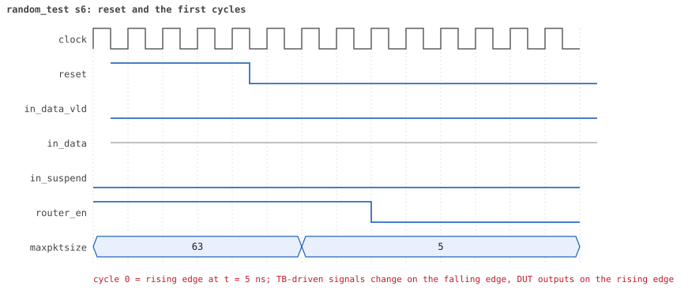
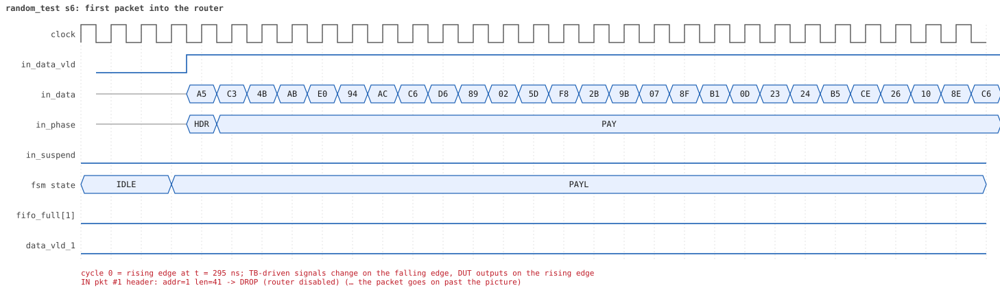
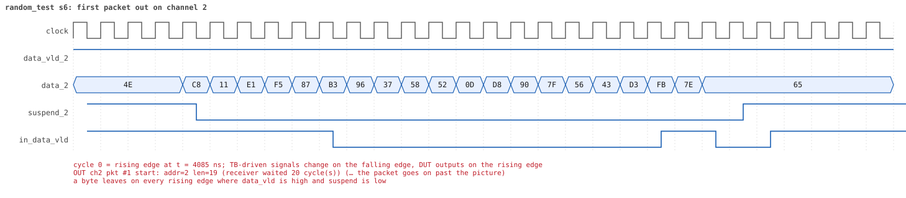
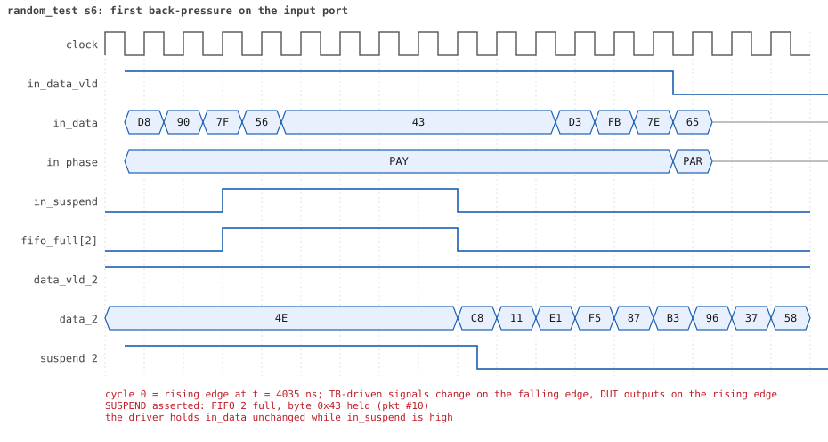
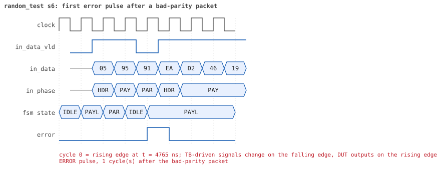
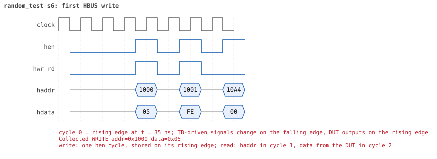
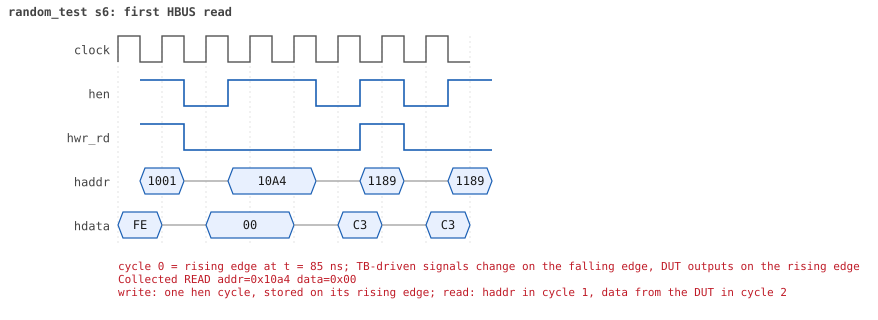

# random_test seed 6

**Result:** PASSED (0 UVM_ERROR, 0 UVM_WARNING, 0 UVM_FATAL) · bench `yapp_project_tb` · sim time 12us · wall 7.8 s · log [`random_test_s6.log`](random_test_s6.log)

Waves: `random_test_s6.fst` (GTKWave, Surfer or the VS Code wave viewer).
[Open the waves in Surfer](https://app.surfer-project.org/?load_url=https%3A%2F%2Fraw.githubusercontent.com%2Ftamirgabgab%2FQcom-Mentoring%2Fmain%2Fyapp_project%2Fregression%2Fyapp_project_tb%2Frandom_test_s6%2Frandom_test_s6.fst&startup_commands=run_command_file_from_url%20https%3A%2F%2Fraw.githubusercontent.com%2Ftamirgabgab%2FQcom-Mentoring%2Fmain%2Fyapp_project%2Ftb%2Fyapp_router.sucl) (web app, the signals already in groups: `yapp_project/tb/yapp_router.sucl`).

## Summary

- YAPP driver sent **24** packet(s) (2 with bad parity); the input monitor saw 24.
- Router: **7** forwarded, **17** dropped (9 router disabled, 8 oversized).
- Packets out: ch0 **2**, ch1 **1**, ch2 **4**.
- Scoreboard: 7 matched, 0 mismatched, 0 unexpected.
- Back-pressure: in_suspend asserted **4** time(s), longest hold 27 cycle(s).
- Error pulses: 2.
- HBUS: 9 write(s), 45 read(s).

## Stages

| time (ns) | stage |
|---|---|
| 0 | receivers: ch0 CHANNEL_RX_PROFILE_STALLY, ch1 CHANNEL_RX_PROFILE_FAST, ch2 CHANNEL_RX_PROFILE_SLOW |
| 0 | random scenario: 24 packets in 3 bursts |
| 310 | burst 1/3: ctrl=0x05 (maxpktsize 5) en=0xfe (router OFF, counter enables 1111111), 9 packet(s) |
| 3750 | burst 1/3 sent: addr0..3 2/3/4/0, bad parity 0, gap 0 4, length 3..63 |
| 3880 | burst 2/3: ctrl=0x3c (maxpktsize 60) en=0x01 (router on, counter enables 0000000), 7 packet(s) |
| 7170 | burst 2/3 sent: addr0..3 1/2/4/0, bad parity 1, gap 0 1, length 1..63 |
| 7320 | burst 3/3: ctrl=0x16 (maxpktsize 22) en=0xff (router on, counter enables 1111111), 8 packet(s) |
| 10960 | burst 3/3 sent: addr0..3 3/2/3/0, bad parity 1, gap 0 2, length 11..63 |
| 10960 | final reads: every register and the stored packet, checked against the reference model |
| 12065 | done: 24 packets (7 forwarded, 17 dropped), 0 storm burst(s), 7 scoreboard matches, 44 HBUS reads checked, 2 error pulses for 2 bad packets |

## Pictures

**reset and the first cycles**

**first packet into the router**

**first packet out on channel 2**

**first back-pressure on the input port**

**first error pulse after a bad-parity packet**

**first HBUS write**

**first HBUS read**

## Timeline

365 events.

| time (ns) | who | event |
|---|---|---|
| 0 | yapp monitor | YAPP monitor running |
| 0 | **test** | STAGE: receivers: ch0 CHANNEL_RX_PROFILE_STALLY, ch1 CHANNEL_RX_PROFILE_FAST, ch2 CHANNEL_RX_PROFILE_SLOW |
| 0 | **test** | STAGE: random scenario: 24 packets in 3 bursts |
| 0 | clk/rst driver | Starting clock (period 10) and holding reset for 5 cycles |
| 0 | **DUT** | RESET asserted |
| 50 | **DUT** | RESET released: router_en=1 maxpktsize=63 |
| 70 | hbus driver | Executed WRITE addr=0x1000 data=0x05 |
| 75 | **DUT** | CONFIG router_en=1 maxpktsize=5 |
| 75 | hbus monitor | Collected WRITE addr=0x1000 data=0x05 |
| 75 | reference | maxpktsize is now 5 |
| 90 | hbus driver | Executed WRITE addr=0x1001 data=0xfe |
| 95 | **DUT** | CONFIG router_en=0 maxpktsize=5 |
| 95 | hbus monitor | Collected WRITE addr=0x1001 data=0xfe |
| 95 | reference | router_en is now 0 (en_reg 0xfe) |
| 120 | hbus driver | Executed READ  addr=0x10a4 data=0x00 |
| 125 | hbus monitor | Collected READ  addr=0x10a4 data=0x00 |
| 140 | hbus driver | Executed WRITE addr=0x1189 data=0xc3 |
| 145 | hbus monitor | Collected WRITE addr=0x1189 data=0xc3 |
| 170 | hbus driver | Executed READ  addr=0x1189 data=0xc3 |
| 175 | hbus monitor | Collected READ  addr=0x1189 data=0xc3 |
| 190 | hbus driver | Executed WRITE addr=0x11e2 data=0x6b |
| 195 | hbus monitor | Collected WRITE addr=0x11e2 data=0x6b |
| 220 | hbus driver | Executed READ  addr=0x11e2 data=0x6b |
| 225 | hbus monitor | Collected READ  addr=0x11e2 data=0x6b |
| 250 | hbus driver | Executed READ  addr=0x100d data=0x00 |
| 255 | hbus monitor | Collected READ  addr=0x100d data=0x00 |
| 280 | hbus driver | Executed READ  addr=0x103b data=0x00 |
| 285 | hbus monitor | Collected READ  addr=0x103b data=0x00 |
| 310 | hbus driver | Executed READ  addr=0x100d data=0x00 |
| 310 | **test** | STAGE: burst 1/3: ctrl=0x05 (maxpktsize 5) en=0xfe (router OFF, counter enables 1111111), 9 packet(s) |
| 310 | yapp driver | TX pkt #1: addr=1 len=41 parity=good delay=0 |
| 315 | hbus monitor | Collected READ  addr=0x100d data=0x00 |
| 325 | **DUT** | IN  pkt #1 header: addr=1 len=41 -> DROP (router disabled) |
| 745 | **DUT** | IN  pkt #1 complete: addr=1 len=41 parity=ok dropped, 43 bytes in 43 cycles (held 0) |
| 745 | yapp monitor | RX pkt #1 on the input: addr=1 len=41 parity=good gap=27 |
| 745 | reference | Packet dropped: router disabled (addr=1 len=41) |
| 745 | **DUT** | ROUTER DROPS PACKET addr=1 length=41 (router disabled) |
| 750 | yapp driver | TX pkt #1 accepted by the DUT |
| 750 | yapp driver | TX pkt #2: addr=2 len=9 parity=good delay=0 |
| 755 | **DUT** | IN  pkt #2 header: addr=2 len=9 -> DROP (router disabled) |
| 855 | **DUT** | IN  pkt #2 complete: addr=2 len=9 parity=ok dropped, 11 bytes in 11 cycles (held 0) |
| 855 | yapp monitor | RX pkt #2 on the input: addr=2 len=9 parity=good gap=0 |
| 855 | reference | Packet dropped: router disabled (addr=2 len=9) |
| 855 | **DUT** | ROUTER DROPS PACKET addr=2 length=9 (router disabled) |
| 860 | yapp driver | TX pkt #2 accepted by the DUT |
| 860 | yapp driver | TX pkt #3: addr=1 len=63 parity=good delay=0 |
| 865 | **DUT** | IN  pkt #3 header: addr=1 len=63 -> DROP (router disabled) |
| 1505 | **DUT** | IN  pkt #3 complete: addr=1 len=63 parity=ok dropped, 65 bytes in 65 cycles (held 0) |
| 1505 | yapp monitor | RX pkt #3 on the input: addr=1 len=63 parity=good gap=0 |
| 1505 | reference | Packet dropped: router disabled (addr=1 len=63) |
| 1505 | **DUT** | ROUTER DROPS PACKET addr=1 length=63 (router disabled) |
| 1510 | yapp driver | TX pkt #3 accepted by the DUT |
| 1510 | yapp driver | TX pkt #4: addr=2 len=10 parity=good delay=3 |
| 1545 | **DUT** | IN  pkt #4 header: addr=2 len=10 -> DROP (router disabled) |
| 1655 | **DUT** | IN  pkt #4 complete: addr=2 len=10 parity=ok dropped, 12 bytes in 12 cycles (held 0) |
| 1655 | yapp monitor | RX pkt #4 on the input: addr=2 len=10 parity=good gap=3 |
| 1655 | reference | Packet dropped: router disabled (addr=2 len=10) |
| 1655 | **DUT** | ROUTER DROPS PACKET addr=2 length=10 (router disabled) |
| 1660 | yapp driver | TX pkt #4 accepted by the DUT |
| 1660 | yapp driver | TX pkt #5: addr=2 len=17 parity=good delay=0 |
| 1665 | **DUT** | IN  pkt #5 header: addr=2 len=17 -> DROP (router disabled) |
| 1845 | **DUT** | IN  pkt #5 complete: addr=2 len=17 parity=ok dropped, 19 bytes in 19 cycles (held 0) |
| 1845 | yapp monitor | RX pkt #5 on the input: addr=2 len=17 parity=good gap=0 |
| 1845 | reference | Packet dropped: router disabled (addr=2 len=17) |
| 1845 | **DUT** | ROUTER DROPS PACKET addr=2 length=17 (router disabled) |
| 1850 | yapp driver | TX pkt #5 accepted by the DUT |
| 1850 | yapp driver | TX pkt #6: addr=2 len=61 parity=good delay=16 |
| 2015 | **DUT** | IN  pkt #6 header: addr=2 len=61 -> DROP (router disabled) |
| 2635 | **DUT** | IN  pkt #6 complete: addr=2 len=61 parity=ok dropped, 63 bytes in 63 cycles (held 0) |
| 2635 | yapp monitor | RX pkt #6 on the input: addr=2 len=61 parity=good gap=16 |
| 2635 | reference | Packet dropped: router disabled (addr=2 len=61) |
| 2635 | **DUT** | ROUTER DROPS PACKET addr=2 length=61 (router disabled) |
| 2640 | yapp driver | TX pkt #6 accepted by the DUT |
| 2640 | yapp driver | TX pkt #7: addr=1 len=5 parity=good delay=20 |
| 2845 | **DUT** | IN  pkt #7 header: addr=1 len=5 -> DROP (router disabled) |
| 2905 | **DUT** | IN  pkt #7 complete: addr=1 len=5 parity=ok dropped, 7 bytes in 7 cycles (held 0) |
| 2905 | yapp monitor | RX pkt #7 on the input: addr=1 len=5 parity=good gap=20 |
| 2905 | reference | Packet dropped: router disabled (addr=1 len=5) |
| 2905 | **DUT** | ROUTER DROPS PACKET addr=1 length=5 (router disabled) |
| 2910 | yapp driver | TX pkt #7 accepted by the DUT |
| 2910 | yapp driver | TX pkt #8: addr=0 len=3 parity=good delay=13 |
| 3045 | **DUT** | IN  pkt #8 header: addr=0 len=3 -> DROP (router disabled) |
| 3085 | **DUT** | IN  pkt #8 complete: addr=0 len=3 parity=ok dropped, 5 bytes in 5 cycles (held 0) |
| 3085 | yapp monitor | RX pkt #8 on the input: addr=0 len=3 parity=good gap=13 |
| 3085 | reference | Packet dropped: router disabled (addr=0 len=3) |
| 3085 | **DUT** | ROUTER DROPS PACKET addr=0 length=3 (router disabled) |
| 3090 | yapp driver | TX pkt #8 accepted by the DUT |
| 3090 | yapp driver | TX pkt #9: addr=0 len=53 parity=good delay=11 |
| 3205 | **DUT** | IN  pkt #9 header: addr=0 len=53 -> DROP (router disabled) |
| 3745 | **DUT** | IN  pkt #9 complete: addr=0 len=53 parity=ok dropped, 55 bytes in 55 cycles (held 0) |
| 3745 | yapp monitor | RX pkt #9 on the input: addr=0 len=53 parity=good gap=11 |
| 3745 | reference | Packet dropped: router disabled (addr=0 len=53) |
| 3745 | **DUT** | ROUTER DROPS PACKET addr=0 length=53 (router disabled) |
| 3750 | yapp driver | TX pkt #9 accepted by the DUT |
| 3750 | **test** | STAGE: burst 1/3 sent: addr0..3 2/3/4/0, bad parity 0, gap 0 4, length 3..63 |
| 3770 | hbus driver | Executed WRITE addr=0x1000 data=0x3c |
| 3775 | **DUT** | CONFIG router_en=0 maxpktsize=60 |
| 3775 | hbus monitor | Collected WRITE addr=0x1000 data=0x3c |
| 3775 | reference | maxpktsize is now 60 |
| 3790 | hbus driver | Executed WRITE addr=0x1001 data=0x01 |
| 3795 | **DUT** | CONFIG router_en=1 maxpktsize=60 |
| 3795 | hbus monitor | Collected WRITE addr=0x1001 data=0x01 |
| 3795 | reference | router_en is now 1 (en_reg 0x01) |
| 3820 | hbus driver | Executed READ  addr=0x1006 data=0x00 |
| 3825 | hbus monitor | Collected READ  addr=0x1006 data=0x00 |
| 3850 | hbus driver | Executed READ  addr=0x1002 data=0x00 |
| 3855 | hbus monitor | Collected READ  addr=0x1002 data=0x00 |
| 3880 | hbus driver | Executed READ  addr=0x100e data=0x00 |
| 3880 | **test** | STAGE: burst 2/3: ctrl=0x3c (maxpktsize 60) en=0x01 (router on, counter enables 0000000), 7 packet(s) |
| 3880 | yapp driver | TX pkt #10: addr=2 len=19 parity=good delay=2 |
| 3885 | hbus monitor | Collected READ  addr=0x100e data=0x00 |
| 3915 | **DUT** | IN  pkt #10 header: addr=2 len=19 -> channel 2 |
| 4075 | **DUT** | SUSPEND asserted: FIFO 2 full, byte 0x43 held (pkt #10) |
| 4125 | **DUT** | OUT ch2 pkt #1 start: addr=2 len=19 (receiver waited 20 cycle(s)) |
| 4135 | **DUT** | SUSPEND released after 6 cycle(s) |
| 4175 | **DUT** | IN  pkt #10 complete: addr=2 len=19 parity=ok forwarded, 21 bytes in 27 cycles (held 6) |
| 4175 | yapp monitor | RX pkt #10 on the input: addr=2 len=19 parity=good gap=16 |
| 4175 | reference | Packet forwarded: addr=2 len=19 -> channel 2 |
| 4180 | yapp driver | TX pkt #10 accepted by the DUT |
| 4180 | yapp driver | TX pkt #11: addr=1 len=1 parity=bad delay=11 |
| 4295 | **DUT** | IN  pkt #11 header: addr=1 len=1 -> channel 1 |
| 4305 | **DUT** | OUT ch1 pkt #1 start: addr=1 len=1 (receiver waited 0 cycle(s)) |
| 4315 | **DUT** | IN  pkt #11 complete: addr=1 len=1 parity=BAD forwarded, 3 bytes in 3 cycles (held 0) |
| 4315 | yapp monitor | RX pkt #11 on the input: addr=1 len=1 parity=bad gap=11 |
| 4315 | reference | Packet forwarded: addr=1 len=1 -> channel 1 |
| 4320 | ch1 driver | ch1: packet consumed (response delay 0) |
| 4320 | ch2 driver | ch2: packet consumed (response delay 20) |
| 4320 | yapp driver | TX pkt #11 accepted by the DUT |
| 4320 | yapp driver | TX pkt #12: addr=2 len=60 parity=good delay=1 |
| 4330 | **DUT** | ERROR pulse, 1 cycle(s) after the bad-parity packet |
| 4330 | error checker | error pulse 1 cycles after the bad packet (0 still owed) |
| 4335 | **DUT** | IN  pkt #12 header: addr=2 len=60 -> channel 2 |
| 4335 | **DUT** | OUT ch1 pkt #1 done: 3 bytes in 4 cycles |
| 4335 | ch1 monitor | ch1 RX pkt #1: addr=1 len=1 parity=bad |
| 4335 | scoreboard | ch1 pkt matched: addr=1 len=1 (1 matched so far) |
| 4485 | **DUT** | SUSPEND asserted: FIFO 2 full, byte 0xec held (pkt #12) |
| 4585 | **DUT** | OUT ch2 pkt #1 done: 21 bytes in 47 cycles |
| 4585 | ch2 monitor | ch2 RX pkt #1: addr=2 len=19 parity=good |
| 4585 | scoreboard | ch2 pkt matched: addr=2 len=19 (2 matched so far) |
| 4595 | **DUT** | SUSPEND released after 11 cycle(s) |
| 4595 | **DUT** | OUT ch2 pkt #2 start: addr=2 len=60 (receiver waited 0 cycle(s)) |
| 4700 | ch1 driver | ch1: packet consumed (response delay 0) |
| 4840 | ch2 driver | ch2: packet consumed (response delay 25) |
| 4855 | **DUT** | SUSPEND asserted: FIFO 2 full, byte 0x80 held (pkt #12) |
| 5125 | **DUT** | SUSPEND released after 27 cycle(s) |
| 5325 | **DUT** | IN  pkt #12 complete: addr=2 len=60 parity=ok forwarded, 62 bytes in 100 cycles (held 38) |
| 5325 | yapp monitor | RX pkt #12 on the input: addr=2 len=60 parity=good gap=1 |
| 5325 | reference | Packet forwarded: addr=2 len=60 -> channel 2 |
| 5330 | yapp driver | TX pkt #12 accepted by the DUT |
| 5330 | yapp driver | TX pkt #13: addr=2 len=63 parity=good delay=20 |
| 5475 | **DUT** | OUT ch2 pkt #2 done: 62 bytes in 89 cycles |
| 5475 | ch2 monitor | ch2 RX pkt #2: addr=2 len=60 parity=good |
| 5475 | scoreboard | ch2 pkt matched: addr=2 len=60 (3 matched so far) |
| 5535 | **DUT** | IN  pkt #13 header: addr=2 len=63 -> DROP (oversized: len 63 > maxpktsize 60) |
| 5620 | ch2 driver | ch2: packet consumed (response delay 26) |
| 6175 | **DUT** | IN  pkt #13 complete: addr=2 len=63 parity=ok dropped, 65 bytes in 65 cycles (held 0) |
| 6175 | yapp monitor | RX pkt #13 on the input: addr=2 len=63 parity=good gap=20 |
| 6175 | reference | Packet dropped: length 63 > maxpktsize 60 (addr=2) |
| 6175 | **DUT** | ROUTER DROPS PACKET addr=2 length=63 (length > maxpktsize) |
| 6180 | yapp driver | TX pkt #13 accepted by the DUT |
| 6180 | yapp driver | TX pkt #14: addr=2 len=1 parity=good delay=0 |
| 6185 | **DUT** | IN  pkt #14 header: addr=2 len=1 -> channel 2 |
| 6205 | **DUT** | IN  pkt #14 complete: addr=2 len=1 parity=ok forwarded, 3 bytes in 3 cycles (held 0) |
| 6205 | yapp monitor | RX pkt #14 on the input: addr=2 len=1 parity=good gap=0 |
| 6205 | reference | Packet forwarded: addr=2 len=1 -> channel 2 |
| 6210 | yapp driver | TX pkt #14 accepted by the DUT |
| 6210 | yapp driver | TX pkt #15: addr=1 len=62 parity=good delay=1 |
| 6225 | **DUT** | IN  pkt #15 header: addr=1 len=62 -> DROP (oversized: len 62 > maxpktsize 60) |
| 6555 | **DUT** | OUT ch2 pkt #3 start: addr=2 len=1 (receiver waited 36 cycle(s)) |
| 6570 | ch2 driver | ch2: packet consumed (response delay 36) |
| 6855 | **DUT** | IN  pkt #15 complete: addr=1 len=62 parity=ok dropped, 64 bytes in 64 cycles (held 0) |
| 6855 | yapp monitor | RX pkt #15 on the input: addr=1 len=62 parity=good gap=1 |
| 6855 | reference | Packet dropped: length 62 > maxpktsize 60 (addr=1) |
| 6855 | **DUT** | ROUTER DROPS PACKET addr=1 length=62 (length > maxpktsize) |
| 6860 | yapp driver | TX pkt #15 accepted by the DUT |
| 6860 | yapp driver | TX pkt #16: addr=0 len=27 parity=good delay=2 |
| 6885 | **DUT** | IN  pkt #16 header: addr=0 len=27 -> channel 0 |
| 6915 | **DUT** | OUT ch0 pkt #1 start: addr=0 len=27 (receiver waited 2 cycle(s)) |
| 6955 | **DUT** | OUT ch2 pkt #3 done: 3 bytes in 41 cycles |
| 6955 | ch2 monitor | ch2 RX pkt #3: addr=2 len=1 parity=good |
| 6955 | scoreboard | ch2 pkt matched: addr=2 len=1 (4 matched so far) |
| 7030 | ch2 driver | ch2: packet consumed (response delay 37) |
| 7165 | **DUT** | IN  pkt #16 complete: addr=0 len=27 parity=ok forwarded, 29 bytes in 29 cycles (held 0) |
| 7165 | yapp monitor | RX pkt #16 on the input: addr=0 len=27 parity=good gap=2 |
| 7165 | reference | Packet forwarded: addr=0 len=27 -> channel 0 |
| 7170 | yapp driver | TX pkt #16 accepted by the DUT |
| 7170 | **test** | STAGE: burst 2/3 sent: addr0..3 1/2/4/0, bad parity 1, gap 0 1, length 1..63 |
| 7190 | ch0 driver | ch0: packet consumed (response delay 2) |
| 7190 | hbus driver | Executed WRITE addr=0x1000 data=0x16 |
| 7195 | **DUT** | CONFIG router_en=1 maxpktsize=22 |
| 7195 | hbus monitor | Collected WRITE addr=0x1000 data=0x16 |
| 7195 | reference | maxpktsize is now 22 |
| 7210 | hbus driver | Executed WRITE addr=0x1001 data=0xff |
| 7215 | hbus monitor | Collected WRITE addr=0x1001 data=0xff |
| 7215 | reference | router_en is now 1 (en_reg 0xff) |
| 7240 | hbus driver | Executed READ  addr=0x100d data=0x1b |
| 7245 | hbus monitor | Collected READ  addr=0x100d data=0x1b |
| 7260 | hbus driver | Executed WRITE addr=0x11a0 data=0x80 |
| 7265 | hbus monitor | Collected WRITE addr=0x11a0 data=0x80 |
| 7290 | hbus driver | Executed READ  addr=0x11a0 data=0x80 |
| 7295 | hbus monitor | Collected READ  addr=0x11a0 data=0x80 |
| 7320 | hbus driver | Executed READ  addr=0x100d data=0x1b |
| 7320 | **test** | STAGE: burst 3/3: ctrl=0x16 (maxpktsize 22) en=0xff (router on, counter enables 1111111), 8 packet(s) |
| 7320 | yapp driver | TX pkt #17: addr=1 len=40 parity=good delay=1 |
| 7325 | hbus monitor | Collected READ  addr=0x100d data=0x1b |
| 7345 | **DUT** | IN  pkt #17 header: addr=1 len=40 -> DROP (oversized: len 40 > maxpktsize 22) |
| 7755 | **DUT** | IN  pkt #17 complete: addr=1 len=40 parity=ok dropped, 42 bytes in 42 cycles (held 0) |
| 7755 | yapp monitor | RX pkt #17 on the input: addr=1 len=40 parity=good gap=17 |
| 7755 | reference | Packet dropped: length 40 > maxpktsize 22 (addr=1) |
| 7755 | **DUT** | ROUTER DROPS PACKET addr=1 length=40 (length > maxpktsize) |
| 7760 | yapp driver | TX pkt #17 accepted by the DUT |
| 7760 | yapp driver | TX pkt #18: addr=2 len=36 parity=good delay=4 |
| 7805 | **DUT** | IN  pkt #18 header: addr=2 len=36 -> DROP (oversized: len 36 > maxpktsize 22) |
| 8175 | **DUT** | IN  pkt #18 complete: addr=2 len=36 parity=ok dropped, 38 bytes in 38 cycles (held 0) |
| 8175 | **DUT** | OUT ch0 pkt #1 done: 29 bytes in 127 cycles |
| 8175 | ch0 monitor | ch0 RX pkt #1: addr=0 len=27 parity=good |
| 8175 | scoreboard | ch0 pkt matched: addr=0 len=27 (5 matched so far) |
| 8175 | yapp monitor | RX pkt #18 on the input: addr=2 len=36 parity=good gap=4 |
| 8175 | reference | Packet dropped: length 36 > maxpktsize 22 (addr=2) |
| 8175 | **DUT** | ROUTER DROPS PACKET addr=2 length=36 (length > maxpktsize) |
| 8180 | yapp driver | TX pkt #18 accepted by the DUT |
| 8180 | yapp driver | TX pkt #19: addr=2 len=21 parity=good delay=20 |
| 8385 | **DUT** | IN  pkt #19 header: addr=2 len=21 -> channel 2 |
| 8520 | ch0 driver | ch0: packet consumed (response delay 97) |
| 8545 | **DUT** | SUSPEND asserted: FIFO 2 full, byte 0xc0 held (pkt #19) |
| 8795 | **DUT** | OUT ch2 pkt #4 start: addr=2 len=21 (receiver waited 40 cycle(s)) |
| 8805 | **DUT** | SUSPEND released after 26 cycle(s) |
| 8865 | **DUT** | IN  pkt #19 complete: addr=2 len=21 parity=ok forwarded, 23 bytes in 49 cycles (held 26) |
| 8865 | yapp monitor | RX pkt #19 on the input: addr=2 len=21 parity=good gap=20 |
| 8865 | reference | Packet forwarded: addr=2 len=21 -> channel 2 |
| 8870 | yapp driver | TX pkt #19 accepted by the DUT |
| 8870 | yapp driver | TX pkt #20: addr=2 len=63 parity=bad delay=0 |
| 8875 | **DUT** | IN  pkt #20 header: addr=2 len=63 -> DROP (oversized: len 63 > maxpktsize 22) |
| 9010 | ch2 driver | ch2: packet consumed (response delay 40) |
| 9385 | **DUT** | OUT ch2 pkt #4 done: 23 bytes in 60 cycles |
| 9385 | ch2 monitor | ch2 RX pkt #4: addr=2 len=21 parity=good |
| 9385 | scoreboard | ch2 pkt matched: addr=2 len=21 (6 matched so far) |
| 9515 | **DUT** | IN  pkt #20 complete: addr=2 len=63 parity=BAD dropped, 65 bytes in 65 cycles (held 0) |
| 9515 | yapp monitor | RX pkt #20 on the input: addr=2 len=63 parity=bad gap=0 |
| 9515 | reference | Packet dropped: length 63 > maxpktsize 22 (addr=2) |
| 9515 | **DUT** | ROUTER DROPS PACKET addr=2 length=63 (length > maxpktsize) |
| 9520 | yapp driver | TX pkt #20 accepted by the DUT |
| 9520 | yapp driver | TX pkt #21: addr=0 len=42 parity=good delay=2 |
| 9545 | **DUT** | IN  pkt #21 header: addr=0 len=42 -> DROP (oversized: len 42 > maxpktsize 22) |
| 9550 | **DUT** | ERROR pulse, 3 cycle(s) after the bad-parity packet |
| 9550 | error checker | error pulse 3 cycles after the bad packet (0 still owed) |
| 9950 | ch2 driver | ch2: packet consumed (response delay 36) |
| 9975 | **DUT** | IN  pkt #21 complete: addr=0 len=42 parity=ok dropped, 44 bytes in 44 cycles (held 0) |
| 9975 | yapp monitor | RX pkt #21 on the input: addr=0 len=42 parity=good gap=2 |
| 9975 | reference | Packet dropped: length 42 > maxpktsize 22 (addr=0) |
| 9975 | **DUT** | ROUTER DROPS PACKET addr=0 length=42 (length > maxpktsize) |
| 9980 | yapp driver | TX pkt #21 accepted by the DUT |
| 9980 | yapp driver | TX pkt #22: addr=1 len=41 parity=good delay=0 |
| 9985 | **DUT** | IN  pkt #22 header: addr=1 len=41 -> DROP (oversized: len 41 > maxpktsize 22) |
| 10405 | **DUT** | IN  pkt #22 complete: addr=1 len=41 parity=ok dropped, 43 bytes in 43 cycles (held 0) |
| 10405 | yapp monitor | RX pkt #22 on the input: addr=1 len=41 parity=good gap=0 |
| 10405 | reference | Packet dropped: length 41 > maxpktsize 22 (addr=1) |
| 10405 | **DUT** | ROUTER DROPS PACKET addr=1 length=41 (length > maxpktsize) |
| 10410 | yapp driver | TX pkt #22 accepted by the DUT |
| 10410 | yapp driver | TX pkt #23: addr=0 len=11 parity=good delay=16 |
| 10575 | **DUT** | IN  pkt #23 header: addr=0 len=11 -> channel 0 |
| 10665 | **DUT** | OUT ch0 pkt #2 start: addr=0 len=11 (receiver waited 8 cycle(s)) |
| 10695 | **DUT** | IN  pkt #23 complete: addr=0 len=11 parity=ok forwarded, 13 bytes in 13 cycles (held 0) |
| 10695 | yapp monitor | RX pkt #23 on the input: addr=0 len=11 parity=good gap=16 |
| 10695 | reference | Packet forwarded: addr=0 len=11 -> channel 0 |
| 10700 | yapp driver | TX pkt #23 accepted by the DUT |
| 10700 | yapp driver | TX pkt #24: addr=0 len=23 parity=good delay=1 |
| 10715 | **DUT** | IN  pkt #24 header: addr=0 len=23 -> DROP (oversized: len 23 > maxpktsize 22) |
| 10780 | ch0 driver | ch0: packet consumed (response delay 8) |
| 10895 | **DUT** | OUT ch0 pkt #2 done: 13 bytes in 24 cycles |
| 10895 | ch0 monitor | ch0 RX pkt #2: addr=0 len=11 parity=good |
| 10895 | scoreboard | ch0 pkt matched: addr=0 len=11 (7 matched so far) |
| 10955 | **DUT** | IN  pkt #24 complete: addr=0 len=23 parity=ok dropped, 25 bytes in 25 cycles (held 0) |
| 10955 | yapp monitor | RX pkt #24 on the input: addr=0 len=23 parity=good gap=1 |
| 10955 | reference | Packet dropped: length 23 > maxpktsize 22 (addr=0) |
| 10955 | **DUT** | ROUTER DROPS PACKET addr=0 length=23 (length > maxpktsize) |
| 10960 | yapp driver | TX pkt #24 accepted by the DUT |
| 10960 | **test** | STAGE: burst 3/3 sent: addr0..3 3/2/3/0, bad parity 1, gap 0 2, length 11..63 |
| 10960 | **test** | STAGE: final reads: every register and the stored packet, checked against the reference model |
| 10990 | hbus driver | Executed READ  addr=0x1000 data=0x16 |
| 10995 | hbus monitor | Collected READ  addr=0x1000 data=0x16 |
| 11020 | hbus driver | Executed READ  addr=0x1001 data=0xff |
| 11025 | hbus monitor | Collected READ  addr=0x1001 data=0xff |
| 11040 | ch0 driver | ch0: packet consumed (response delay 10) |
| 11050 | hbus driver | Executed READ  addr=0x1004 data=0x01 |
| 11055 | hbus monitor | Collected READ  addr=0x1004 data=0x01 |
| 11080 | hbus driver | Executed READ  addr=0x1005 data=0x06 |
| 11085 | hbus monitor | Collected READ  addr=0x1005 data=0x06 |
| 11110 | hbus driver | Executed READ  addr=0x1006 data=0x00 |
| 11115 | hbus monitor | Collected READ  addr=0x1006 data=0x00 |
| 11140 | hbus driver | Executed READ  addr=0x1009 data=0x03 |
| 11145 | hbus monitor | Collected READ  addr=0x1009 data=0x03 |
| 11170 | hbus driver | Executed READ  addr=0x100a data=0x02 |
| 11175 | hbus monitor | Collected READ  addr=0x100a data=0x02 |
| 11200 | hbus driver | Executed READ  addr=0x100b data=0x03 |
| 11205 | hbus monitor | Collected READ  addr=0x100b data=0x03 |
| 11230 | hbus driver | Executed READ  addr=0x100d data=0x17 |
| 11235 | hbus monitor | Collected READ  addr=0x100d data=0x17 |
| 11260 | hbus driver | Executed READ  addr=0x1010 data=0x5c |
| 11265 | hbus monitor | Collected READ  addr=0x1010 data=0x5c |
| 11290 | hbus driver | Executed READ  addr=0x1011 data=0x1c |
| 11295 | hbus monitor | Collected READ  addr=0x1011 data=0x1c |
| 11320 | hbus driver | Executed READ  addr=0x1012 data=0x40 |
| 11325 | hbus monitor | Collected READ  addr=0x1012 data=0x40 |
| 11350 | hbus driver | Executed READ  addr=0x1013 data=0x40 |
| 11355 | hbus monitor | Collected READ  addr=0x1013 data=0x40 |
| 11380 | hbus driver | Executed READ  addr=0x1014 data=0xf5 |
| 11385 | hbus monitor | Collected READ  addr=0x1014 data=0xf5 |
| 11410 | hbus driver | Executed READ  addr=0x1015 data=0xfb |
| 11415 | hbus monitor | Collected READ  addr=0x1015 data=0xfb |
| 11440 | hbus driver | Executed READ  addr=0x1016 data=0xae |
| 11445 | hbus monitor | Collected READ  addr=0x1016 data=0xae |
| 11470 | hbus driver | Executed READ  addr=0x1017 data=0xf1 |
| 11475 | hbus monitor | Collected READ  addr=0x1017 data=0xf1 |
| 11500 | hbus driver | Executed READ  addr=0x1018 data=0x8a |
| 11505 | hbus monitor | Collected READ  addr=0x1018 data=0x8a |
| 11530 | hbus driver | Executed READ  addr=0x1019 data=0x7d |
| 11535 | hbus monitor | Collected READ  addr=0x1019 data=0x7d |
| 11560 | hbus driver | Executed READ  addr=0x101a data=0xfa |
| 11565 | hbus monitor | Collected READ  addr=0x101a data=0xfa |
| 11590 | hbus driver | Executed READ  addr=0x101b data=0x85 |
| 11595 | hbus monitor | Collected READ  addr=0x101b data=0x85 |
| 11620 | hbus driver | Executed READ  addr=0x101c data=0x9e |
| 11625 | hbus monitor | Collected READ  addr=0x101c data=0x9e |
| 11650 | hbus driver | Executed READ  addr=0x101d data=0xd2 |
| 11655 | hbus monitor | Collected READ  addr=0x101d data=0xd2 |
| 11680 | hbus driver | Executed READ  addr=0x101e data=0xc3 |
| 11685 | hbus monitor | Collected READ  addr=0x101e data=0xc3 |
| 11710 | hbus driver | Executed READ  addr=0x101f data=0x5c |
| 11715 | hbus monitor | Collected READ  addr=0x101f data=0x5c |
| 11740 | hbus driver | Executed READ  addr=0x1020 data=0x02 |
| 11745 | hbus monitor | Collected READ  addr=0x1020 data=0x02 |
| 11770 | hbus driver | Executed READ  addr=0x1021 data=0x2e |
| 11775 | hbus monitor | Collected READ  addr=0x1021 data=0x2e |
| 11800 | hbus driver | Executed READ  addr=0x1022 data=0xcb |
| 11805 | hbus monitor | Collected READ  addr=0x1022 data=0xcb |
| 11830 | hbus driver | Executed READ  addr=0x1023 data=0xfe |
| 11835 | hbus monitor | Collected READ  addr=0x1023 data=0xfe |
| 11860 | hbus driver | Executed READ  addr=0x1024 data=0xe5 |
| 11865 | hbus monitor | Collected READ  addr=0x1024 data=0xe5 |
| 11890 | hbus driver | Executed READ  addr=0x1025 data=0xeb |
| 11895 | hbus monitor | Collected READ  addr=0x1025 data=0xeb |
| 11920 | hbus driver | Executed READ  addr=0x1026 data=0x62 |
| 11925 | hbus monitor | Collected READ  addr=0x1026 data=0x62 |
| 11950 | hbus driver | Executed READ  addr=0x1027 data=0x20 |
| 11955 | hbus monitor | Collected READ  addr=0x1027 data=0x20 |
| 12065 | **test** | STAGE: done: 24 packets (7 forwarded, 17 dropped), 0 storm burst(s), 7 scoreboard matches, 44 HBUS reads checked, 2 error pulses for 2 bad packets |
| 12265 | error checker | error pulse report: 2 bad packets, 2 pulses, 0 outside 1..10 cycles, at most 1 owed at once |
| 12265 | ch0 monitor | Channel 0 report: 2 packets collected |
| 12265 | ch1 monitor | Channel 1 report: 1 packets collected |
| 12265 | ch2 monitor | Channel 2 report: 4 packets collected |
| 12265 | hbus monitor | HBUS report: 9 writes, 45 reads |
| 12265 | coverage | Coverage of the router configuration: 65.2% · maxpktsize 0 / 1 / 2..61 / 62 / 63 : 0 / 0 / 15 / 0 / 0 packets · length < max / = max / max+1 / > max+1 : 6 / 1 / 1 / 7 · forwarded good / bad : 6 / 1 · dropped address 3 good / bad : 0 / 0 · dropped oversized good / bad : 7 / 1 · counter enables none / mixed / all : 7 / 0 / 8 |
| 12265 | coverage | HBUS address coverage: 54 accesses sampled, coverage 45.5% |
| 12265 | coverage | HBUS register bits coverage: 6 writes to ctrl_reg/en_reg, coverage 93.2% |
| 12265 | coverage | HBUS counter value coverage: 7 counter reads sampled, coverage 51.9% |
| 12265 | coverage | HBUS yapp_mem data coverage: 6 accesses sampled, coverage 29.4% |
| 12265 | reference | --- Reference model report --- · forwarded to scoreboard : 7 · dropped (router disabled) : 9 · dropped (oversized) : 8 · dropped (address 3) : 0 · counters parity/oversized/addr0..3 : 1 / 6 / 3 2 3 0 |
| 12265 | reference | HBUS reads checked against the model: 44 (0 mismatches, 1 of memory bytes never written) |
| 12265 | scoreboard | --- Scoreboard report --- · packets received : 7 · packets matched : 7 · packets mismatched: 0 · packets unexpected: 0 · packets to addr 3 : 0 · left in queue 0/1/2: 0 / 0 / 0 |
| 12265 | yapp driver | YAPP driver report: 24 packets sent |
| 12265 | coverage | YAPP gap coverage: 23 gaps sampled, coverage 100.0% |
| 12265 | yapp monitor | YAPP monitor report: 24 packets collected, 2 with bad parity |
| 12265 | yapp monitor | YAPP gaps: 6 back to back, 3 of 1 cycle, 2 of 2, 12 longer |
| 12265 | coverage | YAPP packet coverage: 24 packets sampled, coverage 53.3% |
