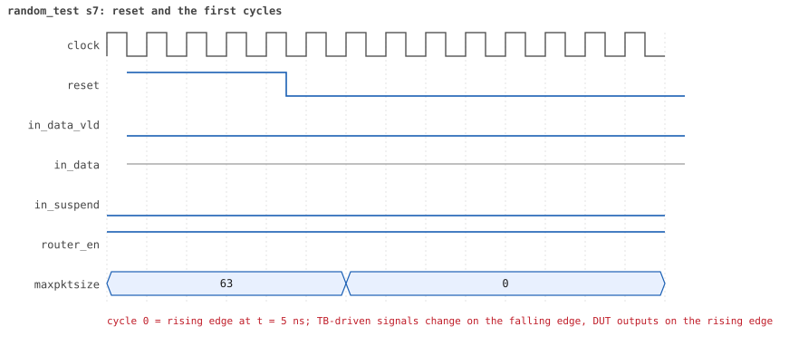
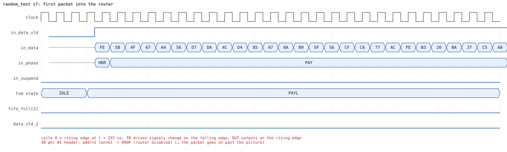
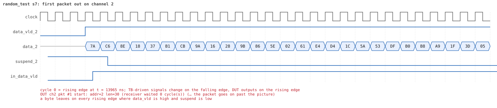
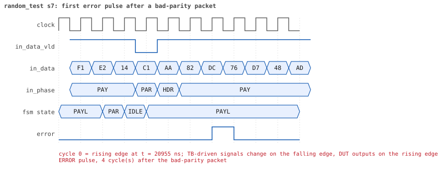
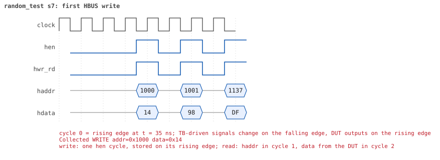
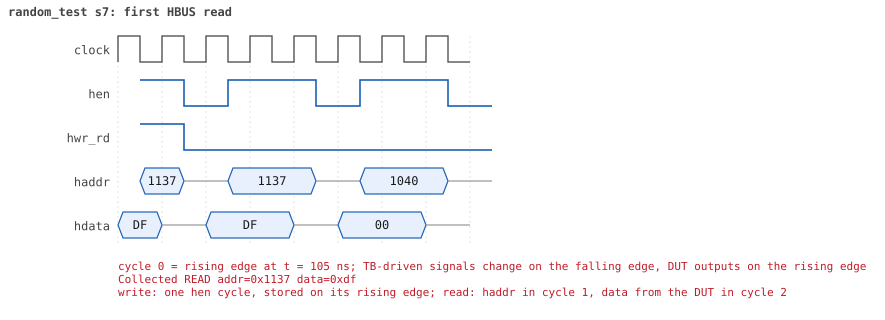

# random_test seed 7

**Result:** PASSED (0 UVM_ERROR, 0 UVM_WARNING, 0 UVM_FATAL) · bench `yapp_project_tb` · sim time 44us · wall 18.5 s · log [`random_test_s7.log`](random_test_s7.log)

Waves: `random_test_s7.fst` (GTKWave, Surfer or the VS Code wave viewer).
[Open the waves in Surfer](https://app.surfer-project.org/?load_url=https%3A%2F%2Fraw.githubusercontent.com%2Ftamirgabgab%2FQcom-Mentoring%2Fmain%2Fyapp_project%2Fregression%2Fyapp_project_tb%2Frandom_test_s7%2Frandom_test_s7.fst&startup_commands=run_command_file_from_url%20https%3A%2F%2Fraw.githubusercontent.com%2Ftamirgabgab%2FQcom-Mentoring%2Fmain%2Fyapp_project%2Ftb%2Fyapp_router.sucl) (web app, the signals already in groups: `yapp_project/tb/yapp_router.sucl`).

## Summary

- YAPP driver sent **89** packet(s) (7 with bad parity); the input monitor saw 89.
- Router: **24** forwarded, **65** dropped (47 oversized, 15 router disabled, 3 illegal address 3).
- Packets out: ch0 **6**, ch1 **5**, ch2 **13**.
- Scoreboard: 24 matched, 0 mismatched, 0 unexpected.
- Back-pressure: in_suspend asserted **0** time(s).
- Error pulses: 6.
- HBUS: 27 write(s), 91 read(s).

## Stages

| time (ns) | stage |
|---|---|
| 0 | receivers: ch0 RX_NORMAL, ch1 RX_NORMAL, ch2 RX_FAST |
| 0 | random scenario: 89 packets in 6 bursts |
| 230 | burst 1/6: ctrl=0x40 (maxpktsize 0) en=0x1b (router on, counter enables 0001101), 14 packet(s) |
| 5030 | burst 1/6 sent: addr0..3 0/3/11/0, bad parity 0, gap 0 5, length 1..63 |
| 5310 | burst 2/6: ctrl=0x26 (maxpktsize 38) en=0x00 (router OFF, counter enables 0000000), 15 packet(s) |
| 12810 | burst 2/6 sent: addr0..3 3/6/4/2, bad parity 1, gap 0 0, length 1..63 |
| 12990 | burst 3/6: ctrl=0xa7 (maxpktsize 39) en=0x91 (router on, counter enables 1001000), 15 packet(s) |
| 21100 | burst 3/6 sent: addr0..3 0/3/10/2, bad parity 1, gap 0 2, length 10..63 |
| 21480 | burst 4/6: ctrl=0x9c (maxpktsize 28) en=0x51 (router on, counter enables 0101000), 15 packet(s) |
| 27710 | burst 4/6 sent: addr0..3 3/3/8/1, bad parity 0, gap 0 5, length 1..63 |
| 27860 | burst 5/6: ctrl=0xbe (maxpktsize 62) en=0xff (router on, counter enables 1111111), 16 packet(s) |
| 36240 | burst 5/6 sent: addr0..3 6/2/7/1, bad parity 2, gap 0 2, length 2..63 |
| 36600 | burst 6/6: ctrl=0x44 (maxpktsize 4) en=0x43 (router on, counter enables 0100001), 14 packet(s) |
| 42020 | burst 6/6 sent: addr0..3 3/5/6/0, bad parity 3, gap 0 4, length 3..63 |
| 42020 | final reads: every register and the stored packet, checked against the reference model |
| 43875 | done: 89 packets (24 forwarded, 65 dropped), 0 storm burst(s), 24 scoreboard matches, 91 HBUS reads checked, 6 error pulses for 6 bad packets |

## Pictures

**reset and the first cycles**

**first packet into the router**

**first packet out on channel 2**

**first error pulse after a bad-parity packet**

**first HBUS write**

**first HBUS read**

## Timeline

1043 events.

| time (ns) | who | event |
|---|---|---|
| 0 | yapp monitor | YAPP monitor running |
| 0 | **test** | STAGE: receivers: ch0 RX_NORMAL, ch1 RX_NORMAL, ch2 RX_FAST |
| 0 | **test** | STAGE: random scenario: 89 packets in 6 bursts |
| 0 | clk/rst driver | Starting clock (period 10) and holding reset for 5 cycles |
| 0 | **DUT** | RESET asserted |
| 50 | **DUT** | RESET released: router_en=1 maxpktsize=63 |
| 70 | hbus driver | Executed WRITE addr=0x1000 data=0x40 |
| 75 | **DUT** | CONFIG router_en=1 maxpktsize=0 |
| 75 | hbus monitor | Collected WRITE addr=0x1000 data=0x40 |
| 75 | reference | maxpktsize is now 0 |
| 90 | hbus driver | Executed WRITE addr=0x1001 data=0x1b |
| 95 | hbus monitor | Collected WRITE addr=0x1001 data=0x1b |
| 95 | reference | router_en is now 1 (en_reg 0x1b) |
| 120 | hbus driver | Executed READ  addr=0x100f data=0x00 |
| 125 | hbus monitor | Collected READ  addr=0x100f data=0x00 |
| 150 | hbus driver | Executed READ  addr=0x10b6 data=0x00 |
| 155 | hbus monitor | Collected READ  addr=0x10b6 data=0x00 |
| 170 | hbus driver | Executed WRITE addr=0x11fa data=0xe9 |
| 175 | hbus monitor | Collected WRITE addr=0x11fa data=0xe9 |
| 200 | hbus driver | Executed READ  addr=0x11fa data=0xe9 |
| 205 | hbus monitor | Collected READ  addr=0x11fa data=0xe9 |
| 230 | hbus driver | Executed READ  addr=0x100d data=0x00 |
| 230 | **test** | STAGE: burst 1/6: ctrl=0x40 (maxpktsize 0) en=0x1b (router on, counter enables 0001101), 14 packet(s) |
| 230 | yapp driver | TX pkt #1: addr=1 len=33 parity=good delay=18 |
| 235 | hbus monitor | Collected READ  addr=0x100d data=0x00 |
| 425 | **DUT** | IN  pkt #1 header: addr=1 len=33 -> DROP (oversized: len 33 > maxpktsize 0) |
| 765 | **DUT** | IN  pkt #1 complete: addr=1 len=33 parity=ok dropped, 35 bytes in 35 cycles (held 0) |
| 765 | yapp monitor | RX pkt #1 on the input: addr=1 len=33 parity=good gap=37 |
| 765 | reference | Packet dropped: length 33 > maxpktsize 0 (addr=1) |
| 765 | **DUT** | ROUTER DROPS PACKET addr=1 length=33 (length > maxpktsize) |
| 770 | yapp driver | TX pkt #1 accepted by the DUT |
| 770 | yapp driver | TX pkt #2: addr=2 len=1 parity=good delay=3 |
| 805 | **DUT** | IN  pkt #2 header: addr=2 len=1 -> DROP (oversized: len 1 > maxpktsize 0) |
| 825 | **DUT** | IN  pkt #2 complete: addr=2 len=1 parity=ok dropped, 3 bytes in 3 cycles (held 0) |
| 825 | yapp monitor | RX pkt #2 on the input: addr=2 len=1 parity=good gap=3 |
| 825 | reference | Packet dropped: length 1 > maxpktsize 0 (addr=2) |
| 825 | **DUT** | ROUTER DROPS PACKET addr=2 length=1 (length > maxpktsize) |
| 830 | yapp driver | TX pkt #2 accepted by the DUT |
| 830 | yapp driver | TX pkt #3: addr=2 len=33 parity=good delay=10 |
| 935 | **DUT** | IN  pkt #3 header: addr=2 len=33 -> DROP (oversized: len 33 > maxpktsize 0) |
| 1275 | **DUT** | IN  pkt #3 complete: addr=2 len=33 parity=ok dropped, 35 bytes in 35 cycles (held 0) |
| 1275 | yapp monitor | RX pkt #3 on the input: addr=2 len=33 parity=good gap=10 |
| 1275 | reference | Packet dropped: length 33 > maxpktsize 0 (addr=2) |
| 1275 | **DUT** | ROUTER DROPS PACKET addr=2 length=33 (length > maxpktsize) |
| 1280 | yapp driver | TX pkt #3 accepted by the DUT |
| 1280 | yapp driver | TX pkt #4: addr=2 len=1 parity=good delay=0 |
| 1285 | **DUT** | IN  pkt #4 header: addr=2 len=1 -> DROP (oversized: len 1 > maxpktsize 0) |
| 1305 | **DUT** | IN  pkt #4 complete: addr=2 len=1 parity=ok dropped, 3 bytes in 3 cycles (held 0) |
| 1305 | yapp monitor | RX pkt #4 on the input: addr=2 len=1 parity=good gap=0 |
| 1305 | reference | Packet dropped: length 1 > maxpktsize 0 (addr=2) |
| 1305 | **DUT** | ROUTER DROPS PACKET addr=2 length=1 (length > maxpktsize) |
| 1310 | yapp driver | TX pkt #4 accepted by the DUT |
| 1310 | yapp driver | TX pkt #5: addr=2 len=30 parity=good delay=0 |
| 1315 | **DUT** | IN  pkt #5 header: addr=2 len=30 -> DROP (oversized: len 30 > maxpktsize 0) |
| 1625 | **DUT** | IN  pkt #5 complete: addr=2 len=30 parity=ok dropped, 32 bytes in 32 cycles (held 0) |
| 1625 | yapp monitor | RX pkt #5 on the input: addr=2 len=30 parity=good gap=0 |
| 1625 | reference | Packet dropped: length 30 > maxpktsize 0 (addr=2) |
| 1625 | **DUT** | ROUTER DROPS PACKET addr=2 length=30 (length > maxpktsize) |
| 1630 | yapp driver | TX pkt #5 accepted by the DUT |
| 1630 | yapp driver | TX pkt #6: addr=2 len=38 parity=good delay=0 |
| 1635 | **DUT** | IN  pkt #6 header: addr=2 len=38 -> DROP (oversized: len 38 > maxpktsize 0) |
| 2025 | **DUT** | IN  pkt #6 complete: addr=2 len=38 parity=ok dropped, 40 bytes in 40 cycles (held 0) |
| 2025 | yapp monitor | RX pkt #6 on the input: addr=2 len=38 parity=good gap=0 |
| 2025 | reference | Packet dropped: length 38 > maxpktsize 0 (addr=2) |
| 2025 | **DUT** | ROUTER DROPS PACKET addr=2 length=38 (length > maxpktsize) |
| 2030 | yapp driver | TX pkt #6 accepted by the DUT |
| 2030 | yapp driver | TX pkt #7: addr=2 len=32 parity=good delay=18 |
| 2215 | **DUT** | IN  pkt #7 header: addr=2 len=32 -> DROP (oversized: len 32 > maxpktsize 0) |
| 2545 | **DUT** | IN  pkt #7 complete: addr=2 len=32 parity=ok dropped, 34 bytes in 34 cycles (held 0) |
| 2545 | yapp monitor | RX pkt #7 on the input: addr=2 len=32 parity=good gap=18 |
| 2545 | reference | Packet dropped: length 32 > maxpktsize 0 (addr=2) |
| 2545 | **DUT** | ROUTER DROPS PACKET addr=2 length=32 (length > maxpktsize) |
| 2550 | yapp driver | TX pkt #7 accepted by the DUT |
| 2550 | yapp driver | TX pkt #8: addr=2 len=63 parity=good delay=5 |
| 2605 | **DUT** | IN  pkt #8 header: addr=2 len=63 -> DROP (oversized: len 63 > maxpktsize 0) |
| 3245 | **DUT** | IN  pkt #8 complete: addr=2 len=63 parity=ok dropped, 65 bytes in 65 cycles (held 0) |
| 3245 | yapp monitor | RX pkt #8 on the input: addr=2 len=63 parity=good gap=5 |
| 3245 | reference | Packet dropped: length 63 > maxpktsize 0 (addr=2) |
| 3245 | **DUT** | ROUTER DROPS PACKET addr=2 length=63 (length > maxpktsize) |
| 3250 | yapp driver | TX pkt #8 accepted by the DUT |
| 3250 | yapp driver | TX pkt #9: addr=2 len=27 parity=good delay=0 |
| 3255 | **DUT** | IN  pkt #9 header: addr=2 len=27 -> DROP (oversized: len 27 > maxpktsize 0) |
| 3535 | **DUT** | IN  pkt #9 complete: addr=2 len=27 parity=ok dropped, 29 bytes in 29 cycles (held 0) |
| 3535 | yapp monitor | RX pkt #9 on the input: addr=2 len=27 parity=good gap=0 |
| 3535 | reference | Packet dropped: length 27 > maxpktsize 0 (addr=2) |
| 3535 | **DUT** | ROUTER DROPS PACKET addr=2 length=27 (length > maxpktsize) |
| 3540 | yapp driver | TX pkt #9 accepted by the DUT |
| 3540 | yapp driver | TX pkt #10: addr=1 len=21 parity=good delay=3 |
| 3575 | **DUT** | IN  pkt #10 header: addr=1 len=21 -> DROP (oversized: len 21 > maxpktsize 0) |
| 3795 | **DUT** | IN  pkt #10 complete: addr=1 len=21 parity=ok dropped, 23 bytes in 23 cycles (held 0) |
| 3795 | yapp monitor | RX pkt #10 on the input: addr=1 len=21 parity=good gap=3 |
| 3795 | reference | Packet dropped: length 21 > maxpktsize 0 (addr=1) |
| 3795 | **DUT** | ROUTER DROPS PACKET addr=1 length=21 (length > maxpktsize) |
| 3800 | yapp driver | TX pkt #10 accepted by the DUT |
| 3800 | yapp driver | TX pkt #11: addr=1 len=34 parity=good delay=3 |
| 3835 | **DUT** | IN  pkt #11 header: addr=1 len=34 -> DROP (oversized: len 34 > maxpktsize 0) |
| 4185 | **DUT** | IN  pkt #11 complete: addr=1 len=34 parity=ok dropped, 36 bytes in 36 cycles (held 0) |
| 4185 | yapp monitor | RX pkt #11 on the input: addr=1 len=34 parity=good gap=3 |
| 4185 | reference | Packet dropped: length 34 > maxpktsize 0 (addr=1) |
| 4185 | **DUT** | ROUTER DROPS PACKET addr=1 length=34 (length > maxpktsize) |
| 4190 | yapp driver | TX pkt #11 accepted by the DUT |
| 4190 | yapp driver | TX pkt #12: addr=2 len=2 parity=good delay=1 |
| 4205 | **DUT** | IN  pkt #12 header: addr=2 len=2 -> DROP (oversized: len 2 > maxpktsize 0) |
| 4235 | **DUT** | IN  pkt #12 complete: addr=2 len=2 parity=ok dropped, 4 bytes in 4 cycles (held 0) |
| 4235 | yapp monitor | RX pkt #12 on the input: addr=2 len=2 parity=good gap=1 |
| 4235 | reference | Packet dropped: length 2 > maxpktsize 0 (addr=2) |
| 4235 | **DUT** | ROUTER DROPS PACKET addr=2 length=2 (length > maxpktsize) |
| 4240 | yapp driver | TX pkt #12 accepted by the DUT |
| 4240 | yapp driver | TX pkt #13: addr=2 len=59 parity=good delay=0 |
| 4245 | **DUT** | IN  pkt #13 header: addr=2 len=59 -> DROP (oversized: len 59 > maxpktsize 0) |
| 4845 | **DUT** | IN  pkt #13 complete: addr=2 len=59 parity=ok dropped, 61 bytes in 61 cycles (held 0) |
| 4845 | yapp monitor | RX pkt #13 on the input: addr=2 len=59 parity=good gap=0 |
| 4845 | reference | Packet dropped: length 59 > maxpktsize 0 (addr=2) |
| 4845 | **DUT** | ROUTER DROPS PACKET addr=2 length=59 (length > maxpktsize) |
| 4850 | yapp driver | TX pkt #13 accepted by the DUT |
| 4850 | yapp driver | TX pkt #14: addr=2 len=1 parity=good delay=15 |
| 5005 | **DUT** | IN  pkt #14 header: addr=2 len=1 -> DROP (oversized: len 1 > maxpktsize 0) |
| 5025 | **DUT** | IN  pkt #14 complete: addr=2 len=1 parity=ok dropped, 3 bytes in 3 cycles (held 0) |
| 5025 | yapp monitor | RX pkt #14 on the input: addr=2 len=1 parity=good gap=15 |
| 5025 | reference | Packet dropped: length 1 > maxpktsize 0 (addr=2) |
| 5025 | **DUT** | ROUTER DROPS PACKET addr=2 length=1 (length > maxpktsize) |
| 5030 | yapp driver | TX pkt #14 accepted by the DUT |
| 5030 | **test** | STAGE: burst 1/6 sent: addr0..3 0/3/11/0, bad parity 0, gap 0 5, length 1..63 |
| 5050 | hbus driver | Executed WRITE addr=0x1000 data=0x26 |
| 5055 | **DUT** | CONFIG router_en=1 maxpktsize=38 |
| 5055 | hbus monitor | Collected WRITE addr=0x1000 data=0x26 |
| 5055 | reference | maxpktsize is now 38 |
| 5070 | hbus driver | Executed WRITE addr=0x1001 data=0x00 |
| 5075 | **DUT** | CONFIG router_en=0 maxpktsize=38 |
| 5075 | hbus monitor | Collected WRITE addr=0x1001 data=0x00 |
| 5075 | reference | router_en is now 0 (en_reg 0x00) |
| 5100 | hbus driver | Executed READ  addr=0x1008 data=0x00 |
| 5105 | hbus monitor | Collected READ  addr=0x1008 data=0x00 |
| 5120 | hbus driver | Executed WRITE addr=0x1125 data=0xfe |
| 5125 | hbus monitor | Collected WRITE addr=0x1125 data=0xfe |
| 5150 | hbus driver | Executed READ  addr=0x1125 data=0xfe |
| 5155 | hbus monitor | Collected READ  addr=0x1125 data=0xfe |
| 5170 | hbus driver | Executed WRITE addr=0x1157 data=0x93 |
| 5175 | hbus monitor | Collected WRITE addr=0x1157 data=0x93 |
| 5200 | hbus driver | Executed READ  addr=0x1157 data=0x93 |
| 5205 | hbus monitor | Collected READ  addr=0x1157 data=0x93 |
| 5230 | hbus driver | Executed READ  addr=0x1008 data=0x00 |
| 5235 | hbus monitor | Collected READ  addr=0x1008 data=0x00 |
| 5250 | hbus driver | Executed WRITE addr=0x111a data=0xe1 |
| 5255 | hbus monitor | Collected WRITE addr=0x111a data=0xe1 |
| 5280 | hbus driver | Executed READ  addr=0x111a data=0xe1 |
| 5285 | hbus monitor | Collected READ  addr=0x111a data=0xe1 |
| 5310 | hbus driver | Executed READ  addr=0x100d data=0x01 |
| 5310 | **test** | STAGE: burst 2/6: ctrl=0x26 (maxpktsize 38) en=0x00 (router OFF, counter enables 0000000), 15 packet(s) |
| 5310 | yapp driver | TX pkt #15: addr=0 len=39 parity=good delay=20 |
| 5315 | hbus monitor | Collected READ  addr=0x100d data=0x01 |
| 5525 | **DUT** | IN  pkt #15 header: addr=0 len=39 -> DROP (router disabled) |
| 5925 | **DUT** | IN  pkt #15 complete: addr=0 len=39 parity=ok dropped, 41 bytes in 41 cycles (held 0) |
| 5925 | yapp monitor | RX pkt #15 on the input: addr=0 len=39 parity=good gap=49 |
| 5925 | reference | Packet dropped: router disabled (addr=0 len=39) |
| 5925 | **DUT** | ROUTER DROPS PACKET addr=0 length=39 (router disabled) |
| 5930 | yapp driver | TX pkt #15 accepted by the DUT |
| 5930 | yapp driver | TX pkt #16: addr=1 len=63 parity=good delay=18 |
| 6115 | **DUT** | IN  pkt #16 header: addr=1 len=63 -> DROP (router disabled) |
| 6755 | **DUT** | IN  pkt #16 complete: addr=1 len=63 parity=ok dropped, 65 bytes in 65 cycles (held 0) |
| 6755 | yapp monitor | RX pkt #16 on the input: addr=1 len=63 parity=good gap=18 |
| 6755 | reference | Packet dropped: router disabled (addr=1 len=63) |
| 6755 | **DUT** | ROUTER DROPS PACKET addr=1 length=63 (router disabled) |
| 6760 | yapp driver | TX pkt #16 accepted by the DUT |
| 6760 | yapp driver | TX pkt #17: addr=1 len=5 parity=good delay=9 |
| 6855 | **DUT** | IN  pkt #17 header: addr=1 len=5 -> DROP (router disabled) |
| 6915 | **DUT** | IN  pkt #17 complete: addr=1 len=5 parity=ok dropped, 7 bytes in 7 cycles (held 0) |
| 6915 | yapp monitor | RX pkt #17 on the input: addr=1 len=5 parity=good gap=9 |
| 6915 | reference | Packet dropped: router disabled (addr=1 len=5) |
| 6915 | **DUT** | ROUTER DROPS PACKET addr=1 length=5 (router disabled) |
| 6920 | yapp driver | TX pkt #17 accepted by the DUT |
| 6920 | yapp driver | TX pkt #18: addr=3 len=63 parity=good delay=10 |
| 7025 | **DUT** | IN  pkt #18 header: addr=3 len=63 -> DROP (router disabled) |
| 7665 | **DUT** | IN  pkt #18 complete: addr=3 len=63 parity=ok dropped, 65 bytes in 65 cycles (held 0) |
| 7665 | yapp monitor | RX pkt #18 on the input: addr=3 len=63 parity=good gap=10 |
| 7665 | reference | Packet dropped: router disabled (addr=3 len=63) |
| 7665 | **DUT** | ROUTER DROPS PACKET addr=3 length=63 (router disabled) |
| 7670 | yapp driver | TX pkt #18 accepted by the DUT |
| 7670 | yapp driver | TX pkt #19: addr=3 len=63 parity=good delay=3 |
| 7705 | **DUT** | IN  pkt #19 header: addr=3 len=63 -> DROP (router disabled) |
| 8345 | **DUT** | IN  pkt #19 complete: addr=3 len=63 parity=ok dropped, 65 bytes in 65 cycles (held 0) |
| 8345 | yapp monitor | RX pkt #19 on the input: addr=3 len=63 parity=good gap=3 |
| 8345 | reference | Packet dropped: router disabled (addr=3 len=63) |
| 8345 | **DUT** | ROUTER DROPS PACKET addr=3 length=63 (router disabled) |
| 8350 | yapp driver | TX pkt #19 accepted by the DUT |
| 8350 | yapp driver | TX pkt #20: addr=2 len=3 parity=good delay=2 |
| 8375 | **DUT** | IN  pkt #20 header: addr=2 len=3 -> DROP (router disabled) |
| 8415 | **DUT** | IN  pkt #20 complete: addr=2 len=3 parity=ok dropped, 5 bytes in 5 cycles (held 0) |
| 8415 | yapp monitor | RX pkt #20 on the input: addr=2 len=3 parity=good gap=2 |
| 8415 | reference | Packet dropped: router disabled (addr=2 len=3) |
| 8415 | **DUT** | ROUTER DROPS PACKET addr=2 length=3 (router disabled) |
| 8420 | yapp driver | TX pkt #20 accepted by the DUT |
| 8420 | yapp driver | TX pkt #21: addr=1 len=38 parity=good delay=3 |
| 8455 | **DUT** | IN  pkt #21 header: addr=1 len=38 -> DROP (router disabled) |
| 8845 | **DUT** | IN  pkt #21 complete: addr=1 len=38 parity=ok dropped, 40 bytes in 40 cycles (held 0) |
| 8845 | yapp monitor | RX pkt #21 on the input: addr=1 len=38 parity=good gap=3 |
| 8845 | reference | Packet dropped: router disabled (addr=1 len=38) |
| 8845 | **DUT** | ROUTER DROPS PACKET addr=1 length=38 (router disabled) |
| 8850 | yapp driver | TX pkt #21 accepted by the DUT |
| 8850 | yapp driver | TX pkt #22: addr=1 len=37 parity=good delay=1 |
| 8865 | **DUT** | IN  pkt #22 header: addr=1 len=37 -> DROP (router disabled) |
| 9245 | **DUT** | IN  pkt #22 complete: addr=1 len=37 parity=ok dropped, 39 bytes in 39 cycles (held 0) |
| 9245 | yapp monitor | RX pkt #22 on the input: addr=1 len=37 parity=good gap=1 |
| 9245 | reference | Packet dropped: router disabled (addr=1 len=37) |
| 9245 | **DUT** | ROUTER DROPS PACKET addr=1 length=37 (router disabled) |
| 9250 | yapp driver | TX pkt #22 accepted by the DUT |
| 9250 | yapp driver | TX pkt #23: addr=1 len=58 parity=good delay=2 |
| 9275 | **DUT** | IN  pkt #23 header: addr=1 len=58 -> DROP (router disabled) |
| 9865 | **DUT** | IN  pkt #23 complete: addr=1 len=58 parity=ok dropped, 60 bytes in 60 cycles (held 0) |
| 9865 | yapp monitor | RX pkt #23 on the input: addr=1 len=58 parity=good gap=2 |
| 9865 | reference | Packet dropped: router disabled (addr=1 len=58) |
| 9865 | **DUT** | ROUTER DROPS PACKET addr=1 length=58 (router disabled) |
| 9870 | yapp driver | TX pkt #23 accepted by the DUT |
| 9870 | yapp driver | TX pkt #24: addr=0 len=39 parity=good delay=20 |
| 10075 | **DUT** | IN  pkt #24 header: addr=0 len=39 -> DROP (router disabled) |
| 10475 | **DUT** | IN  pkt #24 complete: addr=0 len=39 parity=ok dropped, 41 bytes in 41 cycles (held 0) |
| 10475 | yapp monitor | RX pkt #24 on the input: addr=0 len=39 parity=good gap=20 |
| 10475 | reference | Packet dropped: router disabled (addr=0 len=39) |
| 10475 | **DUT** | ROUTER DROPS PACKET addr=0 length=39 (router disabled) |
| 10480 | yapp driver | TX pkt #24 accepted by the DUT |
| 10480 | yapp driver | TX pkt #25: addr=2 len=42 parity=good delay=1 |
| 10495 | **DUT** | IN  pkt #25 header: addr=2 len=42 -> DROP (router disabled) |
| 10925 | **DUT** | IN  pkt #25 complete: addr=2 len=42 parity=ok dropped, 44 bytes in 44 cycles (held 0) |
| 10925 | yapp monitor | RX pkt #25 on the input: addr=2 len=42 parity=good gap=1 |
| 10925 | reference | Packet dropped: router disabled (addr=2 len=42) |
| 10925 | **DUT** | ROUTER DROPS PACKET addr=2 length=42 (router disabled) |
| 10930 | yapp driver | TX pkt #25 accepted by the DUT |
| 10930 | yapp driver | TX pkt #26: addr=2 len=1 parity=bad delay=1 |
| 10945 | **DUT** | IN  pkt #26 header: addr=2 len=1 -> DROP (router disabled) |
| 10965 | **DUT** | IN  pkt #26 complete: addr=2 len=1 parity=BAD dropped, 3 bytes in 3 cycles (held 0) |
| 10965 | yapp monitor | RX pkt #26 on the input: addr=2 len=1 parity=bad gap=1 |
| 10965 | reference | Packet dropped: router disabled (addr=2 len=1) |
| 10965 | **DUT** | ROUTER DROPS PACKET addr=2 length=1 (router disabled) |
| 10970 | yapp driver | TX pkt #26 accepted by the DUT |
| 10970 | yapp driver | TX pkt #27: addr=0 len=37 parity=good delay=1 |
| 10985 | **DUT** | IN  pkt #27 header: addr=0 len=37 -> DROP (router disabled) |
| 11365 | **DUT** | IN  pkt #27 complete: addr=0 len=37 parity=ok dropped, 39 bytes in 39 cycles (held 0) |
| 11365 | yapp monitor | RX pkt #27 on the input: addr=0 len=37 parity=good gap=1 |
| 11365 | reference | Packet dropped: router disabled (addr=0 len=37) |
| 11365 | **DUT** | ROUTER DROPS PACKET addr=0 length=37 (router disabled) |
| 11370 | yapp driver | TX pkt #27 accepted by the DUT |
| 11370 | yapp driver | TX pkt #28: addr=1 len=38 parity=good delay=20 |
| 11575 | **DUT** | IN  pkt #28 header: addr=1 len=38 -> DROP (router disabled) |
| 11965 | **DUT** | IN  pkt #28 complete: addr=1 len=38 parity=ok dropped, 40 bytes in 40 cycles (held 0) |
| 11965 | yapp monitor | RX pkt #28 on the input: addr=1 len=38 parity=good gap=20 |
| 11965 | reference | Packet dropped: router disabled (addr=1 len=38) |
| 11965 | **DUT** | ROUTER DROPS PACKET addr=1 length=38 (router disabled) |
| 11970 | yapp driver | TX pkt #28 accepted by the DUT |
| 11970 | yapp driver | TX pkt #29: addr=2 len=63 parity=good delay=19 |
| 12165 | **DUT** | IN  pkt #29 header: addr=2 len=63 -> DROP (router disabled) |
| 12805 | **DUT** | IN  pkt #29 complete: addr=2 len=63 parity=ok dropped, 65 bytes in 65 cycles (held 0) |
| 12805 | yapp monitor | RX pkt #29 on the input: addr=2 len=63 parity=good gap=19 |
| 12805 | reference | Packet dropped: router disabled (addr=2 len=63) |
| 12805 | **DUT** | ROUTER DROPS PACKET addr=2 length=63 (router disabled) |
| 12810 | yapp driver | TX pkt #29 accepted by the DUT |
| 12810 | **test** | STAGE: burst 2/6 sent: addr0..3 3/6/4/2, bad parity 1, gap 0 0, length 1..63 |
| 12830 | hbus driver | Executed WRITE addr=0x1000 data=0xa7 |
| 12835 | **DUT** | CONFIG router_en=0 maxpktsize=39 |
| 12835 | hbus monitor | Collected WRITE addr=0x1000 data=0xa7 |
| 12835 | reference | maxpktsize is now 39 |
| 12850 | hbus driver | Executed WRITE addr=0x1001 data=0x91 |
| 12855 | **DUT** | CONFIG router_en=1 maxpktsize=39 |
| 12855 | hbus monitor | Collected WRITE addr=0x1001 data=0x91 |
| 12855 | reference | router_en is now 1 (en_reg 0x91) |
| 12880 | hbus driver | Executed READ  addr=0x103b data=0x87 |
| 12885 | hbus monitor | Collected READ  addr=0x103b data=0x87 |
| 12910 | hbus driver | Executed READ  addr=0x1025 data=0xa1 |
| 12915 | hbus monitor | Collected READ  addr=0x1025 data=0xa1 |
| 12940 | hbus driver | Executed READ  addr=0x100d data=0x01 |
| 12945 | hbus monitor | Collected READ  addr=0x100d data=0x01 |
| 12960 | hbus driver | Executed WRITE addr=0x11a4 data=0x66 |
| 12965 | hbus monitor | Collected WRITE addr=0x11a4 data=0x66 |
| 12990 | hbus driver | Executed READ  addr=0x11a4 data=0x66 |
| 12990 | **test** | STAGE: burst 3/6: ctrl=0xa7 (maxpktsize 39) en=0x91 (router on, counter enables 1001000), 15 packet(s) |
| 12990 | yapp driver | TX pkt #30: addr=2 len=62 parity=good delay=16 |
| 12995 | hbus monitor | Collected READ  addr=0x11a4 data=0x66 |
| 13165 | **DUT** | IN  pkt #30 header: addr=2 len=62 -> DROP (oversized: len 62 > maxpktsize 39) |
| 13795 | **DUT** | IN  pkt #30 complete: addr=2 len=62 parity=ok dropped, 64 bytes in 64 cycles (held 0) |
| 13795 | yapp monitor | RX pkt #30 on the input: addr=2 len=62 parity=good gap=35 |
| 13795 | reference | Packet dropped: length 62 > maxpktsize 39 (addr=2) |
| 13795 | **DUT** | ROUTER DROPS PACKET addr=2 length=62 (length > maxpktsize) |
| 13800 | yapp driver | TX pkt #30 accepted by the DUT |
| 13800 | yapp driver | TX pkt #31: addr=2 len=30 parity=good delay=19 |
| 13995 | **DUT** | IN  pkt #31 header: addr=2 len=30 -> channel 2 |
| 14005 | **DUT** | OUT ch2 pkt #1 start: addr=2 len=30 (receiver waited 0 cycle(s)) |
| 14305 | **DUT** | IN  pkt #31 complete: addr=2 len=30 parity=ok forwarded, 32 bytes in 32 cycles (held 0) |
| 14305 | yapp monitor | RX pkt #31 on the input: addr=2 len=30 parity=good gap=19 |
| 14305 | reference | Packet forwarded: addr=2 len=30 -> channel 2 |
| 14310 | ch2 driver | ch2: packet consumed (response delay 0) |
| 14310 | yapp driver | TX pkt #31 accepted by the DUT |
| 14310 | yapp driver | TX pkt #32: addr=2 len=35 parity=good delay=2 |
| 14325 | **DUT** | OUT ch2 pkt #1 done: 32 bytes in 33 cycles |
| 14325 | ch2 monitor | ch2 RX pkt #1: addr=2 len=30 parity=good |
| 14325 | scoreboard | ch2 pkt matched: addr=2 len=30 (1 matched so far) |
| 14335 | **DUT** | IN  pkt #32 header: addr=2 len=35 -> channel 2 |
| 14345 | **DUT** | OUT ch2 pkt #2 start: addr=2 len=35 (receiver waited 0 cycle(s)) |
| 14695 | **DUT** | IN  pkt #32 complete: addr=2 len=35 parity=ok forwarded, 37 bytes in 37 cycles (held 0) |
| 14695 | yapp monitor | RX pkt #32 on the input: addr=2 len=35 parity=good gap=2 |
| 14695 | reference | Packet forwarded: addr=2 len=35 -> channel 2 |
| 14700 | yapp driver | TX pkt #32 accepted by the DUT |
| 14700 | yapp driver | TX pkt #33: addr=3 len=63 parity=good delay=12 |
| 14705 | **DUT** | OUT ch2 pkt #2 done: 37 bytes in 37 cycles |
| 14705 | ch2 monitor | ch2 RX pkt #2: addr=2 len=35 parity=good |
| 14705 | scoreboard | ch2 pkt matched: addr=2 len=35 (2 matched so far) |
| 14825 | **DUT** | IN  pkt #33 header: addr=3 len=63 -> DROP (oversized: len 63 > maxpktsize 39) |
| 14930 | ch2 driver | ch2: packet consumed (response delay 0) |
| 15465 | **DUT** | IN  pkt #33 complete: addr=3 len=63 parity=ok dropped, 65 bytes in 65 cycles (held 0) |
| 15465 | yapp monitor | RX pkt #33 on the input: addr=3 len=63 parity=good gap=12 |
| 15465 | reference | Packet dropped: illegal address 3 (len=63) |
| 15465 | **DUT** | ROUTER DROPS PACKET addr=3 length=63 (    illegal address) |
| 15470 | yapp driver | TX pkt #33 accepted by the DUT |
| 15470 | yapp driver | TX pkt #34: addr=2 len=10 parity=good delay=1 |
| 15485 | **DUT** | IN  pkt #34 header: addr=2 len=10 -> channel 2 |
| 15495 | **DUT** | OUT ch2 pkt #3 start: addr=2 len=10 (receiver waited 0 cycle(s)) |
| 15595 | **DUT** | IN  pkt #34 complete: addr=2 len=10 parity=ok forwarded, 12 bytes in 12 cycles (held 0) |
| 15595 | yapp monitor | RX pkt #34 on the input: addr=2 len=10 parity=good gap=1 |
| 15595 | reference | Packet forwarded: addr=2 len=10 -> channel 2 |
| 15600 | ch2 driver | ch2: packet consumed (response delay 0) |
| 15600 | yapp driver | TX pkt #34 accepted by the DUT |
| 15600 | yapp driver | TX pkt #35: addr=3 len=39 parity=good delay=14 |
| 15615 | **DUT** | OUT ch2 pkt #3 done: 12 bytes in 13 cycles |
| 15615 | ch2 monitor | ch2 RX pkt #3: addr=2 len=10 parity=good |
| 15615 | scoreboard | ch2 pkt matched: addr=2 len=10 (3 matched so far) |
| 15745 | **DUT** | IN  pkt #35 header: addr=3 len=39 -> DROP (illegal address 3) |
| 15800 | ch2 driver | ch2: packet consumed (response delay 0) |
| 16145 | **DUT** | IN  pkt #35 complete: addr=3 len=39 parity=ok dropped, 41 bytes in 41 cycles (held 0) |
| 16145 | yapp monitor | RX pkt #35 on the input: addr=3 len=39 parity=good gap=14 |
| 16145 | reference | Packet dropped: illegal address 3 (len=39) |
| 16145 | **DUT** | ROUTER DROPS PACKET addr=3 length=39 (    illegal address) |
| 16150 | yapp driver | TX pkt #35 accepted by the DUT |
| 16150 | yapp driver | TX pkt #36: addr=2 len=36 parity=good delay=0 |
| 16155 | **DUT** | IN  pkt #36 header: addr=2 len=36 -> channel 2 |
| 16165 | **DUT** | OUT ch2 pkt #4 start: addr=2 len=36 (receiver waited 0 cycle(s)) |
| 16525 | **DUT** | IN  pkt #36 complete: addr=2 len=36 parity=ok forwarded, 38 bytes in 38 cycles (held 0) |
| 16525 | yapp monitor | RX pkt #36 on the input: addr=2 len=36 parity=good gap=0 |
| 16525 | reference | Packet forwarded: addr=2 len=36 -> channel 2 |
| 16530 | ch2 driver | ch2: packet consumed (response delay 0) |
| 16530 | yapp driver | TX pkt #36 accepted by the DUT |
| 16530 | yapp driver | TX pkt #37: addr=1 len=51 parity=good delay=0 |
| 16535 | **DUT** | IN  pkt #37 header: addr=1 len=51 -> DROP (oversized: len 51 > maxpktsize 39) |
| 16545 | **DUT** | OUT ch2 pkt #4 done: 38 bytes in 39 cycles |
| 16545 | ch2 monitor | ch2 RX pkt #4: addr=2 len=36 parity=good |
| 16545 | scoreboard | ch2 pkt matched: addr=2 len=36 (4 matched so far) |
| 16740 | ch2 driver | ch2: packet consumed (response delay 0) |
| 17055 | **DUT** | IN  pkt #37 complete: addr=1 len=51 parity=ok dropped, 53 bytes in 53 cycles (held 0) |
| 17055 | yapp monitor | RX pkt #37 on the input: addr=1 len=51 parity=good gap=0 |
| 17055 | reference | Packet dropped: length 51 > maxpktsize 39 (addr=1) |
| 17055 | **DUT** | ROUTER DROPS PACKET addr=1 length=51 (length > maxpktsize) |
| 17060 | yapp driver | TX pkt #37 accepted by the DUT |
| 17060 | yapp driver | TX pkt #38: addr=1 len=36 parity=bad delay=5 |
| 17115 | **DUT** | IN  pkt #38 header: addr=1 len=36 -> channel 1 |
| 17145 | **DUT** | OUT ch1 pkt #1 start: addr=1 len=36 (receiver waited 2 cycle(s)) |
| 17485 | **DUT** | IN  pkt #38 complete: addr=1 len=36 parity=BAD forwarded, 38 bytes in 38 cycles (held 0) |
| 17485 | yapp monitor | RX pkt #38 on the input: addr=1 len=36 parity=bad gap=5 |
| 17485 | reference | Packet forwarded: addr=1 len=36 -> channel 1 |
| 17490 | yapp driver | TX pkt #38 accepted by the DUT |
| 17490 | yapp driver | TX pkt #39: addr=2 len=63 parity=good delay=2 |
| 17510 | ch1 driver | ch1: packet consumed (response delay 2) |
| 17515 | **DUT** | IN  pkt #39 header: addr=2 len=63 -> DROP (oversized: len 63 > maxpktsize 39) |
| 17550 | **DUT** | ERROR pulse, 6 cycle(s) after the bad-parity packet |
| 17550 | error checker | error pulse 6 cycles after the bad packet (0 still owed) |
| 17605 | **DUT** | OUT ch1 pkt #1 done: 38 bytes in 47 cycles |
| 17605 | ch1 monitor | ch1 RX pkt #1: addr=1 len=36 parity=bad |
| 17605 | scoreboard | ch1 pkt matched: addr=1 len=36 (5 matched so far) |
| 18155 | **DUT** | IN  pkt #39 complete: addr=2 len=63 parity=ok dropped, 65 bytes in 65 cycles (held 0) |
| 18155 | yapp monitor | RX pkt #39 on the input: addr=2 len=63 parity=good gap=2 |
| 18155 | reference | Packet dropped: length 63 > maxpktsize 39 (addr=2) |
| 18155 | **DUT** | ROUTER DROPS PACKET addr=2 length=63 (length > maxpktsize) |
| 18160 | yapp driver | TX pkt #39 accepted by the DUT |
| 18160 | yapp driver | TX pkt #40: addr=2 len=63 parity=good delay=4 |
| 18205 | **DUT** | IN  pkt #40 header: addr=2 len=63 -> DROP (oversized: len 63 > maxpktsize 39) |
| 18220 | ch1 driver | ch1: packet consumed (response delay 8) |
| 18845 | **DUT** | IN  pkt #40 complete: addr=2 len=63 parity=ok dropped, 65 bytes in 65 cycles (held 0) |
| 18845 | yapp monitor | RX pkt #40 on the input: addr=2 len=63 parity=good gap=4 |
| 18845 | reference | Packet dropped: length 63 > maxpktsize 39 (addr=2) |
| 18845 | **DUT** | ROUTER DROPS PACKET addr=2 length=63 (length > maxpktsize) |
| 18850 | yapp driver | TX pkt #40 accepted by the DUT |
| 18850 | yapp driver | TX pkt #41: addr=2 len=55 parity=good delay=2 |
| 18875 | **DUT** | IN  pkt #41 header: addr=2 len=55 -> DROP (oversized: len 55 > maxpktsize 39) |
| 19435 | **DUT** | IN  pkt #41 complete: addr=2 len=55 parity=ok dropped, 57 bytes in 57 cycles (held 0) |
| 19435 | yapp monitor | RX pkt #41 on the input: addr=2 len=55 parity=good gap=2 |
| 19435 | reference | Packet dropped: length 55 > maxpktsize 39 (addr=2) |
| 19435 | **DUT** | ROUTER DROPS PACKET addr=2 length=55 (length > maxpktsize) |
| 19440 | yapp driver | TX pkt #41 accepted by the DUT |
| 19440 | yapp driver | TX pkt #42: addr=2 len=38 parity=good delay=16 |
| 19605 | **DUT** | IN  pkt #42 header: addr=2 len=38 -> channel 2 |
| 19615 | **DUT** | OUT ch2 pkt #5 start: addr=2 len=38 (receiver waited 0 cycle(s)) |
| 19995 | **DUT** | IN  pkt #42 complete: addr=2 len=38 parity=ok forwarded, 40 bytes in 40 cycles (held 0) |
| 19995 | yapp monitor | RX pkt #42 on the input: addr=2 len=38 parity=good gap=16 |
| 19995 | reference | Packet forwarded: addr=2 len=38 -> channel 2 |
| 20000 | ch2 driver | ch2: packet consumed (response delay 0) |
| 20000 | yapp driver | TX pkt #42 accepted by the DUT |
| 20000 | yapp driver | TX pkt #43: addr=1 len=63 parity=good delay=15 |
| 20015 | **DUT** | OUT ch2 pkt #5 done: 40 bytes in 41 cycles |
| 20015 | ch2 monitor | ch2 RX pkt #5: addr=2 len=38 parity=good |
| 20015 | scoreboard | ch2 pkt matched: addr=2 len=38 (6 matched so far) |
| 20155 | **DUT** | IN  pkt #43 header: addr=1 len=63 -> DROP (oversized: len 63 > maxpktsize 39) |
| 20370 | ch2 driver | ch2: packet consumed (response delay 0) |
| 20795 | **DUT** | IN  pkt #43 complete: addr=1 len=63 parity=ok dropped, 65 bytes in 65 cycles (held 0) |
| 20795 | yapp monitor | RX pkt #43 on the input: addr=1 len=63 parity=good gap=15 |
| 20795 | reference | Packet dropped: length 63 > maxpktsize 39 (addr=1) |
| 20795 | **DUT** | ROUTER DROPS PACKET addr=1 length=63 (length > maxpktsize) |
| 20800 | yapp driver | TX pkt #43 accepted by the DUT |
| 20800 | yapp driver | TX pkt #44: addr=2 len=27 parity=good delay=1 |
| 20815 | **DUT** | IN  pkt #44 header: addr=2 len=27 -> channel 2 |
| 20825 | **DUT** | OUT ch2 pkt #6 start: addr=2 len=27 (receiver waited 0 cycle(s)) |
| 21095 | **DUT** | IN  pkt #44 complete: addr=2 len=27 parity=ok forwarded, 29 bytes in 29 cycles (held 0) |
| 21095 | yapp monitor | RX pkt #44 on the input: addr=2 len=27 parity=good gap=1 |
| 21095 | reference | Packet forwarded: addr=2 len=27 -> channel 2 |
| 21100 | ch2 driver | ch2: packet consumed (response delay 0) |
| 21100 | yapp driver | TX pkt #44 accepted by the DUT |
| 21100 | **test** | STAGE: burst 3/6 sent: addr0..3 0/3/10/2, bad parity 1, gap 0 2, length 10..63 |
| 21115 | **DUT** | OUT ch2 pkt #6 done: 29 bytes in 30 cycles |
| 21115 | ch2 monitor | ch2 RX pkt #6: addr=2 len=27 parity=good |
| 21115 | scoreboard | ch2 pkt matched: addr=2 len=27 (7 matched so far) |
| 21120 | hbus driver | Executed WRITE addr=0x1000 data=0x9c |
| 21125 | **DUT** | CONFIG router_en=1 maxpktsize=28 |
| 21125 | hbus monitor | Collected WRITE addr=0x1000 data=0x9c |
| 21125 | reference | maxpktsize is now 28 |
| 21140 | hbus driver | Executed WRITE addr=0x1001 data=0x51 |
| 21145 | hbus monitor | Collected WRITE addr=0x1001 data=0x51 |
| 21145 | reference | router_en is now 1 (en_reg 0x51) |
| 21160 | hbus driver | Executed WRITE addr=0x11bb data=0xab |
| 21165 | hbus monitor | Collected WRITE addr=0x11bb data=0xab |
| 21190 | hbus driver | Executed READ  addr=0x11bb data=0xab |
| 21195 | hbus monitor | Collected READ  addr=0x11bb data=0xab |
| 21210 | hbus driver | Executed WRITE addr=0x114a data=0x26 |
| 21215 | hbus monitor | Collected WRITE addr=0x114a data=0x26 |
| 21240 | hbus driver | Executed READ  addr=0x114a data=0x26 |
| 21245 | hbus monitor | Collected READ  addr=0x114a data=0x26 |
| 21260 | ch2 driver | ch2: packet consumed (response delay 0) |
| 21260 | hbus driver | Executed WRITE addr=0x1161 data=0x64 |
| 21265 | hbus monitor | Collected WRITE addr=0x1161 data=0x64 |
| 21290 | hbus driver | Executed READ  addr=0x1161 data=0x64 |
| 21295 | hbus monitor | Collected READ  addr=0x1161 data=0x64 |
| 21320 | hbus driver | Executed READ  addr=0x1004 data=0x00 |
| 21325 | hbus monitor | Collected READ  addr=0x1004 data=0x00 |
| 21350 | hbus driver | Executed READ  addr=0x1003 data=0x00 |
| 21355 | hbus monitor | Collected READ  addr=0x1003 data=0x00 |
| 21380 | hbus driver | Executed READ  addr=0x1022 data=0x45 |
| 21385 | hbus monitor | Collected READ  addr=0x1022 data=0x45 |
| 21400 | hbus driver | Executed WRITE addr=0x11f4 data=0xa1 |
| 21405 | hbus monitor | Collected WRITE addr=0x11f4 data=0xa1 |
| 21430 | hbus driver | Executed READ  addr=0x11f4 data=0xa1 |
| 21435 | hbus monitor | Collected READ  addr=0x11f4 data=0xa1 |
| 21450 | hbus driver | Executed WRITE addr=0x11f3 data=0x4b |
| 21455 | hbus monitor | Collected WRITE addr=0x11f3 data=0x4b |
| 21480 | hbus driver | Executed READ  addr=0x11f3 data=0x4b |
| 21480 | **test** | STAGE: burst 4/6: ctrl=0x9c (maxpktsize 28) en=0x51 (router on, counter enables 0101000), 15 packet(s) |
| 21480 | yapp driver | TX pkt #45: addr=2 len=61 parity=good delay=14 |
| 21485 | hbus monitor | Collected READ  addr=0x11f3 data=0x4b |
| 21635 | **DUT** | IN  pkt #45 header: addr=2 len=61 -> DROP (oversized: len 61 > maxpktsize 28) |
| 22255 | **DUT** | IN  pkt #45 complete: addr=2 len=61 parity=ok dropped, 63 bytes in 63 cycles (held 0) |
| 22255 | yapp monitor | RX pkt #45 on the input: addr=2 len=61 parity=good gap=53 |
| 22255 | reference | Packet dropped: length 61 > maxpktsize 28 (addr=2) |
| 22255 | **DUT** | ROUTER DROPS PACKET addr=2 length=61 (length > maxpktsize) |
| 22260 | yapp driver | TX pkt #45 accepted by the DUT |
| 22260 | yapp driver | TX pkt #46: addr=2 len=63 parity=good delay=20 |
| 22465 | **DUT** | IN  pkt #46 header: addr=2 len=63 -> DROP (oversized: len 63 > maxpktsize 28) |
| 23105 | **DUT** | IN  pkt #46 complete: addr=2 len=63 parity=ok dropped, 65 bytes in 65 cycles (held 0) |
| 23105 | yapp monitor | RX pkt #46 on the input: addr=2 len=63 parity=good gap=20 |
| 23105 | reference | Packet dropped: length 63 > maxpktsize 28 (addr=2) |
| 23105 | **DUT** | ROUTER DROPS PACKET addr=2 length=63 (length > maxpktsize) |
| 23110 | yapp driver | TX pkt #46 accepted by the DUT |
| 23110 | yapp driver | TX pkt #47: addr=0 len=1 parity=good delay=0 |
| 23115 | **DUT** | IN  pkt #47 header: addr=0 len=1 -> channel 0 |
| 23135 | **DUT** | IN  pkt #47 complete: addr=0 len=1 parity=ok forwarded, 3 bytes in 3 cycles (held 0) |
| 23135 | yapp monitor | RX pkt #47 on the input: addr=0 len=1 parity=good gap=0 |
| 23135 | reference | Packet forwarded: addr=0 len=1 -> channel 0 |
| 23140 | yapp driver | TX pkt #47 accepted by the DUT |
| 23140 | yapp driver | TX pkt #48: addr=2 len=38 parity=good delay=6 |
| 23205 | **DUT** | IN  pkt #48 header: addr=2 len=38 -> DROP (oversized: len 38 > maxpktsize 28) |
| 23215 | **DUT** | OUT ch0 pkt #1 start: addr=0 len=1 (receiver waited 9 cycle(s)) |
| 23230 | ch0 driver | ch0: packet consumed (response delay 9) |
| 23345 | **DUT** | OUT ch0 pkt #1 done: 3 bytes in 14 cycles |
| 23345 | ch0 monitor | ch0 RX pkt #1: addr=0 len=1 parity=good |
| 23345 | scoreboard | ch0 pkt matched: addr=0 len=1 (8 matched so far) |
| 23595 | **DUT** | IN  pkt #48 complete: addr=2 len=38 parity=ok dropped, 40 bytes in 40 cycles (held 0) |
| 23595 | yapp monitor | RX pkt #48 on the input: addr=2 len=38 parity=good gap=6 |
| 23595 | reference | Packet dropped: length 38 > maxpktsize 28 (addr=2) |
| 23595 | **DUT** | ROUTER DROPS PACKET addr=2 length=38 (length > maxpktsize) |
| 23600 | yapp driver | TX pkt #48 accepted by the DUT |
| 23600 | yapp driver | TX pkt #49: addr=2 len=28 parity=good delay=7 |
| 23675 | **DUT** | IN  pkt #49 header: addr=2 len=28 -> channel 2 |
| 23680 | ch0 driver | ch0: packet consumed (response delay 10) |
| 23685 | **DUT** | OUT ch2 pkt #7 start: addr=2 len=28 (receiver waited 0 cycle(s)) |
| 23965 | **DUT** | IN  pkt #49 complete: addr=2 len=28 parity=ok forwarded, 30 bytes in 30 cycles (held 0) |
| 23965 | yapp monitor | RX pkt #49 on the input: addr=2 len=28 parity=good gap=7 |
| 23965 | reference | Packet forwarded: addr=2 len=28 -> channel 2 |
| 23970 | ch2 driver | ch2: packet consumed (response delay 0) |
| 23970 | yapp driver | TX pkt #49 accepted by the DUT |
| 23970 | yapp driver | TX pkt #50: addr=0 len=41 parity=good delay=0 |
| 23975 | **DUT** | IN  pkt #50 header: addr=0 len=41 -> DROP (oversized: len 41 > maxpktsize 28) |
| 23985 | **DUT** | OUT ch2 pkt #7 done: 30 bytes in 31 cycles |
| 23985 | ch2 monitor | ch2 RX pkt #7: addr=2 len=28 parity=good |
| 23985 | scoreboard | ch2 pkt matched: addr=2 len=28 (9 matched so far) |
| 24050 | ch2 driver | ch2: packet consumed (response delay 0) |
| 24395 | **DUT** | IN  pkt #50 complete: addr=0 len=41 parity=ok dropped, 43 bytes in 43 cycles (held 0) |
| 24395 | yapp monitor | RX pkt #50 on the input: addr=0 len=41 parity=good gap=0 |
| 24395 | reference | Packet dropped: length 41 > maxpktsize 28 (addr=0) |
| 24395 | **DUT** | ROUTER DROPS PACKET addr=0 length=41 (length > maxpktsize) |
| 24400 | yapp driver | TX pkt #50 accepted by the DUT |
| 24400 | yapp driver | TX pkt #51: addr=1 len=25 parity=good delay=1 |
| 24415 | **DUT** | IN  pkt #51 header: addr=1 len=25 -> channel 1 |
| 24515 | **DUT** | OUT ch1 pkt #2 start: addr=1 len=25 (receiver waited 9 cycle(s)) |
| 24675 | **DUT** | IN  pkt #51 complete: addr=1 len=25 parity=ok forwarded, 27 bytes in 27 cycles (held 0) |
| 24675 | yapp monitor | RX pkt #51 on the input: addr=1 len=25 parity=good gap=1 |
| 24675 | reference | Packet forwarded: addr=1 len=25 -> channel 1 |
| 24680 | yapp driver | TX pkt #51 accepted by the DUT |
| 24680 | yapp driver | TX pkt #52: addr=2 len=1 parity=good delay=16 |
| 24770 | ch1 driver | ch1: packet consumed (response delay 9) |
| 24815 | **DUT** | OUT ch1 pkt #2 done: 27 bytes in 31 cycles |
| 24815 | ch1 monitor | ch1 RX pkt #2: addr=1 len=25 parity=good |
| 24815 | scoreboard | ch1 pkt matched: addr=1 len=25 (10 matched so far) |
| 24845 | **DUT** | IN  pkt #52 header: addr=2 len=1 -> channel 2 |
| 24855 | **DUT** | OUT ch2 pkt #8 start: addr=2 len=1 (receiver waited 0 cycle(s)) |
| 24865 | **DUT** | IN  pkt #52 complete: addr=2 len=1 parity=ok forwarded, 3 bytes in 3 cycles (held 0) |
| 24865 | yapp monitor | RX pkt #52 on the input: addr=2 len=1 parity=good gap=16 |
| 24865 | reference | Packet forwarded: addr=2 len=1 -> channel 2 |
| 24870 | ch2 driver | ch2: packet consumed (response delay 0) |
| 24870 | yapp driver | TX pkt #52 accepted by the DUT |
| 24870 | yapp driver | TX pkt #53: addr=2 len=63 parity=good delay=12 |
| 24885 | **DUT** | OUT ch2 pkt #8 done: 3 bytes in 4 cycles |
| 24885 | ch2 monitor | ch2 RX pkt #8: addr=2 len=1 parity=good |
| 24885 | scoreboard | ch2 pkt matched: addr=2 len=1 (11 matched so far) |
| 24995 | **DUT** | IN  pkt #53 header: addr=2 len=63 -> DROP (oversized: len 63 > maxpktsize 28) |
| 25080 | ch1 driver | ch1: packet consumed (response delay 3) |
| 25220 | ch2 driver | ch2: packet consumed (response delay 0) |
| 25635 | **DUT** | IN  pkt #53 complete: addr=2 len=63 parity=ok dropped, 65 bytes in 65 cycles (held 0) |
| 25635 | yapp monitor | RX pkt #53 on the input: addr=2 len=63 parity=good gap=12 |
| 25635 | reference | Packet dropped: length 63 > maxpktsize 28 (addr=2) |
| 25635 | **DUT** | ROUTER DROPS PACKET addr=2 length=63 (length > maxpktsize) |
| 25640 | yapp driver | TX pkt #53 accepted by the DUT |
| 25640 | yapp driver | TX pkt #54: addr=2 len=5 parity=good delay=1 |
| 25655 | **DUT** | IN  pkt #54 header: addr=2 len=5 -> channel 2 |
| 25665 | **DUT** | OUT ch2 pkt #9 start: addr=2 len=5 (receiver waited 0 cycle(s)) |
| 25715 | **DUT** | IN  pkt #54 complete: addr=2 len=5 parity=ok forwarded, 7 bytes in 7 cycles (held 0) |
| 25715 | yapp monitor | RX pkt #54 on the input: addr=2 len=5 parity=good gap=1 |
| 25715 | reference | Packet forwarded: addr=2 len=5 -> channel 2 |
| 25720 | ch2 driver | ch2: packet consumed (response delay 0) |
| 25720 | yapp driver | TX pkt #54 accepted by the DUT |
| 25720 | yapp driver | TX pkt #55: addr=1 len=13 parity=good delay=1 |
| 25735 | **DUT** | IN  pkt #55 header: addr=1 len=13 -> channel 1 |
| 25735 | **DUT** | OUT ch2 pkt #9 done: 7 bytes in 8 cycles |
| 25735 | ch2 monitor | ch2 RX pkt #9: addr=2 len=5 parity=good |
| 25735 | scoreboard | ch2 pkt matched: addr=2 len=5 (12 matched so far) |
| 25820 | ch2 driver | ch2: packet consumed (response delay 0) |
| 25825 | **DUT** | OUT ch1 pkt #3 start: addr=1 len=13 (receiver waited 8 cycle(s)) |
| 25875 | **DUT** | IN  pkt #55 complete: addr=1 len=13 parity=ok forwarded, 15 bytes in 15 cycles (held 0) |
| 25875 | yapp monitor | RX pkt #55 on the input: addr=1 len=13 parity=good gap=1 |
| 25875 | reference | Packet forwarded: addr=1 len=13 -> channel 1 |
| 25880 | yapp driver | TX pkt #55 accepted by the DUT |
| 25880 | yapp driver | TX pkt #56: addr=0 len=63 parity=good delay=0 |
| 25885 | **DUT** | IN  pkt #56 header: addr=0 len=63 -> DROP (oversized: len 63 > maxpktsize 28) |
| 25960 | ch1 driver | ch1: packet consumed (response delay 8) |
| 26025 | **DUT** | OUT ch1 pkt #3 done: 15 bytes in 21 cycles |
| 26025 | ch1 monitor | ch1 RX pkt #3: addr=1 len=13 parity=good |
| 26025 | scoreboard | ch1 pkt matched: addr=1 len=13 (13 matched so far) |
| 26240 | ch1 driver | ch1: packet consumed (response delay 5) |
| 26525 | **DUT** | IN  pkt #56 complete: addr=0 len=63 parity=ok dropped, 65 bytes in 65 cycles (held 0) |
| 26525 | yapp monitor | RX pkt #56 on the input: addr=0 len=63 parity=good gap=0 |
| 26525 | reference | Packet dropped: length 63 > maxpktsize 28 (addr=0) |
| 26525 | **DUT** | ROUTER DROPS PACKET addr=0 length=63 (length > maxpktsize) |
| 26530 | yapp driver | TX pkt #56 accepted by the DUT |
| 26530 | yapp driver | TX pkt #57: addr=2 len=63 parity=good delay=1 |
| 26545 | **DUT** | IN  pkt #57 header: addr=2 len=63 -> DROP (oversized: len 63 > maxpktsize 28) |
| 27185 | **DUT** | IN  pkt #57 complete: addr=2 len=63 parity=ok dropped, 65 bytes in 65 cycles (held 0) |
| 27185 | yapp monitor | RX pkt #57 on the input: addr=2 len=63 parity=good gap=1 |
| 27185 | reference | Packet dropped: length 63 > maxpktsize 28 (addr=2) |
| 27185 | **DUT** | ROUTER DROPS PACKET addr=2 length=63 (length > maxpktsize) |
| 27190 | yapp driver | TX pkt #57 accepted by the DUT |
| 27190 | yapp driver | TX pkt #58: addr=1 len=36 parity=good delay=0 |
| 27195 | **DUT** | IN  pkt #58 header: addr=1 len=36 -> DROP (oversized: len 36 > maxpktsize 28) |
| 27565 | **DUT** | IN  pkt #58 complete: addr=1 len=36 parity=ok dropped, 38 bytes in 38 cycles (held 0) |
| 27565 | yapp monitor | RX pkt #58 on the input: addr=1 len=36 parity=good gap=0 |
| 27565 | reference | Packet dropped: length 36 > maxpktsize 28 (addr=1) |
| 27565 | **DUT** | ROUTER DROPS PACKET addr=1 length=36 (length > maxpktsize) |
| 27570 | yapp driver | TX pkt #58 accepted by the DUT |
| 27570 | yapp driver | TX pkt #59: addr=3 len=12 parity=good delay=0 |
| 27575 | **DUT** | IN  pkt #59 header: addr=3 len=12 -> DROP (illegal address 3) |
| 27705 | **DUT** | IN  pkt #59 complete: addr=3 len=12 parity=ok dropped, 14 bytes in 14 cycles (held 0) |
| 27705 | yapp monitor | RX pkt #59 on the input: addr=3 len=12 parity=good gap=0 |
| 27705 | reference | Packet dropped: illegal address 3 (len=12) |
| 27705 | **DUT** | ROUTER DROPS PACKET addr=3 length=12 (    illegal address) |
| 27710 | yapp driver | TX pkt #59 accepted by the DUT |
| 27710 | **test** | STAGE: burst 4/6 sent: addr0..3 3/3/8/1, bad parity 0, gap 0 5, length 1..63 |
| 27730 | hbus driver | Executed WRITE addr=0x1000 data=0xbe |
| 27735 | **DUT** | CONFIG router_en=1 maxpktsize=62 |
| 27735 | hbus monitor | Collected WRITE addr=0x1000 data=0xbe |
| 27735 | reference | maxpktsize is now 62 |
| 27750 | hbus driver | Executed WRITE addr=0x1001 data=0xff |
| 27755 | hbus monitor | Collected WRITE addr=0x1001 data=0xff |
| 27755 | reference | router_en is now 1 (en_reg 0xff) |
| 27780 | hbus driver | Executed READ  addr=0x100d data=0x0c |
| 27785 | hbus monitor | Collected READ  addr=0x100d data=0x0c |
| 27810 | hbus driver | Executed READ  addr=0x101a data=0x59 |
| 27815 | hbus monitor | Collected READ  addr=0x101a data=0x59 |
| 27830 | hbus driver | Executed WRITE addr=0x1113 data=0xfe |
| 27835 | hbus monitor | Collected WRITE addr=0x1113 data=0xfe |
| 27860 | hbus driver | Executed READ  addr=0x1113 data=0xfe |
| 27860 | **test** | STAGE: burst 5/6: ctrl=0xbe (maxpktsize 62) en=0xff (router on, counter enables 1111111), 16 packet(s) |
| 27860 | yapp driver | TX pkt #60: addr=2 len=27 parity=good delay=1 |
| 27865 | hbus monitor | Collected READ  addr=0x1113 data=0xfe |
| 27885 | **DUT** | IN  pkt #60 header: addr=2 len=27 -> channel 2 |
| 27895 | **DUT** | OUT ch2 pkt #10 start: addr=2 len=27 (receiver waited 0 cycle(s)) |
| 28165 | **DUT** | IN  pkt #60 complete: addr=2 len=27 parity=ok forwarded, 29 bytes in 29 cycles (held 0) |
| 28165 | yapp monitor | RX pkt #60 on the input: addr=2 len=27 parity=good gap=17 |
| 28165 | reference | Packet forwarded: addr=2 len=27 -> channel 2 |
| 28170 | ch2 driver | ch2: packet consumed (response delay 0) |
| 28170 | yapp driver | TX pkt #60 accepted by the DUT |
| 28170 | yapp driver | TX pkt #61: addr=2 len=51 parity=good delay=1 |
| 28185 | **DUT** | IN  pkt #61 header: addr=2 len=51 -> channel 2 |
| 28185 | **DUT** | OUT ch2 pkt #10 done: 29 bytes in 30 cycles |
| 28185 | ch2 monitor | ch2 RX pkt #10: addr=2 len=27 parity=good |
| 28185 | scoreboard | ch2 pkt matched: addr=2 len=27 (14 matched so far) |
| 28195 | **DUT** | OUT ch2 pkt #11 start: addr=2 len=51 (receiver waited 0 cycle(s)) |
| 28640 | ch2 driver | ch2: packet consumed (response delay 0) |
| 28705 | **DUT** | IN  pkt #61 complete: addr=2 len=51 parity=ok forwarded, 53 bytes in 53 cycles (held 0) |
| 28705 | yapp monitor | RX pkt #61 on the input: addr=2 len=51 parity=good gap=1 |
| 28705 | reference | Packet forwarded: addr=2 len=51 -> channel 2 |
| 28710 | yapp driver | TX pkt #61 accepted by the DUT |
| 28710 | yapp driver | TX pkt #62: addr=0 len=59 parity=good delay=0 |
| 28715 | **DUT** | IN  pkt #62 header: addr=0 len=59 -> channel 0 |
| 28725 | **DUT** | OUT ch2 pkt #11 done: 53 bytes in 54 cycles |
| 28725 | ch2 monitor | ch2 RX pkt #11: addr=2 len=51 parity=good |
| 28725 | scoreboard | ch2 pkt matched: addr=2 len=51 (15 matched so far) |
| 28815 | **DUT** | OUT ch0 pkt #2 start: addr=0 len=59 (receiver waited 9 cycle(s)) |
| 29080 | ch2 driver | ch2: packet consumed (response delay 0) |
| 29315 | **DUT** | IN  pkt #62 complete: addr=0 len=59 parity=ok forwarded, 61 bytes in 61 cycles (held 0) |
| 29315 | yapp monitor | RX pkt #62 on the input: addr=0 len=59 parity=good gap=0 |
| 29315 | reference | Packet forwarded: addr=0 len=59 -> channel 0 |
| 29320 | yapp driver | TX pkt #62 accepted by the DUT |
| 29320 | yapp driver | TX pkt #63: addr=2 len=63 parity=good delay=18 |
| 29410 | ch0 driver | ch0: packet consumed (response delay 9) |
| 29495 | **DUT** | OUT ch0 pkt #2 done: 61 bytes in 69 cycles |
| 29495 | ch0 monitor | ch0 RX pkt #2: addr=0 len=59 parity=good |
| 29495 | scoreboard | ch0 pkt matched: addr=0 len=59 (16 matched so far) |
| 29505 | **DUT** | IN  pkt #63 header: addr=2 len=63 -> DROP (oversized: len 63 > maxpktsize 62) |
| 29710 | ch0 driver | ch0: packet consumed (response delay 7) |
| 30145 | **DUT** | IN  pkt #63 complete: addr=2 len=63 parity=ok dropped, 65 bytes in 65 cycles (held 0) |
| 30145 | yapp monitor | RX pkt #63 on the input: addr=2 len=63 parity=good gap=18 |
| 30145 | reference | Packet dropped: length 63 > maxpktsize 62 (addr=2) |
| 30145 | **DUT** | ROUTER DROPS PACKET addr=2 length=63 (length > maxpktsize) |
| 30150 | yapp driver | TX pkt #63 accepted by the DUT |
| 30150 | yapp driver | TX pkt #64: addr=1 len=63 parity=good delay=19 |
| 30345 | **DUT** | IN  pkt #64 header: addr=1 len=63 -> DROP (oversized: len 63 > maxpktsize 62) |
| 30985 | **DUT** | IN  pkt #64 complete: addr=1 len=63 parity=ok dropped, 65 bytes in 65 cycles (held 0) |
| 30985 | yapp monitor | RX pkt #64 on the input: addr=1 len=63 parity=good gap=19 |
| 30985 | reference | Packet dropped: length 63 > maxpktsize 62 (addr=1) |
| 30985 | **DUT** | ROUTER DROPS PACKET addr=1 length=63 (length > maxpktsize) |
| 30990 | yapp driver | TX pkt #64 accepted by the DUT |
| 30990 | yapp driver | TX pkt #65: addr=2 len=26 parity=good delay=5 |
| 31045 | **DUT** | IN  pkt #65 header: addr=2 len=26 -> channel 2 |
| 31055 | **DUT** | OUT ch2 pkt #12 start: addr=2 len=26 (receiver waited 0 cycle(s)) |
| 31315 | **DUT** | IN  pkt #65 complete: addr=2 len=26 parity=ok forwarded, 28 bytes in 28 cycles (held 0) |
| 31315 | yapp monitor | RX pkt #65 on the input: addr=2 len=26 parity=good gap=5 |
| 31315 | reference | Packet forwarded: addr=2 len=26 -> channel 2 |
| 31320 | ch2 driver | ch2: packet consumed (response delay 0) |
| 31320 | yapp driver | TX pkt #65 accepted by the DUT |
| 31320 | yapp driver | TX pkt #66: addr=2 len=13 parity=bad delay=19 |
| 31335 | **DUT** | OUT ch2 pkt #12 done: 28 bytes in 29 cycles |
| 31335 | ch2 monitor | ch2 RX pkt #12: addr=2 len=26 parity=good |
| 31335 | scoreboard | ch2 pkt matched: addr=2 len=26 (17 matched so far) |
| 31515 | **DUT** | IN  pkt #66 header: addr=2 len=13 -> channel 2 |
| 31520 | ch2 driver | ch2: packet consumed (response delay 0) |
| 31535 | **DUT** | OUT ch2 pkt #13 start: addr=2 len=13 (receiver waited 1 cycle(s)) |
| 31655 | **DUT** | IN  pkt #66 complete: addr=2 len=13 parity=BAD forwarded, 15 bytes in 15 cycles (held 0) |
| 31655 | yapp monitor | RX pkt #66 on the input: addr=2 len=13 parity=bad gap=19 |
| 31655 | reference | Packet forwarded: addr=2 len=13 -> channel 2 |
| 31660 | yapp driver | TX pkt #66 accepted by the DUT |
| 31660 | yapp driver | TX pkt #67: addr=3 len=45 parity=good delay=3 |
| 31670 | ch2 driver | ch2: packet consumed (response delay 0) |
| 31685 | **DUT** | OUT ch2 pkt #13 done: 15 bytes in 16 cycles |
| 31685 | ch2 monitor | ch2 RX pkt #13: addr=2 len=13 parity=bad |
| 31685 | scoreboard | ch2 pkt matched: addr=2 len=13 (18 matched so far) |
| 31695 | **DUT** | IN  pkt #67 header: addr=3 len=45 -> DROP (illegal address 3) |
| 31750 | **DUT** | ERROR pulse, 9 cycle(s) after the bad-parity packet |
| 31750 | error checker | error pulse 9 cycles after the bad packet (0 still owed) |
| 32155 | **DUT** | IN  pkt #67 complete: addr=3 len=45 parity=ok dropped, 47 bytes in 47 cycles (held 0) |
| 32155 | yapp monitor | RX pkt #67 on the input: addr=3 len=45 parity=good gap=3 |
| 32155 | reference | Packet dropped: illegal address 3 (len=45) |
| 32155 | **DUT** | ROUTER DROPS PACKET addr=3 length=45 (    illegal address) |
| 32160 | yapp driver | TX pkt #67 accepted by the DUT |
| 32160 | yapp driver | TX pkt #68: addr=2 len=63 parity=bad delay=4 |
| 32170 | ch2 driver | ch2: packet consumed (response delay 0) |
| 32205 | **DUT** | IN  pkt #68 header: addr=2 len=63 -> DROP (oversized: len 63 > maxpktsize 62) |
| 32845 | **DUT** | IN  pkt #68 complete: addr=2 len=63 parity=BAD dropped, 65 bytes in 65 cycles (held 0) |
| 32845 | yapp monitor | RX pkt #68 on the input: addr=2 len=63 parity=bad gap=4 |
| 32845 | reference | Packet dropped: length 63 > maxpktsize 62 (addr=2) |
| 32845 | **DUT** | ROUTER DROPS PACKET addr=2 length=63 (length > maxpktsize) |
| 32850 | yapp driver | TX pkt #68 accepted by the DUT |
| 32850 | yapp driver | TX pkt #69: addr=0 len=63 parity=good delay=9 |
| 32910 | **DUT** | ERROR pulse, 6 cycle(s) after the bad-parity packet |
| 32910 | error checker | error pulse 6 cycles after the bad packet (0 still owed) |
| 32945 | **DUT** | IN  pkt #69 header: addr=0 len=63 -> DROP (oversized: len 63 > maxpktsize 62) |
| 33585 | **DUT** | IN  pkt #69 complete: addr=0 len=63 parity=ok dropped, 65 bytes in 65 cycles (held 0) |
| 33585 | yapp monitor | RX pkt #69 on the input: addr=0 len=63 parity=good gap=9 |
| 33585 | reference | Packet dropped: length 63 > maxpktsize 62 (addr=0) |
| 33585 | **DUT** | ROUTER DROPS PACKET addr=0 length=63 (length > maxpktsize) |
| 33590 | yapp driver | TX pkt #69 accepted by the DUT |
| 33590 | yapp driver | TX pkt #70: addr=1 len=24 parity=good delay=6 |
| 33655 | **DUT** | IN  pkt #70 header: addr=1 len=24 -> channel 1 |
| 33725 | **DUT** | OUT ch1 pkt #4 start: addr=1 len=24 (receiver waited 6 cycle(s)) |
| 33905 | **DUT** | IN  pkt #70 complete: addr=1 len=24 parity=ok forwarded, 26 bytes in 26 cycles (held 0) |
| 33905 | yapp monitor | RX pkt #70 on the input: addr=1 len=24 parity=good gap=6 |
| 33905 | reference | Packet forwarded: addr=1 len=24 -> channel 1 |
| 33910 | yapp driver | TX pkt #70 accepted by the DUT |
| 33910 | yapp driver | TX pkt #71: addr=0 len=63 parity=good delay=15 |
| 33970 | ch1 driver | ch1: packet consumed (response delay 6) |
| 33995 | **DUT** | OUT ch1 pkt #4 done: 26 bytes in 28 cycles |
| 33995 | ch1 monitor | ch1 RX pkt #4: addr=1 len=24 parity=good |
| 33995 | scoreboard | ch1 pkt matched: addr=1 len=24 (19 matched so far) |
| 34065 | **DUT** | IN  pkt #71 header: addr=0 len=63 -> DROP (oversized: len 63 > maxpktsize 62) |
| 34410 | ch1 driver | ch1: packet consumed (response delay 1) |
| 34705 | **DUT** | IN  pkt #71 complete: addr=0 len=63 parity=ok dropped, 65 bytes in 65 cycles (held 0) |
| 34705 | yapp monitor | RX pkt #71 on the input: addr=0 len=63 parity=good gap=15 |
| 34705 | reference | Packet dropped: length 63 > maxpktsize 62 (addr=0) |
| 34705 | **DUT** | ROUTER DROPS PACKET addr=0 length=63 (length > maxpktsize) |
| 34710 | yapp driver | TX pkt #71 accepted by the DUT |
| 34710 | yapp driver | TX pkt #72: addr=0 len=2 parity=good delay=13 |
| 34845 | **DUT** | IN  pkt #72 header: addr=0 len=2 -> channel 0 |
| 34865 | **DUT** | OUT ch0 pkt #3 start: addr=0 len=2 (receiver waited 1 cycle(s)) |
| 34875 | **DUT** | IN  pkt #72 complete: addr=0 len=2 parity=ok forwarded, 4 bytes in 4 cycles (held 0) |
| 34875 | yapp monitor | RX pkt #72 on the input: addr=0 len=2 parity=good gap=13 |
| 34875 | reference | Packet forwarded: addr=0 len=2 -> channel 0 |
| 34880 | yapp driver | TX pkt #72 accepted by the DUT |
| 34880 | yapp driver | TX pkt #73: addr=0 len=3 parity=good delay=2 |
| 34890 | ch0 driver | ch0: packet consumed (response delay 1) |
| 34905 | **DUT** | IN  pkt #73 header: addr=0 len=3 -> channel 0 |
| 34945 | **DUT** | IN  pkt #73 complete: addr=0 len=3 parity=ok forwarded, 5 bytes in 5 cycles (held 0) |
| 34945 | yapp monitor | RX pkt #73 on the input: addr=0 len=3 parity=good gap=2 |
| 34945 | reference | Packet forwarded: addr=0 len=3 -> channel 0 |
| 34950 | yapp driver | TX pkt #73 accepted by the DUT |
| 34950 | yapp driver | TX pkt #74: addr=0 len=61 parity=good delay=0 |
| 34955 | **DUT** | IN  pkt #74 header: addr=0 len=61 -> channel 0 |
| 34995 | **DUT** | OUT ch0 pkt #3 done: 4 bytes in 14 cycles |
| 34995 | ch0 monitor | ch0 RX pkt #3: addr=0 len=2 parity=good |
| 34995 | scoreboard | ch0 pkt matched: addr=0 len=2 (20 matched so far) |
| 35005 | **DUT** | OUT ch0 pkt #4 start: addr=0 len=3 (receiver waited 0 cycle(s)) |
| 35045 | **DUT** | OUT ch0 pkt #4 done: 5 bytes in 5 cycles |
| 35045 | ch0 monitor | ch0 RX pkt #4: addr=0 len=3 parity=good |
| 35045 | scoreboard | ch0 pkt matched: addr=0 len=3 (21 matched so far) |
| 35055 | **DUT** | OUT ch0 pkt #5 start: addr=0 len=61 (receiver waited 0 cycle(s)) |
| 35575 | **DUT** | IN  pkt #74 complete: addr=0 len=61 parity=ok forwarded, 63 bytes in 63 cycles (held 0) |
| 35575 | yapp monitor | RX pkt #74 on the input: addr=0 len=61 parity=good gap=0 |
| 35575 | reference | Packet forwarded: addr=0 len=61 -> channel 0 |
| 35580 | yapp driver | TX pkt #74 accepted by the DUT |
| 35580 | yapp driver | TX pkt #75: addr=2 len=63 parity=good delay=1 |
| 35595 | **DUT** | IN  pkt #75 header: addr=2 len=63 -> DROP (oversized: len 63 > maxpktsize 62) |
| 35630 | ch0 driver | ch0: packet consumed (response delay 9) |
| 35735 | **DUT** | OUT ch0 pkt #5 done: 63 bytes in 69 cycles |
| 35735 | ch0 monitor | ch0 RX pkt #5: addr=0 len=61 parity=good |
| 35735 | scoreboard | ch0 pkt matched: addr=0 len=61 (22 matched so far) |
| 35830 | ch0 driver | ch0: packet consumed (response delay 5) |
| 36235 | **DUT** | IN  pkt #75 complete: addr=2 len=63 parity=ok dropped, 65 bytes in 65 cycles (held 0) |
| 36235 | yapp monitor | RX pkt #75 on the input: addr=2 len=63 parity=good gap=1 |
| 36235 | reference | Packet dropped: length 63 > maxpktsize 62 (addr=2) |
| 36235 | **DUT** | ROUTER DROPS PACKET addr=2 length=63 (length > maxpktsize) |
| 36240 | yapp driver | TX pkt #75 accepted by the DUT |
| 36240 | **test** | STAGE: burst 5/6 sent: addr0..3 6/2/7/1, bad parity 2, gap 0 2, length 2..63 |
| 36260 | hbus driver | Executed WRITE addr=0x1000 data=0x44 |
| 36265 | **DUT** | CONFIG router_en=1 maxpktsize=4 |
| 36265 | hbus monitor | Collected WRITE addr=0x1000 data=0x44 |
| 36265 | reference | maxpktsize is now 4 |
| 36280 | hbus driver | Executed WRITE addr=0x1001 data=0x43 |
| 36285 | hbus monitor | Collected WRITE addr=0x1001 data=0x43 |
| 36285 | reference | router_en is now 1 (en_reg 0x43) |
| 36300 | hbus driver | Executed WRITE addr=0x11d8 data=0x05 |
| 36305 | hbus monitor | Collected WRITE addr=0x11d8 data=0x05 |
| 36330 | hbus driver | Executed READ  addr=0x11d8 data=0x05 |
| 36335 | hbus monitor | Collected READ  addr=0x11d8 data=0x05 |
| 36360 | hbus driver | Executed READ  addr=0x100d data=0x3f |
| 36365 | hbus monitor | Collected READ  addr=0x100d data=0x3f |
| 36380 | hbus driver | Executed WRITE addr=0x118d data=0x45 |
| 36385 | hbus monitor | Collected WRITE addr=0x118d data=0x45 |
| 36410 | hbus driver | Executed READ  addr=0x118d data=0x45 |
| 36415 | hbus monitor | Collected READ  addr=0x118d data=0x45 |
| 36430 | hbus driver | Executed WRITE addr=0x11c4 data=0x67 |
| 36435 | hbus monitor | Collected WRITE addr=0x11c4 data=0x67 |
| 36460 | hbus driver | Executed READ  addr=0x11c4 data=0x67 |
| 36465 | hbus monitor | Collected READ  addr=0x11c4 data=0x67 |
| 36490 | hbus driver | Executed READ  addr=0x1005 data=0x06 |
| 36495 | hbus monitor | Collected READ  addr=0x1005 data=0x06 |
| 36510 | hbus driver | Executed WRITE addr=0x1111 data=0x57 |
| 36515 | hbus monitor | Collected WRITE addr=0x1111 data=0x57 |
| 36540 | hbus driver | Executed READ  addr=0x1111 data=0x57 |
| 36545 | hbus monitor | Collected READ  addr=0x1111 data=0x57 |
| 36570 | hbus driver | Executed READ  addr=0x1007 data=0x00 |
| 36575 | hbus monitor | Collected READ  addr=0x1007 data=0x00 |
| 36600 | hbus driver | Executed READ  addr=0x1000 data=0x44 |
| 36600 | **test** | STAGE: burst 6/6: ctrl=0x44 (maxpktsize 4) en=0x43 (router on, counter enables 0100001), 14 packet(s) |
| 36600 | yapp driver | TX pkt #76: addr=2 len=21 parity=bad delay=0 |
| 36605 | hbus monitor | Collected READ  addr=0x1000 data=0x44 |
| 36615 | **DUT** | IN  pkt #76 header: addr=2 len=21 -> DROP (oversized: len 21 > maxpktsize 4) |
| 36835 | **DUT** | IN  pkt #76 complete: addr=2 len=21 parity=BAD dropped, 23 bytes in 23 cycles (held 0) |
| 36835 | yapp monitor | RX pkt #76 on the input: addr=2 len=21 parity=bad gap=37 |
| 36835 | reference | Packet dropped: length 21 > maxpktsize 4 (addr=2) |
| 36835 | **DUT** | ROUTER DROPS PACKET addr=2 length=21 (length > maxpktsize) |
| 36840 | yapp driver | TX pkt #76 accepted by the DUT |
| 36840 | yapp driver | TX pkt #77: addr=2 len=52 parity=good delay=3 |
| 36875 | **DUT** | IN  pkt #77 header: addr=2 len=52 -> DROP (oversized: len 52 > maxpktsize 4) |
| 36890 | **DUT** | ERROR pulse, 5 cycle(s) after the bad-parity packet |
| 36890 | error checker | error pulse 5 cycles after the bad packet (0 still owed) |
| 37405 | **DUT** | IN  pkt #77 complete: addr=2 len=52 parity=ok dropped, 54 bytes in 54 cycles (held 0) |
| 37405 | yapp monitor | RX pkt #77 on the input: addr=2 len=52 parity=good gap=3 |
| 37405 | reference | Packet dropped: length 52 > maxpktsize 4 (addr=2) |
| 37405 | **DUT** | ROUTER DROPS PACKET addr=2 length=52 (length > maxpktsize) |
| 37410 | yapp driver | TX pkt #77 accepted by the DUT |
| 37410 | yapp driver | TX pkt #78: addr=0 len=41 parity=good delay=0 |
| 37415 | **DUT** | IN  pkt #78 header: addr=0 len=41 -> DROP (oversized: len 41 > maxpktsize 4) |
| 37835 | **DUT** | IN  pkt #78 complete: addr=0 len=41 parity=ok dropped, 43 bytes in 43 cycles (held 0) |
| 37835 | yapp monitor | RX pkt #78 on the input: addr=0 len=41 parity=good gap=0 |
| 37835 | reference | Packet dropped: length 41 > maxpktsize 4 (addr=0) |
| 37835 | **DUT** | ROUTER DROPS PACKET addr=0 length=41 (length > maxpktsize) |
| 37840 | yapp driver | TX pkt #78 accepted by the DUT |
| 37840 | yapp driver | TX pkt #79: addr=2 len=56 parity=good delay=0 |
| 37845 | **DUT** | IN  pkt #79 header: addr=2 len=56 -> DROP (oversized: len 56 > maxpktsize 4) |
| 38415 | **DUT** | IN  pkt #79 complete: addr=2 len=56 parity=ok dropped, 58 bytes in 58 cycles (held 0) |
| 38415 | yapp monitor | RX pkt #79 on the input: addr=2 len=56 parity=good gap=0 |
| 38415 | reference | Packet dropped: length 56 > maxpktsize 4 (addr=2) |
| 38415 | **DUT** | ROUTER DROPS PACKET addr=2 length=56 (length > maxpktsize) |
| 38420 | yapp driver | TX pkt #79 accepted by the DUT |
| 38420 | yapp driver | TX pkt #80: addr=2 len=26 parity=good delay=1 |
| 38435 | **DUT** | IN  pkt #80 header: addr=2 len=26 -> DROP (oversized: len 26 > maxpktsize 4) |
| 38705 | **DUT** | IN  pkt #80 complete: addr=2 len=26 parity=ok dropped, 28 bytes in 28 cycles (held 0) |
| 38705 | yapp monitor | RX pkt #80 on the input: addr=2 len=26 parity=good gap=1 |
| 38705 | reference | Packet dropped: length 26 > maxpktsize 4 (addr=2) |
| 38705 | **DUT** | ROUTER DROPS PACKET addr=2 length=26 (length > maxpktsize) |
| 38710 | yapp driver | TX pkt #80 accepted by the DUT |
| 38710 | yapp driver | TX pkt #81: addr=0 len=35 parity=good delay=1 |
| 38725 | **DUT** | IN  pkt #81 header: addr=0 len=35 -> DROP (oversized: len 35 > maxpktsize 4) |
| 39085 | **DUT** | IN  pkt #81 complete: addr=0 len=35 parity=ok dropped, 37 bytes in 37 cycles (held 0) |
| 39085 | yapp monitor | RX pkt #81 on the input: addr=0 len=35 parity=good gap=1 |
| 39085 | reference | Packet dropped: length 35 > maxpktsize 4 (addr=0) |
| 39085 | **DUT** | ROUTER DROPS PACKET addr=0 length=35 (length > maxpktsize) |
| 39090 | yapp driver | TX pkt #81 accepted by the DUT |
| 39090 | yapp driver | TX pkt #82: addr=1 len=31 parity=good delay=20 |
| 39295 | **DUT** | IN  pkt #82 header: addr=1 len=31 -> DROP (oversized: len 31 > maxpktsize 4) |
| 39615 | **DUT** | IN  pkt #82 complete: addr=1 len=31 parity=ok dropped, 33 bytes in 33 cycles (held 0) |
| 39615 | yapp monitor | RX pkt #82 on the input: addr=1 len=31 parity=good gap=20 |
| 39615 | reference | Packet dropped: length 31 > maxpktsize 4 (addr=1) |
| 39615 | **DUT** | ROUTER DROPS PACKET addr=1 length=31 (length > maxpktsize) |
| 39620 | yapp driver | TX pkt #82 accepted by the DUT |
| 39620 | yapp driver | TX pkt #83: addr=0 len=4 parity=bad delay=1 |
| 39635 | **DUT** | IN  pkt #83 header: addr=0 len=4 -> channel 0 |
| 39645 | **DUT** | OUT ch0 pkt #6 start: addr=0 len=4 (receiver waited 0 cycle(s)) |
| 39685 | **DUT** | IN  pkt #83 complete: addr=0 len=4 parity=BAD forwarded, 6 bytes in 6 cycles (held 0) |
| 39685 | yapp monitor | RX pkt #83 on the input: addr=0 len=4 parity=bad gap=1 |
| 39685 | reference | Packet forwarded: addr=0 len=4 -> channel 0 |
| 39690 | ch0 driver | ch0: packet consumed (response delay 0) |
| 39690 | yapp driver | TX pkt #83 accepted by the DUT |
| 39690 | yapp driver | TX pkt #84: addr=1 len=3 parity=good delay=7 |
| 39710 | **DUT** | ERROR pulse, 2 cycle(s) after the bad-parity packet |
| 39710 | error checker | error pulse 2 cycles after the bad packet (0 still owed) |
| 39765 | **DUT** | IN  pkt #84 header: addr=1 len=3 -> channel 1 |
| 39795 | **DUT** | OUT ch0 pkt #6 done: 6 bytes in 16 cycles |
| 39795 | ch0 monitor | ch0 RX pkt #6: addr=0 len=4 parity=bad |
| 39795 | scoreboard | ch0 pkt matched: addr=0 len=4 (23 matched so far) |
| 39805 | **DUT** | IN  pkt #84 complete: addr=1 len=3 parity=ok forwarded, 5 bytes in 5 cycles (held 0) |
| 39805 | yapp monitor | RX pkt #84 on the input: addr=1 len=3 parity=good gap=7 |
| 39805 | reference | Packet forwarded: addr=1 len=3 -> channel 1 |
| 39810 | yapp driver | TX pkt #84 accepted by the DUT |
| 39810 | yapp driver | TX pkt #85: addr=1 len=30 parity=bad delay=2 |
| 39825 | **DUT** | OUT ch1 pkt #5 start: addr=1 len=3 (receiver waited 5 cycle(s)) |
| 39835 | **DUT** | IN  pkt #85 header: addr=1 len=30 -> DROP (oversized: len 30 > maxpktsize 4) |
| 39860 | ch1 driver | ch1: packet consumed (response delay 5) |
| 39965 | **DUT** | OUT ch1 pkt #5 done: 5 bytes in 15 cycles |
| 39965 | ch1 monitor | ch1 RX pkt #5: addr=1 len=3 parity=good |
| 39965 | scoreboard | ch1 pkt matched: addr=1 len=3 (24 matched so far) |
| 40010 | ch1 driver | ch1: packet consumed (response delay 9) |
| 40145 | **DUT** | IN  pkt #85 complete: addr=1 len=30 parity=BAD dropped, 32 bytes in 32 cycles (held 0) |
| 40145 | yapp monitor | RX pkt #85 on the input: addr=1 len=30 parity=bad gap=2 |
| 40145 | reference | Packet dropped: length 30 > maxpktsize 4 (addr=1) |
| 40145 | **DUT** | ROUTER DROPS PACKET addr=1 length=30 (length > maxpktsize) |
| 40150 | yapp driver | TX pkt #85 accepted by the DUT |
| 40150 | yapp driver | TX pkt #86: addr=1 len=18 parity=good delay=0 |
| 40155 | **DUT** | IN  pkt #86 header: addr=1 len=18 -> DROP (oversized: len 18 > maxpktsize 4) |
| 40250 | **DUT** | ERROR pulse, 10 cycle(s) after the bad-parity packet |
| 40250 | error checker | error pulse 10 cycles after the bad packet (0 still owed) |
| 40270 | ch0 driver | ch0: packet consumed (response delay 9) |
| 40345 | **DUT** | IN  pkt #86 complete: addr=1 len=18 parity=ok dropped, 20 bytes in 20 cycles (held 0) |
| 40345 | yapp monitor | RX pkt #86 on the input: addr=1 len=18 parity=good gap=0 |
| 40345 | reference | Packet dropped: length 18 > maxpktsize 4 (addr=1) |
| 40345 | **DUT** | ROUTER DROPS PACKET addr=1 length=18 (length > maxpktsize) |
| 40350 | yapp driver | TX pkt #86 accepted by the DUT |
| 40350 | yapp driver | TX pkt #87: addr=2 len=63 parity=good delay=11 |
| 40465 | **DUT** | IN  pkt #87 header: addr=2 len=63 -> DROP (oversized: len 63 > maxpktsize 4) |
| 41105 | **DUT** | IN  pkt #87 complete: addr=2 len=63 parity=ok dropped, 65 bytes in 65 cycles (held 0) |
| 41105 | yapp monitor | RX pkt #87 on the input: addr=2 len=63 parity=good gap=11 |
| 41105 | reference | Packet dropped: length 63 > maxpktsize 4 (addr=2) |
| 41105 | **DUT** | ROUTER DROPS PACKET addr=2 length=63 (length > maxpktsize) |
| 41110 | yapp driver | TX pkt #87 accepted by the DUT |
| 41110 | yapp driver | TX pkt #88: addr=2 len=20 parity=good delay=15 |
| 41265 | **DUT** | IN  pkt #88 header: addr=2 len=20 -> DROP (oversized: len 20 > maxpktsize 4) |
| 41475 | **DUT** | IN  pkt #88 complete: addr=2 len=20 parity=ok dropped, 22 bytes in 22 cycles (held 0) |
| 41475 | yapp monitor | RX pkt #88 on the input: addr=2 len=20 parity=good gap=15 |
| 41475 | reference | Packet dropped: length 20 > maxpktsize 4 (addr=2) |
| 41475 | **DUT** | ROUTER DROPS PACKET addr=2 length=20 (length > maxpktsize) |
| 41480 | yapp driver | TX pkt #88 accepted by the DUT |
| 41480 | yapp driver | TX pkt #89: addr=1 len=48 parity=good delay=4 |
| 41525 | **DUT** | IN  pkt #89 header: addr=1 len=48 -> DROP (oversized: len 48 > maxpktsize 4) |
| 42015 | **DUT** | IN  pkt #89 complete: addr=1 len=48 parity=ok dropped, 50 bytes in 50 cycles (held 0) |
| 42015 | yapp monitor | RX pkt #89 on the input: addr=1 len=48 parity=good gap=4 |
| 42015 | reference | Packet dropped: length 48 > maxpktsize 4 (addr=1) |
| 42015 | **DUT** | ROUTER DROPS PACKET addr=1 length=48 (length > maxpktsize) |
| 42020 | yapp driver | TX pkt #89 accepted by the DUT |
| 42020 | **test** | STAGE: burst 6/6 sent: addr0..3 3/5/6/0, bad parity 3, gap 0 4, length 3..63 |
| 42020 | **test** | STAGE: final reads: every register and the stored packet, checked against the reference model |
| 42050 | hbus driver | Executed READ  addr=0x1000 data=0x44 |
| 42055 | hbus monitor | Collected READ  addr=0x1000 data=0x44 |
| 42080 | hbus driver | Executed READ  addr=0x1001 data=0x43 |
| 42085 | hbus monitor | Collected READ  addr=0x1001 data=0x43 |
| 42110 | hbus driver | Executed READ  addr=0x1004 data=0x05 |
| 42115 | hbus monitor | Collected READ  addr=0x1004 data=0x05 |
| 42140 | hbus driver | Executed READ  addr=0x1005 data=0x06 |
| 42145 | hbus monitor | Collected READ  addr=0x1005 data=0x06 |
| 42170 | hbus driver | Executed READ  addr=0x1006 data=0x03 |
| 42175 | hbus monitor | Collected READ  addr=0x1006 data=0x03 |
| 42200 | hbus driver | Executed READ  addr=0x1009 data=0x09 |
| 42205 | hbus monitor | Collected READ  addr=0x1009 data=0x09 |
| 42230 | hbus driver | Executed READ  addr=0x100a data=0x02 |
| 42235 | hbus monitor | Collected READ  addr=0x100a data=0x02 |
| 42260 | hbus driver | Executed READ  addr=0x100b data=0x15 |
| 42265 | hbus monitor | Collected READ  addr=0x100b data=0x15 |
| 42290 | hbus driver | Executed READ  addr=0x100d data=0x30 |
| 42295 | hbus monitor | Collected READ  addr=0x100d data=0x30 |
| 42320 | hbus driver | Executed READ  addr=0x1010 data=0xc1 |
| 42325 | hbus monitor | Collected READ  addr=0x1010 data=0xc1 |
| 42350 | hbus driver | Executed READ  addr=0x1011 data=0x64 |
| 42355 | hbus monitor | Collected READ  addr=0x1011 data=0x64 |
| 42380 | hbus driver | Executed READ  addr=0x1012 data=0x55 |
| 42385 | hbus monitor | Collected READ  addr=0x1012 data=0x55 |
| 42410 | hbus driver | Executed READ  addr=0x1013 data=0x04 |
| 42415 | hbus monitor | Collected READ  addr=0x1013 data=0x04 |
| 42440 | hbus driver | Executed READ  addr=0x1014 data=0xb5 |
| 42445 | hbus monitor | Collected READ  addr=0x1014 data=0xb5 |
| 42470 | hbus driver | Executed READ  addr=0x1015 data=0xe5 |
| 42475 | hbus monitor | Collected READ  addr=0x1015 data=0xe5 |
| 42500 | hbus driver | Executed READ  addr=0x1016 data=0x35 |
| 42505 | hbus monitor | Collected READ  addr=0x1016 data=0x35 |
| 42530 | hbus driver | Executed READ  addr=0x1017 data=0x96 |
| 42535 | hbus monitor | Collected READ  addr=0x1017 data=0x96 |
| 42560 | hbus driver | Executed READ  addr=0x1018 data=0x9c |
| 42565 | hbus monitor | Collected READ  addr=0x1018 data=0x9c |
| 42590 | hbus driver | Executed READ  addr=0x1019 data=0x39 |
| 42595 | hbus monitor | Collected READ  addr=0x1019 data=0x39 |
| 42620 | hbus driver | Executed READ  addr=0x101a data=0x22 |
| 42625 | hbus monitor | Collected READ  addr=0x101a data=0x22 |
| 42650 | hbus driver | Executed READ  addr=0x101b data=0xb6 |
| 42655 | hbus monitor | Collected READ  addr=0x101b data=0xb6 |
| 42680 | hbus driver | Executed READ  addr=0x101c data=0x0f |
| 42685 | hbus monitor | Collected READ  addr=0x101c data=0x0f |
| 42710 | hbus driver | Executed READ  addr=0x101d data=0xbf |
| 42715 | hbus monitor | Collected READ  addr=0x101d data=0xbf |
| 42740 | hbus driver | Executed READ  addr=0x101e data=0x5b |
| 42745 | hbus monitor | Collected READ  addr=0x101e data=0x5b |
| 42770 | hbus driver | Executed READ  addr=0x101f data=0x61 |
| 42775 | hbus monitor | Collected READ  addr=0x101f data=0x61 |
| 42800 | hbus driver | Executed READ  addr=0x1020 data=0xc0 |
| 42805 | hbus monitor | Collected READ  addr=0x1020 data=0xc0 |
| 42830 | hbus driver | Executed READ  addr=0x1021 data=0xfd |
| 42835 | hbus monitor | Collected READ  addr=0x1021 data=0xfd |
| 42860 | hbus driver | Executed READ  addr=0x1022 data=0x04 |
| 42865 | hbus monitor | Collected READ  addr=0x1022 data=0x04 |
| 42890 | hbus driver | Executed READ  addr=0x1023 data=0xd3 |
| 42895 | hbus monitor | Collected READ  addr=0x1023 data=0xd3 |
| 42920 | hbus driver | Executed READ  addr=0x1024 data=0xcc |
| 42925 | hbus monitor | Collected READ  addr=0x1024 data=0xcc |
| 42950 | hbus driver | Executed READ  addr=0x1025 data=0x12 |
| 42955 | hbus monitor | Collected READ  addr=0x1025 data=0x12 |
| 42980 | hbus driver | Executed READ  addr=0x1026 data=0x16 |
| 42985 | hbus monitor | Collected READ  addr=0x1026 data=0x16 |
| 43010 | hbus driver | Executed READ  addr=0x1027 data=0x44 |
| 43015 | hbus monitor | Collected READ  addr=0x1027 data=0x44 |
| 43040 | hbus driver | Executed READ  addr=0x1028 data=0xfd |
| 43045 | hbus monitor | Collected READ  addr=0x1028 data=0xfd |
| 43070 | hbus driver | Executed READ  addr=0x1029 data=0xe0 |
| 43075 | hbus monitor | Collected READ  addr=0x1029 data=0xe0 |
| 43100 | hbus driver | Executed READ  addr=0x102a data=0xcf |
| 43105 | hbus monitor | Collected READ  addr=0x102a data=0xcf |
| 43130 | hbus driver | Executed READ  addr=0x102b data=0x84 |
| 43135 | hbus monitor | Collected READ  addr=0x102b data=0x84 |
| 43160 | hbus driver | Executed READ  addr=0x102c data=0xfc |
| 43165 | hbus monitor | Collected READ  addr=0x102c data=0xfc |
| 43190 | hbus driver | Executed READ  addr=0x102d data=0x78 |
| 43195 | hbus monitor | Collected READ  addr=0x102d data=0x78 |
| 43220 | hbus driver | Executed READ  addr=0x102e data=0x33 |
| 43225 | hbus monitor | Collected READ  addr=0x102e data=0x33 |
| 43250 | hbus driver | Executed READ  addr=0x102f data=0xd9 |
| 43255 | hbus monitor | Collected READ  addr=0x102f data=0xd9 |
| 43280 | hbus driver | Executed READ  addr=0x1030 data=0x08 |
| 43285 | hbus monitor | Collected READ  addr=0x1030 data=0x08 |
| 43310 | hbus driver | Executed READ  addr=0x1031 data=0x9e |
| 43315 | hbus monitor | Collected READ  addr=0x1031 data=0x9e |
| 43340 | hbus driver | Executed READ  addr=0x1032 data=0x1c |
| 43345 | hbus monitor | Collected READ  addr=0x1032 data=0x1c |
| 43370 | hbus driver | Executed READ  addr=0x1033 data=0xc0 |
| 43375 | hbus monitor | Collected READ  addr=0x1033 data=0xc0 |
| 43400 | hbus driver | Executed READ  addr=0x1034 data=0x3f |
| 43405 | hbus monitor | Collected READ  addr=0x1034 data=0x3f |
| 43430 | hbus driver | Executed READ  addr=0x1035 data=0x86 |
| 43435 | hbus monitor | Collected READ  addr=0x1035 data=0x86 |
| 43460 | hbus driver | Executed READ  addr=0x1036 data=0x52 |
| 43465 | hbus monitor | Collected READ  addr=0x1036 data=0x52 |
| 43490 | hbus driver | Executed READ  addr=0x1037 data=0x8c |
| 43495 | hbus monitor | Collected READ  addr=0x1037 data=0x8c |
| 43520 | hbus driver | Executed READ  addr=0x1038 data=0xee |
| 43525 | hbus monitor | Collected READ  addr=0x1038 data=0xee |
| 43550 | hbus driver | Executed READ  addr=0x1039 data=0xad |
| 43555 | hbus monitor | Collected READ  addr=0x1039 data=0xad |
| 43580 | hbus driver | Executed READ  addr=0x103a data=0x26 |
| 43585 | hbus monitor | Collected READ  addr=0x103a data=0x26 |
| 43610 | hbus driver | Executed READ  addr=0x103b data=0x85 |
| 43615 | hbus monitor | Collected READ  addr=0x103b data=0x85 |
| 43640 | hbus driver | Executed READ  addr=0x103c data=0x37 |
| 43645 | hbus monitor | Collected READ  addr=0x103c data=0x37 |
| 43670 | hbus driver | Executed READ  addr=0x103d data=0x40 |
| 43675 | hbus monitor | Collected READ  addr=0x103d data=0x40 |
| 43700 | hbus driver | Executed READ  addr=0x103e data=0xad |
| 43705 | hbus monitor | Collected READ  addr=0x103e data=0xad |
| 43730 | hbus driver | Executed READ  addr=0x103f data=0x01 |
| 43735 | hbus monitor | Collected READ  addr=0x103f data=0x01 |
| 43760 | hbus driver | Executed READ  addr=0x1040 data=0x53 |
| 43765 | hbus monitor | Collected READ  addr=0x1040 data=0x53 |
| 43875 | **test** | STAGE: done: 89 packets (24 forwarded, 65 dropped), 0 storm burst(s), 24 scoreboard matches, 91 HBUS reads checked, 6 error pulses for 6 bad packets |
| 44075 | error checker | error pulse report: 6 bad packets, 6 pulses, 0 outside 1..10 cycles, at most 1 owed at once |
| 44075 | ch0 monitor | Channel 0 report: 6 packets collected |
| 44075 | ch1 monitor | Channel 1 report: 5 packets collected |
| 44075 | ch2 monitor | Channel 2 report: 13 packets collected |
| 44075 | hbus monitor | HBUS report: 27 writes, 91 reads |
| 44075 | coverage | Coverage of the router configuration: 82.6% · maxpktsize 0 / 1 / 2..61 / 62 / 63 : 14 / 0 / 44 / 16 / 0 packets · length < max / = max / max+1 / > max+1 : 24 / 3 / 9 / 38 · forwarded good / bad : 21 / 3 · dropped address 3 good / bad : 4 / 0 · dropped oversized good / bad : 43 / 3 · counter enables none / mixed / all : 0 / 58 / 16 |
| 44075 | coverage | HBUS address coverage: 118 accesses sampled, coverage 50.6% |
| 44075 | coverage | HBUS register bits coverage: 12 writes to ctrl_reg/en_reg, coverage 100.0% |
| 44075 | coverage | HBUS counter value coverage: 8 counter reads sampled, coverage 55.6% |
| 44075 | coverage | HBUS yapp_mem data coverage: 30 accesses sampled, coverage 29.4% |
| 44075 | reference | --- Reference model report --- · forwarded to scoreboard : 24 · dropped (router disabled) : 15 · dropped (oversized) : 46 · dropped (address 3) : 4 · counters parity/oversized/addr0..3 : 5 / 6 / 9 2 21 3 |
| 44075 | reference | HBUS reads checked against the model: 91 (0 mismatches, 0 of memory bytes never written) |
| 44075 | scoreboard | --- Scoreboard report --- · packets received : 24 · packets matched : 24 · packets mismatched: 0 · packets unexpected: 0 · packets to addr 3 : 0 · left in queue 0/1/2: 0 / 0 / 0 |
| 44075 | yapp driver | YAPP driver report: 89 packets sent |
| 44075 | coverage | YAPP gap coverage: 88 gaps sampled, coverage 100.0% |
| 44075 | yapp monitor | YAPP monitor report: 89 packets collected, 7 with bad parity |
| 44075 | yapp monitor | YAPP gaps: 17 back to back, 16 of 1 cycle, 7 of 2, 48 longer |
| 44075 | coverage | YAPP packet coverage: 89 packets sampled, coverage 66.7% |
