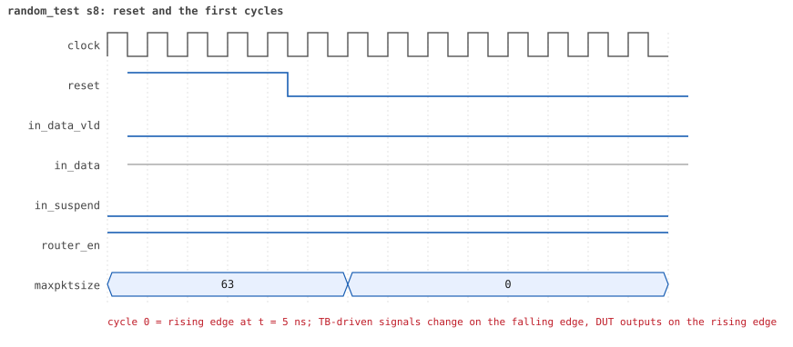
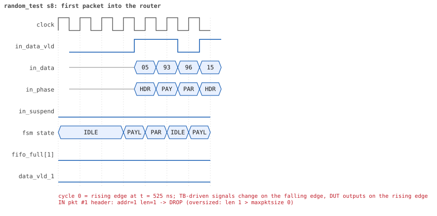
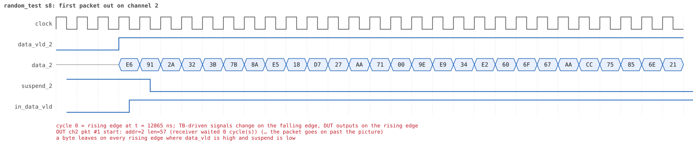
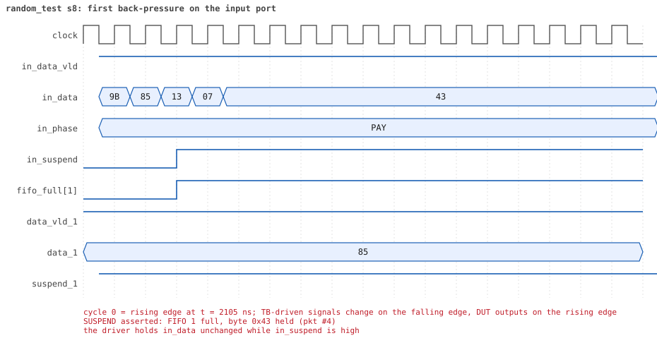
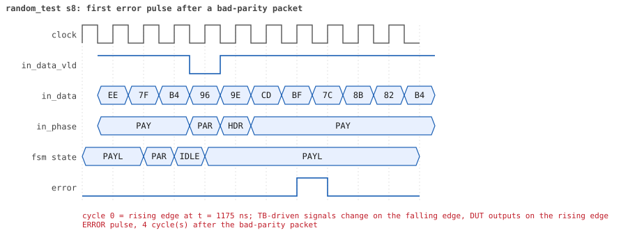
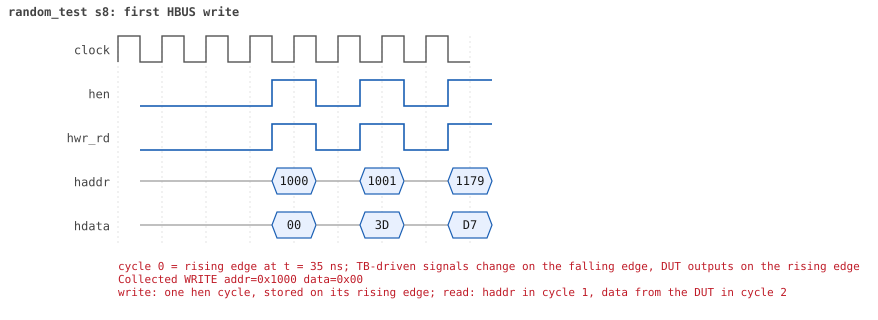
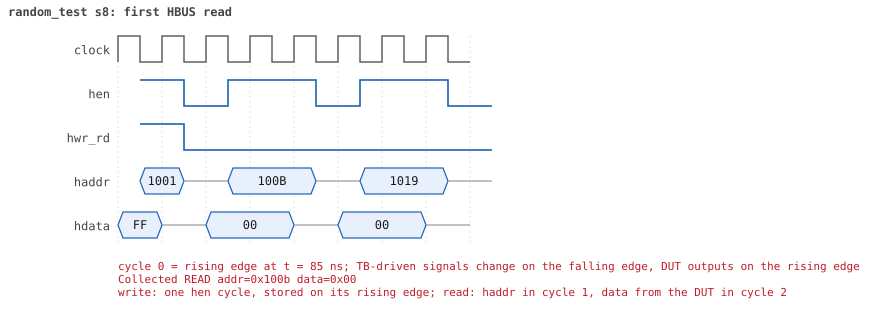

# random_test  seed 8

**Result:** PASSED (0 UVM_ERROR, 0 UVM_WARNING, 0 UVM_FATAL) · bench `yapp_project_tb` · sim time 46us · log `random_test_s8.log`

Waves: `random_test_s8.fst` (GTKWave, Surfer or the VS Code wave viewer); signal trace: `signals.csv`.
[Open the waves in Surfer](https://app.surfer-project.org/?load_url=https%3A%2F%2Fraw.githubusercontent.com%2Ftamirgabgab%2FQcom-Mentoring%2Fmain%2Fyapp_project%2Fregression%2Fyapp_project_tb%2Frandom_test_s8%2Frandom_test_s8.fst&startup_commands=run_command_file_from_url%20https%3A%2F%2Fraw.githubusercontent.com%2Ftamirgabgab%2FQcom-Mentoring%2Fmain%2Fyapp_project%2Ftb%2Fyapp_router.sucl) (web app, the signals already in groups: `yapp_project/tb/yapp_router.sucl`).

## Summary

- YAPP driver sent **95** packet(s) (8 with bad parity); the input monitor saw 95.
- Router: **55** forwarded, **40** dropped (24 oversized, 16 router disabled).
- Packets out: ch0 **12**, ch1 **16**, ch2 **27**.
- Scoreboard: 55 matched, 0 mismatched, 0 unexpected.
- Back-pressure: in_suspend asserted **16** time(s), longest hold 33 cycle(s).
- Error pulses: 7.
- HBUS: 31 write(s), 74 read(s).

## Stages

| time (ns) | stage |
|---|---|
| 0 | receivers: ch0 RX_FAST, ch1 RX_SLOW, ch2 RX_NORMAL |
| 0 | random scenario: 95 packets in 6 bursts |
| 350 | burst 1/6: ctrl=0xed (maxpktsize 45) en=0xff (router on, counter enables 1111111), 16 packet(s) |
| 8440 | burst 1/6 sent: addr0..3 3/4/9/0, bad parity 2, gap 0 6, length 4..63 |
| 8740 | burst 2/6: ctrl=0x57 (maxpktsize 23) en=0xfe (router OFF, counter enables 1111111), 16 packet(s) |
| 14850 | burst 2/6 sent: addr0..3 2/4/6/4, bad parity 1, gap 0 3, length 1..63 |
| 15040 | burst 3/6: ctrl=0x3d (maxpktsize 61) en=0xaf (router on, counter enables 1010111), 15 packet(s) |
| 21680 | burst 3/6 sent: addr0..3 0/4/11/0, bad parity 1, gap 0 3, length 1..63 |
| 21850 | burst 4/6: ctrl=0xbe (maxpktsize 62) en=0x11 (router on, counter enables 0001000), 17 packet(s) |
| 29890 | burst 4/6 sent: addr0..3 6/4/7/0, bad parity 0, gap 0 6, length 3..63 |
| 30250 | burst 5/6: ctrl=0x82 (maxpktsize 2) en=0xff (router on, counter enables 1111111), 16 packet(s) |
| 36180 | burst 5/6 sent: addr0..3 4/5/7/0, bad parity 0, gap 0 0, length 1..63 |
| 36530 | burst 6/6: ctrl=0x3f (maxpktsize 63) en=0x61 (router on, counter enables 0110000), 15 packet(s) |
| 44200 | burst 6/6 sent: addr0..3 6/2/7/0, bad parity 4, gap 0 5, length 1..63 |
| 44200 | final reads: every register and the stored packet, checked against the reference model |
| 45485 | done: 95 packets (55 forwarded, 40 dropped), 0 storm burst(s), 55 scoreboard matches, 71 HBUS reads checked, 7 error pulses for 7 bad packets |

## Pictures

**reset and the first cycles**

**first packet into the router**

**first packet out on channel 2**

**first back-pressure on the input port**

**first error pulse after a bad-parity packet**

**first HBUS write**

**first HBUS read**

## Timeline

1229 events (the same list is in `timeline.csv`).

| time (ns) | who | event |
|---|---|---|
| 0 | yapp monitor | YAPP monitor running |
| 0 | **test** | STAGE: receivers: ch0 RX_FAST, ch1 RX_SLOW, ch2 RX_NORMAL |
| 0 | **test** | STAGE: random scenario: 95 packets in 6 bursts |
| 0 | clk/rst driver | Starting clock (period 10) and holding reset for 5 cycles |
| 0 | **DUT** | RESET asserted |
| 50 | **DUT** | RESET released: router_en=1 maxpktsize=63 |
| 70 | hbus driver | Executed WRITE addr=0x1000 data=0xed |
| 75 | **DUT** | CONFIG router_en=1 maxpktsize=45 |
| 75 | hbus monitor | Collected WRITE addr=0x1000 data=0xed |
| 75 | reference | maxpktsize is now 45 |
| 90 | hbus driver | Executed WRITE addr=0x1001 data=0xff |
| 95 | hbus monitor | Collected WRITE addr=0x1001 data=0xff |
| 95 | reference | router_en is now 1 (en_reg 0xff) |
| 120 | hbus driver | Executed READ  addr=0x100b data=0x00 |
| 125 | hbus monitor | Collected READ  addr=0x100b data=0x00 |
| 150 | hbus driver | Executed READ  addr=0x1019 data=0x00 |
| 155 | hbus monitor | Collected READ  addr=0x1019 data=0x00 |
| 180 | hbus driver | Executed READ  addr=0x101a data=0x00 |
| 185 | hbus monitor | Collected READ  addr=0x101a data=0x00 |
| 200 | hbus driver | Executed WRITE addr=0x111a data=0x86 |
| 205 | hbus monitor | Collected WRITE addr=0x111a data=0x86 |
| 230 | hbus driver | Executed READ  addr=0x111a data=0x86 |
| 235 | hbus monitor | Collected READ  addr=0x111a data=0x86 |
| 260 | hbus driver | Executed READ  addr=0x1000 data=0xed |
| 265 | hbus monitor | Collected READ  addr=0x1000 data=0xed |
| 290 | hbus driver | Executed READ  addr=0x10ea data=0x00 |
| 295 | hbus monitor | Collected READ  addr=0x10ea data=0x00 |
| 320 | hbus driver | Executed READ  addr=0x1001 data=0xff |
| 325 | hbus monitor | Collected READ  addr=0x1001 data=0xff |
| 350 | hbus driver | Executed READ  addr=0x1033 data=0x00 |
| 350 | **test** | STAGE: burst 1/6: ctrl=0xed (maxpktsize 45) en=0xff (router on, counter enables 1111111), 16 packet(s) |
| 350 | yapp driver | TX pkt #1: addr=2 len=63 parity=bad delay=20 |
| 355 | hbus monitor | Collected READ  addr=0x1033 data=0x00 |
| 565 | **DUT** | IN  pkt #1 header: addr=2 len=63 -> DROP (oversized: len 63 > maxpktsize 45) |
| 1205 | **DUT** | IN  pkt #1 complete: addr=2 len=63 parity=BAD dropped, 65 bytes in 65 cycles (held 0) |
| 1205 | yapp monitor | RX pkt #1 on the input: addr=2 len=63 parity=bad gap=51 |
| 1205 | reference | Packet dropped: length 63 > maxpktsize 45 (addr=2) |
| 1205 | **DUT** | ROUTER DROPS PACKET addr=2 length=63 (length > maxpktsize) |
| 1210 | yapp driver | TX pkt #1 accepted by the DUT |
| 1210 | yapp driver | TX pkt #2: addr=2 len=39 parity=good delay=0 |
| 1215 | **DUT** | IN  pkt #2 header: addr=2 len=39 -> channel 2 |
| 1225 | **DUT** | OUT ch2 pkt #1 start: addr=2 len=39 (receiver waited 0 cycle(s)) |
| 1250 | **DUT** | ERROR pulse, 4 cycle(s) after the bad-parity packet |
| 1250 | error checker | error pulse 4 cycles after the bad packet (0 still owed) |
| 1615 | **DUT** | IN  pkt #2 complete: addr=2 len=39 parity=ok forwarded, 41 bytes in 41 cycles (held 0) |
| 1615 | yapp monitor | RX pkt #2 on the input: addr=2 len=39 parity=good gap=0 |
| 1615 | reference | Packet forwarded: addr=2 len=39 -> channel 2 |
| 1620 | ch2 driver | ch2: packet consumed (response delay 0) |
| 1620 | yapp driver | TX pkt #2 accepted by the DUT |
| 1620 | yapp driver | TX pkt #3: addr=0 len=31 parity=bad delay=1 |
| 1635 | **DUT** | IN  pkt #3 header: addr=0 len=31 -> channel 0 |
| 1645 | **DUT** | OUT ch0 pkt #1 start: addr=0 len=31 (receiver waited 0 cycle(s)) |
| 1735 | **DUT** | OUT ch2 pkt #1 done: 41 bytes in 52 cycles |
| 1735 | ch2 monitor | ch2 RX pkt #1: addr=2 len=39 parity=good |
| 1735 | scoreboard | ch2 pkt matched: addr=2 len=39 (1 matched so far) |
| 1955 | **DUT** | IN  pkt #3 complete: addr=0 len=31 parity=BAD forwarded, 33 bytes in 33 cycles (held 0) |
| 1955 | yapp monitor | RX pkt #3 on the input: addr=0 len=31 parity=bad gap=1 |
| 1955 | reference | Packet forwarded: addr=0 len=31 -> channel 0 |
| 1960 | ch0 driver | ch0: packet consumed (response delay 0) |
| 1960 | yapp driver | TX pkt #3 accepted by the DUT |
| 1960 | yapp driver | TX pkt #4: addr=1 len=33 parity=good delay=2 |
| 1975 | **DUT** | OUT ch0 pkt #1 done: 33 bytes in 34 cycles |
| 1975 | ch0 monitor | ch0 RX pkt #1: addr=0 len=31 parity=bad |
| 1975 | scoreboard | ch0 pkt matched: addr=0 len=31 (2 matched so far) |
| 1985 | **DUT** | IN  pkt #4 header: addr=1 len=33 -> channel 1 |
| 2010 | **DUT** | ERROR pulse, 5 cycle(s) after the bad-parity packet |
| 2010 | error checker | error pulse 5 cycles after the bad packet (0 still owed) |
| 2145 | **DUT** | SUSPEND asserted: FIFO 1 full, byte 0x43 held (pkt #4) |
| 2250 | ch2 driver | ch2: packet consumed (response delay 10) |
| 2285 | **DUT** | OUT ch1 pkt #1 start: addr=1 len=33 (receiver waited 29 cycle(s)) |
| 2295 | **DUT** | SUSPEND released after 15 cycle(s) |
| 2410 | ch0 driver | ch0: packet consumed (response delay 0) |
| 2475 | **DUT** | IN  pkt #4 complete: addr=1 len=33 parity=ok forwarded, 35 bytes in 50 cycles (held 15) |
| 2475 | yapp monitor | RX pkt #4 on the input: addr=1 len=33 parity=good gap=2 |
| 2475 | reference | Packet forwarded: addr=1 len=33 -> channel 1 |
| 2480 | yapp driver | TX pkt #4 accepted by the DUT |
| 2480 | yapp driver | TX pkt #5: addr=1 len=38 parity=good delay=1 |
| 2495 | **DUT** | IN  pkt #5 header: addr=1 len=38 -> channel 1 |
| 2620 | ch1 driver | ch1: packet consumed (response delay 29) |
| 2645 | **DUT** | SUSPEND asserted: FIFO 1 full, byte 0xbf held (pkt #5) |
| 2965 | **DUT** | OUT ch1 pkt #1 done: 35 bytes in 69 cycles |
| 2965 | ch1 monitor | ch1 RX pkt #1: addr=1 len=33 parity=good |
| 2965 | scoreboard | ch1 pkt matched: addr=1 len=33 (3 matched so far) |
| 2975 | **DUT** | SUSPEND released after 33 cycle(s) |
| 2975 | **DUT** | OUT ch1 pkt #2 start: addr=1 len=38 (receiver waited 0 cycle(s)) |
| 3215 | **DUT** | IN  pkt #5 complete: addr=1 len=38 parity=ok forwarded, 40 bytes in 73 cycles (held 33) |
| 3215 | yapp monitor | RX pkt #5 on the input: addr=1 len=38 parity=good gap=1 |
| 3215 | reference | Packet forwarded: addr=1 len=38 -> channel 1 |
| 3220 | yapp driver | TX pkt #5 accepted by the DUT |
| 3220 | yapp driver | TX pkt #6: addr=1 len=15 parity=good delay=3 |
| 3255 | **DUT** | IN  pkt #6 header: addr=1 len=15 -> channel 1 |
| 3365 | **DUT** | OUT ch1 pkt #2 done: 40 bytes in 40 cycles |
| 3365 | ch1 monitor | ch1 RX pkt #2: addr=1 len=38 parity=good |
| 3365 | scoreboard | ch1 pkt matched: addr=1 len=38 (4 matched so far) |
| 3375 | **DUT** | OUT ch1 pkt #3 start: addr=1 len=15 (receiver waited 0 cycle(s)) |
| 3415 | **DUT** | IN  pkt #6 complete: addr=1 len=15 parity=ok forwarded, 17 bytes in 17 cycles (held 0) |
| 3415 | yapp monitor | RX pkt #6 on the input: addr=1 len=15 parity=good gap=3 |
| 3415 | reference | Packet forwarded: addr=1 len=15 -> channel 1 |
| 3420 | ch1 driver | ch1: packet consumed (response delay 33) |
| 3420 | yapp driver | TX pkt #6 accepted by the DUT |
| 3420 | yapp driver | TX pkt #7: addr=1 len=11 parity=good delay=0 |
| 3425 | **DUT** | IN  pkt #7 header: addr=1 len=11 -> channel 1 |
| 3465 | **DUT** | SUSPEND asserted: FIFO 1 full, byte 0x52 held (pkt #7) |
| 3715 | **DUT** | SUSPEND released after 25 cycle(s) |
| 3795 | **DUT** | IN  pkt #7 complete: addr=1 len=11 parity=ok forwarded, 13 bytes in 38 cycles (held 25) |
| 3795 | yapp monitor | RX pkt #7 on the input: addr=1 len=11 parity=good gap=0 |
| 3795 | reference | Packet forwarded: addr=1 len=11 -> channel 1 |
| 3800 | yapp driver | TX pkt #7 accepted by the DUT |
| 3800 | yapp driver | TX pkt #8: addr=0 len=44 parity=good delay=0 |
| 3805 | **DUT** | IN  pkt #8 header: addr=0 len=44 -> channel 0 |
| 3815 | **DUT** | OUT ch0 pkt #2 start: addr=0 len=44 (receiver waited 0 cycle(s)) |
| 3815 | **DUT** | OUT ch1 pkt #3 done: 17 bytes in 45 cycles |
| 3815 | ch1 monitor | ch1 RX pkt #3: addr=1 len=15 parity=good |
| 3815 | scoreboard | ch1 pkt matched: addr=1 len=15 (5 matched so far) |
| 3825 | **DUT** | OUT ch1 pkt #4 start: addr=1 len=11 (receiver waited 0 cycle(s)) |
| 3945 | **DUT** | OUT ch1 pkt #4 done: 13 bytes in 13 cycles |
| 3945 | ch1 monitor | ch1 RX pkt #4: addr=1 len=11 parity=good |
| 3945 | scoreboard | ch1 pkt matched: addr=1 len=11 (6 matched so far) |
| 4060 | ch1 driver | ch1: packet consumed (response delay 27) |
| 4255 | **DUT** | IN  pkt #8 complete: addr=0 len=44 parity=ok forwarded, 46 bytes in 46 cycles (held 0) |
| 4255 | yapp monitor | RX pkt #8 on the input: addr=0 len=44 parity=good gap=0 |
| 4255 | reference | Packet forwarded: addr=0 len=44 -> channel 0 |
| 4260 | ch0 driver | ch0: packet consumed (response delay 0) |
| 4260 | yapp driver | TX pkt #8 accepted by the DUT |
| 4260 | yapp driver | TX pkt #9: addr=2 len=63 parity=good delay=1 |
| 4275 | **DUT** | IN  pkt #9 header: addr=2 len=63 -> DROP (oversized: len 63 > maxpktsize 45) |
| 4275 | **DUT** | OUT ch0 pkt #2 done: 46 bytes in 47 cycles |
| 4275 | ch0 monitor | ch0 RX pkt #2: addr=0 len=44 parity=good |
| 4275 | scoreboard | ch0 pkt matched: addr=0 len=44 (7 matched so far) |
| 4710 | ch0 driver | ch0: packet consumed (response delay 0) |
| 4915 | **DUT** | IN  pkt #9 complete: addr=2 len=63 parity=ok dropped, 65 bytes in 65 cycles (held 0) |
| 4915 | yapp monitor | RX pkt #9 on the input: addr=2 len=63 parity=good gap=1 |
| 4915 | reference | Packet dropped: length 63 > maxpktsize 45 (addr=2) |
| 4915 | **DUT** | ROUTER DROPS PACKET addr=2 length=63 (length > maxpktsize) |
| 4920 | yapp driver | TX pkt #9 accepted by the DUT |
| 4920 | yapp driver | TX pkt #10: addr=2 len=4 parity=good delay=0 |
| 4925 | **DUT** | IN  pkt #10 header: addr=2 len=4 -> channel 2 |
| 4935 | **DUT** | OUT ch2 pkt #2 start: addr=2 len=4 (receiver waited 0 cycle(s)) |
| 4975 | **DUT** | IN  pkt #10 complete: addr=2 len=4 parity=ok forwarded, 6 bytes in 6 cycles (held 0) |
| 4975 | yapp monitor | RX pkt #10 on the input: addr=2 len=4 parity=good gap=0 |
| 4975 | reference | Packet forwarded: addr=2 len=4 -> channel 2 |
| 4980 | ch2 driver | ch2: packet consumed (response delay 0) |
| 4980 | yapp driver | TX pkt #10 accepted by the DUT |
| 4980 | yapp driver | TX pkt #11: addr=2 len=63 parity=good delay=17 |
| 5085 | **DUT** | OUT ch2 pkt #2 done: 6 bytes in 16 cycles |
| 5085 | ch2 monitor | ch2 RX pkt #2: addr=2 len=4 parity=good |
| 5085 | scoreboard | ch2 pkt matched: addr=2 len=4 (8 matched so far) |
| 5155 | **DUT** | IN  pkt #11 header: addr=2 len=63 -> DROP (oversized: len 63 > maxpktsize 45) |
| 5680 | ch2 driver | ch2: packet consumed (response delay 9) |
| 5795 | **DUT** | IN  pkt #11 complete: addr=2 len=63 parity=ok dropped, 65 bytes in 65 cycles (held 0) |
| 5795 | yapp monitor | RX pkt #11 on the input: addr=2 len=63 parity=good gap=17 |
| 5795 | reference | Packet dropped: length 63 > maxpktsize 45 (addr=2) |
| 5795 | **DUT** | ROUTER DROPS PACKET addr=2 length=63 (length > maxpktsize) |
| 5800 | yapp driver | TX pkt #11 accepted by the DUT |
| 5800 | yapp driver | TX pkt #12: addr=2 len=59 parity=good delay=0 |
| 5805 | **DUT** | IN  pkt #12 header: addr=2 len=59 -> DROP (oversized: len 59 > maxpktsize 45) |
| 6405 | **DUT** | IN  pkt #12 complete: addr=2 len=59 parity=ok dropped, 61 bytes in 61 cycles (held 0) |
| 6405 | yapp monitor | RX pkt #12 on the input: addr=2 len=59 parity=good gap=0 |
| 6405 | reference | Packet dropped: length 59 > maxpktsize 45 (addr=2) |
| 6405 | **DUT** | ROUTER DROPS PACKET addr=2 length=59 (length > maxpktsize) |
| 6410 | yapp driver | TX pkt #12 accepted by the DUT |
| 6410 | yapp driver | TX pkt #13: addr=0 len=47 parity=good delay=6 |
| 6475 | **DUT** | IN  pkt #13 header: addr=0 len=47 -> DROP (oversized: len 47 > maxpktsize 45) |
| 6955 | **DUT** | IN  pkt #13 complete: addr=0 len=47 parity=ok dropped, 49 bytes in 49 cycles (held 0) |
| 6955 | yapp monitor | RX pkt #13 on the input: addr=0 len=47 parity=good gap=6 |
| 6955 | reference | Packet dropped: length 47 > maxpktsize 45 (addr=0) |
| 6955 | **DUT** | ROUTER DROPS PACKET addr=0 length=47 (length > maxpktsize) |
| 6960 | yapp driver | TX pkt #13 accepted by the DUT |
| 6960 | yapp driver | TX pkt #14: addr=2 len=42 parity=good delay=0 |
| 6965 | **DUT** | IN  pkt #14 header: addr=2 len=42 -> channel 2 |
| 7075 | **DUT** | OUT ch2 pkt #3 start: addr=2 len=42 (receiver waited 10 cycle(s)) |
| 7395 | **DUT** | IN  pkt #14 complete: addr=2 len=42 parity=ok forwarded, 44 bytes in 44 cycles (held 0) |
| 7395 | yapp monitor | RX pkt #14 on the input: addr=2 len=42 parity=good gap=0 |
| 7395 | reference | Packet forwarded: addr=2 len=42 -> channel 2 |
| 7400 | yapp driver | TX pkt #14 accepted by the DUT |
| 7400 | yapp driver | TX pkt #15: addr=2 len=46 parity=good delay=4 |
| 7445 | **DUT** | IN  pkt #15 header: addr=2 len=46 -> DROP (oversized: len 46 > maxpktsize 45) |
| 7500 | ch2 driver | ch2: packet consumed (response delay 10) |
| 7565 | **DUT** | OUT ch2 pkt #3 done: 44 bytes in 50 cycles |
| 7565 | ch2 monitor | ch2 RX pkt #3: addr=2 len=42 parity=good |
| 7565 | scoreboard | ch2 pkt matched: addr=2 len=42 (9 matched so far) |
| 7690 | ch2 driver | ch2: packet consumed (response delay 5) |
| 7915 | **DUT** | IN  pkt #15 complete: addr=2 len=46 parity=ok dropped, 48 bytes in 48 cycles (held 0) |
| 7915 | yapp monitor | RX pkt #15 on the input: addr=2 len=46 parity=good gap=4 |
| 7915 | reference | Packet dropped: length 46 > maxpktsize 45 (addr=2) |
| 7915 | **DUT** | ROUTER DROPS PACKET addr=2 length=46 (length > maxpktsize) |
| 7920 | yapp driver | TX pkt #15 accepted by the DUT |
| 7920 | yapp driver | TX pkt #16: addr=2 len=44 parity=good delay=6 |
| 7985 | **DUT** | IN  pkt #16 header: addr=2 len=44 -> channel 2 |
| 8005 | **DUT** | OUT ch2 pkt #4 start: addr=2 len=44 (receiver waited 1 cycle(s)) |
| 8435 | **DUT** | IN  pkt #16 complete: addr=2 len=44 parity=ok forwarded, 46 bytes in 46 cycles (held 0) |
| 8435 | yapp monitor | RX pkt #16 on the input: addr=2 len=44 parity=good gap=6 |
| 8435 | reference | Packet forwarded: addr=2 len=44 -> channel 2 |
| 8440 | yapp driver | TX pkt #16 accepted by the DUT |
| 8440 | **test** | STAGE: burst 1/6 sent: addr0..3 3/4/9/0, bad parity 2, gap 0 6, length 4..63 |
| 8450 | ch2 driver | ch2: packet consumed (response delay 1) |
| 8460 | hbus driver | Executed WRITE addr=0x1000 data=0x57 |
| 8465 | **DUT** | CONFIG router_en=1 maxpktsize=23 |
| 8465 | hbus monitor | Collected WRITE addr=0x1000 data=0x57 |
| 8465 | reference | maxpktsize is now 23 |
| 8480 | hbus driver | Executed WRITE addr=0x1001 data=0xfe |
| 8485 | **DUT** | CONFIG router_en=0 maxpktsize=23 |
| 8485 | hbus monitor | Collected WRITE addr=0x1001 data=0xfe |
| 8485 | reference | router_en is now 0 (en_reg 0xfe) |
| 8500 | hbus driver | Executed WRITE addr=0x1123 data=0x67 |
| 8505 | hbus monitor | Collected WRITE addr=0x1123 data=0x67 |
| 8530 | hbus driver | Executed READ  addr=0x1123 data=0x67 |
| 8535 | hbus monitor | Collected READ  addr=0x1123 data=0x67 |
| 8550 | hbus driver | Executed WRITE addr=0x11d8 data=0x31 |
| 8555 | hbus monitor | Collected WRITE addr=0x11d8 data=0x31 |
| 8565 | **DUT** | OUT ch2 pkt #4 done: 46 bytes in 57 cycles |
| 8565 | ch2 monitor | ch2 RX pkt #4: addr=2 len=44 parity=good |
| 8565 | scoreboard | ch2 pkt matched: addr=2 len=44 (10 matched so far) |
| 8580 | hbus driver | Executed READ  addr=0x11d8 data=0x31 |
| 8585 | hbus monitor | Collected READ  addr=0x11d8 data=0x31 |
| 8600 | hbus driver | Executed WRITE addr=0x1144 data=0x22 |
| 8605 | hbus monitor | Collected WRITE addr=0x1144 data=0x22 |
| 8630 | hbus driver | Executed READ  addr=0x1144 data=0x22 |
| 8635 | hbus monitor | Collected READ  addr=0x1144 data=0x22 |
| 8660 | hbus driver | Executed READ  addr=0x1004 data=0x02 |
| 8665 | hbus monitor | Collected READ  addr=0x1004 data=0x02 |
| 8680 | hbus driver | Executed WRITE addr=0x1171 data=0xd7 |
| 8685 | hbus monitor | Collected WRITE addr=0x1171 data=0xd7 |
| 8710 | ch2 driver | ch2: packet consumed (response delay 10) |
| 8710 | hbus driver | Executed READ  addr=0x1171 data=0xd7 |
| 8715 | hbus monitor | Collected READ  addr=0x1171 data=0xd7 |
| 8740 | hbus driver | Executed READ  addr=0x100d data=0x2c |
| 8740 | **test** | STAGE: burst 2/6: ctrl=0x57 (maxpktsize 23) en=0xfe (router OFF, counter enables 1111111), 16 packet(s) |
| 8740 | yapp driver | TX pkt #17: addr=2 len=22 parity=good delay=6 |
| 8745 | hbus monitor | Collected READ  addr=0x100d data=0x2c |
| 8815 | **DUT** | IN  pkt #17 header: addr=2 len=22 -> DROP (router disabled) |
| 9045 | **DUT** | IN  pkt #17 complete: addr=2 len=22 parity=ok dropped, 24 bytes in 24 cycles (held 0) |
| 9045 | yapp monitor | RX pkt #17 on the input: addr=2 len=22 parity=good gap=37 |
| 9045 | reference | Packet dropped: router disabled (addr=2 len=22) |
| 9045 | **DUT** | ROUTER DROPS PACKET addr=2 length=22 (router disabled) |
| 9050 | yapp driver | TX pkt #17 accepted by the DUT |
| 9050 | yapp driver | TX pkt #18: addr=1 len=34 parity=good delay=20 |
| 9255 | **DUT** | IN  pkt #18 header: addr=1 len=34 -> DROP (router disabled) |
| 9605 | **DUT** | IN  pkt #18 complete: addr=1 len=34 parity=ok dropped, 36 bytes in 36 cycles (held 0) |
| 9605 | yapp monitor | RX pkt #18 on the input: addr=1 len=34 parity=good gap=20 |
| 9605 | reference | Packet dropped: router disabled (addr=1 len=34) |
| 9605 | **DUT** | ROUTER DROPS PACKET addr=1 length=34 (router disabled) |
| 9610 | yapp driver | TX pkt #18 accepted by the DUT |
| 9610 | yapp driver | TX pkt #19: addr=3 len=4 parity=good delay=1 |
| 9625 | **DUT** | IN  pkt #19 header: addr=3 len=4 -> DROP (router disabled) |
| 9675 | **DUT** | IN  pkt #19 complete: addr=3 len=4 parity=ok dropped, 6 bytes in 6 cycles (held 0) |
| 9675 | yapp monitor | RX pkt #19 on the input: addr=3 len=4 parity=good gap=1 |
| 9675 | reference | Packet dropped: router disabled (addr=3 len=4) |
| 9675 | **DUT** | ROUTER DROPS PACKET addr=3 length=4 (router disabled) |
| 9680 | yapp driver | TX pkt #19 accepted by the DUT |
| 9680 | yapp driver | TX pkt #20: addr=0 len=1 parity=good delay=1 |
| 9695 | **DUT** | IN  pkt #20 header: addr=0 len=1 -> DROP (router disabled) |
| 9715 | **DUT** | IN  pkt #20 complete: addr=0 len=1 parity=ok dropped, 3 bytes in 3 cycles (held 0) |
| 9715 | yapp monitor | RX pkt #20 on the input: addr=0 len=1 parity=good gap=1 |
| 9715 | reference | Packet dropped: router disabled (addr=0 len=1) |
| 9715 | **DUT** | ROUTER DROPS PACKET addr=0 length=1 (router disabled) |
| 9720 | yapp driver | TX pkt #20 accepted by the DUT |
| 9720 | yapp driver | TX pkt #21: addr=3 len=22 parity=good delay=1 |
| 9735 | **DUT** | IN  pkt #21 header: addr=3 len=22 -> DROP (router disabled) |
| 9965 | **DUT** | IN  pkt #21 complete: addr=3 len=22 parity=ok dropped, 24 bytes in 24 cycles (held 0) |
| 9965 | yapp monitor | RX pkt #21 on the input: addr=3 len=22 parity=good gap=1 |
| 9965 | reference | Packet dropped: router disabled (addr=3 len=22) |
| 9965 | **DUT** | ROUTER DROPS PACKET addr=3 length=22 (router disabled) |
| 9970 | yapp driver | TX pkt #21 accepted by the DUT |
| 9970 | yapp driver | TX pkt #22: addr=3 len=13 parity=good delay=1 |
| 9985 | **DUT** | IN  pkt #22 header: addr=3 len=13 -> DROP (router disabled) |
| 10125 | **DUT** | IN  pkt #22 complete: addr=3 len=13 parity=ok dropped, 15 bytes in 15 cycles (held 0) |
| 10125 | yapp monitor | RX pkt #22 on the input: addr=3 len=13 parity=good gap=1 |
| 10125 | reference | Packet dropped: router disabled (addr=3 len=13) |
| 10125 | **DUT** | ROUTER DROPS PACKET addr=3 length=13 (router disabled) |
| 10130 | yapp driver | TX pkt #22 accepted by the DUT |
| 10130 | yapp driver | TX pkt #23: addr=0 len=27 parity=good delay=16 |
| 10295 | **DUT** | IN  pkt #23 header: addr=0 len=27 -> DROP (router disabled) |
| 10575 | **DUT** | IN  pkt #23 complete: addr=0 len=27 parity=ok dropped, 29 bytes in 29 cycles (held 0) |
| 10575 | yapp monitor | RX pkt #23 on the input: addr=0 len=27 parity=good gap=16 |
| 10575 | reference | Packet dropped: router disabled (addr=0 len=27) |
| 10575 | **DUT** | ROUTER DROPS PACKET addr=0 length=27 (router disabled) |
| 10580 | yapp driver | TX pkt #23 accepted by the DUT |
| 10580 | yapp driver | TX pkt #24: addr=2 len=15 parity=good delay=0 |
| 10585 | **DUT** | IN  pkt #24 header: addr=2 len=15 -> DROP (router disabled) |
| 10745 | **DUT** | IN  pkt #24 complete: addr=2 len=15 parity=ok dropped, 17 bytes in 17 cycles (held 0) |
| 10745 | yapp monitor | RX pkt #24 on the input: addr=2 len=15 parity=good gap=0 |
| 10745 | reference | Packet dropped: router disabled (addr=2 len=15) |
| 10745 | **DUT** | ROUTER DROPS PACKET addr=2 length=15 (router disabled) |
| 10750 | yapp driver | TX pkt #24 accepted by the DUT |
| 10750 | yapp driver | TX pkt #25: addr=3 len=50 parity=good delay=3 |
| 10785 | **DUT** | IN  pkt #25 header: addr=3 len=50 -> DROP (router disabled) |
| 11295 | **DUT** | IN  pkt #25 complete: addr=3 len=50 parity=ok dropped, 52 bytes in 52 cycles (held 0) |
| 11295 | yapp monitor | RX pkt #25 on the input: addr=3 len=50 parity=good gap=3 |
| 11295 | reference | Packet dropped: router disabled (addr=3 len=50) |
| 11295 | **DUT** | ROUTER DROPS PACKET addr=3 length=50 (router disabled) |
| 11300 | yapp driver | TX pkt #25 accepted by the DUT |
| 11300 | yapp driver | TX pkt #26: addr=1 len=34 parity=good delay=10 |
| 11405 | **DUT** | IN  pkt #26 header: addr=1 len=34 -> DROP (router disabled) |
| 11755 | **DUT** | IN  pkt #26 complete: addr=1 len=34 parity=ok dropped, 36 bytes in 36 cycles (held 0) |
| 11755 | yapp monitor | RX pkt #26 on the input: addr=1 len=34 parity=good gap=10 |
| 11755 | reference | Packet dropped: router disabled (addr=1 len=34) |
| 11755 | **DUT** | ROUTER DROPS PACKET addr=1 length=34 (router disabled) |
| 11760 | yapp driver | TX pkt #26 accepted by the DUT |
| 11760 | yapp driver | TX pkt #27: addr=1 len=63 parity=good delay=0 |
| 11765 | **DUT** | IN  pkt #27 header: addr=1 len=63 -> DROP (router disabled) |
| 12405 | **DUT** | IN  pkt #27 complete: addr=1 len=63 parity=ok dropped, 65 bytes in 65 cycles (held 0) |
| 12405 | yapp monitor | RX pkt #27 on the input: addr=1 len=63 parity=good gap=0 |
| 12405 | reference | Packet dropped: router disabled (addr=1 len=63) |
| 12405 | **DUT** | ROUTER DROPS PACKET addr=1 length=63 (router disabled) |
| 12410 | yapp driver | TX pkt #27 accepted by the DUT |
| 12410 | yapp driver | TX pkt #28: addr=1 len=54 parity=good delay=17 |
| 12585 | **DUT** | IN  pkt #28 header: addr=1 len=54 -> DROP (router disabled) |
| 13135 | **DUT** | IN  pkt #28 complete: addr=1 len=54 parity=ok dropped, 56 bytes in 56 cycles (held 0) |
| 13135 | yapp monitor | RX pkt #28 on the input: addr=1 len=54 parity=good gap=17 |
| 13135 | reference | Packet dropped: router disabled (addr=1 len=54) |
| 13135 | **DUT** | ROUTER DROPS PACKET addr=1 length=54 (router disabled) |
| 13140 | yapp driver | TX pkt #28 accepted by the DUT |
| 13140 | yapp driver | TX pkt #29: addr=2 len=63 parity=good delay=20 |
| 13345 | **DUT** | IN  pkt #29 header: addr=2 len=63 -> DROP (router disabled) |
| 13985 | **DUT** | IN  pkt #29 complete: addr=2 len=63 parity=ok dropped, 65 bytes in 65 cycles (held 0) |
| 13985 | yapp monitor | RX pkt #29 on the input: addr=2 len=63 parity=good gap=20 |
| 13985 | reference | Packet dropped: router disabled (addr=2 len=63) |
| 13985 | **DUT** | ROUTER DROPS PACKET addr=2 length=63 (router disabled) |
| 13990 | yapp driver | TX pkt #29 accepted by the DUT |
| 13990 | yapp driver | TX pkt #30: addr=2 len=57 parity=good delay=1 |
| 14005 | **DUT** | IN  pkt #30 header: addr=2 len=57 -> DROP (router disabled) |
| 14585 | **DUT** | IN  pkt #30 complete: addr=2 len=57 parity=ok dropped, 59 bytes in 59 cycles (held 0) |
| 14585 | yapp monitor | RX pkt #30 on the input: addr=2 len=57 parity=good gap=1 |
| 14585 | reference | Packet dropped: router disabled (addr=2 len=57) |
| 14585 | **DUT** | ROUTER DROPS PACKET addr=2 length=57 (router disabled) |
| 14590 | yapp driver | TX pkt #30 accepted by the DUT |
| 14590 | yapp driver | TX pkt #31: addr=2 len=1 parity=good delay=20 |
| 14795 | **DUT** | IN  pkt #31 header: addr=2 len=1 -> DROP (router disabled) |
| 14815 | **DUT** | IN  pkt #31 complete: addr=2 len=1 parity=ok dropped, 3 bytes in 3 cycles (held 0) |
| 14815 | yapp monitor | RX pkt #31 on the input: addr=2 len=1 parity=good gap=20 |
| 14815 | reference | Packet dropped: router disabled (addr=2 len=1) |
| 14815 | **DUT** | ROUTER DROPS PACKET addr=2 length=1 (router disabled) |
| 14820 | yapp driver | TX pkt #31 accepted by the DUT |
| 14820 | yapp driver | TX pkt #32: addr=2 len=1 parity=bad delay=0 |
| 14825 | **DUT** | IN  pkt #32 header: addr=2 len=1 -> DROP (router disabled) |
| 14845 | **DUT** | IN  pkt #32 complete: addr=2 len=1 parity=BAD dropped, 3 bytes in 3 cycles (held 0) |
| 14845 | yapp monitor | RX pkt #32 on the input: addr=2 len=1 parity=bad gap=0 |
| 14845 | reference | Packet dropped: router disabled (addr=2 len=1) |
| 14845 | **DUT** | ROUTER DROPS PACKET addr=2 length=1 (router disabled) |
| 14850 | yapp driver | TX pkt #32 accepted by the DUT |
| 14850 | **test** | STAGE: burst 2/6 sent: addr0..3 2/4/6/4, bad parity 1, gap 0 3, length 1..63 |
| 14870 | hbus driver | Executed WRITE addr=0x1000 data=0x3d |
| 14875 | **DUT** | CONFIG router_en=0 maxpktsize=61 |
| 14875 | hbus monitor | Collected WRITE addr=0x1000 data=0x3d |
| 14875 | reference | maxpktsize is now 61 |
| 14890 | hbus driver | Executed WRITE addr=0x1001 data=0xaf |
| 14895 | **DUT** | CONFIG router_en=1 maxpktsize=61 |
| 14895 | hbus monitor | Collected WRITE addr=0x1001 data=0xaf |
| 14895 | reference | router_en is now 1 (en_reg 0xaf) |
| 14910 | hbus driver | Executed WRITE addr=0x115f data=0xda |
| 14915 | hbus monitor | Collected WRITE addr=0x115f data=0xda |
| 14940 | hbus driver | Executed READ  addr=0x115f data=0xda |
| 14945 | hbus monitor | Collected READ  addr=0x115f data=0xda |
| 14960 | hbus driver | Executed WRITE addr=0x111c data=0xea |
| 14965 | hbus monitor | Collected WRITE addr=0x111c data=0xea |
| 14990 | hbus driver | Executed READ  addr=0x111c data=0xea |
| 14995 | hbus monitor | Collected READ  addr=0x111c data=0xea |
| 15010 | hbus driver | Executed WRITE addr=0x11d5 data=0x90 |
| 15015 | hbus monitor | Collected WRITE addr=0x11d5 data=0x90 |
| 15040 | hbus driver | Executed READ  addr=0x11d5 data=0x90 |
| 15040 | **test** | STAGE: burst 3/6: ctrl=0x3d (maxpktsize 61) en=0xaf (router on, counter enables 1010111), 15 packet(s) |
| 15040 | yapp driver | TX pkt #33: addr=2 len=28 parity=good delay=0 |
| 15045 | hbus monitor | Collected READ  addr=0x11d5 data=0x90 |
| 15055 | **DUT** | IN  pkt #33 header: addr=2 len=28 -> channel 2 |
| 15165 | **DUT** | OUT ch2 pkt #5 start: addr=2 len=28 (receiver waited 10 cycle(s)) |
| 15345 | **DUT** | IN  pkt #33 complete: addr=2 len=28 parity=ok forwarded, 30 bytes in 30 cycles (held 0) |
| 15345 | yapp monitor | RX pkt #33 on the input: addr=2 len=28 parity=good gap=20 |
| 15345 | reference | Packet forwarded: addr=2 len=28 -> channel 2 |
| 15350 | yapp driver | TX pkt #33 accepted by the DUT |
| 15350 | yapp driver | TX pkt #34: addr=2 len=63 parity=good delay=12 |
| 15450 | ch2 driver | ch2: packet consumed (response delay 10) |
| 15475 | **DUT** | IN  pkt #34 header: addr=2 len=63 -> DROP (oversized: len 63 > maxpktsize 61) |
| 15505 | **DUT** | OUT ch2 pkt #5 done: 30 bytes in 35 cycles |
| 15505 | ch2 monitor | ch2 RX pkt #5: addr=2 len=28 parity=good |
| 15505 | scoreboard | ch2 pkt matched: addr=2 len=28 (11 matched so far) |
| 15610 | ch2 driver | ch2: packet consumed (response delay 4) |
| 16115 | **DUT** | IN  pkt #34 complete: addr=2 len=63 parity=ok dropped, 65 bytes in 65 cycles (held 0) |
| 16115 | yapp monitor | RX pkt #34 on the input: addr=2 len=63 parity=good gap=12 |
| 16115 | reference | Packet dropped: length 63 > maxpktsize 61 (addr=2) |
| 16115 | **DUT** | ROUTER DROPS PACKET addr=2 length=63 (length > maxpktsize) |
| 16120 | yapp driver | TX pkt #34 accepted by the DUT |
| 16120 | yapp driver | TX pkt #35: addr=2 len=2 parity=good delay=6 |
| 16185 | **DUT** | IN  pkt #35 header: addr=2 len=2 -> channel 2 |
| 16215 | **DUT** | IN  pkt #35 complete: addr=2 len=2 parity=ok forwarded, 4 bytes in 4 cycles (held 0) |
| 16215 | yapp monitor | RX pkt #35 on the input: addr=2 len=2 parity=good gap=6 |
| 16215 | reference | Packet forwarded: addr=2 len=2 -> channel 2 |
| 16220 | yapp driver | TX pkt #35 accepted by the DUT |
| 16220 | yapp driver | TX pkt #36: addr=1 len=1 parity=bad delay=3 |
| 16245 | **DUT** | OUT ch2 pkt #6 start: addr=2 len=2 (receiver waited 5 cycle(s)) |
| 16255 | **DUT** | IN  pkt #36 header: addr=1 len=1 -> channel 1 |
| 16270 | ch2 driver | ch2: packet consumed (response delay 5) |
| 16275 | **DUT** | IN  pkt #36 complete: addr=1 len=1 parity=BAD forwarded, 3 bytes in 3 cycles (held 0) |
| 16275 | yapp monitor | RX pkt #36 on the input: addr=1 len=1 parity=bad gap=3 |
| 16275 | reference | Packet forwarded: addr=1 len=1 -> channel 1 |
| 16280 | yapp driver | TX pkt #36 accepted by the DUT |
| 16280 | yapp driver | TX pkt #37: addr=2 len=24 parity=good delay=8 |
| 16325 | **DUT** | OUT ch2 pkt #6 done: 4 bytes in 9 cycles |
| 16325 | ch2 monitor | ch2 RX pkt #6: addr=2 len=2 parity=good |
| 16325 | scoreboard | ch2 pkt matched: addr=2 len=2 (12 matched so far) |
| 16340 | ch2 driver | ch2: packet consumed (response delay 4) |
| 16350 | **DUT** | ERROR pulse, 7 cycle(s) after the bad-parity packet |
| 16350 | error checker | error pulse 7 cycles after the bad packet (0 still owed) |
| 16365 | **DUT** | IN  pkt #37 header: addr=2 len=24 -> channel 2 |
| 16475 | **DUT** | OUT ch2 pkt #7 start: addr=2 len=24 (receiver waited 10 cycle(s)) |
| 16495 | **DUT** | OUT ch1 pkt #5 start: addr=1 len=1 (receiver waited 23 cycle(s)) |
| 16510 | ch1 driver | ch1: packet consumed (response delay 23) |
| 16615 | **DUT** | IN  pkt #37 complete: addr=2 len=24 parity=ok forwarded, 26 bytes in 26 cycles (held 0) |
| 16615 | yapp monitor | RX pkt #37 on the input: addr=2 len=24 parity=good gap=8 |
| 16615 | reference | Packet forwarded: addr=2 len=24 -> channel 2 |
| 16620 | yapp driver | TX pkt #37 accepted by the DUT |
| 16620 | yapp driver | TX pkt #38: addr=2 len=23 parity=good delay=1 |
| 16635 | **DUT** | IN  pkt #38 header: addr=2 len=23 -> channel 2 |
| 16720 | ch2 driver | ch2: packet consumed (response delay 10) |
| 16785 | **DUT** | SUSPEND asserted: FIFO 2 full, byte 0x7b held (pkt #38) |
| 16835 | **DUT** | OUT ch2 pkt #7 done: 26 bytes in 37 cycles |
| 16835 | ch2 monitor | ch2 RX pkt #7: addr=2 len=24 parity=good |
| 16835 | scoreboard | ch2 pkt matched: addr=2 len=24 (13 matched so far) |
| 16845 | **DUT** | SUSPEND released after 6 cycle(s) |
| 16845 | **DUT** | OUT ch2 pkt #8 start: addr=2 len=23 (receiver waited 0 cycle(s)) |
| 16855 | **DUT** | OUT ch1 pkt #5 done: 3 bytes in 37 cycles |
| 16855 | ch1 monitor | ch1 RX pkt #5: addr=1 len=1 parity=bad |
| 16855 | scoreboard | ch1 pkt matched: addr=1 len=1 (14 matched so far) |
| 16935 | **DUT** | IN  pkt #38 complete: addr=2 len=23 parity=ok forwarded, 25 bytes in 31 cycles (held 6) |
| 16935 | yapp monitor | RX pkt #38 on the input: addr=2 len=23 parity=good gap=1 |
| 16935 | reference | Packet forwarded: addr=2 len=23 -> channel 2 |
| 16940 | yapp driver | TX pkt #38 accepted by the DUT |
| 16940 | yapp driver | TX pkt #39: addr=2 len=13 parity=good delay=6 |
| 17005 | **DUT** | IN  pkt #39 header: addr=2 len=13 -> channel 2 |
| 17085 | **DUT** | OUT ch2 pkt #8 done: 25 bytes in 25 cycles |
| 17085 | ch2 monitor | ch2 RX pkt #8: addr=2 len=23 parity=good |
| 17085 | scoreboard | ch2 pkt matched: addr=2 len=23 (15 matched so far) |
| 17095 | **DUT** | OUT ch2 pkt #9 start: addr=2 len=13 (receiver waited 0 cycle(s)) |
| 17110 | ch2 driver | ch2: packet consumed (response delay 10) |
| 17145 | **DUT** | IN  pkt #39 complete: addr=2 len=13 parity=ok forwarded, 15 bytes in 15 cycles (held 0) |
| 17145 | yapp monitor | RX pkt #39 on the input: addr=2 len=13 parity=good gap=6 |
| 17145 | reference | Packet forwarded: addr=2 len=13 -> channel 2 |
| 17150 | yapp driver | TX pkt #39 accepted by the DUT |
| 17150 | yapp driver | TX pkt #40: addr=2 len=63 parity=good delay=1 |
| 17165 | **DUT** | IN  pkt #40 header: addr=2 len=63 -> DROP (oversized: len 63 > maxpktsize 61) |
| 17335 | **DUT** | OUT ch2 pkt #9 done: 15 bytes in 25 cycles |
| 17335 | ch2 monitor | ch2 RX pkt #9: addr=2 len=13 parity=good |
| 17335 | scoreboard | ch2 pkt matched: addr=2 len=13 (16 matched so far) |
| 17340 | ch1 driver | ch1: packet consumed (response delay 33) |
| 17500 | ch2 driver | ch2: packet consumed (response delay 9) |
| 17805 | **DUT** | IN  pkt #40 complete: addr=2 len=63 parity=ok dropped, 65 bytes in 65 cycles (held 0) |
| 17805 | yapp monitor | RX pkt #40 on the input: addr=2 len=63 parity=good gap=1 |
| 17805 | reference | Packet dropped: length 63 > maxpktsize 61 (addr=2) |
| 17805 | **DUT** | ROUTER DROPS PACKET addr=2 length=63 (length > maxpktsize) |
| 17810 | yapp driver | TX pkt #40 accepted by the DUT |
| 17810 | yapp driver | TX pkt #41: addr=2 len=1 parity=good delay=4 |
| 17855 | **DUT** | IN  pkt #41 header: addr=2 len=1 -> channel 2 |
| 17875 | **DUT** | IN  pkt #41 complete: addr=2 len=1 parity=ok forwarded, 3 bytes in 3 cycles (held 0) |
| 17875 | yapp monitor | RX pkt #41 on the input: addr=2 len=1 parity=good gap=4 |
| 17875 | reference | Packet forwarded: addr=2 len=1 -> channel 2 |
| 17880 | yapp driver | TX pkt #41 accepted by the DUT |
| 17880 | yapp driver | TX pkt #42: addr=2 len=32 parity=good delay=11 |
| 17945 | **DUT** | OUT ch2 pkt #10 start: addr=2 len=1 (receiver waited 8 cycle(s)) |
| 17960 | ch2 driver | ch2: packet consumed (response delay 8) |
| 17995 | **DUT** | IN  pkt #42 header: addr=2 len=32 -> channel 2 |
| 17995 | **DUT** | OUT ch2 pkt #10 done: 3 bytes in 6 cycles |
| 17995 | ch2 monitor | ch2 RX pkt #10: addr=2 len=1 parity=good |
| 17995 | scoreboard | ch2 pkt matched: addr=2 len=1 (17 matched so far) |
| 18005 | **DUT** | OUT ch2 pkt #11 start: addr=2 len=32 (receiver waited 0 cycle(s)) |
| 18020 | ch2 driver | ch2: packet consumed (response delay 2) |
| 18325 | **DUT** | IN  pkt #42 complete: addr=2 len=32 parity=ok forwarded, 34 bytes in 34 cycles (held 0) |
| 18325 | yapp monitor | RX pkt #42 on the input: addr=2 len=32 parity=good gap=11 |
| 18325 | reference | Packet forwarded: addr=2 len=32 -> channel 2 |
| 18330 | yapp driver | TX pkt #42 accepted by the DUT |
| 18330 | yapp driver | TX pkt #43: addr=1 len=39 parity=good delay=19 |
| 18345 | **DUT** | OUT ch2 pkt #11 done: 34 bytes in 35 cycles |
| 18345 | ch2 monitor | ch2 RX pkt #11: addr=2 len=32 parity=good |
| 18345 | scoreboard | ch2 pkt matched: addr=2 len=32 (18 matched so far) |
| 18525 | **DUT** | IN  pkt #43 header: addr=1 len=39 -> channel 1 |
| 18560 | ch2 driver | ch2: packet consumed (response delay 0) |
| 18685 | **DUT** | SUSPEND asserted: FIFO 1 full, byte 0xe1 held (pkt #43) |
| 18925 | **DUT** | OUT ch1 pkt #6 start: addr=1 len=39 (receiver waited 39 cycle(s)) |
| 18935 | **DUT** | SUSPEND released after 25 cycle(s) |
| 19175 | **DUT** | IN  pkt #43 complete: addr=1 len=39 parity=ok forwarded, 41 bytes in 66 cycles (held 25) |
| 19175 | yapp monitor | RX pkt #43 on the input: addr=1 len=39 parity=good gap=19 |
| 19175 | reference | Packet forwarded: addr=1 len=39 -> channel 1 |
| 19180 | yapp driver | TX pkt #43 accepted by the DUT |
| 19180 | yapp driver | TX pkt #44: addr=1 len=48 parity=good delay=0 |
| 19185 | **DUT** | IN  pkt #44 header: addr=1 len=48 -> channel 1 |
| 19320 | ch1 driver | ch1: packet consumed (response delay 39) |
| 19335 | **DUT** | SUSPEND asserted: FIFO 1 full, byte 0x1a held (pkt #44) |
| 19585 | **DUT** | OUT ch1 pkt #6 done: 41 bytes in 67 cycles |
| 19585 | ch1 monitor | ch1 RX pkt #6: addr=1 len=39 parity=good |
| 19585 | scoreboard | ch1 pkt matched: addr=1 len=39 (19 matched so far) |
| 19595 | **DUT** | SUSPEND released after 26 cycle(s) |
| 19595 | **DUT** | OUT ch1 pkt #7 start: addr=1 len=48 (receiver waited 0 cycle(s)) |
| 19900 | ch1 driver | ch1: packet consumed (response delay 25) |
| 19915 | **DUT** | SUSPEND asserted: FIFO 1 full, byte 0x66 held (pkt #44) |
| 20145 | **DUT** | SUSPEND released after 23 cycle(s) |
| 20165 | **DUT** | IN  pkt #44 complete: addr=1 len=48 parity=ok forwarded, 50 bytes in 99 cycles (held 49) |
| 20165 | yapp monitor | RX pkt #44 on the input: addr=1 len=48 parity=good gap=0 |
| 20165 | reference | Packet forwarded: addr=1 len=48 -> channel 1 |
| 20170 | yapp driver | TX pkt #44 accepted by the DUT |
| 20170 | yapp driver | TX pkt #45: addr=1 len=41 parity=good delay=10 |
| 20275 | **DUT** | IN  pkt #45 header: addr=1 len=41 -> channel 1 |
| 20315 | **DUT** | OUT ch1 pkt #7 done: 50 bytes in 73 cycles |
| 20315 | ch1 monitor | ch1 RX pkt #7: addr=1 len=48 parity=good |
| 20315 | scoreboard | ch1 pkt matched: addr=1 len=48 (20 matched so far) |
| 20325 | **DUT** | OUT ch1 pkt #8 start: addr=1 len=41 (receiver waited 0 cycle(s)) |
| 20695 | **DUT** | IN  pkt #45 complete: addr=1 len=41 parity=ok forwarded, 43 bytes in 43 cycles (held 0) |
| 20695 | yapp monitor | RX pkt #45 on the input: addr=1 len=41 parity=good gap=10 |
| 20695 | reference | Packet forwarded: addr=1 len=41 -> channel 1 |
| 20700 | yapp driver | TX pkt #45 accepted by the DUT |
| 20700 | yapp driver | TX pkt #46: addr=2 len=15 parity=good delay=18 |
| 20745 | **DUT** | OUT ch1 pkt #8 done: 43 bytes in 43 cycles |
| 20745 | ch1 monitor | ch1 RX pkt #8: addr=1 len=41 parity=good |
| 20745 | scoreboard | ch1 pkt matched: addr=1 len=41 (21 matched so far) |
| 20770 | ch1 driver | ch1: packet consumed (response delay 22) |
| 20885 | **DUT** | IN  pkt #46 header: addr=2 len=15 -> channel 2 |
| 20975 | **DUT** | OUT ch2 pkt #12 start: addr=2 len=15 (receiver waited 8 cycle(s)) |
| 21045 | **DUT** | IN  pkt #46 complete: addr=2 len=15 parity=ok forwarded, 17 bytes in 17 cycles (held 0) |
| 21045 | yapp monitor | RX pkt #46 on the input: addr=2 len=15 parity=good gap=18 |
| 21045 | reference | Packet forwarded: addr=2 len=15 -> channel 2 |
| 21050 | yapp driver | TX pkt #46 accepted by the DUT |
| 21050 | yapp driver | TX pkt #47: addr=2 len=61 parity=good delay=0 |
| 21055 | **DUT** | IN  pkt #47 header: addr=2 len=61 -> channel 2 |
| 21130 | ch2 driver | ch2: packet consumed (response delay 8) |
| 21155 | **DUT** | OUT ch2 pkt #12 done: 17 bytes in 19 cycles |
| 21155 | ch2 monitor | ch2 RX pkt #12: addr=2 len=15 parity=good |
| 21155 | scoreboard | ch2 pkt matched: addr=2 len=15 (22 matched so far) |
| 21165 | **DUT** | OUT ch2 pkt #13 start: addr=2 len=61 (receiver waited 0 cycle(s)) |
| 21675 | **DUT** | IN  pkt #47 complete: addr=2 len=61 parity=ok forwarded, 63 bytes in 63 cycles (held 0) |
| 21675 | yapp monitor | RX pkt #47 on the input: addr=2 len=61 parity=good gap=0 |
| 21675 | reference | Packet forwarded: addr=2 len=61 -> channel 2 |
| 21680 | yapp driver | TX pkt #47 accepted by the DUT |
| 21680 | **test** | STAGE: burst 3/6 sent: addr0..3 0/4/11/0, bad parity 1, gap 0 3, length 1..63 |
| 21700 | hbus driver | Executed WRITE addr=0x1000 data=0xbe |
| 21705 | **DUT** | CONFIG router_en=1 maxpktsize=62 |
| 21705 | hbus monitor | Collected WRITE addr=0x1000 data=0xbe |
| 21705 | reference | maxpktsize is now 62 |
| 21710 | ch2 driver | ch2: packet consumed (response delay 1) |
| 21720 | hbus driver | Executed WRITE addr=0x1001 data=0x11 |
| 21725 | hbus monitor | Collected WRITE addr=0x1001 data=0x11 |
| 21725 | reference | router_en is now 1 (en_reg 0x11) |
| 21740 | hbus driver | Executed WRITE addr=0x1153 data=0xec |
| 21745 | hbus monitor | Collected WRITE addr=0x1153 data=0xec |
| 21770 | hbus driver | Executed READ  addr=0x1153 data=0xec |
| 21775 | hbus monitor | Collected READ  addr=0x1153 data=0xec |
| 21790 | hbus driver | Executed WRITE addr=0x11f0 data=0xdb |
| 21795 | hbus monitor | Collected WRITE addr=0x11f0 data=0xdb |
| 21820 | hbus driver | Executed READ  addr=0x11f0 data=0xdb |
| 21825 | hbus monitor | Collected READ  addr=0x11f0 data=0xdb |
| 21850 | hbus driver | Executed READ  addr=0x1009 data=0x03 |
| 21850 | **test** | STAGE: burst 4/6: ctrl=0xbe (maxpktsize 62) en=0x11 (router on, counter enables 0001000), 17 packet(s) |
| 21850 | yapp driver | TX pkt #48: addr=2 len=41 parity=good delay=0 |
| 21855 | hbus monitor | Collected READ  addr=0x1009 data=0x03 |
| 21865 | **DUT** | IN  pkt #48 header: addr=2 len=41 -> channel 2 |
| 21895 | **DUT** | OUT ch2 pkt #13 done: 63 bytes in 74 cycles |
| 21895 | ch2 monitor | ch2 RX pkt #13: addr=2 len=61 parity=good |
| 21895 | scoreboard | ch2 pkt matched: addr=2 len=61 (23 matched so far) |
| 21905 | **DUT** | OUT ch2 pkt #14 start: addr=2 len=41 (receiver waited 0 cycle(s)) |
| 22285 | **DUT** | IN  pkt #48 complete: addr=2 len=41 parity=ok forwarded, 43 bytes in 43 cycles (held 0) |
| 22285 | yapp monitor | RX pkt #48 on the input: addr=2 len=41 parity=good gap=18 |
| 22285 | reference | Packet forwarded: addr=2 len=41 -> channel 2 |
| 22290 | yapp driver | TX pkt #48 accepted by the DUT |
| 22290 | yapp driver | TX pkt #49: addr=1 len=45 parity=good delay=11 |
| 22325 | **DUT** | OUT ch2 pkt #14 done: 43 bytes in 43 cycles |
| 22325 | ch2 monitor | ch2 RX pkt #14: addr=2 len=41 parity=good |
| 22325 | scoreboard | ch2 pkt matched: addr=2 len=41 (24 matched so far) |
| 22380 | ch2 driver | ch2: packet consumed (response delay 10) |
| 22405 | **DUT** | IN  pkt #49 header: addr=1 len=45 -> channel 1 |
| 22565 | **DUT** | SUSPEND asserted: FIFO 1 full, byte 0x6c held (pkt #49) |
| 22765 | **DUT** | OUT ch1 pkt #9 start: addr=1 len=45 (receiver waited 35 cycle(s)) |
| 22775 | **DUT** | SUSPEND released after 21 cycle(s) |
| 23075 | **DUT** | IN  pkt #49 complete: addr=1 len=45 parity=ok forwarded, 47 bytes in 68 cycles (held 21) |
| 23075 | yapp monitor | RX pkt #49 on the input: addr=1 len=45 parity=good gap=11 |
| 23075 | reference | Packet forwarded: addr=1 len=45 -> channel 1 |
| 23080 | yapp driver | TX pkt #49 accepted by the DUT |
| 23080 | yapp driver | TX pkt #50: addr=2 len=63 parity=good delay=6 |
| 23145 | **DUT** | IN  pkt #50 header: addr=2 len=63 -> DROP (oversized: len 63 > maxpktsize 62) |
| 23220 | ch1 driver | ch1: packet consumed (response delay 35) |
| 23465 | **DUT** | OUT ch1 pkt #9 done: 47 bytes in 71 cycles |
| 23465 | ch1 monitor | ch1 RX pkt #9: addr=1 len=45 parity=good |
| 23465 | scoreboard | ch1 pkt matched: addr=1 len=45 (25 matched so far) |
| 23785 | **DUT** | IN  pkt #50 complete: addr=2 len=63 parity=ok dropped, 65 bytes in 65 cycles (held 0) |
| 23785 | yapp monitor | RX pkt #50 on the input: addr=2 len=63 parity=good gap=6 |
| 23785 | reference | Packet dropped: length 63 > maxpktsize 62 (addr=2) |
| 23785 | **DUT** | ROUTER DROPS PACKET addr=2 length=63 (length > maxpktsize) |
| 23790 | yapp driver | TX pkt #50 accepted by the DUT |
| 23790 | yapp driver | TX pkt #51: addr=2 len=10 parity=good delay=10 |
| 23895 | **DUT** | IN  pkt #51 header: addr=2 len=10 -> channel 2 |
| 23995 | **DUT** | OUT ch2 pkt #15 start: addr=2 len=10 (receiver waited 9 cycle(s)) |
| 24005 | **DUT** | IN  pkt #51 complete: addr=2 len=10 parity=ok forwarded, 12 bytes in 12 cycles (held 0) |
| 24005 | yapp monitor | RX pkt #51 on the input: addr=2 len=10 parity=good gap=10 |
| 24005 | reference | Packet forwarded: addr=2 len=10 -> channel 2 |
| 24010 | yapp driver | TX pkt #51 accepted by the DUT |
| 24010 | yapp driver | TX pkt #52: addr=1 len=3 parity=good delay=1 |
| 24025 | **DUT** | IN  pkt #52 header: addr=1 len=3 -> channel 1 |
| 24030 | ch1 driver | ch1: packet consumed (response delay 23) |
| 24065 | **DUT** | IN  pkt #52 complete: addr=1 len=3 parity=ok forwarded, 5 bytes in 5 cycles (held 0) |
| 24065 | yapp monitor | RX pkt #52 on the input: addr=1 len=3 parity=good gap=1 |
| 24065 | reference | Packet forwarded: addr=1 len=3 -> channel 1 |
| 24070 | yapp driver | TX pkt #52 accepted by the DUT |
| 24070 | yapp driver | TX pkt #53: addr=2 len=54 parity=good delay=0 |
| 24075 | **DUT** | IN  pkt #53 header: addr=2 len=54 -> channel 2 |
| 24100 | ch2 driver | ch2: packet consumed (response delay 9) |
| 24115 | **DUT** | OUT ch2 pkt #15 done: 12 bytes in 13 cycles |
| 24115 | ch2 monitor | ch2 RX pkt #15: addr=2 len=10 parity=good |
| 24115 | scoreboard | ch2 pkt matched: addr=2 len=10 (26 matched so far) |
| 24125 | **DUT** | OUT ch2 pkt #16 start: addr=2 len=54 (receiver waited 0 cycle(s)) |
| 24285 | **DUT** | OUT ch1 pkt #10 start: addr=1 len=3 (receiver waited 25 cycle(s)) |
| 24320 | ch1 driver | ch1: packet consumed (response delay 24) |
| 24350 | ch2 driver | ch2: packet consumed (response delay 0) |
| 24465 | **DUT** | SUSPEND asserted: FIFO 2 full, byte 0x65 held (pkt #53) |
| 24475 | **DUT** | SUSPEND released after 1 cycle(s) |
| 24615 | **DUT** | OUT ch1 pkt #10 done: 5 bytes in 34 cycles |
| 24615 | ch1 monitor | ch1 RX pkt #10: addr=1 len=3 parity=good |
| 24615 | scoreboard | ch1 pkt matched: addr=1 len=3 (27 matched so far) |
| 24635 | **DUT** | IN  pkt #53 complete: addr=2 len=54 parity=ok forwarded, 56 bytes in 57 cycles (held 1) |
| 24635 | yapp monitor | RX pkt #53 on the input: addr=2 len=54 parity=good gap=0 |
| 24635 | reference | Packet forwarded: addr=2 len=54 -> channel 2 |
| 24640 | yapp driver | TX pkt #53 accepted by the DUT |
| 24640 | yapp driver | TX pkt #54: addr=0 len=24 parity=good delay=7 |
| 24715 | **DUT** | IN  pkt #54 header: addr=0 len=24 -> channel 0 |
| 24725 | **DUT** | OUT ch0 pkt #3 start: addr=0 len=24 (receiver waited 0 cycle(s)) |
| 24730 | ch1 driver | ch1: packet consumed (response delay 28) |
| 24785 | **DUT** | OUT ch2 pkt #16 done: 56 bytes in 67 cycles |
| 24785 | ch2 monitor | ch2 RX pkt #16: addr=2 len=54 parity=good |
| 24785 | scoreboard | ch2 pkt matched: addr=2 len=54 (28 matched so far) |
| 24800 | ch2 driver | ch2: packet consumed (response delay 10) |
| 24965 | **DUT** | IN  pkt #54 complete: addr=0 len=24 parity=ok forwarded, 26 bytes in 26 cycles (held 0) |
| 24965 | yapp monitor | RX pkt #54 on the input: addr=0 len=24 parity=good gap=7 |
| 24965 | reference | Packet forwarded: addr=0 len=24 -> channel 0 |
| 24970 | ch0 driver | ch0: packet consumed (response delay 0) |
| 24970 | yapp driver | TX pkt #54 accepted by the DUT |
| 24970 | yapp driver | TX pkt #55: addr=2 len=63 parity=good delay=0 |
| 24975 | **DUT** | IN  pkt #55 header: addr=2 len=63 -> DROP (oversized: len 63 > maxpktsize 62) |
| 24985 | **DUT** | OUT ch0 pkt #3 done: 26 bytes in 27 cycles |
| 24985 | ch0 monitor | ch0 RX pkt #3: addr=0 len=24 parity=good |
| 24985 | scoreboard | ch0 pkt matched: addr=0 len=24 (29 matched so far) |
| 25570 | ch0 driver | ch0: packet consumed (response delay 0) |
| 25615 | **DUT** | IN  pkt #55 complete: addr=2 len=63 parity=ok dropped, 65 bytes in 65 cycles (held 0) |
| 25615 | yapp monitor | RX pkt #55 on the input: addr=2 len=63 parity=good gap=0 |
| 25615 | reference | Packet dropped: length 63 > maxpktsize 62 (addr=2) |
| 25615 | **DUT** | ROUTER DROPS PACKET addr=2 length=63 (length > maxpktsize) |
| 25620 | yapp driver | TX pkt #55 accepted by the DUT |
| 25620 | yapp driver | TX pkt #56: addr=1 len=15 parity=good delay=11 |
| 25735 | **DUT** | IN  pkt #56 header: addr=1 len=15 -> channel 1 |
| 25895 | **DUT** | SUSPEND asserted: FIFO 1 full, byte 0xd9 held (pkt #56) |
| 26145 | **DUT** | OUT ch1 pkt #11 start: addr=1 len=15 (receiver waited 40 cycle(s)) |
| 26155 | **DUT** | IN  pkt #56 complete: addr=1 len=15 parity=ok forwarded, 17 bytes in 43 cycles (held 26) |
| 26155 | **DUT** | SUSPEND released after 26 cycle(s) |
| 26155 | yapp monitor | RX pkt #56 on the input: addr=1 len=15 parity=good gap=11 |
| 26155 | reference | Packet forwarded: addr=1 len=15 -> channel 1 |
| 26160 | yapp driver | TX pkt #56 accepted by the DUT |
| 26160 | yapp driver | TX pkt #57: addr=0 len=62 parity=good delay=6 |
| 26225 | **DUT** | IN  pkt #57 header: addr=0 len=62 -> channel 0 |
| 26235 | **DUT** | OUT ch0 pkt #4 start: addr=0 len=62 (receiver waited 0 cycle(s)) |
| 26300 | ch1 driver | ch1: packet consumed (response delay 40) |
| 26655 | **DUT** | OUT ch1 pkt #11 done: 17 bytes in 52 cycles |
| 26655 | ch1 monitor | ch1 RX pkt #11: addr=1 len=15 parity=good |
| 26655 | scoreboard | ch1 pkt matched: addr=1 len=15 (30 matched so far) |
| 26855 | **DUT** | IN  pkt #57 complete: addr=0 len=62 parity=ok forwarded, 64 bytes in 64 cycles (held 0) |
| 26855 | yapp monitor | RX pkt #57 on the input: addr=0 len=62 parity=good gap=6 |
| 26855 | reference | Packet forwarded: addr=0 len=62 -> channel 0 |
| 26860 | ch0 driver | ch0: packet consumed (response delay 0) |
| 26860 | yapp driver | TX pkt #57 accepted by the DUT |
| 26860 | yapp driver | TX pkt #58: addr=0 len=44 parity=good delay=0 |
| 26865 | **DUT** | IN  pkt #58 header: addr=0 len=44 -> channel 0 |
| 26875 | **DUT** | OUT ch0 pkt #4 done: 64 bytes in 65 cycles |
| 26875 | ch0 monitor | ch0 RX pkt #4: addr=0 len=62 parity=good |
| 26875 | scoreboard | ch0 pkt matched: addr=0 len=62 (31 matched so far) |
| 26885 | **DUT** | OUT ch0 pkt #5 start: addr=0 len=44 (receiver waited 0 cycle(s)) |
| 27200 | ch1 driver | ch1: packet consumed (response delay 34) |
| 27315 | **DUT** | IN  pkt #58 complete: addr=0 len=44 parity=ok forwarded, 46 bytes in 46 cycles (held 0) |
| 27315 | yapp monitor | RX pkt #58 on the input: addr=0 len=44 parity=good gap=0 |
| 27315 | reference | Packet forwarded: addr=0 len=44 -> channel 0 |
| 27320 | yapp driver | TX pkt #58 accepted by the DUT |
| 27320 | yapp driver | TX pkt #59: addr=2 len=21 parity=good delay=0 |
| 27325 | **DUT** | IN  pkt #59 header: addr=2 len=21 -> channel 2 |
| 27335 | **DUT** | OUT ch0 pkt #5 done: 46 bytes in 46 cycles |
| 27335 | ch0 monitor | ch0 RX pkt #5: addr=0 len=44 parity=good |
| 27335 | scoreboard | ch0 pkt matched: addr=0 len=44 (32 matched so far) |
| 27385 | **DUT** | OUT ch2 pkt #17 start: addr=2 len=21 (receiver waited 5 cycle(s)) |
| 27500 | ch0 driver | ch0: packet consumed (response delay 0) |
| 27545 | **DUT** | IN  pkt #59 complete: addr=2 len=21 parity=ok forwarded, 23 bytes in 23 cycles (held 0) |
| 27545 | yapp monitor | RX pkt #59 on the input: addr=2 len=21 parity=good gap=0 |
| 27545 | reference | Packet forwarded: addr=2 len=21 -> channel 2 |
| 27550 | yapp driver | TX pkt #59 accepted by the DUT |
| 27550 | yapp driver | TX pkt #60: addr=0 len=12 parity=good delay=10 |
| 27600 | ch2 driver | ch2: packet consumed (response delay 5) |
| 27655 | **DUT** | IN  pkt #60 header: addr=0 len=12 -> channel 0 |
| 27665 | **DUT** | OUT ch0 pkt #6 start: addr=0 len=12 (receiver waited 0 cycle(s)) |
| 27675 | **DUT** | OUT ch2 pkt #17 done: 23 bytes in 30 cycles |
| 27675 | ch2 monitor | ch2 RX pkt #17: addr=2 len=21 parity=good |
| 27675 | scoreboard | ch2 pkt matched: addr=2 len=21 (33 matched so far) |
| 27785 | **DUT** | IN  pkt #60 complete: addr=0 len=12 parity=ok forwarded, 14 bytes in 14 cycles (held 0) |
| 27785 | yapp monitor | RX pkt #60 on the input: addr=0 len=12 parity=good gap=10 |
| 27785 | reference | Packet forwarded: addr=0 len=12 -> channel 0 |
| 27790 | ch0 driver | ch0: packet consumed (response delay 0) |
| 27790 | yapp driver | TX pkt #60 accepted by the DUT |
| 27790 | yapp driver | TX pkt #61: addr=0 len=63 parity=good delay=3 |
| 27805 | **DUT** | OUT ch0 pkt #6 done: 14 bytes in 15 cycles |
| 27805 | ch0 monitor | ch0 RX pkt #6: addr=0 len=12 parity=good |
| 27805 | scoreboard | ch0 pkt matched: addr=0 len=12 (34 matched so far) |
| 27825 | **DUT** | IN  pkt #61 header: addr=0 len=63 -> DROP (oversized: len 63 > maxpktsize 62) |
| 27920 | ch2 driver | ch2: packet consumed (response delay 6) |
| 27990 | ch0 driver | ch0: packet consumed (response delay 0) |
| 28465 | **DUT** | IN  pkt #61 complete: addr=0 len=63 parity=ok dropped, 65 bytes in 65 cycles (held 0) |
| 28465 | yapp monitor | RX pkt #61 on the input: addr=0 len=63 parity=good gap=3 |
| 28465 | reference | Packet dropped: length 63 > maxpktsize 62 (addr=0) |
| 28465 | **DUT** | ROUTER DROPS PACKET addr=0 length=63 (length > maxpktsize) |
| 28470 | yapp driver | TX pkt #61 accepted by the DUT |
| 28470 | yapp driver | TX pkt #62: addr=0 len=63 parity=good delay=1 |
| 28485 | **DUT** | IN  pkt #62 header: addr=0 len=63 -> DROP (oversized: len 63 > maxpktsize 62) |
| 29125 | **DUT** | IN  pkt #62 complete: addr=0 len=63 parity=ok dropped, 65 bytes in 65 cycles (held 0) |
| 29125 | yapp monitor | RX pkt #62 on the input: addr=0 len=63 parity=good gap=1 |
| 29125 | reference | Packet dropped: length 63 > maxpktsize 62 (addr=0) |
| 29125 | **DUT** | ROUTER DROPS PACKET addr=0 length=63 (length > maxpktsize) |
| 29130 | yapp driver | TX pkt #62 accepted by the DUT |
| 29130 | yapp driver | TX pkt #63: addr=1 len=4 parity=good delay=0 |
| 29135 | **DUT** | IN  pkt #63 header: addr=1 len=4 -> channel 1 |
| 29185 | **DUT** | IN  pkt #63 complete: addr=1 len=4 parity=ok forwarded, 6 bytes in 6 cycles (held 0) |
| 29185 | yapp monitor | RX pkt #63 on the input: addr=1 len=4 parity=good gap=0 |
| 29185 | reference | Packet forwarded: addr=1 len=4 -> channel 1 |
| 29190 | yapp driver | TX pkt #63 accepted by the DUT |
| 29190 | yapp driver | TX pkt #64: addr=2 len=63 parity=good delay=5 |
| 29245 | **DUT** | IN  pkt #64 header: addr=2 len=63 -> DROP (oversized: len 63 > maxpktsize 62) |
| 29375 | **DUT** | OUT ch1 pkt #12 start: addr=1 len=4 (receiver waited 23 cycle(s)) |
| 29420 | ch1 driver | ch1: packet consumed (response delay 23) |
| 29675 | **DUT** | OUT ch1 pkt #12 done: 6 bytes in 31 cycles |
| 29675 | ch1 monitor | ch1 RX pkt #12: addr=1 len=4 parity=good |
| 29675 | scoreboard | ch1 pkt matched: addr=1 len=4 (35 matched so far) |
| 29710 | ch1 driver | ch1: packet consumed (response delay 24) |
| 29885 | **DUT** | IN  pkt #64 complete: addr=2 len=63 parity=ok dropped, 65 bytes in 65 cycles (held 0) |
| 29885 | yapp monitor | RX pkt #64 on the input: addr=2 len=63 parity=good gap=5 |
| 29885 | reference | Packet dropped: length 63 > maxpktsize 62 (addr=2) |
| 29885 | **DUT** | ROUTER DROPS PACKET addr=2 length=63 (length > maxpktsize) |
| 29890 | yapp driver | TX pkt #64 accepted by the DUT |
| 29890 | **test** | STAGE: burst 4/6 sent: addr0..3 6/4/7/0, bad parity 0, gap 0 6, length 3..63 |
| 29910 | hbus driver | Executed WRITE addr=0x1000 data=0x82 |
| 29915 | **DUT** | CONFIG router_en=1 maxpktsize=2 |
| 29915 | hbus monitor | Collected WRITE addr=0x1000 data=0x82 |
| 29915 | reference | maxpktsize is now 2 |
| 29930 | hbus driver | Executed WRITE addr=0x1001 data=0xff |
| 29935 | hbus monitor | Collected WRITE addr=0x1001 data=0xff |
| 29935 | reference | router_en is now 1 (en_reg 0xff) |
| 29960 | hbus driver | Executed READ  addr=0x1094 data=0x00 |
| 29965 | hbus monitor | Collected READ  addr=0x1094 data=0x00 |
| 29980 | hbus driver | Executed WRITE addr=0x1108 data=0xb1 |
| 29985 | hbus monitor | Collected WRITE addr=0x1108 data=0xb1 |
| 30010 | hbus driver | Executed READ  addr=0x1108 data=0xb1 |
| 30015 | hbus monitor | Collected READ  addr=0x1108 data=0xb1 |
| 30040 | hbus driver | Executed READ  addr=0x100b data=0x09 |
| 30045 | hbus monitor | Collected READ  addr=0x100b data=0x09 |
| 30060 | hbus driver | Executed WRITE addr=0x117a data=0x2d |
| 30065 | hbus monitor | Collected WRITE addr=0x117a data=0x2d |
| 30090 | hbus driver | Executed READ  addr=0x117a data=0x2d |
| 30095 | hbus monitor | Collected READ  addr=0x117a data=0x2d |
| 30110 | hbus driver | Executed WRITE addr=0x1105 data=0xe0 |
| 30115 | hbus monitor | Collected WRITE addr=0x1105 data=0xe0 |
| 30140 | hbus driver | Executed READ  addr=0x1105 data=0xe0 |
| 30145 | hbus monitor | Collected READ  addr=0x1105 data=0xe0 |
| 30160 | hbus driver | Executed WRITE addr=0x11c2 data=0x3c |
| 30165 | hbus monitor | Collected WRITE addr=0x11c2 data=0x3c |
| 30190 | hbus driver | Executed READ  addr=0x11c2 data=0x3c |
| 30195 | hbus monitor | Collected READ  addr=0x11c2 data=0x3c |
| 30220 | hbus driver | Executed READ  addr=0x100d data=0x3f |
| 30225 | hbus monitor | Collected READ  addr=0x100d data=0x3f |
| 30250 | hbus driver | Executed READ  addr=0x100d data=0x3f |
| 30250 | **test** | STAGE: burst 5/6: ctrl=0x82 (maxpktsize 2) en=0xff (router on, counter enables 1111111), 16 packet(s) |
| 30250 | yapp driver | TX pkt #65: addr=2 len=1 parity=good delay=20 |
| 30255 | hbus monitor | Collected READ  addr=0x100d data=0x3f |
| 30465 | **DUT** | IN  pkt #65 header: addr=2 len=1 -> channel 2 |
| 30485 | **DUT** | IN  pkt #65 complete: addr=2 len=1 parity=ok forwarded, 3 bytes in 3 cycles (held 0) |
| 30485 | yapp monitor | RX pkt #65 on the input: addr=2 len=1 parity=good gap=57 |
| 30485 | reference | Packet forwarded: addr=2 len=1 -> channel 2 |
| 30490 | yapp driver | TX pkt #65 accepted by the DUT |
| 30490 | yapp driver | TX pkt #66: addr=2 len=36 parity=good delay=20 |
| 30515 | **DUT** | OUT ch2 pkt #18 start: addr=2 len=1 (receiver waited 4 cycle(s)) |
| 30530 | ch2 driver | ch2: packet consumed (response delay 4) |
| 30595 | **DUT** | OUT ch2 pkt #18 done: 3 bytes in 9 cycles |
| 30595 | ch2 monitor | ch2 RX pkt #18: addr=2 len=1 parity=good |
| 30595 | scoreboard | ch2 pkt matched: addr=2 len=1 (36 matched so far) |
| 30695 | **DUT** | IN  pkt #66 header: addr=2 len=36 -> DROP (oversized: len 36 > maxpktsize 2) |
| 30760 | ch2 driver | ch2: packet consumed (response delay 5) |
| 31065 | **DUT** | IN  pkt #66 complete: addr=2 len=36 parity=ok dropped, 38 bytes in 38 cycles (held 0) |
| 31065 | yapp monitor | RX pkt #66 on the input: addr=2 len=36 parity=good gap=20 |
| 31065 | reference | Packet dropped: length 36 > maxpktsize 2 (addr=2) |
| 31065 | **DUT** | ROUTER DROPS PACKET addr=2 length=36 (length > maxpktsize) |
| 31070 | yapp driver | TX pkt #66 accepted by the DUT |
| 31070 | yapp driver | TX pkt #67: addr=0 len=15 parity=good delay=18 |
| 31255 | **DUT** | IN  pkt #67 header: addr=0 len=15 -> DROP (oversized: len 15 > maxpktsize 2) |
| 31415 | **DUT** | IN  pkt #67 complete: addr=0 len=15 parity=ok dropped, 17 bytes in 17 cycles (held 0) |
| 31415 | yapp monitor | RX pkt #67 on the input: addr=0 len=15 parity=good gap=18 |
| 31415 | reference | Packet dropped: length 15 > maxpktsize 2 (addr=0) |
| 31415 | **DUT** | ROUTER DROPS PACKET addr=0 length=15 (length > maxpktsize) |
| 31420 | yapp driver | TX pkt #67 accepted by the DUT |
| 31420 | yapp driver | TX pkt #68: addr=1 len=28 parity=good delay=3 |
| 31455 | **DUT** | IN  pkt #68 header: addr=1 len=28 -> DROP (oversized: len 28 > maxpktsize 2) |
| 31745 | **DUT** | IN  pkt #68 complete: addr=1 len=28 parity=ok dropped, 30 bytes in 30 cycles (held 0) |
| 31745 | yapp monitor | RX pkt #68 on the input: addr=1 len=28 parity=good gap=3 |
| 31745 | reference | Packet dropped: length 28 > maxpktsize 2 (addr=1) |
| 31745 | **DUT** | ROUTER DROPS PACKET addr=1 length=28 (length > maxpktsize) |
| 31750 | yapp driver | TX pkt #68 accepted by the DUT |
| 31750 | yapp driver | TX pkt #69: addr=1 len=2 parity=good delay=11 |
| 31865 | **DUT** | IN  pkt #69 header: addr=1 len=2 -> channel 1 |
| 31895 | **DUT** | IN  pkt #69 complete: addr=1 len=2 parity=ok forwarded, 4 bytes in 4 cycles (held 0) |
| 31895 | yapp monitor | RX pkt #69 on the input: addr=1 len=2 parity=good gap=11 |
| 31895 | reference | Packet forwarded: addr=1 len=2 -> channel 1 |
| 31900 | yapp driver | TX pkt #69 accepted by the DUT |
| 31900 | yapp driver | TX pkt #70: addr=0 len=63 parity=good delay=20 |
| 32105 | **DUT** | IN  pkt #70 header: addr=0 len=63 -> DROP (oversized: len 63 > maxpktsize 2) |
| 32145 | **DUT** | OUT ch1 pkt #13 start: addr=1 len=2 (receiver waited 27 cycle(s)) |
| 32170 | ch1 driver | ch1: packet consumed (response delay 27) |
| 32515 | **DUT** | OUT ch1 pkt #13 done: 4 bytes in 38 cycles |
| 32515 | ch1 monitor | ch1 RX pkt #13: addr=1 len=2 parity=good |
| 32515 | scoreboard | ch1 pkt matched: addr=1 len=2 (37 matched so far) |
| 32580 | ch1 driver | ch1: packet consumed (response delay 33) |
| 32745 | **DUT** | IN  pkt #70 complete: addr=0 len=63 parity=ok dropped, 65 bytes in 65 cycles (held 0) |
| 32745 | yapp monitor | RX pkt #70 on the input: addr=0 len=63 parity=good gap=20 |
| 32745 | reference | Packet dropped: length 63 > maxpktsize 2 (addr=0) |
| 32745 | **DUT** | ROUTER DROPS PACKET addr=0 length=63 (length > maxpktsize) |
| 32750 | yapp driver | TX pkt #70 accepted by the DUT |
| 32750 | yapp driver | TX pkt #71: addr=1 len=22 parity=good delay=1 |
| 32765 | **DUT** | IN  pkt #71 header: addr=1 len=22 -> DROP (oversized: len 22 > maxpktsize 2) |
| 32995 | **DUT** | IN  pkt #71 complete: addr=1 len=22 parity=ok dropped, 24 bytes in 24 cycles (held 0) |
| 32995 | yapp monitor | RX pkt #71 on the input: addr=1 len=22 parity=good gap=1 |
| 32995 | reference | Packet dropped: length 22 > maxpktsize 2 (addr=1) |
| 32995 | **DUT** | ROUTER DROPS PACKET addr=1 length=22 (length > maxpktsize) |
| 33000 | yapp driver | TX pkt #71 accepted by the DUT |
| 33000 | yapp driver | TX pkt #72: addr=2 len=22 parity=good delay=1 |
| 33015 | **DUT** | IN  pkt #72 header: addr=2 len=22 -> DROP (oversized: len 22 > maxpktsize 2) |
| 33245 | **DUT** | IN  pkt #72 complete: addr=2 len=22 parity=ok dropped, 24 bytes in 24 cycles (held 0) |
| 33245 | yapp monitor | RX pkt #72 on the input: addr=2 len=22 parity=good gap=1 |
| 33245 | reference | Packet dropped: length 22 > maxpktsize 2 (addr=2) |
| 33245 | **DUT** | ROUTER DROPS PACKET addr=2 length=22 (length > maxpktsize) |
| 33250 | yapp driver | TX pkt #72 accepted by the DUT |
| 33250 | yapp driver | TX pkt #73: addr=1 len=1 parity=good delay=5 |
| 33305 | **DUT** | IN  pkt #73 header: addr=1 len=1 -> channel 1 |
| 33325 | **DUT** | IN  pkt #73 complete: addr=1 len=1 parity=ok forwarded, 3 bytes in 3 cycles (held 0) |
| 33325 | yapp monitor | RX pkt #73 on the input: addr=1 len=1 parity=good gap=5 |
| 33325 | reference | Packet forwarded: addr=1 len=1 -> channel 1 |
| 33330 | yapp driver | TX pkt #73 accepted by the DUT |
| 33330 | yapp driver | TX pkt #74: addr=2 len=56 parity=good delay=19 |
| 33525 | **DUT** | IN  pkt #74 header: addr=2 len=56 -> DROP (oversized: len 56 > maxpktsize 2) |
| 33625 | **DUT** | OUT ch1 pkt #14 start: addr=1 len=1 (receiver waited 31 cycle(s)) |
| 33640 | ch1 driver | ch1: packet consumed (response delay 31) |
| 33955 | **DUT** | OUT ch1 pkt #14 done: 3 bytes in 34 cycles |
| 33955 | ch1 monitor | ch1 RX pkt #14: addr=1 len=1 parity=good |
| 33955 | scoreboard | ch1 pkt matched: addr=1 len=1 (38 matched so far) |
| 34095 | **DUT** | IN  pkt #74 complete: addr=2 len=56 parity=ok dropped, 58 bytes in 58 cycles (held 0) |
| 34095 | yapp monitor | RX pkt #74 on the input: addr=2 len=56 parity=good gap=19 |
| 34095 | reference | Packet dropped: length 56 > maxpktsize 2 (addr=2) |
| 34095 | **DUT** | ROUTER DROPS PACKET addr=2 length=56 (length > maxpktsize) |
| 34100 | yapp driver | TX pkt #74 accepted by the DUT |
| 34100 | yapp driver | TX pkt #75: addr=0 len=6 parity=good delay=1 |
| 34115 | **DUT** | IN  pkt #75 header: addr=0 len=6 -> DROP (oversized: len 6 > maxpktsize 2) |
| 34185 | **DUT** | IN  pkt #75 complete: addr=0 len=6 parity=ok dropped, 8 bytes in 8 cycles (held 0) |
| 34185 | yapp monitor | RX pkt #75 on the input: addr=0 len=6 parity=good gap=1 |
| 34185 | reference | Packet dropped: length 6 > maxpktsize 2 (addr=0) |
| 34185 | **DUT** | ROUTER DROPS PACKET addr=0 length=6 (length > maxpktsize) |
| 34190 | yapp driver | TX pkt #75 accepted by the DUT |
| 34190 | yapp driver | TX pkt #76: addr=0 len=51 parity=good delay=5 |
| 34245 | **DUT** | IN  pkt #76 header: addr=0 len=51 -> DROP (oversized: len 51 > maxpktsize 2) |
| 34330 | ch1 driver | ch1: packet consumed (response delay 30) |
| 34765 | **DUT** | IN  pkt #76 complete: addr=0 len=51 parity=ok dropped, 53 bytes in 53 cycles (held 0) |
| 34765 | yapp monitor | RX pkt #76 on the input: addr=0 len=51 parity=good gap=5 |
| 34765 | reference | Packet dropped: length 51 > maxpktsize 2 (addr=0) |
| 34765 | **DUT** | ROUTER DROPS PACKET addr=0 length=51 (length > maxpktsize) |
| 34770 | yapp driver | TX pkt #76 accepted by the DUT |
| 34770 | yapp driver | TX pkt #77: addr=1 len=42 parity=good delay=17 |
| 34945 | **DUT** | IN  pkt #77 header: addr=1 len=42 -> DROP (oversized: len 42 > maxpktsize 2) |
| 35375 | **DUT** | IN  pkt #77 complete: addr=1 len=42 parity=ok dropped, 44 bytes in 44 cycles (held 0) |
| 35375 | yapp monitor | RX pkt #77 on the input: addr=1 len=42 parity=good gap=17 |
| 35375 | reference | Packet dropped: length 42 > maxpktsize 2 (addr=1) |
| 35375 | **DUT** | ROUTER DROPS PACKET addr=1 length=42 (length > maxpktsize) |
| 35380 | yapp driver | TX pkt #77 accepted by the DUT |
| 35380 | yapp driver | TX pkt #78: addr=2 len=2 parity=good delay=20 |
| 35585 | **DUT** | IN  pkt #78 header: addr=2 len=2 -> channel 2 |
| 35605 | **DUT** | OUT ch2 pkt #19 start: addr=2 len=2 (receiver waited 1 cycle(s)) |
| 35615 | **DUT** | IN  pkt #78 complete: addr=2 len=2 parity=ok forwarded, 4 bytes in 4 cycles (held 0) |
| 35615 | yapp monitor | RX pkt #78 on the input: addr=2 len=2 parity=good gap=20 |
| 35615 | reference | Packet forwarded: addr=2 len=2 -> channel 2 |
| 35620 | yapp driver | TX pkt #78 accepted by the DUT |
| 35620 | yapp driver | TX pkt #79: addr=2 len=46 parity=good delay=1 |
| 35630 | ch2 driver | ch2: packet consumed (response delay 1) |
| 35635 | **DUT** | IN  pkt #79 header: addr=2 len=46 -> DROP (oversized: len 46 > maxpktsize 2) |
| 35645 | **DUT** | OUT ch2 pkt #19 done: 4 bytes in 5 cycles |
| 35645 | ch2 monitor | ch2 RX pkt #19: addr=2 len=2 parity=good |
| 35645 | scoreboard | ch2 pkt matched: addr=2 len=2 (39 matched so far) |
| 35780 | ch2 driver | ch2: packet consumed (response delay 0) |
| 36105 | **DUT** | IN  pkt #79 complete: addr=2 len=46 parity=ok dropped, 48 bytes in 48 cycles (held 0) |
| 36105 | yapp monitor | RX pkt #79 on the input: addr=2 len=46 parity=good gap=1 |
| 36105 | reference | Packet dropped: length 46 > maxpktsize 2 (addr=2) |
| 36105 | **DUT** | ROUTER DROPS PACKET addr=2 length=46 (length > maxpktsize) |
| 36110 | yapp driver | TX pkt #79 accepted by the DUT |
| 36110 | yapp driver | TX pkt #80: addr=2 len=2 parity=good delay=3 |
| 36145 | **DUT** | IN  pkt #80 header: addr=2 len=2 -> channel 2 |
| 36175 | **DUT** | IN  pkt #80 complete: addr=2 len=2 parity=ok forwarded, 4 bytes in 4 cycles (held 0) |
| 36175 | yapp monitor | RX pkt #80 on the input: addr=2 len=2 parity=good gap=3 |
| 36175 | reference | Packet forwarded: addr=2 len=2 -> channel 2 |
| 36180 | yapp driver | TX pkt #80 accepted by the DUT |
| 36180 | **test** | STAGE: burst 5/6 sent: addr0..3 4/5/7/0, bad parity 0, gap 0 0, length 1..63 |
| 36200 | hbus driver | Executed WRITE addr=0x1000 data=0x3f |
| 36205 | **DUT** | CONFIG router_en=1 maxpktsize=63 |
| 36205 | hbus monitor | Collected WRITE addr=0x1000 data=0x3f |
| 36205 | reference | maxpktsize is now 63 |
| 36220 | hbus driver | Executed WRITE addr=0x1001 data=0x61 |
| 36225 | hbus monitor | Collected WRITE addr=0x1001 data=0x61 |
| 36225 | reference | router_en is now 1 (en_reg 0x61) |
| 36240 | hbus driver | Executed WRITE addr=0x11cb data=0x68 |
| 36245 | **DUT** | OUT ch2 pkt #20 start: addr=2 len=2 (receiver waited 9 cycle(s)) |
| 36245 | hbus monitor | Collected WRITE addr=0x11cb data=0x68 |
| 36270 | ch2 driver | ch2: packet consumed (response delay 9) |
| 36270 | hbus driver | Executed READ  addr=0x11cb data=0x68 |
| 36275 | hbus monitor | Collected READ  addr=0x11cb data=0x68 |
| 36290 | hbus driver | Executed WRITE addr=0x11ad data=0xfb |
| 36295 | hbus monitor | Collected WRITE addr=0x11ad data=0xfb |
| 36320 | hbus driver | Executed READ  addr=0x11ad data=0xfb |
| 36325 | hbus monitor | Collected READ  addr=0x11ad data=0xfb |
| 36340 | hbus driver | Executed WRITE addr=0x11a1 data=0xc5 |
| 36345 | hbus monitor | Collected WRITE addr=0x11a1 data=0xc5 |
| 36370 | hbus driver | Executed READ  addr=0x11a1 data=0xc5 |
| 36375 | hbus monitor | Collected READ  addr=0x11a1 data=0xc5 |
| 36385 | **DUT** | OUT ch2 pkt #20 done: 4 bytes in 15 cycles |
| 36385 | ch2 monitor | ch2 RX pkt #20: addr=2 len=2 parity=good |
| 36385 | scoreboard | ch2 pkt matched: addr=2 len=2 (40 matched so far) |
| 36390 | hbus driver | Executed WRITE addr=0x11d9 data=0xc2 |
| 36395 | hbus monitor | Collected WRITE addr=0x11d9 data=0xc2 |
| 36420 | hbus driver | Executed READ  addr=0x11d9 data=0xc2 |
| 36425 | hbus monitor | Collected READ  addr=0x11d9 data=0xc2 |
| 36450 | hbus driver | Executed READ  addr=0x10fb data=0x00 |
| 36455 | hbus monitor | Collected READ  addr=0x10fb data=0x00 |
| 36470 | hbus driver | Executed WRITE addr=0x1182 data=0xc9 |
| 36475 | hbus monitor | Collected WRITE addr=0x1182 data=0xc9 |
| 36490 | ch2 driver | ch2: packet consumed (response delay 10) |
| 36500 | hbus driver | Executed READ  addr=0x1182 data=0xc9 |
| 36505 | hbus monitor | Collected READ  addr=0x1182 data=0xc9 |
| 36530 | hbus driver | Executed READ  addr=0x10f4 data=0x00 |
| 36530 | **test** | STAGE: burst 6/6: ctrl=0x3f (maxpktsize 63) en=0x61 (router on, counter enables 0110000), 15 packet(s) |
| 36530 | yapp driver | TX pkt #81: addr=0 len=15 parity=good delay=0 |
| 36535 | hbus monitor | Collected READ  addr=0x10f4 data=0x00 |
| 36545 | **DUT** | IN  pkt #81 header: addr=0 len=15 -> channel 0 |
| 36555 | **DUT** | OUT ch0 pkt #7 start: addr=0 len=15 (receiver waited 0 cycle(s)) |
| 36705 | **DUT** | IN  pkt #81 complete: addr=0 len=15 parity=ok forwarded, 17 bytes in 17 cycles (held 0) |
| 36705 | yapp monitor | RX pkt #81 on the input: addr=0 len=15 parity=good gap=36 |
| 36705 | reference | Packet forwarded: addr=0 len=15 -> channel 0 |
| 36710 | ch0 driver | ch0: packet consumed (response delay 0) |
| 36710 | yapp driver | TX pkt #81 accepted by the DUT |
| 36710 | yapp driver | TX pkt #82: addr=2 len=48 parity=bad delay=2 |
| 36725 | **DUT** | OUT ch0 pkt #7 done: 17 bytes in 18 cycles |
| 36725 | ch0 monitor | ch0 RX pkt #7: addr=0 len=15 parity=good |
| 36725 | scoreboard | ch0 pkt matched: addr=0 len=15 (41 matched so far) |
| 36735 | **DUT** | IN  pkt #82 header: addr=2 len=48 -> channel 2 |
| 36845 | **DUT** | OUT ch2 pkt #21 start: addr=2 len=48 (receiver waited 10 cycle(s)) |
| 37180 | ch0 driver | ch0: packet consumed (response delay 0) |
| 37225 | **DUT** | IN  pkt #82 complete: addr=2 len=48 parity=BAD forwarded, 50 bytes in 50 cycles (held 0) |
| 37225 | yapp monitor | RX pkt #82 on the input: addr=2 len=48 parity=bad gap=2 |
| 37225 | reference | Packet forwarded: addr=2 len=48 -> channel 2 |
| 37230 | yapp driver | TX pkt #82 accepted by the DUT |
| 37230 | yapp driver | TX pkt #83: addr=0 len=63 parity=good delay=6 |
| 37290 | **DUT** | ERROR pulse, 6 cycle(s) after the bad-parity packet |
| 37290 | error checker | error pulse 6 cycles after the bad packet (0 still owed) |
| 37295 | **DUT** | IN  pkt #83 header: addr=0 len=63 -> channel 0 |
| 37305 | **DUT** | OUT ch0 pkt #8 start: addr=0 len=63 (receiver waited 0 cycle(s)) |
| 37330 | ch2 driver | ch2: packet consumed (response delay 10) |
| 37405 | **DUT** | OUT ch2 pkt #21 done: 50 bytes in 57 cycles |
| 37405 | ch2 monitor | ch2 RX pkt #21: addr=2 len=48 parity=bad |
| 37405 | scoreboard | ch2 pkt matched: addr=2 len=48 (42 matched so far) |
| 37450 | ch2 driver | ch2: packet consumed (response delay 6) |
| 37935 | **DUT** | IN  pkt #83 complete: addr=0 len=63 parity=ok forwarded, 65 bytes in 65 cycles (held 0) |
| 37935 | yapp monitor | RX pkt #83 on the input: addr=0 len=63 parity=good gap=6 |
| 37935 | reference | Packet forwarded: addr=0 len=63 -> channel 0 |
| 37940 | ch0 driver | ch0: packet consumed (response delay 0) |
| 37940 | yapp driver | TX pkt #83 accepted by the DUT |
| 37940 | yapp driver | TX pkt #84: addr=2 len=2 parity=bad delay=0 |
| 37945 | **DUT** | IN  pkt #84 header: addr=2 len=2 -> channel 2 |
| 37955 | **DUT** | OUT ch0 pkt #8 done: 65 bytes in 66 cycles |
| 37955 | **DUT** | OUT ch2 pkt #22 start: addr=2 len=2 (receiver waited 0 cycle(s)) |
| 37955 | ch0 monitor | ch0 RX pkt #8: addr=0 len=63 parity=good |
| 37955 | scoreboard | ch0 pkt matched: addr=0 len=63 (43 matched so far) |
| 37975 | **DUT** | IN  pkt #84 complete: addr=2 len=2 parity=BAD forwarded, 4 bytes in 4 cycles (held 0) |
| 37975 | yapp monitor | RX pkt #84 on the input: addr=2 len=2 parity=bad gap=0 |
| 37975 | reference | Packet forwarded: addr=2 len=2 -> channel 2 |
| 37980 | ch2 driver | ch2: packet consumed (response delay 0) |
| 37980 | yapp driver | TX pkt #84 accepted by the DUT |
| 37980 | yapp driver | TX pkt #85: addr=2 len=16 parity=good delay=6 |
| 37990 | **DUT** | ERROR pulse, 1 cycle(s) after the bad-parity packet |
| 37990 | error checker | error pulse 1 cycles after the bad packet (0 still owed) |
| 38045 | **DUT** | IN  pkt #85 header: addr=2 len=16 -> channel 2 |
| 38075 | **DUT** | OUT ch2 pkt #22 done: 4 bytes in 13 cycles |
| 38075 | ch2 monitor | ch2 RX pkt #22: addr=2 len=2 parity=bad |
| 38075 | scoreboard | ch2 pkt matched: addr=2 len=2 (44 matched so far) |
| 38085 | **DUT** | OUT ch2 pkt #23 start: addr=2 len=16 (receiver waited 0 cycle(s)) |
| 38215 | **DUT** | IN  pkt #85 complete: addr=2 len=16 parity=ok forwarded, 18 bytes in 18 cycles (held 0) |
| 38215 | yapp monitor | RX pkt #85 on the input: addr=2 len=16 parity=good gap=6 |
| 38215 | reference | Packet forwarded: addr=2 len=16 -> channel 2 |
| 38220 | yapp driver | TX pkt #85 accepted by the DUT |
| 38220 | yapp driver | TX pkt #86: addr=2 len=63 parity=good delay=18 |
| 38255 | **DUT** | OUT ch2 pkt #23 done: 18 bytes in 18 cycles |
| 38255 | ch2 monitor | ch2 RX pkt #23: addr=2 len=16 parity=good |
| 38255 | scoreboard | ch2 pkt matched: addr=2 len=16 (45 matched so far) |
| 38330 | ch0 driver | ch0: packet consumed (response delay 0) |
| 38405 | **DUT** | IN  pkt #86 header: addr=2 len=63 -> channel 2 |
| 38415 | **DUT** | OUT ch2 pkt #24 start: addr=2 len=63 (receiver waited 0 cycle(s)) |
| 38690 | ch2 driver | ch2: packet consumed (response delay 8) |
| 38940 | ch2 driver | ch2: packet consumed (response delay 10) |
| 38985 | **DUT** | SUSPEND asserted: FIFO 2 full, byte 0xbc held (pkt #86) |
| 39035 | **DUT** | SUSPEND released after 5 cycle(s) |
| 39095 | **DUT** | IN  pkt #86 complete: addr=2 len=63 parity=ok forwarded, 65 bytes in 70 cycles (held 5) |
| 39095 | yapp monitor | RX pkt #86 on the input: addr=2 len=63 parity=good gap=18 |
| 39095 | reference | Packet forwarded: addr=2 len=63 -> channel 2 |
| 39100 | yapp driver | TX pkt #86 accepted by the DUT |
| 39100 | yapp driver | TX pkt #87: addr=2 len=63 parity=bad delay=1 |
| 39115 | **DUT** | IN  pkt #87 header: addr=2 len=63 -> channel 2 |
| 39245 | **DUT** | OUT ch2 pkt #24 done: 65 bytes in 84 cycles |
| 39245 | ch2 monitor | ch2 RX pkt #24: addr=2 len=63 parity=good |
| 39245 | scoreboard | ch2 pkt matched: addr=2 len=63 (46 matched so far) |
| 39255 | **DUT** | OUT ch2 pkt #25 start: addr=2 len=63 (receiver waited 0 cycle(s)) |
| 39280 | ch2 driver | ch2: packet consumed (response delay 7) |
| 39305 | **DUT** | SUSPEND asserted: FIFO 2 full, byte 0xaa held (pkt #87) |
| 39395 | **DUT** | SUSPEND released after 9 cycle(s) |
| 39650 | ch2 driver | ch2: packet consumed (response delay 9) |
| 39665 | **DUT** | SUSPEND asserted: FIFO 2 full, byte 0x3a held (pkt #87) |
| 39775 | **DUT** | SUSPEND released after 11 cycle(s) |
| 39955 | **DUT** | IN  pkt #87 complete: addr=2 len=63 parity=BAD forwarded, 65 bytes in 85 cycles (held 20) |
| 39955 | yapp monitor | RX pkt #87 on the input: addr=2 len=63 parity=bad gap=1 |
| 39955 | reference | Packet forwarded: addr=2 len=63 -> channel 2 |
| 39960 | yapp driver | TX pkt #87 accepted by the DUT |
| 39960 | yapp driver | TX pkt #88: addr=0 len=1 parity=good delay=3 |
| 39995 | **DUT** | IN  pkt #88 header: addr=0 len=1 -> channel 0 |
| 40005 | **DUT** | OUT ch0 pkt #9 start: addr=0 len=1 (receiver waited 0 cycle(s)) |
| 40015 | **DUT** | IN  pkt #88 complete: addr=0 len=1 parity=ok forwarded, 3 bytes in 3 cycles (held 0) |
| 40015 | yapp monitor | RX pkt #88 on the input: addr=0 len=1 parity=good gap=3 |
| 40015 | reference | Packet forwarded: addr=0 len=1 -> channel 0 |
| 40020 | ch0 driver | ch0: packet consumed (response delay 0) |
| 40020 | yapp driver | TX pkt #88 accepted by the DUT |
| 40020 | yapp driver | TX pkt #89: addr=1 len=42 parity=good delay=0 |
| 40025 | **DUT** | IN  pkt #89 header: addr=1 len=42 -> channel 1 |
| 40030 | **DUT** | ERROR pulse, 7 cycle(s) after the bad-parity packet |
| 40030 | error checker | error pulse 7 cycles after the bad packet (0 still owed) |
| 40035 | **DUT** | OUT ch0 pkt #9 done: 3 bytes in 4 cycles |
| 40035 | ch0 monitor | ch0 RX pkt #9: addr=0 len=1 parity=good |
| 40035 | scoreboard | ch0 pkt matched: addr=0 len=1 (47 matched so far) |
| 40105 | **DUT** | OUT ch2 pkt #25 done: 65 bytes in 86 cycles |
| 40105 | ch2 monitor | ch2 RX pkt #25: addr=2 len=63 parity=bad |
| 40105 | scoreboard | ch2 pkt matched: addr=2 len=63 (48 matched so far) |
| 40185 | **DUT** | SUSPEND asserted: FIFO 1 full, byte 0x9d held (pkt #89) |
| 40235 | **DUT** | OUT ch1 pkt #15 start: addr=1 len=42 (receiver waited 20 cycle(s)) |
| 40245 | **DUT** | SUSPEND released after 6 cycle(s) |
| 40310 | ch2 driver | ch2: packet consumed (response delay 10) |
| 40370 | ch0 driver | ch0: packet consumed (response delay 0) |
| 40515 | **DUT** | IN  pkt #89 complete: addr=1 len=42 parity=ok forwarded, 44 bytes in 50 cycles (held 6) |
| 40515 | yapp monitor | RX pkt #89 on the input: addr=1 len=42 parity=good gap=0 |
| 40515 | reference | Packet forwarded: addr=1 len=42 -> channel 1 |
| 40520 | yapp driver | TX pkt #89 accepted by the DUT |
| 40520 | yapp driver | TX pkt #90: addr=2 len=45 parity=bad delay=0 |
| 40525 | **DUT** | IN  pkt #90 header: addr=2 len=45 -> channel 2 |
| 40615 | **DUT** | OUT ch2 pkt #26 start: addr=2 len=45 (receiver waited 8 cycle(s)) |
| 40660 | ch1 driver | ch1: packet consumed (response delay 20) |
| 40985 | **DUT** | IN  pkt #90 complete: addr=2 len=45 parity=BAD forwarded, 47 bytes in 47 cycles (held 0) |
| 40985 | **DUT** | OUT ch1 pkt #15 done: 44 bytes in 76 cycles |
| 40985 | ch1 monitor | ch1 RX pkt #15: addr=1 len=42 parity=good |
| 40985 | scoreboard | ch1 pkt matched: addr=1 len=42 (49 matched so far) |
| 40985 | yapp monitor | RX pkt #90 on the input: addr=2 len=45 parity=bad gap=0 |
| 40985 | reference | Packet forwarded: addr=2 len=45 -> channel 2 |
| 40990 | yapp driver | TX pkt #90 accepted by the DUT |
| 40990 | yapp driver | TX pkt #91: addr=2 len=10 parity=good delay=9 |
| 41030 | **DUT** | ERROR pulse, 4 cycle(s) after the bad-parity packet |
| 41030 | error checker | error pulse 4 cycles after the bad packet (0 still owed) |
| 41070 | ch2 driver | ch2: packet consumed (response delay 8) |
| 41085 | **DUT** | IN  pkt #91 header: addr=2 len=10 -> channel 2 |
| 41105 | **DUT** | OUT ch2 pkt #26 done: 47 bytes in 50 cycles |
| 41105 | ch2 monitor | ch2 RX pkt #26: addr=2 len=45 parity=bad |
| 41105 | scoreboard | ch2 pkt matched: addr=2 len=45 (50 matched so far) |
| 41115 | **DUT** | OUT ch2 pkt #27 start: addr=2 len=10 (receiver waited 0 cycle(s)) |
| 41160 | ch2 driver | ch2: packet consumed (response delay 2) |
| 41195 | **DUT** | IN  pkt #91 complete: addr=2 len=10 parity=ok forwarded, 12 bytes in 12 cycles (held 0) |
| 41195 | yapp monitor | RX pkt #91 on the input: addr=2 len=10 parity=good gap=9 |
| 41195 | reference | Packet forwarded: addr=2 len=10 -> channel 2 |
| 41200 | yapp driver | TX pkt #91 accepted by the DUT |
| 41200 | yapp driver | TX pkt #92: addr=1 len=63 parity=good delay=8 |
| 41265 | **DUT** | OUT ch2 pkt #27 done: 12 bytes in 16 cycles |
| 41265 | ch2 monitor | ch2 RX pkt #27: addr=2 len=10 parity=good |
| 41265 | scoreboard | ch2 pkt matched: addr=2 len=10 (51 matched so far) |
| 41285 | **DUT** | IN  pkt #92 header: addr=1 len=63 -> channel 1 |
| 41295 | **DUT** | OUT ch1 pkt #16 start: addr=1 len=63 (receiver waited 0 cycle(s)) |
| 41620 | ch1 driver | ch1: packet consumed (response delay 31) |
| 41640 | ch2 driver | ch2: packet consumed (response delay 3) |
| 41775 | **DUT** | SUSPEND asserted: FIFO 1 full, byte 0xf4 held (pkt #92) |
| 41985 | **DUT** | SUSPEND released after 21 cycle(s) |
| 42010 | ch1 driver | ch1: packet consumed (response delay 34) |
| 42025 | **DUT** | SUSPEND asserted: FIFO 1 full, byte 0xb8 held (pkt #92) |
| 42335 | **DUT** | SUSPEND released after 31 cycle(s) |
| 42445 | **DUT** | IN  pkt #92 complete: addr=1 len=63 parity=ok forwarded, 65 bytes in 117 cycles (held 52) |
| 42445 | yapp monitor | RX pkt #92 on the input: addr=1 len=63 parity=good gap=8 |
| 42445 | reference | Packet forwarded: addr=1 len=63 -> channel 1 |
| 42450 | yapp driver | TX pkt #92 accepted by the DUT |
| 42450 | yapp driver | TX pkt #93: addr=0 len=58 parity=good delay=3 |
| 42485 | **DUT** | IN  pkt #93 header: addr=0 len=58 -> channel 0 |
| 42495 | **DUT** | OUT ch0 pkt #10 start: addr=0 len=58 (receiver waited 0 cycle(s)) |
| 42595 | **DUT** | OUT ch1 pkt #16 done: 65 bytes in 131 cycles |
| 42595 | ch1 monitor | ch1 RX pkt #16: addr=1 len=63 parity=good |
| 42595 | scoreboard | ch1 pkt matched: addr=1 len=63 (52 matched so far) |
| 42900 | ch1 driver | ch1: packet consumed (response delay 30) |
| 43075 | **DUT** | IN  pkt #93 complete: addr=0 len=58 parity=ok forwarded, 60 bytes in 60 cycles (held 0) |
| 43075 | yapp monitor | RX pkt #93 on the input: addr=0 len=58 parity=good gap=3 |
| 43075 | reference | Packet forwarded: addr=0 len=58 -> channel 0 |
| 43080 | ch0 driver | ch0: packet consumed (response delay 0) |
| 43080 | yapp driver | TX pkt #93 accepted by the DUT |
| 43080 | yapp driver | TX pkt #94: addr=0 len=59 parity=good delay=20 |
| 43095 | **DUT** | OUT ch0 pkt #10 done: 60 bytes in 61 cycles |
| 43095 | ch0 monitor | ch0 RX pkt #10: addr=0 len=58 parity=good |
| 43095 | scoreboard | ch0 pkt matched: addr=0 len=58 (53 matched so far) |
| 43285 | **DUT** | IN  pkt #94 header: addr=0 len=59 -> channel 0 |
| 43295 | **DUT** | OUT ch0 pkt #11 start: addr=0 len=59 (receiver waited 0 cycle(s)) |
| 43540 | ch0 driver | ch0: packet consumed (response delay 0) |
| 43650 | ch0 driver | ch0: packet consumed (response delay 0) |
| 43710 | ch0 driver | ch0: packet consumed (response delay 0) |
| 43800 | ch0 driver | ch0: packet consumed (response delay 0) |
| 43830 | ch0 driver | ch0: packet consumed (response delay 0) |
| 43885 | **DUT** | IN  pkt #94 complete: addr=0 len=59 parity=ok forwarded, 61 bytes in 61 cycles (held 0) |
| 43885 | yapp monitor | RX pkt #94 on the input: addr=0 len=59 parity=good gap=20 |
| 43885 | reference | Packet forwarded: addr=0 len=59 -> channel 0 |
| 43890 | yapp driver | TX pkt #94 accepted by the DUT |
| 43890 | yapp driver | TX pkt #95: addr=0 len=29 parity=good delay=0 |
| 43895 | **DUT** | IN  pkt #95 header: addr=0 len=29 -> channel 0 |
| 43930 | ch0 driver | ch0: packet consumed (response delay 0) |
| 43955 | **DUT** | OUT ch0 pkt #11 done: 61 bytes in 67 cycles |
| 43955 | ch0 monitor | ch0 RX pkt #11: addr=0 len=59 parity=good |
| 43955 | scoreboard | ch0 pkt matched: addr=0 len=59 (54 matched so far) |
| 43965 | **DUT** | OUT ch0 pkt #12 start: addr=0 len=29 (receiver waited 0 cycle(s)) |
| 44195 | **DUT** | IN  pkt #95 complete: addr=0 len=29 parity=ok forwarded, 31 bytes in 31 cycles (held 0) |
| 44195 | yapp monitor | RX pkt #95 on the input: addr=0 len=29 parity=good gap=0 |
| 44195 | reference | Packet forwarded: addr=0 len=29 -> channel 0 |
| 44200 | yapp driver | TX pkt #95 accepted by the DUT |
| 44200 | **test** | STAGE: burst 6/6 sent: addr0..3 6/2/7/0, bad parity 4, gap 0 5, length 1..63 |
| 44200 | **test** | STAGE: final reads: every register and the stored packet, checked against the reference model |
| 44230 | hbus driver | Executed READ  addr=0x1000 data=0x3f |
| 44235 | hbus monitor | Collected READ  addr=0x1000 data=0x3f |
| 44260 | hbus driver | Executed READ  addr=0x1001 data=0x61 |
| 44265 | **DUT** | OUT ch0 pkt #12 done: 31 bytes in 31 cycles |
| 44265 | ch0 monitor | ch0 RX pkt #12: addr=0 len=29 parity=good |
| 44265 | scoreboard | ch0 pkt matched: addr=0 len=29 (55 matched so far) |
| 44265 | hbus monitor | Collected READ  addr=0x1001 data=0x61 |
| 44290 | hbus driver | Executed READ  addr=0x1004 data=0x03 |
| 44295 | hbus monitor | Collected READ  addr=0x1004 data=0x03 |
| 44320 | hbus driver | Executed READ  addr=0x1005 data=0x13 |
| 44325 | hbus monitor | Collected READ  addr=0x1005 data=0x13 |
| 44350 | hbus driver | Executed READ  addr=0x1006 data=0x00 |
| 44355 | hbus monitor | Collected READ  addr=0x1006 data=0x00 |
| 44380 | hbus driver | Executed READ  addr=0x1009 data=0x0d |
| 44385 | hbus monitor | Collected READ  addr=0x1009 data=0x0d |
| 44390 | ch0 driver | ch0: packet consumed (response delay 0) |
| 44410 | hbus driver | Executed READ  addr=0x100a data=0x0f |
| 44415 | hbus monitor | Collected READ  addr=0x100a data=0x0f |
| 44440 | hbus driver | Executed READ  addr=0x100b data=0x17 |
| 44445 | hbus monitor | Collected READ  addr=0x100b data=0x17 |
| 44470 | hbus driver | Executed READ  addr=0x100d data=0x1d |
| 44475 | hbus monitor | Collected READ  addr=0x100d data=0x1d |
| 44500 | hbus driver | Executed READ  addr=0x1010 data=0x74 |
| 44505 | hbus monitor | Collected READ  addr=0x1010 data=0x74 |
| 44530 | hbus driver | Executed READ  addr=0x1011 data=0x53 |
| 44535 | hbus monitor | Collected READ  addr=0x1011 data=0x53 |
| 44560 | hbus driver | Executed READ  addr=0x1012 data=0xe2 |
| 44565 | hbus monitor | Collected READ  addr=0x1012 data=0xe2 |
| 44590 | hbus driver | Executed READ  addr=0x1013 data=0xb1 |
| 44595 | hbus monitor | Collected READ  addr=0x1013 data=0xb1 |
| 44620 | hbus driver | Executed READ  addr=0x1014 data=0xbc |
| 44625 | hbus monitor | Collected READ  addr=0x1014 data=0xbc |
| 44650 | hbus driver | Executed READ  addr=0x1015 data=0x8b |
| 44655 | hbus monitor | Collected READ  addr=0x1015 data=0x8b |
| 44680 | hbus driver | Executed READ  addr=0x1016 data=0x58 |
| 44685 | hbus monitor | Collected READ  addr=0x1016 data=0x58 |
| 44710 | hbus driver | Executed READ  addr=0x1017 data=0x84 |
| 44715 | hbus monitor | Collected READ  addr=0x1017 data=0x84 |
| 44740 | hbus driver | Executed READ  addr=0x1018 data=0x6f |
| 44745 | hbus monitor | Collected READ  addr=0x1018 data=0x6f |
| 44770 | hbus driver | Executed READ  addr=0x1019 data=0x5d |
| 44775 | hbus monitor | Collected READ  addr=0x1019 data=0x5d |
| 44800 | hbus driver | Executed READ  addr=0x101a data=0x50 |
| 44805 | hbus monitor | Collected READ  addr=0x101a data=0x50 |
| 44830 | hbus driver | Executed READ  addr=0x101b data=0x32 |
| 44835 | hbus monitor | Collected READ  addr=0x101b data=0x32 |
| 44860 | hbus driver | Executed READ  addr=0x101c data=0x87 |
| 44865 | hbus monitor | Collected READ  addr=0x101c data=0x87 |
| 44890 | hbus driver | Executed READ  addr=0x101d data=0x57 |
| 44895 | hbus monitor | Collected READ  addr=0x101d data=0x57 |
| 44920 | hbus driver | Executed READ  addr=0x101e data=0x16 |
| 44925 | hbus monitor | Collected READ  addr=0x101e data=0x16 |
| 44950 | hbus driver | Executed READ  addr=0x101f data=0x28 |
| 44955 | hbus monitor | Collected READ  addr=0x101f data=0x28 |
| 44980 | hbus driver | Executed READ  addr=0x1020 data=0xa7 |
| 44985 | hbus monitor | Collected READ  addr=0x1020 data=0xa7 |
| 45010 | hbus driver | Executed READ  addr=0x1021 data=0x2d |
| 45015 | hbus monitor | Collected READ  addr=0x1021 data=0x2d |
| 45040 | hbus driver | Executed READ  addr=0x1022 data=0xed |
| 45045 | hbus monitor | Collected READ  addr=0x1022 data=0xed |
| 45070 | hbus driver | Executed READ  addr=0x1023 data=0x1c |
| 45075 | hbus monitor | Collected READ  addr=0x1023 data=0x1c |
| 45100 | hbus driver | Executed READ  addr=0x1024 data=0x4e |
| 45105 | hbus monitor | Collected READ  addr=0x1024 data=0x4e |
| 45130 | hbus driver | Executed READ  addr=0x1025 data=0x78 |
| 45135 | hbus monitor | Collected READ  addr=0x1025 data=0x78 |
| 45160 | hbus driver | Executed READ  addr=0x1026 data=0x24 |
| 45165 | hbus monitor | Collected READ  addr=0x1026 data=0x24 |
| 45190 | hbus driver | Executed READ  addr=0x1027 data=0x0e |
| 45195 | hbus monitor | Collected READ  addr=0x1027 data=0x0e |
| 45220 | hbus driver | Executed READ  addr=0x1028 data=0x43 |
| 45225 | hbus monitor | Collected READ  addr=0x1028 data=0x43 |
| 45250 | hbus driver | Executed READ  addr=0x1029 data=0x6f |
| 45255 | hbus monitor | Collected READ  addr=0x1029 data=0x6f |
| 45280 | hbus driver | Executed READ  addr=0x102a data=0x91 |
| 45285 | hbus monitor | Collected READ  addr=0x102a data=0x91 |
| 45310 | hbus driver | Executed READ  addr=0x102b data=0x58 |
| 45315 | hbus monitor | Collected READ  addr=0x102b data=0x58 |
| 45340 | hbus driver | Executed READ  addr=0x102c data=0xa5 |
| 45345 | hbus monitor | Collected READ  addr=0x102c data=0xa5 |
| 45370 | hbus driver | Executed READ  addr=0x102d data=0x7e |
| 45375 | hbus monitor | Collected READ  addr=0x102d data=0x7e |
| 45485 | **test** | STAGE: done: 95 packets (55 forwarded, 40 dropped), 0 storm burst(s), 55 scoreboard matches, 71 HBUS reads checked, 7 error pulses for 7 bad packets |
| 45685 | error checker | error pulse report: 7 bad packets, 7 pulses, 0 outside 1..10 cycles, at most 1 owed at once |
| 45685 | ch0 monitor | Channel 0 report: 12 packets collected |
| 45685 | ch1 monitor | Channel 1 report: 16 packets collected |
| 45685 | ch2 monitor | Channel 2 report: 27 packets collected |
| 45685 | hbus monitor | HBUS report: 31 writes, 74 reads |
| 45685 | reference |  |
| 45685 | reference | HBUS reads checked against the model: 71 (0 mismatches, 3 of memory bytes never written) |
| 45685 | reference | Coverage of the router configuration: 73.9% |
| 45685 | scoreboard |  |
| 45685 | yapp driver | YAPP driver report: 95 packets sent |
| 45685 | yapp monitor | YAPP monitor report: 95 packets collected, coverage 70.0% |
| 45685 | yapp monitor | YAPP gaps: 20 back to back, 17 of 1 cycle, 2 of 2, 55 longer (gap coverage 100.0%) |
