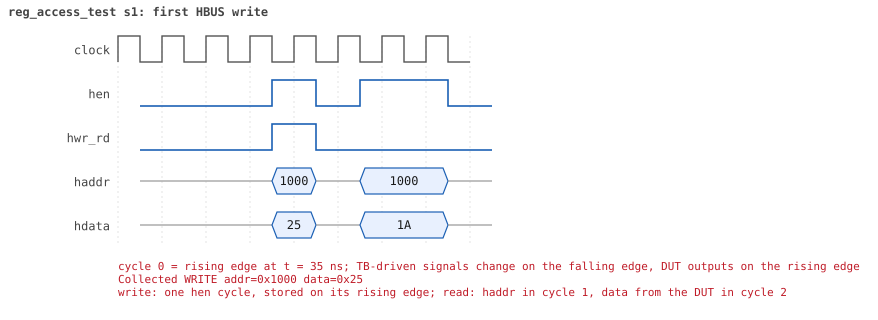
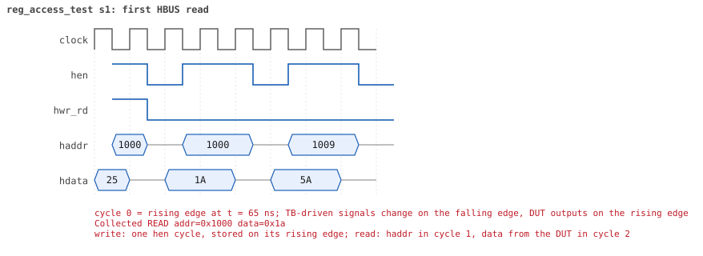

# reg_access_test  seed 1

**Result:** PASSED (0 UVM_ERROR, 0 UVM_WARNING, 0 UVM_FATAL) · bench `yapp_project_tb` · sim time 350ns · log `reg_access_test_s1.log`

Waves: `reg_access_test_s1.fst` (GTKWave, Surfer or the VS Code wave viewer); signal trace: `signals.csv`.

## Summary

- YAPP driver sent **0** packet(s) (0 with bad parity); the input monitor saw 0.
- Router: **0** forwarded, **0** dropped.
- Packets out: ch0 **0**, ch1 **0**, ch2 **0**.
- Scoreboard: 0 matched, 0 mismatched, 0 unexpected.
- Back-pressure: in_suspend asserted **0** time(s).
- Error pulses: 0.
- HBUS: 2 write(s), 2 read(s).

## Stages

| time (ns) | stage |
|---|---|
| 0 | RW register ctrl_reg: front-door write 0x25, peek, poke 0x1a, front-door read |
| 100 | RO register addr0_cnt_reg: poke 0x5a, front-door read, write 0x33 must be ignored |

## Pictures

**reset and the first cycles**

**first HBUS write**

**first HBUS read**

## Timeline

33 events (the same list is in `timeline.csv`).

| time (ns) | who | event |
|---|---|---|
| 0 | yapp monitor | YAPP monitor running |
| 0 | **test** | STAGE: RW register ctrl_reg: front-door write 0x25, peek, poke 0x1a, front-door read |
| 0 | clk/rst driver | Starting clock (period 10) and holding reset for 5 cycles |
| 0 | **DUT** | RESET asserted |
| 50 | **DUT** | RESET released: router_en=1 maxpktsize=63 |
| 70 | hbus driver | Executed WRITE addr=0x1000 data=0x25 |
| 70 | **test** | front-door write 0x25 |
| 70 | **test** | peek            0x25 |
| 70 | **test** | poke            0x1a |
| 75 | **DUT** | CONFIG router_en=1 maxpktsize=26 |
| 75 | hbus monitor | Collected WRITE addr=0x1000 data=0x25 |
| 75 | reference | maxpktsize is now 37 |
| 100 | hbus driver | Executed READ  addr=0x1000 data=0x1a |
| 100 | **test** | front-door read 0x1a |
| 100 | **test** | STAGE: RO register addr0_cnt_reg: poke 0x5a, front-door read, write 0x33 must be ignored |
| 100 | **test** | poke            0x5a |
| 105 | hbus monitor | Collected READ  addr=0x1000 data=0x1a |
| 130 | hbus driver | Executed READ  addr=0x1009 data=0x5a |
| 130 | **test** | front-door read 0x5a |
| 135 | hbus monitor | Collected READ  addr=0x1009 data=0x5a |
| 150 | hbus driver | Executed WRITE addr=0x1009 data=0x33 |
| 150 | **test** | front-door write 0x33 (RO: must be ignored) |
| 150 | **test** | peek            0x5a |
| 155 | hbus monitor | Collected WRITE addr=0x1009 data=0x33 |
| 350 | ch0 monitor | Channel 0 report: 0 packets collected |
| 350 | ch1 monitor | Channel 1 report: 0 packets collected |
| 350 | ch2 monitor | Channel 2 report: 0 packets collected |
| 350 | hbus monitor | HBUS report: 2 writes, 2 reads |
| 350 | reference |  |
| 350 | scoreboard |  |
| 350 | yapp driver | YAPP driver report: 0 packets sent |
| 350 | yapp monitor | YAPP monitor report: 0 packets collected, coverage 0.0% |
| 350 | yapp monitor | YAPP gaps: 0 back to back, 0 of 1 cycle, 0 of 2, 0 longer (gap coverage 0.0%) |
