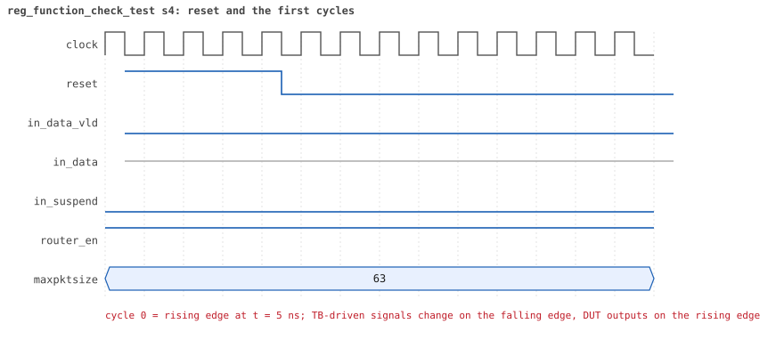
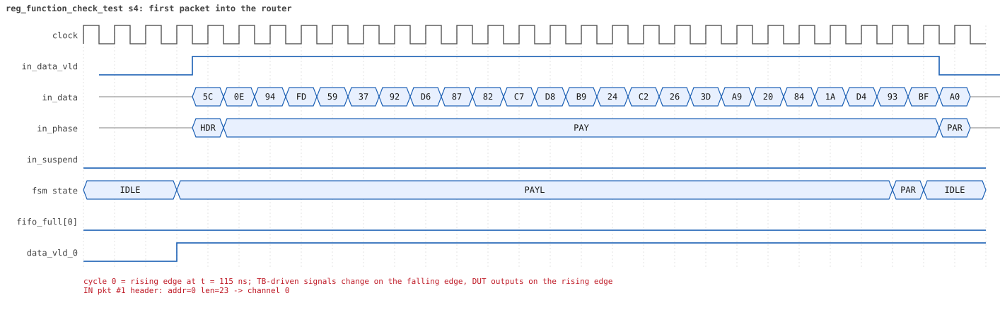
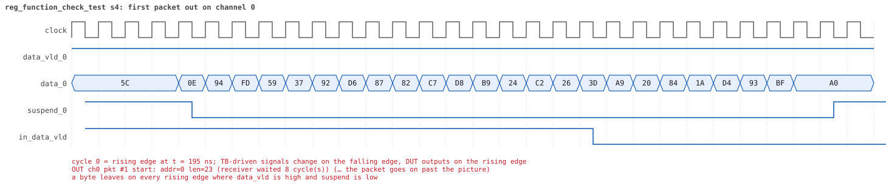
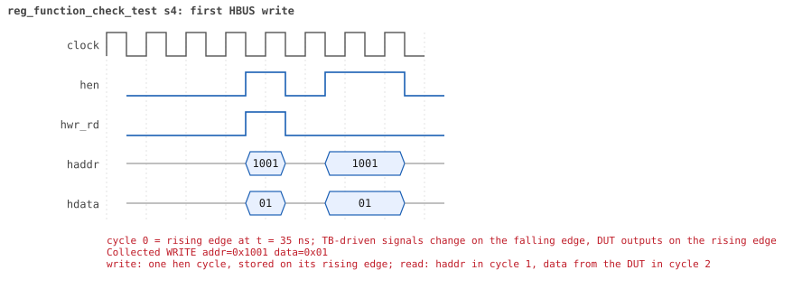
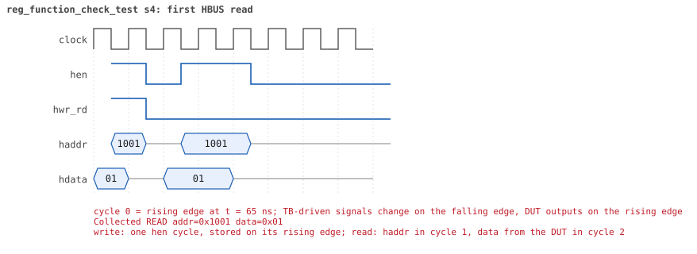

# reg_function_check_test  seed 4

**Result:** PASSED (0 UVM_ERROR, 0 UVM_WARNING, 0 UVM_FATAL) · bench `yapp_project_tb` · sim time 4us · log `reg_function_check_test_s4.log`

Waves: `reg_function_check_test_s4.fst` (GTKWave, Surfer or the VS Code wave viewer); signal trace: `signals.csv`.
[Open the waves in Surfer](https://app.surfer-project.org/?load_url=https%3A%2F%2Fraw.githubusercontent.com%2Ftamirgabgab%2FQcom-Mentoring%2Fmain%2Fyapp_project%2Fregression%2Fyapp_project_tb%2Freg_function_check_test_s4%2Freg_function_check_test_s4.fst&startup_commands=run_command_file_from_url%20https%3A%2F%2Fraw.githubusercontent.com%2Ftamirgabgab%2FQcom-Mentoring%2Fmain%2Fyapp_project%2Ftb%2Fyapp_router.sucl) (web app, the signals already in groups: `yapp_project/tb/yapp_router.sucl`).

## Summary

- YAPP driver sent **9** packet(s) (0 with bad parity); the input monitor saw 9.
- Router: **9** forwarded, **0** dropped.
- Packets out: ch0 **3**, ch1 **3**, ch2 **3**.
- Scoreboard: 9 matched, 0 mismatched, 0 unexpected.
- Back-pressure: in_suspend asserted **0** time(s).
- Error pulses: 0.
- HBUS: 2 write(s), 11 read(s).

## Stages

| time (ns) | stage |
|---|---|
| 0 | check_on_read: every front-door read is compared with the value the model predicts |
| 0 | 1. en_reg=0x01 (router on, counters off): 3 packets, the address counters stay 0 |
| 1760 | 2. en_reg=0xff (every counter on): 6 packets, 2 per address, counters follow the traffic |

## Pictures

**reset and the first cycles**

**first packet into the router**

**first packet out on channel 0**

**first HBUS write**

**first HBUS read**

## Timeline

169 events (the same list is in `timeline.csv`).

| time (ns) | who | event |
|---|---|---|
| 0 | yapp monitor | YAPP monitor running |
| 0 | **test** | STAGE: check_on_read: every front-door read is compared with the value the model predicts |
| 0 | **test** | STAGE: 1. en_reg=0x01 (router on, counters off): 3 packets, the address counters stay 0 |
| 0 | clk/rst driver | Starting clock (period 10) and holding reset for 5 cycles |
| 0 | **DUT** | RESET asserted |
| 50 | **DUT** | RESET released: router_en=1 maxpktsize=63 |
| 70 | hbus driver | Executed WRITE addr=0x1001 data=0x01 |
| 75 | hbus monitor | Collected WRITE addr=0x1001 data=0x01 |
| 75 | reference | router_en is now 1 (en_reg 0x01) |
| 100 | hbus driver | Executed READ  addr=0x1001 data=0x01 |
| 100 | **test** | en_reg reads 0x01 |
| 100 | yapp driver | TX pkt #1: addr=0 len=23 parity=good delay=3 |
| 105 | hbus monitor | Collected READ  addr=0x1001 data=0x01 |
| 145 | **DUT** | IN  pkt #1 header: addr=0 len=23 -> channel 0 |
| 235 | **DUT** | OUT ch0 pkt #1 start: addr=0 len=23 (receiver waited 8 cycle(s)) |
| 385 | **DUT** | IN  pkt #1 complete: addr=0 len=23 parity=ok forwarded, 25 bytes in 25 cycles (held 0) |
| 385 | yapp monitor | RX pkt #1 on the input: addr=0 len=23 parity=good gap=9 |
| 385 | reference | Packet forwarded: addr=0 len=23 -> channel 0 |
| 390 | yapp driver | TX pkt #1 accepted by the DUT |
| 390 | yapp driver | TX pkt #2: addr=1 len=48 parity=good delay=20 |
| 470 | ch0 driver | ch0: packet consumed (response delay 8) |
| 585 | **DUT** | OUT ch0 pkt #1 done: 25 bytes in 36 cycles |
| 585 | ch0 monitor | ch0 RX pkt #1: addr=0 len=23 parity=good |
| 585 | scoreboard | ch0 pkt matched: addr=0 len=23 (1 matched so far) |
| 595 | **DUT** | IN  pkt #2 header: addr=1 len=48 -> channel 1 |
| 705 | **DUT** | OUT ch1 pkt #1 start: addr=1 len=48 (receiver waited 10 cycle(s)) |
| 990 | ch0 driver | ch0: packet consumed (response delay 10) |
| 1085 | **DUT** | IN  pkt #2 complete: addr=1 len=48 parity=ok forwarded, 50 bytes in 50 cycles (held 0) |
| 1085 | yapp monitor | RX pkt #2 on the input: addr=1 len=48 parity=good gap=20 |
| 1085 | reference | Packet forwarded: addr=1 len=48 -> channel 1 |
| 1090 | yapp driver | TX pkt #2 accepted by the DUT |
| 1090 | yapp driver | TX pkt #3: addr=2 len=47 parity=good delay=6 |
| 1155 | **DUT** | IN  pkt #3 header: addr=2 len=47 -> channel 2 |
| 1185 | **DUT** | OUT ch2 pkt #1 start: addr=2 len=47 (receiver waited 2 cycle(s)) |
| 1190 | ch1 driver | ch1: packet consumed (response delay 10) |
| 1245 | **DUT** | OUT ch1 pkt #1 done: 50 bytes in 55 cycles |
| 1245 | ch1 monitor | ch1 RX pkt #1: addr=1 len=48 parity=good |
| 1245 | scoreboard | ch1 pkt matched: addr=1 len=48 (2 matched so far) |
| 1635 | **DUT** | IN  pkt #3 complete: addr=2 len=47 parity=ok forwarded, 49 bytes in 49 cycles (held 0) |
| 1635 | yapp monitor | RX pkt #3 on the input: addr=2 len=47 parity=good gap=6 |
| 1635 | reference | Packet forwarded: addr=2 len=47 -> channel 2 |
| 1640 | yapp driver | TX pkt #3 accepted by the DUT |
| 1660 | ch2 driver | ch2: packet consumed (response delay 2) |
| 1670 | hbus driver | Executed READ  addr=0x1009 data=0x00 |
| 1670 | **test** | addr0_cnt_reg reads 0 (checked against predicted 0) |
| 1675 | hbus monitor | Collected READ  addr=0x1009 data=0x00 |
| 1690 | ch1 driver | ch1: packet consumed (response delay 4) |
| 1700 | hbus driver | Executed READ  addr=0x100a data=0x00 |
| 1700 | **test** | addr1_cnt_reg reads 0 (checked against predicted 0) |
| 1705 | hbus monitor | Collected READ  addr=0x100a data=0x00 |
| 1730 | hbus driver | Executed READ  addr=0x100b data=0x00 |
| 1730 | **test** | addr2_cnt_reg reads 0 (checked against predicted 0) |
| 1735 | hbus monitor | Collected READ  addr=0x100b data=0x00 |
| 1760 | hbus driver | Executed READ  addr=0x1006 data=0x00 |
| 1760 | **test** | addr3_cnt_reg reads 0 (checked against predicted 0) |
| 1760 | **test** | STAGE: 2. en_reg=0xff (every counter on): 6 packets, 2 per address, counters follow the traffic |
| 1765 | hbus monitor | Collected READ  addr=0x1006 data=0x00 |
| 1775 | **DUT** | OUT ch2 pkt #1 done: 49 bytes in 60 cycles |
| 1775 | ch2 monitor | ch2 RX pkt #1: addr=2 len=47 parity=good |
| 1775 | scoreboard | ch2 pkt matched: addr=2 len=47 (3 matched so far) |
| 1780 | hbus driver | Executed WRITE addr=0x1001 data=0xff |
| 1780 | yapp driver | TX pkt #4: addr=0 len=37 parity=good delay=11 |
| 1785 | hbus monitor | Collected WRITE addr=0x1001 data=0xff |
| 1785 | reference | router_en is now 1 (en_reg 0xff) |
| 1905 | **DUT** | IN  pkt #4 header: addr=0 len=37 -> channel 0 |
| 1965 | **DUT** | OUT ch0 pkt #2 start: addr=0 len=37 (receiver waited 5 cycle(s)) |
| 2030 | ch2 driver | ch2: packet consumed (response delay 10) |
| 2285 | **DUT** | IN  pkt #4 complete: addr=0 len=37 parity=ok forwarded, 39 bytes in 39 cycles (held 0) |
| 2285 | yapp monitor | RX pkt #4 on the input: addr=0 len=37 parity=good gap=26 |
| 2285 | reference | Packet forwarded: addr=0 len=37 -> channel 0 |
| 2290 | yapp driver | TX pkt #4 accepted by the DUT |
| 2290 | yapp driver | TX pkt #5: addr=1 len=4 parity=good delay=1 |
| 2305 | **DUT** | IN  pkt #5 header: addr=1 len=4 -> channel 1 |
| 2340 | ch0 driver | ch0: packet consumed (response delay 5) |
| 2355 | **DUT** | IN  pkt #5 complete: addr=1 len=4 parity=ok forwarded, 6 bytes in 6 cycles (held 0) |
| 2355 | yapp monitor | RX pkt #5 on the input: addr=1 len=4 parity=good gap=1 |
| 2355 | reference | Packet forwarded: addr=1 len=4 -> channel 1 |
| 2360 | yapp driver | TX pkt #5 accepted by the DUT |
| 2360 | yapp driver | TX pkt #6: addr=2 len=11 parity=good delay=4 |
| 2395 | **DUT** | OUT ch1 pkt #2 start: addr=1 len=4 (receiver waited 8 cycle(s)) |
| 2405 | **DUT** | IN  pkt #6 header: addr=2 len=11 -> channel 2 |
| 2415 | **DUT** | OUT ch2 pkt #2 start: addr=2 len=11 (receiver waited 0 cycle(s)) |
| 2440 | ch1 driver | ch1: packet consumed (response delay 8) |
| 2455 | **DUT** | OUT ch0 pkt #2 done: 39 bytes in 50 cycles |
| 2455 | ch0 monitor | ch0 RX pkt #2: addr=0 len=37 parity=good |
| 2455 | scoreboard | ch0 pkt matched: addr=0 len=37 (4 matched so far) |
| 2525 | **DUT** | IN  pkt #6 complete: addr=2 len=11 parity=ok forwarded, 13 bytes in 13 cycles (held 0) |
| 2525 | **DUT** | OUT ch1 pkt #2 done: 6 bytes in 14 cycles |
| 2525 | ch1 monitor | ch1 RX pkt #2: addr=1 len=4 parity=good |
| 2525 | scoreboard | ch1 pkt matched: addr=1 len=4 (5 matched so far) |
| 2525 | yapp monitor | RX pkt #6 on the input: addr=2 len=11 parity=good gap=4 |
| 2525 | reference | Packet forwarded: addr=2 len=11 -> channel 2 |
| 2530 | ch2 driver | ch2: packet consumed (response delay 0) |
| 2530 | yapp driver | TX pkt #6 accepted by the DUT |
| 2530 | yapp driver | TX pkt #7: addr=0 len=21 parity=good delay=15 |
| 2615 | **DUT** | OUT ch2 pkt #2 done: 13 bytes in 21 cycles |
| 2615 | ch2 monitor | ch2 RX pkt #2: addr=2 len=11 parity=good |
| 2615 | scoreboard | ch2 pkt matched: addr=2 len=11 (6 matched so far) |
| 2620 | ch2 driver | ch2: packet consumed (response delay 7) |
| 2685 | **DUT** | IN  pkt #7 header: addr=0 len=21 -> channel 0 |
| 2695 | **DUT** | OUT ch0 pkt #3 start: addr=0 len=21 (receiver waited 0 cycle(s)) |
| 2740 | ch1 driver | ch1: packet consumed (response delay 7) |
| 2750 | ch0 driver | ch0: packet consumed (response delay 10) |
| 2905 | **DUT** | IN  pkt #7 complete: addr=0 len=21 parity=ok forwarded, 23 bytes in 23 cycles (held 0) |
| 2905 | yapp monitor | RX pkt #7 on the input: addr=0 len=21 parity=good gap=15 |
| 2905 | reference | Packet forwarded: addr=0 len=21 -> channel 0 |
| 2910 | yapp driver | TX pkt #7 accepted by the DUT |
| 2910 | yapp driver | TX pkt #8: addr=1 len=15 parity=good delay=18 |
| 2960 | ch0 driver | ch0: packet consumed (response delay 10) |
| 3095 | **DUT** | IN  pkt #8 header: addr=1 len=15 -> channel 1 |
| 3115 | **DUT** | OUT ch0 pkt #3 done: 23 bytes in 43 cycles |
| 3115 | ch0 monitor | ch0 RX pkt #3: addr=0 len=21 parity=good |
| 3115 | scoreboard | ch0 pkt matched: addr=0 len=21 (7 matched so far) |
| 3135 | **DUT** | OUT ch1 pkt #3 start: addr=1 len=15 (receiver waited 3 cycle(s)) |
| 3210 | ch0 driver | ch0: packet consumed (response delay 8) |
| 3255 | **DUT** | IN  pkt #8 complete: addr=1 len=15 parity=ok forwarded, 17 bytes in 17 cycles (held 0) |
| 3255 | yapp monitor | RX pkt #8 on the input: addr=1 len=15 parity=good gap=18 |
| 3255 | reference | Packet forwarded: addr=1 len=15 -> channel 1 |
| 3260 | yapp driver | TX pkt #8 accepted by the DUT |
| 3260 | yapp driver | TX pkt #9: addr=2 len=49 parity=good delay=8 |
| 3290 | ch1 driver | ch1: packet consumed (response delay 3) |
| 3345 | **DUT** | IN  pkt #9 header: addr=2 len=49 -> channel 2 |
| 3375 | **DUT** | OUT ch1 pkt #3 done: 17 bytes in 25 cycles |
| 3375 | ch1 monitor | ch1 RX pkt #3: addr=1 len=15 parity=good |
| 3375 | scoreboard | ch1 pkt matched: addr=1 len=15 (8 matched so far) |
| 3455 | **DUT** | OUT ch2 pkt #3 start: addr=2 len=49 (receiver waited 10 cycle(s)) |
| 3600 | ch1 driver | ch1: packet consumed (response delay 7) |
| 3845 | **DUT** | IN  pkt #9 complete: addr=2 len=49 parity=ok forwarded, 51 bytes in 51 cycles (held 0) |
| 3845 | yapp monitor | RX pkt #9 on the input: addr=2 len=49 parity=good gap=8 |
| 3845 | reference | Packet forwarded: addr=2 len=49 -> channel 2 |
| 3850 | yapp driver | TX pkt #9 accepted by the DUT |
| 3880 | hbus driver | Executed READ  addr=0x1009 data=0x02 |
| 3880 | **test** | addr0_cnt_reg reads 2 (checked against predicted 2) |
| 3885 | hbus monitor | Collected READ  addr=0x1009 data=0x02 |
| 3910 | hbus driver | Executed READ  addr=0x100a data=0x02 |
| 3910 | **test** | addr1_cnt_reg reads 2 (checked against predicted 2) |
| 3915 | hbus monitor | Collected READ  addr=0x100a data=0x02 |
| 3940 | hbus driver | Executed READ  addr=0x100b data=0x02 |
| 3940 | **test** | addr2_cnt_reg reads 2 (checked against predicted 2) |
| 3945 | hbus monitor | Collected READ  addr=0x100b data=0x02 |
| 3950 | ch2 driver | ch2: packet consumed (response delay 10) |
| 3970 | hbus driver | Executed READ  addr=0x1006 data=0x00 |
| 3970 | **test** | addr3_cnt_reg reads 0 (checked against predicted 0) |
| 3975 | hbus monitor | Collected READ  addr=0x1006 data=0x00 |
| 4000 | hbus driver | Executed READ  addr=0x1004 data=0x00 |
| 4000 | **test** | parity_err_cnt_reg reads 0 (checked against predicted 0) |
| 4005 | hbus monitor | Collected READ  addr=0x1004 data=0x00 |
| 4030 | hbus driver | Executed READ  addr=0x1005 data=0x00 |
| 4030 | **test** | oversized_pkt_cnt_reg reads 0 (checked against predicted 0) |
| 4035 | hbus monitor | Collected READ  addr=0x1005 data=0x00 |
| 4065 | **DUT** | OUT ch2 pkt #3 done: 51 bytes in 62 cycles |
| 4065 | ch2 monitor | ch2 RX pkt #3: addr=2 len=49 parity=good |
| 4065 | scoreboard | ch2 pkt matched: addr=2 len=49 (9 matched so far) |
| 4230 | ch0 monitor | Channel 0 report: 3 packets collected |
| 4230 | ch1 monitor | Channel 1 report: 3 packets collected |
| 4230 | ch2 monitor | Channel 2 report: 3 packets collected |
| 4230 | hbus monitor | HBUS report: 2 writes, 11 reads |
| 4230 | coverage | Coverage of the router configuration: 30.4% |
| 4230 | coverage | HBUS address coverage: 13 accesses sampled, coverage 22.1% |
| 4230 | coverage | HBUS register bits coverage: 2 writes to ctrl_reg/en_reg, coverage 59.1% |
| 4230 | coverage | HBUS counter value coverage: 10 counter reads sampled, coverage 63.0% |
| 4230 | coverage | HBUS yapp_mem data coverage: 0 accesses sampled, coverage 0.0% |
| 4230 | reference |  |
| 4230 | scoreboard |  |
| 4230 | yapp driver | YAPP driver report: 9 packets sent |
| 4230 | coverage | YAPP gap coverage: 8 gaps sampled, coverage 50.0% |
| 4230 | yapp monitor | YAPP monitor report: 9 packets collected, 0 with bad parity |
| 4230 | yapp monitor | YAPP gaps: 0 back to back, 1 of 1 cycle, 0 of 2, 7 longer |
| 4230 | coverage | YAPP packet coverage: 9 packets sampled, coverage 33.3% |
