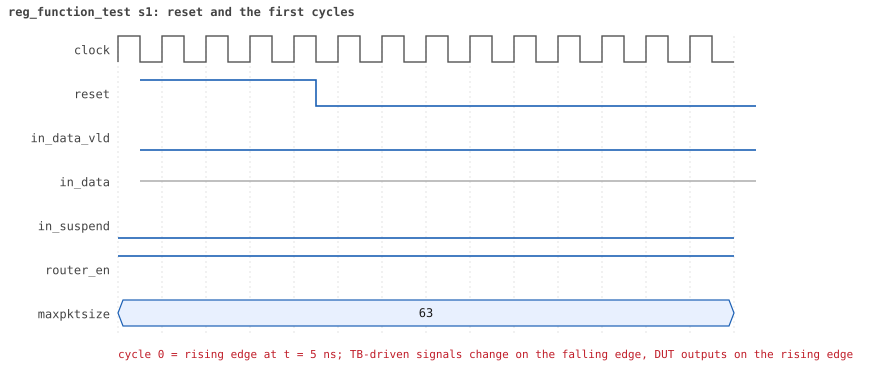
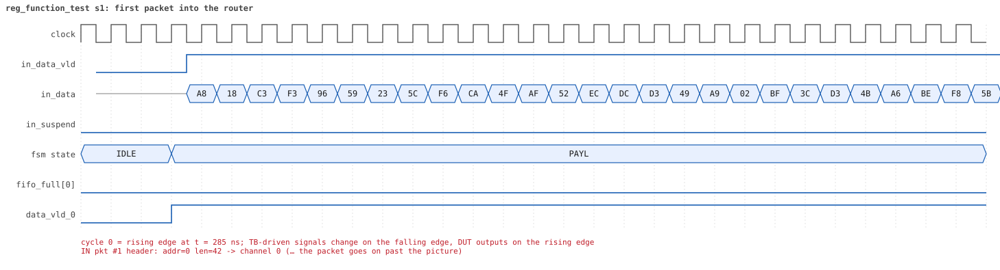
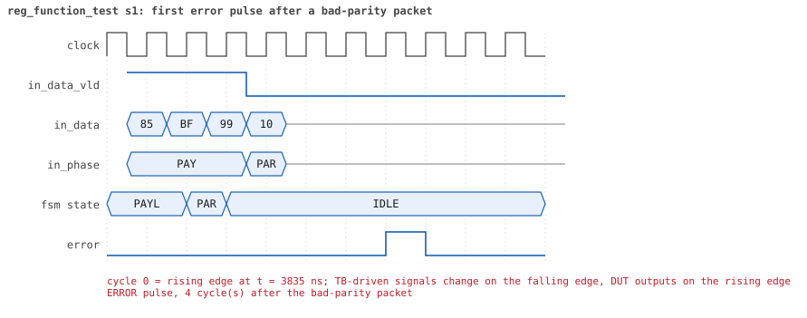
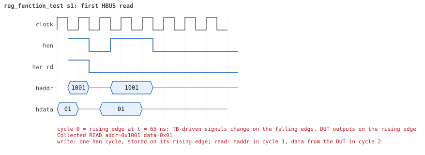

# reg_function_test  seed 1

**Result:** PASSED (0 UVM_ERROR, 0 UVM_WARNING, 0 UVM_FATAL) · bench `yapp_project_tb` · sim time 5us · log `reg_function_test_s1.log`

Waves: `reg_function_test_s1.fst` (GTKWave, Surfer or the VS Code wave viewer); signal trace: `signals.csv`.
[Open the waves in Surfer](https://app.surfer-project.org/?load_url=https%3A%2F%2Fraw.githubusercontent.com%2Ftamirgabgab%2FQcom-Mentoring%2Fmain%2Fyapp_project%2Fregression%2Fyapp_project_tb%2Freg_function_test_s1%2Freg_function_test_s1.fst&startup_commands=run_command_file_from_url%20https%3A%2F%2Fraw.githubusercontent.com%2Ftamirgabgab%2FQcom-Mentoring%2Fmain%2Fyapp_project%2Ftb%2Fyapp_router.sucl) (web app, the signals already in groups: `yapp_project/tb/yapp_router.sucl`).

## Summary

- YAPP driver sent **9** packet(s) (1 with bad parity); the input monitor saw 9.
- Router: **9** forwarded, **0** dropped.
- Packets out: ch0 **3**, ch1 **3**, ch2 **3**.
- Scoreboard: 9 matched, 0 mismatched, 0 unexpected.
- Back-pressure: in_suspend asserted **0** time(s).
- Error pulses: 1.
- HBUS: 2 write(s), 11 read(s).

## Stages

| time (ns) | stage |
|---|---|
| 0 | 1. en_reg=0x01 (router on, counters off): 3 packets, the address counters stay 0 |
| 1800 | 2. en_reg=0xff (every counter on): 6 packets, 2 per address, counters follow the traffic |

## Pictures

**reset and the first cycles**

**first packet into the router**

**first packet out on channel 0**

**first error pulse after a bad-parity packet**

**first HBUS write**

**first HBUS read**

## Timeline

162 events (the same list is in `timeline.csv`).

| time (ns) | who | event |
|---|---|---|
| 0 | yapp monitor | YAPP monitor running |
| 0 | **test** | STAGE: 1. en_reg=0x01 (router on, counters off): 3 packets, the address counters stay 0 |
| 0 | clk/rst driver | Starting clock (period 10) and holding reset for 5 cycles |
| 0 | **DUT** | RESET asserted |
| 50 | **DUT** | RESET released: router_en=1 maxpktsize=63 |
| 70 | hbus driver | Executed WRITE addr=0x1001 data=0x01 |
| 75 | hbus monitor | Collected WRITE addr=0x1001 data=0x01 |
| 75 | reference | router_en is now 1 |
| 100 | hbus driver | Executed READ  addr=0x1001 data=0x01 |
| 100 | **test** | en_reg reads 0x01 |
| 100 | yapp driver | TX pkt #1: addr=0 len=42 parity=good delay=20 |
| 105 | hbus monitor | Collected READ  addr=0x1001 data=0x01 |
| 315 | **DUT** | IN  pkt #1 header: addr=0 len=42 -> channel 0 |
| 355 | **DUT** | OUT ch0 pkt #1 start: addr=0 len=42 (receiver waited 3 cycle(s)) |
| 745 | **DUT** | IN  pkt #1 complete: addr=0 len=42 parity=ok forwarded, 44 bytes in 44 cycles (held 0) |
| 745 | yapp monitor | RX pkt #1 on the input: addr=0 len=42 parity=good gap=26 |
| 745 | reference | Packet forwarded: addr=0 len=42 -> channel 0 |
| 750 | yapp driver | TX pkt #1 accepted by the DUT |
| 750 | yapp driver | TX pkt #2: addr=1 len=59 parity=good delay=2 |
| 775 | **DUT** | IN  pkt #2 header: addr=1 len=59 -> channel 1 |
| 780 | ch0 driver | ch0: packet consumed (response delay 3) |
| 865 | **DUT** | OUT ch1 pkt #1 start: addr=1 len=59 (receiver waited 8 cycle(s)) |
| 875 | **DUT** | OUT ch0 pkt #1 done: 44 bytes in 53 cycles |
| 875 | ch0 monitor | ch0 RX pkt #1: addr=0 len=42 parity=good |
| 875 | scoreboard | ch0 pkt matched: addr=0 len=42 (1 matched so far) |
| 1150 | ch0 driver | ch0: packet consumed (response delay 8) |
| 1375 | **DUT** | IN  pkt #2 complete: addr=1 len=59 parity=ok forwarded, 61 bytes in 61 cycles (held 0) |
| 1375 | yapp monitor | RX pkt #2 on the input: addr=1 len=59 parity=good gap=2 |
| 1375 | reference | Packet forwarded: addr=1 len=59 -> channel 1 |
| 1380 | yapp driver | TX pkt #2 accepted by the DUT |
| 1380 | yapp driver | TX pkt #3: addr=2 len=27 parity=good delay=1 |
| 1395 | **DUT** | IN  pkt #3 header: addr=2 len=27 -> channel 2 |
| 1460 | ch1 driver | ch1: packet consumed (response delay 8) |
| 1475 | **DUT** | OUT ch1 pkt #1 done: 61 bytes in 62 cycles |
| 1475 | ch1 monitor | ch1 RX pkt #1: addr=1 len=59 parity=good |
| 1475 | scoreboard | ch1 pkt matched: addr=1 len=59 (2 matched so far) |
| 1485 | **DUT** | OUT ch2 pkt #1 start: addr=2 len=27 (receiver waited 8 cycle(s)) |
| 1675 | **DUT** | IN  pkt #3 complete: addr=2 len=27 parity=ok forwarded, 29 bytes in 29 cycles (held 0) |
| 1675 | yapp monitor | RX pkt #3 on the input: addr=2 len=27 parity=good gap=1 |
| 1675 | reference | Packet forwarded: addr=2 len=27 -> channel 2 |
| 1680 | yapp driver | TX pkt #3 accepted by the DUT |
| 1710 | hbus driver | Executed READ  addr=0x1009 data=0x00 |
| 1710 | **test** | addr0_cnt_reg reads 0 as expected |
| 1715 | hbus monitor | Collected READ  addr=0x1009 data=0x00 |
| 1740 | hbus driver | Executed READ  addr=0x100a data=0x00 |
| 1740 | **test** | addr1_cnt_reg reads 0 as expected |
| 1745 | hbus monitor | Collected READ  addr=0x100a data=0x00 |
| 1760 | ch2 driver | ch2: packet consumed (response delay 8) |
| 1770 | hbus driver | Executed READ  addr=0x100b data=0x00 |
| 1770 | **test** | addr2_cnt_reg reads 0 as expected |
| 1775 | hbus monitor | Collected READ  addr=0x100b data=0x00 |
| 1800 | hbus driver | Executed READ  addr=0x1006 data=0x00 |
| 1800 | **test** | addr3_cnt_reg reads 0 as expected |
| 1800 | **test** | STAGE: 2. en_reg=0xff (every counter on): 6 packets, 2 per address, counters follow the traffic |
| 1805 | hbus monitor | Collected READ  addr=0x1006 data=0x00 |
| 1820 | hbus driver | Executed WRITE addr=0x1001 data=0xff |
| 1820 | yapp driver | TX pkt #4: addr=0 len=8 parity=good delay=1 |
| 1825 | hbus monitor | Collected WRITE addr=0x1001 data=0xff |
| 1825 | reference | router_en is now 1 |
| 1845 | **DUT** | IN  pkt #4 header: addr=0 len=8 -> channel 0 |
| 1855 | **DUT** | OUT ch2 pkt #1 done: 29 bytes in 38 cycles |
| 1855 | ch2 monitor | ch2 RX pkt #1: addr=2 len=27 parity=good |
| 1855 | scoreboard | ch2 pkt matched: addr=2 len=27 (3 matched so far) |
| 1905 | **DUT** | OUT ch0 pkt #2 start: addr=0 len=8 (receiver waited 5 cycle(s)) |
| 1935 | **DUT** | IN  pkt #4 complete: addr=0 len=8 parity=ok forwarded, 10 bytes in 10 cycles (held 0) |
| 1935 | yapp monitor | RX pkt #4 on the input: addr=0 len=8 parity=good gap=16 |
| 1935 | reference | Packet forwarded: addr=0 len=8 -> channel 0 |
| 1940 | yapp driver | TX pkt #4 accepted by the DUT |
| 1940 | yapp driver | TX pkt #5: addr=1 len=21 parity=good delay=19 |
| 1960 | ch1 driver | ch1: packet consumed (response delay 0) |
| 1990 | ch0 driver | ch0: packet consumed (response delay 5) |
| 2025 | **DUT** | OUT ch0 pkt #2 done: 10 bytes in 13 cycles |
| 2025 | ch0 monitor | ch0 RX pkt #2: addr=0 len=8 parity=good |
| 2025 | scoreboard | ch0 pkt matched: addr=0 len=8 (4 matched so far) |
| 2135 | **DUT** | IN  pkt #5 header: addr=1 len=21 -> channel 1 |
| 2170 | ch0 driver | ch0: packet consumed (response delay 2) |
| 2205 | **DUT** | OUT ch1 pkt #2 start: addr=1 len=21 (receiver waited 6 cycle(s)) |
| 2320 | ch2 driver | ch2: packet consumed (response delay 8) |
| 2355 | **DUT** | IN  pkt #5 complete: addr=1 len=21 parity=ok forwarded, 23 bytes in 23 cycles (held 0) |
| 2355 | yapp monitor | RX pkt #5 on the input: addr=1 len=21 parity=good gap=19 |
| 2355 | reference | Packet forwarded: addr=1 len=21 -> channel 1 |
| 2360 | yapp driver | TX pkt #5 accepted by the DUT |
| 2360 | yapp driver | TX pkt #6: addr=2 len=56 parity=good delay=16 |
| 2420 | ch1 driver | ch1: packet consumed (response delay 6) |
| 2525 | **DUT** | IN  pkt #6 header: addr=2 len=56 -> channel 2 |
| 2535 | **DUT** | OUT ch1 pkt #2 done: 23 bytes in 34 cycles |
| 2535 | ch1 monitor | ch1 RX pkt #2: addr=1 len=21 parity=good |
| 2535 | scoreboard | ch1 pkt matched: addr=1 len=21 (5 matched so far) |
| 2635 | **DUT** | OUT ch2 pkt #2 start: addr=2 len=56 (receiver waited 10 cycle(s)) |
| 3080 | ch1 driver | ch1: packet consumed (response delay 10) |
| 3095 | **DUT** | IN  pkt #6 complete: addr=2 len=56 parity=ok forwarded, 58 bytes in 58 cycles (held 0) |
| 3095 | yapp monitor | RX pkt #6 on the input: addr=2 len=56 parity=good gap=16 |
| 3095 | reference | Packet forwarded: addr=2 len=56 -> channel 2 |
| 3100 | yapp driver | TX pkt #6 accepted by the DUT |
| 3100 | yapp driver | TX pkt #7: addr=0 len=56 parity=bad delay=19 |
| 3200 | ch2 driver | ch2: packet consumed (response delay 10) |
| 3275 | **DUT** | OUT ch2 pkt #2 done: 58 bytes in 65 cycles |
| 3275 | ch2 monitor | ch2 RX pkt #2: addr=2 len=56 parity=good |
| 3275 | scoreboard | ch2 pkt matched: addr=2 len=56 (6 matched so far) |
| 3295 | **DUT** | IN  pkt #7 header: addr=0 len=56 -> channel 0 |
| 3395 | **DUT** | OUT ch0 pkt #3 start: addr=0 len=56 (receiver waited 9 cycle(s)) |
| 3865 | **DUT** | IN  pkt #7 complete: addr=0 len=56 parity=BAD forwarded, 58 bytes in 58 cycles (held 0) |
| 3865 | yapp monitor | RX pkt #7 on the input: addr=0 len=56 parity=bad gap=19 |
| 3865 | reference | Packet forwarded: addr=0 len=56 -> channel 0 |
| 3870 | yapp driver | TX pkt #7 accepted by the DUT |
| 3870 | yapp driver | TX pkt #8: addr=1 len=41 parity=good delay=12 |
| 3880 | ch2 driver | ch2: packet consumed (response delay 6) |
| 3905 | **DUT** | ERROR pulse, 4 cycle(s) after the bad-parity packet |
| 3960 | ch0 driver | ch0: packet consumed (response delay 9) |
| 3995 | **DUT** | IN  pkt #8 header: addr=1 len=41 -> channel 1 |
| 4075 | **DUT** | OUT ch0 pkt #3 done: 58 bytes in 69 cycles |
| 4075 | ch0 monitor | ch0 RX pkt #3: addr=0 len=56 parity=bad |
| 4075 | scoreboard | ch0 pkt matched: addr=0 len=56 (7 matched so far) |
| 4105 | **DUT** | OUT ch1 pkt #3 start: addr=1 len=41 (receiver waited 10 cycle(s)) |
| 4120 | ch0 driver | ch0: packet consumed (response delay 10) |
| 4415 | **DUT** | IN  pkt #8 complete: addr=1 len=41 parity=ok forwarded, 43 bytes in 43 cycles (held 0) |
| 4415 | yapp monitor | RX pkt #8 on the input: addr=1 len=41 parity=good gap=12 |
| 4415 | reference | Packet forwarded: addr=1 len=41 -> channel 1 |
| 4420 | yapp driver | TX pkt #8 accepted by the DUT |
| 4420 | yapp driver | TX pkt #9: addr=2 len=38 parity=good delay=20 |
| 4520 | ch1 driver | ch1: packet consumed (response delay 10) |
| 4625 | **DUT** | IN  pkt #9 header: addr=2 len=38 -> channel 2 |
| 4625 | **DUT** | OUT ch1 pkt #3 done: 43 bytes in 53 cycles |
| 4625 | ch1 monitor | ch1 RX pkt #3: addr=1 len=41 parity=good |
| 4625 | scoreboard | ch1 pkt matched: addr=1 len=41 (8 matched so far) |
| 4665 | **DUT** | OUT ch2 pkt #3 start: addr=2 len=38 (receiver waited 3 cycle(s)) |
| 5015 | **DUT** | IN  pkt #9 complete: addr=2 len=38 parity=ok forwarded, 40 bytes in 40 cycles (held 0) |
| 5015 | yapp monitor | RX pkt #9 on the input: addr=2 len=38 parity=good gap=20 |
| 5015 | reference | Packet forwarded: addr=2 len=38 -> channel 2 |
| 5020 | yapp driver | TX pkt #9 accepted by the DUT |
| 5050 | ch2 driver | ch2: packet consumed (response delay 3) |
| 5050 | hbus driver | Executed READ  addr=0x1009 data=0x02 |
| 5050 | **test** | addr0_cnt_reg reads 2 as expected |
| 5055 | hbus monitor | Collected READ  addr=0x1009 data=0x02 |
| 5080 | hbus driver | Executed READ  addr=0x100a data=0x02 |
| 5080 | **test** | addr1_cnt_reg reads 2 as expected |
| 5085 | hbus monitor | Collected READ  addr=0x100a data=0x02 |
| 5110 | hbus driver | Executed READ  addr=0x100b data=0x02 |
| 5110 | **test** | addr2_cnt_reg reads 2 as expected |
| 5115 | hbus monitor | Collected READ  addr=0x100b data=0x02 |
| 5125 | **DUT** | OUT ch2 pkt #3 done: 40 bytes in 47 cycles |
| 5125 | ch2 monitor | ch2 RX pkt #3: addr=2 len=38 parity=good |
| 5125 | scoreboard | ch2 pkt matched: addr=2 len=38 (9 matched so far) |
| 5140 | hbus driver | Executed READ  addr=0x1006 data=0x00 |
| 5140 | **test** | addr3_cnt_reg reads 0 as expected |
| 5145 | hbus monitor | Collected READ  addr=0x1006 data=0x00 |
| 5160 | ch1 driver | ch1: packet consumed (response delay 9) |
| 5170 | hbus driver | Executed READ  addr=0x1004 data=0x01 |
| 5170 | **test** | parity_err_cnt_reg reads 1 as expected |
| 5175 | hbus monitor | Collected READ  addr=0x1004 data=0x01 |
| 5200 | hbus driver | Executed READ  addr=0x1005 data=0x00 |
| 5200 | **test** | oversized_pkt_cnt_reg reads 0 as expected |
| 5205 | hbus monitor | Collected READ  addr=0x1005 data=0x00 |
| 5400 | ch0 monitor | Channel 0 report: 3 packets collected |
| 5400 | ch1 monitor | Channel 1 report: 3 packets collected |
| 5400 | ch2 monitor | Channel 2 report: 3 packets collected |
| 5400 | hbus monitor | HBUS report: 2 writes, 11 reads |
| 5400 | reference |  |
| 5400 | scoreboard |  |
| 5400 | yapp driver | YAPP driver report: 9 packets sent |
| 5400 | yapp monitor | YAPP monitor report: 9 packets collected, coverage 43.3% |
| 5400 | yapp monitor | YAPP gaps: 0 back to back, 1 of 1 cycle, 1 of 2, 6 longer (gap coverage 75.0%) |
