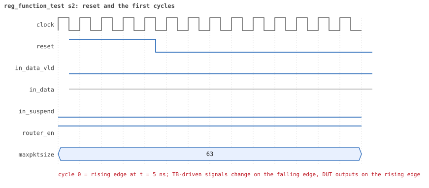
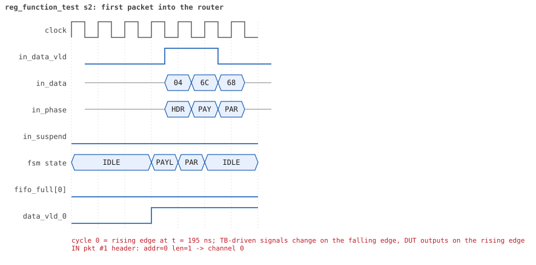
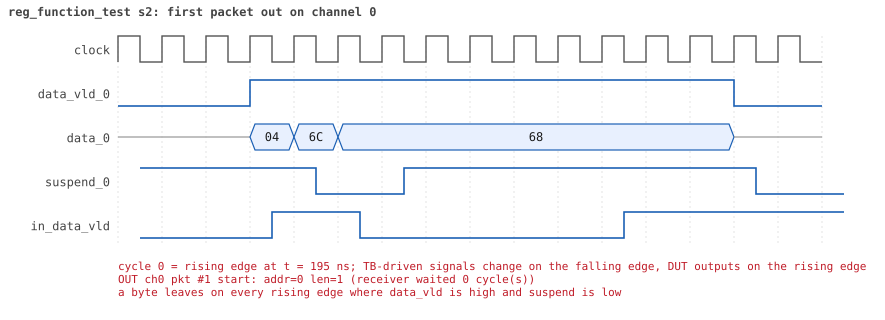
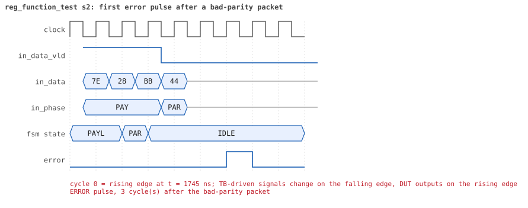
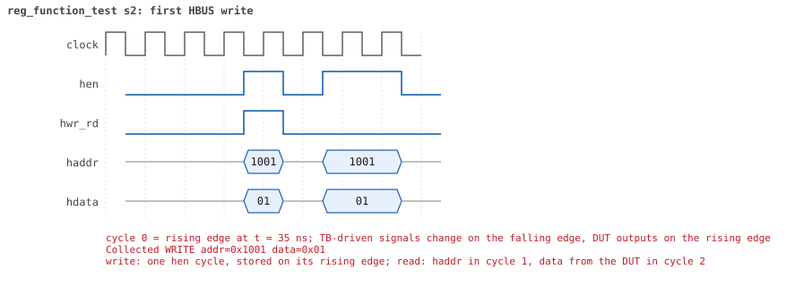
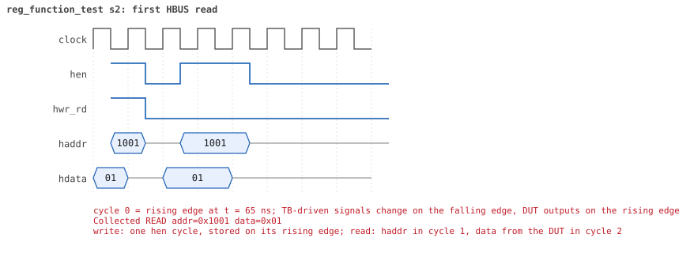

# reg_function_test  seed 2

**Result:** PASSED (0 UVM_ERROR, 0 UVM_WARNING, 0 UVM_FATAL) · bench `yapp_project_tb` · sim time 5us · log `reg_function_test_s2.log`

Waves: `reg_function_test_s2.fst` (GTKWave, Surfer or the VS Code wave viewer); signal trace: `signals.csv`.
[Open the waves in Surfer](https://app.surfer-project.org/?load_url=https%3A%2F%2Fraw.githubusercontent.com%2Ftamirgabgab%2FQcom-Mentoring%2Fmain%2Fyapp_project%2Fregression%2Fyapp_project_tb%2Freg_function_test_s2%2Freg_function_test_s2.fst&startup_commands=run_command_file_from_url%20https%3A%2F%2Fraw.githubusercontent.com%2Ftamirgabgab%2FQcom-Mentoring%2Fmain%2Fyapp_project%2Ftb%2Fyapp_router.sucl) (web app, the signals already in groups: `yapp_project/tb/yapp_router.sucl`).

## Summary

- YAPP driver sent **9** packet(s) (2 with bad parity); the input monitor saw 9.
- Router: **9** forwarded, **0** dropped.
- Packets out: ch0 **3**, ch1 **3**, ch2 **3**.
- Scoreboard: 9 matched, 0 mismatched, 0 unexpected.
- Back-pressure: in_suspend asserted **0** time(s).
- Error pulses: 2.
- HBUS: 2 write(s), 11 read(s).

## Stages

| time (ns) | stage |
|---|---|
| 0 | 1. en_reg=0x01 (router on, counters off): 3 packets, the address counters stay 0 |
| 1080 | 2. en_reg=0xff (every counter on): 6 packets, 2 per address, counters follow the traffic |

## Pictures

**reset and the first cycles**

**first packet into the router**

**first packet out on channel 0**

**first error pulse after a bad-parity packet**

**first HBUS write**

**first HBUS read**

## Timeline

163 events (the same list is in `timeline.csv`).

| time (ns) | who | event |
|---|---|---|
| 0 | yapp monitor | YAPP monitor running |
| 0 | **test** | STAGE: 1. en_reg=0x01 (router on, counters off): 3 packets, the address counters stay 0 |
| 0 | clk/rst driver | Starting clock (period 10) and holding reset for 5 cycles |
| 0 | **DUT** | RESET asserted |
| 50 | **DUT** | RESET released: router_en=1 maxpktsize=63 |
| 70 | hbus driver | Executed WRITE addr=0x1001 data=0x01 |
| 75 | hbus monitor | Collected WRITE addr=0x1001 data=0x01 |
| 75 | reference | router_en is now 1 |
| 100 | hbus driver | Executed READ  addr=0x1001 data=0x01 |
| 100 | **test** | en_reg reads 0x01 |
| 100 | yapp driver | TX pkt #1: addr=0 len=1 parity=good delay=11 |
| 105 | hbus monitor | Collected READ  addr=0x1001 data=0x01 |
| 225 | **DUT** | IN  pkt #1 header: addr=0 len=1 -> channel 0 |
| 235 | **DUT** | OUT ch0 pkt #1 start: addr=0 len=1 (receiver waited 0 cycle(s)) |
| 245 | **DUT** | IN  pkt #1 complete: addr=0 len=1 parity=ok forwarded, 3 bytes in 3 cycles (held 0) |
| 245 | yapp monitor | RX pkt #1 on the input: addr=0 len=1 parity=good gap=17 |
| 245 | reference | Packet forwarded: addr=0 len=1 -> channel 0 |
| 250 | ch0 driver | ch0: packet consumed (response delay 0) |
| 250 | yapp driver | TX pkt #1 accepted by the DUT |
| 250 | yapp driver | TX pkt #2: addr=1 len=41 parity=good delay=5 |
| 305 | **DUT** | IN  pkt #2 header: addr=1 len=41 -> channel 1 |
| 335 | **DUT** | OUT ch0 pkt #1 done: 3 bytes in 11 cycles |
| 335 | **DUT** | OUT ch1 pkt #1 start: addr=1 len=41 (receiver waited 2 cycle(s)) |
| 335 | ch0 monitor | ch0 RX pkt #1: addr=0 len=1 parity=good |
| 335 | scoreboard | ch0 pkt matched: addr=0 len=1 (1 matched so far) |
| 600 | ch0 driver | ch0: packet consumed (response delay 7) |
| 725 | **DUT** | IN  pkt #2 complete: addr=1 len=41 parity=ok forwarded, 43 bytes in 43 cycles (held 0) |
| 725 | yapp monitor | RX pkt #2 on the input: addr=1 len=41 parity=good gap=5 |
| 725 | reference | Packet forwarded: addr=1 len=41 -> channel 1 |
| 730 | yapp driver | TX pkt #2 accepted by the DUT |
| 730 | yapp driver | TX pkt #3: addr=2 len=9 parity=good delay=12 |
| 750 | ch1 driver | ch1: packet consumed (response delay 2) |
| 835 | **DUT** | OUT ch1 pkt #1 done: 43 bytes in 51 cycles |
| 835 | ch1 monitor | ch1 RX pkt #1: addr=1 len=41 parity=good |
| 835 | scoreboard | ch1 pkt matched: addr=1 len=41 (2 matched so far) |
| 855 | **DUT** | IN  pkt #3 header: addr=2 len=9 -> channel 2 |
| 955 | **DUT** | IN  pkt #3 complete: addr=2 len=9 parity=ok forwarded, 11 bytes in 11 cycles (held 0) |
| 955 | yapp monitor | RX pkt #3 on the input: addr=2 len=9 parity=good gap=12 |
| 955 | reference | Packet forwarded: addr=2 len=9 -> channel 2 |
| 960 | yapp driver | TX pkt #3 accepted by the DUT |
| 965 | **DUT** | OUT ch2 pkt #1 start: addr=2 len=9 (receiver waited 10 cycle(s)) |
| 970 | ch1 driver | ch1: packet consumed (response delay 7) |
| 990 | hbus driver | Executed READ  addr=0x1009 data=0x00 |
| 990 | **test** | addr0_cnt_reg reads 0 as expected |
| 995 | hbus monitor | Collected READ  addr=0x1009 data=0x00 |
| 1020 | hbus driver | Executed READ  addr=0x100a data=0x00 |
| 1020 | **test** | addr1_cnt_reg reads 0 as expected |
| 1025 | hbus monitor | Collected READ  addr=0x100a data=0x00 |
| 1050 | hbus driver | Executed READ  addr=0x100b data=0x00 |
| 1050 | **test** | addr2_cnt_reg reads 0 as expected |
| 1055 | hbus monitor | Collected READ  addr=0x100b data=0x00 |
| 1060 | ch2 driver | ch2: packet consumed (response delay 10) |
| 1080 | hbus driver | Executed READ  addr=0x1006 data=0x00 |
| 1080 | **test** | addr3_cnt_reg reads 0 as expected |
| 1080 | **test** | STAGE: 2. en_reg=0xff (every counter on): 6 packets, 2 per address, counters follow the traffic |
| 1085 | hbus monitor | Collected READ  addr=0x1006 data=0x00 |
| 1100 | hbus driver | Executed WRITE addr=0x1001 data=0xff |
| 1100 | yapp driver | TX pkt #4: addr=0 len=62 parity=bad delay=3 |
| 1105 | hbus monitor | Collected WRITE addr=0x1001 data=0xff |
| 1105 | reference | router_en is now 1 |
| 1145 | **DUT** | IN  pkt #4 header: addr=0 len=62 -> channel 0 |
| 1175 | **DUT** | OUT ch2 pkt #1 done: 11 bytes in 22 cycles |
| 1175 | ch2 monitor | ch2 RX pkt #1: addr=2 len=9 parity=good |
| 1175 | scoreboard | ch2 pkt matched: addr=2 len=9 (3 matched so far) |
| 1205 | **DUT** | OUT ch0 pkt #2 start: addr=0 len=62 (receiver waited 5 cycle(s)) |
| 1730 | ch2 driver | ch2: packet consumed (response delay 10) |
| 1775 | **DUT** | IN  pkt #4 complete: addr=0 len=62 parity=BAD forwarded, 64 bytes in 64 cycles (held 0) |
| 1775 | yapp monitor | RX pkt #4 on the input: addr=0 len=62 parity=bad gap=18 |
| 1775 | reference | Packet forwarded: addr=0 len=62 -> channel 0 |
| 1780 | yapp driver | TX pkt #4 accepted by the DUT |
| 1780 | yapp driver | TX pkt #5: addr=1 len=49 parity=good delay=20 |
| 1805 | **DUT** | ERROR pulse, 3 cycle(s) after the bad-parity packet |
| 1830 | ch0 driver | ch0: packet consumed (response delay 5) |
| 1945 | **DUT** | OUT ch0 pkt #2 done: 64 bytes in 75 cycles |
| 1945 | ch0 monitor | ch0 RX pkt #2: addr=0 len=62 parity=bad |
| 1945 | scoreboard | ch0 pkt matched: addr=0 len=62 (4 matched so far) |
| 1985 | **DUT** | IN  pkt #5 header: addr=1 len=49 -> channel 1 |
| 2085 | **DUT** | OUT ch1 pkt #2 start: addr=1 len=49 (receiver waited 9 cycle(s)) |
| 2120 | ch0 driver | ch0: packet consumed (response delay 10) |
| 2485 | **DUT** | IN  pkt #5 complete: addr=1 len=49 parity=ok forwarded, 51 bytes in 51 cycles (held 0) |
| 2485 | yapp monitor | RX pkt #5 on the input: addr=1 len=49 parity=good gap=20 |
| 2485 | reference | Packet forwarded: addr=1 len=49 -> channel 1 |
| 2490 | yapp driver | TX pkt #5 accepted by the DUT |
| 2490 | yapp driver | TX pkt #6: addr=2 len=38 parity=good delay=18 |
| 2580 | ch1 driver | ch1: packet consumed (response delay 9) |
| 2675 | **DUT** | IN  pkt #6 header: addr=2 len=38 -> channel 2 |
| 2675 | **DUT** | OUT ch1 pkt #2 done: 51 bytes in 60 cycles |
| 2675 | ch1 monitor | ch1 RX pkt #2: addr=1 len=49 parity=good |
| 2675 | scoreboard | ch1 pkt matched: addr=1 len=49 (5 matched so far) |
| 2725 | **DUT** | OUT ch2 pkt #2 start: addr=2 len=38 (receiver waited 4 cycle(s)) |
| 3065 | **DUT** | IN  pkt #6 complete: addr=2 len=38 parity=ok forwarded, 40 bytes in 40 cycles (held 0) |
| 3065 | yapp monitor | RX pkt #6 on the input: addr=2 len=38 parity=good gap=18 |
| 3065 | reference | Packet forwarded: addr=2 len=38 -> channel 2 |
| 3070 | yapp driver | TX pkt #6 accepted by the DUT |
| 3070 | yapp driver | TX pkt #7: addr=0 len=25 parity=bad delay=16 |
| 3110 | ch2 driver | ch2: packet consumed (response delay 4) |
| 3120 | ch1 driver | ch1: packet consumed (response delay 8) |
| 3205 | **DUT** | OUT ch2 pkt #2 done: 40 bytes in 49 cycles |
| 3205 | ch2 monitor | ch2 RX pkt #2: addr=2 len=38 parity=good |
| 3205 | scoreboard | ch2 pkt matched: addr=2 len=38 (6 matched so far) |
| 3235 | **DUT** | IN  pkt #7 header: addr=0 len=25 -> channel 0 |
| 3265 | **DUT** | OUT ch0 pkt #3 start: addr=0 len=25 (receiver waited 2 cycle(s)) |
| 3495 | **DUT** | IN  pkt #7 complete: addr=0 len=25 parity=BAD forwarded, 27 bytes in 27 cycles (held 0) |
| 3495 | yapp monitor | RX pkt #7 on the input: addr=0 len=25 parity=bad gap=16 |
| 3495 | reference | Packet forwarded: addr=0 len=25 -> channel 0 |
| 3500 | yapp driver | TX pkt #7 accepted by the DUT |
| 3500 | yapp driver | TX pkt #8: addr=1 len=34 parity=good delay=8 |
| 3520 | ch0 driver | ch0: packet consumed (response delay 2) |
| 3585 | **DUT** | IN  pkt #8 header: addr=1 len=34 -> channel 1 |
| 3585 | **DUT** | ERROR pulse, 9 cycle(s) after the bad-parity packet |
| 3605 | **DUT** | OUT ch1 pkt #3 start: addr=1 len=34 (receiver waited 1 cycle(s)) |
| 3635 | **DUT** | OUT ch0 pkt #3 done: 27 bytes in 38 cycles |
| 3635 | ch0 monitor | ch0 RX pkt #3: addr=0 len=25 parity=bad |
| 3635 | scoreboard | ch0 pkt matched: addr=0 len=25 (7 matched so far) |
| 3710 | ch2 driver | ch2: packet consumed (response delay 8) |
| 3790 | ch0 driver | ch0: packet consumed (response delay 10) |
| 3935 | **DUT** | IN  pkt #8 complete: addr=1 len=34 parity=ok forwarded, 36 bytes in 36 cycles (held 0) |
| 3935 | yapp monitor | RX pkt #8 on the input: addr=1 len=34 parity=good gap=8 |
| 3935 | reference | Packet forwarded: addr=1 len=34 -> channel 1 |
| 3940 | yapp driver | TX pkt #8 accepted by the DUT |
| 3940 | yapp driver | TX pkt #9: addr=2 len=19 parity=good delay=20 |
| 3950 | ch1 driver | ch1: packet consumed (response delay 1) |
| 4055 | **DUT** | OUT ch1 pkt #3 done: 36 bytes in 46 cycles |
| 4055 | ch1 monitor | ch1 RX pkt #3: addr=1 len=34 parity=good |
| 4055 | scoreboard | ch1 pkt matched: addr=1 len=34 (8 matched so far) |
| 4140 | ch1 driver | ch1: packet consumed (response delay 9) |
| 4145 | **DUT** | IN  pkt #9 header: addr=2 len=19 -> channel 2 |
| 4185 | **DUT** | OUT ch2 pkt #3 start: addr=2 len=19 (receiver waited 3 cycle(s)) |
| 4345 | **DUT** | IN  pkt #9 complete: addr=2 len=19 parity=ok forwarded, 21 bytes in 21 cycles (held 0) |
| 4345 | yapp monitor | RX pkt #9 on the input: addr=2 len=19 parity=good gap=20 |
| 4345 | reference | Packet forwarded: addr=2 len=19 -> channel 2 |
| 4350 | yapp driver | TX pkt #9 accepted by the DUT |
| 4380 | ch2 driver | ch2: packet consumed (response delay 3) |
| 4380 | hbus driver | Executed READ  addr=0x1009 data=0x02 |
| 4380 | **test** | addr0_cnt_reg reads 2 as expected |
| 4385 | hbus monitor | Collected READ  addr=0x1009 data=0x02 |
| 4410 | hbus driver | Executed READ  addr=0x100a data=0x02 |
| 4410 | **test** | addr1_cnt_reg reads 2 as expected |
| 4415 | hbus monitor | Collected READ  addr=0x100a data=0x02 |
| 4440 | hbus driver | Executed READ  addr=0x100b data=0x02 |
| 4440 | **test** | addr2_cnt_reg reads 2 as expected |
| 4445 | hbus monitor | Collected READ  addr=0x100b data=0x02 |
| 4470 | hbus driver | Executed READ  addr=0x1006 data=0x00 |
| 4470 | **test** | addr3_cnt_reg reads 0 as expected |
| 4475 | hbus monitor | Collected READ  addr=0x1006 data=0x00 |
| 4495 | **DUT** | OUT ch2 pkt #3 done: 21 bytes in 32 cycles |
| 4495 | ch2 monitor | ch2 RX pkt #3: addr=2 len=19 parity=good |
| 4495 | scoreboard | ch2 pkt matched: addr=2 len=19 (9 matched so far) |
| 4500 | hbus driver | Executed READ  addr=0x1004 data=0x02 |
| 4500 | **test** | parity_err_cnt_reg reads 2 as expected |
| 4505 | hbus monitor | Collected READ  addr=0x1004 data=0x02 |
| 4530 | hbus driver | Executed READ  addr=0x1005 data=0x00 |
| 4530 | **test** | oversized_pkt_cnt_reg reads 0 as expected |
| 4535 | hbus monitor | Collected READ  addr=0x1005 data=0x00 |
| 4730 | ch0 monitor | Channel 0 report: 3 packets collected |
| 4730 | ch1 monitor | Channel 1 report: 3 packets collected |
| 4730 | ch2 monitor | Channel 2 report: 3 packets collected |
| 4730 | hbus monitor | HBUS report: 2 writes, 11 reads |
| 4730 | reference |  |
| 4730 | scoreboard |  |
| 4730 | yapp driver | YAPP driver report: 9 packets sent |
| 4730 | yapp monitor | YAPP monitor report: 9 packets collected, coverage 50.0% |
| 4730 | yapp monitor | YAPP gaps: 0 back to back, 0 of 1 cycle, 0 of 2, 8 longer (gap coverage 25.0%) |
