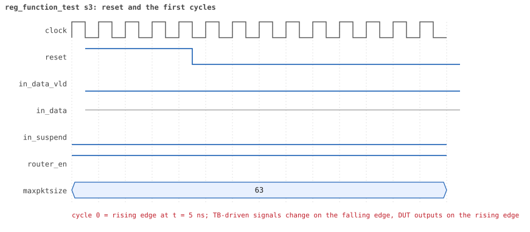
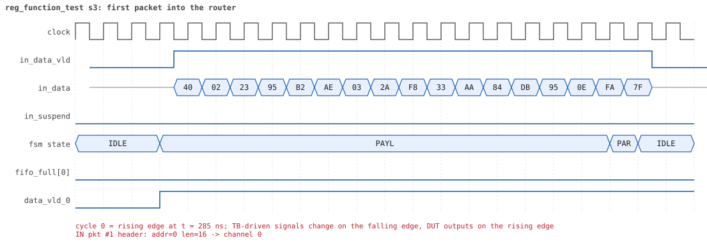
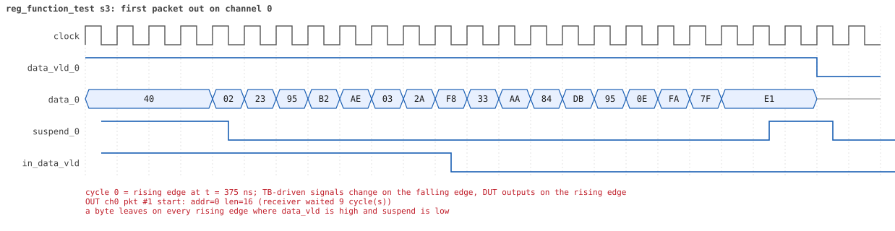
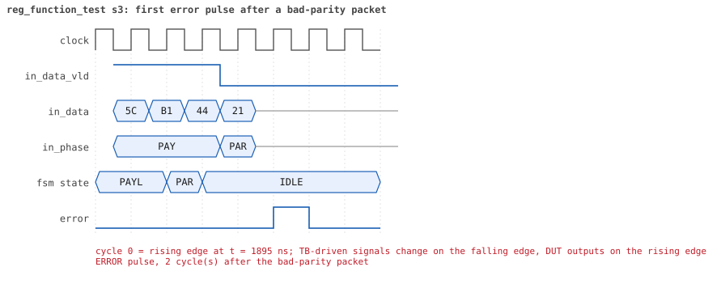
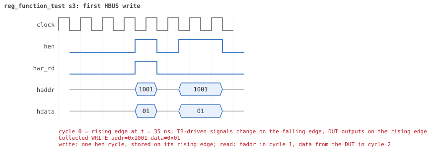
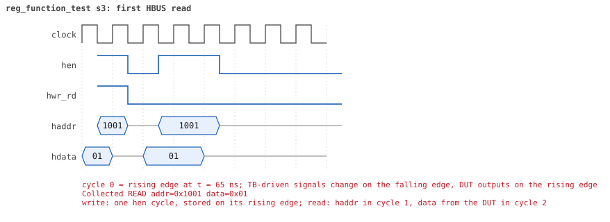

# reg_function_test seed 3

**Result:** PASSED (0 UVM_ERROR, 0 UVM_WARNING, 0 UVM_FATAL) · bench `yapp_project_tb` · sim time 5us · wall 0.7 s · log [`reg_function_test_s3.log`](reg_function_test_s3.log)

Waves: `reg_function_test_s3.fst` (GTKWave, Surfer or the VS Code wave viewer).
[Open the waves in Surfer](https://app.surfer-project.org/?load_url=https%3A%2F%2Fraw.githubusercontent.com%2Ftamirgabgab%2FQcom-Mentoring%2Fmain%2Fyapp_project%2Fregression%2Fyapp_project_tb%2Freg_function_test_s3%2Freg_function_test_s3.fst&startup_commands=run_command_file_from_url%20https%3A%2F%2Fraw.githubusercontent.com%2Ftamirgabgab%2FQcom-Mentoring%2Fmain%2Fyapp_project%2Ftb%2Fyapp_router.sucl) (web app, the signals already in groups: `yapp_project/tb/yapp_router.sucl`).

## Summary

- YAPP driver sent **9** packet(s) (3 with bad parity); the input monitor saw 9.
- Router: **9** forwarded, **0** dropped.
- Packets out: ch0 **3**, ch1 **3**, ch2 **3**.
- Scoreboard: 9 matched, 0 mismatched, 0 unexpected.
- Back-pressure: in_suspend asserted **0** time(s).
- Error pulses: 3.
- HBUS: 2 write(s), 11 read(s).

## Stages

| time (ns) | stage |
|---|---|
| 0 | 1. en_reg=0x01 (router on, counters off): 3 packets, the address counters stay 0 |
| 1520 | 2. en_reg=0xff (every counter on): 6 packets, 2 per address, counters follow the traffic |

## Pictures

**reset and the first cycles**

**first packet into the router**

**first packet out on channel 0**

**first error pulse after a bad-parity packet**

**first HBUS write**

**first HBUS read**

## Timeline

171 events.

| time (ns) | who | event |
|---|---|---|
| 0 | yapp monitor | YAPP monitor running |
| 0 | **test** | STAGE: 1. en_reg=0x01 (router on, counters off): 3 packets, the address counters stay 0 |
| 0 | clk/rst driver | Starting clock (period 10) and holding reset for 5 cycles |
| 0 | **DUT** | RESET asserted |
| 50 | **DUT** | RESET released: router_en=1 maxpktsize=63 |
| 70 | hbus driver | Executed WRITE addr=0x1001 data=0x01 |
| 75 | hbus monitor | Collected WRITE addr=0x1001 data=0x01 |
| 75 | reference | router_en is now 1 (en_reg 0x01) |
| 100 | hbus driver | Executed READ  addr=0x1001 data=0x01 |
| 100 | **test** | en_reg reads 0x01 |
| 100 | yapp driver | TX pkt #1: addr=0 len=16 parity=good delay=20 |
| 105 | hbus monitor | Collected READ  addr=0x1001 data=0x01 |
| 315 | **DUT** | IN  pkt #1 header: addr=0 len=16 -> channel 0 |
| 415 | **DUT** | OUT ch0 pkt #1 start: addr=0 len=16 (receiver waited 9 cycle(s)) |
| 485 | **DUT** | IN  pkt #1 complete: addr=0 len=16 parity=ok forwarded, 18 bytes in 18 cycles (held 0) |
| 485 | yapp monitor | RX pkt #1 on the input: addr=0 len=16 parity=good gap=26 |
| 485 | reference | Packet forwarded: addr=0 len=16 -> channel 0 |
| 490 | yapp driver | TX pkt #1 accepted by the DUT |
| 490 | yapp driver | TX pkt #2: addr=1 len=35 parity=good delay=20 |
| 580 | ch0 driver | ch0: packet consumed (response delay 9) |
| 605 | **DUT** | OUT ch0 pkt #1 done: 18 bytes in 20 cycles |
| 605 | ch0 monitor | ch0 RX pkt #1: addr=0 len=16 parity=good |
| 605 | scoreboard | ch0 pkt matched: addr=0 len=16 (1 matched so far) |
| 695 | **DUT** | IN  pkt #2 header: addr=1 len=35 -> channel 1 |
| 735 | **DUT** | OUT ch1 pkt #1 start: addr=1 len=35 (receiver waited 3 cycle(s)) |
| 1055 | **DUT** | IN  pkt #2 complete: addr=1 len=35 parity=ok forwarded, 37 bytes in 37 cycles (held 0) |
| 1055 | yapp monitor | RX pkt #2 on the input: addr=1 len=35 parity=good gap=20 |
| 1055 | reference | Packet forwarded: addr=1 len=35 -> channel 1 |
| 1060 | yapp driver | TX pkt #2 accepted by the DUT |
| 1060 | yapp driver | TX pkt #3: addr=2 len=14 parity=good delay=18 |
| 1090 | ch1 driver | ch1: packet consumed (response delay 3) |
| 1125 | **DUT** | OUT ch1 pkt #1 done: 37 bytes in 40 cycles |
| 1125 | ch1 monitor | ch1 RX pkt #1: addr=1 len=35 parity=good |
| 1125 | scoreboard | ch1 pkt matched: addr=1 len=35 (2 matched so far) |
| 1170 | ch0 driver | ch0: packet consumed (response delay 1) |
| 1245 | **DUT** | IN  pkt #3 header: addr=2 len=14 -> channel 2 |
| 1325 | **DUT** | OUT ch2 pkt #1 start: addr=2 len=14 (receiver waited 7 cycle(s)) |
| 1395 | **DUT** | IN  pkt #3 complete: addr=2 len=14 parity=ok forwarded, 16 bytes in 16 cycles (held 0) |
| 1395 | yapp monitor | RX pkt #3 on the input: addr=2 len=14 parity=good gap=18 |
| 1395 | reference | Packet forwarded: addr=2 len=14 -> channel 2 |
| 1400 | ch1 driver | ch1: packet consumed (response delay 2) |
| 1400 | yapp driver | TX pkt #3 accepted by the DUT |
| 1430 | hbus driver | Executed READ  addr=0x1009 data=0x00 |
| 1430 | **test** | addr0_cnt_reg reads 0 as expected |
| 1435 | hbus monitor | Collected READ  addr=0x1009 data=0x00 |
| 1460 | hbus driver | Executed READ  addr=0x100a data=0x00 |
| 1460 | **test** | addr1_cnt_reg reads 0 as expected |
| 1465 | hbus monitor | Collected READ  addr=0x100a data=0x00 |
| 1470 | ch2 driver | ch2: packet consumed (response delay 7) |
| 1490 | hbus driver | Executed READ  addr=0x100b data=0x00 |
| 1490 | **test** | addr2_cnt_reg reads 0 as expected |
| 1495 | hbus monitor | Collected READ  addr=0x100b data=0x00 |
| 1520 | hbus driver | Executed READ  addr=0x1006 data=0x00 |
| 1520 | **test** | addr3_cnt_reg reads 0 as expected |
| 1520 | **test** | STAGE: 2. en_reg=0xff (every counter on): 6 packets, 2 per address, counters follow the traffic |
| 1525 | **DUT** | OUT ch2 pkt #1 done: 16 bytes in 21 cycles |
| 1525 | ch2 monitor | ch2 RX pkt #1: addr=2 len=14 parity=good |
| 1525 | scoreboard | ch2 pkt matched: addr=2 len=14 (3 matched so far) |
| 1525 | hbus monitor | Collected READ  addr=0x1006 data=0x00 |
| 1540 | hbus driver | Executed WRITE addr=0x1001 data=0xff |
| 1540 | yapp driver | TX pkt #4: addr=0 len=29 parity=bad delay=7 |
| 1545 | hbus monitor | Collected WRITE addr=0x1001 data=0xff |
| 1545 | reference | router_en is now 1 (en_reg 0xff) |
| 1625 | **DUT** | IN  pkt #4 header: addr=0 len=29 -> channel 0 |
| 1695 | **DUT** | OUT ch0 pkt #2 start: addr=0 len=29 (receiver waited 6 cycle(s)) |
| 1920 | ch2 driver | ch2: packet consumed (response delay 4) |
| 1925 | **DUT** | IN  pkt #4 complete: addr=0 len=29 parity=BAD forwarded, 31 bytes in 31 cycles (held 0) |
| 1925 | yapp monitor | RX pkt #4 on the input: addr=0 len=29 parity=bad gap=22 |
| 1925 | reference | Packet forwarded: addr=0 len=29 -> channel 0 |
| 1930 | yapp driver | TX pkt #4 accepted by the DUT |
| 1930 | yapp driver | TX pkt #5: addr=1 len=49 parity=bad delay=18 |
| 1950 | **DUT** | ERROR pulse, 2 cycle(s) after the bad-parity packet |
| 1990 | ch0 driver | ch0: packet consumed (response delay 6) |
| 2085 | **DUT** | OUT ch0 pkt #2 done: 31 bytes in 40 cycles |
| 2085 | ch0 monitor | ch0 RX pkt #2: addr=0 len=29 parity=bad |
| 2085 | scoreboard | ch0 pkt matched: addr=0 len=29 (4 matched so far) |
| 2115 | **DUT** | IN  pkt #5 header: addr=1 len=49 -> channel 1 |
| 2170 | ch0 driver | ch0: packet consumed (response delay 8) |
| 2185 | **DUT** | OUT ch1 pkt #2 start: addr=1 len=49 (receiver waited 6 cycle(s)) |
| 2615 | **DUT** | IN  pkt #5 complete: addr=1 len=49 parity=BAD forwarded, 51 bytes in 51 cycles (held 0) |
| 2615 | yapp monitor | RX pkt #5 on the input: addr=1 len=49 parity=bad gap=18 |
| 2615 | reference | Packet forwarded: addr=1 len=49 -> channel 1 |
| 2620 | yapp driver | TX pkt #5 accepted by the DUT |
| 2620 | yapp driver | TX pkt #6: addr=2 len=37 parity=bad delay=15 |
| 2630 | **DUT** | ERROR pulse, 1 cycle(s) after the bad-parity packet |
| 2680 | ch1 driver | ch1: packet consumed (response delay 6) |
| 2775 | **DUT** | IN  pkt #6 header: addr=2 len=37 -> channel 2 |
| 2795 | **DUT** | OUT ch1 pkt #2 done: 51 bytes in 62 cycles |
| 2795 | ch1 monitor | ch1 RX pkt #2: addr=1 len=49 parity=bad |
| 2795 | scoreboard | ch1 pkt matched: addr=1 len=49 (5 matched so far) |
| 2815 | **DUT** | OUT ch2 pkt #2 start: addr=2 len=37 (receiver waited 3 cycle(s)) |
| 3155 | **DUT** | IN  pkt #6 complete: addr=2 len=37 parity=BAD forwarded, 39 bytes in 39 cycles (held 0) |
| 3155 | yapp monitor | RX pkt #6 on the input: addr=2 len=37 parity=bad gap=15 |
| 3155 | reference | Packet forwarded: addr=2 len=37 -> channel 2 |
| 3160 | yapp driver | TX pkt #6 accepted by the DUT |
| 3160 | yapp driver | TX pkt #7: addr=0 len=17 parity=good delay=5 |
| 3190 | ch2 driver | ch2: packet consumed (response delay 3) |
| 3200 | ch1 driver | ch1: packet consumed (response delay 10) |
| 3215 | **DUT** | IN  pkt #7 header: addr=0 len=17 -> channel 0 |
| 3230 | **DUT** | ERROR pulse, 7 cycle(s) after the bad-parity packet |
| 3295 | **DUT** | OUT ch0 pkt #3 start: addr=0 len=17 (receiver waited 7 cycle(s)) |
| 3305 | **DUT** | OUT ch2 pkt #2 done: 39 bytes in 50 cycles |
| 3305 | ch2 monitor | ch2 RX pkt #2: addr=2 len=37 parity=bad |
| 3305 | scoreboard | ch2 pkt matched: addr=2 len=37 (6 matched so far) |
| 3360 | ch2 driver | ch2: packet consumed (response delay 10) |
| 3395 | **DUT** | IN  pkt #7 complete: addr=0 len=17 parity=ok forwarded, 19 bytes in 19 cycles (held 0) |
| 3395 | yapp monitor | RX pkt #7 on the input: addr=0 len=17 parity=good gap=5 |
| 3395 | reference | Packet forwarded: addr=0 len=17 -> channel 0 |
| 3400 | yapp driver | TX pkt #7 accepted by the DUT |
| 3400 | yapp driver | TX pkt #8: addr=1 len=31 parity=good delay=1 |
| 3415 | **DUT** | IN  pkt #8 header: addr=1 len=31 -> channel 1 |
| 3455 | **DUT** | OUT ch1 pkt #3 start: addr=1 len=31 (receiver waited 3 cycle(s)) |
| 3470 | ch0 driver | ch0: packet consumed (response delay 7) |
| 3585 | **DUT** | OUT ch0 pkt #3 done: 19 bytes in 30 cycles |
| 3585 | ch0 monitor | ch0 RX pkt #3: addr=0 len=17 parity=good |
| 3585 | scoreboard | ch0 pkt matched: addr=0 len=17 (7 matched so far) |
| 3610 | ch0 driver | ch0: packet consumed (response delay 10) |
| 3735 | **DUT** | IN  pkt #8 complete: addr=1 len=31 parity=ok forwarded, 33 bytes in 33 cycles (held 0) |
| 3735 | yapp monitor | RX pkt #8 on the input: addr=1 len=31 parity=good gap=1 |
| 3735 | reference | Packet forwarded: addr=1 len=31 -> channel 1 |
| 3740 | yapp driver | TX pkt #8 accepted by the DUT |
| 3740 | yapp driver | TX pkt #9: addr=2 len=27 parity=good delay=11 |
| 3770 | ch1 driver | ch1: packet consumed (response delay 3) |
| 3825 | **DUT** | OUT ch1 pkt #3 done: 33 bytes in 38 cycles |
| 3825 | ch1 monitor | ch1 RX pkt #3: addr=1 len=31 parity=good |
| 3825 | scoreboard | ch1 pkt matched: addr=1 len=31 (8 matched so far) |
| 3855 | **DUT** | IN  pkt #9 header: addr=2 len=27 -> channel 2 |
| 3935 | **DUT** | OUT ch2 pkt #3 start: addr=2 len=27 (receiver waited 7 cycle(s)) |
| 4135 | **DUT** | IN  pkt #9 complete: addr=2 len=27 parity=ok forwarded, 29 bytes in 29 cycles (held 0) |
| 4135 | yapp monitor | RX pkt #9 on the input: addr=2 len=27 parity=good gap=11 |
| 4135 | reference | Packet forwarded: addr=2 len=27 -> channel 2 |
| 4140 | yapp driver | TX pkt #9 accepted by the DUT |
| 4170 | hbus driver | Executed READ  addr=0x1009 data=0x02 |
| 4170 | **test** | addr0_cnt_reg reads 2 as expected |
| 4175 | hbus monitor | Collected READ  addr=0x1009 data=0x02 |
| 4200 | hbus driver | Executed READ  addr=0x100a data=0x02 |
| 4200 | **test** | addr1_cnt_reg reads 2 as expected |
| 4205 | hbus monitor | Collected READ  addr=0x100a data=0x02 |
| 4210 | ch2 driver | ch2: packet consumed (response delay 7) |
| 4230 | hbus driver | Executed READ  addr=0x100b data=0x02 |
| 4230 | **test** | addr2_cnt_reg reads 2 as expected |
| 4235 | hbus monitor | Collected READ  addr=0x100b data=0x02 |
| 4260 | ch1 driver | ch1: packet consumed (response delay 4) |
| 4260 | hbus driver | Executed READ  addr=0x1006 data=0x00 |
| 4260 | **test** | addr3_cnt_reg reads 0 as expected |
| 4265 | hbus monitor | Collected READ  addr=0x1006 data=0x00 |
| 4290 | hbus driver | Executed READ  addr=0x1004 data=0x03 |
| 4290 | **test** | parity_err_cnt_reg reads 3 as expected |
| 4295 | hbus monitor | Collected READ  addr=0x1004 data=0x03 |
| 4315 | **DUT** | OUT ch2 pkt #3 done: 29 bytes in 39 cycles |
| 4315 | ch2 monitor | ch2 RX pkt #3: addr=2 len=27 parity=good |
| 4315 | scoreboard | ch2 pkt matched: addr=2 len=27 (9 matched so far) |
| 4320 | hbus driver | Executed READ  addr=0x1005 data=0x00 |
| 4320 | **test** | oversized_pkt_cnt_reg reads 0 as expected |
| 4325 | hbus monitor | Collected READ  addr=0x1005 data=0x00 |
| 4520 | ch0 monitor | Channel 0 report: 3 packets collected |
| 4520 | ch1 monitor | Channel 1 report: 3 packets collected |
| 4520 | ch2 monitor | Channel 2 report: 3 packets collected |
| 4520 | hbus monitor | HBUS report: 2 writes, 11 reads |
| 4520 | coverage | Coverage of the router configuration: 39.1% · maxpktsize 0 / 1 / 2..61 / 62 / 63 : 0 / 0 / 0 / 0 / 9 packets · length < max / = max / max+1 / > max+1 : 9 / 0 / 0 / 0 · forwarded good / bad : 6 / 3 · dropped address 3 good / bad : 0 / 0 · dropped oversized good / bad : 0 / 0 · counter enables none / mixed / all : 3 / 0 / 6 |
| 4520 | coverage | HBUS address coverage: 13 accesses sampled, coverage 22.1% |
| 4520 | coverage | HBUS register bits coverage: 2 writes to ctrl_reg/en_reg, coverage 59.1% |
| 4520 | coverage | HBUS counter value coverage: 10 counter reads sampled, coverage 63.0% |
| 4520 | coverage | HBUS yapp_mem data coverage: 0 accesses sampled, coverage 0.0% |
| 4520 | reference | --- Reference model report --- · forwarded to scoreboard : 9 · dropped (router disabled) : 0 · dropped (oversized) : 0 · dropped (address 3) : 0 · counters parity/oversized/addr0..3 : 3 / 0 / 2 2 2 0 |
| 4520 | scoreboard | --- Scoreboard report --- · packets received : 9 · packets matched : 9 · packets mismatched: 0 · packets unexpected: 0 · packets to addr 3 : 0 · left in queue 0/1/2: 0 / 0 / 0 |
| 4520 | yapp driver | YAPP driver report: 9 packets sent |
| 4520 | coverage | YAPP gap coverage: 8 gaps sampled, coverage 50.0% |
| 4520 | yapp monitor | YAPP monitor report: 9 packets collected, 3 with bad parity |
| 4520 | yapp monitor | YAPP gaps: 0 back to back, 1 of 1 cycle, 0 of 2, 7 longer |
| 4520 | coverage | YAPP packet coverage: 9 packets sampled, coverage 46.7% |
