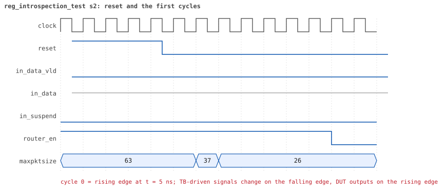
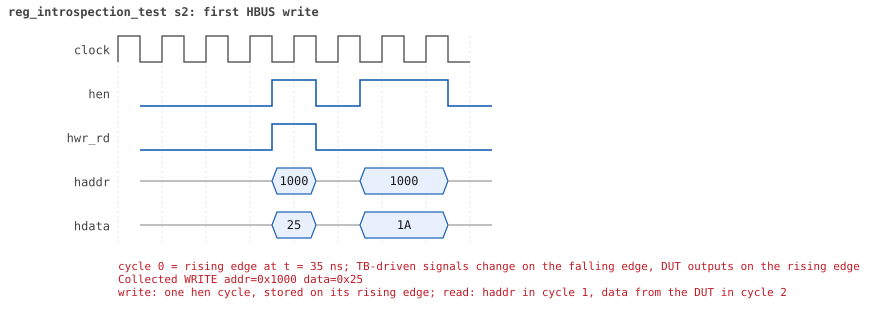
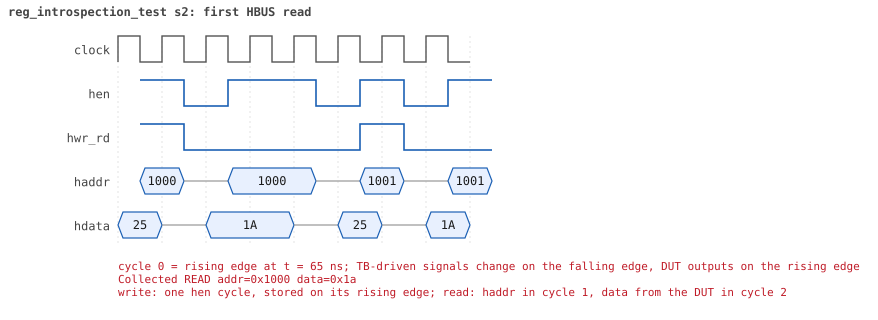

# reg_introspection_test  seed 2

**Result:** PASSED (0 UVM_ERROR, 0 UVM_WARNING, 0 UVM_FATAL) · bench `yapp_project_tb` · sim time 700ns · log `reg_introspection_test_s2.log`

Waves: `reg_introspection_test_s2.fst` (GTKWave, Surfer or the VS Code wave viewer); signal trace: `signals.csv`.
[Open the waves in Surfer](https://app.surfer-project.org/?load_url=https%3A%2F%2Fraw.githubusercontent.com%2Ftamirgabgab%2FQcom-Mentoring%2Fmain%2Fyapp_project%2Fregression%2Fyapp_project_tb%2Freg_introspection_test_s2%2Freg_introspection_test_s2.fst&startup_commands=run_command_file_from_url%20https%3A%2F%2Fraw.githubusercontent.com%2Ftamirgabgab%2FQcom-Mentoring%2Fmain%2Fyapp_project%2Ftb%2Fyapp_router.sucl) (web app, the signals already in groups: `yapp_project/tb/yapp_router.sucl`).

## Summary

- YAPP driver sent **0** packet(s) (0 with bad parity); the input monitor saw 0.
- Router: **0** forwarded, **0** dropped.
- Packets out: ch0 **0**, ch1 **0**, ch2 **0**.
- Scoreboard: 0 matched, 0 mismatched, 0 unexpected.
- Back-pressure: in_suspend asserted **0** time(s).
- Error pulses: 0.
- HBUS: 9 write(s), 9 read(s).

## Stages

| time (ns) | stage |
|---|---|
| 0 | list every register of the model by access rights, then check each one |
| 0 | RW register ctrl_reg: front-door write 0x25, peek, poke 0x1a, front-door read |
| 100 | RW register en_reg: front-door write 0x25, peek, poke 0x1a, front-door read |
| 150 | RO register parity_err_cnt_reg: poke 0x5a, front-door read, write 0x33 must be ignored |
| 200 | RO register oversized_pkt_cnt_reg: poke 0x5a, front-door read, write 0x33 must be ignored |
| 250 | RO register addr3_cnt_reg: poke 0x5a, front-door read, write 0x33 must be ignored |
| 300 | RO register addr0_cnt_reg: poke 0x5a, front-door read, write 0x33 must be ignored |
| 350 | RO register addr1_cnt_reg: poke 0x5a, front-door read, write 0x33 must be ignored |
| 400 | RO register addr2_cnt_reg: poke 0x5a, front-door read, write 0x33 must be ignored |
| 450 | RO register mem_size_reg: poke 0x5a, front-door read, write 0x33 must be ignored |

## Pictures

**reset and the first cycles**

**first HBUS write**

**first HBUS read**

## Timeline

110 events (the same list is in `timeline.csv`).

| time (ns) | who | event |
|---|---|---|
| 0 | yapp monitor | YAPP monitor running |
| 0 | **test** | STAGE: list every register of the model by access rights, then check each one |
| 0 | **test** | RW register: ctrl_reg @ 0x1000 |
| 0 | **test** | RW register: en_reg @ 0x1001 |
| 0 | **test** | RO register: parity_err_cnt_reg @ 0x1004 |
| 0 | **test** | RO register: oversized_pkt_cnt_reg @ 0x1005 |
| 0 | **test** | RO register: addr3_cnt_reg @ 0x1006 |
| 0 | **test** | RO register: addr0_cnt_reg @ 0x1009 |
| 0 | **test** | RO register: addr1_cnt_reg @ 0x100a |
| 0 | **test** | RO register: addr2_cnt_reg @ 0x100b |
| 0 | **test** | RO register: mem_size_reg @ 0x100d |
| 0 | **test** | STAGE: RW register ctrl_reg: front-door write 0x25, peek, poke 0x1a, front-door read |
| 0 | clk/rst driver | Starting clock (period 10) and holding reset for 5 cycles |
| 0 | **DUT** | RESET asserted |
| 50 | **DUT** | RESET released: router_en=1 maxpktsize=63 |
| 70 | hbus driver | Executed WRITE addr=0x1000 data=0x25 |
| 70 | **test** | front-door write 0x25 |
| 70 | **test** | peek            0x25 |
| 70 | **test** | poke            0x1a |
| 75 | **DUT** | CONFIG router_en=1 maxpktsize=26 |
| 75 | hbus monitor | Collected WRITE addr=0x1000 data=0x25 |
| 75 | reference | maxpktsize is now 37 |
| 100 | hbus driver | Executed READ  addr=0x1000 data=0x1a |
| 100 | **test** | front-door read 0x1a |
| 100 | **test** | STAGE: RW register en_reg: front-door write 0x25, peek, poke 0x1a, front-door read |
| 105 | hbus monitor | Collected READ  addr=0x1000 data=0x1a |
| 120 | hbus driver | Executed WRITE addr=0x1001 data=0x25 |
| 120 | **test** | front-door write 0x25 |
| 120 | **test** | peek            0x25 |
| 120 | **test** | poke            0x1a |
| 125 | **DUT** | CONFIG router_en=0 maxpktsize=26 |
| 125 | hbus monitor | Collected WRITE addr=0x1001 data=0x25 |
| 125 | reference | router_en is now 1 (en_reg 0x25) |
| 150 | hbus driver | Executed READ  addr=0x1001 data=0x1a |
| 150 | **test** | front-door read 0x1a |
| 150 | **test** | STAGE: RO register parity_err_cnt_reg: poke 0x5a, front-door read, write 0x33 must be ignored |
| 150 | **test** | poke            0x5a |
| 155 | hbus monitor | Collected READ  addr=0x1001 data=0x1a |
| 180 | hbus driver | Executed READ  addr=0x1004 data=0x5a |
| 180 | **test** | front-door read 0x5a |
| 185 | hbus monitor | Collected READ  addr=0x1004 data=0x5a |
| 200 | hbus driver | Executed WRITE addr=0x1004 data=0x33 |
| 200 | **test** | front-door write 0x33 (RO: must be ignored) |
| 200 | **test** | peek            0x5a |
| 200 | **test** | STAGE: RO register oversized_pkt_cnt_reg: poke 0x5a, front-door read, write 0x33 must be ignored |
| 200 | **test** | poke            0x5a |
| 205 | hbus monitor | Collected WRITE addr=0x1004 data=0x33 |
| 230 | hbus driver | Executed READ  addr=0x1005 data=0x5a |
| 230 | **test** | front-door read 0x5a |
| 235 | hbus monitor | Collected READ  addr=0x1005 data=0x5a |
| 250 | hbus driver | Executed WRITE addr=0x1005 data=0x33 |
| 250 | **test** | front-door write 0x33 (RO: must be ignored) |
| 250 | **test** | peek            0x5a |
| 250 | **test** | STAGE: RO register addr3_cnt_reg: poke 0x5a, front-door read, write 0x33 must be ignored |
| 250 | **test** | poke            0x5a |
| 255 | hbus monitor | Collected WRITE addr=0x1005 data=0x33 |
| 280 | hbus driver | Executed READ  addr=0x1006 data=0x5a |
| 280 | **test** | front-door read 0x5a |
| 285 | hbus monitor | Collected READ  addr=0x1006 data=0x5a |
| 300 | hbus driver | Executed WRITE addr=0x1006 data=0x33 |
| 300 | **test** | front-door write 0x33 (RO: must be ignored) |
| 300 | **test** | peek            0x5a |
| 300 | **test** | STAGE: RO register addr0_cnt_reg: poke 0x5a, front-door read, write 0x33 must be ignored |
| 300 | **test** | poke            0x5a |
| 305 | hbus monitor | Collected WRITE addr=0x1006 data=0x33 |
| 330 | hbus driver | Executed READ  addr=0x1009 data=0x5a |
| 330 | **test** | front-door read 0x5a |
| 335 | hbus monitor | Collected READ  addr=0x1009 data=0x5a |
| 350 | hbus driver | Executed WRITE addr=0x1009 data=0x33 |
| 350 | **test** | front-door write 0x33 (RO: must be ignored) |
| 350 | **test** | peek            0x5a |
| 350 | **test** | STAGE: RO register addr1_cnt_reg: poke 0x5a, front-door read, write 0x33 must be ignored |
| 350 | **test** | poke            0x5a |
| 355 | hbus monitor | Collected WRITE addr=0x1009 data=0x33 |
| 380 | hbus driver | Executed READ  addr=0x100a data=0x5a |
| 380 | **test** | front-door read 0x5a |
| 385 | hbus monitor | Collected READ  addr=0x100a data=0x5a |
| 400 | hbus driver | Executed WRITE addr=0x100a data=0x33 |
| 400 | **test** | front-door write 0x33 (RO: must be ignored) |
| 400 | **test** | peek            0x5a |
| 400 | **test** | STAGE: RO register addr2_cnt_reg: poke 0x5a, front-door read, write 0x33 must be ignored |
| 400 | **test** | poke            0x5a |
| 405 | hbus monitor | Collected WRITE addr=0x100a data=0x33 |
| 430 | hbus driver | Executed READ  addr=0x100b data=0x5a |
| 430 | **test** | front-door read 0x5a |
| 435 | hbus monitor | Collected READ  addr=0x100b data=0x5a |
| 450 | hbus driver | Executed WRITE addr=0x100b data=0x33 |
| 450 | **test** | front-door write 0x33 (RO: must be ignored) |
| 450 | **test** | peek            0x5a |
| 450 | **test** | STAGE: RO register mem_size_reg: poke 0x5a, front-door read, write 0x33 must be ignored |
| 450 | **test** | poke            0x5a |
| 455 | hbus monitor | Collected WRITE addr=0x100b data=0x33 |
| 480 | hbus driver | Executed READ  addr=0x100d data=0x5a |
| 480 | **test** | front-door read 0x5a |
| 485 | hbus monitor | Collected READ  addr=0x100d data=0x5a |
| 500 | hbus driver | Executed WRITE addr=0x100d data=0x33 |
| 500 | **test** | front-door write 0x33 (RO: must be ignored) |
| 500 | **test** | peek            0x5a |
| 505 | hbus monitor | Collected WRITE addr=0x100d data=0x33 |
| 700 | ch0 monitor | Channel 0 report: 0 packets collected |
| 700 | ch1 monitor | Channel 1 report: 0 packets collected |
| 700 | ch2 monitor | Channel 2 report: 0 packets collected |
| 700 | hbus monitor | HBUS report: 9 writes, 9 reads |
| 700 | reference |  |
| 700 | scoreboard |  |
| 700 | yapp driver | YAPP driver report: 0 packets sent |
| 700 | coverage | YAPP gap coverage: 0 gaps sampled, coverage 0.0% |
| 700 | yapp monitor | YAPP monitor report: 0 packets collected, 0 with bad parity |
| 700 | yapp monitor | YAPP gaps: 0 back to back, 0 of 1 cycle, 0 of 2, 0 longer |
| 700 | coverage | YAPP packet coverage: 0 packets sampled, coverage 0.0% |
