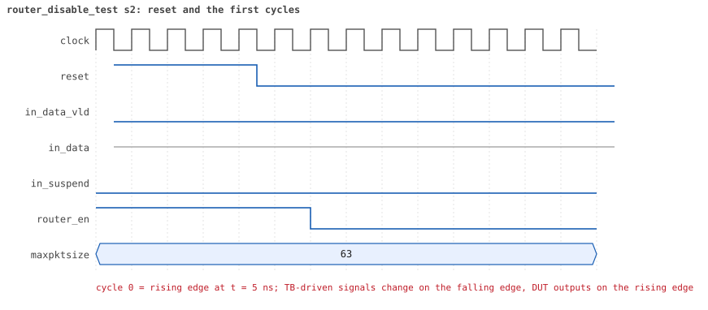
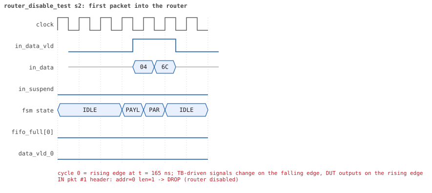
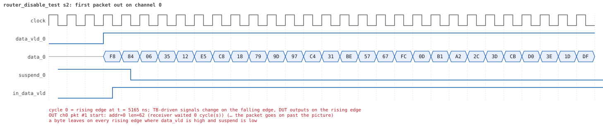
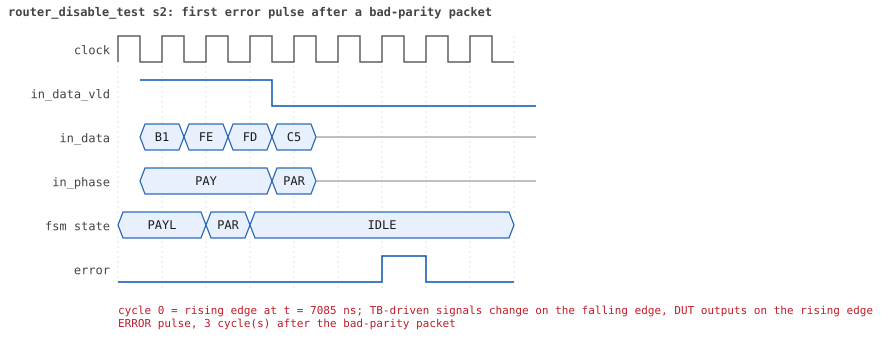
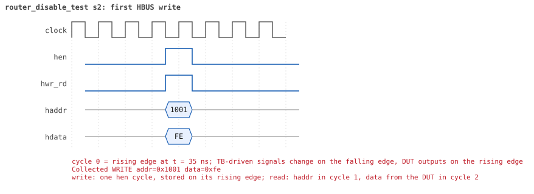
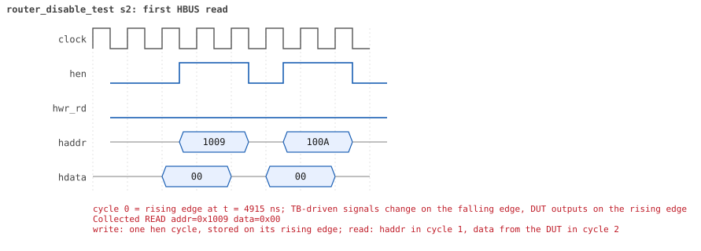

# router_disable_test seed 2

**Result:** PASSED (0 UVM_ERROR, 0 UVM_WARNING, 0 UVM_FATAL) · bench `yapp_project_tb` · sim time 8us · wall 0.4 s · log [`router_disable_test_s2.log`](router_disable_test_s2.log)

Waves: `router_disable_test_s2.fst` (GTKWave, Surfer or the VS Code wave viewer).
[Open the waves in Surfer](https://app.surfer-project.org/?load_url=https%3A%2F%2Fraw.githubusercontent.com%2Ftamirgabgab%2FQcom-Mentoring%2Fmain%2Fyapp_project%2Fregression%2Fyapp_project_tb%2Frouter_disable_test_s2%2Frouter_disable_test_s2.fst&startup_commands=run_command_file_from_url%20https%3A%2F%2Fraw.githubusercontent.com%2Ftamirgabgab%2FQcom-Mentoring%2Fmain%2Fyapp_project%2Ftb%2Fyapp_router.sucl) (web app, the signals already in groups: `yapp_project/tb/yapp_router.sucl`).

## Summary

- YAPP driver sent **6** packet(s) (1 with bad parity); the input monitor saw 6.
- Router: **3** forwarded, **3** dropped (3 router disabled).
- Packets out: ch0 **1**, ch1 **1**, ch2 **1**.
- Scoreboard: 3 matched, 0 mismatched, 0 unexpected.
- Back-pressure: in_suspend asserted **0** time(s).
- Error pulses: 1.
- HBUS: 2 write(s), 11 read(s).

## Stages

| time (ns) | stage |
|---|---|
| 0 | 1. en_reg=0xfe (router_en=0, counters on): 3 packets into a deaf router |
| 5130 | 2. en_reg=0xff (router_en=1): 3 packets, traffic and counters resume |

## Pictures

**reset and the first cycles**

**first packet into the router**

**first packet out on channel 0**

**first error pulse after a bad-parity packet**

**first HBUS write**

**first HBUS read**

## Timeline

121 events.

| time (ns) | who | event |
|---|---|---|
| 0 | yapp monitor | YAPP monitor running |
| 0 | **test** | STAGE: 1. en_reg=0xfe (router_en=0, counters on): 3 packets into a deaf router |
| 0 | clk/rst driver | Starting clock (period 10) and holding reset for 5 cycles |
| 0 | **DUT** | RESET asserted |
| 50 | **DUT** | RESET released: router_en=1 maxpktsize=63 |
| 70 | hbus driver | Executed WRITE addr=0x1001 data=0xfe |
| 70 | yapp driver | TX pkt #1: addr=0 len=1 parity=good delay=11 |
| 75 | **DUT** | CONFIG router_en=0 maxpktsize=63 |
| 75 | hbus monitor | Collected WRITE addr=0x1001 data=0xfe |
| 75 | reference | router_en is now 0 (en_reg 0xfe) |
| 195 | **DUT** | IN  pkt #1 header: addr=0 len=1 -> DROP (router disabled) |
| 215 | **DUT** | IN  pkt #1 complete: addr=0 len=1 parity=ok dropped, 3 bytes in 3 cycles (held 0) |
| 215 | yapp monitor | RX pkt #1 on the input: addr=0 len=1 parity=good gap=14 |
| 215 | reference | Packet dropped: router disabled (addr=0 len=1) |
| 215 | **DUT** | ROUTER DROPS PACKET addr=0 length=1 (router disabled) |
| 220 | yapp driver | TX pkt #1 accepted by the DUT |
| 220 | yapp driver | TX pkt #2: addr=1 len=41 parity=good delay=5 |
| 275 | **DUT** | IN  pkt #2 header: addr=1 len=41 -> DROP (router disabled) |
| 695 | **DUT** | IN  pkt #2 complete: addr=1 len=41 parity=ok dropped, 43 bytes in 43 cycles (held 0) |
| 695 | yapp monitor | RX pkt #2 on the input: addr=1 len=41 parity=good gap=5 |
| 695 | reference | Packet dropped: router disabled (addr=1 len=41) |
| 695 | **DUT** | ROUTER DROPS PACKET addr=1 length=41 (router disabled) |
| 700 | yapp driver | TX pkt #2 accepted by the DUT |
| 700 | yapp driver | TX pkt #3: addr=2 len=9 parity=good delay=12 |
| 825 | **DUT** | IN  pkt #3 header: addr=2 len=9 -> DROP (router disabled) |
| 925 | **DUT** | IN  pkt #3 complete: addr=2 len=9 parity=ok dropped, 11 bytes in 11 cycles (held 0) |
| 925 | yapp monitor | RX pkt #3 on the input: addr=2 len=9 parity=good gap=12 |
| 925 | reference | Packet dropped: router disabled (addr=2 len=9) |
| 925 | **DUT** | ROUTER DROPS PACKET addr=2 length=9 (router disabled) |
| 930 | yapp driver | TX pkt #3 accepted by the DUT |
| 4925 | **test** | router_en = 0: no packet reached a channel |
| 4950 | hbus driver | Executed READ  addr=0x1009 data=0x00 |
| 4950 | **test** | addr0_cnt_reg reads 0 as expected |
| 4955 | hbus monitor | Collected READ  addr=0x1009 data=0x00 |
| 4980 | hbus driver | Executed READ  addr=0x100a data=0x00 |
| 4980 | **test** | addr1_cnt_reg reads 0 as expected |
| 4985 | hbus monitor | Collected READ  addr=0x100a data=0x00 |
| 5010 | hbus driver | Executed READ  addr=0x100b data=0x00 |
| 5010 | **test** | addr2_cnt_reg reads 0 as expected |
| 5015 | hbus monitor | Collected READ  addr=0x100b data=0x00 |
| 5040 | hbus driver | Executed READ  addr=0x1006 data=0x00 |
| 5040 | **test** | addr3_cnt_reg reads 0 as expected |
| 5045 | hbus monitor | Collected READ  addr=0x1006 data=0x00 |
| 5070 | hbus driver | Executed READ  addr=0x1004 data=0x00 |
| 5070 | **test** | parity_err_cnt_reg reads 0 as expected |
| 5075 | hbus monitor | Collected READ  addr=0x1004 data=0x00 |
| 5100 | hbus driver | Executed READ  addr=0x1005 data=0x00 |
| 5100 | **test** | oversized_pkt_cnt_reg reads 0 as expected |
| 5105 | hbus monitor | Collected READ  addr=0x1005 data=0x00 |
| 5130 | hbus driver | Executed READ  addr=0x100d data=0x00 |
| 5130 | **test** | mem_size_reg reads 0 as expected |
| 5130 | **test** | STAGE: 2. en_reg=0xff (router_en=1): 3 packets, traffic and counters resume |
| 5135 | hbus monitor | Collected READ  addr=0x100d data=0x00 |
| 5150 | hbus driver | Executed WRITE addr=0x1001 data=0xff |
| 5150 | yapp driver | TX pkt #4: addr=0 len=62 parity=good delay=3 |
| 5155 | **DUT** | CONFIG router_en=1 maxpktsize=63 |
| 5155 | hbus monitor | Collected WRITE addr=0x1001 data=0xff |
| 5155 | reference | router_en is now 1 (en_reg 0xff) |
| 5195 | **DUT** | IN  pkt #4 header: addr=0 len=62 -> channel 0 |
| 5205 | **DUT** | OUT ch0 pkt #1 start: addr=0 len=62 (receiver waited 0 cycle(s)) |
| 5825 | **DUT** | IN  pkt #4 complete: addr=0 len=62 parity=ok forwarded, 64 bytes in 64 cycles (held 0) |
| 5825 | yapp monitor | RX pkt #4 on the input: addr=0 len=62 parity=good gap=426 |
| 5825 | reference | Packet forwarded: addr=0 len=62 -> channel 0 |
| 5830 | ch0 driver | ch0: packet consumed (response delay 0) |
| 5830 | yapp driver | TX pkt #4 accepted by the DUT |
| 5830 | yapp driver | TX pkt #5: addr=1 len=49 parity=good delay=20 |
| 5915 | **DUT** | OUT ch0 pkt #1 done: 64 bytes in 72 cycles |
| 5915 | ch0 monitor | ch0 RX pkt #1: addr=0 len=62 parity=good |
| 5915 | scoreboard | ch0 pkt matched: addr=0 len=62 (1 matched so far) |
| 6035 | **DUT** | IN  pkt #5 header: addr=1 len=49 -> channel 1 |
| 6065 | **DUT** | OUT ch1 pkt #1 start: addr=1 len=49 (receiver waited 2 cycle(s)) |
| 6090 | ch0 driver | ch0: packet consumed (response delay 7) |
| 6535 | **DUT** | IN  pkt #5 complete: addr=1 len=49 parity=ok forwarded, 51 bytes in 51 cycles (held 0) |
| 6535 | yapp monitor | RX pkt #5 on the input: addr=1 len=49 parity=good gap=20 |
| 6535 | reference | Packet forwarded: addr=1 len=49 -> channel 1 |
| 6540 | yapp driver | TX pkt #5 accepted by the DUT |
| 6540 | yapp driver | TX pkt #6: addr=2 len=38 parity=bad delay=18 |
| 6560 | ch1 driver | ch1: packet consumed (response delay 2) |
| 6645 | **DUT** | OUT ch1 pkt #1 done: 51 bytes in 59 cycles |
| 6645 | ch1 monitor | ch1 RX pkt #1: addr=1 len=49 parity=good |
| 6645 | scoreboard | ch1 pkt matched: addr=1 len=49 (2 matched so far) |
| 6670 | ch1 driver | ch1: packet consumed (response delay 7) |
| 6725 | **DUT** | IN  pkt #6 header: addr=2 len=38 -> channel 2 |
| 6835 | **DUT** | OUT ch2 pkt #1 start: addr=2 len=38 (receiver waited 10 cycle(s)) |
| 7115 | **DUT** | IN  pkt #6 complete: addr=2 len=38 parity=BAD forwarded, 40 bytes in 40 cycles (held 0) |
| 7115 | yapp monitor | RX pkt #6 on the input: addr=2 len=38 parity=bad gap=18 |
| 7115 | reference | Packet forwarded: addr=2 len=38 -> channel 2 |
| 7120 | yapp driver | TX pkt #6 accepted by the DUT |
| 7150 | **DUT** | ERROR pulse, 3 cycle(s) after the bad-parity packet |
| 7220 | ch2 driver | ch2: packet consumed (response delay 10) |
| 7335 | **DUT** | OUT ch2 pkt #1 done: 40 bytes in 51 cycles |
| 7335 | ch2 monitor | ch2 RX pkt #1: addr=2 len=38 parity=bad |
| 7335 | scoreboard | ch2 pkt matched: addr=2 len=38 (3 matched so far) |
| 7360 | hbus driver | Executed READ  addr=0x1009 data=0x01 |
| 7360 | **test** | addr0_cnt_reg reads 1 as expected |
| 7365 | hbus monitor | Collected READ  addr=0x1009 data=0x01 |
| 7390 | hbus driver | Executed READ  addr=0x100a data=0x01 |
| 7390 | **test** | addr1_cnt_reg reads 1 as expected |
| 7395 | hbus monitor | Collected READ  addr=0x100a data=0x01 |
| 7420 | hbus driver | Executed READ  addr=0x100b data=0x01 |
| 7420 | **test** | addr2_cnt_reg reads 1 as expected |
| 7425 | hbus monitor | Collected READ  addr=0x100b data=0x01 |
| 7450 | hbus driver | Executed READ  addr=0x1006 data=0x00 |
| 7450 | **test** | addr3_cnt_reg reads 0 as expected |
| 7455 | hbus monitor | Collected READ  addr=0x1006 data=0x00 |
| 7650 | ch0 monitor | Channel 0 report: 1 packets collected |
| 7650 | ch1 monitor | Channel 1 report: 1 packets collected |
| 7650 | ch2 monitor | Channel 2 report: 1 packets collected |
| 7650 | hbus monitor | HBUS report: 2 writes, 11 reads |
| 7650 | coverage | Coverage of the router configuration: 34.8% · maxpktsize 0 / 1 / 2..61 / 62 / 63 : 0 / 0 / 0 / 0 / 3 packets · length < max / = max / max+1 / > max+1 : 3 / 0 / 0 / 0 · forwarded good / bad : 2 / 1 · dropped address 3 good / bad : 0 / 0 · dropped oversized good / bad : 0 / 0 · counter enables none / mixed / all : 0 / 0 / 3 |
| 7650 | coverage | HBUS address coverage: 13 accesses sampled, coverage 23.4% |
| 7650 | coverage | HBUS register bits coverage: 2 writes to ctrl_reg/en_reg, coverage 45.5% |
| 7650 | coverage | HBUS counter value coverage: 10 counter reads sampled, coverage 63.0% |
| 7650 | coverage | HBUS yapp_mem data coverage: 0 accesses sampled, coverage 0.0% |
| 7650 | reference | --- Reference model report --- · forwarded to scoreboard : 3 · dropped (router disabled) : 3 · dropped (oversized) : 0 · dropped (address 3) : 0 · counters parity/oversized/addr0..3 : 1 / 0 / 1 1 1 0 |
| 7650 | scoreboard | --- Scoreboard report --- · packets received : 3 · packets matched : 3 · packets mismatched: 0 · packets unexpected: 0 · packets to addr 3 : 0 · left in queue 0/1/2: 0 / 0 / 0 |
| 7650 | yapp driver | YAPP driver report: 6 packets sent |
| 7650 | coverage | YAPP gap coverage: 5 gaps sampled, coverage 25.0% |
| 7650 | yapp monitor | YAPP monitor report: 6 packets collected, 1 with bad parity |
| 7650 | yapp monitor | YAPP gaps: 0 back to back, 0 of 1 cycle, 0 of 2, 5 longer |
| 7650 | coverage | YAPP packet coverage: 6 packets sampled, coverage 46.7% |
