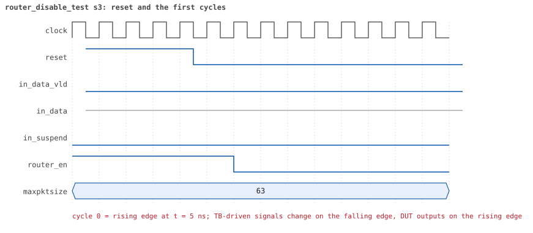
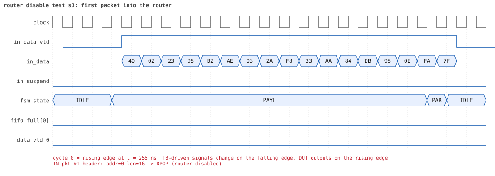
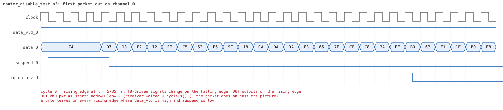
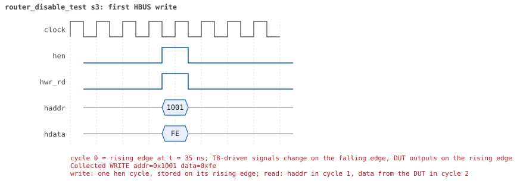
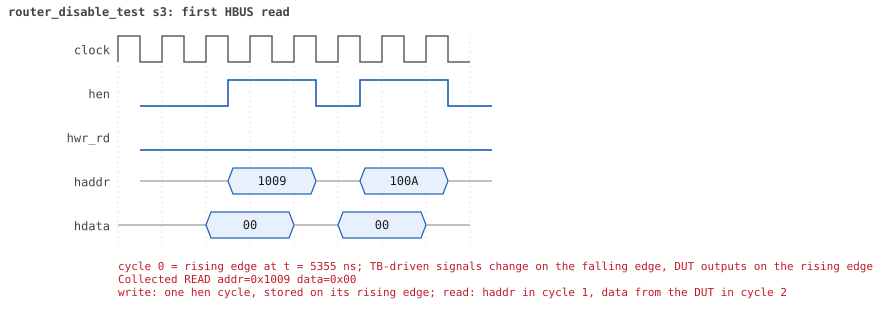

# router_disable_test  seed 3

**Result:** PASSED (0 UVM_ERROR, 0 UVM_WARNING, 0 UVM_FATAL) · bench `yapp_project_tb` · sim time 8us · log `router_disable_test_s3.log`

Waves: `router_disable_test_s3.fst` (GTKWave, Surfer or the VS Code wave viewer); signal trace: `signals.csv`.

## Summary

- YAPP driver sent **6** packet(s) (1 with bad parity); the input monitor saw 6.
- Router: **3** forwarded, **3** dropped (3 router disabled).
- Packets out: ch0 **1**, ch1 **1**, ch2 **1**.
- Scoreboard: 3 matched, 0 mismatched, 0 unexpected.
- Back-pressure: in_suspend asserted **0** time(s).
- Error pulses: 0.
- HBUS: 2 write(s), 11 read(s).

## Stages

| time (ns) | stage |
|---|---|
| 0 | 1. en_reg=0xfe (router_en=0, counters on): 3 packets into a deaf router |
| 5570 | 2. en_reg=0xff (router_en=1): 3 packets, traffic and counters resume |

## Pictures

**reset and the first cycles**

**first packet into the router**

**first packet out on channel 0**

**first HBUS write**

**first HBUS read**

## Timeline

113 events (the same list is in `timeline.csv`).

| time (ns) | who | event |
|---|---|---|
| 0 | yapp monitor | YAPP monitor running |
| 0 | **test** | STAGE: 1. en_reg=0xfe (router_en=0, counters on): 3 packets into a deaf router |
| 0 | clk/rst driver | Starting clock (period 10) and holding reset for 5 cycles |
| 0 | **DUT** | RESET asserted |
| 50 | **DUT** | RESET released: router_en=1 maxpktsize=63 |
| 70 | hbus driver | Executed WRITE addr=0x1001 data=0xfe |
| 70 | yapp driver | TX pkt #1: addr=0 len=16 parity=good delay=20 |
| 75 | **DUT** | CONFIG router_en=0 maxpktsize=63 |
| 75 | hbus monitor | Collected WRITE addr=0x1001 data=0xfe |
| 75 | reference | router_en is now 0 |
| 285 | **DUT** | IN  pkt #1 header: addr=0 len=16 -> DROP (router disabled) |
| 455 | **DUT** | IN  pkt #1 complete: addr=0 len=16 parity=ok dropped, 18 bytes in 18 cycles (held 0) |
| 455 | yapp monitor | RX pkt #1 on the input: addr=0 len=16 parity=good gap=23 |
| 455 | reference | Packet dropped: router disabled (addr=0 len=16) |
| 455 | **DUT** | ROUTER DROPS PACKET addr=0 length=16 (router disabled) |
| 460 | yapp driver | TX pkt #1 accepted by the DUT |
| 460 | yapp driver | TX pkt #2: addr=1 len=35 parity=good delay=20 |
| 665 | **DUT** | IN  pkt #2 header: addr=1 len=35 -> DROP (router disabled) |
| 1025 | **DUT** | IN  pkt #2 complete: addr=1 len=35 parity=ok dropped, 37 bytes in 37 cycles (held 0) |
| 1025 | yapp monitor | RX pkt #2 on the input: addr=1 len=35 parity=good gap=20 |
| 1025 | reference | Packet dropped: router disabled (addr=1 len=35) |
| 1025 | **DUT** | ROUTER DROPS PACKET addr=1 length=35 (router disabled) |
| 1030 | yapp driver | TX pkt #2 accepted by the DUT |
| 1030 | yapp driver | TX pkt #3: addr=2 len=14 parity=bad delay=18 |
| 1215 | **DUT** | IN  pkt #3 header: addr=2 len=14 -> DROP (router disabled) |
| 1365 | **DUT** | IN  pkt #3 complete: addr=2 len=14 parity=BAD dropped, 16 bytes in 16 cycles (held 0) |
| 1365 | yapp monitor | RX pkt #3 on the input: addr=2 len=14 parity=bad gap=18 |
| 1365 | reference | Packet dropped: router disabled (addr=2 len=14) |
| 1365 | **DUT** | ROUTER DROPS PACKET addr=2 length=14 (router disabled) |
| 1370 | yapp driver | TX pkt #3 accepted by the DUT |
| 5365 | **test** | router_en = 0: no packet reached a channel |
| 5390 | hbus driver | Executed READ  addr=0x1009 data=0x00 |
| 5390 | **test** | addr0_cnt_reg reads 0 as expected |
| 5395 | hbus monitor | Collected READ  addr=0x1009 data=0x00 |
| 5420 | hbus driver | Executed READ  addr=0x100a data=0x00 |
| 5420 | **test** | addr1_cnt_reg reads 0 as expected |
| 5425 | hbus monitor | Collected READ  addr=0x100a data=0x00 |
| 5450 | hbus driver | Executed READ  addr=0x100b data=0x00 |
| 5450 | **test** | addr2_cnt_reg reads 0 as expected |
| 5455 | hbus monitor | Collected READ  addr=0x100b data=0x00 |
| 5480 | hbus driver | Executed READ  addr=0x1006 data=0x00 |
| 5480 | **test** | addr3_cnt_reg reads 0 as expected |
| 5485 | hbus monitor | Collected READ  addr=0x1006 data=0x00 |
| 5510 | hbus driver | Executed READ  addr=0x1004 data=0x00 |
| 5510 | **test** | parity_err_cnt_reg reads 0 as expected |
| 5515 | hbus monitor | Collected READ  addr=0x1004 data=0x00 |
| 5540 | hbus driver | Executed READ  addr=0x1005 data=0x00 |
| 5540 | **test** | oversized_pkt_cnt_reg reads 0 as expected |
| 5545 | hbus monitor | Collected READ  addr=0x1005 data=0x00 |
| 5570 | hbus driver | Executed READ  addr=0x100d data=0x00 |
| 5570 | **test** | mem_size_reg reads 0 as expected |
| 5570 | **test** | STAGE: 2. en_reg=0xff (router_en=1): 3 packets, traffic and counters resume |
| 5575 | hbus monitor | Collected READ  addr=0x100d data=0x00 |
| 5590 | hbus driver | Executed WRITE addr=0x1001 data=0xff |
| 5590 | yapp driver | TX pkt #4: addr=0 len=29 parity=good delay=7 |
| 5595 | **DUT** | CONFIG router_en=1 maxpktsize=63 |
| 5595 | hbus monitor | Collected WRITE addr=0x1001 data=0xff |
| 5595 | reference | router_en is now 1 |
| 5675 | **DUT** | IN  pkt #4 header: addr=0 len=29 -> channel 0 |
| 5775 | **DUT** | OUT ch0 pkt #1 start: addr=0 len=29 (receiver waited 9 cycle(s)) |
| 5975 | **DUT** | IN  pkt #4 complete: addr=0 len=29 parity=ok forwarded, 31 bytes in 31 cycles (held 0) |
| 5975 | yapp monitor | RX pkt #4 on the input: addr=0 len=29 parity=good gap=430 |
| 5975 | reference | Packet forwarded: addr=0 len=29 -> channel 0 |
| 5980 | yapp driver | TX pkt #4 accepted by the DUT |
| 5980 | yapp driver | TX pkt #5: addr=1 len=49 parity=good delay=18 |
| 6070 | ch0 driver | ch0: packet consumed (response delay 9) |
| 6095 | **DUT** | OUT ch0 pkt #1 done: 31 bytes in 33 cycles |
| 6095 | ch0 monitor | ch0 RX pkt #1: addr=0 len=29 parity=good |
| 6095 | scoreboard | ch0 pkt matched: addr=0 len=29 (1 matched so far) |
| 6165 | **DUT** | IN  pkt #5 header: addr=1 len=49 -> channel 1 |
| 6205 | **DUT** | OUT ch1 pkt #1 start: addr=1 len=49 (receiver waited 3 cycle(s)) |
| 6590 | ch0 driver | ch0: packet consumed (response delay 1) |
| 6665 | **DUT** | IN  pkt #5 complete: addr=1 len=49 parity=ok forwarded, 51 bytes in 51 cycles (held 0) |
| 6665 | yapp monitor | RX pkt #5 on the input: addr=1 len=49 parity=good gap=18 |
| 6665 | reference | Packet forwarded: addr=1 len=49 -> channel 1 |
| 6670 | yapp driver | TX pkt #5 accepted by the DUT |
| 6670 | yapp driver | TX pkt #6: addr=2 len=37 parity=good delay=15 |
| 6700 | ch1 driver | ch1: packet consumed (response delay 3) |
| 6735 | **DUT** | OUT ch1 pkt #1 done: 51 bytes in 54 cycles |
| 6735 | ch1 monitor | ch1 RX pkt #1: addr=1 len=49 parity=good |
| 6735 | scoreboard | ch1 pkt matched: addr=1 len=49 (2 matched so far) |
| 6825 | **DUT** | IN  pkt #6 header: addr=2 len=37 -> channel 2 |
| 6905 | **DUT** | OUT ch2 pkt #1 start: addr=2 len=37 (receiver waited 7 cycle(s)) |
| 7140 | ch1 driver | ch1: packet consumed (response delay 2) |
| 7205 | **DUT** | IN  pkt #6 complete: addr=2 len=37 parity=ok forwarded, 39 bytes in 39 cycles (held 0) |
| 7205 | yapp monitor | RX pkt #6 on the input: addr=2 len=37 parity=good gap=15 |
| 7205 | reference | Packet forwarded: addr=2 len=37 -> channel 2 |
| 7210 | yapp driver | TX pkt #6 accepted by the DUT |
| 7280 | ch2 driver | ch2: packet consumed (response delay 7) |
| 7335 | **DUT** | OUT ch2 pkt #1 done: 39 bytes in 44 cycles |
| 7335 | ch2 monitor | ch2 RX pkt #1: addr=2 len=37 parity=good |
| 7335 | scoreboard | ch2 pkt matched: addr=2 len=37 (3 matched so far) |
| 7360 | hbus driver | Executed READ  addr=0x1009 data=0x01 |
| 7360 | **test** | addr0_cnt_reg reads 1 as expected |
| 7365 | hbus monitor | Collected READ  addr=0x1009 data=0x01 |
| 7390 | hbus driver | Executed READ  addr=0x100a data=0x01 |
| 7390 | **test** | addr1_cnt_reg reads 1 as expected |
| 7395 | hbus monitor | Collected READ  addr=0x100a data=0x01 |
| 7420 | hbus driver | Executed READ  addr=0x100b data=0x01 |
| 7420 | **test** | addr2_cnt_reg reads 1 as expected |
| 7425 | hbus monitor | Collected READ  addr=0x100b data=0x01 |
| 7450 | hbus driver | Executed READ  addr=0x1006 data=0x00 |
| 7450 | **test** | addr3_cnt_reg reads 0 as expected |
| 7455 | hbus monitor | Collected READ  addr=0x1006 data=0x00 |
| 7650 | ch0 monitor | Channel 0 report: 1 packets collected |
| 7650 | ch1 monitor | Channel 1 report: 1 packets collected |
| 7650 | ch2 monitor | Channel 2 report: 1 packets collected |
| 7650 | hbus monitor | HBUS report: 2 writes, 11 reads |
| 7650 | reference |  |
| 7650 | scoreboard |  |
| 7650 | yapp driver | YAPP driver report: 6 packets sent |
| 7650 | yapp monitor | YAPP monitor report: 6 packets collected, coverage 40.0% |
| 7650 | yapp monitor | YAPP gaps: 0 back to back, 0 of 1 cycle, 0 of 2, 5 longer (gap coverage 25.0%) |
