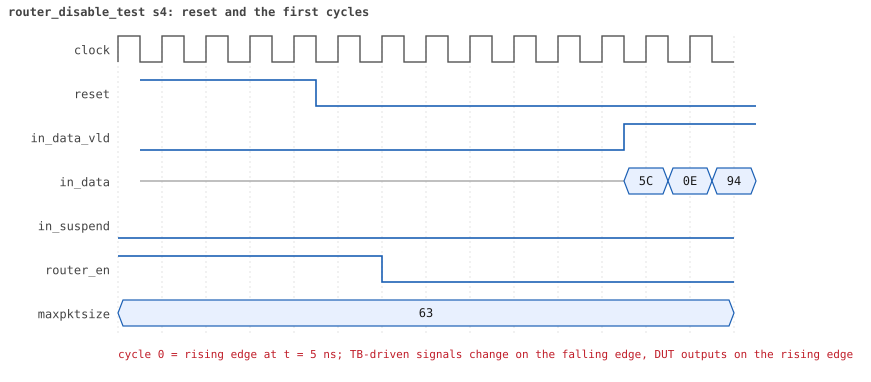
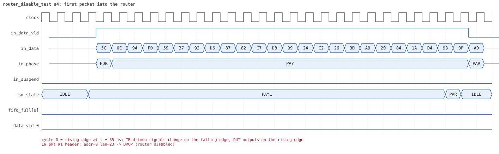
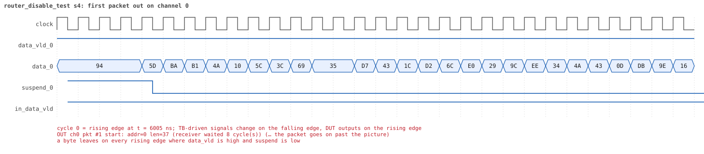
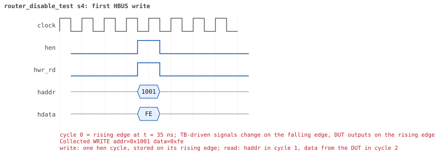
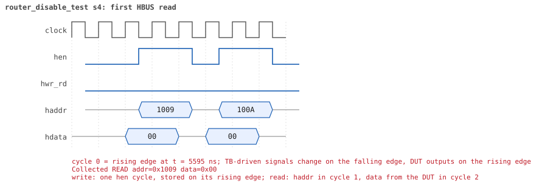

# router_disable_test  seed 4

**Result:** PASSED (0 UVM_ERROR, 0 UVM_WARNING, 0 UVM_FATAL) · bench `yapp_project_tb` · sim time 7us · log `router_disable_test_s4.log`

Waves: `router_disable_test_s4.fst` (GTKWave, Surfer or the VS Code wave viewer); signal trace: `signals.csv`.
[Open the waves in Surfer](https://app.surfer-project.org/?load_url=https%3A%2F%2Fraw.githubusercontent.com%2Ftamirgabgab%2FQcom-Mentoring%2Fmain%2Fyapp_project%2Fregression%2Fyapp_project_tb%2Frouter_disable_test_s4%2Frouter_disable_test_s4.fst&startup_commands=run_command_file_from_url%20https%3A%2F%2Fraw.githubusercontent.com%2Ftamirgabgab%2FQcom-Mentoring%2Fmain%2Fyapp_project%2Ftb%2Fyapp_router.sucl) (web app, the signals already in groups: `yapp_project/tb/yapp_router.sucl`).

## Summary

- YAPP driver sent **6** packet(s) (0 with bad parity); the input monitor saw 6.
- Router: **3** forwarded, **3** dropped (3 router disabled).
- Packets out: ch0 **1**, ch1 **1**, ch2 **1**.
- Scoreboard: 3 matched, 0 mismatched, 0 unexpected.
- Back-pressure: in_suspend asserted **0** time(s).
- Error pulses: 0.
- HBUS: 2 write(s), 11 read(s).

## Stages

| time (ns) | stage |
|---|---|
| 0 | 1. en_reg=0xfe (router_en=0, counters on): 3 packets into a deaf router |
| 5810 | 2. en_reg=0xff (router_en=1): 3 packets, traffic and counters resume |

## Pictures

**reset and the first cycles**

**first packet into the router**

**first packet out on channel 0**

**first HBUS write**

**first HBUS read**

## Timeline

117 events (the same list is in `timeline.csv`).

| time (ns) | who | event |
|---|---|---|
| 0 | yapp monitor | YAPP monitor running |
| 0 | **test** | STAGE: 1. en_reg=0xfe (router_en=0, counters on): 3 packets into a deaf router |
| 0 | clk/rst driver | Starting clock (period 10) and holding reset for 5 cycles |
| 0 | **DUT** | RESET asserted |
| 50 | **DUT** | RESET released: router_en=1 maxpktsize=63 |
| 70 | hbus driver | Executed WRITE addr=0x1001 data=0xfe |
| 70 | yapp driver | TX pkt #1: addr=0 len=23 parity=good delay=3 |
| 75 | **DUT** | CONFIG router_en=0 maxpktsize=63 |
| 75 | hbus monitor | Collected WRITE addr=0x1001 data=0xfe |
| 75 | reference | router_en is now 0 (en_reg 0xfe) |
| 115 | **DUT** | IN  pkt #1 header: addr=0 len=23 -> DROP (router disabled) |
| 355 | **DUT** | IN  pkt #1 complete: addr=0 len=23 parity=ok dropped, 25 bytes in 25 cycles (held 0) |
| 355 | yapp monitor | RX pkt #1 on the input: addr=0 len=23 parity=good gap=6 |
| 355 | reference | Packet dropped: router disabled (addr=0 len=23) |
| 355 | **DUT** | ROUTER DROPS PACKET addr=0 length=23 (router disabled) |
| 360 | yapp driver | TX pkt #1 accepted by the DUT |
| 360 | yapp driver | TX pkt #2: addr=1 len=48 parity=good delay=20 |
| 565 | **DUT** | IN  pkt #2 header: addr=1 len=48 -> DROP (router disabled) |
| 1055 | **DUT** | IN  pkt #2 complete: addr=1 len=48 parity=ok dropped, 50 bytes in 50 cycles (held 0) |
| 1055 | yapp monitor | RX pkt #2 on the input: addr=1 len=48 parity=good gap=20 |
| 1055 | reference | Packet dropped: router disabled (addr=1 len=48) |
| 1055 | **DUT** | ROUTER DROPS PACKET addr=1 length=48 (router disabled) |
| 1060 | yapp driver | TX pkt #2 accepted by the DUT |
| 1060 | yapp driver | TX pkt #3: addr=2 len=47 parity=good delay=6 |
| 1125 | **DUT** | IN  pkt #3 header: addr=2 len=47 -> DROP (router disabled) |
| 1605 | **DUT** | IN  pkt #3 complete: addr=2 len=47 parity=ok dropped, 49 bytes in 49 cycles (held 0) |
| 1605 | yapp monitor | RX pkt #3 on the input: addr=2 len=47 parity=good gap=6 |
| 1605 | reference | Packet dropped: router disabled (addr=2 len=47) |
| 1605 | **DUT** | ROUTER DROPS PACKET addr=2 length=47 (router disabled) |
| 1610 | yapp driver | TX pkt #3 accepted by the DUT |
| 5605 | **test** | router_en = 0: no packet reached a channel |
| 5630 | hbus driver | Executed READ  addr=0x1009 data=0x00 |
| 5630 | **test** | addr0_cnt_reg reads 0 as expected |
| 5635 | hbus monitor | Collected READ  addr=0x1009 data=0x00 |
| 5660 | hbus driver | Executed READ  addr=0x100a data=0x00 |
| 5660 | **test** | addr1_cnt_reg reads 0 as expected |
| 5665 | hbus monitor | Collected READ  addr=0x100a data=0x00 |
| 5690 | hbus driver | Executed READ  addr=0x100b data=0x00 |
| 5690 | **test** | addr2_cnt_reg reads 0 as expected |
| 5695 | hbus monitor | Collected READ  addr=0x100b data=0x00 |
| 5720 | hbus driver | Executed READ  addr=0x1006 data=0x00 |
| 5720 | **test** | addr3_cnt_reg reads 0 as expected |
| 5725 | hbus monitor | Collected READ  addr=0x1006 data=0x00 |
| 5750 | hbus driver | Executed READ  addr=0x1004 data=0x00 |
| 5750 | **test** | parity_err_cnt_reg reads 0 as expected |
| 5755 | hbus monitor | Collected READ  addr=0x1004 data=0x00 |
| 5780 | hbus driver | Executed READ  addr=0x1005 data=0x00 |
| 5780 | **test** | oversized_pkt_cnt_reg reads 0 as expected |
| 5785 | hbus monitor | Collected READ  addr=0x1005 data=0x00 |
| 5810 | hbus driver | Executed READ  addr=0x100d data=0x00 |
| 5810 | **test** | mem_size_reg reads 0 as expected |
| 5810 | **test** | STAGE: 2. en_reg=0xff (router_en=1): 3 packets, traffic and counters resume |
| 5815 | hbus monitor | Collected READ  addr=0x100d data=0x00 |
| 5830 | hbus driver | Executed WRITE addr=0x1001 data=0xff |
| 5830 | yapp driver | TX pkt #4: addr=0 len=37 parity=good delay=11 |
| 5835 | **DUT** | CONFIG router_en=1 maxpktsize=63 |
| 5835 | hbus monitor | Collected WRITE addr=0x1001 data=0xff |
| 5835 | reference | router_en is now 1 (en_reg 0xff) |
| 5955 | **DUT** | IN  pkt #4 header: addr=0 len=37 -> channel 0 |
| 6045 | **DUT** | OUT ch0 pkt #1 start: addr=0 len=37 (receiver waited 8 cycle(s)) |
| 6335 | **DUT** | IN  pkt #4 complete: addr=0 len=37 parity=ok forwarded, 39 bytes in 39 cycles (held 0) |
| 6335 | yapp monitor | RX pkt #4 on the input: addr=0 len=37 parity=good gap=434 |
| 6335 | reference | Packet forwarded: addr=0 len=37 -> channel 0 |
| 6340 | yapp driver | TX pkt #4 accepted by the DUT |
| 6340 | yapp driver | TX pkt #5: addr=1 len=4 parity=good delay=1 |
| 6355 | **DUT** | IN  pkt #5 header: addr=1 len=4 -> channel 1 |
| 6405 | **DUT** | IN  pkt #5 complete: addr=1 len=4 parity=ok forwarded, 6 bytes in 6 cycles (held 0) |
| 6405 | yapp monitor | RX pkt #5 on the input: addr=1 len=4 parity=good gap=1 |
| 6405 | reference | Packet forwarded: addr=1 len=4 -> channel 1 |
| 6410 | yapp driver | TX pkt #5 accepted by the DUT |
| 6410 | yapp driver | TX pkt #6: addr=2 len=11 parity=good delay=4 |
| 6420 | ch0 driver | ch0: packet consumed (response delay 8) |
| 6455 | **DUT** | IN  pkt #6 header: addr=2 len=11 -> channel 2 |
| 6465 | **DUT** | OUT ch1 pkt #1 start: addr=1 len=4 (receiver waited 10 cycle(s)) |
| 6485 | **DUT** | OUT ch2 pkt #1 start: addr=2 len=11 (receiver waited 2 cycle(s)) |
| 6510 | ch1 driver | ch1: packet consumed (response delay 10) |
| 6535 | **DUT** | OUT ch0 pkt #1 done: 39 bytes in 50 cycles |
| 6535 | ch0 monitor | ch0 RX pkt #1: addr=0 len=37 parity=good |
| 6535 | scoreboard | ch0 pkt matched: addr=0 len=37 (1 matched so far) |
| 6565 | **DUT** | OUT ch1 pkt #1 done: 6 bytes in 11 cycles |
| 6565 | ch1 monitor | ch1 RX pkt #1: addr=1 len=4 parity=good |
| 6565 | scoreboard | ch1 pkt matched: addr=1 len=4 (2 matched so far) |
| 6575 | **DUT** | IN  pkt #6 complete: addr=2 len=11 parity=ok forwarded, 13 bytes in 13 cycles (held 0) |
| 6575 | yapp monitor | RX pkt #6 on the input: addr=2 len=11 parity=good gap=4 |
| 6575 | reference | Packet forwarded: addr=2 len=11 -> channel 2 |
| 6580 | yapp driver | TX pkt #6 accepted by the DUT |
| 6600 | ch2 driver | ch2: packet consumed (response delay 2) |
| 6715 | **DUT** | OUT ch2 pkt #1 done: 13 bytes in 24 cycles |
| 6715 | ch2 monitor | ch2 RX pkt #1: addr=2 len=11 parity=good |
| 6715 | scoreboard | ch2 pkt matched: addr=2 len=11 (3 matched so far) |
| 6720 | ch2 driver | ch2: packet consumed (response delay 10) |
| 6740 | hbus driver | Executed READ  addr=0x1009 data=0x01 |
| 6740 | **test** | addr0_cnt_reg reads 1 as expected |
| 6745 | hbus monitor | Collected READ  addr=0x1009 data=0x01 |
| 6770 | hbus driver | Executed READ  addr=0x100a data=0x01 |
| 6770 | **test** | addr1_cnt_reg reads 1 as expected |
| 6775 | hbus monitor | Collected READ  addr=0x100a data=0x01 |
| 6780 | ch1 driver | ch1: packet consumed (response delay 4) |
| 6800 | hbus driver | Executed READ  addr=0x100b data=0x01 |
| 6800 | **test** | addr2_cnt_reg reads 1 as expected |
| 6805 | hbus monitor | Collected READ  addr=0x100b data=0x01 |
| 6830 | ch0 driver | ch0: packet consumed (response delay 10) |
| 6830 | hbus driver | Executed READ  addr=0x1006 data=0x00 |
| 6830 | **test** | addr3_cnt_reg reads 0 as expected |
| 6835 | hbus monitor | Collected READ  addr=0x1006 data=0x00 |
| 7030 | ch0 monitor | Channel 0 report: 1 packets collected |
| 7030 | ch1 monitor | Channel 1 report: 1 packets collected |
| 7030 | ch2 monitor | Channel 2 report: 1 packets collected |
| 7030 | hbus monitor | HBUS report: 2 writes, 11 reads |
| 7030 | coverage | Coverage of the router configuration: 26.1% |
| 7030 | reference |  |
| 7030 | scoreboard |  |
| 7030 | yapp driver | YAPP driver report: 6 packets sent |
| 7030 | coverage | YAPP gap coverage: 5 gaps sampled, coverage 50.0% |
| 7030 | yapp monitor | YAPP monitor report: 6 packets collected, 0 with bad parity |
| 7030 | yapp monitor | YAPP gaps: 0 back to back, 1 of 1 cycle, 0 of 2, 4 longer |
| 7030 | coverage | YAPP packet coverage: 6 packets sampled, coverage 33.3% |
