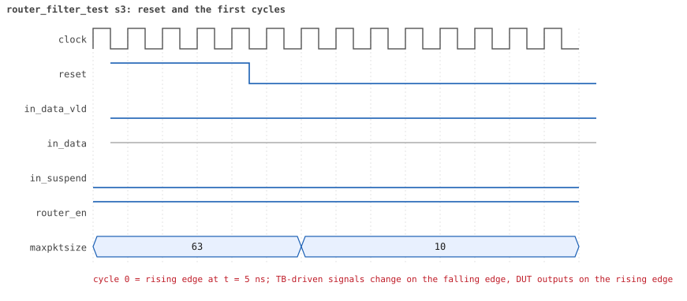
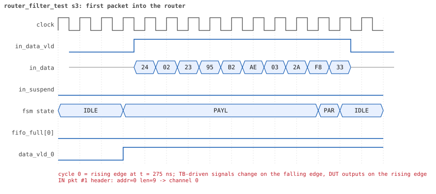
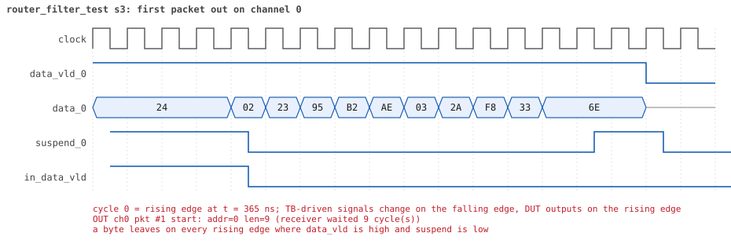
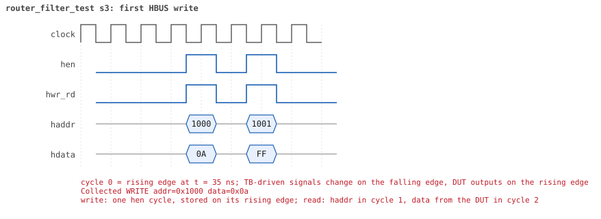
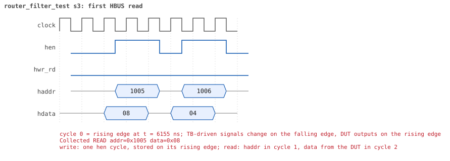

# router_filter_test  seed 3

**Result:** PASSED (0 UVM_ERROR, 0 UVM_WARNING, 0 UVM_FATAL) · bench `yapp_project_tb` · sim time 13us · log `router_filter_test_s3.log`

Waves: `router_filter_test_s3.fst` (GTKWave, Surfer or the VS Code wave viewer); signal trace: `signals.csv`.
[Open the waves in Surfer](https://app.surfer-project.org/?load_url=https%3A%2F%2Fraw.githubusercontent.com%2Ftamirgabgab%2FQcom-Mentoring%2Fmain%2Fyapp_project%2Fregression%2Fyapp_project_tb%2Frouter_filter_test_s3%2Frouter_filter_test_s3.fst&startup_commands=run_command_file_from_url%20https%3A%2F%2Fraw.githubusercontent.com%2Ftamirgabgab%2FQcom-Mentoring%2Fmain%2Fyapp_project%2Ftb%2Fyapp_router.sucl) (web app, the signals already in groups: `yapp_project/tb/yapp_router.sucl`).

## Summary

- YAPP driver sent **32** packet(s) (0 with bad parity); the input monitor saw 32.
- Router: **12** forwarded, **20** dropped (16 oversized, 4 illegal address 3).
- Packets out: ch0 **4**, ch1 **4**, ch2 **4**.
- Scoreboard: 12 matched, 0 mismatched, 0 unexpected.
- Back-pressure: in_suspend asserted **0** time(s).
- Error pulses: 0.
- HBUS: 4 write(s), 11 read(s).

## Stages

| time (ns) | stage |
|---|---|
| 0 | ctrl_reg=10: maxpktsize is 10 for the boundary sequence |
| 70 | 1. en_reg=0xff: lengths 9/10/11/63 to every address, drops counted |
| 6340 | 2. en_reg=0x01: the same traffic, the same drops, the counters do not move |
| 12470 | ctrl_reg back to 0x3f |

## Pictures

**reset and the first cycles**

**first packet into the router**

**first packet out on channel 0**

**first HBUS write**

**first HBUS read**

## Timeline

337 events (the same list is in `timeline.csv`).

| time (ns) | who | event |
|---|---|---|
| 0 | yapp monitor | YAPP monitor running |
| 0 | **test** | STAGE: ctrl_reg=10: maxpktsize is 10 for the boundary sequence |
| 0 | clk/rst driver | Starting clock (period 10) and holding reset for 5 cycles |
| 0 | **DUT** | RESET asserted |
| 50 | **DUT** | RESET released: router_en=1 maxpktsize=63 |
| 70 | hbus driver | Executed WRITE addr=0x1000 data=0x0a |
| 70 | **test** | STAGE: 1. en_reg=0xff: lengths 9/10/11/63 to every address, drops counted |
| 75 | **DUT** | CONFIG router_en=1 maxpktsize=10 |
| 75 | hbus monitor | Collected WRITE addr=0x1000 data=0x0a |
| 75 | reference | maxpktsize is now 10 |
| 90 | hbus driver | Executed WRITE addr=0x1001 data=0xff |
| 90 | yapp driver | TX pkt #1: addr=0 len=9 parity=good delay=20 |
| 95 | hbus monitor | Collected WRITE addr=0x1001 data=0xff |
| 95 | reference | router_en is now 1 |
| 305 | **DUT** | IN  pkt #1 header: addr=0 len=9 -> channel 0 |
| 405 | **DUT** | IN  pkt #1 complete: addr=0 len=9 parity=ok forwarded, 11 bytes in 11 cycles (held 0) |
| 405 | **DUT** | OUT ch0 pkt #1 start: addr=0 len=9 (receiver waited 9 cycle(s)) |
| 405 | yapp monitor | RX pkt #1 on the input: addr=0 len=9 parity=good gap=25 |
| 405 | reference | Packet forwarded: addr=0 len=9 -> channel 0 |
| 410 | yapp driver | TX pkt #1 accepted by the DUT |
| 410 | yapp driver | TX pkt #2: addr=0 len=10 parity=good delay=17 |
| 500 | ch0 driver | ch0: packet consumed (response delay 9) |
| 525 | **DUT** | OUT ch0 pkt #1 done: 11 bytes in 13 cycles |
| 525 | ch0 monitor | ch0 RX pkt #1: addr=0 len=9 parity=good |
| 525 | scoreboard | ch0 pkt matched: addr=0 len=9 (1 matched so far) |
| 585 | **DUT** | IN  pkt #2 header: addr=0 len=10 -> channel 0 |
| 595 | **DUT** | OUT ch0 pkt #2 start: addr=0 len=10 (receiver waited 0 cycle(s)) |
| 695 | **DUT** | IN  pkt #2 complete: addr=0 len=10 parity=ok forwarded, 12 bytes in 12 cycles (held 0) |
| 695 | yapp monitor | RX pkt #2 on the input: addr=0 len=10 parity=good gap=17 |
| 695 | reference | Packet forwarded: addr=0 len=10 -> channel 0 |
| 700 | yapp driver | TX pkt #2 accepted by the DUT |
| 700 | yapp driver | TX pkt #3: addr=0 len=11 parity=good delay=14 |
| 705 | **DUT** | OUT ch0 pkt #2 done: 12 bytes in 12 cycles |
| 705 | ch0 monitor | ch0 RX pkt #2: addr=0 len=10 parity=good |
| 705 | scoreboard | ch0 pkt matched: addr=0 len=10 (2 matched so far) |
| 800 | ch0 driver | ch0: packet consumed (response delay 1) |
| 845 | **DUT** | IN  pkt #3 header: addr=0 len=11 -> DROP (oversized: len 11 > maxpktsize 10) |
| 965 | **DUT** | IN  pkt #3 complete: addr=0 len=11 parity=ok dropped, 13 bytes in 13 cycles (held 0) |
| 965 | yapp monitor | RX pkt #3 on the input: addr=0 len=11 parity=good gap=14 |
| 965 | reference | Packet dropped: length 11 > maxpktsize 10 (addr=0) |
| 965 | **DUT** | ROUTER DROPS PACKET addr=0 length=11 (length > maxpktsize) |
| 970 | yapp driver | TX pkt #3 accepted by the DUT |
| 970 | yapp driver | TX pkt #4: addr=0 len=63 parity=good delay=19 |
| 1165 | **DUT** | IN  pkt #4 header: addr=0 len=63 -> DROP (oversized: len 63 > maxpktsize 10) |
| 1805 | **DUT** | IN  pkt #4 complete: addr=0 len=63 parity=ok dropped, 65 bytes in 65 cycles (held 0) |
| 1805 | yapp monitor | RX pkt #4 on the input: addr=0 len=63 parity=good gap=19 |
| 1805 | reference | Packet dropped: length 63 > maxpktsize 10 (addr=0) |
| 1805 | **DUT** | ROUTER DROPS PACKET addr=0 length=63 (length > maxpktsize) |
| 1810 | yapp driver | TX pkt #4 accepted by the DUT |
| 1810 | yapp driver | TX pkt #5: addr=1 len=9 parity=good delay=1 |
| 1825 | **DUT** | IN  pkt #5 header: addr=1 len=9 -> channel 1 |
| 1865 | **DUT** | OUT ch1 pkt #1 start: addr=1 len=9 (receiver waited 3 cycle(s)) |
| 1925 | **DUT** | IN  pkt #5 complete: addr=1 len=9 parity=ok forwarded, 11 bytes in 11 cycles (held 0) |
| 1925 | yapp monitor | RX pkt #5 on the input: addr=1 len=9 parity=good gap=1 |
| 1925 | reference | Packet forwarded: addr=1 len=9 -> channel 1 |
| 1930 | yapp driver | TX pkt #5 accepted by the DUT |
| 1930 | yapp driver | TX pkt #6: addr=1 len=10 parity=good delay=1 |
| 1945 | **DUT** | IN  pkt #6 header: addr=1 len=10 -> channel 1 |
| 1960 | ch1 driver | ch1: packet consumed (response delay 3) |
| 1995 | **DUT** | OUT ch1 pkt #1 done: 11 bytes in 14 cycles |
| 1995 | ch1 monitor | ch1 RX pkt #1: addr=1 len=9 parity=good |
| 1995 | scoreboard | ch1 pkt matched: addr=1 len=9 (3 matched so far) |
| 2005 | **DUT** | OUT ch1 pkt #2 start: addr=1 len=10 (receiver waited 0 cycle(s)) |
| 2055 | **DUT** | IN  pkt #6 complete: addr=1 len=10 parity=ok forwarded, 12 bytes in 12 cycles (held 0) |
| 2055 | yapp monitor | RX pkt #6 on the input: addr=1 len=10 parity=good gap=1 |
| 2055 | reference | Packet forwarded: addr=1 len=10 -> channel 1 |
| 2060 | yapp driver | TX pkt #6 accepted by the DUT |
| 2060 | yapp driver | TX pkt #7: addr=1 len=11 parity=good delay=18 |
| 2115 | **DUT** | OUT ch1 pkt #2 done: 12 bytes in 12 cycles |
| 2115 | ch1 monitor | ch1 RX pkt #2: addr=1 len=10 parity=good |
| 2115 | scoreboard | ch1 pkt matched: addr=1 len=10 (4 matched so far) |
| 2245 | **DUT** | IN  pkt #7 header: addr=1 len=11 -> DROP (oversized: len 11 > maxpktsize 10) |
| 2365 | **DUT** | IN  pkt #7 complete: addr=1 len=11 parity=ok dropped, 13 bytes in 13 cycles (held 0) |
| 2365 | yapp monitor | RX pkt #7 on the input: addr=1 len=11 parity=good gap=18 |
| 2365 | reference | Packet dropped: length 11 > maxpktsize 10 (addr=1) |
| 2365 | **DUT** | ROUTER DROPS PACKET addr=1 length=11 (length > maxpktsize) |
| 2370 | yapp driver | TX pkt #7 accepted by the DUT |
| 2370 | yapp driver | TX pkt #8: addr=1 len=63 parity=good delay=20 |
| 2520 | ch1 driver | ch1: packet consumed (response delay 2) |
| 2575 | **DUT** | IN  pkt #8 header: addr=1 len=63 -> DROP (oversized: len 63 > maxpktsize 10) |
| 3215 | **DUT** | IN  pkt #8 complete: addr=1 len=63 parity=ok dropped, 65 bytes in 65 cycles (held 0) |
| 3215 | yapp monitor | RX pkt #8 on the input: addr=1 len=63 parity=good gap=20 |
| 3215 | reference | Packet dropped: length 63 > maxpktsize 10 (addr=1) |
| 3215 | **DUT** | ROUTER DROPS PACKET addr=1 length=63 (length > maxpktsize) |
| 3220 | yapp driver | TX pkt #8 accepted by the DUT |
| 3220 | yapp driver | TX pkt #9: addr=2 len=9 parity=good delay=7 |
| 3295 | **DUT** | IN  pkt #9 header: addr=2 len=9 -> channel 2 |
| 3375 | **DUT** | OUT ch2 pkt #1 start: addr=2 len=9 (receiver waited 7 cycle(s)) |
| 3395 | **DUT** | IN  pkt #9 complete: addr=2 len=9 parity=ok forwarded, 11 bytes in 11 cycles (held 0) |
| 3395 | yapp monitor | RX pkt #9 on the input: addr=2 len=9 parity=good gap=7 |
| 3395 | reference | Packet forwarded: addr=2 len=9 -> channel 2 |
| 3400 | yapp driver | TX pkt #9 accepted by the DUT |
| 3400 | yapp driver | TX pkt #10: addr=2 len=10 parity=good delay=20 |
| 3470 | ch2 driver | ch2: packet consumed (response delay 7) |
| 3525 | **DUT** | OUT ch2 pkt #1 done: 11 bytes in 16 cycles |
| 3525 | ch2 monitor | ch2 RX pkt #1: addr=2 len=9 parity=good |
| 3525 | scoreboard | ch2 pkt matched: addr=2 len=9 (5 matched so far) |
| 3605 | **DUT** | IN  pkt #10 header: addr=2 len=10 -> channel 2 |
| 3615 | **DUT** | OUT ch2 pkt #2 start: addr=2 len=10 (receiver waited 0 cycle(s)) |
| 3650 | ch2 driver | ch2: packet consumed (response delay 4) |
| 3715 | **DUT** | IN  pkt #10 complete: addr=2 len=10 parity=ok forwarded, 12 bytes in 12 cycles (held 0) |
| 3715 | yapp monitor | RX pkt #10 on the input: addr=2 len=10 parity=good gap=20 |
| 3715 | reference | Packet forwarded: addr=2 len=10 -> channel 2 |
| 3720 | yapp driver | TX pkt #10 accepted by the DUT |
| 3720 | yapp driver | TX pkt #11: addr=2 len=11 parity=good delay=16 |
| 3765 | **DUT** | OUT ch2 pkt #2 done: 12 bytes in 16 cycles |
| 3765 | ch2 monitor | ch2 RX pkt #2: addr=2 len=10 parity=good |
| 3765 | scoreboard | ch2 pkt matched: addr=2 len=10 (6 matched so far) |
| 3885 | **DUT** | IN  pkt #11 header: addr=2 len=11 -> DROP (oversized: len 11 > maxpktsize 10) |
| 4005 | **DUT** | IN  pkt #11 complete: addr=2 len=11 parity=ok dropped, 13 bytes in 13 cycles (held 0) |
| 4005 | yapp monitor | RX pkt #11 on the input: addr=2 len=11 parity=good gap=16 |
| 4005 | reference | Packet dropped: length 11 > maxpktsize 10 (addr=2) |
| 4005 | **DUT** | ROUTER DROPS PACKET addr=2 length=11 (length > maxpktsize) |
| 4010 | yapp driver | TX pkt #11 accepted by the DUT |
| 4010 | yapp driver | TX pkt #12: addr=2 len=63 parity=good delay=6 |
| 4075 | **DUT** | IN  pkt #12 header: addr=2 len=63 -> DROP (oversized: len 63 > maxpktsize 10) |
| 4140 | ch2 driver | ch2: packet consumed (response delay 3) |
| 4715 | **DUT** | IN  pkt #12 complete: addr=2 len=63 parity=ok dropped, 65 bytes in 65 cycles (held 0) |
| 4715 | yapp monitor | RX pkt #12 on the input: addr=2 len=63 parity=good gap=6 |
| 4715 | reference | Packet dropped: length 63 > maxpktsize 10 (addr=2) |
| 4715 | **DUT** | ROUTER DROPS PACKET addr=2 length=63 (length > maxpktsize) |
| 4720 | yapp driver | TX pkt #12 accepted by the DUT |
| 4720 | yapp driver | TX pkt #13: addr=3 len=9 parity=good delay=14 |
| 4865 | **DUT** | IN  pkt #13 header: addr=3 len=9 -> DROP (illegal address 3) |
| 4965 | **DUT** | IN  pkt #13 complete: addr=3 len=9 parity=ok dropped, 11 bytes in 11 cycles (held 0) |
| 4965 | yapp monitor | RX pkt #13 on the input: addr=3 len=9 parity=good gap=14 |
| 4965 | reference | Packet dropped: illegal address 3 (len=9) |
| 4965 | **DUT** | ROUTER DROPS PACKET addr=3 length=9 (    illegal address) |
| 4970 | yapp driver | TX pkt #13 accepted by the DUT |
| 4970 | yapp driver | TX pkt #14: addr=3 len=10 parity=good delay=12 |
| 5095 | **DUT** | IN  pkt #14 header: addr=3 len=10 -> DROP (illegal address 3) |
| 5205 | **DUT** | IN  pkt #14 complete: addr=3 len=10 parity=ok dropped, 12 bytes in 12 cycles (held 0) |
| 5205 | yapp monitor | RX pkt #14 on the input: addr=3 len=10 parity=good gap=12 |
| 5205 | reference | Packet dropped: illegal address 3 (len=10) |
| 5205 | **DUT** | ROUTER DROPS PACKET addr=3 length=10 (    illegal address) |
| 5210 | yapp driver | TX pkt #14 accepted by the DUT |
| 5210 | yapp driver | TX pkt #15: addr=3 len=11 parity=good delay=1 |
| 5225 | **DUT** | IN  pkt #15 header: addr=3 len=11 -> DROP (oversized: len 11 > maxpktsize 10) |
| 5345 | **DUT** | IN  pkt #15 complete: addr=3 len=11 parity=ok dropped, 13 bytes in 13 cycles (held 0) |
| 5345 | yapp monitor | RX pkt #15 on the input: addr=3 len=11 parity=good gap=1 |
| 5345 | reference | Packet dropped: illegal address 3 (len=11) |
| 5345 | **DUT** | ROUTER DROPS PACKET addr=3 length=11 (    illegal address) |
| 5350 | yapp driver | TX pkt #15 accepted by the DUT |
| 5350 | yapp driver | TX pkt #16: addr=3 len=63 parity=good delay=13 |
| 5485 | **DUT** | IN  pkt #16 header: addr=3 len=63 -> DROP (oversized: len 63 > maxpktsize 10) |
| 6125 | **DUT** | IN  pkt #16 complete: addr=3 len=63 parity=ok dropped, 65 bytes in 65 cycles (held 0) |
| 6125 | yapp monitor | RX pkt #16 on the input: addr=3 len=63 parity=good gap=13 |
| 6125 | reference | Packet dropped: illegal address 3 (len=63) |
| 6125 | **DUT** | ROUTER DROPS PACKET addr=3 length=63 (    illegal address) |
| 6130 | yapp driver | TX pkt #16 accepted by the DUT |
| 6190 | hbus driver | Executed READ  addr=0x1005 data=0x08 |
| 6190 | **test** | oversized_pkt_cnt_reg reads 8 as expected |
| 6195 | hbus monitor | Collected READ  addr=0x1005 data=0x08 |
| 6220 | hbus driver | Executed READ  addr=0x1006 data=0x04 |
| 6220 | **test** | addr3_cnt_reg reads 4 as expected |
| 6225 | hbus monitor | Collected READ  addr=0x1006 data=0x04 |
| 6250 | hbus driver | Executed READ  addr=0x1009 data=0x04 |
| 6250 | **test** | addr0_cnt_reg reads 4 as expected |
| 6255 | hbus monitor | Collected READ  addr=0x1009 data=0x04 |
| 6280 | hbus driver | Executed READ  addr=0x100a data=0x04 |
| 6280 | **test** | addr1_cnt_reg reads 4 as expected |
| 6285 | hbus monitor | Collected READ  addr=0x100a data=0x04 |
| 6310 | hbus driver | Executed READ  addr=0x100b data=0x04 |
| 6310 | **test** | addr2_cnt_reg reads 4 as expected |
| 6315 | hbus monitor | Collected READ  addr=0x100b data=0x04 |
| 6340 | hbus driver | Executed READ  addr=0x1004 data=0x00 |
| 6340 | **test** | parity_err_cnt_reg reads 0 as expected |
| 6340 | **test** | STAGE: 2. en_reg=0x01: the same traffic, the same drops, the counters do not move |
| 6345 | hbus monitor | Collected READ  addr=0x1004 data=0x00 |
| 6360 | hbus driver | Executed WRITE addr=0x1001 data=0x01 |
| 6360 | yapp driver | TX pkt #17: addr=0 len=9 parity=good delay=20 |
| 6365 | hbus monitor | Collected WRITE addr=0x1001 data=0x01 |
| 6365 | reference | router_en is now 1 |
| 6575 | **DUT** | IN  pkt #17 header: addr=0 len=9 -> channel 0 |
| 6645 | **DUT** | OUT ch0 pkt #3 start: addr=0 len=9 (receiver waited 6 cycle(s)) |
| 6675 | **DUT** | IN  pkt #17 complete: addr=0 len=9 parity=ok forwarded, 11 bytes in 11 cycles (held 0) |
| 6675 | yapp monitor | RX pkt #17 on the input: addr=0 len=9 parity=good gap=44 |
| 6675 | reference | Packet forwarded: addr=0 len=9 -> channel 0 |
| 6680 | yapp driver | TX pkt #17 accepted by the DUT |
| 6680 | yapp driver | TX pkt #18: addr=0 len=10 parity=good delay=6 |
| 6740 | ch0 driver | ch0: packet consumed (response delay 6) |
| 6745 | **DUT** | IN  pkt #18 header: addr=0 len=10 -> channel 0 |
| 6835 | **DUT** | OUT ch0 pkt #3 done: 11 bytes in 20 cycles |
| 6835 | ch0 monitor | ch0 RX pkt #3: addr=0 len=9 parity=good |
| 6835 | scoreboard | ch0 pkt matched: addr=0 len=9 (7 matched so far) |
| 6845 | **DUT** | OUT ch0 pkt #4 start: addr=0 len=10 (receiver waited 0 cycle(s)) |
| 6855 | **DUT** | IN  pkt #18 complete: addr=0 len=10 parity=ok forwarded, 12 bytes in 12 cycles (held 0) |
| 6855 | yapp monitor | RX pkt #18 on the input: addr=0 len=10 parity=good gap=6 |
| 6855 | reference | Packet forwarded: addr=0 len=10 -> channel 0 |
| 6860 | yapp driver | TX pkt #18 accepted by the DUT |
| 6860 | yapp driver | TX pkt #19: addr=0 len=11 parity=good delay=14 |
| 6955 | **DUT** | OUT ch0 pkt #4 done: 12 bytes in 12 cycles |
| 6955 | ch0 monitor | ch0 RX pkt #4: addr=0 len=10 parity=good |
| 6955 | scoreboard | ch0 pkt matched: addr=0 len=10 (8 matched so far) |
| 7005 | **DUT** | IN  pkt #19 header: addr=0 len=11 -> DROP (oversized: len 11 > maxpktsize 10) |
| 7125 | **DUT** | IN  pkt #19 complete: addr=0 len=11 parity=ok dropped, 13 bytes in 13 cycles (held 0) |
| 7125 | yapp monitor | RX pkt #19 on the input: addr=0 len=11 parity=good gap=14 |
| 7125 | reference | Packet dropped: length 11 > maxpktsize 10 (addr=0) |
| 7125 | **DUT** | ROUTER DROPS PACKET addr=0 length=11 (length > maxpktsize) |
| 7130 | yapp driver | TX pkt #19 accepted by the DUT |
| 7130 | yapp driver | TX pkt #20: addr=0 len=63 parity=good delay=5 |
| 7185 | **DUT** | IN  pkt #20 header: addr=0 len=63 -> DROP (oversized: len 63 > maxpktsize 10) |
| 7410 | ch0 driver | ch0: packet consumed (response delay 8) |
| 7825 | **DUT** | IN  pkt #20 complete: addr=0 len=63 parity=ok dropped, 65 bytes in 65 cycles (held 0) |
| 7825 | yapp monitor | RX pkt #20 on the input: addr=0 len=63 parity=good gap=5 |
| 7825 | reference | Packet dropped: length 63 > maxpktsize 10 (addr=0) |
| 7825 | **DUT** | ROUTER DROPS PACKET addr=0 length=63 (length > maxpktsize) |
| 7830 | yapp driver | TX pkt #20 accepted by the DUT |
| 7830 | yapp driver | TX pkt #21: addr=1 len=9 parity=good delay=15 |
| 7985 | **DUT** | IN  pkt #21 header: addr=1 len=9 -> channel 1 |
| 8055 | **DUT** | OUT ch1 pkt #3 start: addr=1 len=9 (receiver waited 6 cycle(s)) |
| 8085 | **DUT** | IN  pkt #21 complete: addr=1 len=9 parity=ok forwarded, 11 bytes in 11 cycles (held 0) |
| 8085 | yapp monitor | RX pkt #21 on the input: addr=1 len=9 parity=good gap=15 |
| 8085 | reference | Packet forwarded: addr=1 len=9 -> channel 1 |
| 8090 | yapp driver | TX pkt #21 accepted by the DUT |
| 8090 | yapp driver | TX pkt #22: addr=1 len=10 parity=good delay=3 |
| 8125 | **DUT** | IN  pkt #22 header: addr=1 len=10 -> channel 1 |
| 8150 | ch1 driver | ch1: packet consumed (response delay 6) |
| 8235 | **DUT** | IN  pkt #22 complete: addr=1 len=10 parity=ok forwarded, 12 bytes in 12 cycles (held 0) |
| 8235 | yapp monitor | RX pkt #22 on the input: addr=1 len=10 parity=good gap=3 |
| 8235 | reference | Packet forwarded: addr=1 len=10 -> channel 1 |
| 8240 | yapp driver | TX pkt #22 accepted by the DUT |
| 8240 | yapp driver | TX pkt #23: addr=1 len=11 parity=good delay=12 |
| 8265 | **DUT** | OUT ch1 pkt #3 done: 11 bytes in 22 cycles |
| 8265 | ch1 monitor | ch1 RX pkt #3: addr=1 len=9 parity=good |
| 8265 | scoreboard | ch1 pkt matched: addr=1 len=9 (9 matched so far) |
| 8275 | **DUT** | OUT ch1 pkt #4 start: addr=1 len=10 (receiver waited 0 cycle(s)) |
| 8365 | **DUT** | IN  pkt #23 header: addr=1 len=11 -> DROP (oversized: len 11 > maxpktsize 10) |
| 8385 | **DUT** | OUT ch1 pkt #4 done: 12 bytes in 12 cycles |
| 8385 | ch1 monitor | ch1 RX pkt #4: addr=1 len=10 parity=good |
| 8385 | scoreboard | ch1 pkt matched: addr=1 len=10 (10 matched so far) |
| 8485 | **DUT** | IN  pkt #23 complete: addr=1 len=11 parity=ok dropped, 13 bytes in 13 cycles (held 0) |
| 8485 | yapp monitor | RX pkt #23 on the input: addr=1 len=11 parity=good gap=12 |
| 8485 | reference | Packet dropped: length 11 > maxpktsize 10 (addr=1) |
| 8485 | **DUT** | ROUTER DROPS PACKET addr=1 length=11 (length > maxpktsize) |
| 8490 | yapp driver | TX pkt #23 accepted by the DUT |
| 8490 | yapp driver | TX pkt #24: addr=1 len=63 parity=good delay=5 |
| 8545 | **DUT** | IN  pkt #24 header: addr=1 len=63 -> DROP (oversized: len 63 > maxpktsize 10) |
| 8840 | ch1 driver | ch1: packet consumed (response delay 10) |
| 9185 | **DUT** | IN  pkt #24 complete: addr=1 len=63 parity=ok dropped, 65 bytes in 65 cycles (held 0) |
| 9185 | yapp monitor | RX pkt #24 on the input: addr=1 len=63 parity=good gap=5 |
| 9185 | reference | Packet dropped: length 63 > maxpktsize 10 (addr=1) |
| 9185 | **DUT** | ROUTER DROPS PACKET addr=1 length=63 (length > maxpktsize) |
| 9190 | yapp driver | TX pkt #24 accepted by the DUT |
| 9190 | yapp driver | TX pkt #25: addr=2 len=9 parity=good delay=18 |
| 9375 | **DUT** | IN  pkt #25 header: addr=2 len=9 -> channel 2 |
| 9475 | **DUT** | IN  pkt #25 complete: addr=2 len=9 parity=ok forwarded, 11 bytes in 11 cycles (held 0) |
| 9475 | yapp monitor | RX pkt #25 on the input: addr=2 len=9 parity=good gap=18 |
| 9475 | reference | Packet forwarded: addr=2 len=9 -> channel 2 |
| 9480 | yapp driver | TX pkt #25 accepted by the DUT |
| 9480 | yapp driver | TX pkt #26: addr=2 len=10 parity=good delay=8 |
| 9485 | **DUT** | OUT ch2 pkt #3 start: addr=2 len=9 (receiver waited 10 cycle(s)) |
| 9565 | **DUT** | IN  pkt #26 header: addr=2 len=10 -> channel 2 |
| 9580 | ch2 driver | ch2: packet consumed (response delay 10) |
| 9665 | **DUT** | OUT ch2 pkt #3 done: 11 bytes in 19 cycles |
| 9665 | ch2 monitor | ch2 RX pkt #3: addr=2 len=9 parity=good |
| 9665 | scoreboard | ch2 pkt matched: addr=2 len=9 (11 matched so far) |
| 9675 | **DUT** | IN  pkt #26 complete: addr=2 len=10 parity=ok forwarded, 12 bytes in 12 cycles (held 0) |
| 9675 | **DUT** | OUT ch2 pkt #4 start: addr=2 len=10 (receiver waited 0 cycle(s)) |
| 9675 | yapp monitor | RX pkt #26 on the input: addr=2 len=10 parity=good gap=8 |
| 9675 | reference | Packet forwarded: addr=2 len=10 -> channel 2 |
| 9680 | yapp driver | TX pkt #26 accepted by the DUT |
| 9680 | yapp driver | TX pkt #27: addr=2 len=11 parity=good delay=1 |
| 9695 | **DUT** | IN  pkt #27 header: addr=2 len=11 -> DROP (oversized: len 11 > maxpktsize 10) |
| 9785 | **DUT** | OUT ch2 pkt #4 done: 12 bytes in 12 cycles |
| 9785 | ch2 monitor | ch2 RX pkt #4: addr=2 len=10 parity=good |
| 9785 | scoreboard | ch2 pkt matched: addr=2 len=10 (12 matched so far) |
| 9815 | **DUT** | IN  pkt #27 complete: addr=2 len=11 parity=ok dropped, 13 bytes in 13 cycles (held 0) |
| 9815 | yapp monitor | RX pkt #27 on the input: addr=2 len=11 parity=good gap=1 |
| 9815 | reference | Packet dropped: length 11 > maxpktsize 10 (addr=2) |
| 9815 | **DUT** | ROUTER DROPS PACKET addr=2 length=11 (length > maxpktsize) |
| 9820 | yapp driver | TX pkt #27 accepted by the DUT |
| 9820 | yapp driver | TX pkt #28: addr=2 len=63 parity=good delay=20 |
| 9970 | ch2 driver | ch2: packet consumed (response delay 7) |
| 10025 | **DUT** | IN  pkt #28 header: addr=2 len=63 -> DROP (oversized: len 63 > maxpktsize 10) |
| 10665 | **DUT** | IN  pkt #28 complete: addr=2 len=63 parity=ok dropped, 65 bytes in 65 cycles (held 0) |
| 10665 | yapp monitor | RX pkt #28 on the input: addr=2 len=63 parity=good gap=20 |
| 10665 | reference | Packet dropped: length 63 > maxpktsize 10 (addr=2) |
| 10665 | **DUT** | ROUTER DROPS PACKET addr=2 length=63 (length > maxpktsize) |
| 10670 | yapp driver | TX pkt #28 accepted by the DUT |
| 10670 | yapp driver | TX pkt #29: addr=3 len=9 parity=good delay=15 |
| 10825 | **DUT** | IN  pkt #29 header: addr=3 len=9 -> DROP (illegal address 3) |
| 10925 | **DUT** | IN  pkt #29 complete: addr=3 len=9 parity=ok dropped, 11 bytes in 11 cycles (held 0) |
| 10925 | yapp monitor | RX pkt #29 on the input: addr=3 len=9 parity=good gap=15 |
| 10925 | reference | Packet dropped: illegal address 3 (len=9) |
| 10925 | **DUT** | ROUTER DROPS PACKET addr=3 length=9 (    illegal address) |
| 10930 | yapp driver | TX pkt #29 accepted by the DUT |
| 10930 | yapp driver | TX pkt #30: addr=3 len=10 parity=good delay=18 |
| 11115 | **DUT** | IN  pkt #30 header: addr=3 len=10 -> DROP (illegal address 3) |
| 11225 | **DUT** | IN  pkt #30 complete: addr=3 len=10 parity=ok dropped, 12 bytes in 12 cycles (held 0) |
| 11225 | yapp monitor | RX pkt #30 on the input: addr=3 len=10 parity=good gap=18 |
| 11225 | reference | Packet dropped: illegal address 3 (len=10) |
| 11225 | **DUT** | ROUTER DROPS PACKET addr=3 length=10 (    illegal address) |
| 11230 | yapp driver | TX pkt #30 accepted by the DUT |
| 11230 | yapp driver | TX pkt #31: addr=3 len=11 parity=good delay=13 |
| 11365 | **DUT** | IN  pkt #31 header: addr=3 len=11 -> DROP (oversized: len 11 > maxpktsize 10) |
| 11485 | **DUT** | IN  pkt #31 complete: addr=3 len=11 parity=ok dropped, 13 bytes in 13 cycles (held 0) |
| 11485 | yapp monitor | RX pkt #31 on the input: addr=3 len=11 parity=good gap=13 |
| 11485 | reference | Packet dropped: illegal address 3 (len=11) |
| 11485 | **DUT** | ROUTER DROPS PACKET addr=3 length=11 (    illegal address) |
| 11490 | yapp driver | TX pkt #31 accepted by the DUT |
| 11490 | yapp driver | TX pkt #32: addr=3 len=63 parity=good delay=15 |
| 11645 | **DUT** | IN  pkt #32 header: addr=3 len=63 -> DROP (oversized: len 63 > maxpktsize 10) |
| 12285 | **DUT** | IN  pkt #32 complete: addr=3 len=63 parity=ok dropped, 65 bytes in 65 cycles (held 0) |
| 12285 | yapp monitor | RX pkt #32 on the input: addr=3 len=63 parity=good gap=15 |
| 12285 | reference | Packet dropped: illegal address 3 (len=63) |
| 12285 | **DUT** | ROUTER DROPS PACKET addr=3 length=63 (    illegal address) |
| 12290 | yapp driver | TX pkt #32 accepted by the DUT |
| 12350 | hbus driver | Executed READ  addr=0x1005 data=0x08 |
| 12350 | **test** | oversized_pkt_cnt_reg reads 8 as expected |
| 12355 | hbus monitor | Collected READ  addr=0x1005 data=0x08 |
| 12380 | hbus driver | Executed READ  addr=0x1006 data=0x04 |
| 12380 | **test** | addr3_cnt_reg reads 4 as expected |
| 12385 | hbus monitor | Collected READ  addr=0x1006 data=0x04 |
| 12410 | hbus driver | Executed READ  addr=0x1009 data=0x04 |
| 12410 | **test** | addr0_cnt_reg reads 4 as expected |
| 12415 | hbus monitor | Collected READ  addr=0x1009 data=0x04 |
| 12440 | hbus driver | Executed READ  addr=0x100a data=0x04 |
| 12440 | **test** | addr1_cnt_reg reads 4 as expected |
| 12445 | hbus monitor | Collected READ  addr=0x100a data=0x04 |
| 12470 | hbus driver | Executed READ  addr=0x100b data=0x04 |
| 12470 | **test** | addr2_cnt_reg reads 4 as expected |
| 12470 | **test** | STAGE: ctrl_reg back to 0x3f |
| 12475 | hbus monitor | Collected READ  addr=0x100b data=0x04 |
| 12490 | hbus driver | Executed WRITE addr=0x1000 data=0x3f |
| 12495 | **DUT** | CONFIG router_en=1 maxpktsize=63 |
| 12495 | hbus monitor | Collected WRITE addr=0x1000 data=0x3f |
| 12495 | reference | maxpktsize is now 63 |
| 12690 | ch0 monitor | Channel 0 report: 4 packets collected |
| 12690 | ch1 monitor | Channel 1 report: 4 packets collected |
| 12690 | ch2 monitor | Channel 2 report: 4 packets collected |
| 12690 | hbus monitor | HBUS report: 4 writes, 11 reads |
| 12690 | reference |  |
| 12690 | scoreboard |  |
| 12690 | yapp driver | YAPP driver report: 32 packets sent |
| 12690 | yapp monitor | YAPP monitor report: 32 packets collected, coverage 36.7% |
| 12690 | yapp monitor | YAPP gaps: 0 back to back, 4 of 1 cycle, 0 of 2, 27 longer (gap coverage 50.0%) |
