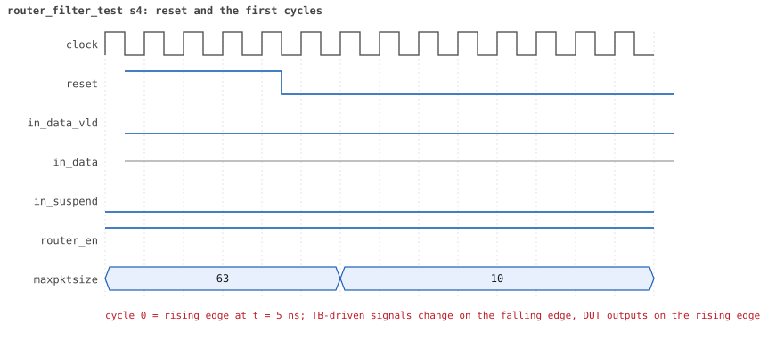
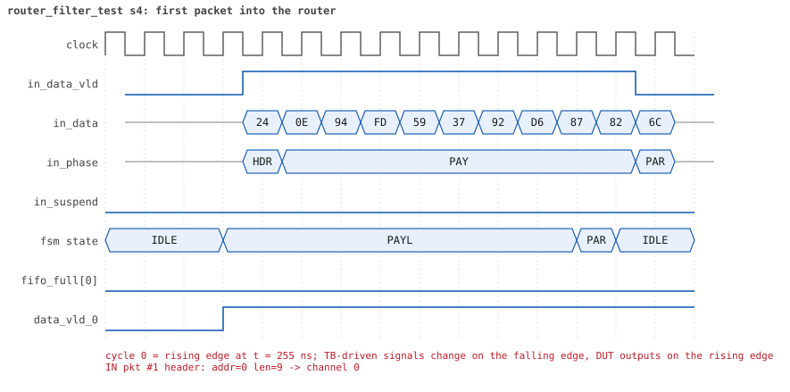
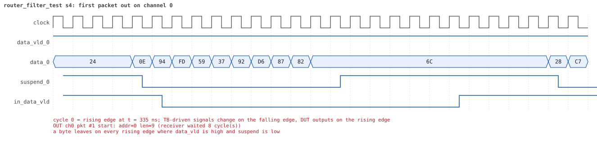
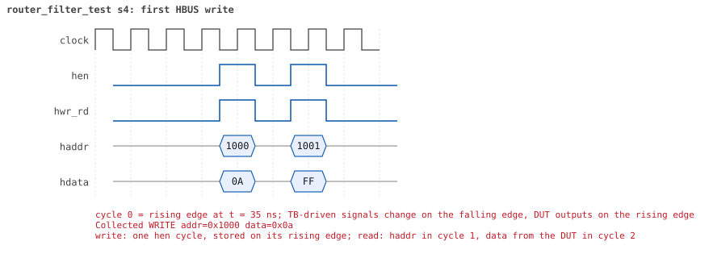
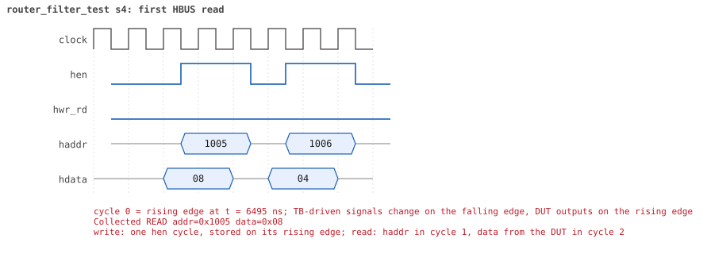

# router_filter_test seed 4

**Result:** PASSED (0 UVM_ERROR, 0 UVM_WARNING, 0 UVM_FATAL) · bench `yapp_project_tb` · sim time 13us · wall 1.2 s · log [`router_filter_test_s4.log`](router_filter_test_s4.log)

Waves: `router_filter_test_s4.fst` (GTKWave, Surfer or the VS Code wave viewer).
[Open the waves in Surfer](https://app.surfer-project.org/?load_url=https%3A%2F%2Fraw.githubusercontent.com%2Ftamirgabgab%2FQcom-Mentoring%2Fmain%2Fyapp_project%2Fregression%2Fyapp_project_tb%2Frouter_filter_test_s4%2Frouter_filter_test_s4.fst&startup_commands=run_command_file_from_url%20https%3A%2F%2Fraw.githubusercontent.com%2Ftamirgabgab%2FQcom-Mentoring%2Fmain%2Fyapp_project%2Ftb%2Fyapp_router.sucl) (web app, the signals already in groups: `yapp_project/tb/yapp_router.sucl`).

## Summary

- YAPP driver sent **32** packet(s) (0 with bad parity); the input monitor saw 32.
- Router: **12** forwarded, **20** dropped (16 oversized, 4 illegal address 3).
- Packets out: ch0 **4**, ch1 **4**, ch2 **4**.
- Scoreboard: 12 matched, 0 mismatched, 0 unexpected.
- Back-pressure: in_suspend asserted **0** time(s).
- Error pulses: 0.
- HBUS: 4 write(s), 11 read(s).

## Stages

| time (ns) | stage |
|---|---|
| 0 | ctrl_reg=10: maxpktsize is 10 for the boundary sequence |
| 70 | 1. en_reg=0xff: lengths 9/10/11/63 to every address, drops counted |
| 6680 | 2. en_reg=0x01: the same traffic, the same drops, the counters do not move |
| 13080 | ctrl_reg back to 0x3f |

## Pictures

**reset and the first cycles**

**first packet into the router**

**first packet out on channel 0**

**first HBUS write**

**first HBUS read**

## Timeline

343 events.

| time (ns) | who | event |
|---|---|---|
| 0 | yapp monitor | YAPP monitor running |
| 0 | **test** | STAGE: ctrl_reg=10: maxpktsize is 10 for the boundary sequence |
| 0 | clk/rst driver | Starting clock (period 10) and holding reset for 5 cycles |
| 0 | **DUT** | RESET asserted |
| 50 | **DUT** | RESET released: router_en=1 maxpktsize=63 |
| 70 | hbus driver | Executed WRITE addr=0x1000 data=0x0a |
| 70 | **test** | STAGE: 1. en_reg=0xff: lengths 9/10/11/63 to every address, drops counted |
| 75 | **DUT** | CONFIG router_en=1 maxpktsize=10 |
| 75 | hbus monitor | Collected WRITE addr=0x1000 data=0x0a |
| 75 | reference | maxpktsize is now 10 |
| 90 | hbus driver | Executed WRITE addr=0x1001 data=0xff |
| 90 | yapp driver | TX pkt #1: addr=0 len=9 parity=good delay=18 |
| 95 | hbus monitor | Collected WRITE addr=0x1001 data=0xff |
| 95 | reference | router_en is now 1 (en_reg 0xff) |
| 285 | **DUT** | IN  pkt #1 header: addr=0 len=9 -> channel 0 |
| 375 | **DUT** | OUT ch0 pkt #1 start: addr=0 len=9 (receiver waited 8 cycle(s)) |
| 385 | **DUT** | IN  pkt #1 complete: addr=0 len=9 parity=ok forwarded, 11 bytes in 11 cycles (held 0) |
| 385 | yapp monitor | RX pkt #1 on the input: addr=0 len=9 parity=good gap=23 |
| 385 | reference | Packet forwarded: addr=0 len=9 -> channel 0 |
| 390 | yapp driver | TX pkt #1 accepted by the DUT |
| 390 | yapp driver | TX pkt #2: addr=0 len=10 parity=good delay=14 |
| 470 | ch0 driver | ch0: packet consumed (response delay 8) |
| 535 | **DUT** | IN  pkt #2 header: addr=0 len=10 -> channel 0 |
| 585 | **DUT** | OUT ch0 pkt #1 done: 11 bytes in 22 cycles |
| 585 | ch0 monitor | ch0 RX pkt #1: addr=0 len=9 parity=good |
| 585 | scoreboard | ch0 pkt matched: addr=0 len=9 (1 matched so far) |
| 595 | **DUT** | OUT ch0 pkt #2 start: addr=0 len=10 (receiver waited 0 cycle(s)) |
| 645 | **DUT** | IN  pkt #2 complete: addr=0 len=10 parity=ok forwarded, 12 bytes in 12 cycles (held 0) |
| 645 | yapp monitor | RX pkt #2 on the input: addr=0 len=10 parity=good gap=14 |
| 645 | reference | Packet forwarded: addr=0 len=10 -> channel 0 |
| 650 | yapp driver | TX pkt #2 accepted by the DUT |
| 650 | yapp driver | TX pkt #3: addr=0 len=11 parity=good delay=18 |
| 705 | **DUT** | OUT ch0 pkt #2 done: 12 bytes in 12 cycles |
| 705 | ch0 monitor | ch0 RX pkt #2: addr=0 len=10 parity=good |
| 705 | scoreboard | ch0 pkt matched: addr=0 len=10 (2 matched so far) |
| 835 | **DUT** | IN  pkt #3 header: addr=0 len=11 -> DROP (oversized: len 11 > maxpktsize 10) |
| 860 | ch0 driver | ch0: packet consumed (response delay 10) |
| 955 | **DUT** | IN  pkt #3 complete: addr=0 len=11 parity=ok dropped, 13 bytes in 13 cycles (held 0) |
| 955 | yapp monitor | RX pkt #3 on the input: addr=0 len=11 parity=good gap=18 |
| 955 | reference | Packet dropped: length 11 > maxpktsize 10 (addr=0) |
| 955 | **DUT** | ROUTER DROPS PACKET addr=0 length=11 (length > maxpktsize) |
| 960 | yapp driver | TX pkt #3 accepted by the DUT |
| 960 | yapp driver | TX pkt #4: addr=0 len=63 parity=good delay=20 |
| 1165 | **DUT** | IN  pkt #4 header: addr=0 len=63 -> DROP (oversized: len 63 > maxpktsize 10) |
| 1805 | **DUT** | IN  pkt #4 complete: addr=0 len=63 parity=ok dropped, 65 bytes in 65 cycles (held 0) |
| 1805 | yapp monitor | RX pkt #4 on the input: addr=0 len=63 parity=good gap=20 |
| 1805 | reference | Packet dropped: length 63 > maxpktsize 10 (addr=0) |
| 1805 | **DUT** | ROUTER DROPS PACKET addr=0 length=63 (length > maxpktsize) |
| 1810 | yapp driver | TX pkt #4 accepted by the DUT |
| 1810 | yapp driver | TX pkt #5: addr=1 len=9 parity=good delay=13 |
| 1945 | **DUT** | IN  pkt #5 header: addr=1 len=9 -> channel 1 |
| 2045 | **DUT** | IN  pkt #5 complete: addr=1 len=9 parity=ok forwarded, 11 bytes in 11 cycles (held 0) |
| 2045 | yapp monitor | RX pkt #5 on the input: addr=1 len=9 parity=good gap=13 |
| 2045 | reference | Packet forwarded: addr=1 len=9 -> channel 1 |
| 2050 | yapp driver | TX pkt #5 accepted by the DUT |
| 2050 | yapp driver | TX pkt #6: addr=1 len=10 parity=good delay=10 |
| 2055 | **DUT** | OUT ch1 pkt #1 start: addr=1 len=9 (receiver waited 10 cycle(s)) |
| 2150 | ch1 driver | ch1: packet consumed (response delay 10) |
| 2155 | **DUT** | IN  pkt #6 header: addr=1 len=10 -> channel 1 |
| 2205 | **DUT** | OUT ch1 pkt #1 done: 11 bytes in 16 cycles |
| 2205 | ch1 monitor | ch1 RX pkt #1: addr=1 len=9 parity=good |
| 2205 | scoreboard | ch1 pkt matched: addr=1 len=9 (3 matched so far) |
| 2215 | **DUT** | OUT ch1 pkt #2 start: addr=1 len=10 (receiver waited 0 cycle(s)) |
| 2265 | **DUT** | IN  pkt #6 complete: addr=1 len=10 parity=ok forwarded, 12 bytes in 12 cycles (held 0) |
| 2265 | yapp monitor | RX pkt #6 on the input: addr=1 len=10 parity=good gap=10 |
| 2265 | reference | Packet forwarded: addr=1 len=10 -> channel 1 |
| 2270 | yapp driver | TX pkt #6 accepted by the DUT |
| 2270 | yapp driver | TX pkt #7: addr=1 len=11 parity=good delay=11 |
| 2325 | **DUT** | OUT ch1 pkt #2 done: 12 bytes in 12 cycles |
| 2325 | ch1 monitor | ch1 RX pkt #2: addr=1 len=10 parity=good |
| 2325 | scoreboard | ch1 pkt matched: addr=1 len=10 (4 matched so far) |
| 2385 | **DUT** | IN  pkt #7 header: addr=1 len=11 -> DROP (oversized: len 11 > maxpktsize 10) |
| 2505 | **DUT** | IN  pkt #7 complete: addr=1 len=11 parity=ok dropped, 13 bytes in 13 cycles (held 0) |
| 2505 | yapp monitor | RX pkt #7 on the input: addr=1 len=11 parity=good gap=11 |
| 2505 | reference | Packet dropped: length 11 > maxpktsize 10 (addr=1) |
| 2505 | **DUT** | ROUTER DROPS PACKET addr=1 length=11 (length > maxpktsize) |
| 2510 | yapp driver | TX pkt #7 accepted by the DUT |
| 2510 | yapp driver | TX pkt #8: addr=1 len=63 parity=good delay=17 |
| 2630 | ch1 driver | ch1: packet consumed (response delay 4) |
| 2685 | **DUT** | IN  pkt #8 header: addr=1 len=63 -> DROP (oversized: len 63 > maxpktsize 10) |
| 3325 | **DUT** | IN  pkt #8 complete: addr=1 len=63 parity=ok dropped, 65 bytes in 65 cycles (held 0) |
| 3325 | yapp monitor | RX pkt #8 on the input: addr=1 len=63 parity=good gap=17 |
| 3325 | reference | Packet dropped: length 63 > maxpktsize 10 (addr=1) |
| 3325 | **DUT** | ROUTER DROPS PACKET addr=1 length=63 (length > maxpktsize) |
| 3330 | yapp driver | TX pkt #8 accepted by the DUT |
| 3330 | yapp driver | TX pkt #9: addr=2 len=9 parity=good delay=19 |
| 3525 | **DUT** | IN  pkt #9 header: addr=2 len=9 -> channel 2 |
| 3555 | **DUT** | OUT ch2 pkt #1 start: addr=2 len=9 (receiver waited 2 cycle(s)) |
| 3625 | **DUT** | IN  pkt #9 complete: addr=2 len=9 parity=ok forwarded, 11 bytes in 11 cycles (held 0) |
| 3625 | yapp monitor | RX pkt #9 on the input: addr=2 len=9 parity=good gap=19 |
| 3625 | reference | Packet forwarded: addr=2 len=9 -> channel 2 |
| 3630 | yapp driver | TX pkt #9 accepted by the DUT |
| 3630 | yapp driver | TX pkt #10: addr=2 len=10 parity=good delay=15 |
| 3650 | ch2 driver | ch2: packet consumed (response delay 2) |
| 3765 | **DUT** | OUT ch2 pkt #1 done: 11 bytes in 22 cycles |
| 3765 | ch2 monitor | ch2 RX pkt #1: addr=2 len=9 parity=good |
| 3765 | scoreboard | ch2 pkt matched: addr=2 len=9 (5 matched so far) |
| 3785 | **DUT** | IN  pkt #10 header: addr=2 len=10 -> channel 2 |
| 3795 | **DUT** | OUT ch2 pkt #2 start: addr=2 len=10 (receiver waited 0 cycle(s)) |
| 3895 | **DUT** | IN  pkt #10 complete: addr=2 len=10 parity=ok forwarded, 12 bytes in 12 cycles (held 0) |
| 3895 | yapp monitor | RX pkt #10 on the input: addr=2 len=10 parity=good gap=15 |
| 3895 | reference | Packet forwarded: addr=2 len=10 -> channel 2 |
| 3900 | yapp driver | TX pkt #10 accepted by the DUT |
| 3900 | yapp driver | TX pkt #11: addr=2 len=11 parity=good delay=1 |
| 3905 | **DUT** | OUT ch2 pkt #2 done: 12 bytes in 12 cycles |
| 3905 | ch2 monitor | ch2 RX pkt #2: addr=2 len=10 parity=good |
| 3905 | scoreboard | ch2 pkt matched: addr=2 len=10 (6 matched so far) |
| 3915 | **DUT** | IN  pkt #11 header: addr=2 len=11 -> DROP (oversized: len 11 > maxpktsize 10) |
| 3990 | ch2 driver | ch2: packet consumed (response delay 10) |
| 4035 | **DUT** | IN  pkt #11 complete: addr=2 len=11 parity=ok dropped, 13 bytes in 13 cycles (held 0) |
| 4035 | yapp monitor | RX pkt #11 on the input: addr=2 len=11 parity=good gap=1 |
| 4035 | reference | Packet dropped: length 11 > maxpktsize 10 (addr=2) |
| 4035 | **DUT** | ROUTER DROPS PACKET addr=2 length=11 (length > maxpktsize) |
| 4040 | yapp driver | TX pkt #11 accepted by the DUT |
| 4040 | yapp driver | TX pkt #12: addr=2 len=63 parity=good delay=13 |
| 4175 | **DUT** | IN  pkt #12 header: addr=2 len=63 -> DROP (oversized: len 63 > maxpktsize 10) |
| 4815 | **DUT** | IN  pkt #12 complete: addr=2 len=63 parity=ok dropped, 65 bytes in 65 cycles (held 0) |
| 4815 | yapp monitor | RX pkt #12 on the input: addr=2 len=63 parity=good gap=13 |
| 4815 | reference | Packet dropped: length 63 > maxpktsize 10 (addr=2) |
| 4815 | **DUT** | ROUTER DROPS PACKET addr=2 length=63 (length > maxpktsize) |
| 4820 | yapp driver | TX pkt #12 accepted by the DUT |
| 4820 | yapp driver | TX pkt #13: addr=3 len=9 parity=good delay=20 |
| 5025 | **DUT** | IN  pkt #13 header: addr=3 len=9 -> DROP (illegal address 3) |
| 5125 | **DUT** | IN  pkt #13 complete: addr=3 len=9 parity=ok dropped, 11 bytes in 11 cycles (held 0) |
| 5125 | yapp monitor | RX pkt #13 on the input: addr=3 len=9 parity=good gap=20 |
| 5125 | reference | Packet dropped: illegal address 3 (len=9) |
| 5125 | **DUT** | ROUTER DROPS PACKET addr=3 length=9 (    illegal address) |
| 5130 | yapp driver | TX pkt #13 accepted by the DUT |
| 5130 | yapp driver | TX pkt #14: addr=3 len=10 parity=good delay=4 |
| 5175 | **DUT** | IN  pkt #14 header: addr=3 len=10 -> DROP (illegal address 3) |
| 5285 | **DUT** | IN  pkt #14 complete: addr=3 len=10 parity=ok dropped, 12 bytes in 12 cycles (held 0) |
| 5285 | yapp monitor | RX pkt #14 on the input: addr=3 len=10 parity=good gap=4 |
| 5285 | reference | Packet dropped: illegal address 3 (len=10) |
| 5285 | **DUT** | ROUTER DROPS PACKET addr=3 length=10 (    illegal address) |
| 5290 | yapp driver | TX pkt #14 accepted by the DUT |
| 5290 | yapp driver | TX pkt #15: addr=3 len=11 parity=good delay=20 |
| 5495 | **DUT** | IN  pkt #15 header: addr=3 len=11 -> DROP (oversized: len 11 > maxpktsize 10) |
| 5615 | **DUT** | IN  pkt #15 complete: addr=3 len=11 parity=ok dropped, 13 bytes in 13 cycles (held 0) |
| 5615 | yapp monitor | RX pkt #15 on the input: addr=3 len=11 parity=good gap=20 |
| 5615 | reference | Packet dropped: illegal address 3 (len=11) |
| 5615 | **DUT** | ROUTER DROPS PACKET addr=3 length=11 (    illegal address) |
| 5620 | yapp driver | TX pkt #15 accepted by the DUT |
| 5620 | yapp driver | TX pkt #16: addr=3 len=63 parity=good delay=20 |
| 5825 | **DUT** | IN  pkt #16 header: addr=3 len=63 -> DROP (oversized: len 63 > maxpktsize 10) |
| 6465 | **DUT** | IN  pkt #16 complete: addr=3 len=63 parity=ok dropped, 65 bytes in 65 cycles (held 0) |
| 6465 | yapp monitor | RX pkt #16 on the input: addr=3 len=63 parity=good gap=20 |
| 6465 | reference | Packet dropped: illegal address 3 (len=63) |
| 6465 | **DUT** | ROUTER DROPS PACKET addr=3 length=63 (    illegal address) |
| 6470 | yapp driver | TX pkt #16 accepted by the DUT |
| 6530 | hbus driver | Executed READ  addr=0x1005 data=0x08 |
| 6530 | **test** | oversized_pkt_cnt_reg reads 8 as expected |
| 6535 | hbus monitor | Collected READ  addr=0x1005 data=0x08 |
| 6560 | hbus driver | Executed READ  addr=0x1006 data=0x04 |
| 6560 | **test** | addr3_cnt_reg reads 4 as expected |
| 6565 | hbus monitor | Collected READ  addr=0x1006 data=0x04 |
| 6590 | hbus driver | Executed READ  addr=0x1009 data=0x04 |
| 6590 | **test** | addr0_cnt_reg reads 4 as expected |
| 6595 | hbus monitor | Collected READ  addr=0x1009 data=0x04 |
| 6620 | hbus driver | Executed READ  addr=0x100a data=0x04 |
| 6620 | **test** | addr1_cnt_reg reads 4 as expected |
| 6625 | hbus monitor | Collected READ  addr=0x100a data=0x04 |
| 6650 | hbus driver | Executed READ  addr=0x100b data=0x04 |
| 6650 | **test** | addr2_cnt_reg reads 4 as expected |
| 6655 | hbus monitor | Collected READ  addr=0x100b data=0x04 |
| 6680 | hbus driver | Executed READ  addr=0x1004 data=0x00 |
| 6680 | **test** | parity_err_cnt_reg reads 0 as expected |
| 6680 | **test** | STAGE: 2. en_reg=0x01: the same traffic, the same drops, the counters do not move |
| 6685 | hbus monitor | Collected READ  addr=0x1004 data=0x00 |
| 6700 | hbus driver | Executed WRITE addr=0x1001 data=0x01 |
| 6700 | yapp driver | TX pkt #17: addr=0 len=9 parity=good delay=20 |
| 6705 | hbus monitor | Collected WRITE addr=0x1001 data=0x01 |
| 6705 | reference | router_en is now 1 (en_reg 0x01) |
| 6915 | **DUT** | IN  pkt #17 header: addr=0 len=9 -> channel 0 |
| 6975 | **DUT** | OUT ch0 pkt #3 start: addr=0 len=9 (receiver waited 5 cycle(s)) |
| 7015 | **DUT** | IN  pkt #17 complete: addr=0 len=9 parity=ok forwarded, 11 bytes in 11 cycles (held 0) |
| 7015 | yapp monitor | RX pkt #17 on the input: addr=0 len=9 parity=good gap=44 |
| 7015 | reference | Packet forwarded: addr=0 len=9 -> channel 0 |
| 7020 | yapp driver | TX pkt #17 accepted by the DUT |
| 7020 | yapp driver | TX pkt #18: addr=0 len=10 parity=good delay=18 |
| 7070 | ch0 driver | ch0: packet consumed (response delay 5) |
| 7185 | **DUT** | OUT ch0 pkt #3 done: 11 bytes in 22 cycles |
| 7185 | ch0 monitor | ch0 RX pkt #3: addr=0 len=9 parity=good |
| 7185 | scoreboard | ch0 pkt matched: addr=0 len=9 (7 matched so far) |
| 7205 | **DUT** | IN  pkt #18 header: addr=0 len=10 -> channel 0 |
| 7215 | **DUT** | OUT ch0 pkt #4 start: addr=0 len=10 (receiver waited 0 cycle(s)) |
| 7315 | **DUT** | IN  pkt #18 complete: addr=0 len=10 parity=ok forwarded, 12 bytes in 12 cycles (held 0) |
| 7315 | yapp monitor | RX pkt #18 on the input: addr=0 len=10 parity=good gap=18 |
| 7315 | reference | Packet forwarded: addr=0 len=10 -> channel 0 |
| 7320 | yapp driver | TX pkt #18 accepted by the DUT |
| 7320 | yapp driver | TX pkt #19: addr=0 len=11 parity=good delay=5 |
| 7325 | **DUT** | OUT ch0 pkt #4 done: 12 bytes in 12 cycles |
| 7325 | ch0 monitor | ch0 RX pkt #4: addr=0 len=10 parity=good |
| 7325 | scoreboard | ch0 pkt matched: addr=0 len=10 (8 matched so far) |
| 7375 | **DUT** | IN  pkt #19 header: addr=0 len=11 -> DROP (oversized: len 11 > maxpktsize 10) |
| 7495 | **DUT** | IN  pkt #19 complete: addr=0 len=11 parity=ok dropped, 13 bytes in 13 cycles (held 0) |
| 7495 | yapp monitor | RX pkt #19 on the input: addr=0 len=11 parity=good gap=5 |
| 7495 | reference | Packet dropped: length 11 > maxpktsize 10 (addr=0) |
| 7495 | **DUT** | ROUTER DROPS PACKET addr=0 length=11 (length > maxpktsize) |
| 7500 | yapp driver | TX pkt #19 accepted by the DUT |
| 7500 | yapp driver | TX pkt #20: addr=0 len=63 parity=good delay=15 |
| 7650 | ch0 driver | ch0: packet consumed (response delay 10) |
| 7655 | **DUT** | IN  pkt #20 header: addr=0 len=63 -> DROP (oversized: len 63 > maxpktsize 10) |
| 8295 | **DUT** | IN  pkt #20 complete: addr=0 len=63 parity=ok dropped, 65 bytes in 65 cycles (held 0) |
| 8295 | yapp monitor | RX pkt #20 on the input: addr=0 len=63 parity=good gap=15 |
| 8295 | reference | Packet dropped: length 63 > maxpktsize 10 (addr=0) |
| 8295 | **DUT** | ROUTER DROPS PACKET addr=0 length=63 (length > maxpktsize) |
| 8300 | yapp driver | TX pkt #20 accepted by the DUT |
| 8300 | yapp driver | TX pkt #21: addr=1 len=9 parity=good delay=11 |
| 8415 | **DUT** | IN  pkt #21 header: addr=1 len=9 -> channel 1 |
| 8505 | **DUT** | OUT ch1 pkt #3 start: addr=1 len=9 (receiver waited 8 cycle(s)) |
| 8515 | **DUT** | IN  pkt #21 complete: addr=1 len=9 parity=ok forwarded, 11 bytes in 11 cycles (held 0) |
| 8515 | yapp monitor | RX pkt #21 on the input: addr=1 len=9 parity=good gap=11 |
| 8515 | reference | Packet forwarded: addr=1 len=9 -> channel 1 |
| 8520 | yapp driver | TX pkt #21 accepted by the DUT |
| 8520 | yapp driver | TX pkt #22: addr=1 len=10 parity=good delay=19 |
| 8600 | ch1 driver | ch1: packet consumed (response delay 8) |
| 8685 | **DUT** | OUT ch1 pkt #3 done: 11 bytes in 19 cycles |
| 8685 | ch1 monitor | ch1 RX pkt #3: addr=1 len=9 parity=good |
| 8685 | scoreboard | ch1 pkt matched: addr=1 len=9 (9 matched so far) |
| 8715 | **DUT** | IN  pkt #22 header: addr=1 len=10 -> channel 1 |
| 8725 | **DUT** | OUT ch1 pkt #4 start: addr=1 len=10 (receiver waited 0 cycle(s)) |
| 8825 | **DUT** | IN  pkt #22 complete: addr=1 len=10 parity=ok forwarded, 12 bytes in 12 cycles (held 0) |
| 8825 | yapp monitor | RX pkt #22 on the input: addr=1 len=10 parity=good gap=19 |
| 8825 | reference | Packet forwarded: addr=1 len=10 -> channel 1 |
| 8830 | yapp driver | TX pkt #22 accepted by the DUT |
| 8830 | yapp driver | TX pkt #23: addr=1 len=11 parity=good delay=14 |
| 8835 | **DUT** | OUT ch1 pkt #4 done: 12 bytes in 12 cycles |
| 8835 | ch1 monitor | ch1 RX pkt #4: addr=1 len=10 parity=good |
| 8835 | scoreboard | ch1 pkt matched: addr=1 len=10 (10 matched so far) |
| 8975 | **DUT** | IN  pkt #23 header: addr=1 len=11 -> DROP (oversized: len 11 > maxpktsize 10) |
| 9030 | ch1 driver | ch1: packet consumed (response delay 7) |
| 9095 | **DUT** | IN  pkt #23 complete: addr=1 len=11 parity=ok dropped, 13 bytes in 13 cycles (held 0) |
| 9095 | yapp monitor | RX pkt #23 on the input: addr=1 len=11 parity=good gap=14 |
| 9095 | reference | Packet dropped: length 11 > maxpktsize 10 (addr=1) |
| 9095 | **DUT** | ROUTER DROPS PACKET addr=1 length=11 (length > maxpktsize) |
| 9100 | yapp driver | TX pkt #23 accepted by the DUT |
| 9100 | yapp driver | TX pkt #24: addr=1 len=63 parity=good delay=17 |
| 9275 | **DUT** | IN  pkt #24 header: addr=1 len=63 -> DROP (oversized: len 63 > maxpktsize 10) |
| 9915 | **DUT** | IN  pkt #24 complete: addr=1 len=63 parity=ok dropped, 65 bytes in 65 cycles (held 0) |
| 9915 | yapp monitor | RX pkt #24 on the input: addr=1 len=63 parity=good gap=17 |
| 9915 | reference | Packet dropped: length 63 > maxpktsize 10 (addr=1) |
| 9915 | **DUT** | ROUTER DROPS PACKET addr=1 length=63 (length > maxpktsize) |
| 9920 | yapp driver | TX pkt #24 accepted by the DUT |
| 9920 | yapp driver | TX pkt #25: addr=2 len=9 parity=good delay=10 |
| 10025 | **DUT** | IN  pkt #25 header: addr=2 len=9 -> channel 2 |
| 10035 | **DUT** | OUT ch2 pkt #3 start: addr=2 len=9 (receiver waited 0 cycle(s)) |
| 10125 | **DUT** | IN  pkt #25 complete: addr=2 len=9 parity=ok forwarded, 11 bytes in 11 cycles (held 0) |
| 10125 | yapp monitor | RX pkt #25 on the input: addr=2 len=9 parity=good gap=10 |
| 10125 | reference | Packet forwarded: addr=2 len=9 -> channel 2 |
| 10130 | ch2 driver | ch2: packet consumed (response delay 0) |
| 10130 | yapp driver | TX pkt #25 accepted by the DUT |
| 10130 | yapp driver | TX pkt #26: addr=2 len=10 parity=good delay=11 |
| 10215 | **DUT** | OUT ch2 pkt #3 done: 11 bytes in 19 cycles |
| 10215 | ch2 monitor | ch2 RX pkt #3: addr=2 len=9 parity=good |
| 10215 | scoreboard | ch2 pkt matched: addr=2 len=9 (11 matched so far) |
| 10245 | **DUT** | IN  pkt #26 header: addr=2 len=10 -> channel 2 |
| 10255 | **DUT** | OUT ch2 pkt #4 start: addr=2 len=10 (receiver waited 0 cycle(s)) |
| 10355 | **DUT** | IN  pkt #26 complete: addr=2 len=10 parity=ok forwarded, 12 bytes in 12 cycles (held 0) |
| 10355 | yapp monitor | RX pkt #26 on the input: addr=2 len=10 parity=good gap=11 |
| 10355 | reference | Packet forwarded: addr=2 len=10 -> channel 2 |
| 10360 | yapp driver | TX pkt #26 accepted by the DUT |
| 10360 | yapp driver | TX pkt #27: addr=2 len=11 parity=good delay=20 |
| 10365 | **DUT** | OUT ch2 pkt #4 done: 12 bytes in 12 cycles |
| 10365 | ch2 monitor | ch2 RX pkt #4: addr=2 len=10 parity=good |
| 10365 | scoreboard | ch2 pkt matched: addr=2 len=10 (12 matched so far) |
| 10510 | ch2 driver | ch2: packet consumed (response delay 7) |
| 10565 | **DUT** | IN  pkt #27 header: addr=2 len=11 -> DROP (oversized: len 11 > maxpktsize 10) |
| 10685 | **DUT** | IN  pkt #27 complete: addr=2 len=11 parity=ok dropped, 13 bytes in 13 cycles (held 0) |
| 10685 | yapp monitor | RX pkt #27 on the input: addr=2 len=11 parity=good gap=20 |
| 10685 | reference | Packet dropped: length 11 > maxpktsize 10 (addr=2) |
| 10685 | **DUT** | ROUTER DROPS PACKET addr=2 length=11 (length > maxpktsize) |
| 10690 | yapp driver | TX pkt #27 accepted by the DUT |
| 10690 | yapp driver | TX pkt #28: addr=2 len=63 parity=good delay=1 |
| 10705 | **DUT** | IN  pkt #28 header: addr=2 len=63 -> DROP (oversized: len 63 > maxpktsize 10) |
| 11345 | **DUT** | IN  pkt #28 complete: addr=2 len=63 parity=ok dropped, 65 bytes in 65 cycles (held 0) |
| 11345 | yapp monitor | RX pkt #28 on the input: addr=2 len=63 parity=good gap=1 |
| 11345 | reference | Packet dropped: length 63 > maxpktsize 10 (addr=2) |
| 11345 | **DUT** | ROUTER DROPS PACKET addr=2 length=63 (length > maxpktsize) |
| 11350 | yapp driver | TX pkt #28 accepted by the DUT |
| 11350 | yapp driver | TX pkt #29: addr=3 len=9 parity=good delay=1 |
| 11365 | **DUT** | IN  pkt #29 header: addr=3 len=9 -> DROP (illegal address 3) |
| 11465 | **DUT** | IN  pkt #29 complete: addr=3 len=9 parity=ok dropped, 11 bytes in 11 cycles (held 0) |
| 11465 | yapp monitor | RX pkt #29 on the input: addr=3 len=9 parity=good gap=1 |
| 11465 | reference | Packet dropped: illegal address 3 (len=9) |
| 11465 | **DUT** | ROUTER DROPS PACKET addr=3 length=9 (    illegal address) |
| 11470 | yapp driver | TX pkt #29 accepted by the DUT |
| 11470 | yapp driver | TX pkt #30: addr=3 len=10 parity=good delay=17 |
| 11645 | **DUT** | IN  pkt #30 header: addr=3 len=10 -> DROP (illegal address 3) |
| 11755 | **DUT** | IN  pkt #30 complete: addr=3 len=10 parity=ok dropped, 12 bytes in 12 cycles (held 0) |
| 11755 | yapp monitor | RX pkt #30 on the input: addr=3 len=10 parity=good gap=17 |
| 11755 | reference | Packet dropped: illegal address 3 (len=10) |
| 11755 | **DUT** | ROUTER DROPS PACKET addr=3 length=10 (    illegal address) |
| 11760 | yapp driver | TX pkt #30 accepted by the DUT |
| 11760 | yapp driver | TX pkt #31: addr=3 len=11 parity=good delay=19 |
| 11955 | **DUT** | IN  pkt #31 header: addr=3 len=11 -> DROP (oversized: len 11 > maxpktsize 10) |
| 12075 | **DUT** | IN  pkt #31 complete: addr=3 len=11 parity=ok dropped, 13 bytes in 13 cycles (held 0) |
| 12075 | yapp monitor | RX pkt #31 on the input: addr=3 len=11 parity=good gap=19 |
| 12075 | reference | Packet dropped: illegal address 3 (len=11) |
| 12075 | **DUT** | ROUTER DROPS PACKET addr=3 length=11 (    illegal address) |
| 12080 | yapp driver | TX pkt #31 accepted by the DUT |
| 12080 | yapp driver | TX pkt #32: addr=3 len=63 parity=good delay=17 |
| 12255 | **DUT** | IN  pkt #32 header: addr=3 len=63 -> DROP (oversized: len 63 > maxpktsize 10) |
| 12895 | **DUT** | IN  pkt #32 complete: addr=3 len=63 parity=ok dropped, 65 bytes in 65 cycles (held 0) |
| 12895 | yapp monitor | RX pkt #32 on the input: addr=3 len=63 parity=good gap=17 |
| 12895 | reference | Packet dropped: illegal address 3 (len=63) |
| 12895 | **DUT** | ROUTER DROPS PACKET addr=3 length=63 (    illegal address) |
| 12900 | yapp driver | TX pkt #32 accepted by the DUT |
| 12960 | hbus driver | Executed READ  addr=0x1005 data=0x08 |
| 12960 | **test** | oversized_pkt_cnt_reg reads 8 as expected |
| 12965 | hbus monitor | Collected READ  addr=0x1005 data=0x08 |
| 12990 | hbus driver | Executed READ  addr=0x1006 data=0x04 |
| 12990 | **test** | addr3_cnt_reg reads 4 as expected |
| 12995 | hbus monitor | Collected READ  addr=0x1006 data=0x04 |
| 13020 | hbus driver | Executed READ  addr=0x1009 data=0x04 |
| 13020 | **test** | addr0_cnt_reg reads 4 as expected |
| 13025 | hbus monitor | Collected READ  addr=0x1009 data=0x04 |
| 13050 | hbus driver | Executed READ  addr=0x100a data=0x04 |
| 13050 | **test** | addr1_cnt_reg reads 4 as expected |
| 13055 | hbus monitor | Collected READ  addr=0x100a data=0x04 |
| 13080 | hbus driver | Executed READ  addr=0x100b data=0x04 |
| 13080 | **test** | addr2_cnt_reg reads 4 as expected |
| 13080 | **test** | STAGE: ctrl_reg back to 0x3f |
| 13085 | hbus monitor | Collected READ  addr=0x100b data=0x04 |
| 13100 | hbus driver | Executed WRITE addr=0x1000 data=0x3f |
| 13105 | **DUT** | CONFIG router_en=1 maxpktsize=63 |
| 13105 | hbus monitor | Collected WRITE addr=0x1000 data=0x3f |
| 13105 | reference | maxpktsize is now 63 |
| 13300 | ch0 monitor | Channel 0 report: 4 packets collected |
| 13300 | ch1 monitor | Channel 1 report: 4 packets collected |
| 13300 | ch2 monitor | Channel 2 report: 4 packets collected |
| 13300 | hbus monitor | HBUS report: 4 writes, 11 reads |
| 13300 | coverage | Coverage of the router configuration: 60.9% · maxpktsize 0 / 1 / 2..61 / 62 / 63 : 0 / 0 / 32 / 0 / 0 packets · length < max / = max / max+1 / > max+1 : 8 / 8 / 8 / 8 · forwarded good / bad : 12 / 0 · dropped address 3 good / bad : 8 / 0 · dropped oversized good / bad : 12 / 0 · counter enables none / mixed / all : 16 / 0 / 16 |
| 13300 | coverage | HBUS address coverage: 15 accesses sampled, coverage 23.4% |
| 13300 | coverage | HBUS register bits coverage: 4 writes to ctrl_reg/en_reg, coverage 88.6% |
| 13300 | coverage | HBUS counter value coverage: 11 counter reads sampled, coverage 51.9% |
| 13300 | coverage | HBUS yapp_mem data coverage: 0 accesses sampled, coverage 0.0% |
| 13300 | reference | --- Reference model report --- · forwarded to scoreboard : 12 · dropped (router disabled) : 0 · dropped (oversized) : 12 · dropped (address 3) : 8 · counters parity/oversized/addr0..3 : 0 / 8 / 4 4 4 4 |
| 13300 | scoreboard | --- Scoreboard report --- · packets received : 12 · packets matched : 12 · packets mismatched: 0 · packets unexpected: 0 · packets to addr 3 : 0 · left in queue 0/1/2: 0 / 0 / 0 |
| 13300 | yapp driver | YAPP driver report: 32 packets sent |
| 13300 | coverage | YAPP gap coverage: 31 gaps sampled, coverage 50.0% |
| 13300 | yapp monitor | YAPP monitor report: 32 packets collected, 0 with bad parity |
| 13300 | yapp monitor | YAPP gaps: 0 back to back, 3 of 1 cycle, 0 of 2, 28 longer |
| 13300 | coverage | YAPP packet coverage: 32 packets sampled, coverage 36.7% |
