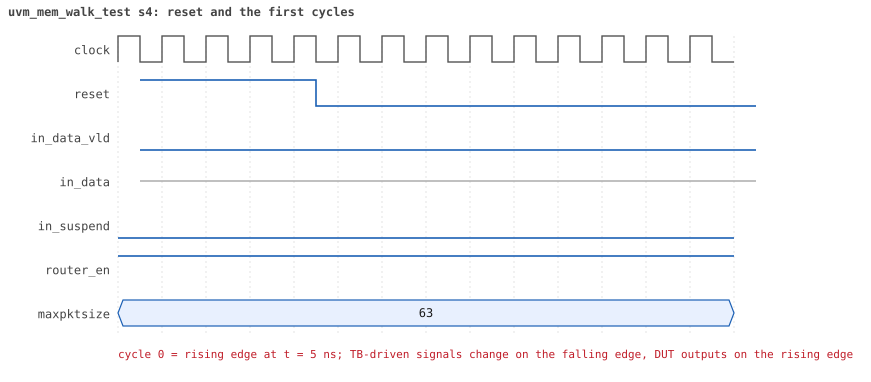
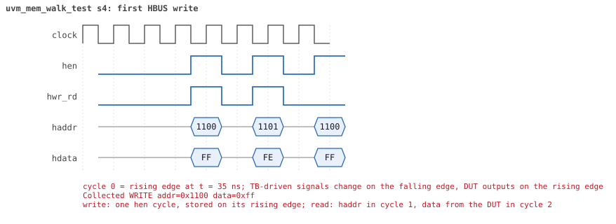
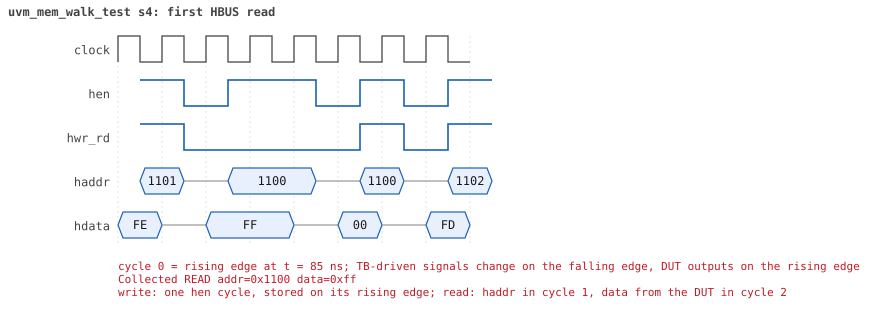

# uvm_mem_walk_test seed 4

**Result:** PASSED (0 UVM_ERROR, 0 UVM_WARNING, 0 UVM_FATAL) · bench `yapp_project_tb` · sim time 18us · wall 0.5 s · log [`uvm_mem_walk_test_s4.log`](uvm_mem_walk_test_s4.log)

Waves: `uvm_mem_walk_test_s4.fst` (GTKWave, Surfer or the VS Code wave viewer).
[Open the waves in Surfer](https://app.surfer-project.org/?load_url=https%3A%2F%2Fraw.githubusercontent.com%2Ftamirgabgab%2FQcom-Mentoring%2Fmain%2Fyapp_project%2Fregression%2Fyapp_project_tb%2Fuvm_mem_walk_test_s4%2Fuvm_mem_walk_test_s4.fst&startup_commands=run_command_file_from_url%20https%3A%2F%2Fraw.githubusercontent.com%2Ftamirgabgab%2FQcom-Mentoring%2Fmain%2Fyapp_project%2Ftb%2Fyapp_router.sucl) (web app, the signals already in groups: `yapp_project/tb/yapp_router.sucl`).

## Summary

- YAPP driver sent **0** packet(s) (0 with bad parity); the input monitor saw 0.
- Router: **0** forwarded, **0** dropped.
- Packets out: ch0 **0**, ch1 **0**, ch2 **0**.
- Scoreboard: 0 matched, 0 mismatched, 0 unexpected.
- Back-pressure: in_suspend asserted **0** time(s).
- Error pulses: 0.
- HBUS: 511 write(s), 256 read(s).

## Stages

| time (ns) | stage |
|---|---|
| 0 | uvm_mem_walk_seq: write and read back every location of every memory of the model |

## Pictures

**reset and the first cycles**

**first HBUS write**

**first HBUS read**

## Timeline

1554 events; this table keeps the 779 of the test, the DUT, the host bus, the checkers' reports and every warning or error. The full list is in the log.

| time (ns) | who | event |
|---|---|---|
| 0 | **test** | STAGE: uvm_mem_walk_seq: write and read back every location of every memory of the model |
| 0 | **DUT** | RESET asserted |
| 50 | **DUT** | RESET released: router_en=1 maxpktsize=63 |
| 75 | hbus monitor | Collected WRITE addr=0x1100 data=0xff |
| 95 | hbus monitor | Collected WRITE addr=0x1101 data=0xfe |
| 125 | hbus monitor | Collected READ  addr=0x1100 data=0xff |
| 145 | hbus monitor | Collected WRITE addr=0x1100 data=0x00 |
| 165 | hbus monitor | Collected WRITE addr=0x1102 data=0xfd |
| 195 | hbus monitor | Collected READ  addr=0x1101 data=0xfe |
| 215 | hbus monitor | Collected WRITE addr=0x1101 data=0x01 |
| 235 | hbus monitor | Collected WRITE addr=0x1103 data=0xfc |
| 265 | hbus monitor | Collected READ  addr=0x1102 data=0xfd |
| 285 | hbus monitor | Collected WRITE addr=0x1102 data=0x02 |
| 305 | hbus monitor | Collected WRITE addr=0x1104 data=0xfb |
| 335 | hbus monitor | Collected READ  addr=0x1103 data=0xfc |
| 355 | hbus monitor | Collected WRITE addr=0x1103 data=0x03 |
| 375 | hbus monitor | Collected WRITE addr=0x1105 data=0xfa |
| 405 | hbus monitor | Collected READ  addr=0x1104 data=0xfb |
| 425 | hbus monitor | Collected WRITE addr=0x1104 data=0x04 |
| 445 | hbus monitor | Collected WRITE addr=0x1106 data=0xf9 |
| 475 | hbus monitor | Collected READ  addr=0x1105 data=0xfa |
| 495 | hbus monitor | Collected WRITE addr=0x1105 data=0x05 |
| 515 | hbus monitor | Collected WRITE addr=0x1107 data=0xf8 |
| 545 | hbus monitor | Collected READ  addr=0x1106 data=0xf9 |
| 565 | hbus monitor | Collected WRITE addr=0x1106 data=0x06 |
| 585 | hbus monitor | Collected WRITE addr=0x1108 data=0xf7 |
| 615 | hbus monitor | Collected READ  addr=0x1107 data=0xf8 |
| 635 | hbus monitor | Collected WRITE addr=0x1107 data=0x07 |
| 655 | hbus monitor | Collected WRITE addr=0x1109 data=0xf6 |
| 685 | hbus monitor | Collected READ  addr=0x1108 data=0xf7 |
| 705 | hbus monitor | Collected WRITE addr=0x1108 data=0x08 |
| 725 | hbus monitor | Collected WRITE addr=0x110a data=0xf5 |
| 755 | hbus monitor | Collected READ  addr=0x1109 data=0xf6 |
| 775 | hbus monitor | Collected WRITE addr=0x1109 data=0x09 |
| 795 | hbus monitor | Collected WRITE addr=0x110b data=0xf4 |
| 825 | hbus monitor | Collected READ  addr=0x110a data=0xf5 |
| 845 | hbus monitor | Collected WRITE addr=0x110a data=0x0a |
| 865 | hbus monitor | Collected WRITE addr=0x110c data=0xf3 |
| 895 | hbus monitor | Collected READ  addr=0x110b data=0xf4 |
| 915 | hbus monitor | Collected WRITE addr=0x110b data=0x0b |
| 935 | hbus monitor | Collected WRITE addr=0x110d data=0xf2 |
| 965 | hbus monitor | Collected READ  addr=0x110c data=0xf3 |
| 985 | hbus monitor | Collected WRITE addr=0x110c data=0x0c |
| 1005 | hbus monitor | Collected WRITE addr=0x110e data=0xf1 |
| 1035 | hbus monitor | Collected READ  addr=0x110d data=0xf2 |
| 1055 | hbus monitor | Collected WRITE addr=0x110d data=0x0d |
| 1075 | hbus monitor | Collected WRITE addr=0x110f data=0xf0 |
| 1105 | hbus monitor | Collected READ  addr=0x110e data=0xf1 |
| 1125 | hbus monitor | Collected WRITE addr=0x110e data=0x0e |
| 1145 | hbus monitor | Collected WRITE addr=0x1110 data=0xef |
| 1175 | hbus monitor | Collected READ  addr=0x110f data=0xf0 |
| 1195 | hbus monitor | Collected WRITE addr=0x110f data=0x0f |
| 1215 | hbus monitor | Collected WRITE addr=0x1111 data=0xee |
| 1245 | hbus monitor | Collected READ  addr=0x1110 data=0xef |
| 1265 | hbus monitor | Collected WRITE addr=0x1110 data=0x10 |
| 1285 | hbus monitor | Collected WRITE addr=0x1112 data=0xed |
| 1315 | hbus monitor | Collected READ  addr=0x1111 data=0xee |
| 1335 | hbus monitor | Collected WRITE addr=0x1111 data=0x11 |
| 1355 | hbus monitor | Collected WRITE addr=0x1113 data=0xec |
| 1385 | hbus monitor | Collected READ  addr=0x1112 data=0xed |
| 1405 | hbus monitor | Collected WRITE addr=0x1112 data=0x12 |
| 1425 | hbus monitor | Collected WRITE addr=0x1114 data=0xeb |
| 1455 | hbus monitor | Collected READ  addr=0x1113 data=0xec |
| 1475 | hbus monitor | Collected WRITE addr=0x1113 data=0x13 |
| 1495 | hbus monitor | Collected WRITE addr=0x1115 data=0xea |
| 1525 | hbus monitor | Collected READ  addr=0x1114 data=0xeb |
| 1545 | hbus monitor | Collected WRITE addr=0x1114 data=0x14 |
| 1565 | hbus monitor | Collected WRITE addr=0x1116 data=0xe9 |
| 1595 | hbus monitor | Collected READ  addr=0x1115 data=0xea |
| 1615 | hbus monitor | Collected WRITE addr=0x1115 data=0x15 |
| 1635 | hbus monitor | Collected WRITE addr=0x1117 data=0xe8 |
| 1665 | hbus monitor | Collected READ  addr=0x1116 data=0xe9 |
| 1685 | hbus monitor | Collected WRITE addr=0x1116 data=0x16 |
| 1705 | hbus monitor | Collected WRITE addr=0x1118 data=0xe7 |
| 1735 | hbus monitor | Collected READ  addr=0x1117 data=0xe8 |
| 1755 | hbus monitor | Collected WRITE addr=0x1117 data=0x17 |
| 1775 | hbus monitor | Collected WRITE addr=0x1119 data=0xe6 |
| 1805 | hbus monitor | Collected READ  addr=0x1118 data=0xe7 |
| 1825 | hbus monitor | Collected WRITE addr=0x1118 data=0x18 |
| 1845 | hbus monitor | Collected WRITE addr=0x111a data=0xe5 |
| 1875 | hbus monitor | Collected READ  addr=0x1119 data=0xe6 |
| 1895 | hbus monitor | Collected WRITE addr=0x1119 data=0x19 |
| 1915 | hbus monitor | Collected WRITE addr=0x111b data=0xe4 |
| 1945 | hbus monitor | Collected READ  addr=0x111a data=0xe5 |
| 1965 | hbus monitor | Collected WRITE addr=0x111a data=0x1a |
| 1985 | hbus monitor | Collected WRITE addr=0x111c data=0xe3 |
| 2015 | hbus monitor | Collected READ  addr=0x111b data=0xe4 |
| 2035 | hbus monitor | Collected WRITE addr=0x111b data=0x1b |
| 2055 | hbus monitor | Collected WRITE addr=0x111d data=0xe2 |
| 2085 | hbus monitor | Collected READ  addr=0x111c data=0xe3 |
| 2105 | hbus monitor | Collected WRITE addr=0x111c data=0x1c |
| 2125 | hbus monitor | Collected WRITE addr=0x111e data=0xe1 |
| 2155 | hbus monitor | Collected READ  addr=0x111d data=0xe2 |
| 2175 | hbus monitor | Collected WRITE addr=0x111d data=0x1d |
| 2195 | hbus monitor | Collected WRITE addr=0x111f data=0xe0 |
| 2225 | hbus monitor | Collected READ  addr=0x111e data=0xe1 |
| 2245 | hbus monitor | Collected WRITE addr=0x111e data=0x1e |
| 2265 | hbus monitor | Collected WRITE addr=0x1120 data=0xdf |
| 2295 | hbus monitor | Collected READ  addr=0x111f data=0xe0 |
| 2315 | hbus monitor | Collected WRITE addr=0x111f data=0x1f |
| 2335 | hbus monitor | Collected WRITE addr=0x1121 data=0xde |
| 2365 | hbus monitor | Collected READ  addr=0x1120 data=0xdf |
| 2385 | hbus monitor | Collected WRITE addr=0x1120 data=0x20 |
| 2405 | hbus monitor | Collected WRITE addr=0x1122 data=0xdd |
| 2435 | hbus monitor | Collected READ  addr=0x1121 data=0xde |
| 2455 | hbus monitor | Collected WRITE addr=0x1121 data=0x21 |
| 2475 | hbus monitor | Collected WRITE addr=0x1123 data=0xdc |
| 2505 | hbus monitor | Collected READ  addr=0x1122 data=0xdd |
| 2525 | hbus monitor | Collected WRITE addr=0x1122 data=0x22 |
| 2545 | hbus monitor | Collected WRITE addr=0x1124 data=0xdb |
| 2575 | hbus monitor | Collected READ  addr=0x1123 data=0xdc |
| 2595 | hbus monitor | Collected WRITE addr=0x1123 data=0x23 |
| 2615 | hbus monitor | Collected WRITE addr=0x1125 data=0xda |
| 2645 | hbus monitor | Collected READ  addr=0x1124 data=0xdb |
| 2665 | hbus monitor | Collected WRITE addr=0x1124 data=0x24 |
| 2685 | hbus monitor | Collected WRITE addr=0x1126 data=0xd9 |
| 2715 | hbus monitor | Collected READ  addr=0x1125 data=0xda |
| 2735 | hbus monitor | Collected WRITE addr=0x1125 data=0x25 |
| 2755 | hbus monitor | Collected WRITE addr=0x1127 data=0xd8 |
| 2785 | hbus monitor | Collected READ  addr=0x1126 data=0xd9 |
| 2805 | hbus monitor | Collected WRITE addr=0x1126 data=0x26 |
| 2825 | hbus monitor | Collected WRITE addr=0x1128 data=0xd7 |
| 2855 | hbus monitor | Collected READ  addr=0x1127 data=0xd8 |
| 2875 | hbus monitor | Collected WRITE addr=0x1127 data=0x27 |
| 2895 | hbus monitor | Collected WRITE addr=0x1129 data=0xd6 |
| 2925 | hbus monitor | Collected READ  addr=0x1128 data=0xd7 |
| 2945 | hbus monitor | Collected WRITE addr=0x1128 data=0x28 |
| 2965 | hbus monitor | Collected WRITE addr=0x112a data=0xd5 |
| 2995 | hbus monitor | Collected READ  addr=0x1129 data=0xd6 |
| 3015 | hbus monitor | Collected WRITE addr=0x1129 data=0x29 |
| 3035 | hbus monitor | Collected WRITE addr=0x112b data=0xd4 |
| 3065 | hbus monitor | Collected READ  addr=0x112a data=0xd5 |
| 3085 | hbus monitor | Collected WRITE addr=0x112a data=0x2a |
| 3105 | hbus monitor | Collected WRITE addr=0x112c data=0xd3 |
| 3135 | hbus monitor | Collected READ  addr=0x112b data=0xd4 |
| 3155 | hbus monitor | Collected WRITE addr=0x112b data=0x2b |
| 3175 | hbus monitor | Collected WRITE addr=0x112d data=0xd2 |
| 3205 | hbus monitor | Collected READ  addr=0x112c data=0xd3 |
| 3225 | hbus monitor | Collected WRITE addr=0x112c data=0x2c |
| 3245 | hbus monitor | Collected WRITE addr=0x112e data=0xd1 |
| 3275 | hbus monitor | Collected READ  addr=0x112d data=0xd2 |
| 3295 | hbus monitor | Collected WRITE addr=0x112d data=0x2d |
| 3315 | hbus monitor | Collected WRITE addr=0x112f data=0xd0 |
| 3345 | hbus monitor | Collected READ  addr=0x112e data=0xd1 |
| 3365 | hbus monitor | Collected WRITE addr=0x112e data=0x2e |
| 3385 | hbus monitor | Collected WRITE addr=0x1130 data=0xcf |
| 3415 | hbus monitor | Collected READ  addr=0x112f data=0xd0 |
| 3435 | hbus monitor | Collected WRITE addr=0x112f data=0x2f |
| 3455 | hbus monitor | Collected WRITE addr=0x1131 data=0xce |
| 3485 | hbus monitor | Collected READ  addr=0x1130 data=0xcf |
| 3505 | hbus monitor | Collected WRITE addr=0x1130 data=0x30 |
| 3525 | hbus monitor | Collected WRITE addr=0x1132 data=0xcd |
| 3555 | hbus monitor | Collected READ  addr=0x1131 data=0xce |
| 3575 | hbus monitor | Collected WRITE addr=0x1131 data=0x31 |
| 3595 | hbus monitor | Collected WRITE addr=0x1133 data=0xcc |
| 3625 | hbus monitor | Collected READ  addr=0x1132 data=0xcd |
| 3645 | hbus monitor | Collected WRITE addr=0x1132 data=0x32 |
| 3665 | hbus monitor | Collected WRITE addr=0x1134 data=0xcb |
| 3695 | hbus monitor | Collected READ  addr=0x1133 data=0xcc |
| 3715 | hbus monitor | Collected WRITE addr=0x1133 data=0x33 |
| 3735 | hbus monitor | Collected WRITE addr=0x1135 data=0xca |
| 3765 | hbus monitor | Collected READ  addr=0x1134 data=0xcb |
| 3785 | hbus monitor | Collected WRITE addr=0x1134 data=0x34 |
| 3805 | hbus monitor | Collected WRITE addr=0x1136 data=0xc9 |
| 3835 | hbus monitor | Collected READ  addr=0x1135 data=0xca |
| 3855 | hbus monitor | Collected WRITE addr=0x1135 data=0x35 |
| 3875 | hbus monitor | Collected WRITE addr=0x1137 data=0xc8 |
| 3905 | hbus monitor | Collected READ  addr=0x1136 data=0xc9 |
| 3925 | hbus monitor | Collected WRITE addr=0x1136 data=0x36 |
| 3945 | hbus monitor | Collected WRITE addr=0x1138 data=0xc7 |
| 3975 | hbus monitor | Collected READ  addr=0x1137 data=0xc8 |
| 3995 | hbus monitor | Collected WRITE addr=0x1137 data=0x37 |
| 4015 | hbus monitor | Collected WRITE addr=0x1139 data=0xc6 |
| 4045 | hbus monitor | Collected READ  addr=0x1138 data=0xc7 |
| 4065 | hbus monitor | Collected WRITE addr=0x1138 data=0x38 |
| 4085 | hbus monitor | Collected WRITE addr=0x113a data=0xc5 |
| 4115 | hbus monitor | Collected READ  addr=0x1139 data=0xc6 |
| 4135 | hbus monitor | Collected WRITE addr=0x1139 data=0x39 |
| 4155 | hbus monitor | Collected WRITE addr=0x113b data=0xc4 |
| 4185 | hbus monitor | Collected READ  addr=0x113a data=0xc5 |
| 4205 | hbus monitor | Collected WRITE addr=0x113a data=0x3a |
| 4225 | hbus monitor | Collected WRITE addr=0x113c data=0xc3 |
| 4255 | hbus monitor | Collected READ  addr=0x113b data=0xc4 |
| 4275 | hbus monitor | Collected WRITE addr=0x113b data=0x3b |
| 4295 | hbus monitor | Collected WRITE addr=0x113d data=0xc2 |
| 4325 | hbus monitor | Collected READ  addr=0x113c data=0xc3 |
| 4345 | hbus monitor | Collected WRITE addr=0x113c data=0x3c |
| 4365 | hbus monitor | Collected WRITE addr=0x113e data=0xc1 |
| 4395 | hbus monitor | Collected READ  addr=0x113d data=0xc2 |
| 4415 | hbus monitor | Collected WRITE addr=0x113d data=0x3d |
| 4435 | hbus monitor | Collected WRITE addr=0x113f data=0xc0 |
| 4465 | hbus monitor | Collected READ  addr=0x113e data=0xc1 |
| 4485 | hbus monitor | Collected WRITE addr=0x113e data=0x3e |
| 4505 | hbus monitor | Collected WRITE addr=0x1140 data=0xbf |
| 4535 | hbus monitor | Collected READ  addr=0x113f data=0xc0 |
| 4555 | hbus monitor | Collected WRITE addr=0x113f data=0x3f |
| 4575 | hbus monitor | Collected WRITE addr=0x1141 data=0xbe |
| 4605 | hbus monitor | Collected READ  addr=0x1140 data=0xbf |
| 4625 | hbus monitor | Collected WRITE addr=0x1140 data=0x40 |
| 4645 | hbus monitor | Collected WRITE addr=0x1142 data=0xbd |
| 4675 | hbus monitor | Collected READ  addr=0x1141 data=0xbe |
| 4695 | hbus monitor | Collected WRITE addr=0x1141 data=0x41 |
| 4715 | hbus monitor | Collected WRITE addr=0x1143 data=0xbc |
| 4745 | hbus monitor | Collected READ  addr=0x1142 data=0xbd |
| 4765 | hbus monitor | Collected WRITE addr=0x1142 data=0x42 |
| 4785 | hbus monitor | Collected WRITE addr=0x1144 data=0xbb |
| 4815 | hbus monitor | Collected READ  addr=0x1143 data=0xbc |
| 4835 | hbus monitor | Collected WRITE addr=0x1143 data=0x43 |
| 4855 | hbus monitor | Collected WRITE addr=0x1145 data=0xba |
| 4885 | hbus monitor | Collected READ  addr=0x1144 data=0xbb |
| 4905 | hbus monitor | Collected WRITE addr=0x1144 data=0x44 |
| 4925 | hbus monitor | Collected WRITE addr=0x1146 data=0xb9 |
| 4955 | hbus monitor | Collected READ  addr=0x1145 data=0xba |
| 4975 | hbus monitor | Collected WRITE addr=0x1145 data=0x45 |
| 4995 | hbus monitor | Collected WRITE addr=0x1147 data=0xb8 |
| 5025 | hbus monitor | Collected READ  addr=0x1146 data=0xb9 |
| 5045 | hbus monitor | Collected WRITE addr=0x1146 data=0x46 |
| 5065 | hbus monitor | Collected WRITE addr=0x1148 data=0xb7 |
| 5095 | hbus monitor | Collected READ  addr=0x1147 data=0xb8 |
| 5115 | hbus monitor | Collected WRITE addr=0x1147 data=0x47 |
| 5135 | hbus monitor | Collected WRITE addr=0x1149 data=0xb6 |
| 5165 | hbus monitor | Collected READ  addr=0x1148 data=0xb7 |
| 5185 | hbus monitor | Collected WRITE addr=0x1148 data=0x48 |
| 5205 | hbus monitor | Collected WRITE addr=0x114a data=0xb5 |
| 5235 | hbus monitor | Collected READ  addr=0x1149 data=0xb6 |
| 5255 | hbus monitor | Collected WRITE addr=0x1149 data=0x49 |
| 5275 | hbus monitor | Collected WRITE addr=0x114b data=0xb4 |
| 5305 | hbus monitor | Collected READ  addr=0x114a data=0xb5 |
| 5325 | hbus monitor | Collected WRITE addr=0x114a data=0x4a |
| 5345 | hbus monitor | Collected WRITE addr=0x114c data=0xb3 |
| 5375 | hbus monitor | Collected READ  addr=0x114b data=0xb4 |
| 5395 | hbus monitor | Collected WRITE addr=0x114b data=0x4b |
| 5415 | hbus monitor | Collected WRITE addr=0x114d data=0xb2 |
| 5445 | hbus monitor | Collected READ  addr=0x114c data=0xb3 |
| 5465 | hbus monitor | Collected WRITE addr=0x114c data=0x4c |
| 5485 | hbus monitor | Collected WRITE addr=0x114e data=0xb1 |
| 5515 | hbus monitor | Collected READ  addr=0x114d data=0xb2 |
| 5535 | hbus monitor | Collected WRITE addr=0x114d data=0x4d |
| 5555 | hbus monitor | Collected WRITE addr=0x114f data=0xb0 |
| 5585 | hbus monitor | Collected READ  addr=0x114e data=0xb1 |
| 5605 | hbus monitor | Collected WRITE addr=0x114e data=0x4e |
| 5625 | hbus monitor | Collected WRITE addr=0x1150 data=0xaf |
| 5655 | hbus monitor | Collected READ  addr=0x114f data=0xb0 |
| 5675 | hbus monitor | Collected WRITE addr=0x114f data=0x4f |
| 5695 | hbus monitor | Collected WRITE addr=0x1151 data=0xae |
| 5725 | hbus monitor | Collected READ  addr=0x1150 data=0xaf |
| 5745 | hbus monitor | Collected WRITE addr=0x1150 data=0x50 |
| 5765 | hbus monitor | Collected WRITE addr=0x1152 data=0xad |
| 5795 | hbus monitor | Collected READ  addr=0x1151 data=0xae |
| 5815 | hbus monitor | Collected WRITE addr=0x1151 data=0x51 |
| 5835 | hbus monitor | Collected WRITE addr=0x1153 data=0xac |
| 5865 | hbus monitor | Collected READ  addr=0x1152 data=0xad |
| 5885 | hbus monitor | Collected WRITE addr=0x1152 data=0x52 |
| 5905 | hbus monitor | Collected WRITE addr=0x1154 data=0xab |
| 5935 | hbus monitor | Collected READ  addr=0x1153 data=0xac |
| 5955 | hbus monitor | Collected WRITE addr=0x1153 data=0x53 |
| 5975 | hbus monitor | Collected WRITE addr=0x1155 data=0xaa |
| 6005 | hbus monitor | Collected READ  addr=0x1154 data=0xab |
| 6025 | hbus monitor | Collected WRITE addr=0x1154 data=0x54 |
| 6045 | hbus monitor | Collected WRITE addr=0x1156 data=0xa9 |
| 6075 | hbus monitor | Collected READ  addr=0x1155 data=0xaa |
| 6095 | hbus monitor | Collected WRITE addr=0x1155 data=0x55 |
| 6115 | hbus monitor | Collected WRITE addr=0x1157 data=0xa8 |
| 6145 | hbus monitor | Collected READ  addr=0x1156 data=0xa9 |
| 6165 | hbus monitor | Collected WRITE addr=0x1156 data=0x56 |
| 6185 | hbus monitor | Collected WRITE addr=0x1158 data=0xa7 |
| 6215 | hbus monitor | Collected READ  addr=0x1157 data=0xa8 |
| 6235 | hbus monitor | Collected WRITE addr=0x1157 data=0x57 |
| 6255 | hbus monitor | Collected WRITE addr=0x1159 data=0xa6 |
| 6285 | hbus monitor | Collected READ  addr=0x1158 data=0xa7 |
| 6305 | hbus monitor | Collected WRITE addr=0x1158 data=0x58 |
| 6325 | hbus monitor | Collected WRITE addr=0x115a data=0xa5 |
| 6355 | hbus monitor | Collected READ  addr=0x1159 data=0xa6 |
| 6375 | hbus monitor | Collected WRITE addr=0x1159 data=0x59 |
| 6395 | hbus monitor | Collected WRITE addr=0x115b data=0xa4 |
| 6425 | hbus monitor | Collected READ  addr=0x115a data=0xa5 |
| 6445 | hbus monitor | Collected WRITE addr=0x115a data=0x5a |
| 6465 | hbus monitor | Collected WRITE addr=0x115c data=0xa3 |
| 6495 | hbus monitor | Collected READ  addr=0x115b data=0xa4 |
| 6515 | hbus monitor | Collected WRITE addr=0x115b data=0x5b |
| 6535 | hbus monitor | Collected WRITE addr=0x115d data=0xa2 |
| 6565 | hbus monitor | Collected READ  addr=0x115c data=0xa3 |
| 6585 | hbus monitor | Collected WRITE addr=0x115c data=0x5c |
| 6605 | hbus monitor | Collected WRITE addr=0x115e data=0xa1 |
| 6635 | hbus monitor | Collected READ  addr=0x115d data=0xa2 |
| 6655 | hbus monitor | Collected WRITE addr=0x115d data=0x5d |
| 6675 | hbus monitor | Collected WRITE addr=0x115f data=0xa0 |
| 6705 | hbus monitor | Collected READ  addr=0x115e data=0xa1 |
| 6725 | hbus monitor | Collected WRITE addr=0x115e data=0x5e |
| 6745 | hbus monitor | Collected WRITE addr=0x1160 data=0x9f |
| 6775 | hbus monitor | Collected READ  addr=0x115f data=0xa0 |
| 6795 | hbus monitor | Collected WRITE addr=0x115f data=0x5f |
| 6815 | hbus monitor | Collected WRITE addr=0x1161 data=0x9e |
| 6845 | hbus monitor | Collected READ  addr=0x1160 data=0x9f |
| 6865 | hbus monitor | Collected WRITE addr=0x1160 data=0x60 |
| 6885 | hbus monitor | Collected WRITE addr=0x1162 data=0x9d |
| 6915 | hbus monitor | Collected READ  addr=0x1161 data=0x9e |
| 6935 | hbus monitor | Collected WRITE addr=0x1161 data=0x61 |
| 6955 | hbus monitor | Collected WRITE addr=0x1163 data=0x9c |
| 6985 | hbus monitor | Collected READ  addr=0x1162 data=0x9d |
| 7005 | hbus monitor | Collected WRITE addr=0x1162 data=0x62 |
| 7025 | hbus monitor | Collected WRITE addr=0x1164 data=0x9b |
| 7055 | hbus monitor | Collected READ  addr=0x1163 data=0x9c |
| 7075 | hbus monitor | Collected WRITE addr=0x1163 data=0x63 |
| 7095 | hbus monitor | Collected WRITE addr=0x1165 data=0x9a |
| 7125 | hbus monitor | Collected READ  addr=0x1164 data=0x9b |
| 7145 | hbus monitor | Collected WRITE addr=0x1164 data=0x64 |
| 7165 | hbus monitor | Collected WRITE addr=0x1166 data=0x99 |
| 7195 | hbus monitor | Collected READ  addr=0x1165 data=0x9a |
| 7215 | hbus monitor | Collected WRITE addr=0x1165 data=0x65 |
| 7235 | hbus monitor | Collected WRITE addr=0x1167 data=0x98 |
| 7265 | hbus monitor | Collected READ  addr=0x1166 data=0x99 |
| 7285 | hbus monitor | Collected WRITE addr=0x1166 data=0x66 |
| 7305 | hbus monitor | Collected WRITE addr=0x1168 data=0x97 |
| 7335 | hbus monitor | Collected READ  addr=0x1167 data=0x98 |
| 7355 | hbus monitor | Collected WRITE addr=0x1167 data=0x67 |
| 7375 | hbus monitor | Collected WRITE addr=0x1169 data=0x96 |
| 7405 | hbus monitor | Collected READ  addr=0x1168 data=0x97 |
| 7425 | hbus monitor | Collected WRITE addr=0x1168 data=0x68 |
| 7445 | hbus monitor | Collected WRITE addr=0x116a data=0x95 |
| 7475 | hbus monitor | Collected READ  addr=0x1169 data=0x96 |
| 7495 | hbus monitor | Collected WRITE addr=0x1169 data=0x69 |
| 7515 | hbus monitor | Collected WRITE addr=0x116b data=0x94 |
| 7545 | hbus monitor | Collected READ  addr=0x116a data=0x95 |
| 7565 | hbus monitor | Collected WRITE addr=0x116a data=0x6a |
| 7585 | hbus monitor | Collected WRITE addr=0x116c data=0x93 |
| 7615 | hbus monitor | Collected READ  addr=0x116b data=0x94 |
| 7635 | hbus monitor | Collected WRITE addr=0x116b data=0x6b |
| 7655 | hbus monitor | Collected WRITE addr=0x116d data=0x92 |
| 7685 | hbus monitor | Collected READ  addr=0x116c data=0x93 |
| 7705 | hbus monitor | Collected WRITE addr=0x116c data=0x6c |
| 7725 | hbus monitor | Collected WRITE addr=0x116e data=0x91 |
| 7755 | hbus monitor | Collected READ  addr=0x116d data=0x92 |
| 7775 | hbus monitor | Collected WRITE addr=0x116d data=0x6d |
| 7795 | hbus monitor | Collected WRITE addr=0x116f data=0x90 |
| 7825 | hbus monitor | Collected READ  addr=0x116e data=0x91 |
| 7845 | hbus monitor | Collected WRITE addr=0x116e data=0x6e |
| 7865 | hbus monitor | Collected WRITE addr=0x1170 data=0x8f |
| 7895 | hbus monitor | Collected READ  addr=0x116f data=0x90 |
| 7915 | hbus monitor | Collected WRITE addr=0x116f data=0x6f |
| 7935 | hbus monitor | Collected WRITE addr=0x1171 data=0x8e |
| 7965 | hbus monitor | Collected READ  addr=0x1170 data=0x8f |
| 7985 | hbus monitor | Collected WRITE addr=0x1170 data=0x70 |
| 8005 | hbus monitor | Collected WRITE addr=0x1172 data=0x8d |
| 8035 | hbus monitor | Collected READ  addr=0x1171 data=0x8e |
| 8055 | hbus monitor | Collected WRITE addr=0x1171 data=0x71 |
| 8075 | hbus monitor | Collected WRITE addr=0x1173 data=0x8c |
| 8105 | hbus monitor | Collected READ  addr=0x1172 data=0x8d |
| 8125 | hbus monitor | Collected WRITE addr=0x1172 data=0x72 |
| 8145 | hbus monitor | Collected WRITE addr=0x1174 data=0x8b |
| 8175 | hbus monitor | Collected READ  addr=0x1173 data=0x8c |
| 8195 | hbus monitor | Collected WRITE addr=0x1173 data=0x73 |
| 8215 | hbus monitor | Collected WRITE addr=0x1175 data=0x8a |
| 8245 | hbus monitor | Collected READ  addr=0x1174 data=0x8b |
| 8265 | hbus monitor | Collected WRITE addr=0x1174 data=0x74 |
| 8285 | hbus monitor | Collected WRITE addr=0x1176 data=0x89 |
| 8315 | hbus monitor | Collected READ  addr=0x1175 data=0x8a |
| 8335 | hbus monitor | Collected WRITE addr=0x1175 data=0x75 |
| 8355 | hbus monitor | Collected WRITE addr=0x1177 data=0x88 |
| 8385 | hbus monitor | Collected READ  addr=0x1176 data=0x89 |
| 8405 | hbus monitor | Collected WRITE addr=0x1176 data=0x76 |
| 8425 | hbus monitor | Collected WRITE addr=0x1178 data=0x87 |
| 8455 | hbus monitor | Collected READ  addr=0x1177 data=0x88 |
| 8475 | hbus monitor | Collected WRITE addr=0x1177 data=0x77 |
| 8495 | hbus monitor | Collected WRITE addr=0x1179 data=0x86 |
| 8525 | hbus monitor | Collected READ  addr=0x1178 data=0x87 |
| 8545 | hbus monitor | Collected WRITE addr=0x1178 data=0x78 |
| 8565 | hbus monitor | Collected WRITE addr=0x117a data=0x85 |
| 8595 | hbus monitor | Collected READ  addr=0x1179 data=0x86 |
| 8615 | hbus monitor | Collected WRITE addr=0x1179 data=0x79 |
| 8635 | hbus monitor | Collected WRITE addr=0x117b data=0x84 |
| 8665 | hbus monitor | Collected READ  addr=0x117a data=0x85 |
| 8685 | hbus monitor | Collected WRITE addr=0x117a data=0x7a |
| 8705 | hbus monitor | Collected WRITE addr=0x117c data=0x83 |
| 8735 | hbus monitor | Collected READ  addr=0x117b data=0x84 |
| 8755 | hbus monitor | Collected WRITE addr=0x117b data=0x7b |
| 8775 | hbus monitor | Collected WRITE addr=0x117d data=0x82 |
| 8805 | hbus monitor | Collected READ  addr=0x117c data=0x83 |
| 8825 | hbus monitor | Collected WRITE addr=0x117c data=0x7c |
| 8845 | hbus monitor | Collected WRITE addr=0x117e data=0x81 |
| 8875 | hbus monitor | Collected READ  addr=0x117d data=0x82 |
| 8895 | hbus monitor | Collected WRITE addr=0x117d data=0x7d |
| 8915 | hbus monitor | Collected WRITE addr=0x117f data=0x80 |
| 8945 | hbus monitor | Collected READ  addr=0x117e data=0x81 |
| 8965 | hbus monitor | Collected WRITE addr=0x117e data=0x7e |
| 8985 | hbus monitor | Collected WRITE addr=0x1180 data=0x7f |
| 9015 | hbus monitor | Collected READ  addr=0x117f data=0x80 |
| 9035 | hbus monitor | Collected WRITE addr=0x117f data=0x7f |
| 9055 | hbus monitor | Collected WRITE addr=0x1181 data=0x7e |
| 9085 | hbus monitor | Collected READ  addr=0x1180 data=0x7f |
| 9105 | hbus monitor | Collected WRITE addr=0x1180 data=0x80 |
| 9125 | hbus monitor | Collected WRITE addr=0x1182 data=0x7d |
| 9155 | hbus monitor | Collected READ  addr=0x1181 data=0x7e |
| 9175 | hbus monitor | Collected WRITE addr=0x1181 data=0x81 |
| 9195 | hbus monitor | Collected WRITE addr=0x1183 data=0x7c |
| 9225 | hbus monitor | Collected READ  addr=0x1182 data=0x7d |
| 9245 | hbus monitor | Collected WRITE addr=0x1182 data=0x82 |
| 9265 | hbus monitor | Collected WRITE addr=0x1184 data=0x7b |
| 9295 | hbus monitor | Collected READ  addr=0x1183 data=0x7c |
| 9315 | hbus monitor | Collected WRITE addr=0x1183 data=0x83 |
| 9335 | hbus monitor | Collected WRITE addr=0x1185 data=0x7a |
| 9365 | hbus monitor | Collected READ  addr=0x1184 data=0x7b |
| 9385 | hbus monitor | Collected WRITE addr=0x1184 data=0x84 |
| 9405 | hbus monitor | Collected WRITE addr=0x1186 data=0x79 |
| 9435 | hbus monitor | Collected READ  addr=0x1185 data=0x7a |
| 9455 | hbus monitor | Collected WRITE addr=0x1185 data=0x85 |
| 9475 | hbus monitor | Collected WRITE addr=0x1187 data=0x78 |
| 9505 | hbus monitor | Collected READ  addr=0x1186 data=0x79 |
| 9525 | hbus monitor | Collected WRITE addr=0x1186 data=0x86 |
| 9545 | hbus monitor | Collected WRITE addr=0x1188 data=0x77 |
| 9575 | hbus monitor | Collected READ  addr=0x1187 data=0x78 |
| 9595 | hbus monitor | Collected WRITE addr=0x1187 data=0x87 |
| 9615 | hbus monitor | Collected WRITE addr=0x1189 data=0x76 |
| 9645 | hbus monitor | Collected READ  addr=0x1188 data=0x77 |
| 9665 | hbus monitor | Collected WRITE addr=0x1188 data=0x88 |
| 9685 | hbus monitor | Collected WRITE addr=0x118a data=0x75 |
| 9715 | hbus monitor | Collected READ  addr=0x1189 data=0x76 |
| 9735 | hbus monitor | Collected WRITE addr=0x1189 data=0x89 |
| 9755 | hbus monitor | Collected WRITE addr=0x118b data=0x74 |
| 9785 | hbus monitor | Collected READ  addr=0x118a data=0x75 |
| 9805 | hbus monitor | Collected WRITE addr=0x118a data=0x8a |
| 9825 | hbus monitor | Collected WRITE addr=0x118c data=0x73 |
| 9855 | hbus monitor | Collected READ  addr=0x118b data=0x74 |
| 9875 | hbus monitor | Collected WRITE addr=0x118b data=0x8b |
| 9895 | hbus monitor | Collected WRITE addr=0x118d data=0x72 |
| 9925 | hbus monitor | Collected READ  addr=0x118c data=0x73 |
| 9945 | hbus monitor | Collected WRITE addr=0x118c data=0x8c |
| 9965 | hbus monitor | Collected WRITE addr=0x118e data=0x71 |
| 9995 | hbus monitor | Collected READ  addr=0x118d data=0x72 |
| 10015 | hbus monitor | Collected WRITE addr=0x118d data=0x8d |
| 10035 | hbus monitor | Collected WRITE addr=0x118f data=0x70 |
| 10065 | hbus monitor | Collected READ  addr=0x118e data=0x71 |
| 10085 | hbus monitor | Collected WRITE addr=0x118e data=0x8e |
| 10105 | hbus monitor | Collected WRITE addr=0x1190 data=0x6f |
| 10135 | hbus monitor | Collected READ  addr=0x118f data=0x70 |
| 10155 | hbus monitor | Collected WRITE addr=0x118f data=0x8f |
| 10175 | hbus monitor | Collected WRITE addr=0x1191 data=0x6e |
| 10205 | hbus monitor | Collected READ  addr=0x1190 data=0x6f |
| 10225 | hbus monitor | Collected WRITE addr=0x1190 data=0x90 |
| 10245 | hbus monitor | Collected WRITE addr=0x1192 data=0x6d |
| 10275 | hbus monitor | Collected READ  addr=0x1191 data=0x6e |
| 10295 | hbus monitor | Collected WRITE addr=0x1191 data=0x91 |
| 10315 | hbus monitor | Collected WRITE addr=0x1193 data=0x6c |
| 10345 | hbus monitor | Collected READ  addr=0x1192 data=0x6d |
| 10365 | hbus monitor | Collected WRITE addr=0x1192 data=0x92 |
| 10385 | hbus monitor | Collected WRITE addr=0x1194 data=0x6b |
| 10415 | hbus monitor | Collected READ  addr=0x1193 data=0x6c |
| 10435 | hbus monitor | Collected WRITE addr=0x1193 data=0x93 |
| 10455 | hbus monitor | Collected WRITE addr=0x1195 data=0x6a |
| 10485 | hbus monitor | Collected READ  addr=0x1194 data=0x6b |
| 10505 | hbus monitor | Collected WRITE addr=0x1194 data=0x94 |
| 10525 | hbus monitor | Collected WRITE addr=0x1196 data=0x69 |
| 10555 | hbus monitor | Collected READ  addr=0x1195 data=0x6a |
| 10575 | hbus monitor | Collected WRITE addr=0x1195 data=0x95 |
| 10595 | hbus monitor | Collected WRITE addr=0x1197 data=0x68 |
| 10625 | hbus monitor | Collected READ  addr=0x1196 data=0x69 |
| 10645 | hbus monitor | Collected WRITE addr=0x1196 data=0x96 |
| 10665 | hbus monitor | Collected WRITE addr=0x1198 data=0x67 |
| 10695 | hbus monitor | Collected READ  addr=0x1197 data=0x68 |
| 10715 | hbus monitor | Collected WRITE addr=0x1197 data=0x97 |
| 10735 | hbus monitor | Collected WRITE addr=0x1199 data=0x66 |
| 10765 | hbus monitor | Collected READ  addr=0x1198 data=0x67 |
| 10785 | hbus monitor | Collected WRITE addr=0x1198 data=0x98 |
| 10805 | hbus monitor | Collected WRITE addr=0x119a data=0x65 |
| 10835 | hbus monitor | Collected READ  addr=0x1199 data=0x66 |
| 10855 | hbus monitor | Collected WRITE addr=0x1199 data=0x99 |
| 10875 | hbus monitor | Collected WRITE addr=0x119b data=0x64 |
| 10905 | hbus monitor | Collected READ  addr=0x119a data=0x65 |
| 10925 | hbus monitor | Collected WRITE addr=0x119a data=0x9a |
| 10945 | hbus monitor | Collected WRITE addr=0x119c data=0x63 |
| 10975 | hbus monitor | Collected READ  addr=0x119b data=0x64 |
| 10995 | hbus monitor | Collected WRITE addr=0x119b data=0x9b |
| 11015 | hbus monitor | Collected WRITE addr=0x119d data=0x62 |
| 11045 | hbus monitor | Collected READ  addr=0x119c data=0x63 |
| 11065 | hbus monitor | Collected WRITE addr=0x119c data=0x9c |
| 11085 | hbus monitor | Collected WRITE addr=0x119e data=0x61 |
| 11115 | hbus monitor | Collected READ  addr=0x119d data=0x62 |
| 11135 | hbus monitor | Collected WRITE addr=0x119d data=0x9d |
| 11155 | hbus monitor | Collected WRITE addr=0x119f data=0x60 |
| 11185 | hbus monitor | Collected READ  addr=0x119e data=0x61 |
| 11205 | hbus monitor | Collected WRITE addr=0x119e data=0x9e |
| 11225 | hbus monitor | Collected WRITE addr=0x11a0 data=0x5f |
| 11255 | hbus monitor | Collected READ  addr=0x119f data=0x60 |
| 11275 | hbus monitor | Collected WRITE addr=0x119f data=0x9f |
| 11295 | hbus monitor | Collected WRITE addr=0x11a1 data=0x5e |
| 11325 | hbus monitor | Collected READ  addr=0x11a0 data=0x5f |
| 11345 | hbus monitor | Collected WRITE addr=0x11a0 data=0xa0 |
| 11365 | hbus monitor | Collected WRITE addr=0x11a2 data=0x5d |
| 11395 | hbus monitor | Collected READ  addr=0x11a1 data=0x5e |
| 11415 | hbus monitor | Collected WRITE addr=0x11a1 data=0xa1 |
| 11435 | hbus monitor | Collected WRITE addr=0x11a3 data=0x5c |
| 11465 | hbus monitor | Collected READ  addr=0x11a2 data=0x5d |
| 11485 | hbus monitor | Collected WRITE addr=0x11a2 data=0xa2 |
| 11505 | hbus monitor | Collected WRITE addr=0x11a4 data=0x5b |
| 11535 | hbus monitor | Collected READ  addr=0x11a3 data=0x5c |
| 11555 | hbus monitor | Collected WRITE addr=0x11a3 data=0xa3 |
| 11575 | hbus monitor | Collected WRITE addr=0x11a5 data=0x5a |
| 11605 | hbus monitor | Collected READ  addr=0x11a4 data=0x5b |
| 11625 | hbus monitor | Collected WRITE addr=0x11a4 data=0xa4 |
| 11645 | hbus monitor | Collected WRITE addr=0x11a6 data=0x59 |
| 11675 | hbus monitor | Collected READ  addr=0x11a5 data=0x5a |
| 11695 | hbus monitor | Collected WRITE addr=0x11a5 data=0xa5 |
| 11715 | hbus monitor | Collected WRITE addr=0x11a7 data=0x58 |
| 11745 | hbus monitor | Collected READ  addr=0x11a6 data=0x59 |
| 11765 | hbus monitor | Collected WRITE addr=0x11a6 data=0xa6 |
| 11785 | hbus monitor | Collected WRITE addr=0x11a8 data=0x57 |
| 11815 | hbus monitor | Collected READ  addr=0x11a7 data=0x58 |
| 11835 | hbus monitor | Collected WRITE addr=0x11a7 data=0xa7 |
| 11855 | hbus monitor | Collected WRITE addr=0x11a9 data=0x56 |
| 11885 | hbus monitor | Collected READ  addr=0x11a8 data=0x57 |
| 11905 | hbus monitor | Collected WRITE addr=0x11a8 data=0xa8 |
| 11925 | hbus monitor | Collected WRITE addr=0x11aa data=0x55 |
| 11955 | hbus monitor | Collected READ  addr=0x11a9 data=0x56 |
| 11975 | hbus monitor | Collected WRITE addr=0x11a9 data=0xa9 |
| 11995 | hbus monitor | Collected WRITE addr=0x11ab data=0x54 |
| 12025 | hbus monitor | Collected READ  addr=0x11aa data=0x55 |
| 12045 | hbus monitor | Collected WRITE addr=0x11aa data=0xaa |
| 12065 | hbus monitor | Collected WRITE addr=0x11ac data=0x53 |
| 12095 | hbus monitor | Collected READ  addr=0x11ab data=0x54 |
| 12115 | hbus monitor | Collected WRITE addr=0x11ab data=0xab |
| 12135 | hbus monitor | Collected WRITE addr=0x11ad data=0x52 |
| 12165 | hbus monitor | Collected READ  addr=0x11ac data=0x53 |
| 12185 | hbus monitor | Collected WRITE addr=0x11ac data=0xac |
| 12205 | hbus monitor | Collected WRITE addr=0x11ae data=0x51 |
| 12235 | hbus monitor | Collected READ  addr=0x11ad data=0x52 |
| 12255 | hbus monitor | Collected WRITE addr=0x11ad data=0xad |
| 12275 | hbus monitor | Collected WRITE addr=0x11af data=0x50 |
| 12305 | hbus monitor | Collected READ  addr=0x11ae data=0x51 |
| 12325 | hbus monitor | Collected WRITE addr=0x11ae data=0xae |
| 12345 | hbus monitor | Collected WRITE addr=0x11b0 data=0x4f |
| 12375 | hbus monitor | Collected READ  addr=0x11af data=0x50 |
| 12395 | hbus monitor | Collected WRITE addr=0x11af data=0xaf |
| 12415 | hbus monitor | Collected WRITE addr=0x11b1 data=0x4e |
| 12445 | hbus monitor | Collected READ  addr=0x11b0 data=0x4f |
| 12465 | hbus monitor | Collected WRITE addr=0x11b0 data=0xb0 |
| 12485 | hbus monitor | Collected WRITE addr=0x11b2 data=0x4d |
| 12515 | hbus monitor | Collected READ  addr=0x11b1 data=0x4e |
| 12535 | hbus monitor | Collected WRITE addr=0x11b1 data=0xb1 |
| 12555 | hbus monitor | Collected WRITE addr=0x11b3 data=0x4c |
| 12585 | hbus monitor | Collected READ  addr=0x11b2 data=0x4d |
| 12605 | hbus monitor | Collected WRITE addr=0x11b2 data=0xb2 |
| 12625 | hbus monitor | Collected WRITE addr=0x11b4 data=0x4b |
| 12655 | hbus monitor | Collected READ  addr=0x11b3 data=0x4c |
| 12675 | hbus monitor | Collected WRITE addr=0x11b3 data=0xb3 |
| 12695 | hbus monitor | Collected WRITE addr=0x11b5 data=0x4a |
| 12725 | hbus monitor | Collected READ  addr=0x11b4 data=0x4b |
| 12745 | hbus monitor | Collected WRITE addr=0x11b4 data=0xb4 |
| 12765 | hbus monitor | Collected WRITE addr=0x11b6 data=0x49 |
| 12795 | hbus monitor | Collected READ  addr=0x11b5 data=0x4a |
| 12815 | hbus monitor | Collected WRITE addr=0x11b5 data=0xb5 |
| 12835 | hbus monitor | Collected WRITE addr=0x11b7 data=0x48 |
| 12865 | hbus monitor | Collected READ  addr=0x11b6 data=0x49 |
| 12885 | hbus monitor | Collected WRITE addr=0x11b6 data=0xb6 |
| 12905 | hbus monitor | Collected WRITE addr=0x11b8 data=0x47 |
| 12935 | hbus monitor | Collected READ  addr=0x11b7 data=0x48 |
| 12955 | hbus monitor | Collected WRITE addr=0x11b7 data=0xb7 |
| 12975 | hbus monitor | Collected WRITE addr=0x11b9 data=0x46 |
| 13005 | hbus monitor | Collected READ  addr=0x11b8 data=0x47 |
| 13025 | hbus monitor | Collected WRITE addr=0x11b8 data=0xb8 |
| 13045 | hbus monitor | Collected WRITE addr=0x11ba data=0x45 |
| 13075 | hbus monitor | Collected READ  addr=0x11b9 data=0x46 |
| 13095 | hbus monitor | Collected WRITE addr=0x11b9 data=0xb9 |
| 13115 | hbus monitor | Collected WRITE addr=0x11bb data=0x44 |
| 13145 | hbus monitor | Collected READ  addr=0x11ba data=0x45 |
| 13165 | hbus monitor | Collected WRITE addr=0x11ba data=0xba |
| 13185 | hbus monitor | Collected WRITE addr=0x11bc data=0x43 |
| 13215 | hbus monitor | Collected READ  addr=0x11bb data=0x44 |
| 13235 | hbus monitor | Collected WRITE addr=0x11bb data=0xbb |
| 13255 | hbus monitor | Collected WRITE addr=0x11bd data=0x42 |
| 13285 | hbus monitor | Collected READ  addr=0x11bc data=0x43 |
| 13305 | hbus monitor | Collected WRITE addr=0x11bc data=0xbc |
| 13325 | hbus monitor | Collected WRITE addr=0x11be data=0x41 |
| 13355 | hbus monitor | Collected READ  addr=0x11bd data=0x42 |
| 13375 | hbus monitor | Collected WRITE addr=0x11bd data=0xbd |
| 13395 | hbus monitor | Collected WRITE addr=0x11bf data=0x40 |
| 13425 | hbus monitor | Collected READ  addr=0x11be data=0x41 |
| 13445 | hbus monitor | Collected WRITE addr=0x11be data=0xbe |
| 13465 | hbus monitor | Collected WRITE addr=0x11c0 data=0x3f |
| 13495 | hbus monitor | Collected READ  addr=0x11bf data=0x40 |
| 13515 | hbus monitor | Collected WRITE addr=0x11bf data=0xbf |
| 13535 | hbus monitor | Collected WRITE addr=0x11c1 data=0x3e |
| 13565 | hbus monitor | Collected READ  addr=0x11c0 data=0x3f |
| 13585 | hbus monitor | Collected WRITE addr=0x11c0 data=0xc0 |
| 13605 | hbus monitor | Collected WRITE addr=0x11c2 data=0x3d |
| 13635 | hbus monitor | Collected READ  addr=0x11c1 data=0x3e |
| 13655 | hbus monitor | Collected WRITE addr=0x11c1 data=0xc1 |
| 13675 | hbus monitor | Collected WRITE addr=0x11c3 data=0x3c |
| 13705 | hbus monitor | Collected READ  addr=0x11c2 data=0x3d |
| 13725 | hbus monitor | Collected WRITE addr=0x11c2 data=0xc2 |
| 13745 | hbus monitor | Collected WRITE addr=0x11c4 data=0x3b |
| 13775 | hbus monitor | Collected READ  addr=0x11c3 data=0x3c |
| 13795 | hbus monitor | Collected WRITE addr=0x11c3 data=0xc3 |
| 13815 | hbus monitor | Collected WRITE addr=0x11c5 data=0x3a |
| 13845 | hbus monitor | Collected READ  addr=0x11c4 data=0x3b |
| 13865 | hbus monitor | Collected WRITE addr=0x11c4 data=0xc4 |
| 13885 | hbus monitor | Collected WRITE addr=0x11c6 data=0x39 |
| 13915 | hbus monitor | Collected READ  addr=0x11c5 data=0x3a |
| 13935 | hbus monitor | Collected WRITE addr=0x11c5 data=0xc5 |
| 13955 | hbus monitor | Collected WRITE addr=0x11c7 data=0x38 |
| 13985 | hbus monitor | Collected READ  addr=0x11c6 data=0x39 |
| 14005 | hbus monitor | Collected WRITE addr=0x11c6 data=0xc6 |
| 14025 | hbus monitor | Collected WRITE addr=0x11c8 data=0x37 |
| 14055 | hbus monitor | Collected READ  addr=0x11c7 data=0x38 |
| 14075 | hbus monitor | Collected WRITE addr=0x11c7 data=0xc7 |
| 14095 | hbus monitor | Collected WRITE addr=0x11c9 data=0x36 |
| 14125 | hbus monitor | Collected READ  addr=0x11c8 data=0x37 |
| 14145 | hbus monitor | Collected WRITE addr=0x11c8 data=0xc8 |
| 14165 | hbus monitor | Collected WRITE addr=0x11ca data=0x35 |
| 14195 | hbus monitor | Collected READ  addr=0x11c9 data=0x36 |
| 14215 | hbus monitor | Collected WRITE addr=0x11c9 data=0xc9 |
| 14235 | hbus monitor | Collected WRITE addr=0x11cb data=0x34 |
| 14265 | hbus monitor | Collected READ  addr=0x11ca data=0x35 |
| 14285 | hbus monitor | Collected WRITE addr=0x11ca data=0xca |
| 14305 | hbus monitor | Collected WRITE addr=0x11cc data=0x33 |
| 14335 | hbus monitor | Collected READ  addr=0x11cb data=0x34 |
| 14355 | hbus monitor | Collected WRITE addr=0x11cb data=0xcb |
| 14375 | hbus monitor | Collected WRITE addr=0x11cd data=0x32 |
| 14405 | hbus monitor | Collected READ  addr=0x11cc data=0x33 |
| 14425 | hbus monitor | Collected WRITE addr=0x11cc data=0xcc |
| 14445 | hbus monitor | Collected WRITE addr=0x11ce data=0x31 |
| 14475 | hbus monitor | Collected READ  addr=0x11cd data=0x32 |
| 14495 | hbus monitor | Collected WRITE addr=0x11cd data=0xcd |
| 14515 | hbus monitor | Collected WRITE addr=0x11cf data=0x30 |
| 14545 | hbus monitor | Collected READ  addr=0x11ce data=0x31 |
| 14565 | hbus monitor | Collected WRITE addr=0x11ce data=0xce |
| 14585 | hbus monitor | Collected WRITE addr=0x11d0 data=0x2f |
| 14615 | hbus monitor | Collected READ  addr=0x11cf data=0x30 |
| 14635 | hbus monitor | Collected WRITE addr=0x11cf data=0xcf |
| 14655 | hbus monitor | Collected WRITE addr=0x11d1 data=0x2e |
| 14685 | hbus monitor | Collected READ  addr=0x11d0 data=0x2f |
| 14705 | hbus monitor | Collected WRITE addr=0x11d0 data=0xd0 |
| 14725 | hbus monitor | Collected WRITE addr=0x11d2 data=0x2d |
| 14755 | hbus monitor | Collected READ  addr=0x11d1 data=0x2e |
| 14775 | hbus monitor | Collected WRITE addr=0x11d1 data=0xd1 |
| 14795 | hbus monitor | Collected WRITE addr=0x11d3 data=0x2c |
| 14825 | hbus monitor | Collected READ  addr=0x11d2 data=0x2d |
| 14845 | hbus monitor | Collected WRITE addr=0x11d2 data=0xd2 |
| 14865 | hbus monitor | Collected WRITE addr=0x11d4 data=0x2b |
| 14895 | hbus monitor | Collected READ  addr=0x11d3 data=0x2c |
| 14915 | hbus monitor | Collected WRITE addr=0x11d3 data=0xd3 |
| 14935 | hbus monitor | Collected WRITE addr=0x11d5 data=0x2a |
| 14965 | hbus monitor | Collected READ  addr=0x11d4 data=0x2b |
| 14985 | hbus monitor | Collected WRITE addr=0x11d4 data=0xd4 |
| 15005 | hbus monitor | Collected WRITE addr=0x11d6 data=0x29 |
| 15035 | hbus monitor | Collected READ  addr=0x11d5 data=0x2a |
| 15055 | hbus monitor | Collected WRITE addr=0x11d5 data=0xd5 |
| 15075 | hbus monitor | Collected WRITE addr=0x11d7 data=0x28 |
| 15105 | hbus monitor | Collected READ  addr=0x11d6 data=0x29 |
| 15125 | hbus monitor | Collected WRITE addr=0x11d6 data=0xd6 |
| 15145 | hbus monitor | Collected WRITE addr=0x11d8 data=0x27 |
| 15175 | hbus monitor | Collected READ  addr=0x11d7 data=0x28 |
| 15195 | hbus monitor | Collected WRITE addr=0x11d7 data=0xd7 |
| 15215 | hbus monitor | Collected WRITE addr=0x11d9 data=0x26 |
| 15245 | hbus monitor | Collected READ  addr=0x11d8 data=0x27 |
| 15265 | hbus monitor | Collected WRITE addr=0x11d8 data=0xd8 |
| 15285 | hbus monitor | Collected WRITE addr=0x11da data=0x25 |
| 15315 | hbus monitor | Collected READ  addr=0x11d9 data=0x26 |
| 15335 | hbus monitor | Collected WRITE addr=0x11d9 data=0xd9 |
| 15355 | hbus monitor | Collected WRITE addr=0x11db data=0x24 |
| 15385 | hbus monitor | Collected READ  addr=0x11da data=0x25 |
| 15405 | hbus monitor | Collected WRITE addr=0x11da data=0xda |
| 15425 | hbus monitor | Collected WRITE addr=0x11dc data=0x23 |
| 15455 | hbus monitor | Collected READ  addr=0x11db data=0x24 |
| 15475 | hbus monitor | Collected WRITE addr=0x11db data=0xdb |
| 15495 | hbus monitor | Collected WRITE addr=0x11dd data=0x22 |
| 15525 | hbus monitor | Collected READ  addr=0x11dc data=0x23 |
| 15545 | hbus monitor | Collected WRITE addr=0x11dc data=0xdc |
| 15565 | hbus monitor | Collected WRITE addr=0x11de data=0x21 |
| 15595 | hbus monitor | Collected READ  addr=0x11dd data=0x22 |
| 15615 | hbus monitor | Collected WRITE addr=0x11dd data=0xdd |
| 15635 | hbus monitor | Collected WRITE addr=0x11df data=0x20 |
| 15665 | hbus monitor | Collected READ  addr=0x11de data=0x21 |
| 15685 | hbus monitor | Collected WRITE addr=0x11de data=0xde |
| 15705 | hbus monitor | Collected WRITE addr=0x11e0 data=0x1f |
| 15735 | hbus monitor | Collected READ  addr=0x11df data=0x20 |
| 15755 | hbus monitor | Collected WRITE addr=0x11df data=0xdf |
| 15775 | hbus monitor | Collected WRITE addr=0x11e1 data=0x1e |
| 15805 | hbus monitor | Collected READ  addr=0x11e0 data=0x1f |
| 15825 | hbus monitor | Collected WRITE addr=0x11e0 data=0xe0 |
| 15845 | hbus monitor | Collected WRITE addr=0x11e2 data=0x1d |
| 15875 | hbus monitor | Collected READ  addr=0x11e1 data=0x1e |
| 15895 | hbus monitor | Collected WRITE addr=0x11e1 data=0xe1 |
| 15915 | hbus monitor | Collected WRITE addr=0x11e3 data=0x1c |
| 15945 | hbus monitor | Collected READ  addr=0x11e2 data=0x1d |
| 15965 | hbus monitor | Collected WRITE addr=0x11e2 data=0xe2 |
| 15985 | hbus monitor | Collected WRITE addr=0x11e4 data=0x1b |
| 16015 | hbus monitor | Collected READ  addr=0x11e3 data=0x1c |
| 16035 | hbus monitor | Collected WRITE addr=0x11e3 data=0xe3 |
| 16055 | hbus monitor | Collected WRITE addr=0x11e5 data=0x1a |
| 16085 | hbus monitor | Collected READ  addr=0x11e4 data=0x1b |
| 16105 | hbus monitor | Collected WRITE addr=0x11e4 data=0xe4 |
| 16125 | hbus monitor | Collected WRITE addr=0x11e6 data=0x19 |
| 16155 | hbus monitor | Collected READ  addr=0x11e5 data=0x1a |
| 16175 | hbus monitor | Collected WRITE addr=0x11e5 data=0xe5 |
| 16195 | hbus monitor | Collected WRITE addr=0x11e7 data=0x18 |
| 16225 | hbus monitor | Collected READ  addr=0x11e6 data=0x19 |
| 16245 | hbus monitor | Collected WRITE addr=0x11e6 data=0xe6 |
| 16265 | hbus monitor | Collected WRITE addr=0x11e8 data=0x17 |
| 16295 | hbus monitor | Collected READ  addr=0x11e7 data=0x18 |
| 16315 | hbus monitor | Collected WRITE addr=0x11e7 data=0xe7 |
| 16335 | hbus monitor | Collected WRITE addr=0x11e9 data=0x16 |
| 16365 | hbus monitor | Collected READ  addr=0x11e8 data=0x17 |
| 16385 | hbus monitor | Collected WRITE addr=0x11e8 data=0xe8 |
| 16405 | hbus monitor | Collected WRITE addr=0x11ea data=0x15 |
| 16435 | hbus monitor | Collected READ  addr=0x11e9 data=0x16 |
| 16455 | hbus monitor | Collected WRITE addr=0x11e9 data=0xe9 |
| 16475 | hbus monitor | Collected WRITE addr=0x11eb data=0x14 |
| 16505 | hbus monitor | Collected READ  addr=0x11ea data=0x15 |
| 16525 | hbus monitor | Collected WRITE addr=0x11ea data=0xea |
| 16545 | hbus monitor | Collected WRITE addr=0x11ec data=0x13 |
| 16575 | hbus monitor | Collected READ  addr=0x11eb data=0x14 |
| 16595 | hbus monitor | Collected WRITE addr=0x11eb data=0xeb |
| 16615 | hbus monitor | Collected WRITE addr=0x11ed data=0x12 |
| 16645 | hbus monitor | Collected READ  addr=0x11ec data=0x13 |
| 16665 | hbus monitor | Collected WRITE addr=0x11ec data=0xec |
| 16685 | hbus monitor | Collected WRITE addr=0x11ee data=0x11 |
| 16715 | hbus monitor | Collected READ  addr=0x11ed data=0x12 |
| 16735 | hbus monitor | Collected WRITE addr=0x11ed data=0xed |
| 16755 | hbus monitor | Collected WRITE addr=0x11ef data=0x10 |
| 16785 | hbus monitor | Collected READ  addr=0x11ee data=0x11 |
| 16805 | hbus monitor | Collected WRITE addr=0x11ee data=0xee |
| 16825 | hbus monitor | Collected WRITE addr=0x11f0 data=0x0f |
| 16855 | hbus monitor | Collected READ  addr=0x11ef data=0x10 |
| 16875 | hbus monitor | Collected WRITE addr=0x11ef data=0xef |
| 16895 | hbus monitor | Collected WRITE addr=0x11f1 data=0x0e |
| 16925 | hbus monitor | Collected READ  addr=0x11f0 data=0x0f |
| 16945 | hbus monitor | Collected WRITE addr=0x11f0 data=0xf0 |
| 16965 | hbus monitor | Collected WRITE addr=0x11f2 data=0x0d |
| 16995 | hbus monitor | Collected READ  addr=0x11f1 data=0x0e |
| 17015 | hbus monitor | Collected WRITE addr=0x11f1 data=0xf1 |
| 17035 | hbus monitor | Collected WRITE addr=0x11f3 data=0x0c |
| 17065 | hbus monitor | Collected READ  addr=0x11f2 data=0x0d |
| 17085 | hbus monitor | Collected WRITE addr=0x11f2 data=0xf2 |
| 17105 | hbus monitor | Collected WRITE addr=0x11f4 data=0x0b |
| 17135 | hbus monitor | Collected READ  addr=0x11f3 data=0x0c |
| 17155 | hbus monitor | Collected WRITE addr=0x11f3 data=0xf3 |
| 17175 | hbus monitor | Collected WRITE addr=0x11f5 data=0x0a |
| 17205 | hbus monitor | Collected READ  addr=0x11f4 data=0x0b |
| 17225 | hbus monitor | Collected WRITE addr=0x11f4 data=0xf4 |
| 17245 | hbus monitor | Collected WRITE addr=0x11f6 data=0x09 |
| 17275 | hbus monitor | Collected READ  addr=0x11f5 data=0x0a |
| 17295 | hbus monitor | Collected WRITE addr=0x11f5 data=0xf5 |
| 17315 | hbus monitor | Collected WRITE addr=0x11f7 data=0x08 |
| 17345 | hbus monitor | Collected READ  addr=0x11f6 data=0x09 |
| 17365 | hbus monitor | Collected WRITE addr=0x11f6 data=0xf6 |
| 17385 | hbus monitor | Collected WRITE addr=0x11f8 data=0x07 |
| 17415 | hbus monitor | Collected READ  addr=0x11f7 data=0x08 |
| 17435 | hbus monitor | Collected WRITE addr=0x11f7 data=0xf7 |
| 17455 | hbus monitor | Collected WRITE addr=0x11f9 data=0x06 |
| 17485 | hbus monitor | Collected READ  addr=0x11f8 data=0x07 |
| 17505 | hbus monitor | Collected WRITE addr=0x11f8 data=0xf8 |
| 17525 | hbus monitor | Collected WRITE addr=0x11fa data=0x05 |
| 17555 | hbus monitor | Collected READ  addr=0x11f9 data=0x06 |
| 17575 | hbus monitor | Collected WRITE addr=0x11f9 data=0xf9 |
| 17595 | hbus monitor | Collected WRITE addr=0x11fb data=0x04 |
| 17625 | hbus monitor | Collected READ  addr=0x11fa data=0x05 |
| 17645 | hbus monitor | Collected WRITE addr=0x11fa data=0xfa |
| 17665 | hbus monitor | Collected WRITE addr=0x11fc data=0x03 |
| 17695 | hbus monitor | Collected READ  addr=0x11fb data=0x04 |
| 17715 | hbus monitor | Collected WRITE addr=0x11fb data=0xfb |
| 17735 | hbus monitor | Collected WRITE addr=0x11fd data=0x02 |
| 17765 | hbus monitor | Collected READ  addr=0x11fc data=0x03 |
| 17785 | hbus monitor | Collected WRITE addr=0x11fc data=0xfc |
| 17805 | hbus monitor | Collected WRITE addr=0x11fe data=0x01 |
| 17835 | hbus monitor | Collected READ  addr=0x11fd data=0x02 |
| 17855 | hbus monitor | Collected WRITE addr=0x11fd data=0xfd |
| 17875 | hbus monitor | Collected WRITE addr=0x11ff data=0x00 |
| 17905 | hbus monitor | Collected READ  addr=0x11fe data=0x01 |
| 17925 | hbus monitor | Collected WRITE addr=0x11fe data=0xfe |
| 17955 | hbus monitor | Collected READ  addr=0x11ff data=0x00 |
| 18150 | hbus monitor | HBUS report: 511 writes, 256 reads |
| 18150 | coverage | HBUS address coverage: 767 accesses sampled, coverage 14.3% |
| 18150 | coverage | HBUS register bits coverage: 0 writes to ctrl_reg/en_reg, coverage 0.0% |
| 18150 | coverage | HBUS counter value coverage: 0 counter reads sampled, coverage 0.0% |
| 18150 | coverage | HBUS yapp_mem data coverage: 767 accesses sampled, coverage 100.0% |
| 18150 | reference | --- Reference model report --- · forwarded to scoreboard : 0 · dropped (router disabled) : 0 · dropped (oversized) : 0 · dropped (address 3) : 0 · counters parity/oversized/addr0..3 : 0 / 0 / 0 0 0 0 |
| 18150 | scoreboard | --- Scoreboard report --- · packets received : 0 · packets matched : 0 · packets mismatched: 0 · packets unexpected: 0 · packets to addr 3 : 0 · left in queue 0/1/2: 0 / 0 / 0 |
| 18150 | coverage | YAPP gap coverage: 0 gaps sampled, coverage 0.0% |
| 18150 | coverage | YAPP packet coverage: 0 packets sampled, coverage 0.0% |
