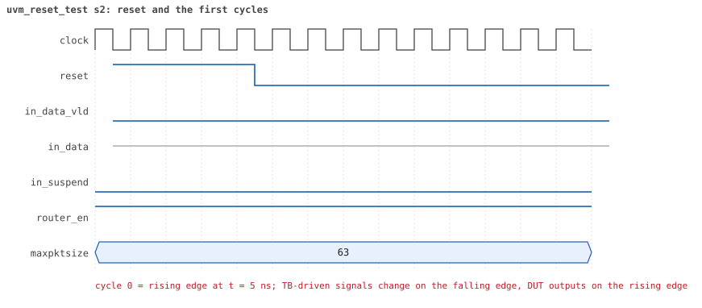
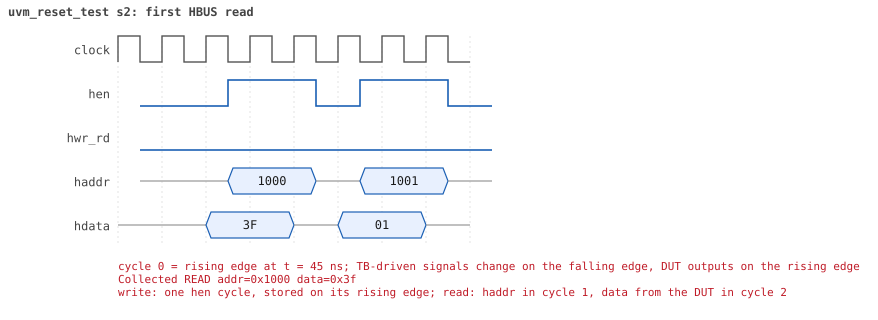

# uvm_reset_test  seed 2

**Result:** PASSED (0 UVM_ERROR, 0 UVM_WARNING, 0 UVM_FATAL) · bench `yapp_project_tb` · sim time 520ns · log `uvm_reset_test_s2.log`

Waves: `uvm_reset_test_s2.fst` (GTKWave, Surfer or the VS Code wave viewer); signal trace: `signals.csv`.
[Open the waves in Surfer](https://app.surfer-project.org/?load_url=https%3A%2F%2Fraw.githubusercontent.com%2Ftamirgabgab%2FQcom-Mentoring%2Fmain%2Fyapp_project%2Fregression%2Fyapp_project_tb%2Fuvm_reset_test_s2%2Fuvm_reset_test_s2.fst&startup_commands=run_command_file_from_url%20https%3A%2F%2Fraw.githubusercontent.com%2Ftamirgabgab%2FQcom-Mentoring%2Fmain%2Fyapp_project%2Ftb%2Fyapp_router.sucl) (web app, the signals already in groups: `yapp_project/tb/yapp_router.sucl`).

## Summary

- YAPP driver sent **0** packet(s) (0 with bad parity); the input monitor saw 0.
- Router: **0** forwarded, **0** dropped.
- Packets out: ch0 **0**, ch1 **0**, ch2 **0**.
- Scoreboard: 0 matched, 0 mismatched, 0 unexpected.
- Back-pressure: in_suspend asserted **0** time(s).
- Error pulses: 0.
- HBUS: 0 write(s), 9 read(s).

## Stages

| time (ns) | stage |
|---|---|
| 0 | uvm_reg_hw_reset_seq: read every register through the front door and compare with its reset value |

## Pictures

**reset and the first cycles**

**first HBUS read**

## Timeline

38 events (the same list is in `timeline.csv`).

| time (ns) | who | event |
|---|---|---|
| 0 | yapp monitor | YAPP monitor running |
| 0 | **test** | STAGE: uvm_reg_hw_reset_seq: read every register through the front door and compare with its reset value |
| 0 | clk/rst driver | Starting clock (period 10) and holding reset for 5 cycles |
| 0 | **DUT** | RESET asserted |
| 50 | **DUT** | RESET released: router_en=1 maxpktsize=63 |
| 80 | hbus driver | Executed READ  addr=0x1000 data=0x3f |
| 85 | hbus monitor | Collected READ  addr=0x1000 data=0x3f |
| 110 | hbus driver | Executed READ  addr=0x1001 data=0x01 |
| 115 | hbus monitor | Collected READ  addr=0x1001 data=0x01 |
| 140 | hbus driver | Executed READ  addr=0x1004 data=0x00 |
| 145 | hbus monitor | Collected READ  addr=0x1004 data=0x00 |
| 170 | hbus driver | Executed READ  addr=0x1005 data=0x00 |
| 175 | hbus monitor | Collected READ  addr=0x1005 data=0x00 |
| 200 | hbus driver | Executed READ  addr=0x1006 data=0x00 |
| 205 | hbus monitor | Collected READ  addr=0x1006 data=0x00 |
| 230 | hbus driver | Executed READ  addr=0x1009 data=0x00 |
| 235 | hbus monitor | Collected READ  addr=0x1009 data=0x00 |
| 260 | hbus driver | Executed READ  addr=0x100a data=0x00 |
| 265 | hbus monitor | Collected READ  addr=0x100a data=0x00 |
| 290 | hbus driver | Executed READ  addr=0x100b data=0x00 |
| 295 | hbus monitor | Collected READ  addr=0x100b data=0x00 |
| 320 | hbus driver | Executed READ  addr=0x100d data=0x00 |
| 325 | hbus monitor | Collected READ  addr=0x100d data=0x00 |
| 520 | ch0 monitor | Channel 0 report: 0 packets collected |
| 520 | ch1 monitor | Channel 1 report: 0 packets collected |
| 520 | ch2 monitor | Channel 2 report: 0 packets collected |
| 520 | hbus monitor | HBUS report: 0 writes, 9 reads |
| 520 | coverage | HBUS address coverage: 9 accesses sampled, coverage 24.7% |
| 520 | coverage | HBUS register bits coverage: 0 writes to ctrl_reg/en_reg, coverage 0.0% |
| 520 | coverage | HBUS counter value coverage: 6 counter reads sampled, coverage 48.1% |
| 520 | coverage | HBUS yapp_mem data coverage: 0 accesses sampled, coverage 0.0% |
| 520 | reference |  |
| 520 | scoreboard |  |
| 520 | yapp driver | YAPP driver report: 0 packets sent |
| 520 | coverage | YAPP gap coverage: 0 gaps sampled, coverage 0.0% |
| 520 | yapp monitor | YAPP monitor report: 0 packets collected, 0 with bad parity |
| 520 | yapp monitor | YAPP gaps: 0 back to back, 0 of 1 cycle, 0 of 2, 0 longer |
| 520 | coverage | YAPP packet coverage: 0 packets sampled, coverage 0.0% |
